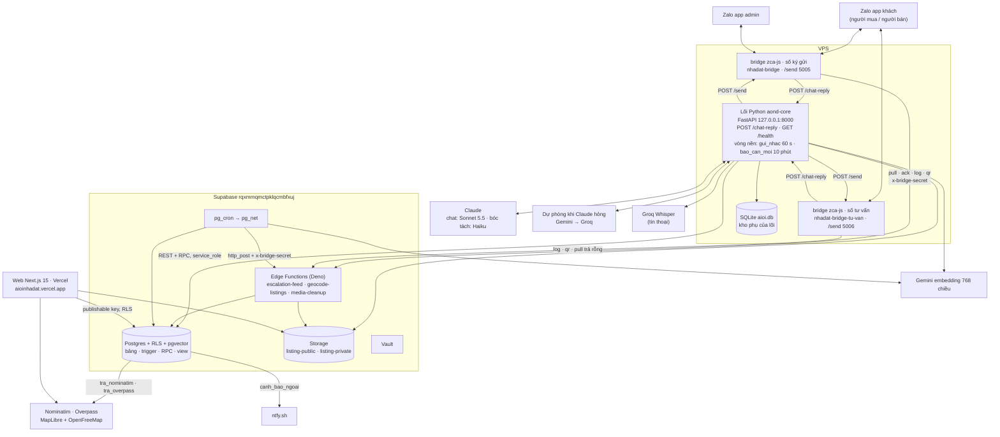
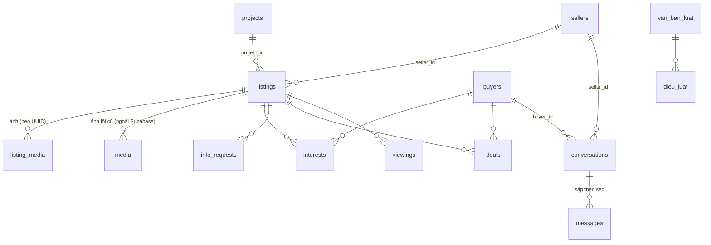
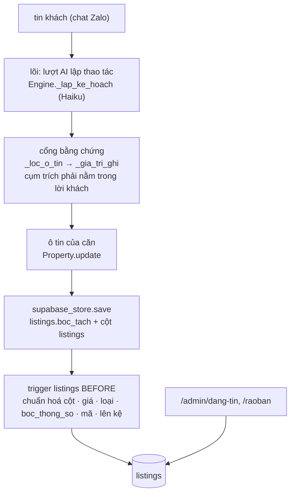

# 07 — Software Requirements Specification

**Hệ thống**: Aioinhadat (AI Ơi Nhà Đất) × nhadat.cc · **Phiên bản**: v3.0 · **Ngày**: 2026-10-28
**Cơ sở**: `02-requirements.md`, `03-user-flows.md`, `04-information-architecture.md`,
code ở HEAD (`src/aioi/`, `bot/`, `app/`) và DB thật project **`rqxmmqmctpklqcmbfxuj`** (Tokyo, gói Free).
Project cũ `tbcdpupiarkuxtntmosl` bị xoá nhầm 08/10/2026; mã đó chỉ còn trong các mục lịch sử.

Tài liệu này tả **hệ thống như đang chạy**. Nguồn của mọi khẳng định là code
trong repo và DB thật. v3.0 viết lại §1, §2, §4 theo kiến trúc lõi Python
(chủ dự án 28/10/2026: "Kiến trúc đúng — bỏ"; "bỏ hẳn CTV đi") `[nguồn: chủ dự án 28/10/2026, chat]`.
§3 chỉ sửa chỗ nhắc bảng đã gỡ và CTV. Các mục `SRS-5.1…` ở §5 là nhật ký sửa, giữ nguyên.
Mục thiết kế chưa dựng chỉ còn một dòng "Không dựng — thay bằng …" để giữ ID
cho `08-traceability.md`.

---

## 1. Giới thiệu

### 1.1 Mục đích
Đặc tả phần mềm đang vận hành để nghiệm thu (`§7`), kiểm thử (`docs/10`) và
mở rộng mà không lệch khỏi yêu cầu ở `02-requirements.md`.

### 1.2 Phạm vi hệ thống

| Mã | Phân hệ | Đường thật |
|---|---|---|
| `WEB` | Website công khai | Next.js ở root repo: `/`, `/[tag]`, `/mua-ban`, `/cho-thue`, `/nha-dat/[code]`, `/du-an`, `/du-an/[slug]`, `/ban-do`, `/moi-gioi`, `/thong-ke`, `/ds/[token]`, `/raoban`, `/tai-khoan`, `/yeu-thich`, `/tinh-lai-vay` |
| `BOT` | Bộ não hội thoại (B và S) | Lõi Python `src/aioi/` trên VPS (`aond-core.service`, cổng 8000), endpoint `POST /chat-reply`; một lõi cho cả người mua lẫn người bán, vai theo ý định từng lượt (SRS-5.1zzzzzzz153) |
| `KENH` | Kênh Zalo | Bridge `zca-js` 2.2.0 (`bot/bridge-zca/index.mjs`) trên tài khoản Zalo cá nhân (clone), HAI tiến trình: số ký gửi (`nhadat-bridge.service`) và số tư vấn người mua (`nhadat-bridge-tu-van.service`, `SO_NHAN=tu_van`) (SRS-5.1zzzzzzz210). Zalo OA không dùng |
| `SEL` | Phía người bán | Cùng lõi, nhánh bán; `/quan-ly` + `/dang-nhap` cho NMG trên web |
| `ADM` | Admin | `/admin`, `/admin/tin-nhan`, `/admin/cau-chuan`, `/admin/danh-gia`, `/admin/dang-tin`, `/admin/ro-hang`; việc nội bộ (câu khách hỏi, lịch xem, cần người thật) đi thẳng admin qua `reminders` → `escalation-feed` → bridge; cảnh báo ntfy |

**CTV không còn là phân hệ** (chủ dự án 28/10/2026: "bỏ hẳn CTV đi"). Mọi việc từng giao CTV nay giao admin, hoặc chủ nhà
khi tin có chủ nhà trên hệ thống (SRS-5.1zzzzzzz165, SRS-5.1zzzzzzz170, SRS-5.1zzzzzzz172, SRS-5.1zzzzzzz173).
Tàn dư CTV còn trong DB / code, chưa dọn: bảng `ctvs`, view `ctv_ranks`, cột `ctv_id` ở `conversations` / `info_requests` /
`reminders` / `deals`, giá trị `assignee = 'ctv'`, hàm `chon_ctv` / `ctv_dang_ganh` / `ctv_sla_phut`, nhánh `ctv` của
`notify_info_request_escalation` / `info_request_sla_tick` cho dòng cũ, `la_nhan_vien` (`src/aioi/mua.py`) còn nhận Zalo ID CTV cho
lệnh `#mã: trả lời`, khối hạng CTV ở `/admin`. Dọn là việc riêng.

### 1.3 Tài liệu tham chiếu
`docs/00`…`docs/06`, `docs/09-open-issues.md`, `docs/10-ke-hoach-kiem-thu.md`, `docs/13-so-do-nhan-va-boc-tach.md` (sơ đồ một lượt chat),
`bot/bridge-zca/VPS.md` (vận hành VPS), `CLAUDE.md` §6 (luật đang áp, mỗi dòng kèm `SRS-…`).

---

## 2. Kiến trúc tổng thể

`[nguồn: src/aioi/server.py, src/aioi/engine.py, bot/bridge-zca/index.mjs, bot/bridge-zca/cai-vps.sh, bot/supabase/functions/, bot/supabase/schema.sql, 28/10/2026]`



Ba điều hay hiểu nhầm:
- **Bộ não chỉ có một: lõi Python.** Edge function `chat-reply`, `zalo-webhook`, `nudge`, `ask-seller`, `ctv-report`,
  `inbound-sweep` đã gỡ 18/10/2026 (SRS-5.1zzzzzzz31, SRS-5.1zzzzzzz46). Prompt chỉ ở `src/aioi/prompts.py`.
- **Tin chủ động cho khách do lõi gửi**, qua `POST /send` của bridge: nhắc `followup` / `sold` / `feedback` / `admin_reply`
  (`gui_nhac.py`, SRS-5.1zzzzzzz216), báo căn mới (`bao_can_moi.py`, SRS-5.1zzzzzzz150), nhắc người bán 5 phút (`followup.py`).
  Tin gửi đúng số khách đang nhắn (`Conversation.so_nhan`).
- **Tin nội bộ cho admin / chủ nhà** đi đường khác: trigger DB đẻ `reminders(kind = 'escalation' | 'report')`, bridge số ký
  gửi kéo qua `escalation-feed`, tin cho admin mở bằng `$$$$$ ` (SRS-5.1zzzzzzz134). Số tư vấn không nhận việc này.

### SRS-2.1 — Tech stack

`[nguồn: package.json, src/aioi/config.py, src/aioi/llm/, bot/bridge-zca/cai-vps.sh, bot/supabase/schema.sql; soát 28/10/2026]`

| Lớp | Công nghệ |
|---|---|
| Lõi hội thoại | Python, FastAPI (`src/aioi/server.py`), chạy `aond-core.service` tại `/opt/aond_core`, cổng 8000 (chỉ 127.0.0.1). Cài và khởi động lại bằng workflow `apply-migration.yml` ô `dung_lai = cai-vps` (`bot/bridge-zca/cai-vps.sh`) |
| Module lõi chính | `engine.py` (phiên chat, định tuyến bán / mua) · `prompts.py` (mọi prompt, `GIONG_VUI`, `AD_FORMAT`, `muc_phi`, `VUNG_NHAN_TIN`) · `schema.py` (`CORE_FIELDS`, `CORE_THEO_LOAI`, `FACETS`, `O_NOI_BO`) · `mua.py` (phía người mua) · `supabase_store.py` (kho Supabase) · `dia_danh.py` · `phap_ly.py` · `cau_mau.py` · `xung_ho.py` · `bao_can_moi.py` · `gui_nhac.py` · `lenh_zalo.py` · `anh_can.py` · `kho_anh.py` · `web.py` · `llm/` |
| Kho trạng thái | Supabase là nguồn chính (`SupabaseConversationStore`); SQLite `aioi.db` trên VPS là kho dự phòng khi thiếu khoá Supabase (`SqliteConversationStore`) |
| Kênh chat | Zalo cá nhân qua bridge `zca-js` 2.2.0 (ghim, SRS-5.1zzzzzzz177), tài khoản clone (quyết định chủ dự án 20/10/2026). Hai số: ký gửi và tư vấn (SRS-5.1zzzzzzz210). Bridge thả tim (`addReaction`), gửi ảnh qua `guiAnhQuaUrl` |
| AI chat | Claude **Sonnet 5.5** cho lượt trả lời khách thật (`MODEL_CHAT` trong `cai-vps.sh` → `AIOI_CHAT_MODEL`, SRS-5.1zzzzzzz235); ID thử theo `AIOI_CHAT_MODEL_THU` (SRS-5.1zzzzzzz234) |
| AI bóc tách | Claude Haiku (`AIOI_EXTRACT_MODEL`, mặc định `claude-haiku-4-5`): lượt lập thao tác, đọc ảnh |
| Dự phòng | `llm/du_phong.py`: Claude hỏng thì Gemini rồi Groq; mỗi lần gọi ≤ 15 s, cả vòng ≤ 40 s (SRS-5.1zzzzzzz117, SRS-5.1zzzzzzz133) |
| Prompt caching | Cắt chuỗi system ở `RANH_GIOI_CACHE` (`llm/base.py`); chỉ phần trước dấu có điểm cache (SRS-5.1zzzzzzz166, SRS-5.1zzzzzzz213) |
| Tìm theo nghĩa | Gemini `gemini-embedding-001`, 768 chiều. Câu khách nhúng lúc chat (`dia_danh.py`); dữ liệu nhúng bằng lịch `nhung-tick`, `nhung-dia-danh-tick`, `nhung-luat-tick`. RPC: `tim_nha` (vector `listings.nhung`), `tim_dia_danh_theo_nghia`, `tim_dieu_luat` |
| Tin thoại | Groq Whisper chép ra chữ trước khi vào lõi (`server.py`, `transcribe_voice_url`) |
| DB | Supabase Postgres, RLS trên mọi bảng, trigger + RPC `security definer`, `pgvector`. Lõi đọc / ghi bằng `service_role` qua REST |
| Serverless | 3 Edge Functions (Deno): `escalation-feed`, `geocode-listings`, `media-cleanup` (`§4`); `_shared/` còn `claude.ts`, `gate.ts`, `geocode.ts`, `tin_nhac.ts`, `extraction/` (`luat-tien.ts`, `luat-lien-he.ts`, `nhan.ts`, `ds-phuong.ts`, `tien-ich.ts`) |
| Lịch / HTTP nội bộ | `pg_cron` + `pg_net` (`net.http_post`). Lịch nhắc tên trong repo: `nhung-tick`, `nhung-dia-danh-tick`, `nhung-luat-tick`, `geocode-tick`, `ctv-sla-tick` (chạy `info_request_sla_tick`), `bot-health-tick`, `media-cleanup-tick`, dọn dữ liệu thử `don_du_lieu_thu()`. Số job thật đếm trong DB |
| Bí mật | `.env` lõi trên VPS (khoá Claude, Gemini `GEMINI_API_KEY`…`_4` lấy từ Vault qua `cai-vps`, Groq, service_role); Vault giữ `BRIDGE_SECRET` và khoá cho hàm DB, đọc qua `get_secret()` chỉ `service_role` |
| Kho file | Supabase Storage (SRS-5.1zzzzzzz56): `listing-public/<uuid tin>/` (ảnh căn, công khai), `listing-private` (sổ đỏ, giấy tờ, PDF, tệp dự án; signed URL). SharePoint / OneDrive đã bỏ |
| Web | Next.js 15 (App Router) + TypeScript + Tailwind 4, Bun, deploy Vercel từ root repo. Link bot gửi lấy từ `src/aioi/web.py` (`AIOI_SITE_URL`, mặc định `https://aioinhadat.vercel.app`) |
| Auth | Supabase Auth: Google OAuth + magic link email (NMG, admin, tài khoản B tự nguyện); không Zalo SSO |
| Bản đồ | MapLibre `maplibre-gl` 6.13.0 + nền OpenFreeMap, nạp qua `napMapLibre()` (`lib/ban-do.ts`), gom cụm `lib/cum-ghim.ts` (SRS-5.1zzzzzzz206, SRS-5.1zzzzzzz217). Toạ độ tin: từ điển `duong` trước, rồi Nominatim qua rpc `tra_nominatim`; tiện ích quanh tin qua rpc `tra_overpass` (SRS-5.1zzzzzzz152, SRS-5.1zzzzzzz224) |
| Cảnh báo | ntfy.sh (`canh_bao_ngoai`), `bot_health_tick` đọc `net._http_response` (NFR-18) |
| Quan trắc | `bot_errors` / `bot_health` / `bot_usage` / `bot_usage_model` + `/admin`; log lõi trên VPS chỉ ra journal từ mức `warning` (SRS-5.1zzzzzzz233); đọc bằng ô `doc-log-loi` |
| Kiểm thử | `bun run test:py` (pytest `tests/`, lõi Python) + `bun run kiem` (tsc, `kieu:bot`, build, `test:bot`, `test:rohang`, `truyvet`); bắn thử production bằng ID thử qua ô `ban-thu-*` của `apply-migration.yml` (`docs/10`) |

### SRS-2.2 — Đường giao tiếp S↔B

`[nguồn: src/aioi/mua.py, src/aioi/engine.py, src/aioi/gui_nhac.py, bot/supabase/schema.sql, 28/10/2026]` Một đường duy nhất, bằng bảng + trigger.
Không có HTTP giữa hai "side", không còn bước CTV.

1. Khách mua hỏi về căn → lõi ghi `info_requests(source = 'buyer_ask')` (`mua.py`). Trigger `route_info_request` giao:
   tin có chủ nhà trên hệ thống → `assignee = 'seller'`, hạn `chu_nha_han_gio()`; không có → `assignee = 'admin'` (migration `20261024a`, SRS-5.1zzzzzzz170).
2. Trigger `notify_info_request_escalation` sinh `reminders(kind = 'escalation')` cho người được giao, kèm mẫu "`#mã: câu trả lời`";
   bridge số ký gửi kéo qua `escalation-feed` rồi nhắn từ tài khoản clone. Chủ nhà quá hạn → nhắc admin ngay.
3. Người trả lời:
   - **Chủ nhà** đang chat với bot: lượt AI đọc ý thấy câu trả lời (`tra_loi_khach_hoi`) → `tra_loi_cau_hoi` đóng câu (`engine._handle`).
   - **Admin** nhắn "`#mã: …`" → `lenh_tra_loi` + `la_nhan_vien` + `tra_loi_theo_ma` (`engine._handle`, `mua.py`).
4. `info_requests.status = 'answered'` → trigger `info_request_bao_lai_khach` đẻ `reminders(kind = 'followup')` cho khách;
   **lõi gửi** qua `gui_nhac.py` (vòng `server._vong_gui_nhac`, 60 s, khung 8–20 giờ), câu mẫu `bao_tra_loi_chu_nha` (SRS-5.1zzzzzzz216).
5. Quá hạn: `info_request_sla_tick` (lịch `ctv-sla-tick`) nhắc admin. Lịch xem (`viewings`) đi thẳng admin (`viewings_bao_ctv_va_email`
   đặt `v_ctv := null`, SRS-5.1zzzzzzz165); admin trả lời `#mã: ok giờ` thì chốt lịch và báo khách.

[deprecated 28/10/2026 — bỏ CTV, chủ dự án] Bản v2.0 của mục này: giao CTV ít việc nhất, SLA 120 phút `ctv_sla_phut()`,
`chat-reply` nhánh `nguoi_noi_bo`, `nudge` gửi followup, vòng nhỏ giọt `ask-seller` / `ask_seller_drip()`. `chat-reply`, `nudge`,
`ask-seller`, `ask_seller_drip()`, `nguoi_noi_bo` đã gỡ; `ctv_sla_phut()` còn là tàn dư.

---

## 3. Mô hình dữ liệu

`[nguồn: information_schema + pg_constraint + pg_policies, DB 04/09/2026; soát lại theo bot/supabase/schema.sql 28/10/2026]`

> **Soát 28/10/2026.** `schema.sql` hiện có **45 bảng** `public`. Đã gỡ, mọi chỗ nhắc dưới đây là LỊCH SỬ: `listing_facts` (SRS-5.1zzzzzzz66,
> ô tin một nguồn `listings.boc_tach`), `required_facts` (`20261019g`, bộ câu hỏi nay ở `src/aioi/schema.py`), `bot_prompts`, `mau_cau`,
> `van_kich`, `inbound_ledger`, `inbound_events`, `ai_ghi_thu`, `ctv_daily_reports`, `du_an_can`, `du_an_tai_lieu`, `project_fact_phieu`
> (`20261018i`), `boc_tach_bong`, `ratings_log`, `project_facts`; trigger `listing_insert_drip`, `bao_tin_moi_khop`,
> `trg_conversations_assign_ctv` + hàm `assign_ctv_round_robin` (`20261025a`); view `listing_missing_facts`, `job_suc_khoe`.
> Bảng mới sau 08/10: `bot_usage_model`, `cau_chuan`, `cau_mau`, `danh_gia_ai`, `du_an_kien_thuc`, `giao_lo`, `kien_thuc_phap_ly`,
> `listing_noi_bo`, `van_ban_luat`, `dieu_luat`, `nhung_viec_luat`, `xa_tinh_khac`. CTV: bỏ hẳn (chủ dự án 28/10/2026), phần CTV còn
> trong DB là tàn dư chưa dọn (§1.2).
Khối: `cột:kiểu`, `!` = NOT NULL, `=` = default, `→` = FK. PK `uuid` trừ khi ghi khác. Enum thật:
`listing_deal(ban, cho_thue)`, `property_type(nha_pho, nha_cap4, chung_cu, dat, biet_thu, phong_tro, mat_bang, toa_nha, dat_nong_nghiep, dat_kinh_doanh, kho_xuong, chua_ro)` (4 loại sau thêm `20260909i`),
`seller_type(ccrb, nmg, unknown)`, `request_status(pending, answered, expired)`, `msg_sender(buyer, seller, bot, ctv, system, human)`,
`unit_status(con_ban, giu_cho, da_coc, da_ban)`.

### SRS-3.0 · Bản đồ 45 bảng và đường ghi ô tin

`[nguồn: pg_class + pg_description, DB 06/09/2026]`

Ba tháng sau mở lại repo, thứ mất trước tiên là *cái nào thuộc về cái nào*. Mục
này là bản đồ đó. Nó KHÔNG đẻ nguồn sự thật thứ hai: chú thích tương ứng đã nằm
trong chính DB (`comment on table/column`, migration `20260906b`), hiện ra ngay
dưới tên bảng trong Supabase Table Editor. Đây là bản in ra giấy của thứ đó.

**Năm nhóm, 45 bảng** (đếm `create table` trong `bot/supabase/schema.sql` 28/10/2026). Tiền tố `[NHÓM]` nằm ngay đầu chú thích mỗi
bảng (`comment on table` trong migration), nên Table Editor xếp A→Z mà mắt vẫn gom được theo việc. `bot_usage_model`, `chat_quota`,
`bridge_dang_nhap` xếp theo việc [giả định BA: chưa thấy dòng `comment on table` của ba bảng này trong migration].

| Nhóm | Bảng |
|---|---|
| `[RỔ HÀNG]` (14) | `listings` `media` `listing_media` `listing_noi_bo` (SRS-5.1zzzzzzz116) `media_cleanup_queue` `projects` `listing_views` `wards` (FR-209) `tien_ich` (FR-204) `duong` (FR-212) `phuong_cu` `quan_cu` (`20260930a`) `giao_lo` (SRS-5.1zzzzzzz43) `xa_tinh_khac` (SRS-5.1zzzzzzz128) |
| `[NGƯỜI & HỘI THOẠI]` (10) | `buyers` `sellers` `conversations` `messages` `interests` `info_requests` `viewings` `deals` `reminders` `danh_gia_ai` (SRS-5.1zzzzzzz104) |
| `[BOT & HÀNG ĐỢI]` (15) | `bot_errors` `bot_health` `bot_usage` `bot_usage_model` `chat_quota` `cau_chuan` (SRS-5.1zzzzzzz88) `cau_mau` (SRS-5.1zzzzzzz106) `nhung_viec` `nhung_viec_du_an` (FR-216) `nhung_viec_dia_danh` (`20260930a`) `nhung_viec_luat` `du_an_kien_thuc` (SRS-5.1zzzzzzz56) `kien_thuc_phap_ly` (SRS-5.1zzzzzzz176) `van_ban_luat` `dieu_luat` (SRS-5.1zzzzzzz231) |
| `[CTV]` (1, tàn dư) | `ctvs` — không còn vai CTV (chủ dự án 28/10/2026); `ctv_daily_reports` đã gỡ (`20261018i`) |
| `[HỆ THỐNG]` (5) | `admins` `app_config` `curated_lists` `property_events` `bridge_dang_nhap` (FR-201; một dòng mỗi số Zalo, SRS-5.1zzzzzzz210) |

**Quan hệ chính** — chỉ khoá ngoại thật, không vẽ luồng chạy:



Một hội thoại có thể gắn CẢ `seller_id` và `buyer_id` (một Zalo = một khách = một hội thoại, SRS-5.1zzzzzzz149). Khoá ngoại
`ctv_id → ctvs` còn ở `conversations`, `info_requests`, `reminders`, `deals` là tàn dư, không vẽ.

Ba chỗ hay hiểu nhầm, nói thẳng ở đây:

- **Không có bảng `buyer_preferences`.** Nhu cầu khách nằm ở cột
  `buyers.preferences` (jsonb).
- **Không có bảng câu hỏi theo loại BĐS.** Bộ câu hỏi theo loại chỉ ở `src/aioi/schema.py` (`CORE_FIELDS` theo nhóm,
  `CORE_THEO_LOAI` đè cho loại riêng, SRS-5.1zzzzzzz68). Bảng `required_facts` đã gỡ (`20261019g`).
- **`media` và `listing_media` là hai đời khác nhau.** `media` trỏ file NGOÀI Supabase (lối cũ). `listing_media` (FR-165) là ảnh
  trong Storage, neo `listings.id`; web đọc qua view `listing_photos_v`. Từ 09/09/2026 không còn `masterDB/` trên máy chủ dự án,
  rổ hàng đến từ tin rao thật qua chat và rổ mẫu `seed_thu` (SRS-5.1zzzzzzz167, SRS-5.1zzzzzzz168).

**Đường ghi ô tin — một nguồn `listings.boc_tach`** (SRS-5.1zzzzzzz66). Hình trạng hiện tại:



Không còn nhánh regex TS và `listing_facts`; luật bậc `bac_nguon()` đã gỡ khỏi DB. Ô chủ nhà nói riêng (`schema.O_NOI_BO`) ghi
bảng `listing_noi_bo`, không vào `boc_tach` công khai (SRS-5.1zzzzzzz116).

**Ranh giới bóc tách ⟂ AI có máy canh** (phần TS còn lại ở `bot/supabase/functions/`; lõi Python không thuộc bài này).
`bot/tests/ranh-gioi.mjs` (nằm trong `bun run test:bot`, nên chạy ở CI mỗi PR) chặn hai chiều: mã bóc tách tiền định
không được import SDK Anthropic / `claude.ts` / gọi RPC; tầng AI không được ghi
bảng nghiệp vụ, chỉ ba RPC đã khai tên (`get_secret`, `log_loi`, `cong_token`).
Bài có ca âm nên luật hỏng thì bài đỏ, không im.

**Đọc rổ hàng bằng mắt người:** view `ro_hang_ban` (20 cột thay cho 56, giá quy
ra tỷ, nhãn tiếng Việt, cột `canh_bao` chỉ đích danh trường nào là máy đoán).
`security_invoker = on`, `anon` bị revoke.

**Nhìn như Excel:** schema `so` (`20260907c`) tách riêng khỏi `public` để Table
Editor / Schema Visualizer không lẫn 38 bảng + 19 view ruột bot (đếm trên DB 18/09/2026). Hai view:
`so.ro_hang` — 9 cột đầu đúng thứ tự sheet Excel gốc Q5 (trong `masterDB/`) (stt · bán
hay thuê · vị trí · diện tích · giá · mô tả · SĐT · người bán), cột thêm xếp
sau, cả bán lẫn cho thuê; `so.nguoi_ban` — mỗi người bán một dòng, đếm tin;
`so.hoi_thoai` (`20260907g`) — log chat đọc được: lúc · ai · nội dung · phía bán/mua,
lọc theo `hoi_thoai` để đọc trọn một cuộc (nguồn `messages`, không SĐT).
PostgREST không phơi schema này, `anon`/`authenticated` bị revoke,
`security_invoker = on`. Khác Excel: cột SĐT là SĐT **người bán đã ký** (60/173
tin), DB không giữ SĐT theo tin (FR-104). `xuat_schema()` chỉ quét `public` nên
`so` không nằm trong `schema.sql`; dựng lại phải chạy thêm hai file migration
(`20260907c`, rồi `20260907f` — ô đọc một dòng: mô tả gộp xuống dòng thành
` · `, vị trí bỏ đuôi `, Quận 5, Hồ Chí Minh`, diện tích dấu phẩy thập phân)
[giả định BA: chấp nhận vì view không mang dữ liệu].

### SRS-3.1 · `listings`

```text
id:uuid!  code:text! unique ('BDS-Q5-0001', trigger listings_fill_code)  legacy_sst:int
seller_id:uuid→sellers  deal:listing_deal!=ban  status:text!=cho_thong_tin
district:text!='Quận 5'  ward:text  street:text  location_raw:text  lat,lng:numeric
property_type:property_type=chua_ro  project_id:uuid→projects  unit_code:text  unit_status:unit_status
area_m2,legal_area_m2,built_area_m2:numeric  frontage_m,length_m,rear_width_m:numeric
floors:int  floors_text:text  floor:int  bedrooms:int  bathrooms:int  direction:text
access_type:text  alley_width_m,distance_to_street_m:numeric
legal_status:text  has_completion:bool  planning_status:text
has_elevator,car_in_house,corner_lot,negotiable:bool  furnishing:text  year_built:int
price_raw:text  price_vnd:bigint  price_per_m2_vnd:bigint(generated)  rent_income_vnd:bigint
description:text  source:text!=import_excel  source_url,cc_link:text
property_type_source,price_source,ward_source:text!=suy_doan  specs_source:text
last_confirmed_at,last_interest_at:timestamptz  created_at,updated_at:timestamptz!
nhan:text[]!='{}' (FR-211, chỉ mục GIN, khoá theo từ điển `_shared/extraction/nhan.ts`; ghi qua RPC `them_nhan_tin`)
```
Soát 28/10/2026: khối trên là bản 04/09. `schema.sql` nay có 63 cột (SRS-5.1zzzzzzz140, OPEN-64): KHÔNG còn `legacy_sst`, `unit_status`,
`source_url`, `cc_link`, `specs_source`, `last_confirmed_at`; thêm `boc_tach` jsonb (ô tin một nguồn, đọc qua `o_boc_tach()`, SRS-5.1zzzzzzz66),
`can_chu_duyet`, `chu_duyet_at`, `gap`, `legacy_code`, `toa_do_muc`, `geocode_at`, `tien_ich_gan`, `tien_ich_at`, `nhung` / `nhung_md5` / `nhung_luc`
(vector cho `tim_nha`). RPC `them_nhan_tin` không còn trong `schema.sql`.
Bản đồ ánh xạ đầy đủ 67 cột (nghĩa, khách nói ví dụ, ghi từ đâu, fact liên quan, lọc ở đâu) + fact → cột + ma trận 12 loại BĐS:
`docs/anh-xa-du-lieu-listings.xlsx` (ảnh chụp 18/09/2026 từ `information_schema` + trigger + `required_facts` + 10 tin bắn thật; đổi schema thì phải làm lại — đã lệch: `required_facts` gỡ 19/10).

- CHECK `status ∈ {cho_thong_tin, dang_ban, dang_quan_tam, da_coc, da_chot, an}` (FR-139; `da_coc` có trong `schema.sql` 28/10); `access_type ∈ {mat_tien, hem_xe_tai, hem_xe_hoi, hem_xe_may, hem}`;
  `legal_status ∈ {so_hong_rieng, so_hong_chung, so_hong, hdmb, giay_tay}`; `furnishing ∈ {full, co_ban, khong}`; `bedrooms 1..20`;
  `*_source ∈ {suy_doan, chu_xac_nhan, admin}`; `specs_source ∈ {boc_mo_ta, admin, chu_xac_nhan}` (FR-164/172).
- Trigger BEFORE (theo tên, `schema.sql` 28/10): `trg_listings_chuan_hoa_cot` · `trg_listings_fill_property_type` (FR-150) · `trg_listings_price_vnd` (FR-154) ·
  `trg_y_listings_boc_thong_so` (FR-172) · `trg_z_listings_normalize_status` · `trg_zy_listings_chan_so` · `trg_zz_listings_dang_tin` (lên kệ, FR-144) ·
  `trg_listings_zz_doi_ma` · `trg_listings_zz_fill_code` · `trg_listings_zz_toa_do`.
  AFTER: `trg_listings_bao_can_da_chot` (FR-108), `trg_listings_day_ro_ccrb`, `trg_pe_listings` (FR-70).
  Đã gỡ: `listing_insert_drip` (FR-129, `20261018i`), `bao_tin_moi_khop` (FR-64, `20261025h`).
- Index lọc: `(deal, price_vnd)`, `(deal, status, access_type)`, `(deal, status, floors)`, `(district, status)`; unique partial `(project_id, unit_code)`.
- Policy: `anon_read_listings` chỉ `dang_ban | dang_quan_tam | da_chot`; `listings_own_read/insert` (NMG tin của mình); `listings_admin_read/update`.
- Luật: `area_m2` là diện tích chính (chung cư = tim tường), `legal_area_m2` là công nhận — hai cột khác nhau; `description` giữ nguyên văn
  câu rao, không trigger nào sửa (FR-91/153). [LỊCH SỬ] Luật bậc nguồn cho fact (`chu_xac_nhan` > `admin` > `suy_doan`, FR-163 a,
  FR-164 a) chạy trên `listing_facts` + `bac_nguon()`, cả hai đã gỡ; nay ô tin chỉ ghi điều khách nói qua cổng bằng chứng của lõi (SRS-5.1zzzzzzz73).

### SRS-3.2 · `property_events` — FR-70, FR-73

```text
id:bigserial  listing_id:uuid!→listings cascade  event_type:text!  buyer_id:uuid→buyers set null  at:timestamptz!=now()  meta:jsonb
```
- CHECK `event_type ∈ {view, asked, interest, photos, viewing, deal, match_sent, status}`; index `(listing_id, at desc)`, `(at desc)`; policy `property_events_admin_read`.
- Chỉ trigger `trg_property_event()` ghi (`ghi_su_kien_bds`, không bao giờ ném): `listing_views` → `view`, `info_requests` `buyer_ask` → `asked`,
  `interests` → `interest`, `viewings` → `viewing`, `deals` → `deal`, `reminders` match sent → `match_sent`, `listings` đổi `status` → `status`. `photos` chưa có nguồn sinh.
- `hot_score` (FR-73) = view `bds_hot` tính lúc đọc (số sự kiện 60 ngày), không có cột/job.

### SRS-3.3 · `buyers`

```text
id:uuid!  zalo_user_id:text unique  auth_user_id:uuid unique→auth.users  name:text  phone:text
preferences:jsonb='{}'  last_contact_at:timestamptz  notes:text  created_at:timestamptz!
```
- `preferences` = hồ sơ nhu cầu tích luỹ, nay do lõi ghi (`mua.py`, `BuyerLead`); `merge_buyer_prefs()` đã gỡ. Cờ tắt báo căn mới:
  `buyers.bao_can_moi` (SRS-5.1zzzzzzz175).
- `phone` chỉ khi B tự cung cấp ở luồng đặt lịch (NFR-07); `/admin` không SELECT cột này. Policy `buyers_self_read/insert/update`, `buyers_admin_read`.
- Không có `connection_status`/`fingerprint_ids`: vết giữ chân ở `reminders.kind = reengage` (FR-63); fingerprint không dựng (OPEN-14).

### SRS-3.4 · `sellers`

```text
id:uuid!  zalo_user_id:text unique  auth_user_id:uuid unique→auth.users  phone:text unique  phone_proxy:text  name:text
seller_type:seller_type!=unknown  rating_sum:int!=0  rating_count:int!=0  active_listing_id:uuid→listings set null  created_at:timestamptz!
```
- `seller_type` quyết định phí (CCRB 1 %, NMG 0,5 %, FR-101). Hồ sơ mở từ chat do lõi tạo (`supabase_store._get_or_create_seller`);
  `mo_ho_so_nguoi_ban` đã gỡ. Vai chỉ nhận khi cụm trích GỌI TÊN vai (`_vai_co_bang_chung`, SRS-5.1zzzzzzz213). Khách chỉ ở vai mua
  không có dòng `sellers` (SRS-5.1zzzzzzz149).
- `active_listing_id` = căn bot đang hỏi (FR-157), trigger `info_request_set_active_listing` giữ. `ghi_danh_gia()` đã gỡ; khách chấm sao
  cho AI ghi bảng `danh_gia_ai` (SRS-5.1zzzzzzz104).
- Policy `sellers_self_read/insert`, `sellers_admin_read/update`. Không có `fee_rate`, `email`, `contract_status`.

### SRS-3.5 · `conversations`, `messages` — FR-71, FR-72, FR-131, FR-141

```text
conversations  id:uuid!  buyer_id:uuid→buyers  seller_id:uuid→sellers  ctv_id:uuid→ctvs  channel:text!=zalo_oa  started_at:timestamptz!
               last_message_at:timestamptz  needs_human:bool!=false  needs_human_at,human_touch_at,human_escalated_at:timestamptz
messages       id:uuid!  conversation_id:uuid!→conversations  sender:msg_sender!  body:text!  zalo_msg_id:text unique  seq:bigint! unique  created_at:timestamptz!
```
- CHECK `conversations_co_vai_check` (`buyer_id` HOẶC `seller_id`, được cả hai — SRS-5.1zzzzzzz149; bản cũ là XOR `conversations_mot_vai`);
  unique partial `(buyer_id)`, `(seller_id)` — **một hội thoại/khách, không bao giờ đóng** (FR-131). Lõi ghi / đọc qua
  `supabase_store._hoi_thoai_chung` / `_tim_hoi_thoai`. Cột `ctv_id` là tàn dư. Thêm `human_hold` (admin giữ hội thoại, SRS-5.1zzzzzzz82).
  "Cuộc trò chuyện" 30 phút của FR-72 tính lúc đọc ở view `hoi_thoai_phien`.
- Trigger: `conversations_email_upset` (`needs_human` false→true → `[UPSET]`); `assign_ctv_round_robin` đã gỡ (`20261025a`, SRS-5.1zzzzzzz172);
  `messages_bump_last_message` giữ `last_message_at = greatest(cũ, mới)` — ứng dụng không ghi tay (FR-171 h).
- `seq` là thứ tự tất định (FR-162). Policy chỉ `*_admin_read`; lõi ghi bằng `service_role`.

### SRS-3.6 · `info_requests` — FR-40…FR-44, FR-76, FR-110, FR-140, FR-173

```text
id:uuid!  listing_id:uuid!→listings cascade  buyer_id:uuid→buyers  question:text!  answer:text  status:request_status!=pending
source:text!=seller_flow  assignee:text  ctv_id:uuid→ctvs  sla_due_at,sla_missed_at,reminded_at,answered_at:timestamptz  created_at:timestamptz!
```
- CHECK `assignee ∈ {seller, ctv, admin}` — `ctv` chỉ còn ở dòng cũ; dòng mới là `seller` hoặc `admin` (`route_info_request`, `20261024a`).
  `source ∈ {seller_flow, buyer_ask}` (theo code); index partial `(sla_due_at) where pending and sla_missed_at is null`. Cột `ctv_id` là tàn dư.
- Trigger: `route_info_request` (BEFORE, giao chủ nhà hoặc admin + hạn), `notify_info_request_escalation` (bỏ qua `xac_nhan_lich`/`con_ban`),
  `info_request_bao_lai_khach` (`answered` → followup; `xac_nhan_lich` → `viewings.status='confirmed'`), `huy_nhac_khi_da_tra_loi`,
  `info_request_set_active_listing`, `trg_info_request_thong_bao_khach_hoi`, `trg_pe_info_requests`.
- `question` với `buyer_ask` là chữ tự do. [LỊCH SỬ] `seller_flow` từng mang `fact_key` của `required_facts` và câu trả lời vào cột qua
  `listing_facts_sync_cols`; cả hai đã gỡ. Policy `info_requests_admin_read`.

### SRS-3.7 · `viewings` — FR-50…FR-57, FR-65

```text
id:uuid!  listing_id:uuid→listings  listing_code:text  buyer_id:uuid→buyers  guide:text  slot:timestamptz  time_text:text  phone:text
status:text!=proposed  buyer_rating:int  note:text  source:text=bot  created_at:timestamptz!
```
- CHECK `status ∈ {proposed, pending, confirmed, done, cancelled}`; `buyer_rating 1..5`; `viewings_can_neo` (`listing_id` hoặc `listing_code`).
- INSERT → `viewings_bao_ctv_va_email`: nhắc **admin** ngay (`v_ctv := null`, `20261023g`, SRS-5.1zzzzzzz165; tên hàm còn chữ "ctv" là tàn dư),
  mở câu `xac_nhan_lich` (`buyer_ask`), `email_admin('VIEWING')` (FR-52/57/81).
- Nhắc trước giờ xem = `reminders.kind='viewing'` kèm link bản đồ khi có toạ độ (FR-54); `viewing` sent → `feedback` +4 h (FR-56), lõi gửi
  (`gui_nhac.py`). `ghi_danh_gia()` đã gỡ. Số điện thoại khách ghi `viewings.phone` khi chốt lịch (`mua.ghi_sdt_hen_xem`, SRS-5.1zzzzzzz148).
- `phone` chỉ điền khi B đồng ý ở bước này (NFR-07). Policy `viewings_admin_read`.

### SRS-3.8 · `interests`, `listing_facts`, `deals` — FR-108, FR-112, FR-140, FR-153

```text
interests      buyer_id:uuid!→buyers cascade  listing_id:uuid!→listings cascade  created_at:timestamptz!   (PK cặp)
listing_facts  [ĐÃ GỠ 19/10/2026, SRS-5.1zzzzzzz66 — ô tin một nguồn listings.boc_tach]
deals          id:uuid!  listing_id:uuid!→listings  buyer_id:uuid→buyers  ctv_id:uuid→ctvs (tàn dư)  price_vnd:bigint  fee_pct:numeric  closed_at  created_at
               unique nulls not distinct (listing_id, buyer_id)
```
- `interests`: `mark_listing_interest(codes, buyer_id)` ghi cho mọi căn khách nhắc/bot gợi/xin hình/nhờ hỏi chủ; tin sang `da_chot` → mỗi khách
  trong `interests` nhận `reminders.kind='sold'` (FR-108), lõi gửi (`gui_nhac.py`). Khách chê căn → `interests.trang_thai = khong_hop`
  (SRS-5.1zzzzzzz175), kèm `ly_do`.
- [LỊCH SỬ] `listing_facts` / `ghi_fact_listing()` / `listing_facts_sync_cols`: đã gỡ. Ô chủ nhà nói riêng nằm ở `listing_noi_bo` (chỉ admin).
- `deals`: căn cứ phí (`fee_pct` null khi chốt lúc `unknown`, OPEN-28); `deals_chan_xoa_da_chot` cấm xoá deal đã chốt.
- Bất biến ẩn danh (FR-104/105): view/policy công khai không bao giờ trả `phone`, `zalo_user_id`, số nhà; trong hội thoại bot khai mọi thứ đã lưu
  về căn trừ liên hệ người bán (OPEN-36). [LỊCH SỬ] `locLienHe()` là hàm của `chat-reply` TS đã gỡ; luật che liên hệ còn ở
  `_shared/extraction/luat-lien-he.ts` (web dùng).

### SRS-3.8a · Hai luật chữ nghĩa bắt buộc

`[nguồn: chat-reply v48 — LỊCH SỬ; luật chữ nghĩa còn áp cho dữ liệu]`
- **`deal` có hai bảng từ vựng**: cột `listings.deal` = `ban | cho_thue`; JSON `buyers.preferences` và schema model = `ban | thue`. Bản TS dùng `dealCol()` (FR-163, đã gỡ cùng `chat-reply`); lõi Python phải tự giữ đúng hai bảng này.
- **Không đặt `\b` cạnh chữ tiếng Việt có dấu** — `\w` của JS chỉ là ASCII. Tự dựng biên (`(^|[^a-zà-ỹ])…(?![a-zà-ỹ])`) hoặc khớp trên bản bỏ dấu `boDau()` (FR-161).

### SRS-3.8b · Bảng phụ trợ

```text
curated_lists        id:uuid!  token:text! unique =24 hex  buyer_id:uuid→buyers set null  listing_ids:uuid[]! (1..60)  title  created_at
                     expires_at:=now()+30 ngày                                    -- FR-100; RLS, không policy; đọc/tạo qua RPC (SRS-4.3)
listing_media        id:uuid!  listing_id:uuid!→listings cascade  bucket:text!  storage_path:text!  media_type:text!  mime_type:text!
                     sort_order:int!=0  is_cover:bool!=false  created_at         -- FR-165
                     CHECK bucket ∈ {listing-public, listing-private}; media_type ∈ {mat_tien, trong_nha, hem, so_do, giay_to, khac};
                     so_do/giay_to ⇒ bucket riêng; is_cover ⇒ bucket công khai; storage_path bắt đầu '<listing_id>/'; unique (bucket, storage_path);
                     unique partial một bìa/tin; trigger listing_media_giu_bia, listing_media_xep_hang_don (→ media_cleanup_queue)
media_cleanup_queue  id:uuid!  bucket,storage_path:text!  trang_thai:text!=cho ∈ {cho, dang_lam, xong, loi, chet}  attempts:int!=0  last_error
                     next_retry_at  created_at  updated_at                          -- FR-165 e, FR-166 g
inbound_events       [ĐÃ GỠ 18/10/2026, 20261018i] -- FR-162
inbound_ledger       [ĐÃ GỠ 18/10/2026, 20261018i] -- FR-162, FR-166
reminders            id:uuid!  kind:text! ∈ {promise, reengage, viewing, followup, escalation, report, match, feedback, sold, rating, admin_reply}
                     buyer_id  seller_id  ctv_id (tàn dư)  listing_id  viewing_id (FK cascade)  due_at:timestamptz!  note:text
                     status:text!=pending ∈ {pending, sent, cancelled, dead}  sent_at  locked_at  locked_by  attempts:int!=0  next_retry_at  last_error
                     unique partial: (buyer_id, listing_id) match; (buyer_id, listing_id) sold; (viewing_id) feedback; (buyer_id) reengage pending
                     -- FR-32/60…64/108/110/133/166 f; policy reminders_admin_read/update
                     -- 28/10: lõi gửi followup / sold / feedback / admin_reply (gui_nhac.py, SRS-5.1zzzzzzz216); escalation / report đi escalation-feed;
                     --        match là sổ báo căn mới của lõi (bao_can_moi.py, SRS-5.1zzzzzzz150)
ratings_log          [ĐÃ GỠ] -- FR-65; khách chấm sao AI nay ở danh_gia_ai (SRS-5.1zzzzzzz104)
ctvs                 id:uuid!  name:text!  zalo_user_id unique  phone  active:bool!=true  last_assigned_at  created_at   -- FR-136/173; TÀN DƯ, không còn vai CTV (28/10/2026)
ctv_daily_reports    [ĐÃ GỠ 18/10/2026, 20261018i] -- FR-137
required_facts       [ĐÃ GỠ 19/10/2026, 20261019g] -- FR-153/177; bộ câu hỏi theo loại nay ở src/aioi/schema.py (CORE_FIELDS, CORE_THEO_LOAI)
listing_views        auth_user_id:uuid!→auth.users  listing_id:uuid!→listings  viewed_at; policy views_own_all   -- FR-126
admins               email:text! PK  zalo_user_id  zalo_phone; policy admins_self_read
app_config           key PK  value!  ghi_chu  (admin_email, ntfy_topic, functions_base_url, storage_public_base_url, publishable_key)
bot_prompts          [ĐÃ GỠ 18/10/2026, 20261018i] -- FR-138; prompt chỉ ở src/aioi/prompts.py
cau_mau / cau_chuan  câu bot nói nguyên văn (đè `cau_mau.MAC_DINH`) / câu chuẩn người chấm sửa làm ví dụ -- SRS-5.1zzzzzzz106, SRS-5.1zzzzzzz88; sửa ở /admin/cau-chuan
wards                ten:text! PK (tên MỚI không tiền tố, khoá tra Nominatim)  loai! ∈ {phuong, xa, dac_khu}  ten_day_du!  quan_cu! ("Quận 9" — chuỗi bocQuan/mã tin)
                     don_vi_2025:text[]!  tinh_cu! ∈ {TP.HCM, Bình Dương, Bà Rịa – Vũng Tàu}  don_vi_cu  lat,lng:numeric(9,6)  ma_hanh_chinh  nguon!  ghi_chu  created_at
                     -- FR-209 / FR-174 đợt 2 (20260915a): 168 dòng, nguồn NQ 1685 + Wikipedia; RLS bật, revoke anon/authenticated, chỉ service_role; xuat_schema() KHÔNG xuất dữ liệu → dựng lại chạy thêm migration
                     nhung:vector(768)  nhung_md5  nhung_luc   -- 20260930a: vector nghĩa (Gemini) của van_ban_dia_danh('wards', ten); cron nhung-dia-danh-tick
duong                id:uuid PK  ten:text! (có dấu, không tiền tố "Đường")  ten_khong_dau:text (generated: bo_dau(ten), index)  tinh! ∈ {TP.HCM, Tây Ninh, Đồng Nai} (tỉnh MỚI)
                     tinh_cu ∈ {TP.HCM, Bình Dương, Bà Rịa – Vũng Tàu}  phuong:text!='' (wards.ten_day_du)  quan_cu  nguon!  created_at; unique (ten, tinh, phuong)
                     -- FR-212 (20260921b): từ điển tên đường từ OSM/Overpass theo phường mới; RPC tim_duong(ten, quan, toi_da) khớp đúng/gần (fuzzystrmatch); chỉ service_role; dữ liệu nạp bằng scripts/nap-duong.mjs
                     loai ∈ {duong, so, hem}  so_hem ('137', '137/28')  duong_me  lat,lng (tâm OSM)  nhung:vector(768) (không nhúng hẻm)  nhung_md5  nhung_luc   -- 20260930a: giữ đường số + hẻm có toạ độ (nap-duong.mjs out center)
phuong_cu            id PK  ten! ('Phường 12', 'Phường Thảo Điền')  loai ∈ {phuong, xa, thi_tran}  quan_cu!  phuong_moi!→wards.ten  toan_bo!  lat,lng (tâm phường mới)  nhung  -- 20260930a: 487 dòng tách từ wards.don_vi_cu; unique (ten, quan_cu, phuong_moi)
quan_cu              ten PK ('Quận Gò Vấp')  lat,lng (trung bình tâm phường mới)  so_phuong_moi  nhung  -- 20260930a: quận / huyện / TP cũ trước 07/2025
media                bảng cũ đường OneDrive, còn policy anon đọc ảnh approved, không còn nguồn ghi — dọn cùng OPEN-18
```
- Không dựng: `tags`/`property_tags` (tag là hằng `lib/tags.ts`, 64 tag, FR-12; OPEN-06), `saved_criteria` (FR-64 đọc `buyers.preferences`),
  `escalations` (bốn loại đi `email_admin()`; vết việc ở `reminders`/`viewings`/`info_requests`), `photos` (thay bởi `listing_media`).

### SRS-3.9 · Bảo mật dữ liệu

`[nguồn: pg_policies, pg_class.relacl, storage.policies, DB 04/09/2026]` Anon key là khoá **công khai** (trong bundle JS và bridge) nên RLS + GRANT là bức tường duy nhất:

1. Vai `anon` chỉ SELECT; `authenticated` ghi có policy gác (`buyers`, `sellers`, `listings` nháp, `listing_views`, `listing_media` tin của mình); không ai có TRUNCATE (FR-167).
2. Bảng chỉ cho bot (`conversations`, `messages`, `info_requests`, `viewings`, `deals`, `interests`, `ctvs` (tàn dư), `listing_noi_bo`,
   `curated_lists`, `media_cleanup_queue`, `app_config`; bản 04/09 còn `ctv_daily_reports`, `bot_prompts`, `required_facts`, `inbound_*`,
   `ratings_log` — đã gỡ) bật RLS, chỉ policy đọc cho admin hoặc không policy — anon 0 dòng; cảnh báo `rls_enabled_no_policy` là kỳ vọng.
3. Hàm là nội bộ trừ khi chứng minh ngược lại: EXECUTE mặc định chỉ `service_role`/`postgres`; ngoại lệ cố ý là hàm thuần `immutable` (`bo_dau`, `boc_thong_so`,
   `khu_khop`, `seller_rank`, `chuan_hoa_*`…; `bac_nguon` đã gỡ), `log_loi` (web Next chạy bằng publishable key), `doc_danh_sach` (anon), và cho `authenticated`:
   `admin_dang_tin`, `tao_danh_sach`, `la_admin`, `tin_cua_toi`, `thu_muc_dau_uuid`, `parse_vnd`, `guess_property_type`. Mọi hàm ghim `search_path`.
4. View công khai phải là **SECURITY DEFINER tự chứa** (`agents_public`, `listing_photos_v`), chỉ lộ cột không định danh, chỉ tin đã lên kệ; view không dùng cho anon
   để `security_invoker` và revoke (`public_listings`, `public_media`, `media_mo_coi_*`; `listing_missing_facts`, `job_suc_khoe` không còn trong `schema.sql` 28/10).
   View admin (`ctv_ranks` — tàn dư CTV, `nmg_hoat_dong`, `bds_hot`, `hoi_thoai_*`, `khach_can_nguoi_that`; `bot_do_tre` không còn trong `schema.sql` 28/10) gác `auth.role() = 'service_role'` hoặc email trong `admins` (FR-167 c).
5. Vault không chạm anon: `get_secret()` chỉ `postgres`/`service_role`.
6. Storage: `listing-private` không có route public; đọc duy nhất bằng signed URL 900 s do admin ký ở `/admin` (`storage_admin_private_all`, NFR-06). Bucket công khai:
   `storage_admin_public_all`; người bán chỉ INSERT/DELETE đường dẫn có thư mục đầu = UUID tin của mình (`tin_cua_toi(thu_muc_dau_uuid(name))`, FR-96).
   `listing_media` công khai chỉ đọc được khi TIN đã lên kệ (`listing_media_doc_cong_khai`, FR-167 c).
7. Cổng edge function (`_shared/gate.ts`): 3 function còn lại (`escalation-feed`, `geocode-listings`, `media-cleanup`) qua nếu `Authorization` là service key hoặc header `x-bridge-secret` khớp `BRIDGE_SECRET`; chưa đặt secret thì
   fail-open nhưng ghi `bot_errors` nguồn `<function> CONG MO`; bí mật đọc qua `secretOf()` (env trước, Vault sau). Mọi hàm SQL gọi `net.http_post` tới function
   phải mang `x-bridge-secret`, trừ `canh_bao_ngoai` (FR-151 b, FR-167 b).
8. [deprecated 28/10/2026] `zalo-webhook` đã gỡ (SRS-5.1zzzzzzz46); không còn cửa Zalo OA. Lõi `aond-core` chỉ nghe 127.0.0.1, bridge gọi
   trong cùng máy; `/send` của bridge cũng chỉ nghe 127.0.0.1.

Hồi quy: TS-SEC-01…10, TS-SEC2 (`docs/10`) sau mọi migration đụng RLS/GRANT.

### SRS-3.10 · `projects` — FR-113…FR-117

```text
id:uuid!  name:text!  slug:text unique  developer  district  ward  province  location_raw  lat,lng:numeric  legal_status  amenities:jsonb
floor_plans:jsonb  images:jsonb  specs:jsonb  unit_types:jsonb  description  price_min,price_max:bigint  priority:int!=100  is_partner:bool!=false
handover_date:date  handover:text  status_text  source  source_url  created_at  updated_at
```
- `listings.project_id/unit_code/floor/direction/unit_status` nối căn với dự án; unique partial `(project_id, unit_code)`. Policy `anon_read_projects` (true); `match_projects(text)` tìm dự án khách nhắc.
- Luật thừa hưởng (FR-115/116): câu tầng dự án trả từ `projects`, không sinh `info_requests`; "căn X còn không" đọc `unit_status`; `last_confirmed_at` > 7 ngày hoặc null → "để em xác nhận lại chủ".
  Soát 28/10/2026: `listings.unit_status` và `listings.last_confirmed_at` không còn trong `schema.sql` (SRS-5.1zzzzzzz140). Kiến thức dự án lõi học
  được nằm ở `du_an_kien_thuc`; phía mua tra qua `supabase_store.tra_du_an` (SRS-5.1zzzzzzz184).

### SRS-3.11 · Tài khoản, admin và view quan trắc hội thoại — FR-124…FR-128, FR-71/74/76/77/78/80

- `sellers.auth_user_id`, `buyers.auth_user_id` nối Supabase Auth (Google OAuth + magic link). CCRB không cần tài khoản.
- `admins(email)`: mọi policy `*_admin_read/update` kiểm `exists (select 1 from admins where email = auth.jwt()->>'email')`. Thêm admin = insert email.
  Các bảng buyer side (`info_requests`, `viewings`, `buyers`, `conversations`, `messages`; `ctvs` là tàn dư) chỉ mở SELECT cho admin; ghi thuộc lõi / trigger / RPC admin.
- `agents_public` (definer, tự chứa): `id, name, seller_type, rating_sum, rating_count, listing_count, closed_count, rank` — không bao giờ `phone`/`zalo_user_id` (FR-125).
- `listing_views` (own-only) là nền "tin đã xem"; `TrackView` chỉ chạy khi có phiên đăng nhập.
- View admin: `hoi_thoai_thong_ke` (30 ngày theo ngày VN, FR-71), `khach_can_nguoi_that` (FR-77), `hoi_thoai_phien` (FR-72), `bds_hot` (FR-73); `bot_do_tre` (NFR-01) không còn trong `schema.sql` 28/10, thời gian lượt nay đo ở `thoi_gian_ms` của `/chat-reply`. `/admin` đọc bằng JWT admin, có CSV.
- Kỷ luật cột: DB quyết "ai đọc", web quyết "đọc cột nào" — `app/admin/page.tsx` không SELECT `buyers.phone`/`ctvs.phone` (NFR-07).

### SRS-3.12 · Bảng vận hành và hàm RPC — FR-146, FR-151, FR-152, FR-159, FR-166…FR-173

```text
bot_usage   day:date! PK (giờ VN)  model_calls:int!=0  capped_at  in_tokens,out_tokens,cache_write_tokens,cache_read_tokens:bigint!=0  -- FR-151 a, FR-169
bot_usage_model  day:date! model:text! PK(day,model)  calls:int!=0  in_tokens,out_tokens,cache_write_tokens,cache_read_tokens:bigint!=0  -- SRS-5.1zv/zw: chữ-máy + lượt theo model, /admin quy ra đô đúng giá từng model
bot_errors  id:bigserial  at:timestamptz!  source:text!  status_code:int  detail:text; index (at desc), (source, at desc)      -- FR-152
bot_health  who:text! PK  at:timestamptz!  last_id:bigint!=0                                                                    -- FR-152
```
Cả ba: RLS, policy `*_admin_read`, ghi chỉ `service_role`. `bot_errors` là sổ duy nhất còn lại khi log function (1 ngày, bậc Free) trôi — mọi `catch` phải nối `ghiLoi()`/`log_loi()` (FR-152 d).

> **Soát 28/10/2026** (đối chiếu `bot/supabase/schema.sql`): các hàm sau trong bảng dưới **không còn** — dòng nhắc chúng là LỊCH SỬ:
> `ensure_buyer_conversation`, `ensure_seller_conversation`, `mo_ho_so_nguoi_ban`, `nguoi_noi_bo`, `merge_buyer_prefs`, `ghi_fact_listing`,
> `tao_followup`, `ghi_danh_gia`, `bao_tin_moi_khop`, `info_request_timeout_tick`, `stale_listing_tick`, `seller_drip_tick`, `ask_seller_drip`,
> `trg_listing_drip`, `nudge_tick`, `ctv_report_tick`, `inbound_sweep_tick`, `bo_dem_nhac_treo`, `claim_inbound`, `bao_hong_inbound`,
> `viec_inbound_bo_roi`, `ghi_su_kien_inbound`, `nhan_viec_nhac`, `bao_hong_nhac`, `nha_viec_nhac`, `lan_thu_ke`, `ap_thong_so`,
> `listing_facts_sync_cols`, `chuan_hoa_lai_gia`, `guess_property_type_answer`, `listings_try_publish`, `listings_autopublish`,
> `seller_hoi_bu_tick`, `ghi_boc_tach`, `trg_fact_vao_boc_tach`, `trg_vi_tri_vao_cot`, `ngu_canh_tin`, `mau_cau_fewshot`, `bac_nguon`,
> `cat_truoc_phu_dinh`, `tim_phuong_theo_nghia`, `dia_danh_gan`, `duong_gan_duong`, `phuong_giao_hai_duong`, `tim_hem`, `them_nhan_tin`;
> view `listing_missing_facts`, `job_suc_khoe`. Hàm CTV còn (`ctv_sla_phut`, `chon_ctv`, `ctv_dang_ganh`, view `ctv_ranks`) là tàn dư.
> Hàm lõi Python gọi hiện nay: bảng RPC ở §4. Hàm mới đáng kể sau 08/10: `tim_nha`, `tim_dia_danh`, `tim_dieu_luat`, `tra_nominatim`,
> `tra_overpass`, `tim_moc`, `ban_do_khung`, `admin_gui_tin`, `giao_lo_cua`, `chuan_dia_ban`, `o_boc_tach`, `la_id_thu`, `reset_nguoi_test`.

`[nguồn: pg_proc + proacl, DB 04/09/2026]` Quyền: **SR** = chỉ `service_role`/`postgres`; **trig** = hàm trigger; **thuần** = ai cũng gọi được; **auth** = thêm `authenticated`; **anon** = mở cho web.

| Hàm / view | Việc | Quyền |
|---|---|---|
| `ensure_buyer_conversation` / `ensure_seller_conversation` | Mở/lấy hồ sơ + hội thoại duy nhất (advisory lock), trả kèm `ctv_id`, `human_touch_at` | SR |
| `mo_ho_so_nguoi_ban(zalo, seller_type)` / `nguoi_noi_bo(zalo)` | Mở `sellers` idempotent kèm nhãn, không ghi đè nhãn (FR-159) / tra CTV-admin (FR-173 d) | SR |
| `merge_buyer_prefs` / `ghi_fact_listing` / `mark_listing_interest` / `tao_followup` / `ghi_danh_gia` | Hồ sơ nhu cầu (FR-130) / cửa ghi fact duy nhất / `interests` + `dang_quan_tam` (FR-108/139) / followup +150' một lần/24 h (FR-32) / sao → `viewings` + `sellers.rating_*`, idempotent (FR-65) | SR |
| `can_cung_khu(buyer, listing, limit)` / `khu_khop` | 2–3 căn cùng phường/quận, giá 0,7–1,15×, trừ căn đã gửi (FR-62/108/110) | SR / thuần |
| `bao_tin_moi_khop` / `bao_can_da_chot` + trigger | Tin vừa `dang_ban` → `reminders.match` cho khách khớp, van 1/khách/24 h (FR-64) / tin `da_chot` → `reminders.sold` (FR-108) | SR / trig |
| `reminders_hen_hoi_cam_nhan` / `messages_bump_last_message` | `viewing` sent → `feedback` +4 h (FR-56) / giữ `last_message_at` (FR-171 h) | trig |
| `route_info_request` / `notify_info_request_escalation` / `info_request_bao_lai_khach` | Giao việc + SLA / nhắc người được giao / báo lại khách, lật lịch `confirmed` (FR-140, FR-173, FR-52) | trig |
| `viewings_bao_ctv_va_email` / `conversations_email_upset` / `reminders_email_voice` | `[VIEWING]` + nhắc CTV + câu `xac_nhan_lich` / `[UPSET]` / `[VOICE]` (FR-52/57/77/79/81) | trig |
| `email_admin(loai, uid, body, listing)` / `canh_bao_ngoai(title, text, priority, p_email)` | Ghép `[LOẠI] <uid>` → ntfy; `admin_email` rỗng → không gửi (FR-81) / `net.http_post` tới ntfy.sh, không qua bridge (FR-152 e) | SR |
| `info_request_sla_tick` / `info_request_timeout_tick` / `stale_listing_tick` | Quá 120' → admin + `[QUESTION]` (FR-173 c) / 24 h nhắc, 48 h `expired` + followup căn khác (FR-110) / tin im 30 ngày → hỏi `con_ban`, ≤ 5 tin/ngày (FR-103) | SR (cron) |
| `seller_drip_tick` / `ask_seller_drip` / `trg_listing_drip` | Gọi `ask-seller` hỏi nhỏ giọt, mang `x-bridge-secret` (FR-129/144) | SR / trig |
| `nudge_tick` / `ctv_report_tick` / `media_cleanup_tick` / `inbound_sweep_tick` | Gọi edge function tương ứng; chỉ gọi HTTP khi có việc (FR-166 d, FR-171 c) | SR (cron) |
| `bot_health_tick` / `beat(who)` / `bo_dem_nhac_treo(gio)` | Quét `net._http_response` không 2xx → `bot_errors`, nhịp tim bridge, gộp báo 1 tin/giờ, dọn sổ 30 ngày (FR-152, NFR-18) / nhịp tim / đếm nhắc treo | SR |
| `log_loi(source, detail, code)` / `bat_het_tien_api()` | Cửa ghi lỗi, van 20 dòng/nguồn/giờ, 200/giờ (FR-171 b) / dấu hiệu hết tiền AI → `HET TIEN API`, ghi thẳng, hãm 6 h (FR-168) | anon / trig |
| `bump_model_quota(limit)` / `cong_token(..., p_model)` | Trần lượt gọi model/ngày; cộng số chữ vào `bot_usage` (theo ngày) và `bot_usage_model` (theo ngày × model, SRS-5.1zv) (FR-151 a, FR-169) | SR |
| `claim_inbound` / `bao_hong_inbound` / `viec_inbound_bo_roi` / `ghi_su_kien_inbound` | Sổ idempotency tin đến: giành job atomic, 8 lần → `dead`, tìm việc bỏ rơi 24 h (FR-162, FR-166) | SR |
| `nhan_viec_nhac` / `bao_hong_nhac` / `nha_viec_nhac(id, worker)` | Hàng đợi nhắc: thuê 5' `skip locked`; hỏng → lùi dần, 5 lần `dead`; chưa thử → trả lại nguyên vẹn (FR-166 f) | SR |
| `nhan_viec_don_media` / `chon_viec_don_chet` / `lan_thu_ke(attempts)` | Hàng đợi dọn file `attempts < 6`; khoảng chờ nhân đôi, trần 1 h, nhiễu ±20 % (FR-165 e, FR-166) | SR |
| `boc_thong_so(text, type)` / `boc_ten_duong` / `ap_thong_so(listing, j, bac, de)` / `listings_boc_thong_so` | Bóc thông số (trên `bo_dau`) → cột theo luật bậc (FR-172) | thuần / thuần / SR / trig |
| `listing_facts_sync_cols` / `listings_fill_code` / `next_listing_code` | Fact → cột (SRS-3.14) / cấp mã tin chỉ trong trigger (FR-158, FR-167) | trig / trig / SR |
| `listings_set_price_vnd` / `parse_vnd` / `chuan_hoa_gia_raw` / `chuan_hoa_lai_gia` | Giá chữ → số (FR-154) | trig / auth / thuần / SR |
| `listings_fill_property_type` / `guess_property_type` / `guess_property_type_answer` | Loại BĐS từ mô tả; không đoán ra thì `chua_ro` (FR-150) | trig / auth / SR |
| `listings_quyet_dinh_dang_tin` / `listing_du_dang_tin` / `listings_try_publish` / `listings_autopublish` | Tự lên kệ khi đủ giá + m2 + phường (FR-144); tin từ chat (`can_chu_duyet`) còn cần `diem_tin ≥ 70` + `chu_duyet_at` (FR-177 d) | trig / thuần / SR |
| `diem_tin` / `seller_hoi_bu_tick` / `seller_drip_tick` / `ghi_boc_tach` / `trg_fact_vao_boc_tach` / `trg_vi_tri_vao_cot` | FR-177 f–h (`20260909a`): điểm 8 mục (ảnh 4/7/10 theo số tấm), hỏi bù 5 phút sau khi gật rồi nhịp 30 phút tới khi hết câu hoặc `listings.chu_noi_du_at`; `listings.boc_tach` jsonb gom mọi thứ bóc được (bỏ null); `listings.gap`; fact `vi_tri` → `location_raw` | SR / cron / trig |
| `mau_cau` / `ngu_canh_tin` / `mau_cau_fewshot` / `so.mau_cau` | FR-180 (`20260909c`): mẫu câu chuẩn anh/sếp sửa tay từ câu bot thật; bot dán 12 mẫu mới nhất/phía vào system prompt; xuất JSONL để fine-tune (`scripts/xuat-mau-cau.mjs`, `train/`) | bảng / SR / view |
| `diem_tin(listings)` / `diem_tin(uuid)` | Điểm đầy đủ tin 0–100, 7 tiêu chí 15/20/15/10/10/20/10, tiền định từ cột + fact → `{diem, chi_tiet, thieu[], co_anh}` (FR-177 d) | SR |
| `admin_xoa_khach(zalo)` / `admin_xoa_het_khach_va_ro_hang('XOA HET')` / `don_du_lieu_thu()` | Xoá một khách (`/admin/tin-nhan`) / XOÁ HÀNG LOẠT khách + rổ hàng để test lại, đòi đúng chữ, dấu `bot_health(xoa_het)` (FR-210, nút tab CRM) / dọn người thử 21:00 (FR-197) | auth (`la_admin()` trong thân) |
| `admin_dang_tin(jsonb)` / `tao_danh_sach` / `doc_danh_sach(token)` | Cửa đăng tin admin (FR-156/174) / danh sách riêng (FR-100) | auth / auth / anon |
| `la_admin` / `tin_cua_toi(listing)` / `thu_muc_dau_uuid(name)` / `get_secret` / `cau_hinh(key)` | Gác policy storage + `listing_media` (FR-96) / Vault / `app_config` | auth / SR |
| `seller_rank` / `bac_nguon` / `ctv_sla_phut` / `bo_dau` / `chuan_hoa_phuong` / `cat_truoc_phu_dinh` / `match_projects` | Hàm thuần dùng chung | thuần (`match_projects` SR) |
| `tim_duong(ten, quan, toi_da)` | FR-212 (`20260921b`): tra từ điển `duong` — khớp đúng + khớp gần (Levenshtein ≤ toi_da trên chữ bỏ dấu, `fuzzystrmatch`), mỗi tên một dòng gom phường/quận/tỉnh, ưu tiên quận trùng | SR |
| `tim_dia_danh_theo_nghia(vec, loai[], lat, lng, n)` / `tim_phuong_theo_nghia(vec, n)` | `20260930a`: địa danh (phường mới / cũ, quận cũ, đường, đường số, dự án) gần NGHĨA nhất với vector câu khách, trừ điểm theo khoảng cách tới điểm neo (1 km = −0,01, tối đa −0,2). Kết quả là ỨNG VIÊN (SRS-5.1a) | SR |
| `dia_danh_gan(lat, lng, bán kính, loai[], n)` / `duong_gan_duong(ten, phuong, bán kính, n)` / `phuong_giao_hai_duong(d1, d2, bán kính)` / `tim_hem(cap_hem[], duong_me, phuong)` / `khoang_cach_m(...)` | `20260930a`: VỊ TRÍ — địa danh quanh một điểm; đường nào gần đường nào; phường có cả hai con đường gần nhau; hẻm theo số (hẻm nhỏ nhất trước) + đường mẹ; haversine (không PostGIS). `tim_duong` bỏ hàng hẻm khỏi khớp tên | SR / thuần |
| `nhung_dia_danh_tick()` / `van_ban_dia_danh(bang, khoa)` | `20260930a`: cron `nhung-dia-danh-tick` 2 phút nhúng quận cũ → phường mới → phường cũ → đường (không hẻm) SAU hàng chờ tin rao + dự án, chung công tắc `tim_theo_nghia` và mốc tạm dừng Gemini | cron / SR |
| view `ctv_ranks`, `nmg_hoat_dong`, `seller_ranks`, `job_suc_khoe`, `listing_missing_facts`, `media_mo_coi_db/storage` | Hạng CTV (FR-173 e); NMG hoạt động (I5); hạng người rao (FR-155); ba hàng đợi (FR-166); câu còn thiếu (FR-153); file mồ côi (FR-165) | admin/SR; `seller_ranks` invoker; còn lại SR |

[LỊCH SỬ] Cửa `mark_sent` của `chat-reply` TS ghi `inbound_ledger.sent_bubbles/sent_at` (FR-162). Lõi Python vẫn nhận trường `mark_sent`
nhưng chỉ trả rỗng; `inbound_ledger` đã gỡ.

### SRS-3.13 · Tầng cache của web — NFR-17, FR-171 j

`[nguồn: app/**/page.tsx]`

| Nhóm | Route | Cách |
|---|---|---|
| Tĩnh/ISR | `/`, `/ban-do` (300 s); `/moi-gioi`, `/thong-ke`, `sitemap` (3600 s) | `export const revalidate` |
| Động có tham số đường dẫn | `/nha-dat/[code]` (300 s), `/[tag]`, `/du-an/[slug]` (3600 s) | `revalidate` **bắt buộc kèm** `generateStaticParams()` — thiếu là route thành `ƒ`, mỗi lượt xem một lambda |
| Đọc `searchParams` | `/mua-ban`, `/cho-thue` | ISR không với tới → truy vấn bọc `unstable_cache` (300 s) khoá theo bộ lọc; không `revalidate` |
| Bí mật | `/ds/[token]`, `/admin`, `/quan-ly` | động (`ƒ`) có chủ ý |

- Luật: trang tin phải là `●`/`○` trong bảng route sau `bun run build`; thấy `ƒ` là hỏng (TS-CACHE).
- Trong một lần dựng: `getListing` bọc `React.cache`; danh sách đọc `CARD_COLS`, bản đồ `MAP_COLS`, không `select("*")`; `/admin` gom truy vấn vào một `Promise.all`.

### SRS-3.14 · Bộ câu hỏi theo loại, bậc nguồn, hạng người rao, cửa đăng tin admin — FR-153…FR-156, FR-164, FR-172

> **Soát 28/10/2026.** Phần "bộ câu hỏi theo loại" và "bậc nguồn" dưới đây là LỊCH SỬ: `required_facts` (gỡ `20261019g`), `listing_facts`
> (gỡ, SRS-5.1zzzzzzz66), view `listing_missing_facts`, trigger `listing_facts_sync_cols`, `bac_nguon()`, `chonCauKe()` (TS) đều không còn.
> Hiện nay bộ câu hỏi theo loại chỉ ở `src/aioi/schema.py`: `CORE_FIELDS` theo nhóm, `CORE_THEO_LOAI` đè cho loại riêng (SRS-5.1zzzzzzz68),
> `FACETS` / `FACET_CHINH` cho ngưỡng soạn bài (`Property.minimal_missing`, `summary_ready`, SRS-5.1zzzzzzz200, SRS-5.1zzzzzzz202), hỏi sau
> khi tin lên web theo `CUM_SAU_DANG`, ô riêng chủ nhà `O_NOI_BO` → bảng `listing_noi_bo`. Ô tin ghi vào `listings.boc_tach`.
> Còn đúng: `boc_tach_nhom` / `jsonb_bo_rong` / view `boc_tach_v`, hạng người rao (`seller_rank`, `seller_ranks`), cửa `admin_dang_tin`.

Đặc tính riêng theo loại không nằm ở cột riêng mà ở cặp `required_facts × listing_facts`:
`listing_missing_facts = required_facts ⋈ property_type − listing_facts − {fact_key mà cột tương ứng đã có}` (FR-172 d; ánh xạ `ket_cau↔floors`,
`do_rong_hem/do_rong_duong↔alley_width_m|mat_tien`, `phap_ly↔legal_status`, `huong↔direction`, `so_phong_ngu↔bedrooms`, `tang↔floor`, `dien_tich*↔area_m2`,
`nam_xay↔year_built`, `noi_that↔furnishing`, `mat_tien↔frontage_m`, `quy_hoach↔planning_status`). Đổi `property_type` = đổi bộ câu hỏi ở lượt kế, không migration.

| Loại | Bộ câu hỏi (`required_facts`, theo `nhom` rồi priority — FR-177 a, `20260907h`; thứ tự TRONG nhóm cơ bản do `chonCauKe()` bám câu chủ nhà vừa nói) |
|---|---|
| `nha_pho` | cơ bản: phuong, dien_tich_dat, gia · chuyên môn: do_rong_hem, ket_cau, so_phong_ngu, phap_ly, hinh_anh · phụ (không hỏi): huong, quy_hoach, nam_xay |
| `nha_cap4` | cơ bản: phuong, dien_tich_dat, gia · chuyên môn: dien_tich_dat→do_rong_hem, phap_ly, hien_trang, so_phong_ngu, hinh_anh · phụ: quy_hoach |
| `chung_cu` | cơ bản: phuong, dien_tich_tim_tuong, gia · chuyên môn: phap_ly, so_phong_ngu, tang, phi_quan_ly, noi_that, hinh_anh · phụ: huong |
| `dat` | cơ bản: phuong, dien_tich, tho_cu, gia · chuyên môn: phap_ly, do_rong_duong, hinh_anh · phụ: quy_hoach |
| `biet_thu` | cơ bản: phuong, dien_tich_dat, gia · chuyên môn: ket_cau, phap_ly, san_vuon, do_rong_hem, so_phong_ngu, hinh_anh · phụ: huong |
| `phong_tro` | cơ bản: phuong, dien_tich, gia · chuyên môn: gia_dien_nuoc, gio_giac, noi_that, hinh_anh |
| `mat_bang` | cơ bản: phuong, dien_tich, mat_tien, gia · chuyên môn: thoi_han_thue, nganh_hang_phu_hop, hinh_anh |
| `chua_ro` | loai_bds, phuong, gia |
| `toa_nha` (20260909i) | cơ bản: vi_tri, phuong, dien_tich_dat, gia · chuyên môn: so_phong, ty_le_lap_day, doanh_thu, ket_cau, thang_may, pccc, phap_ly, do_rong_hem, hinh_anh · sau đăng: the_chap, ly_do_ban, thuong_luong |
| `dat_nong_nghiep` (20260909i) | cơ bản: vi_tri, phuong, dien_tich, gia · chuyên môn: quy_hoach, len_tho_cu, duong_vao, nguon_nuoc, ranh_gioi, phap_ly, hinh_anh · sau đăng: ly_do_ban, thuong_luong |
| `dat_kinh_doanh` (20260909i) | cơ bản: vi_tri, phuong, dien_tich, gia · chuyên môn: thoi_han_su_dung, hinh_thuc_thue_dat, muc_dich, do_rong_duong, phap_ly, hinh_anh · sau đăng: ly_do_ban, thuong_luong |
| `kho_xuong` (20260909i) | cơ bản: vi_tri, phuong, dien_tich, gia · chuyên môn: chieu_cao, tai_trong_san, tram_bien_ap, xu_ly_nuoc_thai, duong_container, phap_ly, thoi_han_su_dung, (thuê) tien_coc, thoi_han_thue, hinh_anh · sau đăng: (thuê) truot_gia, fit_out, ly_do_ban |
| *mọi loại nhà/chung cư/đất* | **sau đăng** (`sau_dang`, 30+, chỉ vòng hỏi bù): so_wc, cach_mat_tien, hem_thong, ngap_nuoc, hien_trang_su_dung, the_chap, tien_ich_gan, ly_do_ban, thuong_luong; chung cư: view, can_goc, phi_gui_xe, so_huu; đất: hinh_dang, mat_do_xd, tang_cao_toi_da; thuê: fit_out |

JSON chia nhóm của một tin (FR-187, `20260909i`): `boc_tach_nhom(listings) → jsonb` 12 nhóm (tin · nguoi_rao · vi_tri · thong_so · phap_ly · gia · cho_thue · khai_thac · anh · bo_sung · cham_soc · diem), `jsonb_bo_rong()` bỏ null; view `boc_tach_v` (RLS admin) cho `/admin/ro-hang(/json)`, `so.boc_tach` cho Table Editor. Cột `listings.boc_tach` phẳng vẫn giữ (trigger ghi, `boc_thong_so` đọc).

Fact ngoài bảng nhưng có nghĩa (FR-177 e): `bo_sung` (câu lệch không nhận ra fact nào — ghi nguyên văn, `boc_thong_so` vẫn quét), `tiem_nang` (tiềm năng sử dụng, chỉ khi chủ tự kể), `duyet_tin` (lượt gật bản nháp; câu chờ cùng tên trong `info_requests`).

- Trigger `listing_facts_sync_cols` đổ fact vào cột (fact giữ nguyên văn, chuẩn hoá chỉ trên đường vào cột): `so_phong_ngu → bedrooms` (1…20);
  `dien_tich/dien_tich_dat → area_m2` (5…5000), `dien_tich_tim_tuong → area_m2` **chỉ** `chung_cu` (FR-163); `tang → floor` (0…80); `huong → direction`;
  `gia → price_raw + price_source` (`parse_vnd` 1e8…1e12, thuê dải riêng; `price_vnd` do trigger dẫn xuất); `phuong → ward + ward_source` (`chuan_hoa_phuong`);
  `loai_bds → property_type + property_type_source` (`guess_property_type_answer`, không đọc ra thì không ghi); khoá khác → cụm cột FR-172 qua `boc_thong_so()` → `ap_thong_so()`.
- Luật bậc `bac_nguon()`: `chu_xac_nhan` (3) > `admin` (2) > `suy_doan`/`boc_mo_ta` (1); ghi khi bậc fact ≥ bậc cột, cùng bậc thì mới nhất thắng.
  Mô tả đổi mà `specs_source` còn `boc_mo_ta` thì bóc lại; không bao giờ đè lời chủ nhà/admin.
- Hạng người rao (FR-155): `seller_rank()` + view `seller_ranks` (`id, name, seller_type, active_count, closed_count, total_count, rank`) tính lúc đọc, không lưu cột.
- Cửa đăng tin admin (FR-156/174): `admin_dang_tin(jsonb) → {id, code, price_vnd, seller_id}` — kiểm `admins` (42501 nếu không), tìm/tạo `sellers`,
  `lock table listings in share row exclusive mode`, mã kế tiếp, insert (trigger giá/loại tự chạy); `district` từ form, mặc định "Quận 5".
  Là RPC chứ không policy INSERT để admin gọi được hàm mà không đọc được bảng `sellers` (SĐT thật).

---

## 4. Đặc tả giao diện lập trình

`[nguồn: src/aioi/server.py, bot/bridge-zca/index.mjs, src/aioi/followup.py, bot/supabase/functions/*, src/aioi/*.py, app/api/*; soát 28/10/2026]`
Giao diện thật có bốn lớp: **HTTP của lõi** (chỉ 127.0.0.1 trên VPS), **HTTP của bridge** (chỉ 127.0.0.1), **3 Edge Functions**
(`POST {SUPABASE_URL}/functions/v1/<name>`, cổng SRS-3.9 (7)) và **RPC / REST Supabase** lõi gọi bằng `service_role`. Cộng hai route Next.
Không có REST `/api/*` giữa các "side".

**Lõi `aond-core` (`src/aioi/server.py`)**

| Endpoint | Vào | Ra / việc | Ai gọi |
|---|---|---|---|
| `POST /chat-reply` | `ZaloBridgePayload`: `external_user_id`, `text`, `image_urls` / `image_url`, `file_url` / `file_name`, `sticker_url` / `sticker_text`, `gioi_tinh`, `so_nhan`, `msg_id`, `sender_name`, `human_note`, `mark_sent` | `ZaloBridgeResponse`: `replies[]`, `nhip_go[]`, `photos[]`, `tha_tim`, `assistant_name`, `captured`, `next_field`, điểm, `thoi_gian_ms`. Một lượt chat (`docs/13`). `human_note` = admin gõ tay → ghi lịch sử, bot nhường sân; `mark_sent` trả rỗng | bridge (hai số) |
| `GET /health` | — | `status`, `provider`, `chat_model`, `stt`, `drive`, `dia_danh` | `cai-vps.sh` sau khởi động lại |
| `POST /message` | `IncomingMessage` | lượt chat không qua bridge (không gom tin, không ảnh) | ô bắn thử `ban-thu-luan` (`bot/tests/ban-thu-luan.sh`, gọi một lõi thử ở cổng 8001), `tests/test_server.py` |
| `POST /trigger-followup/{user_key}`, `POST /reset/{user_key}`, `POST /reset-all` | — | bắn nhắc 5 phút / xoá phiên một khách / xoá mọi phiên | vận hành tay trên VPS |

Vòng nền trong cùng tiến trình: `_vong_gui_nhac` (60 s, `gui_nhac.py`, tắt `GUI_NHAC=tat`) và `_vong_bao_can_moi` (10 phút,
`bao_can_moi.py`, tắt `BAO_CAN_MOI=tat`).

**Bridge (`bot/bridge-zca/index.mjs`)**

| Endpoint | Vào | Việc | Ai gọi |
|---|---|---|---|
| `POST /send` (127.0.0.1:5005 số ký gửi, :5006 số tư vấn — `SEND_PORT`) | `{threadId, message, photos?}` | gửi tin chủ động, ảnh chỉ `https://`, tối đa 4, sau chữ; trả `{ok, anh_da_gui}` | lõi: `followup.py` (`BRIDGE_SEND_URL`, `BRIDGE_SEND_URL_TU_VAN`), `gui_nhac.py`, `bao_can_moi.py` |
| cổng QR tạm (8787 / 8788 — `QR_PORT`) | — | ảnh QR đăng nhập Zalo, đường dẫn có token ngẫu nhiên | người vận hành |

**Edge Functions (còn 3)**

| Function | Vào | Việc | Ai gọi hợp lệ |
|---|---|---|---|
| `escalation-feed` | `{action: pull \| ack \| log \| qr, so_nhan}` | `pull`: trả việc `reminders(kind ∈ escalation, report)` kèm `text` soạn sẵn + đích, cờ `noi_bo`; số tư vấn nhận hàng rỗng. `ack`: đánh dấu đã gửi. `log`: ghi `bot_errors` hộ bridge. `qr`: trạng thái đăng nhập + ảnh QR vào `bridge_dang_nhap`. Mỗi lượt gõ cửa là nhịp tim bridge | bridge, header `x-bridge-secret` |
| `geocode-listings` | `{}` | điền `lat/lng` (từ điển `duong` trước, rồi rpc `tra_nominatim`; mức đường, bỏ số nhà); tiện ích OSM trong 3 km qua rpc `tra_overpass` vào `tien_ich` + `listings.tien_ich_gan`; geocode dần `projects` | cron `geocode-tick` 10 phút, chỉ khi `tin_can_geocode` / `du_an_can_geocode` có việc |
| `media-cleanup` | `{}` | xoá file trong `media_cleanup_queue` qua Storage API | cron `media-cleanup-tick` |

[deprecated 28/10/2026 — gỡ 18/10/2026, SRS-5.1zzzzzzz31 / SRS-5.1zzzzzzz46] `chat-reply` (Edge Function TS), `zalo-webhook`,
`nudge`, `ask-seller`, `ctv-report`, `inbound-sweep`. Mục `SRS-5.1`…`SRS-5.4` ở §5 mô tả chúng là lịch sử.

**RPC lõi gọi** (tên thấy trong `src/aioi/*.py`, gọi qua `/rest/v1/rpc/<tên>`)

| RPC | Việc | Gọi từ |
|---|---|---|
| `tim_nha` | tìm căn cho khách mua: lọc cứng bán / thuê / loại / giá, cộng điểm khu vực, diện tích, phòng ngủ, xe hơi, tiện ích, vector (SRS-5.1zzzzzzz138, SRS-5.1zzzzzzz179) | `mua.py` |
| `parse_vnd` | giá chữ → số (luật một nguồn với `luat-tien.ts`) | `mua.py` |
| `mark_listing_interest` | ghi `interests` cho căn khách quan tâm | `mua.py` |
| `match_projects` | tìm dự án theo tên | `supabase_store.py` |
| `chuan_dia_ban`, `boc_thong_so` | chuẩn địa bàn; bóc thông số từ chữ | `supabase_store.py` |
| `la_id_thu` | tách dữ liệu thử / thật | `supabase_store.py` |
| `log_loi` | ghi `bot_errors` | `supabase_store.py` |
| `tim_duong`, `tim_dia_danh`, `tim_dia_danh_theo_nghia`, `tim_dieu_luat`, `tra_nominatim` | tra đường / phường / quận / dự án theo chữ và theo nghĩa; điều luật gần nghĩa (SRS-5.1zzzzzzz231); phường theo số nhà (SRS-5.1zzzzzzz236) | `dia_danh.py` |
| `giao_lo_cua` | phường của ngã tư | `giao_lo.py` |
| `bump_user_quota`, `bump_model_quota`, `get_secret` | trần lượt theo người / ngày, trần lượt model / ngày | `han_muc.py` |
| `cong_token` | cộng token vào `bot_usage` / `bot_usage_model` | `so_token.py` |

Bảng lõi đọc / ghi thẳng qua REST (không RPC): `listings`, `listing_media`, `listing_noi_bo`, `sellers`, `buyers`, `conversations`,
`messages`, `interests`, `info_requests`, `viewings`, `deals`, `reminders`, `danh_gia_ai`, `cau_mau`, `cau_chuan`, `kien_thuc_phap_ly`,
`duong`, `xa_tinh_khac`, view `listing_photos_v`. Ghi ô tin một nguồn `listings.boc_tach` (SRS-5.1zzzzzzz66).

### SRS-4.1 · B Side → S Side: câu hỏi (FR-41)
Không dựng REST — thay bằng `info_requests(source='buyer_ask')` do lõi ghi (`mua.py`) + trigger `route_info_request` /
`notify_info_request_escalation`; giao chủ nhà hoặc admin, không CTV (SRS-2.2).

### SRS-4.2 · S Side → B Side: trả lời (FR-43, FR-44)
Không dựng REST — chủ nhà trả lời trong chat (lượt AI đọc `tra_loi_khach_hoi` → `tra_loi_cau_hoi`) hoặc admin nhắn "`#mã: trả lời`"
(`tra_loi_theo_ma`) → `answered` → trigger `info_request_bao_lai_khach` → `reminders(kind = 'followup')` → lõi gửi (`gui_nhac.py`).
[deprecated 28/10/2026] Bản cũ: `chat-reply` → `ghi_fact_listing` → `listing_facts_sync_cols` → `nudge` gửi; cả bốn đã gỡ.

### SRS-4.3 · Danh sách riêng cho khách (FR-100)
RPC thay cho HTTP: `tao_danh_sach(p_listing_codes text[], p_title, p_buyer_id) → {token, path, expires_at, n}` (admin qua `admins` hoặc `service_role`; mã lạ → lỗi) và
`doc_danh_sach(p_token) → {title, created_at, expires_at, listings[CARD_COLS]}` hoặc NULL (chỉ tin lên kệ, không trả `buyer_id`).
Trang `app/ds/[token]` đặt `<meta robots noindex, nofollow>`; `robots.txt` chặn `/ds/`; hết hạn → trang báo + hộp Zalo.

### SRS-4.4 · Nhận tin Zalo (FR-162)
Một cửa vào: bridge `bot/bridge-zca/index.mjs` (zca-js 2.2.0, tài khoản clone, chạy trên VPS) gọi `POST http://127.0.0.1:8000/chat-reply`
(`CHAT_REPLY_URL`), mỗi tin kèm `msg_id`, `so_nhan`. Lõi gom các tin chờ của cùng khách thành một lượt (`_xep_cho`, `_lay_cho`) và
giữ một lượt một lúc mỗi khách (`Engine.khoa_luot`). Bridge gửi `replies[]` theo `nhip_go[]`, rồi ảnh `photos[]`, rồi thả tim nếu `tha_tim`.
Lượt hỏng: lõi trả câu mẫu `giu_cho` và tự thử lại nền.
[deprecated 28/10/2026] Cửa Zalo OA `zalo-webhook`, sổ `inbound_events` / `inbound_ledger`, `claim_inbound`, `inbound-sweep`: đã gỡ (SRS-5.1zzzzzzz46).

### SRS-4.5 · `POST /api/search` (FR-09)
`app/api/search/route.ts` + `lib/parse-query.ts`: `{q}` → `{q, filters, confidence, title, url, empty}`; không đụng DB, không xác thực. `filters` dùng tên cột thật
(`deal`, `types[]`, `ward`, `district`, `priceMin/Max/Approx` — "8 tỉ" → ±15 %, `access` mt|hxh|hem, `bedrooms`, `areaMin/Max`, `street`, `landmark`).
`url` = `/{tag}` khi tổ hợp khớp đúng một tag, không thì `/mua-ban|/cho-thue?…`; `GET ?go=1` trả 302 cho form không JS. Kết quả do trang đích truy vấn (một nơi lọc);
0 kết quả → chip lọc + hộp Zalo mang câu gốc, không `relaxed`.

### SRS-4.6 · `POST /api/listing/parse` (FR-92)
`app/api/listing/parse/route.ts`: `{text}` (nhận cả `raw_pitch`; `GET ?text=`) → `{text, fields, confidence, needs_review[]}` bằng luật `parseListing` (không DB, không model).
Trường: deal, property_type, ward, district, street, landmark, bedrooms, price_raw/price_vnd, access_type, alley_width_m, frontage_m/length_m/rear_width_m, area_m2, floors,
legal_status, has_completion, negotiable, direction, has_elevator, car_in_house, corner_lot, furnishing. Là bản xem trước cho `/raoban`; đường bóc thật lúc đăng là `boc_thong_so()` ở DB (FR-172).

### SRS-4.7 · Zalo deep link kèm ngữ cảnh (FR-14)
`zaloLink(context)` (`lib/format.ts`) → `{ZALO_OA_URL}?ref=<ngữ cảnh>` chữ thường (`#mã`, `search:<câu>`, `tag:<slug>`, `ds:<8 ký tự token>`, `du-an:<slug>`).
Không có bảng token/TTL, không nối fingerprint (OPEN-14); lõi chưa đọc `ref` ở tin đầu.

---

## 5. Đặc tả xử lý


> **Nhật ký sửa trước 26/10/2026 (366 mục) đã chuyển sang `docs/07-srs-luu-tru.md`** (30/10/2026, SRS-5.1zzzzzzz305) — mã giữ nguyên, mục ở đây (mới hơn) thắng mục lưu trữ. Tìm một mã: `grep -n "SRS-5.1zzzzzzz123 " docs/07*.md`.

### SRS-5.1 · Chu trình `chat-reply` v48

`[nguồn: bot/supabase/functions/chat-reply/index.ts]`

```text
1. Cổng 1: bí mật (service key | x-bridge-secret); nạp bot_prompts + trần lượt, nhớ tạm 60 s (FR-171 h).
   mark_sent? → ghi inbound_ledger, return.  human_note? → nhường sân 30' (FR-141), return
2. Sổ inbound: claim_inbound(msg_id) → in_flight/completed thì trả lại reply đã lưu (FR-162)
3. Chuẩn hoá: tKD = boDau(text); mọi cổng regex khớp CẢ có dấu lẫn không dấu (FR-161)
4. Cổng 2: bump_model_quota(cap) — vượt trần → nhánh dự phòng regex, admin được báo một lần/ngày (FR-151 a)
5. Người nội bộ (nguoi_noi_bo) nhắn "#mã: trả lời" → ghi_fact_listing + đóng info_requests, return (FR-173 d)
6. Phân vai (FR-159): đã có hồ sơ bán → BÁN; tự nhận có BĐS → mo_ho_so_nguoi_ban (nhãn ccrb/nmg) → BÁN;
   câu mập mờ ở tin đầu → hỏi vai một lần, không gọi model; mặc định → MUA
7. Nhánh BÁN: câu rao mới → listings nháp (bocQuan, dealCol); trả lời drip → ghi_fact_listing (FR-164);
   lời hứa (PROMISE_RE) → reminders.promise (FR-133); tin đủ đăng thì ngừng drip (FR-144)
8. Nhánh MUA: ensure_buyer_conversation; trần 100 tin/24 h (FR-146); merge_buyer_prefs từ model (fallback regex);
   prompt 2 khối (chung: luật + few-shot + dự án nhà mình, cache 1 h; riêng: KHO ≤ 6 tin theo hồ sơ + giá TB phường FR-99,
   căn khách nhắc, CĂN TRONG DỰ ÁN ≤ 5 + unit_status FR-116, CĂN TƯƠNG TỰ FR-31); structured output → ≤ 2 bong bóng, ≤ 3 listing
9. Cổng regex trên tKD: xin hình → ≤ 4 ảnh/lượt + photo_offset (FR-27); "N sao" trong 48 h sau feedback → ghi_danh_gia (FR-65);
   muốn gọi/voice → needs_human + reminders.escalation "VOICE:" (FR-79); tiêu cực/cần người → needs_human (FR-77/141);
   đặt lịch → viewings (xin SĐT đúng kịch bản, từ chối vẫn đặt được, NFR-07); đồng ý chốt → deals + da_chot (FR-142)
10. Câu cần xác minh (còn bán/sổ/quy hoạch/hoàn công…) → info_requests buyer_ask + câu giữ nhịp FR-45; không tự khẳng định (RSK-03)
11. Lọc liên hệ: mọi fact/địa chỉ vào prompt và mọi bong bóng gửi người MUA qua locLienHe() — SĐT/Zalo → "[liên hệ qua Zalo]", bỏ số nhà (FR-105)
12. Hậu kỳ song song: messages, mark_listing_interest, tao_followup, cong_token (FR-169), ledger completed; mọi catch → ghiLoi
```

Bất biến kiểm thử được: I1 ≤ 3 listing/tin (FR-24); I2 tin chủ động kết thúc bằng câu hỏi (FR-63, `06 §6.8`); I3 câu thuộc {còn bán, sổ, quy hoạch, hoàn công}
luôn sinh `info_requests`; I4 không hỏi SĐT ngoài đặt lịch (NFR-07).

### SRS-5.2 · Xếp hạng gợi ý

`[nguồn: chat-reply v48]` Không có công thức trọng số; hai luật đang chạy:

- **KHO theo hồ sơ** (FR-130): lọc `deal` (qua `dealCol`), đúng số phường (`ward ilike 'Phường N'`), `bedrooms ≥`, `price_vnd` trong dải `budgetRangeVnd()`
  ("tầm 5 tỷ" → ≤ 5,75 tỷ; "5–6 tỷ" → 4,75–6,6 tỷ; đọc "5 tỷ 8", "5 tới 6"), chỉ `dang_ban | dang_quan_tam` có giá số; `created_at` giảm dần, lấy 6, model chọn ≤ 3.
- **CĂN TƯƠNG TỰ** (FR-31): khi căn khách hỏi đã `da_chot`/`an` hoặc câu có "giống vầy/tương tự/na ná": gốc = căn khách nhắc (không có → mã cuối bot nói trong 12 tin);
  ứng viên cùng `deal`, lên kệ, giá 0,7–1,3× gốc, bước 1 cùng `ward` (≤ 6), < 3 thì thêm cùng `district`; điểm = 4·[cùng ward] + 2·[cùng access_type] + 1·[cùng property_type]; lấy 3.
- Phía DB, `can_cung_khu()` dùng cho nhắc (reengage/sold/followup): cùng phường ưu tiên rồi cùng quận, giá 0,7–1,15×, trừ căn đã gửi.
- **Loại hẻm + theo nghĩa** (FR-216, 23/09/2026): `prefs.alley` lọc cứng `access_type` (`locLoaiHem`). Công tắc `app_config.tim_theo_nghia = bat` thì KHO lấy 30 căn đã lọc cứng, nhúng câu khách (Gemini `gemini-embedding-001`, 768 chiều, RETRIEVAL_QUERY) rồi `tim_tin_theo_nghia(p_vec, p_codes)` xếp theo cosine với `listings.nhung` (cron `nhung-tick` nhúng tin, RETRIEVAL_DOCUMENT), cắt 6. Hỏng → thứ tự `gap`, `created_at` như cũ.
- Chưa có: loại listing B đã từ chối sau khi xem (UF-07); `bds_hot` chưa tham gia xếp hạng.

### SRS-5.3 · Job định kỳ

`[nguồn: cron.job, DB 04/09/2026]` Giờ cron là UTC (1–13 = 8 h–20 h VN).

| Job | Lịch | Gọi gì |
|---|---|---|
| `inbound-sweep-tick` | `* * * * *` | `inbound_sweep_tick()` → `inbound-sweep` chỉ khi có việc bỏ rơi (FR-166 d) |
| `media-cleanup-tick` | `*/5 * * * *` | `media_cleanup_tick()` → `media-cleanup` chỉ khi có việc nhận được (FR-165 e) |
| `bot-health-tick` | `*/15 * * * *` | `bot_health_tick()` — SQL thuần (FR-152, NFR-18) |
| `nhung-tick` | `*/2 * * * *` | `nhung_tick()` — thu vector Gemini lượt trước từ `net._http_response`, gửi ≤ `nhung_moi_tick` (10) tin rao rồi dự án mới/đổi; Gemini từ chối thì tạm dừng 2 → 60 phút; chỉ gửi khi `tim_theo_nghia = bat` (FR-216 g) |
| `ctv-sla-tick` | `*/15 1-13 * * *` | `info_request_sla_tick()` (FR-173 c) |
| `nudge-tick` | `7,37 1-13 * * *` | `nudge_tick()` → `nudge` (FR-32/54/56/60…64/108/110/133) |
| `seller-drip-tick` | `22,52 1-13 * * *` | `seller_drip_tick()` → `ask-seller` (FR-129/144) |
| `info-timeout-tick` | `3 1-13 * * *` | `info_request_timeout_tick()` (FR-110) |
| `media-chet-tick` | `0 * * * *` | `chon_viec_don_chet()` (FR-166 g) |
| `stale-listing-tick` | `0 2 * * *` (9 h VN) | `stale_listing_tick()` (FR-103) |
| `ctv-report-tick` | `0 10 * * *` (17 h VN) | `ctv_report_tick()` → `ctv-report` (FR-137/149/173 e) |
| `listing-interest-decay` | `0 20 * * *` | SQL: `dang_quan_tam` quá 7 ngày → `dang_ban` (FR-139) |
| `soat-du-lieu-tick` | `5 1 * * *` (8:05 VN) | `soat_du_lieu_tick()` — soi dữ liệu tin thật, có chỗ nghi lỗi thì một tin 🔎 cho admin (FR-245) |
| `cron-don-so` | `15 18 * * *` | SQL: xoá `cron.job_run_details` quá 7 ngày (FR-171 d) |

- Luật: không tin `cron.job_run_details.status` — `net.http_post` trả về khi xếp hàng nên luôn `succeeded`; kết quả thật ở `net._http_response` → `bot_health_tick()` → `bot_errors` (NFR-18).
- Không dựng job riêng cho `recompute_hot_score` (view `bds_hot`), `match_new_listings` (trigger `bao_tin_moi_khop`), `close_conversations` (FR-131).

### SRS-5.4 · `nudge` v25 và cờ cần người thật — FR-60…FR-64, FR-77, FR-133, FR-147

`[nguồn: bot/supabase/functions/nudge/index.ts]`

```text
1. Cổng bí mật (congBiMat); tự chặn ngoài 8 h–21 h VN; dry_run không giành việc
2. nhan_viec_nhac(kinds, limit, worker) — hợp đồng thuê 5', hai lượt chồng nhau không gửi đúp (FR-166 f)
3. Theo kind:
   promise   → nhắc khéo một tin đúng giờ hẹn (FR-133)
   viewing   → nhắc trước ~45', kèm "Bản đồ: maps.google.com/?q=lat,lng" khi có toạ độ (FR-54); sent → trigger hẹn feedback +4 h
   reengage  → khách im ĐỦ 5 ngày: một lần/lượt im (FR-60), góc xoay vòng tất định theo số lần đã hỏi
               (can_cuoi · tien_do · xem_anh · tieu_chi · dat_lich · thi_truong, FR-61) + kho can_cung_khu (FR-62);
               im ≥ 6 ngày → BUỘC mẫu KEEPALIVE cố định "nhắn lại một chữ kẻo Zalo ngắt" (FR-63)
   followup  → "chủ nhà chưa phản hồi #mã…" (FR-110) / "lịch xem #mã đã được xác nhận…" (FR-52) mẫu cố định; còn lại qua model (FR-32)
   match     → "vừa có căn mới khớp tiêu chí: <note>" mẫu cố định (FR-64)
   feedback  → hỏi cảm nhận + xin chấm sao 1–5 (FR-56/65)
   sold      → "#mã đã chốt · thay thế: …" mẫu cố định (FR-108)
   escalation/report → gửi qua OA nếu có token, không thì để bridge kéo qua escalation-feed; CTV không chạm sau 30' → admin (FR-147)
4. Gửi (sendZalo) → sent; hụt có thử → bao_hong_nhac (lùi dần, 5 lần dead); chưa thử được → nha_viec_nhac
5. Mọi tin chủ động kết thúc bằng câu hỏi; ≤ 1 emoji, ≤ 2 bong bóng (06 §6.8)
```

Phát hiện phản ứng tiêu cực (FR-77): cờ `conversations.needs_human` là proxy — `chat-reply` bật khi model/regex thấy khách bực, đòi người thật, muốn gọi, hoặc câu hỏi
lặp không có trả lời; trigger `conversations_email_upset` gửi `[UPSET]` kèm 3 tin khách gần nhất; `/admin` thẻ "Khách cần người thật" đọc `khach_can_nguoi_that`.
Chưa có: nhánh từ đánh giá ≤ 3 sao, `unfollow`.

### SRS-5.5 · Email / cảnh báo ngoài — FR-81, FR-152 e

- Đường đi: sự kiện → `email_admin(loai, zalo_uid, body, listing_id)` → `canh_bao_ngoai(title, text, priority, p_email=true)` → `net.http_post` tới `https://ntfy.sh`
  body `{topic: app_config.ntfy_topic, title: "[LOẠI] <uid>", message, priority, email: app_config.admin_email}`.
- Bốn nguồn: `[VIEWING]` trigger `viewings` INSERT; `[UPSET]` `needs_human` false→true; `[QUESTION]` `info_request_sla_tick` (trừ `xac_nhan_lich`); `[VOICE]` `reminders` note "VOICE:".
- Thân: các trường sự kiện + "BĐS: #mã · địa chỉ · giá · m2" + 300 ký tự mô tả + giờ VN; không có link admin.
- `admin_email` rỗng → `email_admin` không gửi gì (topic ntfy là kênh sức khoẻ bot); ntfy.sh từ chối email ẩn danh (400) — cần tài khoản ntfy + secret Vault `NTFY_TOKEN`
  (`Authorization: Bearer`). Hiện `admin_email` rỗng, `NTFY_TOKEN` chưa có.
- Không hàng đợi/retry riêng: pg_net gửi một lần, kết quả `net._http_response` → `bot_health_tick` → `bot_errors`; việc thật vẫn ở `reminders`/`viewings`/`info_requests` nên email hụt không mất việc.

---

Nhật ký sửa: chỉ giữ 10 mục mới nhất ở đây (mới nhất ở đầu, mỗi mục ≤ ~5 dòng); mục cũ hơn ở `docs/07-srs-luu-tru.md` — mã giữ nguyên, tìm bằng `grep -n "<mã> " docs/07*.md`. Bản đầy đủ của SRS-299…308 trước khi rút gọn (30/10): `git show 5c7d5ea:docs/07-srs.md`.

### SRS-5.1zzzzzzz311 · Kế hoạch bước 4: lượt dễ của người bán viết bằng model rẻ; luật soát chưa gỡ (30/10/2026)
- `MODEL_LUOT_DE` (`cai-vps.sh`): lượt thu thập bằng phiếu lượt, không tra dữ liệu, không việc khác (`y_luot` chỉ khoá `_`, không hỏi về) → model rẻ, cả lần soát
  gọi lại; lượt khác giữ `MODEL_CHAT`. Đo 408 phép: Sonnet mọi lượt 402 / 400, giọng 2,65 / 2,62, $5,0 / $5,3 · Haiku lượt dễ 404 / 402,
  giọng 2,38 / 2,40, $3,4 / $3,4 (−35 % tiền, giọng tụt) → `tat` (chủ dự án 30/10 chọn Sonnet vì chất lượng); bật = đổi một dòng.
- Luật soát: 280 cuộc chấm, lưới kích nhiều nhất "gọi khách là mình" (40 lần, bắt lỗi thật); lưới không kích lần nào đều là quyết định chủ dự án có test
  (kho hẻm SRS-115, HOA SRS-241, câu ghi nhận SRS-229, "anh ơi" lặp) và ở chế độ gọn chỉ ghi log — chưa gỡ, gỡ là đảo quyết định đã chốt.
- Kiểm: `tests/test_model_luot_de_311.py` (đỏ khi gỡ chỗ đặt model).

### SRS-5.1zzzzzzz310 · Kế hoạch bước 3: agent bóc tách bằng công cụ ghi (giữ thử); cổng đổi trạng thái rổ nhiều căn cho mọi khách (30/10/2026)
Ca gốc bộ chấm `hai_can_da_ban`: rổ hai căn, "căn đó anh bán được rồi" → form đánh dấu căn đang nói là đã bán (lớp lỗi: model đoán căn, code không kiểm).
- `agent_boc.py`: 5 công cụ (`ghi_o`, `them_can`, `doi_trang_thai`, `bo_can`, `ghi_y_khach`, đầu vào cắt từ schema form), code kiểm từng lần gọi. Đo 408 phép:
  form 406 / 404 · agent Sonnet 404 / 403 (+40–75 % tiền) · agent Haiku 402 / 401 → `AGENT_BOC = thu`, chưa bật khách thật.
- Cổng dùng chung (`Engine._chua_ro_can`): rổ ≥ 2 căn thì `set_status` phải kèm `trich_dan_can` nằm nguyên trong lời khách, chỉ ra đúng căn; không thì không đổi,
  lời trả lời hỏi lại căn nào; form chưa rõ căn vẫn báo set_status trống cụm để code chặn. Form + cổng: 401 / 402, `hai_can_da_ban` đạt 2/2 (trước 1/2);
  các phép trượt còn lại cùng loại với mọi lần chạy ("mình", mở lặp, `ma_lo_7m`, `dat_nen_long_an`) — dao động giữa các lần ±3 phép.
- Kiểm: `tests/test_agent_boc_310.py` (ca form đỏ khi gỡ cổng). Chỗ cùng lớp: `remove` / `keep_only` đã có bước xác nhận trước khi ẩn.

### SRS-5.1zzzzzzz309 · Kế hoạch bước 1–2: bộ chấm 40 kịch bản + giám khảo giọng; phiếu lượt ngắn cho lượt thu thập người bán (30/10/2026)
Chủ dự án 30/10 (kế hoạch 4 bước): bộ kịch bản offline là nguồn sự thật; prompt viết lời ngắn "giọng + dữ liệu + một việc"; không mở PR / bắn production khi không cần.
- Bước 1: `tests/kich_ban/ban.json` 40 kịch bản (2 từ chat tester DB, ẩn danh; còn lại tự viết); `bun run cham --giong` thêm giám khảo LLM chấm giọng 1–5.
- Bước 2: `prompts.build_phieu_luot` (~3.000 chữ, `build_chat_system` ~10.000) sau công tắc `PHIEU_LUOT` (`cai-vps.sh`) = `bat`. Đo 2 lần mỗi bản, 447 phép:
  cũ 405 / 402, giọng TB 2,45 / 2,35, $7,6 / $6,4 → phiếu lượt 407 / 407, giọng 2,62 / 2,67, $5,6 / $5,3; lỗi nghiệp vụ không thêm (hai_can_da_ban, ma_lo_7m còn — để bước 3).
- Quy trình (CLAUDE.md §7): một PR mỗi bước; bắn production chỉ khi đổi DB / Zalo / bridge / công cụ ghi / cài VPS. Kiểm: `tests/test_phieu_luot_309.py`.

### SRS-5.1zzzzzzz308 · Agent phía bán cho mọi khách; hai căn một tin giữ đúng ô; dự phòng không mù dữ liệu (30/10/2026)
Chủ dự án 30/10: "làm đi thử thì trên cli", rồi nạp $200 API; "dùng haiku hết luôn cũng dc" → cùng ngày "chuyển sang sonnet 5.5 luôn".
- `AGENT_BAN=bat` cho mọi khách (thử bằng bộ chấm + chat tay CLI). Viết lời: thử Haiku rồi quay lại Sonnet 5.5 (`MODEL_CHAT`, `MODEL_CHAT_THU`).
- Hai căn một tin: nhánh `add` đọc lại cả tin nên căn sau mang dữ liệu căn đầu → dùng ô của thao tác `add`; `add` thiếu cụm trích mà cùng lượt đã ghi
  căn đang khai thì vẫn là căn khác; `_match_listing` so cả ô `duong`. Gemini dự phòng không gọi công cụ → agent bán viết lại với đủ khối dữ liệu.
- Đo: bộ chấm 289 phép — Sonnet 288 + 288, Haiku 284 + 288. Production `ban-thu-nhieu-can` (2 tin) và `ban-thu-ban` đạt.
- Kiểm: `tests/test_hai_can_mot_tin_308.py`, `test_agent_ban_307.py::test_du_phong_*`, `test_du_phong.py::test_converse_du_phong_*`.

### SRS-5.1zzzzzzz307 · B2 bước 2: agent phía bán tự tra rổ hàng / bộ nhớ dự án / giá đã gửi; rổ nhiều căn chưa rõ căn nào thì hỏi lại (30/10/2026)
Chủ dự án 30/10: "làm nốt b2 nhưng vẫn lưu các hàm để dễ gọi"; "cái nào mà ko cần đổi thì ko đổi".
- `agent_ban.py`: rổ hàng / bộ nhớ dự án / giá đã gửi thành công cụ `ro_hang` / `bo_nho_du_an` / `gia_da_gui`, thân = chính hàm khối cũ; prompt
  chỉ còn một dòng báo dữ liệu có thể tra; lượt không có gì để tra thì không mở vòng công cụ. Trần 3 lần gọi / 25 s. Luật hành vi đặt ở `HUONG_DAN`.
- Khối địa danh / trạng thái tin / câu khách mua hỏi KHÔNG đổi (vốn chỉ vào prompt khi cần). `claude -p` giả lập vòng công cụ bằng JSON.
- Còn: rổ nhiều căn "căn đó bán rồi" — bóc tách vẫn đổi nhầm trạng thái ~6/16 lần (kịch bản `hai_can_da_ban`), để agent bóc tách xử lý.
- Kiểm: `tests/test_agent_ban_307.py`.

### SRS-5.1zzzzzzz306 · Gỡ lưới soát theo số đo: "em gửi ảnh" chỉ soi phần chat; bộ chấm ghi lưới nào kích (30/10/2026)
Chủ dự án 30/10: "chạy thử và triển khai theo kế hoạch đi" (gỡ luật theo số đo).
- Bộ chấm ghi lưới soát nào kích. 7/9 lần Sonnet bị gọi lại là lưới "em gửi ảnh" bắt nhầm câu mời chốt trong bản tin (viết cho người mua) →
  `_bot_hua_gui_anh` chỉ soi phần chat. Sonnet gọi lại 9–13 → 4 mỗi lần chạy, điểm không đổi.
- Kiểm: `tests/test_soat_anh_ban_tin_306.py`.

### SRS-5.1zzzzzzz305 · Nhật ký SRS cũ sang tệp lưu trữ; lỗi từng gặp thành kịch bản chấm, không thành luật prompt (30/10/2026)
Chủ dự án 30/10: "xóa bớt srs bỏ các lỗi vào prompt dc ko" → "1 đi".
- Nhật ký SRS cũ chuyển nguyên văn sang `docs/07-srs-luu-tru.md` (mã giữ nguyên, không xoá). Đợt 2 cùng ngày: `docs/07` chỉ giữ 10 mục mới nhất.
- Lỗi bot đáng giữ → thêm kịch bản vào `tests/kich_ban/ban.json` (nay 27 kịch bản), không thêm câu luật vào prompt.

### SRS-5.1zzzzzzz304 · Bộ kịch bản chấm tự động offline; chat tay bằng quota CLI; bật soát gọn cho mọi khách (30/10/2026)
Chủ dự án 30/10: "lập kế hoạch làm, xong thực thi đi"; "có cách nào để tôi test tay bằng cli quota ko".
- `bun run cham` (`scripts/cham-kich-ban.py` + `tests/kich_ban/`): chạy kịch bản người bán offline bằng `claude -p`, chấm tất định (ô, loại, số căn,
  bản tin đúng lượt, 7 luật lời), in điểm / gọi lại / tiền quy đổi, `--so-voi` so lần trước. So phải chạy ≥ 2 lần (dao động vài lần gọi lại).
- `bun run chat:cli`: chat tay bằng quota CLI. `SOAT_GON=bat` cho mọi khách (điểm bằng chế độ cũ). Bỏ mã SRS khỏi prompt làm điểm tụt → không làm.
- Kiểm: `tests/test_cham_kich_ban_304.py`.

### SRS-5.1zzzzzzz303 · Ngưỡng gọi lại vì tiêu đề dài 30 từ (prompt vẫn 15–25); form bóc tách gọn cho người bán (30/10/2026)
Chủ dự án 30/10: "nâng hạn mức lại thành 30 từ"; "prompt bóc tách sao mà dài … ngắn lại dc ko".
- Tiêu đề: prompt vẫn dặn 15–25 từ, lưới chỉ gọi lại khi quá 30 (`TIEU_DE_TOI_DA_TU`).
- Form bóc tách người bán gọn `OPERATIONS_SYSTEM_BAN` (cắt mục việc khách mua, −19 % chữ) khi vai đã là người bán; đọc ra ý mua → đọc lại form đầy đủ.
  Công tắc `FORM_BAN_GON`. Luật trong prompt viết lời chỉ nói việc làm, không kèm lý do (Haiku từng kể lý do cho khách).
- Kiểm: `tests/test_form_ban_gon_303.py`, `test_sua_ban_tin_theo_y_27_10.py`.

### SRS-5.1zzzzzzz302 · Bot tự hiểu từ dữ kiện đã có, không hỏi lại; "em rao lại xem" ra bản tin; đếm từ tiêu đề đúng số thập phân (30/10/2026)
Chủ dự án 30/10: "từ các dữ liệu đã có thì bot tự hiểu dữ liệu khác", "không cần hỏi lại".
- "Em rao lại xem" khi chưa có bản nháp → `xin_dang` (ví dụ cũ trong prompt đá định nghĩa ô); lượt chat không có bản tin thì không nói "gửi bên dưới".
- Bot tự hiểu từ dữ kiện đã có, không hỏi lại để xác nhận nghĩa; khách đính chính số thì sửa luôn. Bộ đếm từ tiêu đề coi số thập phân là một từ.
- Kiểm: `tests/test_khong_hoi_lai_302.py`.

---

## 6. Yêu cầu phi chức năng — tiêu chí nghiệm thu

`[nguồn: docs/10 §10.7–10.8, DB 04/09/2026]` ✅ đạt · 🟡 một phần/chưa đo đủ · ❌ chưa.

| NFR | Cách nghiệm thu | Trạng thái |
|---|---|---|
| NFR-01 | view `bot_do_tre` p95 < 3 s trên 7 ngày; load test 50 tin đồng thời | 🟡 view có, chưa load test |
| NFR-02 | Lighthouse mobile ≥ 90, LCP < 2,5 s/4G | ❌ chưa đo |
| NFR-03 | `bot_health_tick` + ntfy báo bridge im; uptime OA 30 ngày ≥ 99,5 % | 🟡 OA chưa duyệt, bridge dừng từ 27/08 |
| NFR-04 | TS-JOB: dựng cảnh sập tay → 0 tin mất, `inbound_ledger` không `dead` oan | ✅ |
| NFR-05 | Seed 5.000 listing + 300 hội thoại, p95 không suy giảm | ❌ chưa seed |
| NFR-06 | Bucket riêng không có route public; signed URL 900 s chỉ admin ký (TS-WEB2 S) | ✅ |
| NFR-07 | Rà 100 hội thoại: 0 lần hỏi SĐT ngoài đặt lịch; `/admin` không đọc `phone` | 🟡 e2e đạt, chưa có 100 hội thoại thật |
| NFR-08 | Fingerprint có thông báo/từ chối | — không dựng fingerprint (OPEN-14) |
| NFR-09 | 100 URL tag index Search Console, 0 lỗi structured data (TS-SEO) | 🟡 64 tag SSG + sitemap + JSON-LD; chưa index (OPEN-44) |
| NFR-10 | Toàn bộ UI + chat tiếng Việt, xưng anh/chị/em | ✅ |
| NFR-11 | Thống kê kết nối được từ Excel | 🟡 CSV từ `/admin` + Table Editor; chưa nối trực tiếp |
| NFR-12 | Thêm kênh không sửa `chat-reply` | ✅ OA + bridge cùng gọi một bộ não |
| NFR-13 | Mọi sự kiện có timestamp truy vết | ✅ `property_events`, `messages.seq/created_at` |
| NFR-14 | Tổng chi phí build ≤ 418 tr | ❌ chưa có số đo |
| NFR-15 | Theme thương mại ngoài git, đúng license | ✅ |
| NFR-16 | Mọi dịch vụ ở bậc Free, đối chiếu usage hằng tuần | ✅ (Supabase/Vercel/ntfy Free) |
| NFR-17 | Bảng route sau build: trang tin `●`/`○`; `x-vercel-cache` HIT (TS-CACHE) | ✅ 01…03; 04/05 cần Vercel |
| NFR-18 | Request tới function không tồn tại → `bot_errors` có dòng dù cron `succeeded` (TS-HEALTH) | ✅ |

---

## 7. Tiêu chí nghiệm thu MVP

`[nguồn: docs/10 §10.8 + TS-GIUCHAN/TS-V48/TS-WEB2/TS-ADM2/TS-MATCH]` ✅ chạy end-to-end (test rollback/e2e) · 🟡 một phần · ❌ chưa.

| # | Kịch bản | FR/UF | Trạng thái | TS phủ |
|---|---|---|---|---|
| AC-01 | Google → trang tag → chi tiết → click Zalo → bot nhắc đúng nhu cầu ở tin đầu | UF-01→03, FR-14 | 🟡 link mang `ref`, bot chưa đọc (OPEN-14) | TS-SEO, TS-WEB |
| AC-02 | Chat từ đầu, bot thu đủ khu vực + giá, trả ≤ 3 listing, "xem thêm" trả tiếp | UF-04, FR-24 | 🟡 hồ sơ + ≤ 3 tin đạt; "xem thêm" mới có cho ảnh | TS-CHATREPLY, TS-E2E, TS-V48 |
| AC-03 | B hỏi "cho xem sổ đỏ" → info_request → CTV/chủ trả lời → B nhận **và** listing cập nhật | UF-05, FR-44, FR-173 | ✅ (ảnh Zalo tạm chưa vào kho, OPEN-32) | TS-HOICHU, TS-CTV, TS-OUNG |
| AC-04 | Đặt lịch xem đúng căn, B từ chối cho SĐT vẫn đặt được, nhận link Maps, email `[VIEWING]` | UF-06, FR-53, NFR-07 | 🟡 lịch + Maps + push đạt; email cần tài khoản ntfy | TS-VIEW, TS-MATCH-08, TS-GIUCHAN |
| AC-05 | Sau buổi xem B nói "chỉ mua MT trên 4m" → gợi ý sau loại nhà hẻm | UF-07 | 🟡 hồ sơ cập nhật; chưa loại căn đã từ chối | TS-MATCH-06/07 |
| AC-06 | B im 5 ngày → hỏi thăm; ≥ 6 ngày → giữ kết nối mẫu cố định, kết thúc bằng câu hỏi | UF-08, FR-60, FR-63 | ✅ | TS-GIUCHAN-02/03, TS-RET |
| AC-07 | S gõ một câu rao → bóc ≥ 4 trường → sửa → đăng → có mã `#ID` | UF-09, FR-92 | ✅ | TS-MA, TS-VAI, TS-THONGSO |
| AC-08 | Nhắn Zalo "cần bán nhà" → được hỏi ngay trong Zalo, mở hồ sơ bán kèm nhãn (FR-159 thay link `/raoban`) | UF-10, FR-97, FR-159 | ✅ theo FR-159 | TS-VAI-01…06, TS-E2E |
| AC-09 | Admin thấy đủ bảng buyer side, phân trang, click B ID sang Zalo | FR-70…80 | 🟡 bảng + view có (TS-ADM2); phân trang/click UI ⏭ | TS-ADM2-01…10 |
| AC-10 | 4 loại cảnh báo `[QUESTION] [VOICE] [VIEWING] [UPSET]` đúng subject/body tới `admin_email` | FR-81 | 🟡 push đạt; email 400 chờ tài khoản ntfy | TS-GIUCHAN-05 |
| AC-11 | Tạo danh sách riêng → URL token → `noindex`, không lộ danh tính B | UF-12, FR-100 | ✅ | TS-WEB2-P06…P10 |
| AC-12 | Tìm "gần ngã tư Trần Bình Trọng và An Dương Vương" trả kết quả hợp lý | FR-22, INS-07 | 🟡 `landmark` bóc được, lọc theo mốc chưa có | TS-WEB2-P01…P05 |
| AC-13 | Căn 50 của dự án còn không → theo `unit_status`; tiện ích dự án không sinh info_request; đã bán → khách trong interests được báo kèm căn thay thế | FR-113…116, INS-10 | 🟡 hai vế đầu ✅ (v48); vế báo đi theo `listings.status='da_chot'`, chưa theo `unit_status` | TS-V48-114/116, TS-GIUCHAN-01, TS-PROJECT |

---

## 8. Trạng thái phát hành

- **Đang chạy** (04/09/2026): web trên Vercel; DB + 9 edge function + 12 cron trên Supabase Free; toàn bộ FR-129…174 có test rollback/e2e xanh.
- **Chưa có giao dịch thật**: `listing_facts`, `info_requests`, `viewings`, `deals`, `interests` đều 0 dòng; 158 tin `dang_ban` là import Excel.
- **Kênh Zalo**: OA chờ duyệt (`ZALO_OA_ACCESS_TOKEN` chưa có); bridge zca-js là đường duy nhất và đang dừng từ 27/08 — bật lại là điều kiện cho DH-06 đợt 2.
- **Cảnh báo**: push ntfy chạy; email cần tài khoản ntfy + `NTFY_TOKEN` + `admin_email`.
- **Treo**: OPEN-14 (fingerprint/ref), OPEN-32 (ảnh Zalo vào kho), OPEN-33 (`ZALO_APP_SECRET`), OPEN-43/44/45.
