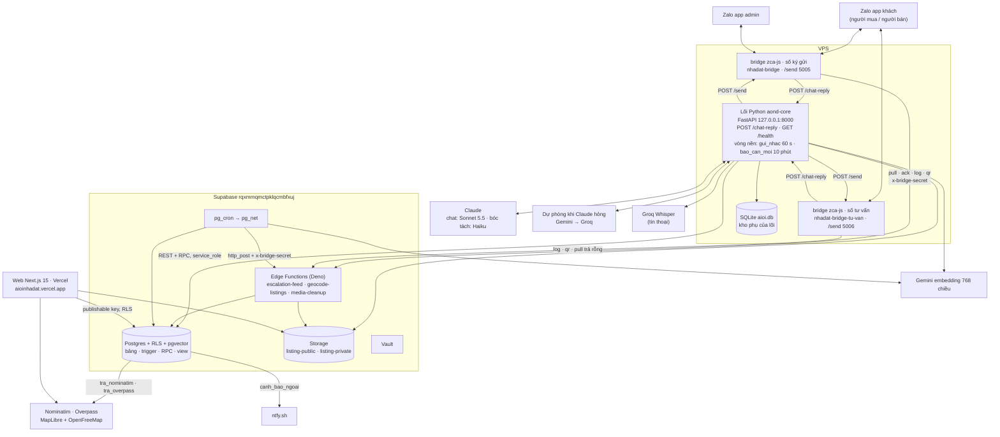
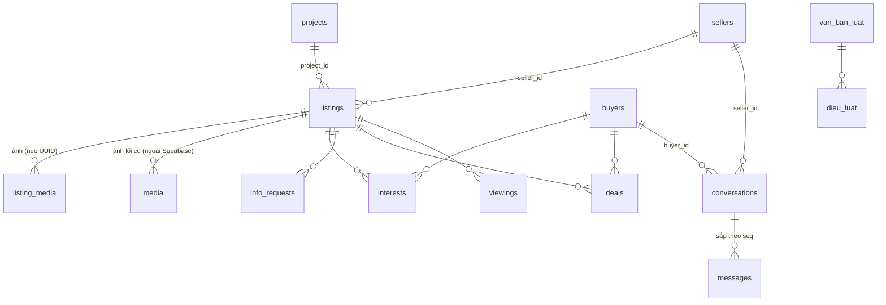
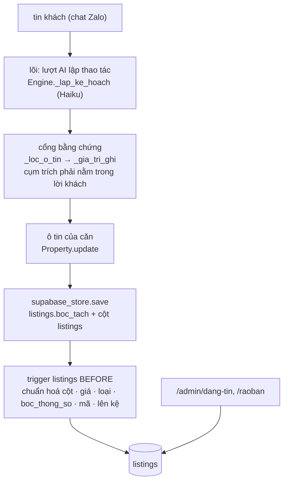

# 07 — Software Requirements Specification

**Hệ thống**: Aioinhadat (AI Ơi Nhà Đất) × nhadat.cc · **Phiên bản**: v3.0 · **Ngày**: 2026-10-28
**Cơ sở**: `02-requirements.md`, `03-user-flows.md`, `04-information-architecture.md`,
code ở HEAD (`src/aioi/`, `bot/`, `app/`) và DB thật project **`rqxmmqmctpklqcmbfxuj`** (Tokyo, gói Free).
Project cũ `tbcdpupiarkuxtntmosl` bị xoá nhầm 08/10/2026; mã đó chỉ còn trong các mục lịch sử.

Tài liệu này tả **hệ thống như đang chạy**. Nguồn của mọi khẳng định là code
trong repo và DB thật. v3.0 viết lại §1, §2, §4 theo kiến trúc lõi Python
(chủ dự án 28/10/2026: "Kiến trúc đúng — bỏ"; "bỏ hẳn CTV đi") `[nguồn: chủ dự án 28/10/2026, chat]`.
§3 chỉ sửa chỗ nhắc bảng đã gỡ và CTV. Các mục `SRS-5.1…` ở §5 là nhật ký sửa, giữ nguyên.
Mục thiết kế chưa dựng chỉ còn một dòng "Không dựng — thay bằng …" để giữ ID
cho `08-traceability.md`.

---

## 1. Giới thiệu

### 1.1 Mục đích
Đặc tả phần mềm đang vận hành để nghiệm thu (`§7`), kiểm thử (`docs/10`) và
mở rộng mà không lệch khỏi yêu cầu ở `02-requirements.md`.

### 1.2 Phạm vi hệ thống

| Mã | Phân hệ | Đường thật |
|---|---|---|
| `WEB` | Website công khai | Next.js ở root repo: `/`, `/[tag]`, `/mua-ban`, `/cho-thue`, `/nha-dat/[code]`, `/du-an`, `/du-an/[slug]`, `/ban-do`, `/moi-gioi`, `/thong-ke`, `/ds/[token]`, `/raoban`, `/tai-khoan`, `/yeu-thich`, `/tinh-lai-vay` |
| `BOT` | Bộ não hội thoại (B và S) | Lõi Python `src/aioi/` trên VPS (`aond-core.service`, cổng 8000), endpoint `POST /chat-reply`; một lõi cho cả người mua lẫn người bán, vai theo ý định từng lượt (SRS-5.1zzzzzzz153) |
| `KENH` | Kênh Zalo | Bridge `zca-js` 2.2.0 (`bot/bridge-zca/index.mjs`) trên tài khoản Zalo cá nhân (clone), HAI tiến trình: số ký gửi (`nhadat-bridge.service`) và số tư vấn người mua (`nhadat-bridge-tu-van.service`, `SO_NHAN=tu_van`) (SRS-5.1zzzzzzz210). Zalo OA không dùng |
| `SEL` | Phía người bán | Cùng lõi, nhánh bán; `/quan-ly` + `/dang-nhap` cho NMG trên web |
| `ADM` | Admin | `/admin`, `/admin/tin-nhan`, `/admin/cau-chuan`, `/admin/danh-gia`, `/admin/dang-tin`, `/admin/ro-hang`; việc nội bộ (câu khách hỏi, lịch xem, cần người thật) đi thẳng admin qua `reminders` → `escalation-feed` → bridge; cảnh báo ntfy |

**CTV không còn là phân hệ** (chủ dự án 28/10/2026: "bỏ hẳn CTV đi"). Mọi việc từng giao CTV nay giao admin, hoặc chủ nhà
khi tin có chủ nhà trên hệ thống (SRS-5.1zzzzzzz165, SRS-5.1zzzzzzz170, SRS-5.1zzzzzzz172, SRS-5.1zzzzzzz173).
Tàn dư CTV còn trong DB / code, chưa dọn: bảng `ctvs`, view `ctv_ranks`, cột `ctv_id` ở `conversations` / `info_requests` /
`reminders` / `deals`, giá trị `assignee = 'ctv'`, hàm `chon_ctv` / `ctv_dang_ganh` / `ctv_sla_phut`, nhánh `ctv` của
`notify_info_request_escalation` / `info_request_sla_tick` cho dòng cũ, `la_nhan_vien` (`src/aioi/mua.py`) còn nhận Zalo ID CTV cho
lệnh `#mã: trả lời`, khối hạng CTV ở `/admin`. Dọn là việc riêng.

### 1.3 Tài liệu tham chiếu
`docs/00`…`docs/06`, `docs/09-open-issues.md`, `docs/10-ke-hoach-kiem-thu.md`, `docs/13-so-do-nhan-va-boc-tach.md` (sơ đồ một lượt chat),
`bot/bridge-zca/VPS.md` (vận hành VPS), `CLAUDE.md` §6 (luật đang áp, mỗi dòng kèm `SRS-…`).

---

## 2. Kiến trúc tổng thể

`[nguồn: src/aioi/server.py, src/aioi/engine.py, bot/bridge-zca/index.mjs, bot/bridge-zca/cai-vps.sh, bot/supabase/functions/, bot/supabase/schema.sql, 28/10/2026]`



Ba điều hay hiểu nhầm:
- **Bộ não chỉ có một: lõi Python.** Edge function `chat-reply`, `zalo-webhook`, `nudge`, `ask-seller`, `ctv-report`,
  `inbound-sweep` đã gỡ 18/10/2026 (SRS-5.1zzzzzzz31, SRS-5.1zzzzzzz46). Prompt chỉ ở `src/aioi/prompts.py`.
- **Tin chủ động cho khách do lõi gửi**, qua `POST /send` của bridge: nhắc `followup` / `sold` / `feedback` / `admin_reply`
  (`gui_nhac.py`, SRS-5.1zzzzzzz216), báo căn mới (`bao_can_moi.py`, SRS-5.1zzzzzzz150), nhắc người bán 5 phút (`followup.py`).
  Tin gửi đúng số khách đang nhắn (`Conversation.so_nhan`).
- **Tin nội bộ cho admin / chủ nhà** đi đường khác: trigger DB đẻ `reminders(kind = 'escalation' | 'report')`, bridge số ký
  gửi kéo qua `escalation-feed`, tin cho admin mở bằng `$$$$$ ` (SRS-5.1zzzzzzz134). Số tư vấn không nhận việc này.

### SRS-2.1 — Tech stack

`[nguồn: package.json, src/aioi/config.py, src/aioi/llm/, bot/bridge-zca/cai-vps.sh, bot/supabase/schema.sql; soát 28/10/2026]`

| Lớp | Công nghệ |
|---|---|
| Lõi hội thoại | Python, FastAPI (`src/aioi/server.py`), chạy `aond-core.service` tại `/opt/aond_core`, cổng 8000 (chỉ 127.0.0.1). Cài và khởi động lại bằng workflow `apply-migration.yml` ô `dung_lai = cai-vps` (`bot/bridge-zca/cai-vps.sh`) |
| Module lõi chính | `engine.py` (phiên chat, định tuyến bán / mua) · `prompts.py` (mọi prompt, `GIONG_VUI`, `AD_FORMAT`, `muc_phi`, `VUNG_NHAN_TIN`) · `schema.py` (`CORE_FIELDS`, `CORE_THEO_LOAI`, `FACETS`, `O_NOI_BO`) · `mua.py` (phía người mua) · `supabase_store.py` (kho Supabase) · `dia_danh.py` · `phap_ly.py` · `cau_mau.py` · `xung_ho.py` · `bao_can_moi.py` · `gui_nhac.py` · `lenh_zalo.py` · `anh_can.py` · `kho_anh.py` · `web.py` · `llm/` |
| Kho trạng thái | Supabase là nguồn chính (`SupabaseConversationStore`); SQLite `aioi.db` trên VPS là kho dự phòng khi thiếu khoá Supabase (`SqliteConversationStore`) |
| Kênh chat | Zalo cá nhân qua bridge `zca-js` 2.2.0 (ghim, SRS-5.1zzzzzzz177), tài khoản clone (quyết định chủ dự án 20/10/2026). Hai số: ký gửi và tư vấn (SRS-5.1zzzzzzz210). Bridge thả tim (`addReaction`), gửi ảnh qua `guiAnhQuaUrl` |
| AI chat | Claude **Sonnet 5.5** cho lượt trả lời khách thật (`MODEL_CHAT` trong `cai-vps.sh` → `AIOI_CHAT_MODEL`, SRS-5.1zzzzzzz235); ID thử theo `AIOI_CHAT_MODEL_THU` (SRS-5.1zzzzzzz234) |
| AI bóc tách | Claude Haiku (`AIOI_EXTRACT_MODEL`, mặc định `claude-haiku-4-5`): lượt lập thao tác, đọc ảnh |
| Dự phòng | `llm/du_phong.py`: Claude hỏng thì Gemini rồi Groq; mỗi lần gọi ≤ 15 s, cả vòng ≤ 40 s (SRS-5.1zzzzzzz117, SRS-5.1zzzzzzz133) |
| Prompt caching | Cắt chuỗi system ở `RANH_GIOI_CACHE` (`llm/base.py`); chỉ phần trước dấu có điểm cache (SRS-5.1zzzzzzz166, SRS-5.1zzzzzzz213) |
| Tìm theo nghĩa | Gemini `gemini-embedding-001`, 768 chiều. Câu khách nhúng lúc chat (`dia_danh.py`); dữ liệu nhúng bằng lịch `nhung-tick`, `nhung-dia-danh-tick`, `nhung-luat-tick`. RPC: `tim_nha` (vector `listings.nhung`), `tim_dia_danh_theo_nghia`, `tim_dieu_luat` |
| Tin thoại | Groq Whisper chép ra chữ trước khi vào lõi (`server.py`, `transcribe_voice_url`) |
| DB | Supabase Postgres, RLS trên mọi bảng, trigger + RPC `security definer`, `pgvector`. Lõi đọc / ghi bằng `service_role` qua REST |
| Serverless | 3 Edge Functions (Deno): `escalation-feed`, `geocode-listings`, `media-cleanup` (`§4`); `_shared/` còn `claude.ts`, `gate.ts`, `geocode.ts`, `tin_nhac.ts`, `extraction/` (`luat-tien.ts`, `luat-lien-he.ts`, `nhan.ts`, `ds-phuong.ts`, `tien-ich.ts`) |
| Lịch / HTTP nội bộ | `pg_cron` + `pg_net` (`net.http_post`). Lịch nhắc tên trong repo: `nhung-tick`, `nhung-dia-danh-tick`, `nhung-luat-tick`, `geocode-tick`, `ctv-sla-tick` (chạy `info_request_sla_tick`), `bot-health-tick`, `media-cleanup-tick`, dọn dữ liệu thử `don_du_lieu_thu()`. Số job thật đếm trong DB |
| Bí mật | `.env` lõi trên VPS (khoá Claude, Gemini `GEMINI_API_KEY`…`_4` lấy từ Vault qua `cai-vps`, Groq, service_role); Vault giữ `BRIDGE_SECRET` và khoá cho hàm DB, đọc qua `get_secret()` chỉ `service_role` |
| Kho file | Supabase Storage (SRS-5.1zzzzzzz56): `listing-public/<uuid tin>/` (ảnh căn, công khai), `listing-private` (sổ đỏ, giấy tờ, PDF, tệp dự án; signed URL). SharePoint / OneDrive đã bỏ |
| Web | Next.js 15 (App Router) + TypeScript + Tailwind 4, Bun, deploy Vercel từ root repo. Link bot gửi lấy từ `src/aioi/web.py` (`AIOI_SITE_URL`, mặc định `https://aioinhadat.vercel.app`) |
| Auth | Supabase Auth: Google OAuth + magic link email (NMG, admin, tài khoản B tự nguyện); không Zalo SSO |
| Bản đồ | MapLibre `maplibre-gl` 6.13.0 + nền OpenFreeMap, nạp qua `napMapLibre()` (`lib/ban-do.ts`), gom cụm `lib/cum-ghim.ts` (SRS-5.1zzzzzzz206, SRS-5.1zzzzzzz217). Toạ độ tin: từ điển `duong` trước, rồi Nominatim qua rpc `tra_nominatim`; tiện ích quanh tin qua rpc `tra_overpass` (SRS-5.1zzzzzzz152, SRS-5.1zzzzzzz224) |
| Cảnh báo | ntfy.sh (`canh_bao_ngoai`), `bot_health_tick` đọc `net._http_response` (NFR-18) |
| Quan trắc | `bot_errors` / `bot_health` / `bot_usage` / `bot_usage_model` + `/admin`; log lõi trên VPS chỉ ra journal từ mức `warning` (SRS-5.1zzzzzzz233); đọc bằng ô `doc-log-loi` |
| Kiểm thử | `bun run test:py` (pytest `tests/`, lõi Python) + `bun run kiem` (tsc, `kieu:bot`, build, `test:bot`, `test:rohang`, `truyvet`); bắn thử production bằng ID thử qua ô `ban-thu-*` của `apply-migration.yml` (`docs/10`) |

### SRS-2.2 — Đường giao tiếp S↔B

`[nguồn: src/aioi/mua.py, src/aioi/engine.py, src/aioi/gui_nhac.py, bot/supabase/schema.sql, 28/10/2026]` Một đường duy nhất, bằng bảng + trigger.
Không có HTTP giữa hai "side", không còn bước CTV.

1. Khách mua hỏi về căn → lõi ghi `info_requests(source = 'buyer_ask')` (`mua.py`). Trigger `route_info_request` giao:
   tin có chủ nhà trên hệ thống → `assignee = 'seller'`, hạn `chu_nha_han_gio()`; không có → `assignee = 'admin'` (migration `20261024a`, SRS-5.1zzzzzzz170).
2. Trigger `notify_info_request_escalation` sinh `reminders(kind = 'escalation')` cho người được giao, kèm mẫu "`#mã: câu trả lời`";
   bridge số ký gửi kéo qua `escalation-feed` rồi nhắn từ tài khoản clone. Chủ nhà quá hạn → nhắc admin ngay.
3. Người trả lời:
   - **Chủ nhà** đang chat với bot: lượt AI đọc ý thấy câu trả lời (`tra_loi_khach_hoi`) → `tra_loi_cau_hoi` đóng câu (`engine._handle`).
   - **Admin** nhắn "`#mã: …`" → `lenh_tra_loi` + `la_nhan_vien` + `tra_loi_theo_ma` (`engine._handle`, `mua.py`).
4. `info_requests.status = 'answered'` → trigger `info_request_bao_lai_khach` đẻ `reminders(kind = 'followup')` cho khách;
   **lõi gửi** qua `gui_nhac.py` (vòng `server._vong_gui_nhac`, 60 s, khung 8–20 giờ), câu mẫu `bao_tra_loi_chu_nha` (SRS-5.1zzzzzzz216).
5. Quá hạn: `info_request_sla_tick` (lịch `ctv-sla-tick`) nhắc admin. Lịch xem (`viewings`) đi thẳng admin (`viewings_bao_ctv_va_email`
   đặt `v_ctv := null`, SRS-5.1zzzzzzz165); admin trả lời `#mã: ok giờ` thì chốt lịch và báo khách.

[deprecated 28/10/2026 — bỏ CTV, chủ dự án] Bản v2.0 của mục này: giao CTV ít việc nhất, SLA 120 phút `ctv_sla_phut()`,
`chat-reply` nhánh `nguoi_noi_bo`, `nudge` gửi followup, vòng nhỏ giọt `ask-seller` / `ask_seller_drip()`. `chat-reply`, `nudge`,
`ask-seller`, `ask_seller_drip()`, `nguoi_noi_bo` đã gỡ; `ctv_sla_phut()` còn là tàn dư.

---

## 3. Mô hình dữ liệu

`[nguồn: information_schema + pg_constraint + pg_policies, DB 04/09/2026; soát lại theo bot/supabase/schema.sql 28/10/2026]`

> **Soát 28/10/2026.** `schema.sql` hiện có **45 bảng** `public`. Đã gỡ, mọi chỗ nhắc dưới đây là LỊCH SỬ: `listing_facts` (SRS-5.1zzzzzzz66,
> ô tin một nguồn `listings.boc_tach`), `required_facts` (`20261019g`, bộ câu hỏi nay ở `src/aioi/schema.py`), `bot_prompts`, `mau_cau`,
> `van_kich`, `inbound_ledger`, `inbound_events`, `ai_ghi_thu`, `ctv_daily_reports`, `du_an_can`, `du_an_tai_lieu`, `project_fact_phieu`
> (`20261018i`), `boc_tach_bong`, `ratings_log`, `project_facts`; trigger `listing_insert_drip`, `bao_tin_moi_khop`,
> `trg_conversations_assign_ctv` + hàm `assign_ctv_round_robin` (`20261025a`); view `listing_missing_facts`, `job_suc_khoe`.
> Bảng mới sau 08/10: `bot_usage_model`, `cau_chuan`, `cau_mau`, `danh_gia_ai`, `du_an_kien_thuc`, `giao_lo`, `kien_thuc_phap_ly`,
> `listing_noi_bo`, `van_ban_luat`, `dieu_luat`, `nhung_viec_luat`, `xa_tinh_khac`. CTV: bỏ hẳn (chủ dự án 28/10/2026), phần CTV còn
> trong DB là tàn dư chưa dọn (§1.2).
Khối: `cột:kiểu`, `!` = NOT NULL, `=` = default, `→` = FK. PK `uuid` trừ khi ghi khác. Enum thật:
`listing_deal(ban, cho_thue)`, `property_type(nha_pho, nha_cap4, chung_cu, dat, biet_thu, phong_tro, mat_bang, toa_nha, dat_nong_nghiep, dat_kinh_doanh, kho_xuong, chua_ro)` (4 loại sau thêm `20260909i`),
`seller_type(ccrb, nmg, unknown)`, `request_status(pending, answered, expired)`, `msg_sender(buyer, seller, bot, ctv, system, human)`,
`unit_status(con_ban, giu_cho, da_coc, da_ban)`.

### SRS-3.0 · Bản đồ 45 bảng và đường ghi ô tin

`[nguồn: pg_class + pg_description, DB 06/09/2026]`

Ba tháng sau mở lại repo, thứ mất trước tiên là *cái nào thuộc về cái nào*. Mục
này là bản đồ đó. Nó KHÔNG đẻ nguồn sự thật thứ hai: chú thích tương ứng đã nằm
trong chính DB (`comment on table/column`, migration `20260906b`), hiện ra ngay
dưới tên bảng trong Supabase Table Editor. Đây là bản in ra giấy của thứ đó.

**Năm nhóm, 45 bảng** (đếm `create table` trong `bot/supabase/schema.sql` 28/10/2026). Tiền tố `[NHÓM]` nằm ngay đầu chú thích mỗi
bảng (`comment on table` trong migration), nên Table Editor xếp A→Z mà mắt vẫn gom được theo việc. `bot_usage_model`, `chat_quota`,
`bridge_dang_nhap` xếp theo việc [giả định BA: chưa thấy dòng `comment on table` của ba bảng này trong migration].

| Nhóm | Bảng |
|---|---|
| `[RỔ HÀNG]` (14) | `listings` `media` `listing_media` `listing_noi_bo` (SRS-5.1zzzzzzz116) `media_cleanup_queue` `projects` `listing_views` `wards` (FR-209) `tien_ich` (FR-204) `duong` (FR-212) `phuong_cu` `quan_cu` (`20260930a`) `giao_lo` (SRS-5.1zzzzzzz43) `xa_tinh_khac` (SRS-5.1zzzzzzz128) |
| `[NGƯỜI & HỘI THOẠI]` (10) | `buyers` `sellers` `conversations` `messages` `interests` `info_requests` `viewings` `deals` `reminders` `danh_gia_ai` (SRS-5.1zzzzzzz104) |
| `[BOT & HÀNG ĐỢI]` (15) | `bot_errors` `bot_health` `bot_usage` `bot_usage_model` `chat_quota` `cau_chuan` (SRS-5.1zzzzzzz88) `cau_mau` (SRS-5.1zzzzzzz106) `nhung_viec` `nhung_viec_du_an` (FR-216) `nhung_viec_dia_danh` (`20260930a`) `nhung_viec_luat` `du_an_kien_thuc` (SRS-5.1zzzzzzz56) `kien_thuc_phap_ly` (SRS-5.1zzzzzzz176) `van_ban_luat` `dieu_luat` (SRS-5.1zzzzzzz231) |
| `[CTV]` (1, tàn dư) | `ctvs` — không còn vai CTV (chủ dự án 28/10/2026); `ctv_daily_reports` đã gỡ (`20261018i`) |
| `[HỆ THỐNG]` (5) | `admins` `app_config` `curated_lists` `property_events` `bridge_dang_nhap` (FR-201; một dòng mỗi số Zalo, SRS-5.1zzzzzzz210) |

**Quan hệ chính** — chỉ khoá ngoại thật, không vẽ luồng chạy:



Một hội thoại có thể gắn CẢ `seller_id` và `buyer_id` (một Zalo = một khách = một hội thoại, SRS-5.1zzzzzzz149). Khoá ngoại
`ctv_id → ctvs` còn ở `conversations`, `info_requests`, `reminders`, `deals` là tàn dư, không vẽ.

Ba chỗ hay hiểu nhầm, nói thẳng ở đây:

- **Không có bảng `buyer_preferences`.** Nhu cầu khách nằm ở cột
  `buyers.preferences` (jsonb).
- **Không có bảng câu hỏi theo loại BĐS.** Bộ câu hỏi theo loại chỉ ở `src/aioi/schema.py` (`CORE_FIELDS` theo nhóm,
  `CORE_THEO_LOAI` đè cho loại riêng, SRS-5.1zzzzzzz68). Bảng `required_facts` đã gỡ (`20261019g`).
- **`media` và `listing_media` là hai đời khác nhau.** `media` trỏ file NGOÀI Supabase (lối cũ). `listing_media` (FR-165) là ảnh
  trong Storage, neo `listings.id`; web đọc qua view `listing_photos_v`. Từ 09/09/2026 không còn `masterDB/` trên máy chủ dự án,
  rổ hàng đến từ tin rao thật qua chat và rổ mẫu `seed_thu` (SRS-5.1zzzzzzz167, SRS-5.1zzzzzzz168).

**Đường ghi ô tin — một nguồn `listings.boc_tach`** (SRS-5.1zzzzzzz66). Hình trạng hiện tại:



Không còn nhánh regex TS và `listing_facts`; luật bậc `bac_nguon()` đã gỡ khỏi DB. Ô chủ nhà nói riêng (`schema.O_NOI_BO`) ghi
bảng `listing_noi_bo`, không vào `boc_tach` công khai (SRS-5.1zzzzzzz116).

**Ranh giới bóc tách ⟂ AI có máy canh** (phần TS còn lại ở `bot/supabase/functions/`; lõi Python không thuộc bài này).
`bot/tests/ranh-gioi.mjs` (nằm trong `bun run test:bot`, nên chạy ở CI mỗi PR) chặn hai chiều: mã bóc tách tiền định
không được import SDK Anthropic / `claude.ts` / gọi RPC; tầng AI không được ghi
bảng nghiệp vụ, chỉ ba RPC đã khai tên (`get_secret`, `log_loi`, `cong_token`).
Bài có ca âm nên luật hỏng thì bài đỏ, không im.

**Đọc rổ hàng bằng mắt người:** view `ro_hang_ban` (20 cột thay cho 56, giá quy
ra tỷ, nhãn tiếng Việt, cột `canh_bao` chỉ đích danh trường nào là máy đoán).
`security_invoker = on`, `anon` bị revoke.

**Nhìn như Excel:** schema `so` (`20260907c`) tách riêng khỏi `public` để Table
Editor / Schema Visualizer không lẫn 38 bảng + 19 view ruột bot (đếm trên DB 18/09/2026). Hai view:
`so.ro_hang` — 9 cột đầu đúng thứ tự sheet Excel gốc Q5 (trong `masterDB/`) (stt · bán
hay thuê · vị trí · diện tích · giá · mô tả · SĐT · người bán), cột thêm xếp
sau, cả bán lẫn cho thuê; `so.nguoi_ban` — mỗi người bán một dòng, đếm tin;
`so.hoi_thoai` (`20260907g`) — log chat đọc được: lúc · ai · nội dung · phía bán/mua,
lọc theo `hoi_thoai` để đọc trọn một cuộc (nguồn `messages`, không SĐT).
PostgREST không phơi schema này, `anon`/`authenticated` bị revoke,
`security_invoker = on`. Khác Excel: cột SĐT là SĐT **người bán đã ký** (60/173
tin), DB không giữ SĐT theo tin (FR-104). `xuat_schema()` chỉ quét `public` nên
`so` không nằm trong `schema.sql`; dựng lại phải chạy thêm hai file migration
(`20260907c`, rồi `20260907f` — ô đọc một dòng: mô tả gộp xuống dòng thành
` · `, vị trí bỏ đuôi `, Quận 5, Hồ Chí Minh`, diện tích dấu phẩy thập phân)
[giả định BA: chấp nhận vì view không mang dữ liệu].

### SRS-3.1 · `listings`

```text
id:uuid!  code:text! unique ('BDS-Q5-0001', trigger listings_fill_code)  legacy_sst:int
seller_id:uuid→sellers  deal:listing_deal!=ban  status:text!=cho_thong_tin
district:text!='Quận 5'  ward:text  street:text  location_raw:text  lat,lng:numeric
property_type:property_type=chua_ro  project_id:uuid→projects  unit_code:text  unit_status:unit_status
area_m2,legal_area_m2,built_area_m2:numeric  frontage_m,length_m,rear_width_m:numeric
floors:int  floors_text:text  floor:int  bedrooms:int  bathrooms:int  direction:text
access_type:text  alley_width_m,distance_to_street_m:numeric
legal_status:text  has_completion:bool  planning_status:text
has_elevator,car_in_house,corner_lot,negotiable:bool  furnishing:text  year_built:int
price_raw:text  price_vnd:bigint  price_per_m2_vnd:bigint(generated)  rent_income_vnd:bigint
description:text  source:text!=import_excel  source_url,cc_link:text
property_type_source,price_source,ward_source:text!=suy_doan  specs_source:text
last_confirmed_at,last_interest_at:timestamptz  created_at,updated_at:timestamptz!
nhan:text[]!='{}' (FR-211, chỉ mục GIN, khoá theo từ điển `_shared/extraction/nhan.ts`; ghi qua RPC `them_nhan_tin`)
```
Soát 28/10/2026: khối trên là bản 04/09. `schema.sql` nay có 63 cột (SRS-5.1zzzzzzz140, OPEN-64): KHÔNG còn `legacy_sst`, `unit_status`,
`source_url`, `cc_link`, `specs_source`, `last_confirmed_at`; thêm `boc_tach` jsonb (ô tin một nguồn, đọc qua `o_boc_tach()`, SRS-5.1zzzzzzz66),
`can_chu_duyet`, `chu_duyet_at`, `gap`, `legacy_code`, `toa_do_muc`, `geocode_at`, `tien_ich_gan`, `tien_ich_at`, `nhung` / `nhung_md5` / `nhung_luc`
(vector cho `tim_nha`). RPC `them_nhan_tin` không còn trong `schema.sql`.
Bản đồ ánh xạ đầy đủ 67 cột (nghĩa, khách nói ví dụ, ghi từ đâu, fact liên quan, lọc ở đâu) + fact → cột + ma trận 12 loại BĐS:
`docs/anh-xa-du-lieu-listings.xlsx` (ảnh chụp 18/09/2026 từ `information_schema` + trigger + `required_facts` + 10 tin bắn thật; đổi schema thì phải làm lại — đã lệch: `required_facts` gỡ 19/10).

- CHECK `status ∈ {cho_thong_tin, dang_ban, dang_quan_tam, da_coc, da_chot, an}` (FR-139; `da_coc` có trong `schema.sql` 28/10); `access_type ∈ {mat_tien, hem_xe_tai, hem_xe_hoi, hem_xe_may, hem}`;
  `legal_status ∈ {so_hong_rieng, so_hong_chung, so_hong, hdmb, giay_tay}`; `furnishing ∈ {full, co_ban, khong}`; `bedrooms 1..20`;
  `*_source ∈ {suy_doan, chu_xac_nhan, admin}`; `specs_source ∈ {boc_mo_ta, admin, chu_xac_nhan}` (FR-164/172).
- Trigger BEFORE (theo tên, `schema.sql` 28/10): `trg_listings_chuan_hoa_cot` · `trg_listings_fill_property_type` (FR-150) · `trg_listings_price_vnd` (FR-154) ·
  `trg_y_listings_boc_thong_so` (FR-172) · `trg_z_listings_normalize_status` · `trg_zy_listings_chan_so` · `trg_zz_listings_dang_tin` (lên kệ, FR-144) ·
  `trg_listings_zz_doi_ma` · `trg_listings_zz_fill_code` · `trg_listings_zz_toa_do`.
  AFTER: `trg_listings_bao_can_da_chot` (FR-108), `trg_listings_day_ro_ccrb`, `trg_pe_listings` (FR-70).
  Đã gỡ: `listing_insert_drip` (FR-129, `20261018i`), `bao_tin_moi_khop` (FR-64, `20261025h`).
- Index lọc: `(deal, price_vnd)`, `(deal, status, access_type)`, `(deal, status, floors)`, `(district, status)`; unique partial `(project_id, unit_code)`.
- Policy: `anon_read_listings` chỉ `dang_ban | dang_quan_tam | da_chot`; `listings_own_read/insert` (NMG tin của mình); `listings_admin_read/update`.
- Luật: `area_m2` là diện tích chính (chung cư = tim tường), `legal_area_m2` là công nhận — hai cột khác nhau; `description` giữ nguyên văn
  câu rao, không trigger nào sửa (FR-91/153). [LỊCH SỬ] Luật bậc nguồn cho fact (`chu_xac_nhan` > `admin` > `suy_doan`, FR-163 a,
  FR-164 a) chạy trên `listing_facts` + `bac_nguon()`, cả hai đã gỡ; nay ô tin chỉ ghi điều khách nói qua cổng bằng chứng của lõi (SRS-5.1zzzzzzz73).

### SRS-3.2 · `property_events` — FR-70, FR-73

```text
id:bigserial  listing_id:uuid!→listings cascade  event_type:text!  buyer_id:uuid→buyers set null  at:timestamptz!=now()  meta:jsonb
```
- CHECK `event_type ∈ {view, asked, interest, photos, viewing, deal, match_sent, status}`; index `(listing_id, at desc)`, `(at desc)`; policy `property_events_admin_read`.
- Chỉ trigger `trg_property_event()` ghi (`ghi_su_kien_bds`, không bao giờ ném): `listing_views` → `view`, `info_requests` `buyer_ask` → `asked`,
  `interests` → `interest`, `viewings` → `viewing`, `deals` → `deal`, `reminders` match sent → `match_sent`, `listings` đổi `status` → `status`. `photos` chưa có nguồn sinh.
- `hot_score` (FR-73) = view `bds_hot` tính lúc đọc (số sự kiện 60 ngày), không có cột/job.

### SRS-3.3 · `buyers`

```text
id:uuid!  zalo_user_id:text unique  auth_user_id:uuid unique→auth.users  name:text  phone:text
preferences:jsonb='{}'  last_contact_at:timestamptz  notes:text  created_at:timestamptz!
```
- `preferences` = hồ sơ nhu cầu tích luỹ, nay do lõi ghi (`mua.py`, `BuyerLead`); `merge_buyer_prefs()` đã gỡ. Cờ tắt báo căn mới:
  `buyers.bao_can_moi` (SRS-5.1zzzzzzz175).
- `phone` chỉ khi B tự cung cấp ở luồng đặt lịch (NFR-07); `/admin` không SELECT cột này. Policy `buyers_self_read/insert/update`, `buyers_admin_read`.
- Không có `connection_status`/`fingerprint_ids`: vết giữ chân ở `reminders.kind = reengage` (FR-63); fingerprint không dựng (OPEN-14).

### SRS-3.4 · `sellers`

```text
id:uuid!  zalo_user_id:text unique  auth_user_id:uuid unique→auth.users  phone:text unique  phone_proxy:text  name:text
seller_type:seller_type!=unknown  rating_sum:int!=0  rating_count:int!=0  active_listing_id:uuid→listings set null  created_at:timestamptz!
```
- `seller_type` quyết định phí (CCRB 1 %, NMG 0,5 %, FR-101). Hồ sơ mở từ chat do lõi tạo (`supabase_store._get_or_create_seller`);
  `mo_ho_so_nguoi_ban` đã gỡ. Vai chỉ nhận khi cụm trích GỌI TÊN vai (`_vai_co_bang_chung`, SRS-5.1zzzzzzz213). Khách chỉ ở vai mua
  không có dòng `sellers` (SRS-5.1zzzzzzz149).
- `active_listing_id` = căn bot đang hỏi (FR-157), trigger `info_request_set_active_listing` giữ. `ghi_danh_gia()` đã gỡ; khách chấm sao
  cho AI ghi bảng `danh_gia_ai` (SRS-5.1zzzzzzz104).
- Policy `sellers_self_read/insert`, `sellers_admin_read/update`. Không có `fee_rate`, `email`, `contract_status`.

### SRS-3.5 · `conversations`, `messages` — FR-71, FR-72, FR-131, FR-141

```text
conversations  id:uuid!  buyer_id:uuid→buyers  seller_id:uuid→sellers  ctv_id:uuid→ctvs  channel:text!=zalo_oa  started_at:timestamptz!
               last_message_at:timestamptz  needs_human:bool!=false  needs_human_at,human_touch_at,human_escalated_at:timestamptz
messages       id:uuid!  conversation_id:uuid!→conversations  sender:msg_sender!  body:text!  zalo_msg_id:text unique  seq:bigint! unique  created_at:timestamptz!
```
- CHECK `conversations_co_vai_check` (`buyer_id` HOẶC `seller_id`, được cả hai — SRS-5.1zzzzzzz149; bản cũ là XOR `conversations_mot_vai`);
  unique partial `(buyer_id)`, `(seller_id)` — **một hội thoại/khách, không bao giờ đóng** (FR-131). Lõi ghi / đọc qua
  `supabase_store._hoi_thoai_chung` / `_tim_hoi_thoai`. Cột `ctv_id` là tàn dư. Thêm `human_hold` (admin giữ hội thoại, SRS-5.1zzzzzzz82).
  "Cuộc trò chuyện" 30 phút của FR-72 tính lúc đọc ở view `hoi_thoai_phien`.
- Trigger: `conversations_email_upset` (`needs_human` false→true → `[UPSET]`); `assign_ctv_round_robin` đã gỡ (`20261025a`, SRS-5.1zzzzzzz172);
  `messages_bump_last_message` giữ `last_message_at = greatest(cũ, mới)` — ứng dụng không ghi tay (FR-171 h).
- `seq` là thứ tự tất định (FR-162). Policy chỉ `*_admin_read`; lõi ghi bằng `service_role`.

### SRS-3.6 · `info_requests` — FR-40…FR-44, FR-76, FR-110, FR-140, FR-173

```text
id:uuid!  listing_id:uuid!→listings cascade  buyer_id:uuid→buyers  question:text!  answer:text  status:request_status!=pending
source:text!=seller_flow  assignee:text  ctv_id:uuid→ctvs  sla_due_at,sla_missed_at,reminded_at,answered_at:timestamptz  created_at:timestamptz!
```
- CHECK `assignee ∈ {seller, ctv, admin}` — `ctv` chỉ còn ở dòng cũ; dòng mới là `seller` hoặc `admin` (`route_info_request`, `20261024a`).
  `source ∈ {seller_flow, buyer_ask}` (theo code); index partial `(sla_due_at) where pending and sla_missed_at is null`. Cột `ctv_id` là tàn dư.
- Trigger: `route_info_request` (BEFORE, giao chủ nhà hoặc admin + hạn), `notify_info_request_escalation` (bỏ qua `xac_nhan_lich`/`con_ban`),
  `info_request_bao_lai_khach` (`answered` → followup; `xac_nhan_lich` → `viewings.status='confirmed'`), `huy_nhac_khi_da_tra_loi`,
  `info_request_set_active_listing`, `trg_info_request_thong_bao_khach_hoi`, `trg_pe_info_requests`.
- `question` với `buyer_ask` là chữ tự do. [LỊCH SỬ] `seller_flow` từng mang `fact_key` của `required_facts` và câu trả lời vào cột qua
  `listing_facts_sync_cols`; cả hai đã gỡ. Policy `info_requests_admin_read`.

### SRS-3.7 · `viewings` — FR-50…FR-57, FR-65

```text
id:uuid!  listing_id:uuid→listings  listing_code:text  buyer_id:uuid→buyers  guide:text  slot:timestamptz  time_text:text  phone:text
status:text!=proposed  buyer_rating:int  note:text  source:text=bot  created_at:timestamptz!
```
- CHECK `status ∈ {proposed, pending, confirmed, done, cancelled}`; `buyer_rating 1..5`; `viewings_can_neo` (`listing_id` hoặc `listing_code`).
- INSERT → `viewings_bao_ctv_va_email`: nhắc **admin** ngay (`v_ctv := null`, `20261023g`, SRS-5.1zzzzzzz165; tên hàm còn chữ "ctv" là tàn dư),
  mở câu `xac_nhan_lich` (`buyer_ask`), `email_admin('VIEWING')` (FR-52/57/81).
- Nhắc trước giờ xem = `reminders.kind='viewing'` kèm link bản đồ khi có toạ độ (FR-54); `viewing` sent → `feedback` +4 h (FR-56), lõi gửi
  (`gui_nhac.py`). `ghi_danh_gia()` đã gỡ. Số điện thoại khách ghi `viewings.phone` khi chốt lịch (`mua.ghi_sdt_hen_xem`, SRS-5.1zzzzzzz148).
- `phone` chỉ điền khi B đồng ý ở bước này (NFR-07). Policy `viewings_admin_read`.

### SRS-3.8 · `interests`, `listing_facts`, `deals` — FR-108, FR-112, FR-140, FR-153

```text
interests      buyer_id:uuid!→buyers cascade  listing_id:uuid!→listings cascade  created_at:timestamptz!   (PK cặp)
listing_facts  [ĐÃ GỠ 19/10/2026, SRS-5.1zzzzzzz66 — ô tin một nguồn listings.boc_tach]
deals          id:uuid!  listing_id:uuid!→listings  buyer_id:uuid→buyers  ctv_id:uuid→ctvs (tàn dư)  price_vnd:bigint  fee_pct:numeric  closed_at  created_at
               unique nulls not distinct (listing_id, buyer_id)
```
- `interests`: `mark_listing_interest(codes, buyer_id)` ghi cho mọi căn khách nhắc/bot gợi/xin hình/nhờ hỏi chủ; tin sang `da_chot` → mỗi khách
  trong `interests` nhận `reminders.kind='sold'` (FR-108), lõi gửi (`gui_nhac.py`). Khách chê căn → `interests.trang_thai = khong_hop`
  (SRS-5.1zzzzzzz175), kèm `ly_do`.
- [LỊCH SỬ] `listing_facts` / `ghi_fact_listing()` / `listing_facts_sync_cols`: đã gỡ. Ô chủ nhà nói riêng nằm ở `listing_noi_bo` (chỉ admin).
- `deals`: căn cứ phí (`fee_pct` null khi chốt lúc `unknown`, OPEN-28); `deals_chan_xoa_da_chot` cấm xoá deal đã chốt.
- Bất biến ẩn danh (FR-104/105): view/policy công khai không bao giờ trả `phone`, `zalo_user_id`, số nhà; trong hội thoại bot khai mọi thứ đã lưu
  về căn trừ liên hệ người bán (OPEN-36). [LỊCH SỬ] `locLienHe()` là hàm của `chat-reply` TS đã gỡ; luật che liên hệ còn ở
  `_shared/extraction/luat-lien-he.ts` (web dùng).

### SRS-3.8a · Hai luật chữ nghĩa bắt buộc

`[nguồn: chat-reply v48 — LỊCH SỬ; luật chữ nghĩa còn áp cho dữ liệu]`
- **`deal` có hai bảng từ vựng**: cột `listings.deal` = `ban | cho_thue`; JSON `buyers.preferences` và schema model = `ban | thue`. Bản TS dùng `dealCol()` (FR-163, đã gỡ cùng `chat-reply`); lõi Python phải tự giữ đúng hai bảng này.
- **Không đặt `\b` cạnh chữ tiếng Việt có dấu** — `\w` của JS chỉ là ASCII. Tự dựng biên (`(^|[^a-zà-ỹ])…(?![a-zà-ỹ])`) hoặc khớp trên bản bỏ dấu `boDau()` (FR-161).

### SRS-3.8b · Bảng phụ trợ

```text
curated_lists        id:uuid!  token:text! unique =24 hex  buyer_id:uuid→buyers set null  listing_ids:uuid[]! (1..60)  title  created_at
                     expires_at:=now()+30 ngày                                    -- FR-100; RLS, không policy; đọc/tạo qua RPC (SRS-4.3)
listing_media        id:uuid!  listing_id:uuid!→listings cascade  bucket:text!  storage_path:text!  media_type:text!  mime_type:text!
                     sort_order:int!=0  is_cover:bool!=false  created_at         -- FR-165
                     CHECK bucket ∈ {listing-public, listing-private}; media_type ∈ {mat_tien, trong_nha, hem, so_do, giay_to, khac};
                     so_do/giay_to ⇒ bucket riêng; is_cover ⇒ bucket công khai; storage_path bắt đầu '<listing_id>/'; unique (bucket, storage_path);
                     unique partial một bìa/tin; trigger listing_media_giu_bia, listing_media_xep_hang_don (→ media_cleanup_queue)
media_cleanup_queue  id:uuid!  bucket,storage_path:text!  trang_thai:text!=cho ∈ {cho, dang_lam, xong, loi, chet}  attempts:int!=0  last_error
                     next_retry_at  created_at  updated_at                          -- FR-165 e, FR-166 g
inbound_events       [ĐÃ GỠ 18/10/2026, 20261018i] -- FR-162
inbound_ledger       [ĐÃ GỠ 18/10/2026, 20261018i] -- FR-162, FR-166
reminders            id:uuid!  kind:text! ∈ {promise, reengage, viewing, followup, escalation, report, match, feedback, sold, rating, admin_reply}
                     buyer_id  seller_id  ctv_id (tàn dư)  listing_id  viewing_id (FK cascade)  due_at:timestamptz!  note:text
                     status:text!=pending ∈ {pending, sent, cancelled, dead}  sent_at  locked_at  locked_by  attempts:int!=0  next_retry_at  last_error
                     unique partial: (buyer_id, listing_id) match; (buyer_id, listing_id) sold; (viewing_id) feedback; (buyer_id) reengage pending
                     -- FR-32/60…64/108/110/133/166 f; policy reminders_admin_read/update
                     -- 28/10: lõi gửi followup / sold / feedback / admin_reply (gui_nhac.py, SRS-5.1zzzzzzz216); escalation / report đi escalation-feed;
                     --        match là sổ báo căn mới của lõi (bao_can_moi.py, SRS-5.1zzzzzzz150)
ratings_log          [ĐÃ GỠ] -- FR-65; khách chấm sao AI nay ở danh_gia_ai (SRS-5.1zzzzzzz104)
ctvs                 id:uuid!  name:text!  zalo_user_id unique  phone  active:bool!=true  last_assigned_at  created_at   -- FR-136/173; TÀN DƯ, không còn vai CTV (28/10/2026)
ctv_daily_reports    [ĐÃ GỠ 18/10/2026, 20261018i] -- FR-137
required_facts       [ĐÃ GỠ 19/10/2026, 20261019g] -- FR-153/177; bộ câu hỏi theo loại nay ở src/aioi/schema.py (CORE_FIELDS, CORE_THEO_LOAI)
listing_views        auth_user_id:uuid!→auth.users  listing_id:uuid!→listings  viewed_at; policy views_own_all   -- FR-126
admins               email:text! PK  zalo_user_id  zalo_phone; policy admins_self_read
app_config           key PK  value!  ghi_chu  (admin_email, ntfy_topic, functions_base_url, storage_public_base_url, publishable_key)
bot_prompts          [ĐÃ GỠ 18/10/2026, 20261018i] -- FR-138; prompt chỉ ở src/aioi/prompts.py
cau_mau / cau_chuan  câu bot nói nguyên văn (đè `cau_mau.MAC_DINH`) / câu chuẩn người chấm sửa làm ví dụ -- SRS-5.1zzzzzzz106, SRS-5.1zzzzzzz88; sửa ở /admin/cau-chuan
wards                ten:text! PK (tên MỚI không tiền tố, khoá tra Nominatim)  loai! ∈ {phuong, xa, dac_khu}  ten_day_du!  quan_cu! ("Quận 9" — chuỗi bocQuan/mã tin)
                     don_vi_2025:text[]!  tinh_cu! ∈ {TP.HCM, Bình Dương, Bà Rịa – Vũng Tàu}  don_vi_cu  lat,lng:numeric(9,6)  ma_hanh_chinh  nguon!  ghi_chu  created_at
                     -- FR-209 / FR-174 đợt 2 (20260915a): 168 dòng, nguồn NQ 1685 + Wikipedia; RLS bật, revoke anon/authenticated, chỉ service_role; xuat_schema() KHÔNG xuất dữ liệu → dựng lại chạy thêm migration
                     nhung:vector(768)  nhung_md5  nhung_luc   -- 20260930a: vector nghĩa (Gemini) của van_ban_dia_danh('wards', ten); cron nhung-dia-danh-tick
duong                id:uuid PK  ten:text! (có dấu, không tiền tố "Đường")  ten_khong_dau:text (generated: bo_dau(ten), index)  tinh! ∈ {TP.HCM, Tây Ninh, Đồng Nai} (tỉnh MỚI)
                     tinh_cu ∈ {TP.HCM, Bình Dương, Bà Rịa – Vũng Tàu}  phuong:text!='' (wards.ten_day_du)  quan_cu  nguon!  created_at; unique (ten, tinh, phuong)
                     -- FR-212 (20260921b): từ điển tên đường từ OSM/Overpass theo phường mới; RPC tim_duong(ten, quan, toi_da) khớp đúng/gần (fuzzystrmatch); chỉ service_role; dữ liệu nạp bằng scripts/nap-duong.mjs
                     loai ∈ {duong, so, hem}  so_hem ('137', '137/28')  duong_me  lat,lng (tâm OSM)  nhung:vector(768) (không nhúng hẻm)  nhung_md5  nhung_luc   -- 20260930a: giữ đường số + hẻm có toạ độ (nap-duong.mjs out center)
phuong_cu            id PK  ten! ('Phường 12', 'Phường Thảo Điền')  loai ∈ {phuong, xa, thi_tran}  quan_cu!  phuong_moi!→wards.ten  toan_bo!  lat,lng (tâm phường mới)  nhung  -- 20260930a: 487 dòng tách từ wards.don_vi_cu; unique (ten, quan_cu, phuong_moi)
quan_cu              ten PK ('Quận Gò Vấp')  lat,lng (trung bình tâm phường mới)  so_phuong_moi  nhung  -- 20260930a: quận / huyện / TP cũ trước 07/2025
media                bảng cũ đường OneDrive, còn policy anon đọc ảnh approved, không còn nguồn ghi — dọn cùng OPEN-18
```
- Không dựng: `tags`/`property_tags` (tag là hằng `lib/tags.ts`, 64 tag, FR-12; OPEN-06), `saved_criteria` (FR-64 đọc `buyers.preferences`),
  `escalations` (bốn loại đi `email_admin()`; vết việc ở `reminders`/`viewings`/`info_requests`), `photos` (thay bởi `listing_media`).

### SRS-3.9 · Bảo mật dữ liệu

`[nguồn: pg_policies, pg_class.relacl, storage.policies, DB 04/09/2026]` Anon key là khoá **công khai** (trong bundle JS và bridge) nên RLS + GRANT là bức tường duy nhất:

1. Vai `anon` chỉ SELECT; `authenticated` ghi có policy gác (`buyers`, `sellers`, `listings` nháp, `listing_views`, `listing_media` tin của mình); không ai có TRUNCATE (FR-167).
2. Bảng chỉ cho bot (`conversations`, `messages`, `info_requests`, `viewings`, `deals`, `interests`, `ctvs` (tàn dư), `listing_noi_bo`,
   `curated_lists`, `media_cleanup_queue`, `app_config`; bản 04/09 còn `ctv_daily_reports`, `bot_prompts`, `required_facts`, `inbound_*`,
   `ratings_log` — đã gỡ) bật RLS, chỉ policy đọc cho admin hoặc không policy — anon 0 dòng; cảnh báo `rls_enabled_no_policy` là kỳ vọng.
3. Hàm là nội bộ trừ khi chứng minh ngược lại: EXECUTE mặc định chỉ `service_role`/`postgres`; ngoại lệ cố ý là hàm thuần `immutable` (`bo_dau`, `boc_thong_so`,
   `khu_khop`, `seller_rank`, `chuan_hoa_*`…; `bac_nguon` đã gỡ), `log_loi` (web Next chạy bằng publishable key), `doc_danh_sach` (anon), và cho `authenticated`:
   `admin_dang_tin`, `tao_danh_sach`, `la_admin`, `tin_cua_toi`, `thu_muc_dau_uuid`, `parse_vnd`, `guess_property_type`. Mọi hàm ghim `search_path`.
4. View công khai phải là **SECURITY DEFINER tự chứa** (`agents_public`, `listing_photos_v`), chỉ lộ cột không định danh, chỉ tin đã lên kệ; view không dùng cho anon
   để `security_invoker` và revoke (`public_listings`, `public_media`, `media_mo_coi_*`; `listing_missing_facts`, `job_suc_khoe` không còn trong `schema.sql` 28/10).
   View admin (`ctv_ranks` — tàn dư CTV, `nmg_hoat_dong`, `bds_hot`, `hoi_thoai_*`, `khach_can_nguoi_that`; `bot_do_tre` không còn trong `schema.sql` 28/10) gác `auth.role() = 'service_role'` hoặc email trong `admins` (FR-167 c).
5. Vault không chạm anon: `get_secret()` chỉ `postgres`/`service_role`.
6. Storage: `listing-private` không có route public; đọc duy nhất bằng signed URL 900 s do admin ký ở `/admin` (`storage_admin_private_all`, NFR-06). Bucket công khai:
   `storage_admin_public_all`; người bán chỉ INSERT/DELETE đường dẫn có thư mục đầu = UUID tin của mình (`tin_cua_toi(thu_muc_dau_uuid(name))`, FR-96).
   `listing_media` công khai chỉ đọc được khi TIN đã lên kệ (`listing_media_doc_cong_khai`, FR-167 c).
7. Cổng edge function (`_shared/gate.ts`): 3 function còn lại (`escalation-feed`, `geocode-listings`, `media-cleanup`) qua nếu `Authorization` là service key hoặc header `x-bridge-secret` khớp `BRIDGE_SECRET`; chưa đặt secret thì
   fail-open nhưng ghi `bot_errors` nguồn `<function> CONG MO`; bí mật đọc qua `secretOf()` (env trước, Vault sau). Mọi hàm SQL gọi `net.http_post` tới function
   phải mang `x-bridge-secret`, trừ `canh_bao_ngoai` (FR-151 b, FR-167 b).
8. [deprecated 28/10/2026] `zalo-webhook` đã gỡ (SRS-5.1zzzzzzz46); không còn cửa Zalo OA. Lõi `aond-core` chỉ nghe 127.0.0.1, bridge gọi
   trong cùng máy; `/send` của bridge cũng chỉ nghe 127.0.0.1.

Hồi quy: TS-SEC-01…10, TS-SEC2 (`docs/10`) sau mọi migration đụng RLS/GRANT.

### SRS-3.10 · `projects` — FR-113…FR-117

```text
id:uuid!  name:text!  slug:text unique  developer  district  ward  province  location_raw  lat,lng:numeric  legal_status  amenities:jsonb
floor_plans:jsonb  images:jsonb  specs:jsonb  unit_types:jsonb  description  price_min,price_max:bigint  priority:int!=100  is_partner:bool!=false
handover_date:date  handover:text  status_text  source  source_url  created_at  updated_at
```
- `listings.project_id/unit_code/floor/direction/unit_status` nối căn với dự án; unique partial `(project_id, unit_code)`. Policy `anon_read_projects` (true); `match_projects(text)` tìm dự án khách nhắc.
- Luật thừa hưởng (FR-115/116): câu tầng dự án trả từ `projects`, không sinh `info_requests`; "căn X còn không" đọc `unit_status`; `last_confirmed_at` > 7 ngày hoặc null → "để em xác nhận lại chủ".
  Soát 28/10/2026: `listings.unit_status` và `listings.last_confirmed_at` không còn trong `schema.sql` (SRS-5.1zzzzzzz140). Kiến thức dự án lõi học
  được nằm ở `du_an_kien_thuc`; phía mua tra qua `supabase_store.tra_du_an` (SRS-5.1zzzzzzz184).

### SRS-3.11 · Tài khoản, admin và view quan trắc hội thoại — FR-124…FR-128, FR-71/74/76/77/78/80

- `sellers.auth_user_id`, `buyers.auth_user_id` nối Supabase Auth (Google OAuth + magic link). CCRB không cần tài khoản.
- `admins(email)`: mọi policy `*_admin_read/update` kiểm `exists (select 1 from admins where email = auth.jwt()->>'email')`. Thêm admin = insert email.
  Các bảng buyer side (`info_requests`, `viewings`, `buyers`, `conversations`, `messages`; `ctvs` là tàn dư) chỉ mở SELECT cho admin; ghi thuộc lõi / trigger / RPC admin.
- `agents_public` (definer, tự chứa): `id, name, seller_type, rating_sum, rating_count, listing_count, closed_count, rank` — không bao giờ `phone`/`zalo_user_id` (FR-125).
- `listing_views` (own-only) là nền "tin đã xem"; `TrackView` chỉ chạy khi có phiên đăng nhập.
- View admin: `hoi_thoai_thong_ke` (30 ngày theo ngày VN, FR-71), `khach_can_nguoi_that` (FR-77), `hoi_thoai_phien` (FR-72), `bds_hot` (FR-73); `bot_do_tre` (NFR-01) không còn trong `schema.sql` 28/10, thời gian lượt nay đo ở `thoi_gian_ms` của `/chat-reply`. `/admin` đọc bằng JWT admin, có CSV.
- Kỷ luật cột: DB quyết "ai đọc", web quyết "đọc cột nào" — `app/admin/page.tsx` không SELECT `buyers.phone`/`ctvs.phone` (NFR-07).

### SRS-3.12 · Bảng vận hành và hàm RPC — FR-146, FR-151, FR-152, FR-159, FR-166…FR-173

```text
bot_usage   day:date! PK (giờ VN)  model_calls:int!=0  capped_at  in_tokens,out_tokens,cache_write_tokens,cache_read_tokens:bigint!=0  -- FR-151 a, FR-169
bot_usage_model  day:date! model:text! PK(day,model)  calls:int!=0  in_tokens,out_tokens,cache_write_tokens,cache_read_tokens:bigint!=0  -- SRS-5.1zv/zw: chữ-máy + lượt theo model, /admin quy ra đô đúng giá từng model
bot_errors  id:bigserial  at:timestamptz!  source:text!  status_code:int  detail:text; index (at desc), (source, at desc)      -- FR-152
bot_health  who:text! PK  at:timestamptz!  last_id:bigint!=0                                                                    -- FR-152
```
Cả ba: RLS, policy `*_admin_read`, ghi chỉ `service_role`. `bot_errors` là sổ duy nhất còn lại khi log function (1 ngày, bậc Free) trôi — mọi `catch` phải nối `ghiLoi()`/`log_loi()` (FR-152 d).

> **Soát 28/10/2026** (đối chiếu `bot/supabase/schema.sql`): các hàm sau trong bảng dưới **không còn** — dòng nhắc chúng là LỊCH SỬ:
> `ensure_buyer_conversation`, `ensure_seller_conversation`, `mo_ho_so_nguoi_ban`, `nguoi_noi_bo`, `merge_buyer_prefs`, `ghi_fact_listing`,
> `tao_followup`, `ghi_danh_gia`, `bao_tin_moi_khop`, `info_request_timeout_tick`, `stale_listing_tick`, `seller_drip_tick`, `ask_seller_drip`,
> `trg_listing_drip`, `nudge_tick`, `ctv_report_tick`, `inbound_sweep_tick`, `bo_dem_nhac_treo`, `claim_inbound`, `bao_hong_inbound`,
> `viec_inbound_bo_roi`, `ghi_su_kien_inbound`, `nhan_viec_nhac`, `bao_hong_nhac`, `nha_viec_nhac`, `lan_thu_ke`, `ap_thong_so`,
> `listing_facts_sync_cols`, `chuan_hoa_lai_gia`, `guess_property_type_answer`, `listings_try_publish`, `listings_autopublish`,
> `seller_hoi_bu_tick`, `ghi_boc_tach`, `trg_fact_vao_boc_tach`, `trg_vi_tri_vao_cot`, `ngu_canh_tin`, `mau_cau_fewshot`, `bac_nguon`,
> `cat_truoc_phu_dinh`, `tim_phuong_theo_nghia`, `dia_danh_gan`, `duong_gan_duong`, `phuong_giao_hai_duong`, `tim_hem`, `them_nhan_tin`;
> view `listing_missing_facts`, `job_suc_khoe`. Hàm CTV còn (`ctv_sla_phut`, `chon_ctv`, `ctv_dang_ganh`, view `ctv_ranks`) là tàn dư.
> Hàm lõi Python gọi hiện nay: bảng RPC ở §4. Hàm mới đáng kể sau 08/10: `tim_nha`, `tim_dia_danh`, `tim_dieu_luat`, `tra_nominatim`,
> `tra_overpass`, `tim_moc`, `ban_do_khung`, `admin_gui_tin`, `giao_lo_cua`, `chuan_dia_ban`, `o_boc_tach`, `la_id_thu`, `reset_nguoi_test`.

`[nguồn: pg_proc + proacl, DB 04/09/2026]` Quyền: **SR** = chỉ `service_role`/`postgres`; **trig** = hàm trigger; **thuần** = ai cũng gọi được; **auth** = thêm `authenticated`; **anon** = mở cho web.

| Hàm / view | Việc | Quyền |
|---|---|---|
| `ensure_buyer_conversation` / `ensure_seller_conversation` | Mở/lấy hồ sơ + hội thoại duy nhất (advisory lock), trả kèm `ctv_id`, `human_touch_at` | SR |
| `mo_ho_so_nguoi_ban(zalo, seller_type)` / `nguoi_noi_bo(zalo)` | Mở `sellers` idempotent kèm nhãn, không ghi đè nhãn (FR-159) / tra CTV-admin (FR-173 d) | SR |
| `merge_buyer_prefs` / `ghi_fact_listing` / `mark_listing_interest` / `tao_followup` / `ghi_danh_gia` | Hồ sơ nhu cầu (FR-130) / cửa ghi fact duy nhất / `interests` + `dang_quan_tam` (FR-108/139) / followup +150' một lần/24 h (FR-32) / sao → `viewings` + `sellers.rating_*`, idempotent (FR-65) | SR |
| `can_cung_khu(buyer, listing, limit)` / `khu_khop` | 2–3 căn cùng phường/quận, giá 0,7–1,15×, trừ căn đã gửi (FR-62/108/110) | SR / thuần |
| `bao_tin_moi_khop` / `bao_can_da_chot` + trigger | Tin vừa `dang_ban` → `reminders.match` cho khách khớp, van 1/khách/24 h (FR-64) / tin `da_chot` → `reminders.sold` (FR-108) | SR / trig |
| `reminders_hen_hoi_cam_nhan` / `messages_bump_last_message` | `viewing` sent → `feedback` +4 h (FR-56) / giữ `last_message_at` (FR-171 h) | trig |
| `route_info_request` / `notify_info_request_escalation` / `info_request_bao_lai_khach` | Giao việc + SLA / nhắc người được giao / báo lại khách, lật lịch `confirmed` (FR-140, FR-173, FR-52) | trig |
| `viewings_bao_ctv_va_email` / `conversations_email_upset` / `reminders_email_voice` | `[VIEWING]` + nhắc CTV + câu `xac_nhan_lich` / `[UPSET]` / `[VOICE]` (FR-52/57/77/79/81) | trig |
| `email_admin(loai, uid, body, listing)` / `canh_bao_ngoai(title, text, priority, p_email)` | Ghép `[LOẠI] <uid>` → ntfy; `admin_email` rỗng → không gửi (FR-81) / `net.http_post` tới ntfy.sh, không qua bridge (FR-152 e) | SR |
| `info_request_sla_tick` / `info_request_timeout_tick` / `stale_listing_tick` | Quá 120' → admin + `[QUESTION]` (FR-173 c) / 24 h nhắc, 48 h `expired` + followup căn khác (FR-110) / tin im 30 ngày → hỏi `con_ban`, ≤ 5 tin/ngày (FR-103) | SR (cron) |
| `seller_drip_tick` / `ask_seller_drip` / `trg_listing_drip` | Gọi `ask-seller` hỏi nhỏ giọt, mang `x-bridge-secret` (FR-129/144) | SR / trig |
| `nudge_tick` / `ctv_report_tick` / `media_cleanup_tick` / `inbound_sweep_tick` | Gọi edge function tương ứng; chỉ gọi HTTP khi có việc (FR-166 d, FR-171 c) | SR (cron) |
| `bot_health_tick` / `beat(who)` / `bo_dem_nhac_treo(gio)` | Quét `net._http_response` không 2xx → `bot_errors`, nhịp tim bridge, gộp báo 1 tin/giờ, dọn sổ 30 ngày (FR-152, NFR-18) / nhịp tim / đếm nhắc treo | SR |
| `log_loi(source, detail, code)` / `bat_het_tien_api()` | Cửa ghi lỗi, van 20 dòng/nguồn/giờ, 200/giờ (FR-171 b) / dấu hiệu hết tiền AI → `HET TIEN API`, ghi thẳng, hãm 6 h (FR-168) | anon / trig |
| `bump_model_quota(limit)` / `cong_token(..., p_model)` | Trần lượt gọi model/ngày; cộng số chữ vào `bot_usage` (theo ngày) và `bot_usage_model` (theo ngày × model, SRS-5.1zv) (FR-151 a, FR-169) | SR |
| `claim_inbound` / `bao_hong_inbound` / `viec_inbound_bo_roi` / `ghi_su_kien_inbound` | Sổ idempotency tin đến: giành job atomic, 8 lần → `dead`, tìm việc bỏ rơi 24 h (FR-162, FR-166) | SR |
| `nhan_viec_nhac` / `bao_hong_nhac` / `nha_viec_nhac(id, worker)` | Hàng đợi nhắc: thuê 5' `skip locked`; hỏng → lùi dần, 5 lần `dead`; chưa thử → trả lại nguyên vẹn (FR-166 f) | SR |
| `nhan_viec_don_media` / `chon_viec_don_chet` / `lan_thu_ke(attempts)` | Hàng đợi dọn file `attempts < 6`; khoảng chờ nhân đôi, trần 1 h, nhiễu ±20 % (FR-165 e, FR-166) | SR |
| `boc_thong_so(text, type)` / `boc_ten_duong` / `ap_thong_so(listing, j, bac, de)` / `listings_boc_thong_so` | Bóc thông số (trên `bo_dau`) → cột theo luật bậc (FR-172) | thuần / thuần / SR / trig |
| `listing_facts_sync_cols` / `listings_fill_code` / `next_listing_code` | Fact → cột (SRS-3.14) / cấp mã tin chỉ trong trigger (FR-158, FR-167) | trig / trig / SR |
| `listings_set_price_vnd` / `parse_vnd` / `chuan_hoa_gia_raw` / `chuan_hoa_lai_gia` | Giá chữ → số (FR-154) | trig / auth / thuần / SR |
| `listings_fill_property_type` / `guess_property_type` / `guess_property_type_answer` | Loại BĐS từ mô tả; không đoán ra thì `chua_ro` (FR-150) | trig / auth / SR |
| `listings_quyet_dinh_dang_tin` / `listing_du_dang_tin` / `listings_try_publish` / `listings_autopublish` | Tự lên kệ khi đủ giá + m2 + phường (FR-144); tin từ chat (`can_chu_duyet`) còn cần `diem_tin ≥ 70` + `chu_duyet_at` (FR-177 d) | trig / thuần / SR |
| `diem_tin` / `seller_hoi_bu_tick` / `seller_drip_tick` / `ghi_boc_tach` / `trg_fact_vao_boc_tach` / `trg_vi_tri_vao_cot` | FR-177 f–h (`20260909a`): điểm 8 mục (ảnh 4/7/10 theo số tấm), hỏi bù 5 phút sau khi gật rồi nhịp 30 phút tới khi hết câu hoặc `listings.chu_noi_du_at`; `listings.boc_tach` jsonb gom mọi thứ bóc được (bỏ null); `listings.gap`; fact `vi_tri` → `location_raw` | SR / cron / trig |
| `mau_cau` / `ngu_canh_tin` / `mau_cau_fewshot` / `so.mau_cau` | FR-180 (`20260909c`): mẫu câu chuẩn anh/sếp sửa tay từ câu bot thật; bot dán 12 mẫu mới nhất/phía vào system prompt; xuất JSONL để fine-tune (`scripts/xuat-mau-cau.mjs`, `train/`) | bảng / SR / view |
| `diem_tin(listings)` / `diem_tin(uuid)` | Điểm đầy đủ tin 0–100, 7 tiêu chí 15/20/15/10/10/20/10, tiền định từ cột + fact → `{diem, chi_tiet, thieu[], co_anh}` (FR-177 d) | SR |
| `admin_xoa_khach(zalo)` / `admin_xoa_het_khach_va_ro_hang('XOA HET')` / `don_du_lieu_thu()` | Xoá một khách (`/admin/tin-nhan`) / XOÁ HÀNG LOẠT khách + rổ hàng để test lại, đòi đúng chữ, dấu `bot_health(xoa_het)` (FR-210, nút tab CRM) / dọn người thử 21:00 (FR-197) | auth (`la_admin()` trong thân) |
| `admin_dang_tin(jsonb)` / `tao_danh_sach` / `doc_danh_sach(token)` | Cửa đăng tin admin (FR-156/174) / danh sách riêng (FR-100) | auth / auth / anon |
| `la_admin` / `tin_cua_toi(listing)` / `thu_muc_dau_uuid(name)` / `get_secret` / `cau_hinh(key)` | Gác policy storage + `listing_media` (FR-96) / Vault / `app_config` | auth / SR |
| `seller_rank` / `bac_nguon` / `ctv_sla_phut` / `bo_dau` / `chuan_hoa_phuong` / `cat_truoc_phu_dinh` / `match_projects` | Hàm thuần dùng chung | thuần (`match_projects` SR) |
| `tim_duong(ten, quan, toi_da)` | FR-212 (`20260921b`): tra từ điển `duong` — khớp đúng + khớp gần (Levenshtein ≤ toi_da trên chữ bỏ dấu, `fuzzystrmatch`), mỗi tên một dòng gom phường/quận/tỉnh, ưu tiên quận trùng | SR |
| `tim_dia_danh_theo_nghia(vec, loai[], lat, lng, n)` / `tim_phuong_theo_nghia(vec, n)` | `20260930a`: địa danh (phường mới / cũ, quận cũ, đường, đường số, dự án) gần NGHĨA nhất với vector câu khách, trừ điểm theo khoảng cách tới điểm neo (1 km = −0,01, tối đa −0,2). Kết quả là ỨNG VIÊN (SRS-5.1a) | SR |
| `dia_danh_gan(lat, lng, bán kính, loai[], n)` / `duong_gan_duong(ten, phuong, bán kính, n)` / `phuong_giao_hai_duong(d1, d2, bán kính)` / `tim_hem(cap_hem[], duong_me, phuong)` / `khoang_cach_m(...)` | `20260930a`: VỊ TRÍ — địa danh quanh một điểm; đường nào gần đường nào; phường có cả hai con đường gần nhau; hẻm theo số (hẻm nhỏ nhất trước) + đường mẹ; haversine (không PostGIS). `tim_duong` bỏ hàng hẻm khỏi khớp tên | SR / thuần |
| `nhung_dia_danh_tick()` / `van_ban_dia_danh(bang, khoa)` | `20260930a`: cron `nhung-dia-danh-tick` 2 phút nhúng quận cũ → phường mới → phường cũ → đường (không hẻm) SAU hàng chờ tin rao + dự án, chung công tắc `tim_theo_nghia` và mốc tạm dừng Gemini | cron / SR |
| view `ctv_ranks`, `nmg_hoat_dong`, `seller_ranks`, `job_suc_khoe`, `listing_missing_facts`, `media_mo_coi_db/storage` | Hạng CTV (FR-173 e); NMG hoạt động (I5); hạng người rao (FR-155); ba hàng đợi (FR-166); câu còn thiếu (FR-153); file mồ côi (FR-165) | admin/SR; `seller_ranks` invoker; còn lại SR |

[LỊCH SỬ] Cửa `mark_sent` của `chat-reply` TS ghi `inbound_ledger.sent_bubbles/sent_at` (FR-162). Lõi Python vẫn nhận trường `mark_sent`
nhưng chỉ trả rỗng; `inbound_ledger` đã gỡ.

### SRS-3.13 · Tầng cache của web — NFR-17, FR-171 j

`[nguồn: app/**/page.tsx]`

| Nhóm | Route | Cách |
|---|---|---|
| Tĩnh/ISR | `/`, `/ban-do` (300 s); `/moi-gioi`, `/thong-ke`, `sitemap` (3600 s) | `export const revalidate` |
| Động có tham số đường dẫn | `/nha-dat/[code]` (300 s), `/[tag]`, `/du-an/[slug]` (3600 s) | `revalidate` **bắt buộc kèm** `generateStaticParams()` — thiếu là route thành `ƒ`, mỗi lượt xem một lambda |
| Đọc `searchParams` | `/mua-ban`, `/cho-thue` | ISR không với tới → truy vấn bọc `unstable_cache` (300 s) khoá theo bộ lọc; không `revalidate` |
| Bí mật | `/ds/[token]`, `/admin`, `/quan-ly` | động (`ƒ`) có chủ ý |

- Luật: trang tin phải là `●`/`○` trong bảng route sau `bun run build`; thấy `ƒ` là hỏng (TS-CACHE).
- Trong một lần dựng: `getListing` bọc `React.cache`; danh sách đọc `CARD_COLS`, bản đồ `MAP_COLS`, không `select("*")`; `/admin` gom truy vấn vào một `Promise.all`.

### SRS-3.14 · Bộ câu hỏi theo loại, bậc nguồn, hạng người rao, cửa đăng tin admin — FR-153…FR-156, FR-164, FR-172

> **Soát 28/10/2026.** Phần "bộ câu hỏi theo loại" và "bậc nguồn" dưới đây là LỊCH SỬ: `required_facts` (gỡ `20261019g`), `listing_facts`
> (gỡ, SRS-5.1zzzzzzz66), view `listing_missing_facts`, trigger `listing_facts_sync_cols`, `bac_nguon()`, `chonCauKe()` (TS) đều không còn.
> Hiện nay bộ câu hỏi theo loại chỉ ở `src/aioi/schema.py`: `CORE_FIELDS` theo nhóm, `CORE_THEO_LOAI` đè cho loại riêng (SRS-5.1zzzzzzz68),
> `FACETS` / `FACET_CHINH` cho ngưỡng soạn bài (`Property.minimal_missing`, `summary_ready`, SRS-5.1zzzzzzz200, SRS-5.1zzzzzzz202), hỏi sau
> khi tin lên web theo `CUM_SAU_DANG`, ô riêng chủ nhà `O_NOI_BO` → bảng `listing_noi_bo`. Ô tin ghi vào `listings.boc_tach`.
> Còn đúng: `boc_tach_nhom` / `jsonb_bo_rong` / view `boc_tach_v`, hạng người rao (`seller_rank`, `seller_ranks`), cửa `admin_dang_tin`.

Đặc tính riêng theo loại không nằm ở cột riêng mà ở cặp `required_facts × listing_facts`:
`listing_missing_facts = required_facts ⋈ property_type − listing_facts − {fact_key mà cột tương ứng đã có}` (FR-172 d; ánh xạ `ket_cau↔floors`,
`do_rong_hem/do_rong_duong↔alley_width_m|mat_tien`, `phap_ly↔legal_status`, `huong↔direction`, `so_phong_ngu↔bedrooms`, `tang↔floor`, `dien_tich*↔area_m2`,
`nam_xay↔year_built`, `noi_that↔furnishing`, `mat_tien↔frontage_m`, `quy_hoach↔planning_status`). Đổi `property_type` = đổi bộ câu hỏi ở lượt kế, không migration.

| Loại | Bộ câu hỏi (`required_facts`, theo `nhom` rồi priority — FR-177 a, `20260907h`; thứ tự TRONG nhóm cơ bản do `chonCauKe()` bám câu chủ nhà vừa nói) |
|---|---|
| `nha_pho` | cơ bản: phuong, dien_tich_dat, gia · chuyên môn: do_rong_hem, ket_cau, so_phong_ngu, phap_ly, hinh_anh · phụ (không hỏi): huong, quy_hoach, nam_xay |
| `nha_cap4` | cơ bản: phuong, dien_tich_dat, gia · chuyên môn: dien_tich_dat→do_rong_hem, phap_ly, hien_trang, so_phong_ngu, hinh_anh · phụ: quy_hoach |
| `chung_cu` | cơ bản: phuong, dien_tich_tim_tuong, gia · chuyên môn: phap_ly, so_phong_ngu, tang, phi_quan_ly, noi_that, hinh_anh · phụ: huong |
| `dat` | cơ bản: phuong, dien_tich, tho_cu, gia · chuyên môn: phap_ly, do_rong_duong, hinh_anh · phụ: quy_hoach |
| `biet_thu` | cơ bản: phuong, dien_tich_dat, gia · chuyên môn: ket_cau, phap_ly, san_vuon, do_rong_hem, so_phong_ngu, hinh_anh · phụ: huong |
| `phong_tro` | cơ bản: phuong, dien_tich, gia · chuyên môn: gia_dien_nuoc, gio_giac, noi_that, hinh_anh |
| `mat_bang` | cơ bản: phuong, dien_tich, mat_tien, gia · chuyên môn: thoi_han_thue, nganh_hang_phu_hop, hinh_anh |
| `chua_ro` | loai_bds, phuong, gia |
| `toa_nha` (20260909i) | cơ bản: vi_tri, phuong, dien_tich_dat, gia · chuyên môn: so_phong, ty_le_lap_day, doanh_thu, ket_cau, thang_may, pccc, phap_ly, do_rong_hem, hinh_anh · sau đăng: the_chap, ly_do_ban, thuong_luong |
| `dat_nong_nghiep` (20260909i) | cơ bản: vi_tri, phuong, dien_tich, gia · chuyên môn: quy_hoach, len_tho_cu, duong_vao, nguon_nuoc, ranh_gioi, phap_ly, hinh_anh · sau đăng: ly_do_ban, thuong_luong |
| `dat_kinh_doanh` (20260909i) | cơ bản: vi_tri, phuong, dien_tich, gia · chuyên môn: thoi_han_su_dung, hinh_thuc_thue_dat, muc_dich, do_rong_duong, phap_ly, hinh_anh · sau đăng: ly_do_ban, thuong_luong |
| `kho_xuong` (20260909i) | cơ bản: vi_tri, phuong, dien_tich, gia · chuyên môn: chieu_cao, tai_trong_san, tram_bien_ap, xu_ly_nuoc_thai, duong_container, phap_ly, thoi_han_su_dung, (thuê) tien_coc, thoi_han_thue, hinh_anh · sau đăng: (thuê) truot_gia, fit_out, ly_do_ban |
| *mọi loại nhà/chung cư/đất* | **sau đăng** (`sau_dang`, 30+, chỉ vòng hỏi bù): so_wc, cach_mat_tien, hem_thong, ngap_nuoc, hien_trang_su_dung, the_chap, tien_ich_gan, ly_do_ban, thuong_luong; chung cư: view, can_goc, phi_gui_xe, so_huu; đất: hinh_dang, mat_do_xd, tang_cao_toi_da; thuê: fit_out |

JSON chia nhóm của một tin (FR-187, `20260909i`): `boc_tach_nhom(listings) → jsonb` 12 nhóm (tin · nguoi_rao · vi_tri · thong_so · phap_ly · gia · cho_thue · khai_thac · anh · bo_sung · cham_soc · diem), `jsonb_bo_rong()` bỏ null; view `boc_tach_v` (RLS admin) cho `/admin/ro-hang(/json)`, `so.boc_tach` cho Table Editor. Cột `listings.boc_tach` phẳng vẫn giữ (trigger ghi, `boc_thong_so` đọc).

Fact ngoài bảng nhưng có nghĩa (FR-177 e): `bo_sung` (câu lệch không nhận ra fact nào — ghi nguyên văn, `boc_thong_so` vẫn quét), `tiem_nang` (tiềm năng sử dụng, chỉ khi chủ tự kể), `duyet_tin` (lượt gật bản nháp; câu chờ cùng tên trong `info_requests`).

- Trigger `listing_facts_sync_cols` đổ fact vào cột (fact giữ nguyên văn, chuẩn hoá chỉ trên đường vào cột): `so_phong_ngu → bedrooms` (1…20);
  `dien_tich/dien_tich_dat → area_m2` (5…5000), `dien_tich_tim_tuong → area_m2` **chỉ** `chung_cu` (FR-163); `tang → floor` (0…80); `huong → direction`;
  `gia → price_raw + price_source` (`parse_vnd` 1e8…1e12, thuê dải riêng; `price_vnd` do trigger dẫn xuất); `phuong → ward + ward_source` (`chuan_hoa_phuong`);
  `loai_bds → property_type + property_type_source` (`guess_property_type_answer`, không đọc ra thì không ghi); khoá khác → cụm cột FR-172 qua `boc_thong_so()` → `ap_thong_so()`.
- Luật bậc `bac_nguon()`: `chu_xac_nhan` (3) > `admin` (2) > `suy_doan`/`boc_mo_ta` (1); ghi khi bậc fact ≥ bậc cột, cùng bậc thì mới nhất thắng.
  Mô tả đổi mà `specs_source` còn `boc_mo_ta` thì bóc lại; không bao giờ đè lời chủ nhà/admin.
- Hạng người rao (FR-155): `seller_rank()` + view `seller_ranks` (`id, name, seller_type, active_count, closed_count, total_count, rank`) tính lúc đọc, không lưu cột.
- Cửa đăng tin admin (FR-156/174): `admin_dang_tin(jsonb) → {id, code, price_vnd, seller_id}` — kiểm `admins` (42501 nếu không), tìm/tạo `sellers`,
  `lock table listings in share row exclusive mode`, mã kế tiếp, insert (trigger giá/loại tự chạy); `district` từ form, mặc định "Quận 5".
  Là RPC chứ không policy INSERT để admin gọi được hàm mà không đọc được bảng `sellers` (SĐT thật).

---

## 4. Đặc tả giao diện lập trình

`[nguồn: src/aioi/server.py, bot/bridge-zca/index.mjs, src/aioi/followup.py, bot/supabase/functions/*, src/aioi/*.py, app/api/*; soát 28/10/2026]`
Giao diện thật có bốn lớp: **HTTP của lõi** (chỉ 127.0.0.1 trên VPS), **HTTP của bridge** (chỉ 127.0.0.1), **3 Edge Functions**
(`POST {SUPABASE_URL}/functions/v1/<name>`, cổng SRS-3.9 (7)) và **RPC / REST Supabase** lõi gọi bằng `service_role`. Cộng hai route Next.
Không có REST `/api/*` giữa các "side".

**Lõi `aond-core` (`src/aioi/server.py`)**

| Endpoint | Vào | Ra / việc | Ai gọi |
|---|---|---|---|
| `POST /chat-reply` | `ZaloBridgePayload`: `external_user_id`, `text`, `image_urls` / `image_url`, `file_url` / `file_name`, `sticker_url` / `sticker_text`, `gioi_tinh`, `so_nhan`, `msg_id`, `sender_name`, `human_note`, `mark_sent` | `ZaloBridgeResponse`: `replies[]`, `nhip_go[]`, `photos[]`, `tha_tim`, `assistant_name`, `captured`, `next_field`, điểm, `thoi_gian_ms`. Một lượt chat (`docs/13`). `human_note` = admin gõ tay → ghi lịch sử, bot nhường sân; `mark_sent` trả rỗng | bridge (hai số) |
| `GET /health` | — | `status`, `provider`, `chat_model`, `stt`, `drive`, `dia_danh` | `cai-vps.sh` sau khởi động lại |
| `POST /message` | `IncomingMessage` | lượt chat không qua bridge (không gom tin, không ảnh) | ô bắn thử `ban-thu-luan` (`bot/tests/ban-thu-luan.sh`, gọi một lõi thử ở cổng 8001), `tests/test_server.py` |
| `POST /trigger-followup/{user_key}`, `POST /reset/{user_key}`, `POST /reset-all` | — | bắn nhắc 5 phút / xoá phiên một khách / xoá mọi phiên | vận hành tay trên VPS |

Vòng nền trong cùng tiến trình: `_vong_gui_nhac` (60 s, `gui_nhac.py`, tắt `GUI_NHAC=tat`) và `_vong_bao_can_moi` (10 phút,
`bao_can_moi.py`, tắt `BAO_CAN_MOI=tat`).

**Bridge (`bot/bridge-zca/index.mjs`)**

| Endpoint | Vào | Việc | Ai gọi |
|---|---|---|---|
| `POST /send` (127.0.0.1:5005 số ký gửi, :5006 số tư vấn — `SEND_PORT`) | `{threadId, message, photos?}` | gửi tin chủ động, ảnh chỉ `https://`, tối đa 4, sau chữ; trả `{ok, anh_da_gui}` | lõi: `followup.py` (`BRIDGE_SEND_URL`, `BRIDGE_SEND_URL_TU_VAN`), `gui_nhac.py`, `bao_can_moi.py` |
| cổng QR tạm (8787 / 8788 — `QR_PORT`) | — | ảnh QR đăng nhập Zalo, đường dẫn có token ngẫu nhiên | người vận hành |

**Edge Functions (còn 3)**

| Function | Vào | Việc | Ai gọi hợp lệ |
|---|---|---|---|
| `escalation-feed` | `{action: pull \| ack \| log \| qr, so_nhan}` | `pull`: trả việc `reminders(kind ∈ escalation, report)` kèm `text` soạn sẵn + đích, cờ `noi_bo`; số tư vấn nhận hàng rỗng. `ack`: đánh dấu đã gửi. `log`: ghi `bot_errors` hộ bridge. `qr`: trạng thái đăng nhập + ảnh QR vào `bridge_dang_nhap`. Mỗi lượt gõ cửa là nhịp tim bridge | bridge, header `x-bridge-secret` |
| `geocode-listings` | `{}` | điền `lat/lng` (từ điển `duong` trước, rồi rpc `tra_nominatim`; mức đường, bỏ số nhà); tiện ích OSM trong 3 km qua rpc `tra_overpass` vào `tien_ich` + `listings.tien_ich_gan`; geocode dần `projects` | cron `geocode-tick` 10 phút, chỉ khi `tin_can_geocode` / `du_an_can_geocode` có việc |
| `media-cleanup` | `{}` | xoá file trong `media_cleanup_queue` qua Storage API | cron `media-cleanup-tick` |

[deprecated 28/10/2026 — gỡ 18/10/2026, SRS-5.1zzzzzzz31 / SRS-5.1zzzzzzz46] `chat-reply` (Edge Function TS), `zalo-webhook`,
`nudge`, `ask-seller`, `ctv-report`, `inbound-sweep`. Mục `SRS-5.1`…`SRS-5.4` ở §5 mô tả chúng là lịch sử.

**RPC lõi gọi** (tên thấy trong `src/aioi/*.py`, gọi qua `/rest/v1/rpc/<tên>`)

| RPC | Việc | Gọi từ |
|---|---|---|
| `tim_nha` | tìm căn cho khách mua: lọc cứng bán / thuê / loại / giá, cộng điểm khu vực, diện tích, phòng ngủ, xe hơi, tiện ích, vector (SRS-5.1zzzzzzz138, SRS-5.1zzzzzzz179) | `mua.py` |
| `parse_vnd` | giá chữ → số (luật một nguồn với `luat-tien.ts`) | `mua.py` |
| `mark_listing_interest` | ghi `interests` cho căn khách quan tâm | `mua.py` |
| `match_projects` | tìm dự án theo tên | `supabase_store.py` |
| `chuan_dia_ban`, `boc_thong_so` | chuẩn địa bàn; bóc thông số từ chữ | `supabase_store.py` |
| `la_id_thu` | tách dữ liệu thử / thật | `supabase_store.py` |
| `log_loi` | ghi `bot_errors` | `supabase_store.py` |
| `tim_duong`, `tim_dia_danh`, `tim_dia_danh_theo_nghia`, `tim_dieu_luat`, `tra_nominatim` | tra đường / phường / quận / dự án theo chữ và theo nghĩa; điều luật gần nghĩa (SRS-5.1zzzzzzz231); phường theo số nhà (SRS-5.1zzzzzzz236) | `dia_danh.py` |
| `giao_lo_cua` | phường của ngã tư | `giao_lo.py` |
| `bump_user_quota`, `bump_model_quota`, `get_secret` | trần lượt theo người / ngày, trần lượt model / ngày | `han_muc.py` |
| `cong_token` | cộng token vào `bot_usage` / `bot_usage_model` | `so_token.py` |

Bảng lõi đọc / ghi thẳng qua REST (không RPC): `listings`, `listing_media`, `listing_noi_bo`, `sellers`, `buyers`, `conversations`,
`messages`, `interests`, `info_requests`, `viewings`, `deals`, `reminders`, `danh_gia_ai`, `cau_mau`, `cau_chuan`, `kien_thuc_phap_ly`,
`duong`, `xa_tinh_khac`, view `listing_photos_v`. Ghi ô tin một nguồn `listings.boc_tach` (SRS-5.1zzzzzzz66).

### SRS-4.1 · B Side → S Side: câu hỏi (FR-41)
Không dựng REST — thay bằng `info_requests(source='buyer_ask')` do lõi ghi (`mua.py`) + trigger `route_info_request` /
`notify_info_request_escalation`; giao chủ nhà hoặc admin, không CTV (SRS-2.2).

### SRS-4.2 · S Side → B Side: trả lời (FR-43, FR-44)
Không dựng REST — chủ nhà trả lời trong chat (lượt AI đọc `tra_loi_khach_hoi` → `tra_loi_cau_hoi`) hoặc admin nhắn "`#mã: trả lời`"
(`tra_loi_theo_ma`) → `answered` → trigger `info_request_bao_lai_khach` → `reminders(kind = 'followup')` → lõi gửi (`gui_nhac.py`).
[deprecated 28/10/2026] Bản cũ: `chat-reply` → `ghi_fact_listing` → `listing_facts_sync_cols` → `nudge` gửi; cả bốn đã gỡ.

### SRS-4.3 · Danh sách riêng cho khách (FR-100)
RPC thay cho HTTP: `tao_danh_sach(p_listing_codes text[], p_title, p_buyer_id) → {token, path, expires_at, n}` (admin qua `admins` hoặc `service_role`; mã lạ → lỗi) và
`doc_danh_sach(p_token) → {title, created_at, expires_at, listings[CARD_COLS]}` hoặc NULL (chỉ tin lên kệ, không trả `buyer_id`).
Trang `app/ds/[token]` đặt `<meta robots noindex, nofollow>`; `robots.txt` chặn `/ds/`; hết hạn → trang báo + hộp Zalo.

### SRS-4.4 · Nhận tin Zalo (FR-162)
Một cửa vào: bridge `bot/bridge-zca/index.mjs` (zca-js 2.2.0, tài khoản clone, chạy trên VPS) gọi `POST http://127.0.0.1:8000/chat-reply`
(`CHAT_REPLY_URL`), mỗi tin kèm `msg_id`, `so_nhan`. Lõi gom các tin chờ của cùng khách thành một lượt (`_xep_cho`, `_lay_cho`) và
giữ một lượt một lúc mỗi khách (`Engine.khoa_luot`). Bridge gửi `replies[]` theo `nhip_go[]`, rồi ảnh `photos[]`, rồi thả tim nếu `tha_tim`.
Lượt hỏng: lõi trả câu mẫu `giu_cho` và tự thử lại nền.
[deprecated 28/10/2026] Cửa Zalo OA `zalo-webhook`, sổ `inbound_events` / `inbound_ledger`, `claim_inbound`, `inbound-sweep`: đã gỡ (SRS-5.1zzzzzzz46).

### SRS-4.5 · `POST /api/search` (FR-09)
`app/api/search/route.ts` + `lib/parse-query.ts`: `{q}` → `{q, filters, confidence, title, url, empty}`; không đụng DB, không xác thực. `filters` dùng tên cột thật
(`deal`, `types[]`, `ward`, `district`, `priceMin/Max/Approx` — "8 tỉ" → ±15 %, `access` mt|hxh|hem, `bedrooms`, `areaMin/Max`, `street`, `landmark`).
`url` = `/{tag}` khi tổ hợp khớp đúng một tag, không thì `/mua-ban|/cho-thue?…`; `GET ?go=1` trả 302 cho form không JS. Kết quả do trang đích truy vấn (một nơi lọc);
0 kết quả → chip lọc + hộp Zalo mang câu gốc, không `relaxed`.

### SRS-4.6 · `POST /api/listing/parse` (FR-92)
`app/api/listing/parse/route.ts`: `{text}` (nhận cả `raw_pitch`; `GET ?text=`) → `{text, fields, confidence, needs_review[]}` bằng luật `parseListing` (không DB, không model).
Trường: deal, property_type, ward, district, street, landmark, bedrooms, price_raw/price_vnd, access_type, alley_width_m, frontage_m/length_m/rear_width_m, area_m2, floors,
legal_status, has_completion, negotiable, direction, has_elevator, car_in_house, corner_lot, furnishing. Là bản xem trước cho `/raoban`; đường bóc thật lúc đăng là `boc_thong_so()` ở DB (FR-172).

### SRS-4.7 · Zalo deep link kèm ngữ cảnh (FR-14)
`zaloLink(context)` (`lib/format.ts`) → `{ZALO_OA_URL}?ref=<ngữ cảnh>` chữ thường (`#mã`, `search:<câu>`, `tag:<slug>`, `ds:<8 ký tự token>`, `du-an:<slug>`).
Không có bảng token/TTL, không nối fingerprint (OPEN-14); lõi chưa đọc `ref` ở tin đầu.

---

## 5. Đặc tả xử lý


> **Nhật ký sửa trước 26/10/2026 (366 mục) đã chuyển sang `docs/07-srs-luu-tru.md`** (30/10/2026, SRS-5.1zzzzzzz305) — mã giữ nguyên, mục ở đây (mới hơn) thắng mục lưu trữ. Tìm một mã: `grep -n "SRS-5.1zzzzzzz123 " docs/07*.md`.

### SRS-5.1 · Chu trình `chat-reply` v48

`[nguồn: bot/supabase/functions/chat-reply/index.ts]`

```text
1. Cổng 1: bí mật (service key | x-bridge-secret); nạp bot_prompts + trần lượt, nhớ tạm 60 s (FR-171 h).
   mark_sent? → ghi inbound_ledger, return.  human_note? → nhường sân 30' (FR-141), return
2. Sổ inbound: claim_inbound(msg_id) → in_flight/completed thì trả lại reply đã lưu (FR-162)
3. Chuẩn hoá: tKD = boDau(text); mọi cổng regex khớp CẢ có dấu lẫn không dấu (FR-161)
4. Cổng 2: bump_model_quota(cap) — vượt trần → nhánh dự phòng regex, admin được báo một lần/ngày (FR-151 a)
5. Người nội bộ (nguoi_noi_bo) nhắn "#mã: trả lời" → ghi_fact_listing + đóng info_requests, return (FR-173 d)
6. Phân vai (FR-159): đã có hồ sơ bán → BÁN; tự nhận có BĐS → mo_ho_so_nguoi_ban (nhãn ccrb/nmg) → BÁN;
   câu mập mờ ở tin đầu → hỏi vai một lần, không gọi model; mặc định → MUA
7. Nhánh BÁN: câu rao mới → listings nháp (bocQuan, dealCol); trả lời drip → ghi_fact_listing (FR-164);
   lời hứa (PROMISE_RE) → reminders.promise (FR-133); tin đủ đăng thì ngừng drip (FR-144)
8. Nhánh MUA: ensure_buyer_conversation; trần 100 tin/24 h (FR-146); merge_buyer_prefs từ model (fallback regex);
   prompt 2 khối (chung: luật + few-shot + dự án nhà mình, cache 1 h; riêng: KHO ≤ 6 tin theo hồ sơ + giá TB phường FR-99,
   căn khách nhắc, CĂN TRONG DỰ ÁN ≤ 5 + unit_status FR-116, CĂN TƯƠNG TỰ FR-31); structured output → ≤ 2 bong bóng, ≤ 3 listing
9. Cổng regex trên tKD: xin hình → ≤ 4 ảnh/lượt + photo_offset (FR-27); "N sao" trong 48 h sau feedback → ghi_danh_gia (FR-65);
   muốn gọi/voice → needs_human + reminders.escalation "VOICE:" (FR-79); tiêu cực/cần người → needs_human (FR-77/141);
   đặt lịch → viewings (xin SĐT đúng kịch bản, từ chối vẫn đặt được, NFR-07); đồng ý chốt → deals + da_chot (FR-142)
10. Câu cần xác minh (còn bán/sổ/quy hoạch/hoàn công…) → info_requests buyer_ask + câu giữ nhịp FR-45; không tự khẳng định (RSK-03)
11. Lọc liên hệ: mọi fact/địa chỉ vào prompt và mọi bong bóng gửi người MUA qua locLienHe() — SĐT/Zalo → "[liên hệ qua Zalo]", bỏ số nhà (FR-105)
12. Hậu kỳ song song: messages, mark_listing_interest, tao_followup, cong_token (FR-169), ledger completed; mọi catch → ghiLoi
```

Bất biến kiểm thử được: I1 ≤ 3 listing/tin (FR-24); I2 tin chủ động kết thúc bằng câu hỏi (FR-63, `06 §6.8`); I3 câu thuộc {còn bán, sổ, quy hoạch, hoàn công}
luôn sinh `info_requests`; I4 không hỏi SĐT ngoài đặt lịch (NFR-07).

### SRS-5.2 · Xếp hạng gợi ý

`[nguồn: chat-reply v48]` Không có công thức trọng số; hai luật đang chạy:

- **KHO theo hồ sơ** (FR-130): lọc `deal` (qua `dealCol`), đúng số phường (`ward ilike 'Phường N'`), `bedrooms ≥`, `price_vnd` trong dải `budgetRangeVnd()`
  ("tầm 5 tỷ" → ≤ 5,75 tỷ; "5–6 tỷ" → 4,75–6,6 tỷ; đọc "5 tỷ 8", "5 tới 6"), chỉ `dang_ban | dang_quan_tam` có giá số; `created_at` giảm dần, lấy 6, model chọn ≤ 3.
- **CĂN TƯƠNG TỰ** (FR-31): khi căn khách hỏi đã `da_chot`/`an` hoặc câu có "giống vầy/tương tự/na ná": gốc = căn khách nhắc (không có → mã cuối bot nói trong 12 tin);
  ứng viên cùng `deal`, lên kệ, giá 0,7–1,3× gốc, bước 1 cùng `ward` (≤ 6), < 3 thì thêm cùng `district`; điểm = 4·[cùng ward] + 2·[cùng access_type] + 1·[cùng property_type]; lấy 3.
- Phía DB, `can_cung_khu()` dùng cho nhắc (reengage/sold/followup): cùng phường ưu tiên rồi cùng quận, giá 0,7–1,15×, trừ căn đã gửi.
- **Loại hẻm + theo nghĩa** (FR-216, 23/09/2026): `prefs.alley` lọc cứng `access_type` (`locLoaiHem`). Công tắc `app_config.tim_theo_nghia = bat` thì KHO lấy 30 căn đã lọc cứng, nhúng câu khách (Gemini `gemini-embedding-001`, 768 chiều, RETRIEVAL_QUERY) rồi `tim_tin_theo_nghia(p_vec, p_codes)` xếp theo cosine với `listings.nhung` (cron `nhung-tick` nhúng tin, RETRIEVAL_DOCUMENT), cắt 6. Hỏng → thứ tự `gap`, `created_at` như cũ.
- Chưa có: loại listing B đã từ chối sau khi xem (UF-07); `bds_hot` chưa tham gia xếp hạng.

### SRS-5.3 · Job định kỳ

`[nguồn: cron.job, DB 04/09/2026]` Giờ cron là UTC (1–13 = 8 h–20 h VN).

| Job | Lịch | Gọi gì |
|---|---|---|
| `inbound-sweep-tick` | `* * * * *` | `inbound_sweep_tick()` → `inbound-sweep` chỉ khi có việc bỏ rơi (FR-166 d) |
| `media-cleanup-tick` | `*/5 * * * *` | `media_cleanup_tick()` → `media-cleanup` chỉ khi có việc nhận được (FR-165 e) |
| `bot-health-tick` | `*/15 * * * *` | `bot_health_tick()` — SQL thuần (FR-152, NFR-18) |
| `nhung-tick` | `*/2 * * * *` | `nhung_tick()` — thu vector Gemini lượt trước từ `net._http_response`, gửi ≤ `nhung_moi_tick` (10) tin rao rồi dự án mới/đổi; Gemini từ chối thì tạm dừng 2 → 60 phút; chỉ gửi khi `tim_theo_nghia = bat` (FR-216 g) |
| `ctv-sla-tick` | `*/15 1-13 * * *` | `info_request_sla_tick()` (FR-173 c) |
| `nudge-tick` | `7,37 1-13 * * *` | `nudge_tick()` → `nudge` (FR-32/54/56/60…64/108/110/133) |
| `seller-drip-tick` | `22,52 1-13 * * *` | `seller_drip_tick()` → `ask-seller` (FR-129/144) |
| `info-timeout-tick` | `3 1-13 * * *` | `info_request_timeout_tick()` (FR-110) |
| `media-chet-tick` | `0 * * * *` | `chon_viec_don_chet()` (FR-166 g) |
| `stale-listing-tick` | `0 2 * * *` (9 h VN) | `stale_listing_tick()` (FR-103) |
| `ctv-report-tick` | `0 10 * * *` (17 h VN) | `ctv_report_tick()` → `ctv-report` (FR-137/149/173 e) |
| `listing-interest-decay` | `0 20 * * *` | SQL: `dang_quan_tam` quá 7 ngày → `dang_ban` (FR-139) |
| `soat-du-lieu-tick` | `5 1 * * *` (8:05 VN) | `soat_du_lieu_tick()` — soi dữ liệu tin thật, có chỗ nghi lỗi thì một tin 🔎 cho admin (FR-245) |
| `cron-don-so` | `15 18 * * *` | SQL: xoá `cron.job_run_details` quá 7 ngày (FR-171 d) |

- Luật: không tin `cron.job_run_details.status` — `net.http_post` trả về khi xếp hàng nên luôn `succeeded`; kết quả thật ở `net._http_response` → `bot_health_tick()` → `bot_errors` (NFR-18).
- Không dựng job riêng cho `recompute_hot_score` (view `bds_hot`), `match_new_listings` (trigger `bao_tin_moi_khop`), `close_conversations` (FR-131).

### SRS-5.4 · `nudge` v25 và cờ cần người thật — FR-60…FR-64, FR-77, FR-133, FR-147

`[nguồn: bot/supabase/functions/nudge/index.ts]`

```text
1. Cổng bí mật (congBiMat); tự chặn ngoài 8 h–21 h VN; dry_run không giành việc
2. nhan_viec_nhac(kinds, limit, worker) — hợp đồng thuê 5', hai lượt chồng nhau không gửi đúp (FR-166 f)
3. Theo kind:
   promise   → nhắc khéo một tin đúng giờ hẹn (FR-133)
   viewing   → nhắc trước ~45', kèm "Bản đồ: maps.google.com/?q=lat,lng" khi có toạ độ (FR-54); sent → trigger hẹn feedback +4 h
   reengage  → khách im ĐỦ 5 ngày: một lần/lượt im (FR-60), góc xoay vòng tất định theo số lần đã hỏi
               (can_cuoi · tien_do · xem_anh · tieu_chi · dat_lich · thi_truong, FR-61) + kho can_cung_khu (FR-62);
               im ≥ 6 ngày → BUỘC mẫu KEEPALIVE cố định "nhắn lại một chữ kẻo Zalo ngắt" (FR-63)
   followup  → "chủ nhà chưa phản hồi #mã…" (FR-110) / "lịch xem #mã đã được xác nhận…" (FR-52) mẫu cố định; còn lại qua model (FR-32)
   match     → "vừa có căn mới khớp tiêu chí: <note>" mẫu cố định (FR-64)
   feedback  → hỏi cảm nhận + xin chấm sao 1–5 (FR-56/65)
   sold      → "#mã đã chốt · thay thế: …" mẫu cố định (FR-108)
   escalation/report → gửi qua OA nếu có token, không thì để bridge kéo qua escalation-feed; CTV không chạm sau 30' → admin (FR-147)
4. Gửi (sendZalo) → sent; hụt có thử → bao_hong_nhac (lùi dần, 5 lần dead); chưa thử được → nha_viec_nhac
5. Mọi tin chủ động kết thúc bằng câu hỏi; ≤ 1 emoji, ≤ 2 bong bóng (06 §6.8)
```

Phát hiện phản ứng tiêu cực (FR-77): cờ `conversations.needs_human` là proxy — `chat-reply` bật khi model/regex thấy khách bực, đòi người thật, muốn gọi, hoặc câu hỏi
lặp không có trả lời; trigger `conversations_email_upset` gửi `[UPSET]` kèm 3 tin khách gần nhất; `/admin` thẻ "Khách cần người thật" đọc `khach_can_nguoi_that`.
Chưa có: nhánh từ đánh giá ≤ 3 sao, `unfollow`.

### SRS-5.5 · Email / cảnh báo ngoài — FR-81, FR-152 e

- Đường đi: sự kiện → `email_admin(loai, zalo_uid, body, listing_id)` → `canh_bao_ngoai(title, text, priority, p_email=true)` → `net.http_post` tới `https://ntfy.sh`
  body `{topic: app_config.ntfy_topic, title: "[LOẠI] <uid>", message, priority, email: app_config.admin_email}`.
- Bốn nguồn: `[VIEWING]` trigger `viewings` INSERT; `[UPSET]` `needs_human` false→true; `[QUESTION]` `info_request_sla_tick` (trừ `xac_nhan_lich`); `[VOICE]` `reminders` note "VOICE:".
- Thân: các trường sự kiện + "BĐS: #mã · địa chỉ · giá · m2" + 300 ký tự mô tả + giờ VN; không có link admin.
- `admin_email` rỗng → `email_admin` không gửi gì (topic ntfy là kênh sức khoẻ bot); ntfy.sh từ chối email ẩn danh (400) — cần tài khoản ntfy + secret Vault `NTFY_TOKEN`
  (`Authorization: Bearer`). Hiện `admin_email` rỗng, `NTFY_TOKEN` chưa có.
- Không hàng đợi/retry riêng: pg_net gửi một lần, kết quả `net._http_response` → `bot_health_tick` → `bot_errors`; việc thật vẫn ở `reminders`/`viewings`/`info_requests` nên email hụt không mất việc.

---

### SRS-5.1zzzzzzz187 · Nguyên nhân gốc đường nhầm tỉnh: phép đếm đa giác theo TÊN (26/10/2026)
Chủ dự án 26/10: "Tìm nguyên nhân gốc khiến đường Tân Phú của Đồng Nai lọt vào TP.HCM. và cách sửa" (còn dở từ SRS-186 mục 2).
1. **Nguyên nhân (đã xác nhận bằng Overpass 26/10)**: OSM có hai relation `admin_level=6` cùng tên "Phường Tân Phú" — 6890891 (TP.HCM, 10,777°N 106,640°E) và 14484095 (Đồng Nai, 11,277°N 107,433°E). `nap-duong` tra `area["name"=…]` nên lấy CẢ HAI, rồi lấy mọi way trong hộp bao TP.HCM (tới 11,50°N, phủ cả Tân Phú Đồng Nai). Phép chặn `soArea !== 1` đáng lẽ bắt ca này nhưng `gomDuong` đếm đa giác bằng `Set` của TÊN → hai đa giác cùng tên gộp thành một → luôn ra 1. **Lớp lỗi**: kiểm "đúng một đối tượng" bằng khoá không duy nhất.
2. **Chỗ khác cùng lớp (đã soát 26/10, 168 phường, relation `admin_level=6` trong hộp bao 8,55–11,50 / 106,30–107,70)**: đúng ba tên trùng — Phường Tân Phú (đã xoá 19 dòng ở SRS-186), **Phường Long Bình** (Thủ Đức ↔ Biên Hòa, ~12 km: đo 27 đường + 25 hẻm Biên Hòa lẫn trong 333 dòng; ngưỡng 50 km không bắt được), Xã Long Hòa (Dầu Tiếng ↔ Trà Vinh ở 9,87°N, ngoài hộp bao của way — không nhiễm: 9 đường, xa tâm xã tối đa 11 km). Phép soát bằng khoảng cách tới tâm phường chỉ bắt được trùng tên ở xa; trùng tên gần (< ~10 km) chỉ lộ khi đếm đa giác theo ID.
3. **Sửa**: (a) `gomDuong` đếm đa giác theo `::id` (CSV thêm cột `::id`; thiếu cột id thì đếm theo tên như cũ); (b) `nap-duong.mjs`: `soArea > 1` → tra các relation cùng tên (`out center`), `chonRelationGanTam` chọn đúng MỘT relation có tâm trong 3 km quanh tâm phường (`wards.lat/lng`), tra lại bằng `rel(id);map_to_area`; không chọn được → bỏ, in "cần soi tay" (5 phường trong `wards` chưa có toạ độ rơi vào nhánh này nếu trùng tên); (c) migration `20261026a_xoa_duong_long_binh_de_nap_lai.sql` xoá 333 dòng Long Bình để `nap-duong --thieu` nạp lại. Giữ lọc 50 km của SRS-186 làm lưới thứ hai.
4. **Chưa kiểm**: truy vấn `rel(id);map_to_area` chưa chạy thử trên Overpass (máy `openstreetmap.fr` trong danh sách DB không có chỉ mục vùng, hai máy kia quá giờ từ DB) — kiểm bằng số liệu sau khi nạp lại (khoảng cách tới tâm phường). 
5. **Kiểm**: `bot/tests/phan-loai-duong.mjs` thêm 8 ca (hai đa giác cùng tên đếm là 2 — đỏ với bản đếm theo tên; CSV cũ không vỡ; chọn relation theo tâm cho Long Bình Thủ Đức / Biên Hòa; không cái nào trong 3 km, thiếu toạ độ, hai cái đều gần → null).

### SRS-5.1zzzzzzz188 · Tin báo căn mới: hai tin liền nhau không được cùng văn phong (26/10/2026)
Chủ dự án 26/10 (ảnh chụp CRM, hai tin báo cho cùng một khách lúc 08:06 24/10 và 15:30 25/10): "nếu tin thứ 2 thì phải khác chứ, văn phong gì trùng nhau nữa".
1. **Lớp lỗi**: thông điệp chủ động lặp lại cho cùng một người đi qua MỘT khung câu mẫu cố định (`bao_can_moi` / `bao_can_moi_vuot`, SRS-150 / 159) — mỗi lần gửi cùng mở lời, cùng câu dẫn link, cùng câu hỏi lịch xem, chỉ khác dữ kiện căn; khách đọc thấy máy. Chủ dự án đã nhắc đúng ý này ở SRS-97 / 102 ("câu chữ thực như môi giới nhắn Zalo, không văn mẫu").
2. **Chỗ khác cùng lớp (đã soát, CHƯA sửa)**: tin nhắc `nhac_hoi_lai` / `nhac_xin_anh` / `nhac_xin_anh_em` (tin nhắc sau 5 phút, một khung cố định, có thể gửi nhiều lần cho cùng khách), `xin_cham_sao` và lời chào (mỗi khách một lần nên ít lộ). Tin giới thiệu căn TRONG chat do model viết nên không dính.
3. **Sửa**: thêm 6 câu mẫu `bao_can_moi_2/_3/_4` và `bao_can_moi_vuot_2/_3/_4` (migration `20261026b_cau_mau_bao_can_moi_bien_the.sql`, sửa được ở CRM như các câu mẫu khác); `bao_can_moi.viet_tin(kieu=…)` chọn khoá theo kiểu và đổi chữ mở "vì sao hợp" (Hợp vì / Khớp ở chỗ / Điểm cộng là / Được cái); `chay_mot_luot` truyền `kieu = số tin báo đã gửi cho khách trong 30 ngày % SO_KIEU (4)` nên hai tin liền nhau luôn khác kiểu và kiểu thứ 5 quay lại kiểu đầu. Kiểu 0 giữ nguyên hai câu cũ.
4. **Chưa làm / hạn chế**: chỉ 4 kiểu; kiểu dựa trên số tin báo trong 30 ngày nên khi tin cũ rơi khỏi cửa sổ, hai tin liền nhau có thể trùng kiểu (hiếm: cách nhau > 30 ngày); xoá `reminders` của khách thì khách quay về kiểu 0. Chưa thử Zalo thật.
5. **Kiểm**: `tests/test_bao_can_moi.py` thêm 3 ca (năm tin liền nhau cho một khách: mỗi cặp liền nhau khác ở cả bốn đoạn và kiểu 5 quay về kiểu 1; bản vượt ngân sách cũng xoay và giữ `{pct}`; kiểu ngoài khoảng quay vòng, mặc định không đổi) — hai ca đầu ĐỎ khi thay `kieu=len(mine) % SO_KIEU` bằng `kieu=0` (đã thử).

### SRS-5.1zzzzzzz189 · `$$$$$` phải xoá cả hồ sơ người mua (26/10/2026)
Chủ dự án 26/10 (ảnh chụp CRM "Anh Luận": `$$$$$`, "chào em", bot chào như người mới, 5 phút sau bot gửi căn Quận 8 theo nhu cầu cũ): "sao người ta reset để chat lại mà nhu cầu mua vẫn lưu thế".
1. **Ca gốc / nguyên nhân**: đọc DB thật — dòng `buyers` của khách tạo 02:13, tin `$$$$$` lúc 02:14, `preferences` vẫn `{khu_vuc: Quận 8, loai_bds: nha_pho, loai_giao_dich: mua}`, sổ `reminders` kind `match` có tin báo lúc 02:19. `SupabaseConversationStore.reset` chỉ xoá `listings` + hội thoại của dòng `sellers`, thoát ngay (`return`) khi không có dòng `sellers`, và không bao giờ đụng `buyers` / `interests` / `reminders`. Vòng `bao_can_moi` đọc nhu cầu từ `buyers.preferences` và chỉ cần một hội thoại có `buyer_id` trong 30 ngày — lời "chào em" sau reset vừa tạo lại hội thoại đó.
2. **Lớp lỗi**: "làm mới" chỉ làm sạch phía được nghĩ tới đầu tiên (bán) trong khi một Zalo là hai bản ghi (`sellers` + `buyers`, SRS-149); mỗi nơi giữ trạng thái khách phải nằm trong đường xoá. **Chỗ khác cùng lớp**: `reset_nguoi_test` / `xoa_nguoi_theo_zalo` (DB, dùng cho ID thử và admin) đã xoá cả `buyers` nhưng KHÔNG xoá `reminders` kind `match` / `interests` bằng câu lệnh riêng (đi theo khoá ngoại — chưa kiểm cascade); `reset_all` của server gọi cùng `reset` nên được sửa theo.
3. **Sửa** (`src/aioi/supabase_store.py` `reset`): có dòng `buyers` thì xoá `interests` của khách, xoá `reminders` kind `match` (sổ "đã báo" và van 24 giờ cũng về số không), đặt `preferences = {}` và `bao_can_moi = true`; hội thoại xoá theo `seller_id` HOẶC `buyer_id`; khách chỉ đi mua (không có dòng `sellers`) giờ cũng được reset thay vì thoát im lặng; xoá luôn `_buyer_cache`. Giữ dòng `buyers` vì `viewings` / `info_requests` / `deals` trỏ vào nó.
4. **Hạn chế**: lịch hẹn xem (`viewings`), yêu cầu thông tin (`info_requests`) và `deals` của khách KHÔNG bị xoá bởi `$$$$$` (chủ dự án chưa yêu cầu; dữ liệu thật của khách mua). Chưa thử Zalo thật.
5. **Kiểm**: `tests/test_reset_ho_so_mua.py` (3 ca: xoá nhu cầu + căn quan tâm + sổ báo căn và vẫn xoá phía bán; khách chỉ mua vẫn bị reset; khách chưa có gì thì không gọi xoá/sửa) — hai ca đầu ĐỎ khi trả `reset` về bản cũ (đã thử bằng `git stash`).

### SRS-5.1zzzzzzz190 · Tiêu đề tin rao viết hấp dẫn hơn (26/10/2026)
Chủ dự án 26/10 (hai ảnh chụp chạy `cli.py` trên máy riêng, chat `sonnet-4-6`, bản tin "NHÀ MẶT TIỀN HOÀNG HOA THÁM BÌNH THẠNH – 3 TẦNG KIÊN CỐ, SỐ HỒNG, CHỈ 12.5 TỶ"): "sửa lại tiêu đề cho hay hay vào như nó á, sửa bot prompt thôi, biết bên đó sai rồi" (bên đó sai = trích nhầm `muc_coc` / `thoi_han_hd`, không chép sang đây).
1. **Hiện trạng**: `AD_FORMAT` (một nguồn cho bản nháp, bản sửa, lượt khách xin đăng) bắt tiêu đề là nhãn khô: vị trí · diện tích · giá, cấm chữ khác; bản nháp Hoàng Hoa Thám ra "Bán nhà MT Hoàng Hoa Thám P.6 Q.Bình Thạnh, 34,5m², 12,5 tỷ".
2. **Sửa (chỉ prompt, `src/aioi/prompts.py`)**: tiêu đề vẫn BẮT BUỘC vị trí · diện tích · giá và tối đa 15 từ (quyết định 20/10 giữ nguyên — nâng lên 20–25 từ ở SRS-5.1zzzzzzz192), thêm: đúng MỘT điểm mạnh lấy từ dữ liệu căn (kết cấu, mặt tiền / hẻm xe hơi, sổ hồng, số phòng khi cho thuê…; chưa có thì bỏ, không bịa), chốt giá dạng "chỉ 12,5 tỷ" / "chỉ 7 triệu/tháng", đúng MỘT biểu tượng cuối dòng (🏠 nhà, 🏢 căn hộ, 🌱 đất; biểu tượng không tính vào 15 từ); cấm chữ khoe không có trong dữ liệu ("hot", "cháy hàng", "giá sốc", "rẻ", "giá tốt"…), cấm viết HOA toàn bộ và dấu **. Dòng công thức ở prompt chat cũng chỉ sang cùng cách viết. Ví dụ mới: "Nhà MT Hoàng Hoa Thám Bình Thạnh, 34,5m², 3 tầng kiên cố, chỉ 12,5 tỷ 🏠".
3. **Chọn khác ảnh**: ảnh viết HOA toàn bộ và 17 từ; bản này viết thường (Zalo hiển thị chữ hoa cả dòng rất gắt) và giữ 15 từ. Muốn đúng như ảnh thì đổi hai điểm đó, nói tôi.
4. **Lớp lỗi / chỗ khác cùng lớp**: lớp "luật prompt cứng làm đầu ra khô" — chỉ tiêu đề được sửa; văn mô tả và gạch đầu dòng của `AD_FORMAT` giữ nguyên. Các bước kiểm hình thức trong `engine` (`_tieu_de_thieu` đòi con số giá có trong tiêu đề, `_tieu_de_sai_don_vi`, `_tieu_de_can_ho_co_mt`, `_hem_mt_khong_co_du_lieu`, `_binh_luan_gia`) đọc code, đã đối chiếu: "chỉ 12,5 tỷ" và biểu tượng cuối dòng không làm chúng kêu (`_dong_tieu_de` chỉ cắt ở 📋).
5. **Hạn chế**: chưa thử với model thật (môi trường này không có khoá Anthropic) nên chưa biết Haiku có theo đúng không; chữ "chỉ" trước giá là cách nói rao bán quen thuộc, nhưng nếu chủ dự án coi nó là bình luận giá thì bỏ chữ "chỉ" ở ba chỗ trong `AD_FORMAT`.
6. **Kiểm**: `tests/test_prompts.py::test_tieu_de_hap_dan_vi_du_trong_prompt_tu_tuan_luat` — mọi ví dụ tiêu đề trong prompt phải tự tuân luật (≤ 15 từ không tính biểu tượng, có "chỉ" + con số giá, đúng một biểu tượng cuối dòng, không HOA cả từ); ĐỎ khi bỏ bản sửa prompt (đã thử bằng `git stash`).

### SRS-5.1zzzzzzz191 · Phường cũ bị chia về nhiều phường mới: hỏi ngay kèm lựa chọn, ghi đúng khi khách chọn (26/10/2026)
Chat anh Luận 26/10 (nhà MT Hoàng Hoa Thám, khách nói "phường 6"; chủ dự án: "sao hỏi phường nữa").
1. **Ca gốc / nguyên nhân (đã đọc DB thật)**: bảng `phuong_cu` cho "Phường 6" của Quận Bình Thạnh về HAI phường mới (Bình Lợi Trung, Gia Định); đường Hoàng Hoa Thám trong kho `duong` đi qua cả hai (34 + 21 dòng) nên không suy được từ đường. `chuan_dia_ban` trả `mo_ho` → cột `ward` để trống (đúng thiết kế: không đoán) và trigger giữ tin ở `cho_thong_tin`. Ba lỗ: (a) lõi `_chuan_dia_ban` bỏ cột `kieu` nên model không hề biết phường mơ hồ — bot khen "Phường 6 gần trung tâm" rồi hỏi việc khác; (b) tới lúc khách duyệt tin mới hỏi, mà là câu trống "phường nào trong các phường mới của Bình Thạnh" (`khoi_trang_thai_web`), không nêu hai lựa chọn; (c) kể cả khi khách chọn "Gia Định", `dia_chi` vẫn còn chữ "phường 6" nên DB cứ trả mơ hồ — tin không bao giờ có phường.
2. **Lớp lỗi**: kết quả "mơ hồ" của một bước tra bị nuốt ở ranh giới DB → lõi (chỉ giữ giá trị hoặc None), nên các tầng sau không phân biệt được "chưa hỏi" với "hỏi rồi mà mơ hồ". **Chỗ khác cùng lớp**: `chuan_dia_ban` còn nhánh 2c (phường cũ GỌI TÊN chia về nhiều phường mới) cũng trả `mo_ho` — chưa có khối riêng, vẫn dùng đường cũ; 16 phường cũ đánh số bị chia (Quận 3/4/8/10/11, Bình Thạnh, Gò Vấp, Phú Nhuận, Tân Bình) đều đi qua cách sửa này vì tra thẳng bảng `phuong_cu`.
3. **Sửa** (không đổi DB): `dia_danh.so_phuong_cu` đọc số phường cũ từ chữ khách; `dia_danh.phuong_cu_chia` đọc `phuong_cu` + `wards` ra các phường mới (từ 2 trở lên, cần quận cũ), `TraDiaDanh.phuong_cu_chia` nhớ theo (số, quận); `khoi_dia_danh` thêm khối "phường CŨ đánh số … chia về A, B — hỏi NGAY, kể hai phường cho khách chọn, không hỏi trống" (có ở mọi lượt, kể cả khi chưa có đường); `chon_phuong_da_goi_ten` + `SupabaseConversationStore._phuong_chia_da_chon` — khi khách GỌI TÊN đúng một trong các phường mới ở ô `phuong` thì `_dia_ban` ghi phường đó (nguồn `chu_xac_nhan`) dù địa chỉ còn chữ "phường 6"; nêu hai phường / không nêu / thiếu quận thì không ghi.
4. **Hạn chế**: chưa thử model thật nên chưa biết Haiku nghe theo khối này ngay lượt khách nói "phường 6" hay không; câu trả lời của khách phải được AI ghi vào ô `phuong` (chỉ ô `phuong` được dùng để chọn, không đọc `dia_chi` vì tên đường có thể trùng tên phường).
5. **Kiểm**: `tests/test_phuong_cu_chia.py` (5 ca: đọc số phường, chia từ hai phường trở lên theo quận, chọn theo tên, khối prompt, `_dia_ban`); ĐỎ khi bỏ khối trong `khoi_dia_danh` hoặc bỏ bước chọn ở `_dia_ban` (đã thử từng cái).

### SRS-5.1zzzzzzz192 · Tiêu đề tin rao 20–25 từ, giọng vui (26/10/2026)
Chủ dự án 26/10: "không cần điền … tiêu đề vẫn có cấu trúc vậy nhưng kêu hơn, cho 20-25 từ đi, chốt từ đây, sửa mấy chỗ cấu hình"; "rao cho zui zui lên". Thay giới hạn "tối đa 15 từ" (20/10, SRS-85 / 86) và nới SRS-190.
1. **Sửa (prompt)**: `prompts.AD_FORMAT` — tiêu đề đúng 1 dòng, 20–25 từ khi dữ liệu đủ (biểu tượng không tính), ít dữ liệu thì ngắn hơn, KHÔNG độn chữ, không quá 25; vẫn đủ vị trí · diện tích · giá; 2–3 điểm mạnh lấy từ dữ liệu; chốt "chỉ <giá>"; GIỌNG VUI MÀ CHUYÊN NGHIỆP như môi giới lão luyện (chủ dự án: "vui mà hay kiểu 1 môi giới chuyên nghiệp"): được mở bằng lời mời ngắn kiểu "Mời xem … 👋", không sến / tiếng lóng ("nè", "nha", "zui"), tối đa 2 biểu tượng cả dòng (biểu tượng hợp loại luôn ở cuối); đoạn mô tả giọng vui mà chuyên nghiệp. Vẫn cấm chữ khoe / nhận xét giá không có trong dữ liệu ("hot", "giá sốc", "rẻ", "giá tốt"…), cấm HOA cả từ, tin bán không nhét số phòng ngủ / WC / hướng / tình trạng trống vào tiêu đề. Dòng công thức ở prompt chat đổi theo.
2. **Các chỗ cấu hình số 15 đã đổi**: `prompts.py` (hai chỗ), `engine._soat_hinh_thuc` (lý do gọi lại model), `bot/tests/ban-thu-kb.sh` (4 chỗ) và `bot/tests/ban-thu-ban.sh` (kiểm bắn thử đếm `wc -w ≤ 26` = 25 từ + 1 biểu tượng), `tests/test_prompts.py`, `tests/test_tin_rao_bo_cuc.py`. Ghi chú CLAUDE.md "tiêu đề tối đa 15 từ — giữ" cập nhật.
3. **Chưa làm / hạn chế**: chưa thử model thật nên chưa biết Haiku giữ đúng 20–25 từ và đúng giọng; không có bước code đếm từ tiêu đề (chỉ prompt + kiểm giá có trong tiêu đề); "chỉ <giá>" là cách nói rao quen, nếu coi là bình luận giá thì bỏ chữ "chỉ" ở `AD_FORMAT`.
4. **Kiểm**: `tests/test_prompts.py::test_tieu_de_hap_dan_vi_du_trong_prompt_tu_tuan_luat` — mọi ví dụ trong prompt phải tự tuân luật (20–25 từ không tính biểu tượng, có "chỉ" + con số giá, tối đa 2 biểu tượng với biểu tượng hợp loại ở cuối, không HOA cả từ, có ví dụ giọng vui); ĐỎ khi bỏ bản sửa prompt (đã thử).

### SRS-5.1zzzzzzz193 · Bot đáp vào ý nghĩa điều khách vừa nói (26/10/2026)
Chủ dự án 26/10 (kèm ảnh chat bản anh Luận: khách báo "hiện có HĐT 35 triệu" → bot đáp "Thông tin vàng đó anh ơi! Có hợp đồng thuê sẵn … khách mua có chỗ ở vừa có dòng tiền ngay"): "tôi cần nó trả lời tương tác với người ta"; chọn phương án A (chỉ sửa prompt, giữ Haiku, đo lại).
1. **Ca gốc / lớp lỗi**: luật khen của mình chỉ cho khen điểm tốt hoặc cảm ơn ngắn, đồng thời cấm "nhại lại lời khách" và "kể lại chi tiết khách vừa nói" — model hiểu thành không được phản hồi nội dung, nên lượt nào cũng khô (khen chung rồi hỏi). Lớp lỗi: các luật CẤM xếp chồng triệt luôn hành vi mong muốn (đáp vào điều khách nói) vì không luật nào nói rõ cái được làm. Prompt chat của mình ~3.500 từ, của anh Luận ~770 từ (đo ở `build_chat_system`).
2. **Sửa (chỉ prompt, `src/aioi/prompts.py`)**: thêm bước "ĐÁP VÀO Ý NGHĨA" vào `LUAT_KHEN` (một nguồn): khi lời khách có hệ quả rõ cho người mua / giao dịch (đang có hợp đồng thuê → có dòng tiền ngay; sổ riêng / hoàn công → giao dịch nhanh; nhà mới xây → dọn vào ở ngay) thì nói MỘT câu hệ quả, giọng hào hứng, được nhắc đúng MỘT chi tiết then chốt; thay chỗ lời khen khác (vẫn ≤ ~20 từ), cấm kèm con số / lợi suất / nhận định thị trường / "hấp dẫn lắm / dễ bán". Nới ba chỗ mâu thuẫn: `LUAT_MO_LUOT` ("không kể lại chi tiết" nay có ngoại lệ nói hệ quả), luật số 5 trong `build_chat_system` và dòng "CẤM NHẠI LẠI LỜI KHÁCH" trong `CONVERSATION_POLICY`. Các lưới an toàn bằng code (cổng bằng chứng, `_so_khong_co_trong_can`, `_binh_luan_gia`) giữ nguyên.
3. **Chỗ khác cùng lớp**: phía mua (`build_buyer_chat_system`) có luật khen riêng cấm "nhận xét tài chính" — CHƯA đổi; các lời nhắc cố định (`nhac_hoi_lai`, `nhac_xin_anh`) và lời nhận ảnh / link / tệp là câu mẫu, không đi qua luật này.
4. **Chưa làm / hạn chế**: chưa thử model thật (sandbox không có khoá), nên chưa biết Haiku có đáp đúng ý nghĩa hay lại khen gượng; chưa so cùng kịch bản với bản anh Luận (chat bằng Sonnet-4-6, theo ảnh). Chủ dự án sẽ đo lại bằng trang chat thử / `ban-thu-ban` sau triển khai.
5. **Kiểm**: `tests/test_dap_vao_y_nghia.py` — luật nằm trong luật khen một nguồn, ví dụ trong luật tự tuân điều cấm (không con số, không nhận định thị trường, ≤ 25 từ); đỏ khi gỡ bước này (đã thử gỡ: 2/3 ca đỏ).
6. **Bắn thử (26/10, theo yêu cầu "thêm ca đó rồi bắn lại")**: `bot/tests/ban-thu-dap-y.sh` (ô `dung_lai` = `ban-thu-dap-y`) — chat kiểu ảnh chủ dự án (nhà phố Hoàng Hoa Thám, từng ý ngắn, sau bản nháp nói "hiện có HĐT 35 triệu"): in từng bong bóng, số từ / số dấu hỏi mỗi lượt, số lượt tới bản nháp; chỉ kiểm cứng điều tất định (đáp nhắc hợp đồng thuê, 35 triệu không ghi nhầm vào mức cọc / thời hạn hợp đồng, giá bán giữ nguyên, không nhận định thị trường / "Dạ" / `**` / "bạn"). Độ tự nhiên của lời đáp và lời khen do người đọc log chấm, không có điểm số.

### SRS-5.1zzzzzzz194 · `cli.py /state` theo kiểu anh Luận + gỡ luật cấm khen chung chung (26/10/2026)
Chủ dự án 26/10: "đổi các hàm để test như bên AOND của anh Luận đi, /state hay gì đó"; "cụm 'rất thuận tiện' … sao cấm, xóa mấy cấm để giống bên AOND đi".
1. **`cli.py` (công cụ test, không phải đường chạy thật)**: `/state` in rổ hàng từng căn kèm "đủ để RAO ✓" hoặc "CHƯA đủ rao (cần …)" (theo `Property.thieu_toi_thieu()`), rồi các ô GOM THEO FACET (Vị trí · Vị thế · Kích thước đất · Quy mô xây dựng · Pháp lý · Giá & thương mại · Khác) thay cho danh sách ô phẳng + "còn thiếu"; sau mỗi lượt in thêm dòng chi phí theo từng model (`gọi · in · cache_w · cache_r · out · ~$`, lấy từ `so_token.tong_luot()` + `che_do_test.tien_usd`). `schema.FACETS` / `facet_of` / `Property.by_facet()` chỉ để HIỂN THỊ — luật hỏi và ra bản nháp vẫn theo `CORE_FIELDS` / `CUM_HOI`, KHÔNG theo mô hình facet của bản anh Luận (68129e4: ra bản nháp khi đủ loại hình + vị trí + giá, hỏi theo facet còn rỗng) — đó là một thay đổi hành vi riêng, chưa làm.
2. **Gỡ luật cấm khen chung chung** (`prompts.LUAT_KHEN`, luật số 8 của `build_chat_system`): bỏ "CẤM khen chung chung ('vị trí đẹp', 'rất phù hợp', 'rất thuận tiện', 'an tâm')" — nguồn gốc là SRS-5.1zzzzzzz75 (19/10, chủ dự án: "khen quá nhiều, khen tào lao"), nay chủ dự án chọn theo bản anh Luận. GIỮ: cấm bịa số liệu thị trường / bình giá ("thanh khoản tốt", "dễ bán lắm"…), chỉ khen điều khách vừa nói, không bịa chi tiết — bản anh Luận cũng có "KHÔNG bịa ngoài thông tin khách cung cấp".
3. **Chưa làm / hạn chế**: dòng chi phí chưa thử với model thật (chạy thử bằng mock không có `usage`); chưa gỡ các luật cấm khác ngoài khen (cấm "Dạ", cấm nhại lời khách, cấm "mình" ngôi hai…) và chưa động tới tin phụ `$$$$$` ở Zalo (SRS-130 / 139).
3b. **Khen vị trí được suy từ địa danh** (chủ dự án 26/10: "thuận tiện đi lại các quận lân cận … mấy quận trung tâm khen z đúng rồi"): `LUAT_KHEN` tách hai ý — chi tiết VẬT LÝ của căn khách chưa nói vẫn cấm bịa; riêng VỊ TRÍ theo địa danh khách nói thì được suy từ kiến thức chung (đi lại tiện, gần trung tâm, kế bến xe đi các tỉnh tiện). Bỏ ví dụ cấm "giao thương thuận lợi".
4. **Kiểm**: `tests/test_hien_thi_facet.py` (gom đúng nhóm, ô lạ vào "Khác", ô `_…` và ô rỗng không hiện, facet rỗng không in); `tests/test_khen_co_co_so.py` / `test_khen_100.py` vẫn xanh sau khi gỡ luật.

### SRS-5.1zzzzzzz195 · Gỡ lệnh `$$$$$`, chế độ test và lệnh `json` — chỉ còn công cụ test của `cli.py` (26/10/2026)
Chủ dự án 26/10 (kèm ảnh `cli.py` bản anh Luận): "làm y hệt đi, xóa $$$$$ và json"; "bên kia ra sao mình trả như vậy"; "nút $ ở đầu chỗ đã trích xuất". Bản anh Luận (luan8560/AOND) không có lệnh nào trên kênh chat: chỉ `cli.py` có `/state`, `/listings`, `/whoami`, `/seller`, `/import`, `/project`, `/link`, `/quit` — nên gõ `$$$$$` hay `json` bên đó chỉ là tin nhắn thường.
1. **Gỡ khỏi lõi** (`src/aioi/engine.py`): nhánh `cmd == "$$$$$"` (xoá phiên + bật chế độ test + im lặng), nhánh `json / /json / xem json / check json / thong tin`, hằng `LENH_LAM_MOI`, trường `TurnResult.chu_thich` và việc dựng tin phụ; `server.py` không chèn tin phụ vào `replies` nữa; `tin_goc.py` bỏ bộ lọc hai lệnh (chữ đó giờ là tin thường); xoá `nhom_json.py` (chỉ `json` dùng). `che_do_test.py` chỉ còn bảng giá model + `tien_usd` / `dong_tien` (test vẫn so từng dòng với `lib/gia-model.ts`). Cột / trường `conversations.che_do_test` giữ nguyên để khỏi đổi lược đồ — không còn đường nào bật.
2. **Không gỡ**: (a) tiền tố `$$$$$ ` của tin NỘI BỘ gửi CTV / admin (SRS-5.1zzzzzzz134, `bot/bridge-zca/index.mjs`) — tính năng khác, đánh dấu tin cho người nhà chứ không phải lệnh khách gõ; (b) điểm cuối `POST /reset/{user_key}` và `/reset-all` của lõi, hàm DB `reset_nguoi_test` — nay là CÁCH DUY NHẤT xoá phiên của một tài khoản thử (kịch bản `ban-thu-*` đang dùng).
3. **`cli.py` theo bản anh Luận**: dòng chi phí tách theo mục đích gọi, in TRƯỚC lời bot — `[ $extract · haiku-4-5 · in=… cache_r=… out=… · ~$0.0036]` rồi `[ $chat · sonnet-4-6 · … ]` (extract trước chat; tên model bỏ tiền tố `claude-`; chỉ in ô cache khác 0; `cli.py` đặt `AIOI_LOG_COST=0` để khỏi in lặp log của sổ token) (`so_token.tong_luot_theo_nhan`, nhãn lấy từ `SoToken.ghi("chat" | "extract" | "agent" | "vision" …)`), rồi lời bot, rồi `[đã trích xuất: …]` và `[điểm BĐS | uy tín | hạng | hoàn chỉnh]`.
4. **Gỡ kịch bản `ban-thu-92`** (script + ô `dung_lai` + bước workflow): toàn bộ phép kiểm đọc tin phụ `$$$$$`, không còn nguồn.
5. **Hệ quả cần biết**: tester trên Zalo KHÔNG còn cách tự xoá phiên bằng chữ — muốn chat lại từ đầu phải nhờ người có quyền gọi `/reset/<id>` hoặc `reset_nguoi_test`. Các đoạn lịch sử trong docs / `CLAUDE.md` nói `$$$$$` là lệnh / chế độ test / tin phụ / `json` là LỊCH SỬ.
6. **Kiểm**: `tests/test_khong_con_lenh_dac_biet.py` (gõ `$$$$$` không xoá dữ liệu, không bật chế độ test, không tin phụ; `json` / `/json` / `xem json` / `thong tin` không in khối JSON; `TurnResult` không còn `chu_thich`), `tests/test_che_do_test.py` (bảng giá + `tong_luot_theo_nhan`). Xoá `test_lenh_lam_moi.py`, `test_json_2_tang.py`. Chưa thử Zalo thật.

### SRS-5.1zzzzzzz196 · Bot hỏi lại giá dù tin đã có giá — ví dụ trong prompt kèm câu hỏi của một ô (26/10/2026)
Ca gốc (chat CRM, tin Bình Hưng, 26/10): chủ nhà nhắn "Giá: 9,25 tỷ. Thương lượng" (02:10:10Z), bot ghi nhận; hai lượt sau, khi chủ nhà đáp "nhà anh đang ở" (02:12:19Z), bot hỏi "Anh muốn bán với mức giá khoảng bao nhiêu vậy anh?" và chủ nhà phải gõ lại "đây em 9.25 tỏi". Chủ dự án: "sao cái này, lại mất dạng cái giá vậy phải trả lời lại, fix từ gốc".
1. **Giá KHÔNG mất.** Đọc DB thật (`listings` `6cc6ee1a…`): `price_raw = "9,25 tỷ"`, `boc_tach.gia = "9,25 tỷ"` ngay từ lúc tạo tin; log lõi: mọi kế hoạch sau đó đều giữ `gia`, không có dòng "Bỏ ô gia"; `Property.update` không có đường xoá `gia` (chỉ `del dien_tich` ở hai guard diện tích). Tái dựng trạng thái tin offline: `gia` không nằm trong `missing_fields()`. Tức code KHÔNG hề đòi hỏi giá — câu hỏi do model tự đặt.
2. **Nguyên nhân gốc**: quy tắc 5 của `build_chat_system` ("CẤM NHẠI LẠI LỜI KHÁCH") có ví dụ `Khách: "nhà mình đang ở" -> "Vậy tiện hẹn khách xem nhà. Căn này mình mong muốn thu về giá bao nhiêu vậy anh/chị?"` — đúng cụm khách vừa nói và đúng câu bot đã hỏi. Model chép nửa hỏi của ví dụ thay vì hỏi ô ở "Thông tin cần hỏi tiếp theo" (câu "KHÔNG chép nguyên câu mẫu" không giữ được trước một ví dụ khớp tình huống đến từng chữ). Ví dụ thứ hai ("hẻm 4m" → "xây mấy tầng") cùng hình.
3. **Sửa** (`src/aioi/prompts.py`, chỉ prompt): hai ví dụ quy tắc 5 chỉ còn nửa LỜI ĐÁP, thêm câu "câu hỏi của lượt thật lấy DUY NHẤT từ 'Thông tin cần hỏi tiếp theo' ở cuối; ô đã có trong tin thì KHÔNG hỏi lại, kể cả giá"; câu mẫu ở mục "KHÁCH HỎI DÒ GIÁ THỊ TRƯỜNG" bỏ vế "Căn này mình đang mong muốn bán tầm bao nhiêu ạ?" (hỏi giá dù tin có giá), thay bằng điều kiện (đã có giá thì không hỏi). Không thêm van sửa văn / dò từ khoá trên lời bot (CLAUDE.md: bộ đọc ý bằng từ khoá không vá thêm).
4. **Ba câu hỏi (CLAUDE.md §6)**:
   - **Lớp lỗi**: ví dụ trong prompt mang theo CÂU HỎI của một ô cụ thể → model coi là lời dặn hỏi ô đó, lệch khỏi ô code chọn (`next_field`). Hai nguồn "ô nào được hỏi" (code chọn · ví dụ viết cứng) mâu thuẫn nhau; ví dụ thắng vì khớp tình huống hơn.
   - **Chỗ khác cùng lớp**: soát `prompts.py` mọi ví dụ có dấu hỏi — (a) quy tắc 5 hai ví dụ: ĐÃ sửa; (b) mục dò giá thị trường: ĐÃ sửa; (c) "Nhà mình ở mặt tiền hay trong hẻm vậy anh/chị?" (CONVERSATION_POLICY): CÒN, có điều kiện rõ ("chưa nói hẻm / mặt tiền") và hẻm là ô code cũng hỏi, nên không mâu thuẫn; (d) ví dụ "ngang dài bao nhiêu, xây mấy tầng" trong khối hỏi gộp cụm: CÒN nhưng chỉ chạy khi `len(cum) > 1`, mà `CUM_TOI_DA = 1` nên đang không dùng; (e) câu hỏi mẫu của `build_listing_proposal_system` / `build_fee_followup_system` / nhánh mua: CHƯA soát từng cái.
   - **Bài kiểm đỏ khi tắt bản sửa**: `tests/test_vi_du_khong_hoi_o_khac.py` — ví dụ quy tắc 5 không có dấu hỏi và không nhắc giá / tầng; phần cố định của prompt cho ô kế "hẻm" trên tin đã có giá không còn câu hỏi giá mẫu. Chạy trên prompt cũ: 2/3 test đỏ; bản mới: xanh; cả bộ `tests/` 873 xanh. Test cache (`test_cache_ranh_gioi`) đỏ lúc đầu vì câu mới nhắc cụm "Thông tin cần hỏi tiếp theo" trong phần cố định — đã đổi lời.
5. **Chưa chứng minh**: chưa bắn model thật nên chưa biết bản mới có hết hỏi lại giá ở đúng ca này; cần chạy `ban-thu-ban` / `ban-thu-dap-y` sau khi chủ dự án cho triển khai. Nguyên nhân "model chép ví dụ" là suy ra từ việc code không đòi giá + ví dụ khớp từng chữ, KHÔNG phải đã đọc đầu ra model của lượt đó.

### SRS-5.1zzzzzzz197 · Ô `thu_nhap_thue` cho tin bán có hợp đồng thuê + gom ô hiện trạng (26/10/2026)
Chủ dự án 26/10 (sau chat Bình Hưng): "thêm ô thu nhập thuê: thêm `thu_nhap_thue` cho tin bán có HĐT và gọn lại ô `hien_trang_su_dung`".
1. **Gọn hiện trạng**: cùng một ý (đang ở / trống / đang cho thuê) có hai tên ô — `tinh_trang_ban_giao` (bộ câu hỏi nhà phố, hỏi TRƯỚC bản nháp) và `hien_trang_su_dung` (ô phụ căn hộ). Chat Bình Hưng: "nhà anh đang ở" được AI ghi vào `hien_trang_su_dung`, `tinh_trang_ban_giao` vẫn "thiếu". `Property.update` nay gom `hien_trang_su_dung` về `tinh_trang_ban_giao` cho loại có ô đó trong `core_fields()` (nhà phố, biệt thự…); `Property._has` coi hai tên là MỘT ý (dòng cũ trong DB còn `hien_trang_su_dung` vẫn tính là đã có). Căn hộ giữ `hien_trang_su_dung`. Nhãn của hai ô nói rõ ô nào cho loại nào.
2. **`thu_nhap_thue`** (tiền thuê đang thu mỗi tháng, chỉ tin BÁN) và **`co_hdt`**: `co_hdt` là Ô PHÂN LOẠI (`engine._O_PHAN_LOAI`, như `loai_hinh`) — AI đọc nghĩa hiện trạng, ghi `"co"` khi khách nói nhà đang cho thuê / có người thuê, `"khong"` khi đang ở / để trống; code KHÔNG dò từ khoá trên lời khách. `schema.CUM_SAU_DANG` thêm cụm `hdt` (đứng sau pháp lý) CHỈ khi `co_hdt == "co"` và chưa có `thu_nhap_thue`; hỏi SAU khi tin lên web (như các cụm `CUM_SAU_DANG` khác, mỗi ô một lần, `sau:thu_nhap_thue`). Khách tự nói số tiền thì AI ghi ngay (qua cổng bằng chứng: `thu_nhap_thue` nằm trong `_O_SO_DO`, số phải có trong lời khách). `hd_thue_con` (hợp đồng còn bao lâu) giữ nguyên. Hai ô thêm vào `_O_KHONG_PHAI_THONG_SO` của `supabase_store` để bộ đọc thông số của DB không dò chữ trên chúng.
3. **Chưa làm / chưa kiểm**: cột `listings.rent_income_vnd` đã có trong DB nhưng tôi CHƯA kiểm nó đọc khoá nào từ `boc_tach` nên chưa chắc `thu_nhap_thue` tự vào cột đó; chưa thêm vào bản nháp tin rao (model đọc `describe_captured` nên có thể nhắc, chưa kiểm); chưa thử model thật / Zalo thật.
4. **Ba câu hỏi**: (a) *Lớp lỗi* — một ý có hai tên ô, mỗi đường (AI ghi / bộ câu hỏi đọc) chọn một tên khác nhau → ô "thiếu" giả. (b) *Chỗ khác cùng lớp* — soát `schema.py`: `tinh_trang_ban_giao` / `hien_trang_su_dung` ĐÃ gom; `phap_ly_hoan_cong` vs `phap_ly` đã có bí danh `_has` từ SRS-76; `dien_tich` vs `dien_tich_dat` / `kich_thuoc` đã có bí danh; `dong_tien_thue` (toà nhà) và `thu_nhap_thue` (nhà bán có HĐT) là hai ô khác loại BĐS, CỐ Ý không gộp. (c) *Bài kiểm đỏ khi tắt bản sửa* — `tests/test_thu_nhap_thue_hien_trang.py` (gom ô, bí danh `_has`, `co_hdt` mở cụm `hdt`, `thu_nhap_thue` không bịa khi khách không nói số); bỏ bản sửa trong `src/` thì 4/7 test đỏ. Sửa `tests/test_hoi_sau_dang.py` bỏ cụm có điều kiện `hdt` khỏi danh sách "mọi ô đều được hỏi".

### SRS-5.1zzzzzzz198 · Nới giọng: cho mở lượt sôi nổi "Wow", "Tuyệt vời!" (26/10/2026)
Chủ dự án 26/10: nới giọng bot, cho phép mở đầu sôi nổi như "Wow", "Tuyệt vời!"; vẫn cấm "đắc địa", bình giá và dự đoán khách quan tâm, trừ khi chủ dự án nói gỡ.
1. **Chỗ sửa** (`prompts.LUAT_KHEN`, chỉ prompt): thêm mục "GIỌNG SÔI NỔI ĐƯỢC PHÉP" — khi điều khách vừa nói thật sự tốt được mở lượt bằng MỘT tiếng cảm thán ngắn ("Wow,", "Tuyệt vời!", "Hay quá anh!", "Quá tốt luôn chị!") rồi nối vào lời khen / hệ quả; tối đa một tiếng mỗi lượt, hai lượt liền đổi chữ, thông tin bình thường không cảm thán gượng, cả lượt vẫn ≤ ~40 từ. Cấm bịa số liệu thị trường giữ nguyên ("vị trí đắc địa", "thanh khoản tốt", "giá hợp lý"…, KHÔNG bình luận giá) và THÊM cấm dự đoán người mua ("khách mua sẽ thích", "chắc nhiều người hỏi", "dễ có khách"); câu "Wow, vị trí đắc địa quá!" ghi rõ là vẫn sai. Vẫn cấm mở đầu "Dạ" và câu ghi nhận.
2. **Chưa chứng minh**: chỉ sửa prompt, chưa bắn model thật nên chưa biết Haiku dùng cảm thán đúng lúc hay lạm dụng. Đo bằng `ban-thu-ban` / `ban-thu-dap-y` sau triển khai; nếu lạm dụng thì thu hẹp danh sách tình huống được phép.
3. **Kiểm**: `tests/test_giong_soi_noi.py` (prompt chat có khối cho phép, các cấm cũ + cấm dự đoán khách còn nguyên); bỏ bản sửa thì 2/3 test đỏ. Không phải sửa lỗi nên không áp ba câu hỏi lớp lỗi.

### SRS-5.1zzzzzzz199 · Chạy bản anh Luận trên VPS để so cạnh lõi mình (26/10/2026)
Chủ dự án 26/10: "đưa bản của anh Luận lên VPS bắn thử"; sau khi đối chiếu cấu trúc DB: "làm cả hai, chạy bản anh Luận trước".
1. **Khác biệt đã đọc (repo `luan8560/aond`, `68129e4` 26/10 10:29)**: bản anh Luận chỉ có SQLite cục bộ (`conversations`, `listings.fields_json`), không có SQL / migration / lớp Supabase; các commit sáng 26/10 chỉ đổi mã Python — mô hình facet (`FACETS`, `minimal_missing` = loại hình + vị trí + giá, `can_publish`, hỏi mỗi facet còn trống một câu, ghi tự do trong facet), kênh chỉ phục vụ người bán (`_looks_like_buyer`), luật tách `lo_gioi_hem` / `mat_tien`, `muc_coc` / `thoi_han_hd`, giới hạn icon. Không đổi cột DB nào.
2. **Cách chạy** (`bot/tests/ban-thu-luan.sh`, ô `dung_lai` = `ban-thu-luan`): dịch vụ RIÊNG `aond-luan` (127.0.0.1:8001, `/opt/aond_luan`, SQLite riêng, dùng trình thông dịch của `aond-core`, chỉ mượn `ANTHROPIC_API_KEY` + tên model từ `.env` lõi — KHÔNG mượn khoá Supabase / Gemini / bridge) — không đụng `aond-core` (cổng 8000), bridge Zalo hay Supabase; chạy xong dừng dịch vụ (`systemctl stop`, không bật theo máy). Bắn hai kịch bản (HHT: nhà phố + HĐT 35 triệu; BH: ca Bình Hưng — khách đã nói giá, trả lời "nhà anh đang ở") vào bản đó (`POST /message`) rồi vào lõi mình (`/chat-reply`, ID thử `thu-lc-m-…`, tự dọn). In từng lời đáp, số từ, dấu hỏi, lượt tới bản nháp, số lần "Wow / Tuyệt vời", cờ hỏi lại giá; chỉ thoát khác 0 khi hạ tầng hỏng.
3. **Làm sau ở SRS-200**: bước 2 của chủ dự án ("áp tinh thần facet vào lõi mình": tối thiểu để rao = loại hình + vị trí + giá, ghi tự do trong facet) — đã làm ở SRS-200. Bản anh Luận chạy với model theo `.env` lõi mình (để cùng điều kiện), KHÔNG phải model chat Sonnet-4-6 mà anh Luận nói dùng trên máy họ.

### SRS-5.1zzzzzzz200 · Cổng "đủ rao" = loại hình + vị trí + giá, ô còn lại hỏi sau, mỗi facet một câu (26/10/2026)
Chủ dự án 26/10: "áp tinh thần facet vào lõi mình và lấy giọng anh Luận lun, đổi cách quyết 'đủ rao chưa' thành loại hình + vị trí + giá của anh Luận luôn, đừng có nhắn trùng thế". Theo ý anh Luận: không hỏi ồ ạt, chỉ cần thông tin tối thiểu là rao được, hỏi thêm dần.
1. **Ca gốc**: chat thử 26/10 — căn đã có loại / vị trí / giá mà bot còn hỏi diện tích sàn 4 lượt liền (khách trả lời ý khác); cổng cũ đếm ≥ 75 % ô mong đợi + ô bắt buộc theo loại (phường, diện tích đất VÀ nhà, kết cấu…) nên nhà phố mất 7–8 lượt mới ra bản nháp.
2. **Chỗ sửa**: `src/aioi/schema.py` — `Property.minimal_missing()` (loại hình + vị trí [`dia_chi` / `duong` / `du_an`] + `gia`); `can_publish()`, `summary_ready()`, `thieu_toi_thieu()` đều theo nó; `missing_fields()` xếp loại / địa chỉ / giá lên đầu rồi phường, còn lại như cũ; `FACETS` mở rộng (vị trí, vị thế, kích thước đất, quy mô xây dựng, pháp lý, giá & thương mại); `cau_hoi_sau_ra_tin()` bỏ ô mà facet của nó đã có ô khác khách cho (MỘT câu mỗi facet còn trống, vị trí thì luôn hỏi). `src/aioi/engine.py` — lúc ra bản nháp đầu, ô còn thiếu được đánh dấu `hoan` (hỏi SAU khi khách duyệt, mỗi lượt một ô); lượt hỏi lại ô vừa hỏi mà khách chưa trả lời (`conv.lo`) truyền `hoi_lai` cho `build_chat_system` ("ĐỔI cách hỏi, không lặp câu cũ"). `src/aioi/prompts.py` — lời dẫn bản nháp "đã đủ để rao… dữ liệu ít thì viết NGẮN, không độn / bịa".
3. **Ba câu hỏi gốc (CLAUDE.md §6)** — (1) *Lớp lỗi*: cổng quyết định rao là một con số tổng hợp từ danh sách ô cứng theo loại, nên thêm ô nào là chặn bản nháp thêm một lượt; (2) *Chỗ khác cùng lớp*: cổng khách bảo đăng (`thieu_toi_thieu`, SRS-86) nay cùng một nguồn `minimal_missing`; `blocking_fields()` còn dùng cho điều kiện LÊN WEB (giá, diện tích, phường — DB) chứ không còn cho bản nháp; điều kiện lên web vẫn do `khoi_trang_thai_web` nói thật "tin chưa lên web, còn thiếu X"; (3) *Bài đỏ khi tắt bản sửa*: `tests/test_cong_toi_thieu_facet.py` (đỏ khi bỏ `minimal_missing` khỏi `summary_ready`, khi bỏ đánh dấu `hoan` lúc ra nháp, khi bỏ `hoi_lai`), cùng 11 test cũ đã sửa theo yêu cầu mới (cổng 75 % / hai diện tích / phường chặn bản nháp là yêu cầu CŨ, thay bằng quyết định này).
4. **Hệ quả cần biết**: bản nháp có thể ra ngay lượt khách nêu đủ ba ô — kể cả khi chưa biết phường, nên tin chưa lên web cho tới khi khách trả lời phường (hỏi đầu tiên sau khi duyệt); diện tích mơ hồ ("80m2" chưa rõ đất hay nhà) vẫn KHÔNG tự thành diện tích đất (SRS-52), chỉ chuyển sang hỏi sau. Chưa thử model thật — đo bằng `ban-thu-luan` / `ban-thu-ban` sau triển khai (số lượt tới bản nháp, có còn hỏi lặp không).

### SRS-5.1zzzzzzz201 · Tin rao giọng rao chợ + câu mời nhắn Zalo + mỗi tin một vẻ, lấy từ anh Luận (26/10/2026)
Chủ dự án 26/10: "lấy bên anh Luận qua" (sau khi anh Luận push `ce11491`, `c768f25`, `4aac437`, `207a145` lên `luan8560/aond` main — trước đó chỉ có ảnh chụp, repo còn ở `68129e4`).
1. **Lấy**: `src/aioi/prompts.py` `AD_FORMAT` — mô tả giọng rao chợ nói thẳng với đám đông ("anh chị cô bác", "anh chị" chỉ ở đỉnh quyền lợi + đỉnh mất cơ hội), khối 4 là CÂU MỜI CHỐT kêu gọi nhắn Zalo gắn FOMO (mệnh lệnh, không dấu "?"), luật ĐA DẠNG "mỗi tin một vẻ" (ví dụ chỉ minh hoạ, cấm chép y nguyên), GIỌNG & XƯNG HÔ tin công khai, 2–3 biểu tượng cả bản, viết rõ không "MT / PN" trong mô tả và gạch đầu dòng; lời chốt khi hết ô cần hỏi (`build_chat_system`) cảm ơn + chúc, không hỏi cho có, không gạ rao thêm căn.
2. **Giữ của mình, không đè** (nêu để chủ dự án đổi nếu muốn): tiêu đề 20–25 từ (SRS-192, nằm trong khoảng 15–25 của anh Luận); không viết HOA toàn bộ, không dấu `**` (Zalo không in đậm — anh Luận cho "viết hoa gây chú ý" và in đậm); nội dung chỉ từ dữ liệu căn (SRS-73): FOMO chỉ là lời thúc chung, không khẳng định "đã có người đặt cọc / căn cuối cùng"; tiêu đề vẫn cho dạng viết gọn ("MT", "Q.5") — anh Luận cấm cả ở tiêu đề; KHÔNG lấy lời hứa "sẽ liên hệ ngay khi có khách quan tâm" trong lời chốt (hệ thống chưa gửi tin đó cho người bán); KHÔNG lấy ô tự do `uu_the` của anh Luận (ô tin của mình chỉ ghi điều khách nói kèm bằng chứng, SRS-73).
3. **Ba câu hỏi gốc** — (1) *Lớp lỗi*: ví dụ đặt sẵn trong prompt bị model chép nên mọi tin giống hệt nhau (cùng lớp SRS-196: câu hỏi mẫu bị chép); (2) *Chỗ khác cùng lớp*: ví dụ tiêu đề trong `AD_FORMAT` (đã có test tự tuân luật, SRS-190) và ví dụ lời đáp quy tắc 5 `build_chat_system` — soát cả hai, đều ghi "chỉ minh hoạ"; lời mở bản nháp `mo_dau_nhap` là câu mẫu cố định theo SRS-110, KHÔNG thuộc lớp này; (3) *Bài đỏ khi tắt bản sửa*: `tests/test_giong_rao_cho.py`. Chưa đo bằng model thật: cần bắn ≥ 3 căn khác nhau và so tay xem lời mở / lời chốt có khác nhau không.
4. **Hệ quả**: bản tin có thêm khối 4 nên nằm trong "thân" của `_than_ban_tin` — mô tả lưu lên web có kèm câu mời nhắn Zalo (web là phễu sang Zalo OA nên hợp; muốn bỏ thì cắt khối cuối trước khi lưu).

### SRS-5.1zzzzzzz202 · Ngưỡng soạn bài rao hai tầng theo anh Luận ce11491 + siết lời tin rao (26/10/2026)
Chủ dự án 26/10: "sửa đi" kèm đoạn anh Luận mô tả ngưỡng `summary_ready` của bản anh ấy (đã đối chiếu mã `luan8560/aond` `ce11491`: `summary_ready = can_publish() and len(empty_facets()) <= 1`). Thay SRS-200 mục "cổng = sàn tối thiểu": sàn tối thiểu giờ chỉ là tầng 1.
1. **Tầng 1 — `can_publish` / `minimal_missing`** (`src/aioi/schema.py`): loại hình + vị trí (địa chỉ / đường / dự án) + giá — đủ cái này khách bảo đăng sớm là soạn ngay (`thieu_toi_thieu`).
2. **Tầng 2 — `summary_ready`** (tự soạn bài): `can_publish` VÀ còn ≤ `FACET_TRONG_TOI_DA` (1) facet chính trống trong `FACET_CHINH` = vị thế · kích thước đất · quy mô xây dựng · pháp lý (≥ 3/4 có dữ liệu). `Property.facet_trong()` chỉ tính facet mà loại BĐS này có ô mong đợi, và bỏ facet mà mọi ô mong đợi đã bị khách lờ 2 lần (`hoan`) — khỏi kẹt. Chưa đủ thì `missing_fields()` hỏi: sàn tối thiểu → MỖI facet trống MỘT ô → phường → ô còn lại. Phường không còn chen trước facet (thay SRS-200); vẫn hỏi ngay sau bản nháp.
3. **Siết lời tin rao** (`AD_FORMAT`, từ bắn thử `ban-thu-luan` sau SRS-201): cấm câu khoe khan hiếm / so sánh thị trường không kiểm được ("không phải lúc nào cũng có", "không nhiều đâu"…), cấm chép lời bot từng khen trong chat vào tin ("xe hơi đi lại thoải mái" khi khách chỉ nói ngang dài), cấm mở màn mô tả trùng câu mở tiêu đề.
4. **Ba câu hỏi gốc** — (1) *Lớp lỗi*: "đủ rao chưa" là một con số cứng không phản ánh độ phong phú dữ liệu (SRS-200 hạ quá thấp nên tin mỏng, anh Luận đã nâng lại vì "hơi vội rao"); (2) *Chỗ khác cùng lớp*: cổng khách bảo đăng và cổng web (`blocking_fields`) vẫn theo sàn tối thiểu / điều kiện DB — cố ý khác; (3) *Bài đỏ khi tắt bản sửa*: `tests/test_cong_toi_thieu_facet.py` (8 ca), `tests/test_giong_rao_cho.py`, và 7 test cũ sửa theo ngưỡng hai tầng.
5. **Chưa đo model thật** — hệ quả cần xem khi bắn: số lượt tới bản nháp tăng lại so với SRS-200 (tối đa 1 câu cho mỗi facet trống nên ~2–4 câu), nhưng không hỏi trùng một ô.

### SRS-5.1zzzzzzz203 · Code chọn kiểu lời mỗi tin rao + pháp lý không mất khi khách nói tiếp (26/10/2026)
Chủ dự án 26/10: "làm cả hai đi" (sau bắn thử `ban-thu-ban` bản `fc99e52`: tin rao lặp câu mời nhắn Zalo / lời mở, và ca Cao Lỗ trượt "sổ hồng riêng").
1. **Kiểu lời theo code** (`src/aioi/prompts.py`: `KIEU_LOI_TIN_RAO` 5 kiểu, `kieu_loi_tin_rao`, `khoi_kieu_loi_tin_rao`): băm địa chỉ + đường + dự án + phường + quận + loại (KHÔNG băm giá, để bản sửa giá giữ giọng) chọn một kiểu mở mô tả + một hướng câu mời nhắn Zalo; khối đặt ngay sau `AD_FORMAT` ở cả bản nháp lẫn bản sửa. `AD_FORMAT` bỏ câu mẫu hoàn chỉnh ("Nhanh tay nhắn Zalo cho em ngay…") và bỏ "Mở màn gọi anh chị cô bác" bắt buộc. Kiểu chỉ tả HƯỚNG, không viết sẵn câu. Thêm kiểu = thêm một dòng tuple (tin của hai căn trùng kiểu vẫn có thể giống hướng, chỉ khác câu chữ model tự đặt).
2. **Pháp lý không mất** (`src/aioi/schema.py`: `KHOA_PHAP_LY`, `_nho_phap_ly_cu`, `phap_ly_da_noi`; `src/aioi/supabase_store.py` cột `legal_status`): khách nói "sổ riêng" rồi "đã hoàn công đủ" thì AI ghi cả hai vào ô `phap_ly_hoan_cong`, câu sau đè câu trước, và cột mã pháp lý chỉ đọc ô `phap_ly` nên rỗng (bắn thử Cao Lỗ). Nay ý cũ bị đè cất ở `_phap_ly_cu` (mới nhất trước, tối đa 5) và `legal_status` lấy mã đầu tiên đọc được trong mọi chữ pháp lý đã nói; khách sửa ý cũ thì mã của câu mới thắng (mới nhất trước). Ô `_phap_ly_cu` lưu cùng `boc_tach` (như `_hoan`).
3. **Ba câu hỏi gốc** — (1) *Lớp lỗi*: (a) câu mẫu trong prompt bị chép (cùng SRS-196 / 201), (b) một ô gộp hai ý và ý sau đè ý trước; (2) *Chỗ khác cùng lớp*: mọi ô "gộp nhiều ý" — `tinh_trang_ban_giao` (gom `hien_trang_su_dung`, SRS-197) và `dia_chi` đã có merge riêng; còn lại chưa soát: `ket_cau` / `noi_that` có thể bị đè khi khách bổ sung (chưa có ca); lời chốt khác (`nhac_hoi_lai`, `nhac_xin_anh`) chưa xoay; (3) *Bài đỏ khi tắt bản sửa*: `tests/test_giong_rao_cho.py` (kiểu theo căn, giữ giọng khi sửa giá, không còn câu mẫu), `tests/test_phap_ly_khong_mat.py`. Test pháp lý chưa chạy qua `SupabaseConversationStore` thật (cần DB giả) — chỉ kiểm danh sách chữ pháp lý; việc cột `legal_status` ra `so_hong_rieng` phải xem ở `ban-thu-ban`.
4. **Chưa đo model thật**: cần bắn lại `ban-thu-ban` xem câu mời và lời mở có khác giữa các tin, và Cao Lỗ hết trượt.

### SRS-5.1zzzzzzz204 · Lượt trình bản nháp phải ra bản tin (gọi lại một lần) + cấm "bạn" trong tin rao (26/10/2026)
Bắn thử `ban-thu-ban` bản `9f9b9d0` (chủ dự án "làm cả hai đi"): Cao Lỗ hết trượt (cột `legal_status` = `so_hong_rieng`); Âu Cơ TRƯỢT lại "ra bản nháp" dù lần trước đạt — không ổn định.
1. **Ca gốc**: Âu Cơ đủ loại · vị trí · giá · cả 4 facet nhưng 8 lượt không có bản tin. Lượt trình bản nháp đặt `listing_proposed = True` TRƯỚC khi biết model có thật sự gửi bản tin; model đáp như chat thường ("Em nhận giá 16 tỷ… Tổng diện tích sàn…") thì lượt sau đi nhánh nói phí và khách chưa bao giờ thấy bản tin. Thêm: 2/8 bản nháp bỏ khối 4 (câu mời nhắn Zalo); một tin viết "Bạn đang tìm nhà phố…".
2. **Chỗ sửa** (`src/aioi/engine.py`: `_la_ban_nhap`, khối gọi lại ở `Engine.handle`; `src/aioi/prompts.py`: `AD_FORMAT`): lượt `trinh_nhap` mà lời không phải bản tin (không 📋 / dòng mở bản nháp / bố cục tin), hoặc bản tin không có chữ "Zalo", thì gọi lại model MỘT lần với lời dặn "lượt trước chưa đạt"; vẫn không ra bản tin thì `listing_proposed = False` để lượt sau trình lại; ra bản tin nhưng thiếu câu mời thì giữ bản cũ. `AD_FORMAT`: gọi người đọc "anh chị / cô bác", CẤM "bạn".
3. **Ba câu hỏi gốc** — (1) *Lớp lỗi*: đặt cờ "đã trình" trước khi kiểm đầu ra có thật sự là bản trình; (2) *Chỗ khác cùng lớp*: lượt BẢN SỬA sau khi khách chỉnh (không `trinh_nhap`) cũng có thể ra lời chat thay bản tin — CHƯA có lưới; bản tin thiếu câu mời ở bản sửa cũng chưa kiểm; (3) *Bài đỏ khi tắt bản sửa*: `tests/test_ban_nhap_thieu_thi_goi_lai.py` (5 ca), `tests/test_giong_rao_cho.py` (`CẤM "bạn"`); 3 test cũ dùng spy không bao giờ ra bản tin đã sửa để spy trả bản tin như model thật.
4. **Chưa đo model thật**; mỗi lần gọi lại tốn thêm một lượt model (chỉ khi lượt trình nháp lỗi).
5. **Kết quả bắn `ban-thu-ban` bản `29ff6b4`**: Cao Lỗ (cột `legal_status` = `so_hong_rieng`) và Âu Cơ (bản nháp ở lượt 7) ĐẠT; Nguyễn Trãi 4 lượt tới nháp, Lê Văn Sỹ 3, Cao Lỗ 7; đủ câu mời Zalo ở mọi bản nháp. Một ca TRƯỢT "Đất: giá 3 tỷ": `price_vnd` rỗng vì script đọc DB 1–2 giây sau lượt cuối trong khi lõi ghi nền (như kịch bản hai căn đã chờ tới 15 s, 22/10) — không phải lỗi bot (bản tin đã in "chỉ 3 tỷ"); `bot/tests/ban-thu-ban.sh` nay chờ tới 15 s cho tới khi cột giá có. Lỗi thấy khác: bản nháp nhà đất / căn hộ viết kiểu "như ghé quán quen", "ngắm tầng cao thoáng đãng là thấy dễ chịu liền" — lời bay bổng thêm hình ảnh khách không nói (lớp lỗi "lời khen / hình ảnh không có trong dữ liệu" của SRS-73, chưa vá).

### SRS-5.1zzzzzzz205 · Lấy nốt từ anh Luận: lời hứa liên hệ lại, câu mời Zalo theo câu mẫu, ô tự do `uu_the` (26/10/2026)
Chủ dự án 26/10 (sau khi tôi liệt kê phần chưa lấy): "lấy lời hứa 'sẽ liên hệ khi có khách quan tâm' luôn", "Câu mời Zalo: anh Luận cho model tự diễn đạt theo câu mẫu. làm theo anh Luận", "Ô tự do `uu_the` lấy lun".
1. **Lời chốt có lời hứa** (`src/aioi/prompts.py`, `build_chat_system` khi hết ô cần hỏi): thêm "sẽ đem đi chào khách, HỨA sẽ liên hệ lại ngay khi có khách quan tâm" như `ce11491`. **Chưa kiểm hệ thống có thật sự báo người bán khi có khách quan tâm** (bot đã trả lời được "có ai hỏi mua chưa" bằng số thật khi người bán hỏi, SRS-116; chưa thấy đường tự nhắn người bán) — đã nói với chủ dự án; nếu không có thì lời hứa là lời hứa suông.
2. **Câu mời Zalo theo câu mẫu** (`AD_FORMAT`): GỠ kiểu lời do code chọn của SRS-203 (`KIEU_LOI_TIN_RAO`, `kieu_loi_tin_rao`, `khoi_kieu_loi_tin_rao`) và trả lại câu mẫu "Nhanh tay nhắn Zalo cho em ngay — chậm một bước…" + "Mở màn gọi anh chị cô bác" kèm luật "MỖI TIN MỘT VẺ… TUYỆT ĐỐI KHÔNG chép y nguyên". Bắn thử 26/10 (bản `fc99e52`) đã thấy model chép câu mẫu ở nhiều tin; nay là quyết định của chủ dự án, đo lại ở lượt bắn tới.
3. **Ô `uu_the`** (`prompts.property_field_props`, `schema._merge_uu_the`, `engine._loc_uu_the` / `_loc_o_tin`, `supabase_store._O_KHONG_PHAI_THONG_SO`, `describe_captured`): điều khách TỰ NÓI mà không có ô riêng vào mảng cụm ngắn; CỘNG DỒN (không đè), nối bằng " · "; vào dữ liệu bản tin để model dùng. **Khác anh Luận**: chỉ giữ cụm NẰM NGUYÊN trong lời khách lượt đó (`_trich_dan_khop`), cụm AI tự suy bị bỏ và ghi sổ `bo_luot` — giữ luật SRS-73 của mình. Không là ô hỏi (không vào `missing_fields`), không chặn bản nháp, không đưa vào bộ đọc thông số của DB.
4. **Ba câu hỏi gốc** — (1) *Lớp lỗi*: "bóc tách theo khung ô cố định nên điều khách nói ngoài khung rơi mất"; (2) *Chỗ khác cùng lớp*: ô tự do chỉ có cho phía bán; khách MUA tả nhu cầu ngoài khung (`BuyerLead`) chưa có ô tương tự; luật bóc tách "tin mới nhất không thêm gì thì không tạo update" của anh Luận CHƯA lấy (bản mình có cổng bằng chứng làm việc tương tự); (3) *Bài đỏ khi tắt bản sửa*: `tests/test_uu_the_tu_do.py` (6 ca), `tests/test_giong_rao_cho.py`. Cổng `_loc_uu_the` chưa chạy với model thật.

### SRS-5.1zzzzzzz306 · Gỡ lưới soát theo số đo: "em gửi ảnh" chỉ soi phần chat; bộ chấm ghi lưới nào kích (30/10/2026)
Chủ dự án 30/10: "thôi bạn chạy thử và triển khai theo kế hoạch đi" (kế hoạch SRS-304: gỡ luật theo số đo `bun run cham`).

1. **Đo**: `bun run cham` nay ghi lưới soát nào kích mỗi lượt (`soat` trong JSON) và in bảng đếm cuối lần chạy. Mốc 25 kịch bản: Sonnet 9–13
   lần gọi lại / lần chạy, trong đó 7/9 là lưới "em gửi ảnh" (SRS-228 mục 4).
2. **Lớp lỗi**: lưới soi CẢ thân bản tin 📋 — câu mời chốt viết cho NGƯỜI MUA "nhắn Zalo cho em, em gửi thêm hình và hẹn đi coi" đúng vai và
   AD_FORMAT khối 4 cho phép, nên lưới bắt nhầm rồi gọi lại Sonnet viết cả bản tin. Sửa: `_bot_hua_gui_anh` soi `_phan_chat_quanh_ban_tin`.
3. **Chỗ khác cùng lớp**: các lưới khác soi lời chat đã tách bản tin (lặp mở đầu, câu lặp, bình luận giá); lưới bản tin (số bịa, hẻm, pháp lý)
   cố ý soi thân tin. "Dạ" còn kích ở Haiku là ca «Dạ không, …» — code không tự bỏ chữ vì đổi nghĩa (SRS-230), giữ.
4. **Kết quả** (2 lần mỗi bên, trước → sau): Sonnet điểm 267 + 267 → 268 + 266 (phép trượt: bóc tách Haiku không ghi loại hình `nct_q5`, không
   liên quan), gọi lại 13 + 9 → 4 + 4, tiền quy đổi $5,19 + $4,26 → $3,86 + $3,79; Haiku 268 + 264 → 265 + 267, gọi lại 12 + 13 → 7 + 8.
5. **Kiểm**: `tests/test_soat_anh_ban_tin_306.py` đỏ khi gỡ bản sửa (câu mời chốt trong bản tin bị bắt), phần chat quanh bản tin vẫn bị bắt.

### SRS-5.1zzzzzzz305 · Nhật ký SRS cũ sang tệp lưu trữ; lỗi từng gặp thành kịch bản chấm, không thành luật prompt (30/10/2026)
Chủ dự án 30/10: "xóa bớt srs bỏ các lỗi vào prompt dc ko" → chọn cách 1: chuyển SRS cũ sang lưu trữ (không xoá), lỗi vào kịch bản chấm.

1. **Lưu trữ**: 366 mục nhật ký đề ngày trước 26/10/2026 chuyển nguyên văn sang `docs/07-srs-luu-tru.md` (mã giữ nguyên, mục ở `docs/07` thắng);
   `docs/07-srs.md` 1,79 MB → 0,5 MB. Mục không đề ngày (đặc tả SRS-5.1…5.5) giữ chỗ cũ. Tìm mã: `grep -n "<mã> " docs/07*.md`.
2. **Kịch bản**: `tests/kich_ban/ban.json` 15 → 25 kịch bản, thêm 10 ca lỗi cũ chấm được offline: xã + tỉnh không hỏi huyện, HĐT 35 triệu
   (SRS-197), kho xưởng chưa sổ chưa ra tin (SRS-268), bảo đăng khi thiếu giá, phí môi giới 0,5 %, phí cho thuê 0.75 tháng, lệnh `$$$$$` / `json`,
   thuế phí khi bán + tranh chấp (SRS-176), báo đã bán, báo đã cọc (SRS-295). Bộ chấm thêm `luot_khong` (lượt N không được có) và `trang_thai`.
   Ca cần dữ liệu Supabase thật (kho hẻm, căn mẫu, lịch hẹn, phía mua) vẫn ở `bot/tests/ban-thu-*.sh`.
3. **Mốc 10 ca mới**: Sonnet 102/103, Haiku 102/103 — phép trượt là phép chấm sai lượt (bot hỏi sổ ở lượt 2, khách lờ thì lượt 3 không hỏi lại
   đúng SRS-208), đã sửa phép chấm.
4. **Quy ước mới**: lỗi bot đáng giữ → thêm kịch bản vào `tests/kich_ban/ban.json`, không thêm câu luật vào prompt trừ khi `bun run cham` cho
   thấy cần.

### SRS-5.1zzzzzzz304 · Bộ kịch bản chấm tự động offline; chat tay bằng quota CLI; bật soát gọn cho mọi khách (30/10/2026)
Chủ dự án 30/10: "lập kế hoạch làm, xong thực thi đi" (sau khi thống nhất: ngừng vá mỗi lỗi một luật, gỡ luật phải có số đo); "có cách nào để tôi
test tay bằng cli quota ko".

1. **Bộ chấm**: `tests/kich_ban/ban.json` — 15 kịch bản người bán lấy từ `ban-thu-ban.sh` / `ban-thu-kb.sh` / `ban-thu-srd.sh` (không dữ liệu khách
   thật); `tests/kich_ban/cham.py` chấm tất định: ô tin, loại, cho thuê, số căn, báo người thật, bản tin ra ở lượt ≤ N, không soạn tin ngoài vùng,
   regex cấm / phải có theo lượt, và 7 luật chung trên lời cuối (Dạ, gọi "mình", bình luận giá, số bịa, > 1 câu hỏi, câu ghi nhận, mở đầu lặp) —
   dùng chung hàm với lớp soát của lõi. `bun run cham` (`scripts/cham-kich-ban.py`) chạy song song bằng `claude -p`, in điểm / lần gọi / gọi lại /
   tiền quy đổi, `--so-voi` để so với lần trước. Phía mua chưa có (cần kho giả cho căn).
2. **Mốc chuẩn** (Haiku bóc tách): viết lời Sonnet 165/165 phép, 147–148 lần gọi, 4–5 lần gọi lại, $2,6–3,6 quy đổi; Haiku 163–164/165, 8–10 lần
   gọi lại, ~$0,3 (rẻ ~11 lần). Hai lần chạy cùng cấu hình lệch nhau vài lần gọi lại — so phải chạy ≥ 2 lần.
3. **Thí nghiệm gỡ — quyết định (BA, uỷ quyền) theo số đo**:
   - Soát gọn (SRS-298) so chế độ cũ: điểm bằng nhau cả hai model, Haiku ít gọi lại hơn (8 so 10) → `SOAT_GON="bat"` cho mọi khách.
   - Bỏ mã SRS / ngày ở phần cố định của prompt lúc gửi (−2–3 % chữ): Sonnet tụt 165 → 162–164/165 (gọi khách "mình" 1–3 lần), gọi lại 4–5 → 11–12,
     lặp lại hai lần như nhau → KHÔNG làm. Gốc chưa rõ; bài học: sửa "vô hại" cũng phải đo.
4. **Chat tay**: `bun run chat:cli` (`scripts/chat-cli.py`) — gõ tin như khách, in lời bot, ô vừa ghi, lần gọi, tiền quy đổi; `/o` xem ô, `/moi`
   cuộc chat mới, `--luu` giữ cuộc chat. `claude_cli` tìm lệnh bằng `shutil.which` (Windows cài `claude.cmd`).
5. **Kiểm**: `tests/test_cham_kich_ban_304.py` (tệp kịch bản hợp lệ, phép chấm bắt đúng ô sai / bản tin muộn / Dạ / hai câu hỏi).

### SRS-5.1zzzzzzz303 · Ngưỡng gọi lại vì tiêu đề dài 30 từ (prompt vẫn 15–25); form bóc tách gọn cho người bán (30/10/2026)
Chủ dự án 30/10 (hỏi vì sao bot phải viết lại): "prompt đầu tiên cho nó 25 từ nhưng nâng hạn mức lại thành 30 từ đi. prompt bóc tách sao mà dài,
giờ có agent làm rồi thì ngắn lại dc ko".

1. **Tiêu đề**: `AD_FORMAT` vẫn dặn 15–25 từ; `TIEU_DE_TOI_DA_TU` = 30 — lưới `_tieu_de_thieu` chỉ gọi lại model khi tiêu đề quá 30 từ. Câu dặn khi
   gọi lại bỏ "(không quá 25)". `ban-thu-ban.sh` / `ban-thu-kb.sh` kiểm ≤ 30 (+1 biểu tượng).
2. **Form bán gọn**: agent hiện chỉ có ở phía MUA (SRS-290, công cụ chỉ đọc); phía bán vẫn đọc ý bằng form đầy đủ. Làm như form mua gọn (SRS-293):
   `OPERATIONS_SYSTEM_BAN` CẮT mục "VIỆC CỦA KHÁCH MUA" khỏi `OPERATIONS_SYSTEM` (27.670 → 23.405 chữ, −15 %), `operations_schema_ban` bỏ
   `buyer_lead` / `mua` / `xong_viec_mua` (24.635 → 18.827 chữ, −24 %); tổng −19 % mỗi lượt đọc ý người bán. Chỉ dùng khi vai đã là `seller` từ
   lượt trước (lượt đầu chưa rõ vai vẫn form đầy đủ); đọc ra `user_intent = buy` → đọc lại cả lượt bằng form đầy đủ. Công tắc `FORM_BAN_GON` trong
   `cai-vps.sh` → `AIOI_FORM_BAN_GON` (hiện `bat`).
3. **Chưa cắt thêm (BA, uỷ quyền)**: phần còn lại của form là thao tác rổ hàng, duyệt bản nháp, pháp lý, xưng hô, tiếng lóng — đều dùng ở lượt bán.
   Thay hẳn form bằng agent phía bán (B2 bước 2, SRS-298) là việc lớn hơn, chưa làm.
4. **Kiểm**: `tests/test_form_ban_gon_303.py` (cắt không viết lại định nghĩa ô; lượt hai của người bán dùng form gọn; ý mua → đọc lại form đầy đủ;
   công tắc tắt / `thu` với khách thật giữ form đầy đủ — đỏ khi gỡ bản sửa); `tests/test_sua_ban_tin_theo_y_27_10.py` (28 từ không gọi lại,
   34 từ gọi lại); `tests/test_cache_ranh_gioi.py` (form bán gọn đứng trước dấu cache).
5. **Đo bằng quota CLI** (form bán gọn bật): lượt đầu form đầy đủ ~33.200 token vào, từ lượt 2 ~27.500 (−17 %); ô ghi đủ, bản tin ra ở "Em rao lại
   xem", sửa "ngang 5m" không hỏi lại (Haiku 3 lần, Sonnet 1 lần `hht`; Haiku `dat` ra bản tin lượt 3). Lỗi thấy và sửa cùng mục: luật SRS-302 "số
   lệch thì giữ số khách nói (sổ có thể tóp hậu)" bị Haiku KỂ LẠI cho khách ("sổ khách ghi 34,5m² — chênh khá nhiều… em giữ đúng số khách nói") →
   viết lại thành "dùng đúng số khách nói, không tự nhân, KHÔNG nhắc chuyện số lệch — việc này em tự biết"; chạy lại 2 lần Haiku không còn.
   Lớp lỗi: luật giải thích LÝ DO trong prompt viết lời bị model rẻ chép thành lời nói với khách — luật mới chỉ nói việc làm, không kèm lý do.

### SRS-5.1zzzzzzz302 · Bot tự hiểu từ dữ kiện đã có, không hỏi lại; "em rao lại xem" ra bản tin; đếm từ tiêu đề đúng số thập phân (30/10/2026)
Chủ dự án 30/10 (xem báo cáo thử CLI SRS-301): "làm cho ra việc luôn khen cho hay luôn đi", "từ các dữ liệu đã có thì bot tự hiểu dữ liệu khác",
"không cần hỏi lại".

1. **Ca gốc** (thử quota CLI, kịch bản `hht`, viết lời Haiku 5.5): (a) lượt "Em rao lại xem" (chưa có bản nháp) bóc tách không ghi `xin_dang` → lượt
   đi nhánh chat, bot nói "em gửi anh ngay bên dưới" mà không có bản tin; (b) lượt 3 bot tự nhân 5,2 × 8 và bắt khách kiểm diện tích (hai câu hỏi một
   lượt); (c) lượt "mặt tiền có 5 m thôi" bot hỏi lại "5m là ngang hay đường" thay vì sửa; (d) Sonnet 3/3 bản tin bị gọi lại vì "tiêu đề quá 25 từ"
   dù tiêu đề 24 từ.
2. **Gốc**: (a) prompt bóc tách lấy đúng câu "em rao lại xem" làm ví dụ "câu nhờ — để yeu_cau_viet hoặc bỏ", đá nhau với định nghĩa `xin_dang`; prompt
   chat ghi "hệ thống tự gửi bản tin…" nên model tưởng bản tin sắp đi kèm; (b)(c) prompt chỉ cấm hỏi lại điều khách nói RÕ, không nói tự suy từ dữ kiện
   đã có; (d) `_tieu_de_thieu` tách dấu phẩy của số thập phân ("34,5m²", "12,5 tỷ") thành hai từ.
3. **Sửa**: `OPERATIONS_SYSTEM` — `xin_dang` nhận "em rao lại xem" khi CHƯA có bản nháp, bản nháp đã gửi mà chỉ xin xem lại thì bỏ trống (không thành
   đồng ý); câu nhờ "để xin_dang / yeu_cau_viet hoặc bỏ". `build_chat_system` — lượt chat không có bản tin kèm, cấm nói "gửi bên dưới"; ghi chú nghiệp vụ
   "tự hiểu từ dữ kiện đã có rồi làm luôn, không hỏi lại để xác nhận nghĩa / giải thích số lệch; số khách nói thắng số tự tính".
   `build_fee_followup_system` — khách đính chính số thì sửa luôn, không hỏi lại nghĩa. `_tieu_de_thieu` — số thập phân là một từ (như `wc -w` của
   `ban-thu-*`).
4. **Quyết định (BA, uỷ quyền) về "41,6m²"**: diện tích TỰ TÍNH từ ngang × dài đã được ghi sẵn khi khách KHÔNG nói diện tích (`Property` tự tính,
   "4x15" → 60m², có từ trước) nên đúng ý "tự hiểu dữ liệu khác". Lưới số bản tin (SRS-218) chỉ chặn số tự tính KHÁC số khách đã nói — ca gốc là
   khách thật hỏi "Ai nói 41.6m2?" khi sổ ghi 34,5m² — nên GIỮ.
5. **Đo** (quota CLI, `hht` 8 lượt, sau bản sửa prompt): Haiku 2 lần — lượt 6 ra bản tin cả hai, lượt 8 sửa luôn "ngang 5m" không hỏi, mỗi lượt một
   câu hỏi, không tự nhân diện tích; gọi model 16 / 17 lần (1 lần gọi lại do tiêu đề — trước bản sửa bộ đếm). Sonnet: 19 lần (3 lần gọi lại do bộ đếm
   tiêu đề — đã sửa ở mục 3).
   Chạy lại sau sửa bộ đếm: Sonnet 16 lần gọi, 0 lần gọi lại ($0,347 quy đổi); Haiku 19 lần, 3 lần gọi lại (2 lần chữ "đắc địa" — lưới bình luận giá,
   1 lần gọi khách "mình") → thêm "đắc địa" vào ví dụ khen chung chung trong `GIONG_VUI` để model tránh từ đầu. Kịch bản `dat` (Haiku): bản tin ở lượt 3,
   "100m²" tự tính từ ngang 5 × dài 20 khi khách không nói diện tích.
6. **Ba câu hỏi gốc** — (1) *lớp lỗi*: ví dụ trong prompt bóc tách đá nhau với định nghĩa một ô; câu mô tả hệ thống ("hệ thống tự gửi") bị model đọc như
   lời hứa; bộ đếm tự viết lệch với bộ đếm của script bắn thử. (2) *chỗ khác cùng lớp*: khối hỏi bề ngang hay đường (`khoi_hoi_mat_tien`, SRS-96,
   chủ dự án "có cho hỏi") vẫn hỏi MỘT lần khi chưa có hai chiều lô — không có dữ kiện để tự hiểu, giữ; các ví dụ khác trong `OPERATIONS_SYSTEM`
   chưa soát hết xem có đá định nghĩa ô nào không. (3) *kiểm*: `tests/test_khong_hoi_lai_302.py` (4 ca, đỏ khi gỡ bản sửa ở `prompts.py` / `engine.py`).

### SRS-5.1zzzzzzz301 · Chỉnh prompt để Haiku khen cụ thể như Sonnet, mở đầu không lặp, không chào lại giữa chừng (30/10/2026)
Chủ dự án 30/10 (sau SRS-300, Haiku rẻ ~9 lần nhưng khen nhạt): "sếp thích kiểu khen lúc test Sonnet" → chọn "cách 3": chỉnh prompt cho Haiku, thử bằng quota CLI.

1. **Ca gốc** (kịch bản `hht`, viết lời Haiku 5.5, `scripts/thu-cli.py`): khen chung chung ("lợi thế lớn", "yên tâm lắm"); mở "Ồ" bốn lượt; lượt 1 tự giới thiệu
   kiểu máy dù khách đã nói nhu cầu; lượt 3 tự "Em chào anh ạ" giữa chừng.
2. **Sửa**:
   - `prompts.GIONG_VUI`: khen CỤ THỂ — trúng đúng điểm khách vừa nói và nó được việc gì cho căn NÀY, chữ mạnh có hình ảnh; cấm khen chung chung.
   - `engine.khoi_mo_dau_vua_dung`: dữ kiện sau ranh giới cache — "đang giữa cuộc chat, không chào lại" + các cụm mở đầu (chữ trước dấu phẩy đầu, ≤ 4 chữ) của
     ba lời gần nhất (bỏ bản tin 📋), dặn lượt này mở khác. Soát gọn (SRS-298) chỉ ghi log lỗi lặp nên báo trước trong prompt, không gọi lại model.
   - Khối chào lần đầu (`khoi_chao_lan_dau`) chỉ khi khách chưa đưa ô tin nào hoặc lượt đọc ý thấy khách chỉ chào (`tha_tim = chao`).
3. **Đo lại** (cùng kịch bản 8 lượt, bóc tách Haiku 5.5, quota CLI — tiền quy đổi theo giá niêm yết): viết lời Sonnet 5.5 $0,5436 · Haiku 5.5 $0,0529. Lời Haiku
   nay khen trúng chi tiết ("ngang 5,2m mà mặt tiền Hoàng Hoa Thám thì mở buôn bán rộng rãi"), mở đầu đổi tiếng, không chào lại; ghi đủ ô, ra bản nháp,
   sửa đúng chỗ khách đính chính. **Còn lệch**: Haiku gọi "Anh/chị" ở lượt 1–2 dù khách tự xưng "anh" (Sonnet gọi "anh") — chưa sửa.
4. **Chưa đổi model production**: `MODEL_CHAT` vẫn Sonnet 5.5; chuyển Haiku khi chủ dự án / sếp duyệt giọng (bản so từng lượt đã gửi chủ dự án). Tài khoản
   Anthropic còn hết tiền (SRS-299) nên production đang chạy Gemini dự phòng — bản sửa prompt có hiệu lực với mọi model viết lời.
5. **Ba câu hỏi gốc** — (1) *lớp lỗi*: luật giọng chỉ tả hình thức ("một tiếng cảm thán") không tả nội dung khen; luật chống lặp nằm ở lớp soát SAU khi viết,
   model rẻ không thấy lời mình vừa dùng; khối chào gắn theo "chưa có lượt bot" thay vì theo việc khách đã nói gì. (2) *chỗ khác cùng lớp*: phía mua (`agent_mua.py`)
   dùng chung `GIONG_VUI` nên hưởng luật khen, nhưng chưa nhận khối mở đầu — chưa đo; xưng hô "Anh/chị" lượt đầu của Haiku (mục 3). (3) *kiểm*:
   `tests/test_giong_khen_301.py` (khối mở đầu liệt kê cụm đã dùng, bỏ bản tin; lượt đầu có nhu cầu không nhận khối chào, "hello em" vẫn nhận; `GIONG_VUI` có
   luật khen cụ thể) — đỏ khi gỡ bản sửa ở `engine.py`.

### SRS-5.1zzzzzzz300 · Test lời bot bằng quota gói Claude Code (`claude -p`), không tốn tiền API (30/10/2026)
Chủ dự án 30/10 (Claude API hết tiền; hỏi dùng quota CLI để test): "cài claude code dùng quota của bên mình đi".

1. **Làm**: provider `claude_cli` (`src/aioi/llm/claude_cli.py`, bật bằng `AIOI_LLM_PROVIDER=claude_cli`) gọi `claude -p` trong thư mục trống: prompt hệ
   thống qua `--system-prompt-file`, lời nhắn qua stdin (chạy được cả Windows), không công cụ / MCP / cấu hình dự án, không lưu phiên; bóc tách dùng
   `--json-schema`. Script `scripts/thu-cli.py` chạy kịch bản người bán (`hht` = chat anh Luận 26/10, `dat`) trên DB tạm, không đụng Supabase / Zalo,
   in lời bot, ô đã ghi, số lần gọi, giây, tiền QUY ĐỔI theo giá niêm yết (quota gói không trừ tiền thật).
2. **Chỉ để test** — không dùng cho bot phục vụ khách thật: quota gói Claude Code dành cho người dùng tự làm việc; bot trả lời khách là sản phẩm → API key.
   Khác đường API: lịch sử chat gửi thành một bản ghi chép, không công cụ (agent mua như không gọi công cụ), không đọc ảnh, mỗi lần gọi khởi động vài giây.
3. **Kết quả đo đầu** (30/10, kịch bản `dat` 3 lượt và `hht` 8 lượt, bóc tách Haiku 5.5): viết lời Sonnet 5.5 $0,1326 / $0,3605 quy đổi; viết lời Haiku 5.5
   $0,0138 / $0,0406 — rẻ ~9 lần. Cả hai ghi đủ ô, ra bản nháp, sửa đúng chỗ khách đính chính. Haiku khen nhạt hơn, lượt đầu có câu tự giới thiệu kiểu
   máy; chủ dự án: "sếp thích kiểu khen lúc test Sonnet".
4. **Kiểm**: `tests/test_claude_cli_300.py` (khuôn gọi, không chạy CLI thật).

### SRS-5.1zzzzzzz299 · Claude hết tiền: Gemini dự phòng chỉ đỡ một lượt vì model mặc định quá giờ — đổi danh sách model, một nguồn ở cai-vps.sh (30/10/2026)
Ca gốc: 29/10 15:57 UTC tài khoản Anthropic báo "credit balance is too low" (sổ lỗi `HET TIEN API`); từ 15:59 mọi lượt chỉ nhận câu giữ chỗ (20 lượt hỏng, 8 lần
thử lại hỏng). Chủ dự án 30/10: "bạn dùng key gemini free trước đi … mỗi thứ gọi vào 1 việc" (dán 6 khoá).

1. **Soát**: cả 6 khoá chủ dự án dán đều gọi được Gemini và ĐÃ có trong Vault theo việc — 3 khoá chat (`GEMINI_API_KEY`, `_2`, `_3`) và 3 khoá nhúng
   vector (`GEMINI_NHUNG_4/5/6` = Check xe / NhaDat Radar / Goi-My). Không cần thêm khoá. Gốc thật: model dự phòng mặc định `gemini-3.8-flash` QUÁ GIỜ
   với khoá miễn phí (cả 3 khoá; `gemini-flash-latest` cũng vậy) → vòng dự phòng tiêu hết ngân sách 40 s rồi ném lỗi Claude. `gemini-3.5-flash`,
   `gemini-3.5-flash-lite`, `gemini-3.1-flash-lite` trả lời được (chạy lại hai lượt người bán trên engine: 8–10 s / lượt).
2. **Sửa**: `MODEL_GEMINI="gemini-3.5-flash,gemini-3.1-flash-lite"` trong `cai-vps.sh` ghi `GEMINI_MODEL` vào `.env` lõi (ghi đè dòng cũ) — một nguồn; mặc định
   `config.Settings.gemini_chat_models` khớp. Không đổi thứ tự nguồn: Claude vẫn chính, hết tiền thì nghỉ Claude 300 s và đi thẳng Gemini.
3. **Chất lượng khi chạy Gemini (đo, chưa sửa)**: bóc tách sót ô — lượt "Bán nhà phố … giá 5 tỷ" cả hai model không ghi giá; lượt "ngang 4 dài 15, 1 trệt 2 lầu,
   sổ hồng riêng, đang ở" sót kết cấu / pháp lý / hiện trạng → bot hỏi lại điều khách đã nói (cùng ghi nhận SRS-239). Đỡ hơn bot câm; không dùng làm đường chính.
   Gemini miễn phí: Google được dùng nội dung để cải thiện sản phẩm (điều khoản Gemini API) — đã báo chủ dự án; chủ dự án chọn dùng.
4. **Ba câu hỏi gốc** — (1) *lớp lỗi*: tên model dự phòng ghi cứng trong code / `.env` VPS, không ai kiểm còn chạy; chỉ lộ khi Claude hỏng. (2) *chỗ khác cùng
   lớp*: model Groq (`qwen/qwen3.8-27b`, `openai/gpt-oss-120b`) chưa kiểm — chưa có khoá Groq trong lần soát này. (3) *kiểm*: `tests/test_gemini_du_phong_299.py`
   (đỏ khi gỡ bản sửa); bắn thử sau khi cài (ID thử cũng đi Claude trước → dự phòng Gemini).

### SRS-5.1zzzzzzz298 · B2 bước 1: lớp soát lời — luật giọng / lặp thôi gọi lại model, tối đa một lần gọi lại (29/10/2026)
Chủ dự án 29/10 (về bốn khâu phía bán trong bản review: Haiku đọc form 27.518 chữ → code áp → Sonnet viết từ ~28 khối → ~34 luật regex soát lời,
gọi lại tối đa 2 lần): "Đoạn này có xoá hay bỏ không hay như thế nào trước rồi làm b2".

1. **Số đếm thật**: `_soat_hinh_thuc` + `_ly_do_cung` có 34 chỗ ghi lý do (vài luật trùng giữa hai hàm) — khoảng 26 luật khác nhau.
2. **Quyết định (BA, uỷ quyền) cho từng khâu trong B2**:
   - *Haiku form 27.518 chữ*: không xoá ngay — B2 bước 2 cho agent phía bán (công cụ ghi ô qua cùng cổng bằng chứng `_loc_o_tin`) thay nó sau
     công tắc `thu`; bắn thử đạt rồi mới gỡ.
   - *Code áp kết quả*: GIỮ — thành phần thân của công cụ (cổng bằng chứng, phí, trạng thái).
   - *~28 khối prompt*: lõi cố định ngắn (giọng, xưng hô, phí, một câu hỏi) giữ; khối dữ liệu (địa danh, dự án, câu khách mua hỏi, trạng thái tin) chuyển
     thành công cụ agent tự tra khi cần — B2 bước 2.
   - *Lớp soát lời* (mục này): tách hai nhóm. GIỮ gọi lại (sự thật / tiền / riêng tư / bản tin / luật cứng chủ dự án): phí sai vai, số không có trong tin
     / trong căn, bịa hẻm / chi tiết / pháp lý, lộ ô riêng, tiêu đề thiếu / sai đơn vị / "MT" căn hộ, phường tên cũ, in tên khối, tin đang hiển thị mà
     trình 📋, khách dặn cách viết mà không sửa, bình luận giá, "em gửi ảnh" ngược vai, gọi khách "mình", hơn một câu hỏi. CHỈ GHI LOG (giọng / lặp):
     viết HOA cả cụm, câu ghi nhận lặp, cùng mở đầu (2 chỗ), câu lặp (2 chỗ), "ạ / ơi" lặp, không nhắc phường kho hẻm, đáp ngắn đồng ý quá dài.
     "Dạ" mở đầu: code bỏ chữ, không gọi model. Gọi lại tối đa MỘT lần (bỏ lần hai).
3. **Công tắc** `SOAT_GON` trong `cai-vps.sh` → `AIOI_SOAT_GON`: `thu` (chỉ ID thử, hiện tại) / `bat` / `tat`. Log `Lời bot lệch luật giọng / lặp (…
   chế độ gọn — không gọi lại)` để đếm lưới nào còn kích — số đó quyết luật nào bỏ hẳn, luật nào đưa vào prompt.
4. **Ba câu hỏi gốc** — (1) *lớp lỗi*: mỗi lỗi giọng thành một lưới regex + một lần gọi model (tốn 2–3 lượt Sonnet cho lỗi khách không thấy). (2) *chỗ
   khác cùng lớp*: phía mua dùng chung `_soat_hinh_thuc` — cùng công tắc. (3) *kiểm*: `tests/test_soat_gon_298.py` (3 ca chế độ gọn đỏ khi gỡ bản
   sửa; ca khách thật giữ như cũ). Bắn thử: chạy `ban-thu-ban` sau khi cài.

### SRS-5.1zzzzzzz297 · B1 gọn quy trình: CI tự chạy, tự cài VPS sau gộp, một lệnh sau gộp, CLAUDE.md tách luật chi tiết (29/10/2026)
Chủ dự án 29/10 (sau bản review "đi đường vòng" — gọi AI, lưu trữ, quy trình; thứ tự B1 → B2 → B3): "Ok gọn quy trình theo b1 đi".

1. **Đo trước**: mỗi thay đổi nhỏ ~10 bước tay (test, truyvet, commit, PR, dispatch kiem, chờ, gộp, dispatch cai-vps, chờ, merge -s ours) + docs ba chỗ
   (docs/07, docs/08, CLAUDE.md). CLAUDE.md 252 dòng nạp vào MỌI lượt → ngữ cảnh đầy nhanh, phiên compact nhiều lần.
2. **Sửa (BA, uỷ quyền)**:
   - Bỏ bước dispatch `kiem.yml` tay: workflow đã tự chạy trên `pull_request` (các lượt dispatch trước là chạy đúp).
   - `.github/workflows/tu-cai-vps.yml`: push lên `main` có đổi `src/aioi/**` / `bot/bridge-zca/**` → `gh workflow run apply-migration.yml -f dung_lai=cai-vps`
     (GITHUB_TOKEN được kích `workflow_dispatch`). Không nhân đôi đường cài — vẫn đúng một bước cai-vps cũ.
   - `scripts/sau-gop.sh`: một lệnh sau khi gộp — có đổi lõi thì chờ `tu-cai-vps` rồi chờ lượt cai-vps của ĐÚNG commit đó, rồi `merge -s ours` + push.
     `cho-workflow.sh` thêm tham số SHA: lượt mới nhất chưa phải của commit đang chờ thì chờ tiếp, không lấy nhầm lượt cũ (thử: đúng SHA trả 0, SHA sai
     hết giờ trả 1).
   - CLAUDE.md 252 → ~140 dòng: §3 (tài liệu gốc), §6.2 (luật lõi bot), §6.4–6.5 (DB, web) chuyển NGUYÊN VĂN sang `.claude/luat-dang-ap.md` (không tự nạp,
     đọc trước khi sửa phần tương ứng); CLAUDE.md giữ năm luật hay sai nhất + trỏ đường. Vòng giao việc §7 còn 6 bước, gom việc cùng chủ đề một PR.
   - docs/08 chỉ cập nhật khi đổi FR / tầng trên; mục SRS sửa lỗi / cải tiến không thêm dòng docs/08 (dòng FR-177 đã thành khối hàng chục mục).
3. **Không đổi**: PR + CI + bắn thử production vẫn là cổng (bắt lỗi thật: SRS-291 / 292 bắn thử thấy bộ nhu cầu bị đè, Haiku sót hẹn xem; SRS-295 CI
   bắt `schema.sql` lệch) — chỉ bỏ phần bấm tay, không bỏ phần kiểm. Luật trong `.claude/luat-dang-ap.md` không bớt chữ nào.
4. **Ba câu hỏi gốc** — (1) *lớp lỗi*: quy trình người làm tay lớn dần theo từng sự cố, không ai gom lại. (2) *chỗ khác cùng lớp*: `docs/11-quy-trinh.md`,
   `.clinerules/` còn tả vòng cũ (dispatch kiem tay) — chưa sửa. (3) *kiểm*: `cho-workflow.sh` với SHA đúng / sai trên lượt thật; `tu-cai-vps.yml` kiểm
   ở lần gộp đầu tiên đổi lõi (chưa chạy lần nào lúc viết mục này).

### SRS-5.1zzzzzzz296 · Bật form gọn + vòng agent phía mua cho mọi khách (29/10/2026)
Chủ dự án 29/10 (đáp câu "có chuyển `FORM_MUA_GON` và `AGENT_MUA` sang `bat` cho khách thật không" — form gọn rẻ hơn, agent tốn thêm khoảng
$0,017–0,07 / lượt khách mua): "Có bật đi".

1. **Quyết định chủ dự án**: `bot/bridge-zca/cai-vps.sh` `AGENT_MUA="bat"`, `FORM_MUA_GON="bat"` (trước `thu` = chỉ ID thử). Khách thật phía mua từ
   nay: lượt đọc ý Haiku dùng form gọn (SRS-293 / 294), lượt trả lời là vòng agent có công cụ (SRS-290 / 292). Không đổi code — cùng đường ID thử
   đã bắn (`ban-thu-mua` 4 lần sau SRS-293 / 294, đều đạt mọi phép).
2. **Theo dõi**: chi phí lượt khách mua trên CRM (token) và dòng log `Agent mua:` (thời gian, công cụ). Tắt lại: đổi hai dòng về `thu` / `tat` rồi
   chạy `cai-vps`.

### SRS-5.1zzzzzzz295 · Bước 3 chuỗi tiền: phí theo mức chuẩn, bot hỏi cọc / công chứng, 20 ngày hỏi chủ nhà căn còn bán (29/10/2026)
Chủ dự án 29/10, trả lời 3 câu của bước 3 (SRS-285): "1 ko dc 2 dc hỏi 3 20 ngày" — (1) phí trong hợp đồng môi giới KHÔNG được khác mức chuẩn;
(2) bot ĐƯỢC hỏi tiền cọc / ngày cọc / hạn công chứng; (3) cứ 20 ngày hỏi chủ nhà căn còn bán.

1. **Phí (quyết định chủ dự án)**: không thêm cột "phí thoả thuận". `deals.fee_pct` vẫn lấy mức chuẩn theo vai lúc chốt (`ghi_deal` ←
   `SALE_FEE_RATE[vai_phi]`); chính sách không bớt phí ở `prompts.BUSINESS_CONTEXT` giữ nguyên.
2. **Cọc / công chứng**: ô riêng `tien_coc`, `ngay_coc`, `han_cong_chung` (`schema.O_COC`, thuộc `O_NOI_BO` → bảng `listing_noi_bo`, không lên
   web / bản tin), có mô tả ô cho lượt đọc ý (`FIELD_LABELS`) — vẫn qua cổng bằng chứng như mọi ô. Tin ở trạng thái "đã cọc" và đang hiển thị →
   lượt trả lời có khối `prompts.khoi_hoi_coc`: hỏi MỘT ô mỗi lượt theo thứ tự tiền cọc → ngày cọc → hạn công chứng, mỗi ô MỘT lần (`_coc_da_hoi`),
   thay cụm hỏi sau đăng lượt đó; khách lờ thì thôi. Lượt có khối ưu tiên (hỏi về, duyệt) thì không hỏi.
3. **20 ngày hỏi còn bán**: migration `20261029g_cau_mau_hoi_con_ban` — cột `listings.xac_nhan_con_ban_at`, kind nhắc `con_ban`, rpc
   `tin_can_hoi_con_ban` (tin `dang_ban` / `dang_quan_tam`, bỏ rổ mẫu / ID thử / hội thoại người thật giữ, mốc xác nhận — chưa có thì
   `chu_duyet_at` / `created_at` — cũ hơn 20 ngày, chưa hỏi trong 20 ngày), câu mẫu `hoi_con_ban`. Lõi `hoi_con_ban.py` (vòng 30 phút, 8–20 giờ,
   tắt bằng env `HOI_CON_BAN=tat`): MỘT tin mỗi người bán gộp tối đa 3 căn tới hạn, giữ chỗ trước gửi sau (khuôn `giu_ket_noi`). Chủ đáp còn →
   lượt đọc ý đặt `con_ban` → `SupabaseConversationStore.xac_nhan_con_ban` ghi mốc cho các căn vừa hỏi (nhắc `con_ban` gửi trong 7 ngày); chủ
   báo bán / cọc / dừng → op `set_status` có sẵn. **Chưa làm** (chưa có quyết định): chủ không đáp thì chưa tự ẩn tin — 20 ngày sau hỏi lại.
   Chạy thử migration trên DB thật trong giao dịch huỷ: áp được; lúc thử 0 tin tới hạn (3 tin thật đang hiển thị, đều chưa đủ 20 ngày).
4. **Ba câu hỏi gốc** — (1) *lớp lỗi*: thiếu chỗ ghi các mốc tiền sau khi tin lên web (cọc, công chứng) và không ai kiểm tin còn thật (hàng ảo).
   (2) *chỗ khác cùng lớp*: ngày trống / hết hạn hợp đồng cho thuê (bước 3) chưa làm; trang CRM chưa hiện ô cọc / mốc xác nhận. (3) *kiểm*:
   `tests/test_chuoi_tien_295.py` (ca engine hỏi cọc, ghi mốc khi chủ đáp còn, store ghi mốc — đỏ khi gỡ bản sửa; lõi gửi gộp căn, ngoài giờ,
   bridge hụt; migration). Chưa bắn thử production.

### SRS-5.1zzzzzzz294 · Lượt đọc ý khách mua không nhận phần dặn cách nói của lượt viết lời (29/10/2026)
Chủ dự án 29/10 (sau SRS-293): "Bat là sao bớt prompt nữa dc ko".

1. **Đo**: prompt lượt đọc ý (Haiku) của khách mua sau SRS-293 = 13.883 chữ phần cố định (trước dấu `RANH_GIOI_CACHE`, đọc từ cache) + 3.389 chữ
   phần đổi mỗi lượt (sau dấu, tính tiền đủ mỗi lượt). Trong 3.389 chữ đó ≈ 2.500 là khối `khoi_can_cho_khach` — dặn lượt VIẾT LỜI cách giới
   thiệu căn (bốn đoạn, khen, link, ảnh, một câu hỏi). Lượt đọc ý không viết lời nên phần này thừa.
2. **Quyết định (BA, uỷ quyền)**: lượt đọc ý dùng `mua.khoi_can_lap_viec` — chỉ các dòng căn (mã + điều dòng căn đã có, để biết mã căn và
   điều gì không phải `hoi_chu_nha`), tiêu đề "CĂN ĐANG CÓ" khớp chữ mục `ma_can` trong form. Lượt viết lời giữ nguyên `khoi_can_cho_khach`.
   Phần đổi mỗi lượt còn 865 chữ (đo bằng engine thử, một căn). Áp cho cả form gọn lẫn form đầy đủ của khách mua (cùng chỗ dựng prompt).
3. **Đã cân nhắc, không làm**: bỏ thẻ ngày / mã SRS trong form gọn chỉ bớt 362 / 13.883 chữ (2,6%) ở phần đã cache; bỏ ô hỏi tư vấn trong
   `buyer_lead` (hướng, vay, người ở…) là đổi dữ liệu thu (task 7 câu tư vấn) — không làm. Danh mục pháp lý giữ (Haiku cần nghĩa để chọn khoá).
4. **Ba câu hỏi gốc** — (1) *lớp lỗi*: khối dựng cho một lượt (viết lời) được dùng lại nguyên cho lượt khác (đọc ý). (2) *chỗ khác cùng lớp*: phía
   bán lượt đọc ý nhận `khoi_cau_hoi_cho` (câu khách mua hỏi) — khối này là dữ liệu, không dặn cách nói; chưa soát hết các khối khác của phía bán.
   (3) *kiểm*: `tests/test_form_mua_gon_293.py::test_luot_doc_y_chi_nhan_dong_can_khong_nhan_cach_noi` (đỏ khi gỡ bản sửa).

### SRS-5.1zzzzzzz293 · Phía mua: lượt Haiku đọc ý khách dùng form gọn (prompt ≈ một nửa, schema 36 → 16 khoá) (29/10/2026)
Chủ dự án 29/10: "Hay là bớt prompt dài đi, cấu trúc form json ngắn hơn ổn hơn k" (sau bắn thử SRS-292: Haiku bỏ sót hẹn xem / câu hỏi chủ nhà 2 / 4 lần).

1. **Đo trước khi sửa**: lượt lập thao tác của MỌI khách (cả khách mua) nhận `OPERATIONS_SYSTEM` 27.243 chữ + schema `operations_schema()` 24.117 chữ
   (36 khoá cấp kế hoạch, 163 ô kể cả lồng); phần lớn là thao tác rổ hàng người bán (`operations` riêng 11.177 chữ). Khách mua chỉ dùng
   `user_intent`, `buyer_lead`, `mua` và vài ô chung.
2. **Quyết định (BA, uỷ quyền)**: form gọn cho khách đã ở vai mua (`conv.role == "buyer"`) — `prompts.OPERATIONS_SYSTEM_MUA` (13.883 chữ) +
   `operations_schema_mua()` (9.133 chữ, 16 khoá `KHOA_FORM_MUA`). Không viết lại luật: CẮT từ `OPERATIONS_SYSTEM` theo mốc (đoạn "PHÂN BIỆT Ý ĐỊNH
   KHÁCH" → trước "TRẢ LỜI CÂU KHÁCH HỎI (", 6 mục dùng chung, "TỪ ĐIỂN TIẾNG LÓNG" tới cuối) và lấy nguyên định nghĩa ô từ `operations_schema()` —
   sửa luật ở form đầy đủ là form gọn theo. Form gọn đọc ra `user_intent = "sell"` → đọc lại CÙNG lượt bằng form đầy đủ (log "form mua gọn đọc ra
   ý bán"). Lượt đầu (chưa rõ vai) vẫn form đầy đủ. Công tắc `FORM_MUA_GON` trong `cai-vps.sh` → `AIOI_FORM_MUA_GON`: `thu` (chỉ ID thử, hiện tại)
   / `bat` / `tat`. Không đổi model (vẫn Haiku), không đổi vòng agent SRS-290 / 292 (vẫn là lưới đỡ khi Haiku sót).
3. **Ba câu hỏi gốc** — (1) *lớp lỗi*: model nhỏ đọc một form dài phần lớn không dính lượt → dễ trả thiếu khoá (bắn thử: Haiku ra 66–80 token, bỏ trống
   `mua`). (2) *chỗ khác cùng lớp*: phía BÁN vẫn form đầy đủ (cần `operations`); lượt chủ nhà trả lời câu khách mua (`tra_loi_khach_hoi`, trượt lần
   bắn 4 SRS-292) chưa có form gọn — để đo sau khi có số phía mua. (3) *kiểm*: `tests/test_form_mua_gon_293.py` (2 ca engine đỏ khi gỡ bản sửa:
   khách mua ID thử đọc bằng form gọn; form gọn ra ý bán thì đọc lại form đầy đủ), `tests/test_cache_ranh_gioi.py` (cả hai form đứng trước
   `RANH_GIOI_CACHE`). Hiệu quả thật (Haiku bớt sót hay không) chỉ biết sau bắn `ban-thu-mua`.
4. **Bắn `ban-thu-mua` 3 lần sau cài (công tắc `thu`; run 40892505510, 40893049896, 40893534078): 15/15 phép đạt cả 3 lần** (trước form gọn,
   SRS-291 / 292: 14, 8, 12, 13 / 15). Lượt "chiều thứ 7 3h qua xem, sổ hồng riêng không": Haiku ra 191–231 token (các lần sót trước: 66–80);
   lần 1 và 2 vòng agent KHÔNG gọi công cụ ghi mà lịch hẹn + câu hỏi chủ nhà vẫn có → Haiku tự đọc ra. Lần 3 agent có gọi `hen_xem` / `hoi_chu_nha`;
   log không phân biệt Haiku sót hay agent gọi trùng (đường cũ đã ghi thì công cụ báo "đã ghi ở lượt này rồi") — không chắc. Phía bán (vẫn form đầy
   đủ) đạt cả 3 lần, kể cả `tra_loi_khach_hoi` (trượt lần bắn 4 SRS-292). 3 lần là mẫu nhỏ; giữ `thu`, chuyển `bat` sau khi có thêm số.

### SRS-5.1zzzzzzz292 · Bắn thử ban-thu-mua lần 2: bóc tách bỏ sót hẹn xem → agent ghi được; tin ngoài chat đang hiển thị không trình lại bản tin (29/10/2026)
Bắn lại `ban-thu-mua` sau SRS-291 (run 40872893032): bộ nhu cầu không còn bị đè (lượt 4 giữ "cho con" Q7 3 tỷ; bộ đầu nhãn "mua ở"); vòng agent
gọi `xem_can` (6,7 s) và `tim_can` (10,7 s). Trượt 7 phép:

1. **Ca A — lượt "chiều thứ 7 3h anh qua xem, sổ hồng riêng không"**: bóc tách Haiku ra 80 token, không đọc ra hẹn xem / câu hỏi chủ nhà (lần bắn
   trước cùng câu thì đọc ra đủ) → không `viewings`, không `info_requests`, kéo theo 5 phép trượt. Bot nói thật "em chưa xếp lịch". Đúng lớp chủ dự án
   nêu ("chạy không ổn định"). **Quyết định (BA, uỷ quyền; theo hướng "Chọn công cụ → Thực thi" chủ dự án chốt)**: vòng agent có thêm 2 công cụ GHI
   `hen_xem` / `hoi_chu_nha` (`agent_mua._ghi_viec`): cùng hàm ghi đường cũ (`ghi_hen_xem` gộp giờ, `ghi_hoi_chu_nha` chống câu trùng), chỉ căn đang
   hiện, căn lượt này đường cũ đã ghi thì không ghi lại (`y_luot["_da_ghi_hen_xem" / "_da_ghi_hoi_chu_nha"]`), xin số MỘT lần cùng cờ `_da_xin_sdt`;
   lời bot chỉ nói đã ghi khi kết quả công cụ báo ĐÃ GHI. Bóc tách ô vẫn Haiku.
2. **Ca B — phía bán (trượt cả hai lần bắn)**: tin tạo ngoài chat đang hiển thị (`dang_quan_tam`), chủ nhà trả lời câu khách mua kèm pháp lý → nhánh
   "sau bản nháp" (`listing_proposed` theo SRS-257) có prompt "vừa cho khách xem bản tin" → bot rao "📋 Bản tin cập nhật" + hỏi đã ưng chưa. Sửa: tin đang
   hiển thị mà chat CHƯA có bản tin 📋 nào → khối `KHOI_TIN_DANG_HIEN_NGOAI_CHAT` (đã cập nhật thẳng vào tin, không trình / không hỏi duyệt) + luật cứng
   trong `_ly_do_cung` (lời có 📋 thì viết lại). SRS-291 mục 3 (bỏ ví dụ "hay mình đăng luôn") đúng nhưng chưa đủ.
3. **Ba câu hỏi gốc** — (1) *lớp lỗi*: A — việc phụ thuộc MỘT lần đọc của model nhỏ, không có đường đỡ; B — prompt dựng theo trạng thái "đã trình
   bản nháp" suy từ DB mà không phân biệt tin tạo ngoài chat. (2) *chỗ khác cùng lớp*: xin ảnh / chê căn vẫn chỉ đi bóc tách Haiku (chưa thấy trượt khi
   bắn — để đo thêm); tin tạo ngoài chat mà CHƯA hiển thị vẫn đi nhánh cũ. (3) *kiểm*: `tests/test_agent_mua_290.py` (4 ca mới, đỏ khi gỡ bản sửa);
   bắn lại `ban-thu-mua`.
4. **Bắn lần 3 (run 40874392228): 12/15** — lịch hẹn ghi được nhờ công cụ `hen_xem` (Haiku lại bỏ sót, ra 66 token); phía bán đạt ("em đã ghi vào tin
   đang hiển thị"). Còn trượt câu hỏi sổ: agent hỏi lại khách "anh muốn em hỏi chủ nhà không" thay vì gửi — hướng dẫn công cụ viết "khách muốn hỏi
   chủ nhà", lệch luật đã chốt ở đường cũ (prompts mục `hoi_chu_nha`: điều dòng căn không có thì gửi chủ nhà NGAY). Sửa `agent_mua.HUONG_DAN` cho
   khớp luật đó (cả hẹn xem: khách đề nghị giờ là ghi ngay). Kiểm: `test_huong_dan_gui_chu_nha_ngay_khong_hoi_xin_phep`; bắn lần 4.
5. **Bắn lần 4 (run 40875417679): 13/15** — phía mua đủ (lịch hẹn, câu hỏi chủ nhà, 2 bộ nhu cầu), phía bán không trình lại bản tin. Còn trượt 2 phép
   cùng gốc: chủ nhà trả lời "sổ hồng riêng chính chủ" mà bóc tách Haiku phía BÁN không đọc ra `tra_loi_khach_hoi` (lần 1 cùng câu thì đọc ra) →
   câu hỏi không `answered`, khách mua không được báo lại. Cùng lớp "một lần đọc của model nhỏ, không đường đỡ" — phía bán chưa có vòng agent; ghi
   nhận, chưa sửa ở mục này. Đo vòng agent qua 4 lần bắn (16 lượt mua): lượt không gọi công cụ 5–7 s phần viết lời, $0,017–0,038 / lượt; lượt có tra
   / ghi 10–15 s, $0,03–0,07 / lượt; cả lượt (gồm bóc tách, soát) 17–43 s — dưới trần bridge 90 s. Công tắc giữ `thu` (chỉ ID thử).

### SRS-5.1zzzzzzz291 · Bắn thử ban-thu-mua sau SRS-290: bộ nhu cầu bị ghi đè; bot chép ví dụ "hay mình đăng luôn" (29/10/2026)
Bắn thử production `ban-thu-mua` (run 40871600371, ID thử, Sonnet 5.5 + bóc tách Haiku) sau khi bật vòng agent (SRS-290): 14/15 phép đạt.

1. **Kết quả vòng agent** (log `Agent mua:`): 4 lượt mua; 3 lượt model KHÔNG gọi công cụ (5–7 giây phần viết lời); lượt "tìm giùm con căn hộ Q7 3 tỷ"
   gọi `tim_can` (3 căn, 12,8 giây; cả lượt ~35 giây, $0,0696 — lượt thường $0,016–0,036). Kho không có căn hộ Q7 hợp → bot nói thật chưa có.
2. **Lỗi A — bộ nhu cầu bị đè** (thấy ở dòng "Đã trích xuất" — phía mua in cả bộ đang nói): lượt 3 bộ "cho con" = căn hộ Q7 3 tỷ; lượt 4 khách hỏi
   lại căn Q5 → bộ "cho con" thành nhà phố Q5 5 tỷ. Gốc: bộ đầu chưa nhãn bị đặt "nhu cầu trước" (AI không gọi lại được) và Haiku chép ô cũ từ lịch sử
   vào bộ đang nói. Sửa (`Engine._chon_nhu_cau`): không có `nhu_cau_moi` và nhãn trống / trùng bộ đang nói mà ô AI ghi TRÙNG HẲN một bộ đã cất (≥ 2
   trong khu vực / ngân sách / loại) và khác bộ đang nói → quay về bộ đã cất. Bộ chưa nhãn được đặt nhãn từ dữ liệu (`mua.nhan_tu_du_lieu`:
   "nhà phố Quận 5"). Mô tả ô `nhu_cau` dặn: khách quay lại bộ đã cất thì ghi nhãn bộ đó, đừng chép ô sang bộ khác.
3. **Lỗi B — phía bán**: chủ nhà trả lời câu khách mua (tin tạo ngoài chat, đang chế độ thu ô) → bot "Bản tin rao ở trên còn chỗ nào cần chỉnh không,
   hay mình đăng luôn?" dù chưa có bản tin. Gốc: `_CAM_GOI_MINH` (khối xưng hô, có trong MỌI prompt) kèm ví dụ `("hay mình đăng luôn")` — model
   chép (cùng lớp SRS-196 / 248). Sửa: bỏ ví dụ, giữ luật.
4. **Ba câu hỏi gốc** — (1) *lớp lỗi*: A — dữ liệu AI trích lại từ lịch sử không gắn bộ; B — ví dụ cụm câu trong prompt dùng chung bị model chép.
   (2) *chỗ khác cùng lớp*: soát ví dụ dạng câu hoàn chỉnh trong các khối dùng chung (`khoi_xung_ho`, `_GIONG_CHUNG`) — chỉ còn ví dụ đại từ đơn
   lẻ; lưới `_cung_mo_dau` / `_cau_lap_luot_truoc` giữ. (3) *kiểm*: `tests/test_nhieu_nhu_cau_286.py::…_291` (2 ca, đỏ khi gỡ bản sửa); bắn lại
   `ban-thu-mua` sau khi cài.

### SRS-5.1zzzzzzz290 · Phía mua: lượt trả lời thành vòng agent "suy nghĩ → chọn công cụ → thực thi → đánh giá" (công cụ chỉ đọc) (29/10/2026)
Chủ dự án 29/10 (sau khi đọc bài "AI Agent dùng Tool Use"): "Ok thử, kiểm tra xem. chủ yếu vẫn là sang kiểu Suy nghĩ -> Chọn công cụ -> Thực thi
-> Đánh giá thôi còn bóc tách vẫn dùng haiku có dc ko tại mấy cái code từ khóa bạn làm chạy không ổn định dc".

1. **Hiện trạng trước**: mỗi lượt mua là đường cố định — Haiku lập thao tác (bóc ý ra JSON qua công cụ ép `save_property_data`) → code làm việc +
   tra kho MỘT lần theo hồ sơ nhu cầu (`_can_goi_y`) → Sonnet viết lời. Code quyết tra gì; khách đổi tiêu chí giữa câu, hỏi chi tiết căn không có
   trong khối, hỏi dự án khác… thì lời viết trên dữ liệu đã dựng sẵn.
2. **Quyết định (chủ dự án chốt thử; BA chọn cách làm)**:
   - Bóc tách GIỮ Haiku; mọi việc GHI (ô nhu cầu, hẹn xem, hỏi chủ nhà, xin ảnh, chê căn) giữ đường cũ có cổng (SRS-281 / 286–288).
   - Lượt viết lời (Sonnet, `MODEL_CHAT_LUOT`) chạy vòng công cụ CHỈ ĐỌC (`agent_mua.py`): `tim_can` (tiêu chí mới đè lên hồ sơ, qua
     `can_phu_hop` — bỏ căn đã chê, mỗi nhà một tin), `xem_can` (dòng đầy đủ + kế thừa dự án), `tra_du_an` (kho + căn trong dự án),
     `du_an_trong_khu`. Model tự quyết có tra không; chữ ở lượt có gọi công cụ không tới khách.
   - Trần: tối đa 3 lần gọi model / lượt, không tra thêm sau 25 giây (lõi 40 s, bridge 90 s); hết trần chưa có lời → `reply` thường kèm "KẾT QUẢ
     EM VỪA TRA KHO". Công cụ lỗi → câu nói thật, lượt không vỡ. Claude hỏng → dự phòng trả chữ (đường `converse` sẵn có).
   - Căn công cụ tra được gộp vào `can` của lượt → lưới số (`_so_khong_co_trong_can`) và ảnh biết các căn đó.
   - KHÔNG cho bot công cụ chạy code / terminal / web (khách lạ trên Zalo có thể gõ lời lừa); không dùng LangChain / CrewAI (vòng tay 60 dòng trên
     SDK sẵn có, cùng khuôn `_agent_reply` phía bán dự án).
   - Công tắc `AGENT_MUA` trong `cai-vps.sh` → `AIOI_AGENT_MUA`: `thu` (mặc định — chỉ ID thử, bắn thử trước), `bat` (mọi khách), `tat`.
   - Đo: mỗi lượt một dòng log `Agent mua: công_cụ=… căn_tra=… giây=…` (không lời khách); token ghi `bot_usage_model` loại `agent`.
3. **Về "code từ khoá chạy không ổn định"**: vòng này thay việc CODE quyết tra gì bằng model quyết. Cổng nguyên văn cho ô dữ liệu / tiền / đăng /
   xoá (SRS-281 mục 3) giữ — đó là chặn bịa dữ liệu, không phải đoán ý.
4. **Kiểm**: `tests/test_agent_mua_290.py` (5 ca; 3 ca agent đỏ khi gỡ bản sửa; 2 ca tắt / khách thật giữ đường cũ). `bot/tests/ban-thu-mua.sh`
   thêm lượt mở bộ "cho con" + hỏi chi tiết căn, kiểm `buyer_needs` ≥ 2 và có dòng log `Agent mua:`.

### SRS-5.1zzzzzzz289 · CRM hiện các bộ nhu cầu; tin báo căn mới nói căn cho bộ nào (29/10/2026)
Chủ dự án 29/10: "Trang CRM không hiện các bộ nhu cầu của khách"; "Tin báo căn mới chưa nói căn đó hợp với bộ nào".

1. **Ca gốc**: (a) thẻ khách CRM (`app/admin/page.tsx`) chỉ đọc `buyers.preferences` — không thấy `buyer_needs` (SRS-286). (b) Soát thêm: thẻ đọc khoá
   tiếng Anh (`area`, `property_type`, `budget`, `deal`, `bedrooms`, do form CRM cũ ghi), còn lõi ghi khoá tiếng Việt (`khu_vuc`, `loai_bds`,
   `ngan_sach`, `loai_giao_dich`, `so_phong_ngu`) → nhu cầu bot thu được hiện "Chưa rõ" ở mọi ô. (c) Khách có hai bộ (mua ở Q5, cho con Q7) nhận tin
   báo căn Q7 mà tin không nói là cho bộ "cho con".
2. **Sửa (BA, uỷ quyền)**: (a) CRM đọc `buyer_needs` (RLS admin, SRS-286), mỗi bộ một khối: nhãn, mua / thuê, khu vực, loại, phòng ngủ, ngân sách chữ
   + khoảng số sàn – trần, diện tích; ghi "(đang nói)" / "(đã thôi tìm)". Khách chưa có dòng `buyer_needs` → khối cũ từ `preferences`. (b) Hàm
   `docNhuCau` đọc khoá lõi trước, khoá form cũ sau; ô tìm kiếm và form "Sửa nhu cầu" điền sẵn theo cùng thứ tự. (c) `bao_can_moi.viet_tin(nhan=…)`:
   khách ≥ 2 bộ thì câu "vì sao hợp" thêm "(nhu cầu «cho con»)"; khách một bộ thì giữ nguyên.
3. **Ba câu hỏi gốc** — (1) *lớp lỗi*: hai bên ghi cùng một cục JSON bằng hai bộ khoá khác nhau, bên đọc chỉ biết một bộ. (2) *chỗ khác cùng lớp*: form
   "Sửa nhu cầu" vẫn GHI khoá tiếng Anh (RPC trộn) — lõi không đọc các khoá đó nên sửa tay trên CRM chưa đổi được cách bot gợi căn; ghi nhận, để mục sau
   (cần đổi RPC sang khoá lõi + migration). (3) *kiểm*: `tests/test_nhieu_nhu_cau_286.py` (2 ca tin báo, đỏ khi gỡ bản sửa); CRM: `tsc` + `bun run
   build` xanh, CHƯA chụp màn hình (trang admin cần đăng nhập).

### SRS-5.1zzzzzzz288 · Phía mua: không lấy nhầm mã căn khi khách không gõ mã (29/10/2026)
Chủ dự án 29/10: "rủi ro lấy nhầm code" (sau khi đọc lại luồng "hỏi giúp a đi e → mã căn lấy từ căn bot vừa gửi link").

1. **Soát `Engine._ma_can_bot_vua_nhac`** (đường đỡ khi AI không ghi `ma_can`): lấy link trong lời bot gần nhất có link (3 lượt bot gần nhất). Ba chỗ nhầm:
   - (a) Lời bot đó nhắc ≥ 2 căn (bảng căn dự án, so sánh, "căn A đã bán — căn B") → lấy căn ĐẦU: câu hỏi / lịch hẹn tới nhầm chủ nhà.
   - (b) Khách hỏi / hẹn NHIỀU căn AI đọc ra → chỉ căn đầu (`nhac[0]`) có `info_requests` / `viewings`, chủ căn kia không biết.
   - (c) Lời bot báo đã chuyển chỉ có mã (bot không đọc mã) → khách không thấy được căn nào để chữa nếu nhầm.
2. **Sửa (BA, uỷ quyền)**: (a) lời bot có nhiều căn mà khách không nói căn nào → KHÔNG đoán, không ghi; việc "chưa rõ căn nào: hỏi lại MỘT câu" (gọi
   căn bằng loại + đường); đường "câu về dự án" (SRS-250) cũng không chạy khi mơ hồ. (b) hẹn xem / câu hỏi chủ nhà ghi cho TỪNG căn AI đọc ra (tối đa 3).
   (c) việc vừa ghi kèm đường + quận của căn, dặn lời đáp nói rõ căn nào — khách thấy nhầm thì nói lại ngay. Lời bot có MỘT căn thì như trước.
3. **Ba câu hỏi gốc** — (1) *lớp lỗi*: đường đỡ chọn phần tử đầu của danh sách thay vì nhận ra danh sách mơ hồ; (2) *chỗ khác cùng lớp*: `_can_dang_noi`
   (khối pháp lý theo căn) dùng cùng hàm nên cũng thôi đoán; xin ảnh / chê căn vốn đã hỏi lại khi không rõ căn; `bao_can_moi` mỗi tin một căn nên
   không mơ hồ; (3) *kiểm*: `tests/test_lay_dung_can_288.py` (3 ca, đỏ khi gỡ bản sửa). Chưa bắn thử với model thật.

### SRS-5.1zzzzzzz287 · Khách thôi tìm một bộ nhu cầu; nhãn bộ không đọc bằng chữ (29/10/2026)
Chủ dự án 29/10 (sau SRS-286): "ai đọc nhãn bộ nhu cầu chứ code đọc theo chữ thì lệnh hết à, kiểu có chữ không đừng các thứ nữa mà chết".

1. **Trả lời**: code KHÔNG dò chữ khách. AI đọc nghĩa và ghi nhãn (`nhu_cau`), cờ mở bộ (`nhu_cau_moi`); code chỉ so nhãn AI vừa ghi với nhãn AI đã ghi
   trước đó (bỏ hoa / thường, khoảng trắng). Chữ "không", "đừng", "khỏi" trong lời khách không đi qua code nào của phần này. Số tiền: AI tách cụm "6 tỷ",
   code đổi bằng `parse_vnd` (đọc số + đơn vị, không đọc "từ / dưới").
2. **Lỗ soát ra**: cột `buyer_needs.dang_tim` có nhưng không đường nào tắt — khách "khỏi tìm cho con nữa" vẫn bị báo căn mới cho bộ đó.
3. **Sửa**: ô AI `buyer_lead.nhu_cau_thoi` = nhãn bộ khách thôi tìm → `Engine._chon_nhu_cau` đánh dấu `_thoi_tim`; `ghi_nhu_cau` ghi `dang_tim = false`;
   `bao_can_moi` vốn chỉ đọc `dang_tim = true`. Khách quay lại nói bộ đó (AI ghi đúng nhãn) thì bật lại. Khối "BỘ NHU CẦU CỦA KHÁCH" ghi bộ đã thôi.
4. **Ba câu hỏi gốc** — (1) *lớp lỗi*: cột trạng thái có mà không có đường ghi; (2) *chỗ khác cùng lớp*: `buyers.bao_can_moi` (thôi báo cả khách) đã
   có đường `ngung_bao` (SRS-175); (3) *kiểm*: `tests/test_nhieu_nhu_cau_286.py::test_khach_thoi_tim_mot_bo_thi_tat_bo_do_khong_do_chu` — đỏ khi gỡ bản
   sửa; có ca lời khách chứa "không" mà AI không ghi thôi → không bộ nào bị tắt. Chưa bắn thử với model thật.

### SRS-5.1zzzzzzz286 · Phía mua: một khách nhiều bộ nhu cầu; ngân sách / diện tích dạng số min–max (29/10/2026)
Chủ dự án 29/10 (bước 4 của SRS-5.1zzzzzzz285): "Một khách có nhiều bộ nhu cầu (mua ở, mua đầu tư, tìm giùm con). cái này cần làm" và "Ngân sách và
diện tích lưu dạng số min–max … làm như này có bị phình db ra nhiều quá ko, có khiến phải hỏi nhiều mới ra bản nháp không".

1. **Ca gốc**:
   - (a) Một `buyer_lead` / khách; `buyers.preferences` một bộ. Khách nói "tìm giùm con căn hộ Q7 3 tỷ" thì khu vực / ngân sách mới ĐÈ bộ "nhà phố Q5
     8 tỷ để ở"; vòng báo căn mới chỉ còn biết một bộ.
   - (b) Ngân sách đổi ra số bằng `parse_vnd` cả câu — `parse_vnd` lấy số CUỐI ("5-7 tỷ" → 7 tỷ: đúng trần). Nhưng "từ 8 tỷ trở lên" → trần 8 tỷ
     (nới 20 % = 9,6 tỷ), căn 12 tỷ bị loại; khách nêu sàn không có chỗ nào dùng. Diện tích lấy SỐ ĐẦU của `dien_tich_mong_muon` làm tối thiểu:
     "dưới 80m²" thành TỐI THIỂU 80.
2. **Quyết định (BA, uỷ quyền)** — AI đọc nghĩa, code làm (cùng khuôn SRS-280 / 281):
   - AI (lượt lập thao tác, ô `buyer_lead`): `nhu_cau` = nhãn ngắn bộ đang nói ("mua ở", "đầu tư", "cho con"), chép đúng nhãn ở khối "BỘ NHU CẦU CỦA
     KHÁCH"; `nhu_cau_moi = true` khi khách tìm thêm một căn KHÁC (mục đích / người khác); `ngan_sach_tu` / `ngan_sach_den` (cụm tiền có đơn vị),
     `dien_tich_tu` / `dien_tich_den` (số m²).
   - Code (`Engine._chon_nhu_cau`): `nhu_cau_moi` → cất bộ đang nói vào `conv.nhu_cau_khac`, mở bộ mới (bộ đang nói còn trống thì dùng luôn);
     nhãn trùng một bộ đã cất → quay lại bộ đó. Nhãn lệch chữ mà KHÔNG có `nhu_cau_moi` thì không đẻ bộ (tránh tách bộ vì AI gọi tên khác đi).
   - Tiền vẫn một nguồn: cụm AI đọc → `parse_vnd` (`KhoNguoiMua.khoang_gia`); số < 500 nghìn (cụm thiếu đơn vị) bỏ. Hồ sơ cũ không có hai ô đó →
     như trước. `tim_nha`: trần = mức trần × 1,2 (khách chỉ nêu sàn → không trần); căn dưới 80 % sàn bỏ (`mua._tren_san`, `SAN_NOI`); `p_dt_min` =
     sàn diện tích. `can_moi_khop` (báo căn mới) lọc thêm `price_vnd ≥ sàn × 0,8`. Trọng số `tim_nha` không đổi.
   - Lưu: bảng mới `buyer_needs` (migration `20261029f_buyer_needs`) — mỗi bộ một dòng: nhãn, chữ khách (`preferences`), `gia_min` / `gia_max`
     (đồng), `dien_tich_min` / `dien_tich_max`, `dang_noi`, `dang_tim`; khoá (buyer_id, lead_id); RLS chỉ admin đọc, anon không quyền. Lõi ghi mỗi
     lượt mua (`KhoNguoiMua.ghi_nhu_cau`, bộ không đổi thì không gọi DB). `buyers.preferences` giữ là bộ ĐANG NÓI (CRM / chỗ đọc cũ không vỡ).
     Phía lõi: SQLite `buyer_leads` vốn khoá theo `lead_id` — lưu / nạp cả các bộ đã cất. `$$$$$` xoá cả `buyer_needs`.
   - `bao_can_moi`: xét từng bộ còn tìm (bộ đang nói trước), bộ đầu tiên có căn khớp thì báo; vẫn ≤ 1 tin / khách / 24 giờ. Đọc `buyer_needs` lỗi →
     về `preferences`.
   - Lời bot phía mua thấy khối các bộ khi khách có ≥ 2 bộ; `/state` kể các bộ đã cất.
3. **Trả lời câu hỏi chủ dự án**: (i) chữ khách nói vẫn giữ, số là cột thêm cạnh chữ; (ii) DB: một dòng vài trăm byte mỗi bộ — ước tính, chưa đo
   trên dữ liệu thật; (iii) không thêm câu hỏi: khách mua không có bản nháp (bản nháp là phía bán), điều kiện gợi căn vẫn khu vực + ngân sách
   (`co_tieu_chi`); bộ MỚI thì bot hỏi khu vực / ngân sách của bộ đó như khách mới (tối đa `MAX_CAU_HOI_MUA` khi đã đủ hai ô).
4. **Ba câu hỏi gốc** — (1) *lớp lỗi*: hồ sơ một-bản-ghi cho thứ vốn nhiều-bản-ghi, và chữ tự do đổi ra số bằng một bộ đọc không biết nghĩa
   "từ / dưới". (2) *chỗ khác cùng lớp*: `so_phong_ngu` / `so_tang_mong_muon` vẫn lấy số đầu làm tối thiểu ("tối đa 3 phòng" hiếm, để đó); trang
   CRM chưa hiện `buyer_needs` (chỉ `buyers.preferences` của bộ đang nói); tin báo căn mới chưa nói căn hợp bộ nào. (3) *kiểm*:
   `tests/test_nhieu_nhu_cau_286.py` (8 ca, đỏ khi gỡ bản sửa). Migration chạy thử trên DB thật trong giao dịch huỷ: 2 bộ / khách, ghi đè theo khoá,
   anon không đọc được. Chưa bắn thử với model thật.

### SRS-5.1zzzzzzz285 · Soát DB theo góc môi giới: kế hoạch 4 bước; bước 1 — cột lọc trống, khoá `deals`, lịch sử giá (29/10/2026)
Chủ dự án 29/10: "vào vai môi giới 20 năm kinh nghiệm review lại cái db ssot … các tình huống nào thì nó không đáp ứng dc" → "tạo plan sửa các thứ bạn
triển khai được đi, nếu mở rộng enum thì thêm bộ câu hỏi à facet à, cứ làm đi rồi tôi chốt từ từ, hiện tại đang là phát triển nên chưa có dữ liệu".

1. **Kế hoạch (BA, uỷ quyền — chủ dự án chốt sau từng bước)**:
   - Bước 1 (mục này): vá nền không đụng nghiệp vụ — cột lọc trống, khoá `deals`, lịch sử giá.
   - Bước 2: mở rộng enum + câu hỏi / facet — giao dịch `sang_nhuong`; loại hình shophouse / khách sạn / CHDV / officetel / đất nền dự án (hiện bị
     gộp vào `mat_bang` / `toa_nha`); pháp lý vi bằng / sổ đỏ / chờ sổ / đất nông nghiệp; rủi ro pháp lý thành cột lọc (thế chấp, tranh chấp, quy hoạch).
   - Bước 3: chuỗi tiền — hợp đồng môi giới (phí thoả thuận, thời hạn, độc quyền), đặt cọc (số tiền, ngày, hạn công chứng), phí đã thu; ngày chủ xác nhận
     còn bán (chống hàng ảo); ngày trống / hết hạn hợp đồng cho thuê. Đụng tiền → chủ dự án chốt con số / luồng trước khi bot dùng.
   - Bước 4: phía mua nhiều bộ nhu cầu / khách; ngân sách – diện tích dạng số min–max.
2. **Bước 1 — ca gốc đo trên DB thật**:
   - (a) Tin thật có ô `nam_xay: 2015`, `dien_tich_nha: 150` mà cột `year_built` / `built_area_m2` trống (7/7 tin). Gốc: `_thong_so` gửi bộ đọc chữ
     `boc_thong_so` của DB chuỗi "năm xây / năm sửa lại: 2015", "diện tích nhà: 150" — bộ đọc chỉ nhận "xây 2015" / "diện tích sàn 150m2". Web lọc /
     `tim_nha` đọc cột nên không thấy dữ liệu bot đã bóc.
   - (b) `deals` khoá duy nhất (listing_id, buyer_id) NULLS NOT DISTINCT → mỗi tin một giao dịch với khách ngoài hệ thống; căn cho thuê chốt lần hai
     không ghi được (lõi dùng `on_conflict … ignore-duplicates` nên bỏ im lặng).
   - (c) Giá ghi đè, không lịch sử — mất tín hiệu "chủ đã giảm giá", không báo được khách đã quan tâm.
3. **Sửa**:
   - `supabase_store.cot_tu_o`: `year_built` / `built_area_m2` đọc THẲNG từ ô AI đã bóc khi cả ô đúng khuôn (năm 4 chữ số 1950…nay; một con số m²) —
     đọc khuôn số, không đoán ý; ô khác khuôn để bộ đọc DB xét. Không thêm chữ vào regex của DB.
   - Migration `20261029e_deals_lich_su_gia`: bỏ khoá `deals_listing_buyer_key` (lõi chỉ ghi `deals` lúc tin ĐỔI sang `da_chot`); `property_events`
     thêm loại `doi_gia` (meta `tu`, `den`, chữ gốc, nguồn) do `trg_property_event` ghi khi `price_vnd` đổi (đã có giá trước đó). `mua.ghi_deal` bỏ
     `on_conflict`. Chạy thử trên DB thật trong giao dịch huỷ: 2 dòng `deals` cùng tin, `doi_gia` {4,5 tỷ → 3 tỷ}; DB nguyên sau khi huỷ.
4. **Ba câu hỏi gốc** — (1) *lớp lỗi*: hai bộ đọc nối nhau (AI ghi ô → regex DB ghi cột) mà nhãn ô không khớp từ vựng regex; khoá chống trùng đặt
   sai mức (cả đời tin thay vì một lần chốt). (2) *chỗ khác cùng lớp*: `dien_tich_dat` → `legal_area_m2` (diện tích công nhận) KHÔNG nối — đất thực tế
   có thể khác sổ, để AI đọc ở bước 2; `noi_that` ("để lại toàn bộ nội thất") / `thuong_luong` ("có bớt chút") → `furnishing` / `negotiable` vẫn
   trống khi chữ khác từ khoá — cần AI trả mã (bước 2), không thêm từ vào regex. (3) *kiểm*: `tests/test_db_nen_285.py` — đỏ khi gỡ bản sửa.

### SRS-5.1zzzzzzz284 · Đối chiếu commit anh Luận: ô mức cọc / thời hạn hợp đồng chỉ cho tin cho thuê (29/10/2026)
Chủ dự án 29/10: "xem các commit của anh Luận có sửa gì ko".

1. **Đối chiếu** `luan8560/aond` (21 commit, mới nhất `207a145` 26/10 13:10 — không có commit mới sau lần soát trước). Đã có bên mình: giọng rao / CTA / mỗi tin
   một vẻ (`207a145`, `4aac437`, `c768f25` — SRS-207 / 219), facet + ô tự do (`68129e4`, `ce11491` — SRS-205 / 260), giới hạn 2–3 icon (`c9d3582`,
   `AD_FORMAT`), bố cục tin (`802b957`, `0b31235`, `AD_FORMAT`), gộp địa chỉ khi thêm số nhà (`b274582`, `schema._merge_dia_chi`), một bong bóng Zalo
   (`ffd3684`), trần 30 tin lịch sử (`e4cbf90`), Drive là media (`4ebeb18`), ghi token (`418f63b`). Giải bằng đường khác: "MT 5.2m" lẫn sang lộ giới
   (`4f977bb`) — SRS-95 tách ô `mat_tien` (bề ngang căn) / `lo_gioi_duong` (độ rộng đường); kênh chỉ người bán (`9a06086`) — bên mình hai số, khách mua
   nhắn nhầm vẫn được trả lời (SRS-210 / 251). Không áp: `01052c4` (script xoá sạch SharePoint của anh Luận).
2. **Còn thiếu `6d58e9a`**: tin BÁN "có HĐT 35tr/tháng" → AI ghi "35 triệu/tháng" vào `muc_coc`, "sẵn HĐT" vào `thoi_han_hd`; mô tả hai ô bên mình chỉ là
   "mức cọc" / "thời hạn hợp đồng". Sửa (`prompts.property_field_props`): mô tả ô nói rõ CHỈ cho tin CHO THUÊ, không phải giá thuê / "có HĐT", nhà bán đang
   có người thuê thuộc `co_hdt` / `thu_nhap_thue` / `hd_thue_con` (SRS-64 của bên mình). Nhãn hiển thị `FIELD_LABELS` giữ nguyên.
3. **Ba câu hỏi gốc** — (1) *lớp lỗi*: mô tả ô quá trơn để model phân biệt hai nghĩa gần nhau; (2) *chỗ khác cùng lớp*: `kich_thuoc` / `lo_gioi_hem`
   / `mat_tien` / `lo_gioi_duong` đã tách nghĩa ở SRS-95; (3) *kiểm*: `tests/test_dieu_khoan_thue_284.py` — đỏ khi gỡ bản sửa. Chưa bắn thử với model thật.

### SRS-5.1zzzzzzz283 · Thông tin dự án chung / riêng theo khuôn anh Luận: căn kế thừa dự án + mẫu nhà ở cả phía mua và web (29/10/2026)
Chủ dự án 29/10: "thông tin dự án có các thứ chung các thứ riêng, xem bên github anh Luận có quy chế chung riêng chưa" → "làm theo anh Luận đi, có điểm nào
cần cải thiện theo logic thì cải thiện luôn".

1. **Quy chế anh Luận** (`luan8560/aond` commit `207a145`, `docs/data-model.md` "Kế thừa 3 tầng", `README.md`, `engine.py` `_AGENT_TOOL_GUIDE`):
   Project ⊕ UnitType ⊕ Unit, "join, không copy", căn thắng. Chung dự án: tiện ích, cổng, đường vào, vị trí khu, pháp lý / quy hoạch dự án, phân lô,
   tài liệu dự án. Chung mẫu nhà (~99%): công năng, diện tích, số phòng, bản vẽ, hoàn thiện. Riêng căn: block / tầng / số căn, hướng, giá, tình trạng,
   ảnh thực tế, ~1% khác mẫu; vị trí không kế thừa từ mẫu. Giá là của riêng người rao. Sổ đỏ trong dự án: dữ kiện đất chung, danh tính chủ xoá.
2. **Soát lõi hiện tại**: phía bán đã đúng khuôn (`build_project_block`, `_structured_shared_block`, chặn giá vào kho chung `engine.py` `_AGENT_TOOL_GUIDE`,
   `_redact_personal_data`), cộng luật phiếu theo hạng của SRS-249. Hở:
   - (a) **Phía mua**: dòng căn (`mua.dong_can`) không mang gì của dự án / mẫu nhà — khách hỏi "căn này có hồ bơi không" bot không biết dù kho có.
   - (b) **Web trang dự án** không đọc `projects.thong_tin` (dữ kiện đã chốt) — web và bot nói hai điều khác nhau (còn ghi ở SRS-249 mục 6).
   - (c) **Mẫu nhà dạng phẳng**: `projects.unit_types` của Ny'ah nhập tay `{ten, ket_cau, kich_thuoc, …}` (khác mogi `{name, specs}`) — web hiện
     "Loại 1…5" trống; lõi bỏ qua (lõi vẫn có 5 mẫu nhờ `du_an_kien_thuc`, nhưng cột chung đọc hụt). Đo DB: 5 mẫu / 1 dự án dạng phẳng, 520 dạng mogi.
3. **Sửa (BA, uỷ quyền theo khuôn anh Luận)**:
   - `projects.dong_ke_thua(project, ten_mau, can)`: phần CHUNG căn kế thừa — mẫu nhà của căn, ý chính dự án (chủ đầu tư, loại hình, quy mô, pháp lý,
     bàn giao, tình trạng, vị trí) trước, tiện ích (≤ 6 mục, mỗi mục ≤ 40 ký tự, thiếu chỗ thì rút bớt mục chứ không bỏ hẳn), rồi dữ kiện khác; căn đã có
     cột cùng nghĩa (pháp lý, diện tích, phòng ngủ, tầng, hướng, phường) thì căn thắng, không lặp; bỏ link ngoài; không bao giờ có giá; trần 700 ký tự.
   - `ProjectStore.theo_id` (Supabase đọc `projects` + phần học thêm theo `project_id`); `mua.COT_CAN` thêm `project_id`, `unit_type:boc_tach->>unit_type`;
     `Engine._gan_ke_thua` gắn `_ke_thua` cho căn có `project_id` trước khi dựng khối căn phía mua; `dong_can` in phần đó. Số trong phần kế thừa nằm
     trong dòng căn nên lưới `_so_khong_co_trong_can` cho phép bot nói.
   - Web `app/du-an/[slug]`: đọc `thong_tin` — dữ kiện đã chốt đè cột mogi cùng nghĩa (vị trí, pháp lý, bàn giao, chủ đầu tư), dữ kiện khác thêm dòng,
     tiện ích gộp; bỏ link ngoài. `loaiCan` + `project_from_row` đọc cả dạng phẳng `ten`.
   - Giữ: luật phiếu Đồng / Bạc / Vàng + admin ghi thẳng (SRS-249, quyết định chủ dự án — chặt hơn bản anh Luận một người nói là ghi).
4. **Ba câu hỏi gốc**:
   - (1) *Lớp lỗi*: luật kế thừa chỉ nối ở một phía (bán); dữ liệu cùng cột mà hai khuôn (mogi / nhập tay) thì bộ đọc chỉ biết một khuôn.
   - (2) *Chỗ khác cùng lớp*: tin báo căn mới (`bao_can_moi.mo_ta_can`) chưa mang phần dự án — chủ ý giữ ngắn; trang tin `app/nha-dat/[code]` đã có
     link sang trang dự án (FR-117), chưa in tiện ích dự án. Hiện 0 tin đang hiện có `project_id` (rổ mẫu `seed_thu` 85 căn hộ không gắn dự án) — đường
     kế thừa phía mua chạy khi người bán rao căn trong dự án qua chat.
   - (3) *Kiểm*: `tests/test_ke_thua_du_an_283.py` (căn thắng, không link / giá, trần độ dài, khách mua thấy "thuộc dự án … hồ bơi … mẫu" trong prompt,
     mẫu nhà dạng phẳng) — gỡ nối engine / `COT_CAN` thì đỏ. Truy vấn `COT_CAN` mới chạy thử trên PostgREST thật; dòng kế thừa dựng từ dòng Ny'ah thật.
     Web: build thật + chụp `/du-an/nyah-phu-dinh` máy tính và 375 px (dữ kiện đã chốt, 5 mẫu nhà có thông số). Chưa bắn thử với model thật.

### SRS-5.1zzzzzzz282 · Trả lời pháp lý ngắn, trúng ý khách hỏi (29/10/2026)
Chủ dự án xem chat khách mua (số tư vấn, 29/10 15:11, khách "Mr T." hỏi "công chứng sang tên lâu không?"): "đoạn pháp lý dài quá ta".

1. **Ca gốc**: lời bot 4 đoạn Zalo — chép đủ mục `thoi_han_sang_ten` (hạn 30 ngày, mức phạt 2–3 triệu, thời gian do tỉnh quy định, nơi nộp hồ sơ)
   rồi một câu kết dặn dò dài. Nội dung đúng kho (`phap_ly.MAC_DINH`), chỉ dài.
   - Gốc: `phap_ly.khoi_luot` dặn "trả lời bằng ĐÚNG nội dung trên … có thể bỏ ý phụ" và "kết bằng MỘT câu" dài cố định — model chọn chép đủ.
2. **Quyết định (BA, uỷ quyền)**: trả lời THẲNG điều khách hỏi, tối đa 2 câu ngắn, bỏ ý phụ khách không hỏi (khách hỏi thêm thì lượt sau);
   kết bằng MỘT vế ngắn có chữ "tham khảo" (luật "luôn nói tham khảo" giữ nguyên). Không thêm lưới đếm độ dài ở code (gọi lại model tốn thêm
   ~8–10 s mỗi lượt, SRS-279) — sửa ở lời dặn.
3. **Ba câu hỏi gốc**:
   - (1) *Lớp lỗi*: lời dặn "đúng nội dung trên" + "có thể bỏ" để model tự chọn độ dài → chọn đủ.
   - (2) *Chỗ khác cùng lớp*: khối điều luật ngoài kho (`khoi_dieu_luat(ngoai_kho=True)`) đã giới hạn 1–3 câu; câu nhạy cảm vốn "nói ngắn".
   - (3) *Kiểm*: `tests/test_phap_ly_ngan_282.py` — đỏ khi gỡ bản sửa. Chưa bắn thử với model thật.

### SRS-5.1zzzzzzz281 · Việc bot tự giao làm theo ý AI đọc, không so nguyên văn lời khách (29/10/2026)
Chủ dự án 29/10, sau SRS-280: "còn các kiểu tự giao việc khác nữa có đổi lại cho tối ưu dc ko". Trước đó: "con người ta chắc chắn có muôn vàn
câu hỏi nên bắt theo nghĩa vậy mà chết à, sửa để AI hiểu ý khách, thực thi đúng ý khách, tư duy thông minh lên" và "kệ hallucinate".

1. **Soát**: mọi chỗ `_trich_dan_khop` / `_chu_co_trong_loi_khach` trong `engine.py` gác một việc bot TỰ GIAO. Cùng lớp lỗi SRS-280: AI hiểu đúng ý
   nhưng ghi khác chữ (sửa chính tả, tóm ý, chuẩn tên dự án, ghép giờ hẹn) → việc bị bỏ im lặng, lời bot vẫn nói như đã làm hoặc hỏi lại.
2. **Quyết định (BA, uỷ quyền, theo hướng chủ dự án) — AI đọc ra là làm**, code chỉ chuẩn hoá kiểu và kiểm dữ liệu thật (mã căn có trong kho, id câu
   hỏi đang chờ, khoá pháp lý có trong danh mục):
   - Phía mua (`_loc_viec_mua` viết lại, `_viec_mua`): `hen_xem`, `quan_tam`, `xin_anh`, `khong_hop` + `ly_do`, `ngung_bao`, `hoi_du_an`, `tim_du_an`,
     `du_an_khu_vuc`, `can_cu_the` (cùng `hoi_chu_nha` của SRS-280). Bỏ các ô `*_trich` / `trich_dan` khỏi schema công cụ. Prompt dặn: việc được LÀM
     NGAY khi ghi, chỉ ghi việc của tin vừa nhắn (không chép việc lượt trước). Đường ghi DB vốn gộp trùng (lịch hẹn một dòng mỗi căn, `interests` merge).
   - Xin gặp người thật (`can_nguoi_that`): AI tóm ý khách là đủ để báo admin.
   - Hỏi phí / uy tín / link / tình hình bán / định giá (`hoi_ve`) và hỏi pháp lý (`hoi_phap_ly`): chỉ chọn khối dữ kiện để tra — nhận theo khoá
     AI đọc; bỏ ô `hoi_ve_trich_dan`. Câu pháp lý nhạy cảm báo admin kèm cụm AI trích, không có thì lời khách.
   - Chủ nhà trả lời câu khách mua hỏi (`tra_loi_khach_hoi`): câu này đi THẲNG tới khách mua (thông tin về căn) — cụm AI trích nằm nguyên trong
     tin chủ nhà thì chuyển cụm đó; không thì chuyển NGUYÊN lời chủ nhà (bản trước bỏ im lặng, khách chờ mãi). Không chuyển câu AI tự diễn.
3. **Giữ so nguyên văn** (không phải "giao việc" mà là ghi dữ liệu / tiền / đăng / xoá): ô tin phía bán (SRS-73), duyệt bản nháp / xin đăng,
   vai người rao (phí, SRS-213), ngoài vùng nhận tin (từ chối tin), xác nhận xoá căn, tách tin bán + thuê, chấm sao, xưng hô, yêu cầu viết, việc
   dự án phía bán (`xin_xem_ban_ve` / `cau_hoi_du_an` rẽ cả lượt khỏi bóc tách; `mo_ta_du_an` ghi kiến thức dự án).
4. **Đánh đổi** (chấp nhận theo "kệ hallucinate"): AI đọc nhầm thì có thể ghi một lịch hẹn / báo admin / tắt báo căn thừa — lịch hẹn chờ chủ nhà
   xác nhận, tắt báo căn khách bật lại được bằng một câu.
5. **Ba câu hỏi gốc**:
   - (1) *Lớp lỗi*: dùng lưới chống bịa ô dữ liệu (SRS-73) cho cả việc giao đi — giá trị AI DIỄN ĐẠT bị đòi khớp nguyên văn.
   - (2) *Chỗ khác cùng lớp*: đã soát hết `engine.py` (mục 2 sửa, mục 3 giữ có lý do). `server.py` / `mua.py` không có cổng nguyên văn cho việc giao.
   - (3) *Kiểm*: `tests/test_ai_hieu_y_giao_viec_281.py` (khách nói khác chữ: lịch hẹn + câu hỏi chủ nhà + quan tâm đều ghi; câu trả lời chủ nhà
     AI diễn lại → chuyển nguyên lời chủ nhà) và 15 bài cũ đổi từ "bịa thì bỏ" sang "AI đọc ra thì làm" (chuyển người, hỏi về, dự án, khu, căn cụ thể,
     lý do chê, thôi báo, xin ảnh, pháp lý, giờ hẹn). Gỡ bản sửa: 15 bài đỏ. Chưa bắn thử với model thật.

### SRS-5.1zzzzzzz280 · Câu hỏi chủ nhà đọc theo ý khách; ảnh gửi một lần; gỡ ảnh mẫu vẽ của rổ seed (29/10/2026)
Chủ dự án test mua 29/10 14:24–14:26 (căn SEED0002):

1. **Câu hỏi chủ nhà không đi tới ai.** Khách "a mua để ở nha. nhà này vào ở ngay được khoogn?" → bot "Em hỏi chủ nhà giúp anh nhé?" → khách
   "hỏi giúp a đi e" → bot hỏi sang "Anh dự định dọn vào ở khoảng khi nào ạ?"; `info_requests` trống. Log lõi:
   `Mua: bỏ việc ['hoi_chu_nha', 'ma_can', 'quan_tam'] — không có căn cứ trong lời khách` (cả lượt "2 tuần nữa vào ở được không" cũng bị bỏ).
   - Gốc: `_loc_viec_mua` đòi CHÍNH câu hỏi `hoi_chu_nha` nằm nguyên văn trong lời khách; AI sửa chính tả ("khoogn" → "không") / diễn lại → trượt.
   - Chủ dự án: "con người ta chắc chắn có muôn vàn câu hỏi nên bắt theo nghĩa vậy mà chết à, sửa để AI hiểu ý khách, thực thi đúng ý khách".
   - **Quyết định chủ dự án** (29/10, sau bản nháp kiểm cụm căn cứ): "AI sẽ tự diễn giải và viết lại câu hỏi gửi chủ nhà cho rõ ràng và tạo code
     tạo yêu cầu luôn, kệ hallucinate".
   - Sửa: `hoi_chu_nha` = câu AI VIẾT LẠI theo ý khách (gộp nhiều tin, sửa lỗi gõ, đủ ý để chủ nhà trả lời) — `_loc_viec_mua` NHẬN LUÔN, không
     kiểm cụm trích. Mã căn AI không ghi thì lấy căn bot vừa dán link (`_ma_can_bot_vua_nhac`, có sẵn). Câu hỏi đi tiếp như cũ: căn thật →
     chủ nhà (hạn 12 giờ), căn mẫu → admin. Đánh đổi chấp nhận: AI đọc nhầm thì chủ nhà nhận một câu hỏi thừa.
   - **Bổ sung sau khi cài (#197)**: `Engine._viec_mua` còn HAI chỗ so nguyên văn `hoi_chu_nha` với lời khách (đường căn cụ thể và đường dự án,
     có từ SRS-212 / 250) — bản cài #197 chỉ sửa `_loc_viec_mua` nên câu AI viết lại vẫn bị bỏ ở bước sau, chưa tạo `info_requests`. Gỡ cả hai.
     Bài kiểm đi hết đường thật (engine → `info_requests`): `test_khach_dong_y_hoi_giup_tao_info_request_voi_cau_ai_viet_lai` — đỏ trên bản #197.
2. **Ảnh gửi từng tấm phóng to** ("ảnh gửi 1 lần có được ko, nhìn nó phóng trên zalo to lắm"): bridge `guiAnhQuaUrl` nay nhận danh sách,
   tải song song rồi gửi MỘT tin nhiều tệp; gửi gộp hỏng thì gửi lẻ. Cả đường trả lời chat lẫn `/send` (báo căn mới) dùng chung.
   Chưa kiểm trên Zalo thật cách Zalo hiện một tin nhiều ảnh (zca-js 2.2.0).
3. **Gỡ ảnh mẫu vẽ** ("bỏ luôn mấy cái ảnh mẫu vẽ kia"): xoá 968 dòng `listing_media` (4 ảnh "ẢNH MẪU" × 242 căn `seed_thu`) — trigger
   `trg_listing_media_don_file` xếp 968 file vào `media_cleanup_queue`, cron `media-cleanup` xoá khỏi Storage. Gỡ công cụ `nap-anh-mau`
   (script, ảnh, `sinh-anh-mau.py`, ô workflow, tự kiểm trong `test:bot`). Căn mẫu nay "chưa có ảnh" → khách xin ảnh thì xin qua admin (SRS-269).
4. **Ba câu hỏi gốc**:
   - (1) *Lớp lỗi*: bằng chứng đòi khớp nguyên văn trên chính GIÁ TRỊ AI diễn đạt (câu hỏi) — AI hiểu đúng ý vẫn bị chặn.
   - (2) *Chỗ khác cùng lớp*: `hoi_du_an`, `ly_do`, `can_cu_the` vẫn so nguyên văn tin vừa nhắn — chưa thấy ca thật trượt; `hen_xem` đã chịu ghép
     từ nhiều tin (SRS-153). Ô tin phía bán (số, giá, địa chỉ) giữ so nguyên văn — số liệu không được diễn lại.
   - (3) *Kiểm*: `tests/test_hoi_chu_va_anh_280.py` — câu AI viết lại (có / không có chữ khách) được nhận; bridge gửi mọi ảnh một lần; công cụ
     ảnh mẫu đã gỡ. Đỏ khi gỡ bản sửa.

### SRS-5.1zzzzzzz279 · Khách nhắn thêm lúc bot đang soạn: bỏ lời cũ, đọc gộp; lượt chậm ghi thời gian từng khâu (29/10/2026)
Chủ dự án test phía mua 29/10 14:16: "sao có vẻ phản hồi chậm z ta".

1. **Ca gốc (lời cũ)**: khách nhắn "a đang cần mua nhà khu vực bình tân e" (14:17:50) rồi 6 giây sau "giá tầm 3 4 tỉ gì đó. có không?". Bridge gom
   2,5 giây nên hai tin thành hai lượt; lượt một trả "Ngân sách anh dự kiến … tầm bao nhiêu ạ?" (14:18:09) — hỏi điều khách VỪA nói — rồi lượt
   hai mới gợi căn (14:18:38).
   - Gốc: hàng chờ `_xep_cho` / `_lay_cho` (SRS-91) gom tin tới TRƯỚC khi lượt bắt đầu; tin tới TRONG lúc lượt đang soạn thì lượt đó vẫn gửi lời đã cũ.
   - Sửa: `server._bo_loi_cu_neu_co_tin_moi` — lượt chữ soạn xong mà còn tin chữ của khách đang chờ thì bỏ lời vừa soạn (cắt lịch sử về mốc,
     như `_thu_lai_nen`), đặt tin vừa xử lý lên đầu hàng chờ; lượt kế đọc gộp mọi tin, khách nhận MỘT lời đáp. Tin vẫn ghi CRM đủ từng tin.
   - Quyết định (BA, uỷ quyền): đổi lại tin đầu tới muộn hơn (chờ lượt gộp) để không hỏi lại điều khách vừa nói; tốn thêm một lượt model khi
     khách nhắn chen. Không kéo dài cửa gom 2,5 giây của bridge (mọi tin đều chậm thêm).
2. **Chậm**: log lõi khung 14:16–14:19 — "hello" 35 giây: bóc tách Haiku ghi cache lạnh 30 nghìn token (~9 s) + lượt chat Sonnet ghi cache lạnh
   (~18 s); lượt gợi căn: Sonnet viết 880 token (~26 s). Thời gian từng khâu (`do_luot`) trước đây ghi `info` — không ra journal (SRS-233).
   - Sửa: lượt ≥ 10 s (`LUOT_CHAM_MS`) ghi `warning` kèm ms từng khâu, để lần sau đọc được chậm ở đâu bằng ô `doc-log-loi`.
   - Chưa sửa tốc độ model: cần số đo từng khâu trước (cache 5 phút hết hạn khi khách nhắn thưa; lời gợi căn bốn đoạn dài).
3. **Ba câu hỏi gốc**:
   - (1) *Lớp lỗi*: lời đáp soạn trên ảnh chụp hội thoại lúc lượt bắt đầu, không xét tin tới trong lúc soạn; số đo chậm có nhưng nằm ở mức log không ra.
   - (2) *Chỗ khác cùng lớp*: lượt ảnh / tệp (`handle_media_batch`) không vào hàng chờ chữ — giữ nguyên; tin nhắc / báo căn mới đi đường riêng
     (đã không chen khi khách đang chat, SRS-278).
   - (3) *Kiểm*: `tests/test_mot_luot_mot_luc.py` — hai tin song song → một lời đáp, lịch sử một cặp, tin khách gộp; ba tin lúc bot soạn → lượt kế
     gộp cả ba, khách nhận một lời đáp, CRM đủ ba tin. Đỏ khi gỡ bản sửa. Chưa bắn thử production.

### SRS-5.1zzzzzzz278 · Phía mua: không giới thiệu lại cùng một căn nhà dưới mã tin khác; không chen tin báo căn mới khi khách đang chat (29/10/2026)
Chủ dự án hỏi 29/10: "còn sửa gì ở phía mua dc nữa ko". Soát chat mua 28/10 (hai cuộc chat cùng kịch bản, Zalo thật):

1. **Ca gốc (a)**: 146 Trần Bình Trọng có HAI tin đang hiển thị (mã EBCB3EEA và B6B04A44, hai người rao — ở đây là hai lượt bắn thử). Bot giới
   thiệu EBCB3EEA trong chat; 17:11 tin báo căn mới gửi B6B04A44 như "căn mới". Ngoài đời hai môi giới rao cùng một nhà là chuyện thường.
   - Gốc: `bao_can_moi` / `can_phu_hop` chỉ loại theo id tin (đã báo / đã dán link / đã chê) — không biết hai tin là một nhà.
   - Sửa: `mua.khoa_nha(street, ward, dia_chi)` = số nhà (đầu ô `boc_tach.dia_chi`) + đường + phường, bỏ dấu; thiếu số nhà → không gộp.
     `KhoMua.khoa_nha_theo_id` đọc `dia_chi:boc_tach->>dia_chi`; `bo_can_trung_nha` bỏ căn trùng nhà với căn đứng trước / căn đã nghe.
     `bao_can_moi`: căn trùng nhà với căn đã báo / đã giới thiệu / đã chê thì không báo. `can_phu_hop`: hai tin cùng nhà chỉ đưa một, trùng
     nhà căn đã chê thì bỏ; xin thêm 2 căn từ `tim_nha` để bù chỗ bị bỏ.
2. **Ca gốc (b)**: khách nhắn 17:10:41, bot trả 17:10:54, tin báo căn mới chen vào 17:11:03 — khách đang chat thì lượt chat đã tự gợi căn.
   - Sửa: `bao_can_moi` bỏ khách có `last_message_at` trong 30 phút qua (`DANG_CHAT_PHUT`); vòng 10 phút sau xét lại. Quyết định (BA, uỷ quyền).
3. **Ba câu hỏi gốc**:
   - (1) *Lớp lỗi*: "một căn" được đếm bằng mã tin, trong khi một nhà có thể có nhiều tin; đường gửi chủ động không biết khách đang chat.
   - (2) *Chỗ khác cùng lớp*: lượt gợi căn trong chat (`can_phu_hop`) — đã sửa cùng lúc; trang web vẫn hiện cả hai tin (đúng: hai người rao) —
     để nguyên. Căn đã gợi ở lượt chat trước nhưng chưa dán link thì `can_da_gioi_thieu` không biết — chưa thấy ca thật, để vậy.
   - (3) *Kiểm*: `tests/test_trung_nha_278.py` — khoá nhà, bỏ trùng trong danh sách, không báo tin trùng nhà căn đã báo (khác số nhà vẫn báo),
     truy vấn hội thoại có mốc 30 phút. Đỏ khi gỡ bản sửa ở `bao_can_moi`. Đã chạy `khoa_nha` trên hai tin thật: cùng khoá
     `146|tran binh trong|cho quan`. `tests/test_ngung_bao_va_khong_hop.py`: `p_limit` 4 → 6 (thêm 2 chỗ bù tin trùng).

### SRS-5.1zzzzzzz277 · Soát giọng chat 72 giờ: phía mua lặp khuôn khen "Em nêu rõ … nên anh dễ lọc" (29/10/2026)
Chủ dự án hỏi 29/10: "còn văn thì hay chat thì ổn vui vẻ rồi hả". Soát 61 lời bot gửi khách thật (không tính ID thử) 26–29/10:

- **Phía bán ổn**: 0 lời mở "Dạ"; có cảm thán đổi kiểu ("Wow, ngang 7m lận là rộng ghê", "Ngon lành, mặt tiền lớn thì khách nhìn là mê liền",
  "Ồ, nhà Mã Lò mà giá 12,5 tỷ, nghe hấp dẫn đó anh!"); câu ghi nhận 1 lần. Chuỗi "Em xin lỗi … Bản tin cập nhật" lặp 27/10 (8 lần bản tin) là
  trước SRS-219 / 228; câu hỏi phường trống 29/10 10:37 là trước SRS-270 lên VPS.
- **Phía mua lặp khuôn**: 28/10 hai cuộc chat mở 5 lượt bằng khen CÁCH khách nói ("Em nêu rõ khu vực, ngân sách… nên anh dễ lọc hơn nè",
  "Anh nêu rõ đường, hẻm xe hơi… nên em dễ lọc hơn"), xen giữa là lượt gợi căn.

1. **Gốc**: prompt mua (`build_buyer_chat_system`, luật KHEN SRS-178) tự gợi ý khen "cách nêu rõ (khu vực, ngân sách, số phòng, hẻm xe hơi…)" —
   model chép thành khuôn (cùng lớp SRS-196 / 248). Lưới lặp mở đầu (`_cung_mo_dau`, SRS-213) chỉ so MỘT lượt trước, khuôn cách một lượt thì lọt.
2. **Sửa**:
   - Luật khen phía mua chỉ còn "lợi ích cụ thể của điều khách muốn"; ghi rõ đừng khen cách khách nói; hai lượt gần nhau không mở cùng kiểu.
   - `_soat_hinh_thuc`: lặp ba chữ mở đầu và lặp câu ≥ 6 chữ so với BA lời bot gần nhất (bỏ lời có 📋), không chỉ lượt ngay trước.
   - Quyết định (BA, uỷ quyền): không đổi `GIONG_VUI` (phía bán đang ổn), không thêm luật giọng mới — sửa luật khen có sẵn của phía mua.
3. **Ba câu hỏi gốc**:
   - (1) *Lớp lỗi*: ví dụ cụ thể trong prompt bị model chép thành câu mẫu; lưới hình thức nhìn quá ngắn (một lượt).
   - (2) *Chỗ khác cùng lớp*: soát ví dụ trong prompt mua / gợi căn (`mua.py` đoạn (1) mở lời) — không kèm câu mẫu; câu mẫu `bao_can_moi`
     ("… có căn này hợp với nhu cầu của … nè, … xem qua nha") là tin chủ động nói nguyên văn, model có chép lại trong chat 28/10 17:10 —
     lưới lặp câu ba lượt nay bắt được khi trùng nguyên câu.
   - (3) *Kiểm*: `tests/test_lap_mo_dau_ba_luot_277.py` — lời mở "Em nêu rõ…" trùng lời bot hai lượt trước thì gọi lại model; prompt mua không
     còn gợi ý khen "cách nêu rõ". Đỏ khi gỡ bản sửa. Hành vi model thật chưa bắn thử ở mục này.

### SRS-5.1zzzzzzz276 · Sổ lỗi 29/10: tin của người bán không tên không xuống CRM; việc gửi tới ID thử bị gửi lại mỗi phút (29/10/2026)
Soát `bot_errors` 48 giờ (chủ dự án "ok làm tiếp đi"), hai lỗi còn lặp tới sáng 29/10:

1. **`supabase sync: ghi tin vào messages hỏng: TypeError: argument of type 'NoneType' is not iterable`** — 15 lần (28/10 16:22 → 29/10 04:52).
   - Gốc: `SupabaseConversationStore._get_or_create_seller` viết `"Khách Zalo" in sellers[0].get("name", "")`; cột `name` NULL thì `.get` trả
     None (khoá có, giá trị None) → TypeError TRƯỚC khi nhớ cache → mọi lượt của khách đó không xuống `messages` (CRM trống).
   - Người bán `name` NULL: bắn thử chèn thẳng `sellers` (`ban-thu-kiem` / `-mua` / `-vm`), hoặc dòng tạo ở CRM. DB 29/10 không còn dòng
     thật nào như vậy — lỗi mới gặp ở ID thử, nhưng đường CRM / web tạo người bán không tên sẽ dính y hệt.
   - Sửa: đọc `sellers[0].get("name") or ""`. Cùng kiểu ở `engine._image_count` (`filename` NULL) — sửa luôn.
2. **`bridge escalation <id>: Tham số không hợp lệ`** — 56 lần cho MỘT dòng việc (`💬 có khách đang hỏi căn…`, người bán `thu-…` của bắn thử F).
   - Gốc: `escalation-feed` trao bridge việc gửi tới ID THỬ; Zalo không có người đó nên từ chối. Bridge giữ dòng `pending`, kéo lại mỗi
     phút — không đếm lần, không trần (lõi `gui_nhac` đã có trần 5 lần → `dead`, đường bridge thì chưa).
   - Sửa (a): `pull` hỏi `la_id_thu` cho đích của từng việc — ID thử thì huỷ dòng (`cancelled`, giữ dòng để bài bắn thử đếm) và không trao bridge.
     Tiền tố ID thử vẫn chỉ ở `la_id_thu`.
   - Sửa (b): bridge gửi hụt báo `action: "hut"` → feed đếm `attempts`, hẹn `next_retry_at` (5 phút × số lần), tới 5 lần thì `dead` và ghi
     sổ MỘT dòng `escalation-feed bỏ việc`; `pull` bỏ dòng chưa tới giờ thử lại.
3. **Ba câu hỏi gốc**:
   - (1) *Lớp lỗi*: (a) `.get(k, "")` không đỡ được giá trị NULL từ DB; (b) đường gửi thứ hai (bridge) thiếu trần thử lại mà đường lõi có,
     và không lọc ID thử như lõi (`bao_can_nguoi` chỉ bật cờ với ID thử).
   - (2) *Chỗ khác cùng lớp*: soát `.get("…", "")` rồi `in` / `.lower()` ở `src/aioi` — sửa `engine._image_count`; các chỗ còn lại đọc
     dữ liệu Drive / kho địa danh (cột không NULL). Đường gửi khác: `gui_nhac` đã có trần; `bao_can_moi` / `giu_ket_noi` đi qua lõi.
   - (3) *Kiểm*: `tests/test_hut_va_id_thu_276.py` — người bán tên NULL vẫn ghi đủ hai tin (đỏ khi gỡ bản sửa: TypeError); feed lọc ID thử
     qua `la_id_thu`, có `hut` + trần, cả hai truy vấn kéo việc lọc `next_retry_at`; bridge báo `hut`.

### SRS-5.1zzzzzzz275 · Mức phí môi giới một nguồn: chữ trong prompt và web dựng từ số tính tiền (29/10/2026)
Chủ dự án hỏi 29/10: "vẫn giữ 1 thư viện tư liệu duy nhất SSOT để các bên nối vào rồi đúng ko". Soát: dự án (`projects`), pháp lý (`phap_ly.MAC_DINH` + bảng),
câu mẫu (`cau_mau`), luật tiền (`luat-tien.ts` + `parse_vnd`), vùng nhận tin đều một nguồn. Riêng **mức phí** viết tay 7 chỗ:

- Lõi: `revenue.SALE_FEE_RATE` / `RENTAL_FEE_MONTHS` (số tính tiền) nhưng `prompts.BUSINESS_CONTEXT`, `prompts.muc_phi`, `prompts._fee_hint`,
  khối phí `engine.py` gõ lại "1%", "0.5%", "0.75 tháng tiền thuê".
- Web: `app/raoban/page.tsx`, `app/moi-gioi/page.tsx`, `app/admin/page.tsx` gõ lại "1%" / "0,5%".

Đổi mức phí ở `revenue.py` thì lời bot và web vẫn nói số cũ — báo sai tiền.

1. **Sửa**:
   - `prompts.PT_CHU` / `PT_MG` / `PHI_THUE` dựng từ `revenue.py`; `BUSINESS_CONTEXT`, `muc_phi`, `_fee_hint`, khối phí engine dùng ba chữ này.
     `BUSINESS_CONTEXT` ra đúng từng byte như cũ (cache prompt không đổi).
   - Web: `lib/phi.ts` (một nguồn phía web), ba trang import từ đó. Nhãn admin đổi "0,5%" → "0.5%" cho cùng cách viết với lời bot.
   - Mức phí KHÔNG đổi (1% / 0.5% / 0.75 tháng tiền thuê).
2. **Ba câu hỏi gốc**:
   - (1) *Lớp lỗi*: cùng một con số chép tay ở nhiều tầng (Python tính tiền, prompt, web) — không gì ép các bản khớp nhau.
   - (2) *Chỗ khác cùng lớp*: đã soát dự án, pháp lý, câu mẫu, luật tiền, vùng nhận tin — một nguồn. Câu mẫu admin (`cau_mau.MAC_DINH`)
     có thể chứa số phí do chủ dự án sửa ở `/admin/cau-chuan` — để vậy (chữ chủ dự án, không phải code). `docs/` nêu mức phí bằng chữ — tài liệu, không phải nguồn.
   - (3) *Kiểm*: `tests/test_phi_mot_nguon_275.py` — chữ phí bằng số tính tiền; prompts / engine không còn "1%" / "0.5%" viết tay (quét AST, bỏ docstring);
     `lib/phi.ts` khớp `revenue.py`; trang web không gõ tay mức phí. Đỏ khi gỡ bản sửa (gõ lại "1%" trong prompt / trang web).

### SRS-5.1zzzzzzz274 · Bắn thử lần 7: không còn timeout tra đường; ô `duong` ghi cả tên khách gõ không dấu (29/10/2026)
Bắn thử `ban-thu-kiem` (run 40818146901, sau #189): 20/22 ĐẠT.

1. **Log lõi**: không còn dòng "tim_duong / tim_dia_danh … timed out" (lần 6 có 2 dòng). Chỉ mục SRS-272 có tác dụng trên production.
2. **H** (khách gõ mã căn) ĐẠT: vai mua, câu hỏi giao admin, tin tới Zalo admin.
3. **J TRƯỢT**:
   - Khách "ban nha mat tien duong ma lo, ngang 7m, gia 12 ty". Lần này AI KHÔNG ghi ô `duong` (chỉ ghi "mặt tiền đường"), sang lượt 2 cũng không.
   - Chưa có tên đường nên không có gì để hỏi Mã Lò / Mã Lộ; bot hỏi "phường nào, thành phố nào".
   - Lần 6 AI ghi "Mã Lò" có dấu — ô `duong` với tên không dấu chập chờn.
4. **Sửa**: mô tả ô `duong` (`prompts.property_field_props`): khách gõ không dấu ("duong ma lo") vẫn là tên đường — ghi đúng chữ khách gõ,
   không tự thêm dấu; hệ thống tra kho, tên khớp nhiều đường thì hỏi lại.
5. **Ba câu hỏi gốc**:
   - (1) *Lớp lỗi*: AI bỏ / "làm đẹp" chữ khách gõ không dấu.
   - (2) *Chỗ khác cùng lớp*: ô `phuong`, `quan`, `du_an` cũng có thể bị bỏ khi khách gõ không dấu; chưa thấy ca thật.
   - (3) *Kiểm*: chỉ đo được bằng model thật — bắn lại kịch bản J. Lưới code (`_duong_chu_khach`, `ung_vien_duong`) đã có bài đỏ ở SRS-271 / 273.
6. **Bắn thử lần 8** (run 40819589024, sau #190): **22/22 ĐẠT**, log lõi không còn timeout.
   - J: AI ghi `duong` "ma lo"; bot hỏi "Căn này nằm ở đường Mã Lò (Bình Tân) hay Mã Lộ (Quận 1) vậy anh/chị?".

### SRS-5.1zzzzzzz273 · Bắn thử 29/10 lần 6: khách gõ mã căn là khách mua; ô tên đường giữ chữ khách gõ khi tên khớp nhiều đường (29/10/2026)
Bắn thử `ban-thu-kiem` (run 40816491377, sau #188): 20/22 ĐẠT, 2 TRƯỢT.

1. **H — khách mới hỏi "căn #SEED0040 trần tầng trệt cao bao nhiêu" trên số ký gửi**:
   - Lần này model không ra "buy", lượt đi nhánh bán ("Căn này là nhà phố hay chung cư vậy anh?"), không có `info_requests`. Lần bắn trước
     cùng câu thì ra "buy" — model chập chờn.
   - Ô "có tin báo admin" vẫn ĐẠT nhờ một tin cũ trong 10 phút. Script nay chỉ tính tin tạo SAU lượt chat.
2. **Sửa H**:
   - Định nghĩa "buy" trong `OPERATIONS_SYSTEM`: hỏi về một căn đang rao bằng mã tin / link mà căn đó không phải của họ là "buy".
   - Lưới đỡ bằng DỮ LIỆU `Engine._go_ma_can_dang_hien`: model không ra buy / sell, khách chưa có việc bán, mã "#…" khách gõ là căn đang hiện
     (`can_theo_ma`) → vai mua. Không đoán nghĩa bằng từ khoá — code kiểm mã có thật trên hệ thống.
3. **J — khách gõ "ban nha mat tien duong ma lo…"**:
   - AI bóc tách ghi ô `duong` = "Mã Lò" (tự thêm dấu), nên luật "gõ đúng dấu thì nhận" (SRS-270) chọn luôn Mã Lò.
   - Bot không hỏi Mã Lò hay Mã Lộ (chỉ hỏi phường).
4. **Sửa J**:
   - `Engine._duong_chu_khach` (gọi trong `_loc_o_tin`): chữ khách gõ khớp nhiều đường (`ung_vien_duong`) thì ô `duong` giữ đúng chữ khách
     gõ ("ma lo"), không nhận dấu AI thêm. Tên không nhập nhằng giữ như cũ (bước chuẩn hoá theo kho lo dấu).
   - `TraDiaDanh._duong`: khách đã nói quận ("mã lò bình tân") thì chọn tên cùng quận.
5. **Ba câu hỏi gốc**:
   - (1) *Lớp lỗi*:
     - Quyết định vai chỉ dựa vào model (không có lưới).
     - Giá trị ô do AI "làm đẹp" (thêm dấu) che mất chữ khách gõ.
   - (2) *Chỗ khác cùng lớp*:
     - Phường / dự án AI ghi có dấu cũng có thể lệch; phường đã có luật cần quận.
     - Khách nhắn link tin web `nha-dat/<mã>` (không có "#") chưa vào lưới đỡ.
   - (3) *Bài đỏ khi tắt bản sửa*:
     - `tests/test_ma_can_vai_mua_273.py` (2 ca, cách nói mới "#seed0040 còn không em").
     - `tests/test_dia_danh.py::test_khach_noi_quan_thi_chon_duong_cung_quan`.
     - `tests/test_dia_danh.py::test_o_duong_giu_chu_khach_go_khi_ten_khop_nhieu_duong` (cách nói mới "Ma Lo").
     - Đỏ khi gỡ bản sửa. pytest 1170 passed.

### SRS-5.1zzzzzzz272 · Tra tên đường quá giờ: chỉ mục gọn cho bảng `duong` (29/10/2026)
Việc tự soát (chủ dự án 29/10 "ok làm tiếp đi" sau danh sách việc còn lại).

1. **Ca gốc**:
   - Log lõi của các lần bắn thử 29/10 lặp "tim_dia_danh lỗi: The read operation timed out", "tim_duong lỗi: …".
   - Lõi chờ rpc 5 giây (`TraDiaDanh.tu_cau_hinh`). Lượt đó mất phần tra đường / phường: không gợi ý tên đường gần đúng, không kể phường.
2. **Đo trên DB thật** (explain analyze):
   - `tim_duong('Mã Lò')` lần lượt 6,08 s, 1,41 s, 30 ms cho cùng một phép quét.
   - `tim_duong('Trần Bình Trọng')` 209 ms.
   - Hàm quét CẢ bảng `duong`: 39 nghìn dòng (25,5 nghìn hẻm), 78 MB vì mỗi dòng mang vector `nhung`.
   - Gói Free bộ nhớ đệm ít; các lịch `nhung-tick` / `nhung-dia-danh-tick` / `nhung-luat-tick` chạy 2 phút một lần.
3. **Sửa** (migration `20261029d_duong_chi_muc_ten.sql`):
   - Chỉ mục `duong_ten_gon (length(ten_khong_dau)) include (ten_khong_dau, ten, loai, quan_cu, phuong, tinh) where loai <> 'hem'`.
   - `tim_duong` lọc độ dài tên theo KHOẢNG (dùng được chỉ mục) thay cho `abs(...)`. Cùng tập dòng, chữ ký không đổi.
4. **Ba câu hỏi gốc**:
   - (1) *Lớp lỗi*: hàm tra chữ đọc cả bảng có cột vector nặng; bảng lớn dần theo dữ liệu nạp (hẻm, vector), không ai đo lại.
   - (2) *Chỗ khác cùng lớp*:
     - `tim_dia_danh` cũng gom cả `duong` (`group by ten`), được cùng chỉ mục nếu planner chọn quét chỉ mục.
     - Kết quả đo sau khi áp ghi dưới mục này.
   - (3) *Kiểm*: đo `explain analyze` trước / sau trên DB thật. Không có bài pytest (lõi không đổi). Bắn thử `ban-thu-kiem` đọc log còn timeout không.
5. **Đo sau khi áp** (29/10, cùng DB):
   - `tim_duong('ma lo')` 7 ms; `tim_duong('Trần Bình Trọng')` 167 ms (trước 209 ms – 6,08 s).
   - Kế hoạch: Index Only Scan `duong_ten_gon`, 79 trang thay vì 9.957.
   - `tim_dia_danh('Mã Lò')` 584 ms — dưới hạn 5 s, chưa sửa thêm.

### SRS-5.1zzzzzzz271 · Tên đường khách gõ khớp nhiều đường thì hỏi lại là đường nào (29/10/2026)
Chủ dự án 29/10: "Mã Lò mà chưa ra phường thì nó phải hỏi lại là mã lò hay mã lộ chứ. khách gõ sai tên mà ra 2 đường thì hỏi lại là mã lò
hay mã lộ".

1. **Trước bản này**: SRS-270 chỉ xử ca khách gõ ĐÚNG dấu.
   - Gõ không dấu / thiếu dấu ("ma lo", "mã lo") vẫn khớp ngang nhau Mã Lò (Quận Bình Tân) và Mã Lộ (Quận 1).
   - `TraDiaDanh._duong` trả None, không khối nào nói cho bot. Bot không hỏi đường, tới lượt duyệt tin thì hỏi trống "gần chợ, trường, ngã tư".
2. **Sửa**:
   - `TraDiaDanh._duong` nhớ các tên cùng gần nhất (2–4 tên, kèm quận cũ).
   - `TraDiaDanh.ung_vien_duong()` trả danh sách đó khi không chọn được một tên.
   - `khoi_dia_danh` (lượt trả lời, mọi nhánh): kể các tên cho khách chọn, hỏi TRƯỚC thay cho câu hỏi kế, không tự chọn.
   - `goi_y_duong` (lượt lập thao tác): khách chọn / nói quận → ghi `duong` = đúng tên kho đó.
   - `khoi_trang_thai_web` (tin chờ phường, `web.duong_nhap_nhang`): hỏi đường nào trước, không hỏi chợ / trường / ngã tư.
3. **Ba câu hỏi gốc**:
   - (1) *Lớp lỗi*: tra kho ra "không chắc" bị coi như "không có", nên mất thông tin để hỏi lại.
   - (2) *Chỗ khác cùng lớp*: phường trùng tên (`TraDiaDanh.phuong`) cũng trả None khi nhiều tỉnh, nhưng đã có luật cần quận; dự án trùng tên
     có câu "🤔 có phải dự án X" (SRS-254).
   - (3) *Bài đỏ khi tắt bản sửa*:
     - `tests/test_dia_danh.py::test_ten_duong_khop_nhieu_duong_thi_hoi_khach_chon` ("ma lo" và cách nói mới "mã lo").
     - `tests/test_dia_danh.py::test_tin_cho_phuong_ma_ten_duong_nhap_nhang_thi_hoi_duong_truoc`.
     - Đỏ khi gỡ bản sửa. pytest 1166 passed.
   - Bắn thử: kịch bản J của `bot/tests/ban-thu-kiem.sh` (khách gõ "ban nha mat tien duong ma lo…").

### SRS-5.1zzzzzzz270 · Đường trùng tên khi bỏ dấu (Mã Lò / Mã Lộ); bot đọc tin khách bấm "Trả lời" trên Zalo (29/10/2026)
Chủ dự án 29/10, kèm ảnh chat căn đường Mã Lò: "sao đường mã lò mà ko ra dc phường z" và "người ta bấm nút trả lời thì bot có đọc chính xác hơn dc ko".

1. **Ca gốc — đường Mã Lò**:
   - Khách rao "bán nhà Mã Lò 12.5 tỉ", duyệt bản nháp. Bot hỏi "Nhà ở gần chợ, trường hay ngã tư nào, hoặc số nhà bao nhiêu", không kể phường nào.
   - DB: rpc `tim_duong('Mã Lò')` trả "Mã Lò" (Bình Tân; Phường Bình Hưng Hòa + Phường Bình Trị Đông, theo kho OSM) và "Mã Lộ" (Quận 1, Tân Định),
     cả hai khoảng cách 0 vì so bỏ dấu.
   - `TraDiaDanh._duong` thấy hai tên nên trả None: không có `goi_y_phuong`, không ra quận, bot hỏi trống.
   - Ghi chú: bảng `phuong_cu` (NQ 1685) cho thấy phường Bình Hưng Hòa A cũ chia về Bình Hưng Hòa và Bình Trị Đông. Kho OSM đặt các hẻm 382–499
     Mã Lò ở Bình Hưng Hòa. Tra Google AI (ảnh chủ dự án gửi) lại nói toàn tuyến thuộc Bình Trị Đông. **Chưa xác minh được nguồn nào đúng**;
     bot kể cả hai phường cho khách chọn, lời khách thắng.
2. **Sửa (Mã Lò)**: `dia_danh.TraDiaDanh._duong` — nhiều tên cùng khoảng cách gần nhất mà khách gõ ĐÚNG DẤU một tên trong số đó thì nhận tên đó.
   Gõ không dấu ("ma lo") vẫn không đoán.
3. **Ca gốc — nút "Trả lời"**:
   - Khách bấm "Trả lời" bản nháp 📋 rồi gõ "ừ đăng đi". zca-js đưa nội dung tin được trích ở `message.data.quote.msg` (`TQuote.msg`,
     zca-js 2.2.0), nhưng bridge bỏ trường này, lõi không biết khách đang đáp tin nào.
4. **Sửa (nút Trả lời)**:
   - Bridge (`index.mjs`) gửi `quote_text` (≤ 1500 chữ, qua bước gom tin) → `ZaloBridgePayload.quote_text` → `Conversation.tin_tra_loi`.
     Server gán mỗi request, nên không sót sang lượt sau.
   - `prompts.khoi_tin_tra_loi` vào lượt lập thao tác, lượt trả lời phía bán và phía mua: đọc lời khách theo đúng tin được trích (bản nháp nào,
     câu hỏi nào, căn gợi ý nào).
   - Nội dung tin trích KHÔNG phải lời khách: không vào `loi_khach_luot`, không làm bằng chứng ghi ô (SRS-73).
5. **Ba câu hỏi gốc**:
   - (1) *Lớp lỗi*:
     - Mã Lò: so bỏ dấu để chịu được khách gõ thiếu dấu, nhưng làm mất thông tin khi khách gõ đúng dấu.
     - Nút Trả lời: dữ liệu Zalo có sẵn mà bridge không chuyển.
   - (2) *Chỗ khác cùng lớp*:
     - `TraDiaDanh.phuong` / dự án cũng dùng `_mot` trên kết quả bỏ dấu. Phường trùng tên đã cần quận (test Tân Định); chưa thêm luật đúng
       dấu cho phường / dự án.
     - Bridge còn bỏ `mentions` (chỉ có ở nhóm, không dùng).
   - (3) *Bài đỏ khi tắt bản sửa*:
     - `tests/test_dia_danh.py::test_duong_trung_ten_bo_dau_khach_go_dung_dau_thi_nhan` ("Mã Lò" / "mã lộ" / "ma lo").
     - `tests/test_tin_tra_loi_270.py` (3 ca; khối vào cả lượt lập thao tác và lượt trả lời, số trong tin trích không thành ô tin).
     - Đỏ khi gỡ bản sửa. pytest 1164 passed.
6. **Chưa kiểm production**:
   - Nút Trả lời cần Zalo thật (bắn thử gọi thẳng lõi, không qua bridge).
   - Sau `cai-vps` (bridge khởi động lại vì `index.mjs` đổi), chủ dự án bấm "Trả lời" một tin để kiểm.
7. **Bắn thử** `ban-thu-kiem` (run 40814337101, sau `cai-vps` bản #186): **21/21 ĐẠT**.
   - Kịch bản I mới: khách rao "Bán nhà mặt tiền đường Mã Lò…" → bản nháp → "ừ đăng đi".
   - Bot hỏi "Nhà mình thuộc Phường Bình Hưng Hòa hay Phường Bình Trị Đông vậy?", không còn hỏi trống "gần chợ, trường, ngã tư".
   - Chủ dự án 29/10: "nếu vậy thì hỏi xác nhận người ta đi chứ, linh động lên" — đúng hướng bản này: kể các phường kho tra được cho khách
     xác nhận, lời khách thắng.

### SRS-5.1zzzzzzz269 · Câu khách hỏi về căn rổ mẫu giao thẳng admin (29/10/2026)
Chủ dự án 29/10: "làm đi, giao thẳng admin luôn". Trước đó tôi kiểm theo câu hỏi "câu hỏi căn mẫu có chuyển admin không".

1. **Trước bản này**:
   - `route_info_request` giao câu khách hỏi căn SEED cho "chủ nhà", vì người bán thử `thu-seed-001` có Zalo ID. Hạn 12 giờ (`chu_nha_han_gio`).
   - Tin nhắn cho chủ nhà không tới ai (ID thử, không phải Zalo thật).
   - Sau 12 giờ, `info_request_sla_tick` mới chuyển sang admin. Lịch chạy 15 phút một lần, 8–20 giờ.
   - Người test phía mua chờ ≥ 12 giờ. DB 29/10: `info_requests` 0 dòng, chưa ca nào từng chuyển admin.
2. **Sửa** (migration `20261029c_seed_hoi_thang_admin.sql`):
   - `route_info_request`: tin `listings.source = 'seed_thu'` giao thẳng admin như tin không có chủ nhà (hạn `admin_han_gio`, 5 giờ).
   - `notify_info_request_escalation` có sẵn nhánh admin, đẻ tin "❓ Khách hỏi căn #…" cho admin.
   - Tin thật có chủ nhà đi như cũ.
3. **Kiểm**: `bot/tests/ban-thu-kiem.sh` kịch bản H.
   - Khách thử hỏi căn #SEED0040 → `info_requests.assignee = admin`.
   - Có `reminders` escalation không gắn người bán; bridge gửi tới Zalo admin (status `sent`).
   - Admin thật nhận một tin thử mỗi lần bắn.

### SRS-5.1zzzzzzz268 · Bắn thử các việc chưa kiểm production (`ban-thu-kiem`); "add" mở căn mới phải có cụm khách nói căn khác (29/10/2026)
Chủ dự án 29/10: "kiểm đi" (sau bảng soát SRS-267). Script mới `bot/tests/ban-thu-kiem.sh`, ô `dung_lai = ban-thu-kiem` của
`apply-migration.yml`; chỉ dùng ID thử, cuối script dọn qua `reset_nguoi_test`.

1. **Bảy kịch bản**:
   - A: lời chào số tư vấn (SRS-261);
   - B: tìm nhà 4 tầng (SRS-262);
   - C: khách hỏi đúng một căn không có;
   - D: khách gõ mã căn không có (SRS-264);
   - E: kho xưởng đủ vị trí · diện tích · pháp lý mới ra bản nháp (SRS-263);
   - F: chủ nhà hai căn, ảnh vào đúng căn khách xin (SRS-258);
   - G: sticker .png (SRS-255).
   Mọi lượt đều kiểm không mở đầu "Dạ".
2. **Kết quả lần 1** (run 40806225862, bản `99edcab`): 13 ĐẠT, 3 TRƯỢT.
   - **E TRƯỢT — lỗi thật.** Kho xưởng Đức Hòa đã có vị trí, diện tích và giá; khách nói tiếp "Sổ đỏ riêng, đất SKC 50 năm".
     - Lượt lập thao tác trả "add". Code mở căn mới rỗng ngay (`_apply_operation`, nhánh căn mới), nên bản nháp không ra.
     - Bot hỏi lại loại hình và vị trí. Log có "Bỏ ô phap_ly_so_do", vì lượt đọc lại căn mới không mang cụm bằng chứng.
   - **F TRƯỢT 2 ô — lỗi dữ liệu thử, không phải lỗi bot.**
     - Ảnh gửi là ảnh rổ mẫu SEED (ảnh minh hoạ). AI chấm ảnh (OPEN-53, SRS-241) bỏ đúng, nên không ảnh nào được lưu.
     - Việc ảnh vào đúng căn chưa đo được ở lần này.
3. **Sửa E**:
   - Lượt lập thao tác có ô mới `can_khac_trich` (`prompts.operations_schema`): nguyên văn cụm khách nói đây là căn KHÁC.
   - Luật "add" trong `OPERATIONS_SYSTEM` nói rõ: khách nói thêm loại đất, pháp lý hay diện tích của căn đang khai là "update".
   - `Engine._apply_operation`: "add" một căn khi căn đang khai không rỗng chỉ mở căn mới nếu `_co_cum_can_khac` thấy cụm trích nằm
     trong lời khách lượt này. Không thì ghi các ô (qua cùng cổng bằng chứng) vào căn đang khai.
   - "add" nhiều mã căn cùng mẫu và căn khởi đầu rỗng giữ nguyên như cũ.
   - Mock (`llm/mock.py`) trả cụm khách nói kèm "add".
4. **Sửa F (script)**: ảnh gửi là ảnh nhà thật có sẵn trên web của dự án (`public/img/house1.jpg`), không dùng ảnh rổ mẫu.
5. **Ba câu hỏi gốc**
   - (1) *Lớp lỗi*: quyết định cấu trúc của AI (mở căn mới) được nhận không cần căn cứ. Các ô tin đã qua cổng bằng chứng (SRS-73), riêng
     thao tác rổ thì chưa.
   - (2) *Chỗ khác cùng lớp*:
     - `set_status` và `remove` / `keep_only` / `clear` theo mã căn — đường hủy đã chỉ ẩn, không xoá (`_unlist_listings`) và có lời xác nhận
       theo trạng thái thật. Chưa thêm cổng cụm trích.
     - "add" nhiều mã căn — mã căn phải là chữ khách gõ. Chưa kiểm.
   - (3) *Bài đỏ khi tắt bản sửa*: `tests/test_add_can_khac_268.py`, 3 ca.
     - Kho xưởng "Sổ đỏ riêng, đất SKC 50 năm" không cụm → vẫn một căn, pháp lý vào căn đang khai.
     - Cách nói mới: AI bịa cụm "còn một căn nữa" khách không nói → vẫn một căn.
     - Khách nói "còn lô đất SKC ở Bến Lức nữa" → hai căn.
     - Hai ca đầu đỏ khi gỡ bản sửa. Test cũ `test_nhieu_can.py`, `test_bang_chung_o_tin.py` thêm cụm trích.
   - pytest 1159 passed.
6. **Bắn lại lần 2** (run 40807964141, sau `cai-vps` bản #181): 15 ĐẠT, 1 TRƯỢT.
   - **E ĐẠT cả ba ô**: có sổ thì ra bản nháp 📋.
   - **F**: câu xin ảnh chuyển answered, nghĩa là ảnh đã vào đúng căn B. Nhưng cả hai căn đều 0 dòng `listing_media`.
     - Gốc: tin tạo ngoài chat có mã khác 8 ký tự đầu id. Đó là tin bài bắn, rổ mẫu SEED, và tin CRM `admin_dang_tin` (mã do
       `next_listing_code` sinh, dạng "BDS-…").
     - Với các tin này, lúc nạp từ DB lõi lấy MÃ làm id căn. Id không phải uuid nên `_folder_for` rơi về thư mục cũ, còn `_ghi_anh` chỉ
       nhận tệp trong `<uuid>/` nên bỏ. Ảnh chủ nhà gửi không lên web.
     - Mã dài hơn 8 ký tự còn bị cắt ở mọi chỗ lõi tính mã bằng `listing_id[:8]` (lưu tin, duyệt, mô tả, trạng thái web, xin ảnh).
     - DB 29/10: 7 tin chat đều khớp; 242 tin SEED lệch; chưa có tin CRM nào. Chưa đụng tin thật.
   - **Sửa**:
     - `supabase_store.load`: id căn luôn là uuid của dòng; mã riêng giữ ở khoá nội bộ `_ma_tin` (không ra khách, không ghi vào `boc_tach`).
     - `Listing.ma_tin` (engine) và `supabase_store._ma_tin` thay mọi chỗ `listing_id[:8].upper()`.
     - Lưu tin giữ nguyên mã DB. `_match_listing` nhận mã đầy đủ, không chỉ mã 8 ký tự.
   - **Ba câu hỏi gốc**:
     - (1) *Lớp lỗi*: một giả định ngầm (mã tin = 8 ký tự đầu id) rải ở nhiều chỗ; tin tạo ngoài chat phá giả định mà không chỗ nào báo.
     - (2) *Chỗ khác cùng lớp*: đã soát mọi `listing_id[:8]` trong `src/aioi`. Còn `kho_tep.listing_folder` dùng 8 ký tự đầu, nhưng chỉ
       là đường thư mục kho cũ (không phải Supabase).
     - (3) *Bài đỏ khi tắt bản sửa*:
       `tests/test_trang_thai_va_nap_lai.py::test_tin_crm_ma_rieng_id_can_la_uuid_anh_vao_dung_tin`.
       - Tin mã "BDS-NP-Q5-0007": id căn là uuid, lưu không đổi mã, ảnh `<uuid>/` ghi được `listing_media`, `_match_listing` nhận mã đầy đủ.
       - Đỏ khi gỡ bản sửa ở `supabase_store`. pytest 1160 passed.
7. **Bắn lại lần 3** (run 40809374432, sau `cai-vps` bản #182): **15/15 ô ĐẠT**.
   - F: ảnh vào căn B được 1 dòng `listing_media`, căn A 0 dòng, câu xin ảnh chuyển answered.
   - Job vẫn đỏ vì bước `dung-lai-db.mjs` chạy sau với `ban-thu-kiem`: điều kiện của bước đó chưa loại ô mới. Đã thêm `ban-thu-kiem` vào danh sách loại trừ trong `apply-migration.yml`.
   - Log lõi có `tim_dia_danh` / `tim_duong` timeout (đọc DB quá giờ). Bot vẫn trả lời đủ; chưa soi gốc.

### SRS-5.1zzzzzzz267 · Soát lời hứa của bot: mỗi câu hứa phải có code phía sau (29/10/2026)
Chủ dự án 29/10: "kiểm tra các thứ tôi cần có code phía sau chưa hay ai hứa suông thôi". Soát mọi câu mẫu gửi thẳng khách (`cau_mau.MAC_DINH`) và
mọi lời dặn hứa trong prompt (`prompts.py`, `mua.py`, `engine.py`: báo lại / nhắn lại / liên hệ / gọi / chuyển / người phụ trách).

1. **Kết quả đối chiếu** (lời hứa → code thật):

   | Lời hứa | Code phía sau | Kết luận |
   |---|---|---|
   | `thu_lai_hong` "đã báo người phụ trách" | `server._thu_lai_nen` → `_bao_can_nguoi_nen` (tin 🙋 qua escalation-feed) | thật |
   | `file_qua_lon` "đã báo admin" | `_escalate_oversize` → `bao_can_nguoi` (SRS-216) | thật |
   | `xac_nhan_lich` / `bao_lich_da_chot` | `viewings` → trigger nhắc admin + `info_requests xac_nhan_lich`; "#mã: ok giờ" → `gui_nhac` báo khách | thật |
   | Phía mua "người phụ trách sẽ gọi xác nhận" | SĐT vào `viewings.phone` → email `[VIEWING]` kèm SĐT cho admin | thật (người gọi tay) |
   | Câu khách hỏi → chủ nhà → báo lại khách | `info_requests` → nhắc chủ nhà → `info_request_bao_lai_khach` → `gui_nhac` | thật (bắn thử 28/10 11/11) |
   | Xin thêm ảnh / tin hiển thị em nhắn | `xin_them_anh` / `hen_bao_len_web` → `gui_nhac` (SRS-254) | thật |
   | Báo căn mới cho khách mua | `bao_can_moi.py` | thật |
   | `giu_ket_noi_ban` "có khách hỏi em báo" | đường câu hỏi chủ nhà ở trên | thật |
   | `chua_co_ban_ve` "gửi giúp em, em gắn vào tin" | `_store_unittype_media` gắn tệp vào mẫu nhà | thật |
   | **Chốt tin phía bán: "HỨA sẽ liên hệ lại ngay khi có khách quan tâm"** | khách bấm "quan tâm" (`interests`) chỉ ghi `property_events`, KHÔNG báo ai | **rộng hơn đường thật** |
   | **`giu_cho`, `thu_lai_hong`** viết cứng "anh/chị", "Em", "của mình" | — | **sót đợt SRS-254** (sai khi khách xưng em / cháu; vi phạm SRS-230) |

2. **Sửa**
   - Lời chốt (`build_chat_system`) đổi thành "có khách hỏi hay hẹn xem thì bên em báo ngay", nói rõ hai đường thật:
     - câu hỏi → chủ nhà;
     - lịch xem → người phụ trách.
   - Lời chốt không còn hứa gọi điện hay hạn bán, bỏ chữ "anh/chị" trong lời dặn.
   - `giu_cho` / `thu_lai_hong` dùng `{goi}` / `{toi}`; `server._cau_theo_khach` điền theo cách khách xưng.
   - Migration `20261029b_cau_mau_giu_cho_xin_loi.sql`: dòng đã sửa tay ở CRM giữ nguyên.
3. **Lớp lỗi**
   - Lời hứa viết trong prompt / câu mẫu, tách khỏi code làm việc đó; đổi một bên thì bên kia không đổi theo.
   - Câu mẫu do server gửi đi không qua `_cau_khach` / `_goi_toi` như câu do engine gửi.
4. **Chỗ khác cùng lớp** — đã soát toàn bộ `cau_mau.MAC_DINH` (câu có báo / nhắn / gửi / gọi / liên hệ / chuyển / hẹn) và lời dặn hứa trong 3 file trên.
   Còn lại đúng hai chỗ ở bảng, đã sửa.
5. **Kiểm**
   - `tests/test_chuyen_nguoi.py::test_cau_giu_cho_va_xin_loi_goi_theo_cach_khach_xung`: khách xưng "cháu" → không còn "anh/chị", "của mình", chỗ giữ
     sót. Đỏ khi gỡ bản sửa.
   - `tests/test_giong_rao_cho.py` theo câu chốt mới.
   - pytest 1156 passed.

### SRS-5.1zzzzzzz266 · Khi nào agent tự quyết, khi nào hỏi chủ dự án (29/10/2026)
Chủ dự án 28–29/10:
- "làm hết đi hỏi lắm";
- "bạn quyết thêm đi, còn chỗ nào cần quy định rồi làm luôn";
- "mấy cái đó có cấu hình hết rồi sao còn hỏi lại vậy";
- "mày cần nhớ định hướng của t để đỡ hỏi lại".

`CLAUDE.md` §4 mục 2 cũ ("không tự ý chốt điều còn mơ hồ → OPEN, chờ chủ dự án") khiến agent hỏi cả việc kỹ thuật, và hỏi lại điều code đã có. Thay bằng:
- **Tự quyết:** việc kỹ thuật / UX / câu chữ / ngưỡng hỏi — sau khi soát code + docs; ghi mục SRS "Quyết định (BA, uỷ quyền)".
- **Chỉ hỏi**, một câu, khi đụng:
  - tiền / phí;
  - pháp lý;
  - thương hiệu;
  - dữ liệu khách thật;
  - hoặc đảo quyết định đã chốt.
- Mâu thuẫn tài liệu không tự giải được → vẫn tạo `OPEN-xx` kèm khuyến nghị.
- Scope đổi thường xuyên: mục SRS mới nhất thắng.

Đồng bộ `.clinerules/00-du-an.md` mục 11. Không đổi code.

### SRS-5.1zzzzzzz265 · Harness giữ thông tin qua compact: vòng giao việc ở CLAUDE.md, hook in mục SRS mới nhất, script chờ CI trong repo (29/10/2026)
Chủ dự án 29/10: "có harness rồi, có cách nào để ghi đầy đủ thông tin trên đó, docs PR làm chuẩn, sau bạn làm gì thì đọc docs trước, thì compact chat
vẫn không bị mất thông tin không".
1. **Đã có:**
   - `CLAUDE.md` được nạp lại mỗi phiên và sau compact; lý do từng thay đổi ở docs/07.
   - Mỗi PR có mô tả.
2. **Hở** — ba thứ chỉ sống trong chat / thư mục tạm của phiên, nên compact hay phiên mới là mất:
   - quy trình giao việc của agent (PR → CI → gộp → cài VPS → đồng bộ nhánh);
   - script chờ CI;
   - quyết định chủ dự án nói trong chat mà chưa ghi docs.
3. **Sửa:**
   - (a) `CLAUDE.md` §7 "Vòng giao việc của agent": 7 bước, gồm đọc SRS liên quan trước khi sửa và ghi quyết định vào docs/07 cùng commit.
   - (b) `scripts/cho-workflow.sh <workflow> <nhánh>`: chờ lượt chạy mới nhất, in job hỏng. Thay ba script tạm `cho-kiem` / `cho-vps` / `cho-ban`.
   - (c) `.claude/hooks/session-start.sh` in lời nhắc + 6 mục SRS mới nhất mỗi lần SessionStart (gồm cả sau compact):
     - xếp theo mã SRS, vì các mục không nằm theo thứ tự trong file;
     - chạy cả máy local.
4. **Giới hạn** — điều nói trong chat mà chưa ghi file vẫn có thể mất khi compact. Bước 2 của vòng giao việc là chỗ chặn: ghi docs ngay trong lượt.
5. **Kiểm:**
   - Chạy tay hook (`CLAUDE_CODE_REMOTE=false`) in đúng SRS-264 → 259.
   - `bash -n` hai script.

### SRS-5.1zzzzzzz264 · Khách gõ mã căn không có → nói thẳng; script bắn thử theo luật bản nháp mới (29/10/2026)
Chủ dự án 29/10: "có bao nhiêu trường hợp hỏi nữa, cấu hình luôn đi". Soát lại:
- 67 mục OPEN ở `docs/09` đều đã chốt hoặc đóng.
- Còn hai việc tự để ngỏ, làm luôn ở mục này.
1. **Mã căn không có**
   - **Ca gốc:** "chỗ khác cùng lớp còn" của SRS-262. Khách gõ một mã căn không có căn nào đang hiện (đã bán / ẩn / gõ nhầm): `can_theo_ma` trả rỗng, khối
     căn chỉ dặn "giới thiệu căn dưới đây", nên bot lờ mã đó và gợi căn khác.
   - **Sửa:** `Engine._viec_mua` dặn câu đầu nói thẳng chưa thấy căn mã đó, nhờ khách kiểm lại mã hoặc gửi link, rồi mới giới thiệu căn KHÁC. Điều kiện:
     - mã do AI đọc (`mua.ma_can`) nằm trong lời khách;
     - mã đó không có trong kết quả `can_theo_ma`.
   - Có mã không tồn tại thì không dặn thêm phần `can_cu_the` (một khối).
   - **Lớp lỗi:** như SRS-262 — lời đáp không biết khách hỏi một căn cụ thể.
   - **Chỗ khác cùng lớp:** đã soát hết nhánh phía mua.
   - **Kiểm:** `tests/test_tim_can_262.py::test_khach_go_ma_khong_co_thi_noi_thang`.
     - Mã không có → có khối. Đỏ khi gỡ bản sửa.
     - Mã có thật → không có khối.
2. **`bot/tests/ban-thu-ban.sh`** — kịch bản Nguyễn Trãi trả lời theo cụm thêm "nhà đang để trống" vào câu cuối. Luật SRS-260 cần hiện trạng; nếu không
   thêm, kiểm "≤ 4 lượt" trượt oan. Các kịch bản khác:
   - Âu Cơ đã có "đang ở".
   - Cao Lỗ không kiểm số lượt.
   - `ban-thu-dap-y` chỉ in số lượt.
   - `ban-thu-srd` đã có lượt hiện trạng.

### SRS-5.1zzzzzzz263 · Đất thương mại / kho xưởng: đủ vị trí · diện tích · pháp lý mới soạn bản nháp (29/10/2026)
Chủ dự án 29/10: "đất thương mại / kho xưởng: hiện chỉ đòi quy mô trước bản nháp, rồi vị trí, diện tích, pháp lý đồ nữa". Thay SRS-5.1zzzzzzz261 mục 3.
1. **Trước** — nhóm công nghiệp / thương mại không có ô sổ trong `CORE_FIELDS`:
   - nhóm pháp lý của `NHOM_SOAN` không tính với nhóm thương mại;
   - kho xưởng chỉ có `thoi_han_su_dung`, hỏi sau cùng;
   - bản nháp ra khi mới có diện tích.
2. **Sửa** — `schema.py`:
   - `phap_ly_so_do` đứng đầu bộ câu của `INDUSTRIAL` (kho xưởng, đất kinh doanh / SKC / TMD theo nhóm) và `COMMERCIAL` (mặt bằng, shophouse).
   - `phap_ly_so_do` thêm vào sau kích thước ở `CORE_THEO_LOAI` của `dat_kinh_doanh` / `dat_skc` / `dat_tmd`.
   - Kết quả:
     - Vị trí nằm ở sàn `minimal_missing`.
     - Diện tích = nhóm quy mô: ô `dien_tich` của loại một diện tích.
     - Pháp lý = nhóm pháp lý, nay bot hỏi sổ trước.
     - Tin cho thuê vẫn bỏ pháp lý (SRS-260).
3. **Kiểm** — `tests/test_cong_toi_thieu_facet.py::test_dat_thuong_mai_kho_xuong_doi_vi_tri_dien_tich_phap_ly`, đỏ khi gỡ bản sửa. Bốn loại:
   - hỏi diện tích rồi sổ;
   - thiếu sổ thì chưa soạn;
   - thiếu vị trí thì chưa soạn.

### SRS-5.1zzzzzzz262 · Tìm căn theo số tầng; khách hỏi đúng một căn không tìm thấy thì nói thẳng trước (29/10/2026)
Chủ dự án 29/10:
- Khách hỏi đúng một căn mà bot không tìm thấy → nói rõ "căn đó chưa có" trước rồi mới gợi căn khác.
- Khách tìm theo khu vực, khoảng giá, công năng, gần bệnh viện / trường, không gian yên tĩnh, nhà 4 tầng, nhà cấp 4, đất nền… → "cân đối để gợi ý,
  tìm trường phù hợp với code có sẵn, và vector hoá".

1. **Đối chiếu tiêu chí ↔ code có sẵn** (`mua.tim_nha` → rpc `tim_nha`, một lượt gọi DB):

   | Tiêu chí khách nói | Ô nhu cầu (AI đọc) | Cách tìm |
   |---|---|---|
   | Khu vực | `khu_vuc` | `p_khu` cộng 3 điểm; khác khu ghi "KHÁC khu vực" |
   | Khoảng giá | `ngan_sach` | `p_gia_max` lọc cứng, nới 20 %; vượt thì cờ "VƯỢT ngân sách" (SRS-145) |
   | Nhà cấp 4 / đất nền / chung cư / nhà phố | `loai_bds` | `p_loai` lọc cứng (`_LOAI_MUA_SANG_DB`) |
   | Gần trường / bệnh viện / chợ / siêu thị / công viên | `tien_ich_mong_muon` | `p_tien_ich` — mỗi loại ≤ 1 km cộng 2 (dữ liệu Overpass, SRS-179); không có dữ liệu thì "CHƯA RÕ" |
   | Yên tĩnh, công năng (ở / kinh doanh / cho thuê), thành viên, nơi làm việc | `moi_truong_song`, `muc_dich`, `thanh_vien`, `noi_lam_viec` | vector Gemini câu nhu cầu so với `listings.nhung` (`p_vec`, ×4) |
   | Diện tích, phòng ngủ, xe hơi | `dien_tich_mong_muon`, `so_phong_ngu`, `yeu_cau_xe_hoi` | `p_dt_min` / `p_pn_min` +1, `p_xe_hoi` +2 |
   | **Số tầng (mới)** | **`so_tang_mong_muon`** (con số, tính cả trệt) | **`p_tang_min` +1** (cột `floors`, tính cả trệt, không tính lửng) |

2. **Số tầng**
   - Ô `so_tang_mong_muon` trong `buyer_lead`: AI ghi con số, ví dụ "1 trệt 3 lầu" → "4".
   - `mua._so_tang` → `tim_nha(p_tang_min)`. Migration `20261029a_tim_nha_so_tang.sql`: đổi chữ ký, `can` thêm `floors`, `ly_do` thêm "đủ số tầng".
   - `danh_dau_lech` ghi `_thieu_tang`, rồi `dong_can` in "ÍT tầng hơn" / "CHƯA RÕ số tầng". Căn lệch không bị loại, bot phải nói thẳng (như phòng ngủ, SRS-177).
3. **Căn cụ thể không tìm thấy**
   - **Ca gốc** — bắn thử `ban-thu-srd` 28/10: khách hỏi "nhà hẻm xe hơi đường Trần Bình Trọng quận 5 giá 10 tỷ còn không". Căn đó chưa lên web vì thiếu
     phường, nên bot không tìm thấy, nhưng vẫn đáp "em có căn này hợp với anh" rồi kể căn 60 m² 9 tỷ.
   - **Sửa:**
     - Ô `mua.can_cu_the` (AI đọc theo nghĩa: khách tả MỘT căn đã thấy, không mã). Qua `_loc_viec_mua` như các ô trích khác.
     - `Engine._viec_mua`: cụm có trong lời khách và không có mã căn → việc dặn: không căn nào khớp đúng (cùng đường VÀ cùng giá / diện tích) thì câu
       đầu nói thẳng chưa thấy đúng căn đó, rồi mới gợi căn KHÁC.
   - **Lớp lỗi:** lời bot chỉ được dặn "giới thiệu căn tốt nhất", không biết khách đang hỏi một căn cụ thể, nên căn gần nhất bị nói như đúng căn.
   - **Chỗ khác cùng lớp:**
     - Khách gõ mã căn không tồn tại → `can_theo_ma` trả rỗng, khối căn vẫn dặn "chỉ giới thiệu căn dưới đây". Chưa có câu riêng — còn.
     - Báo căn mới (`bao_can_moi`) không có ca này.
4. **Kiểm**:
   - `tests/test_tim_can_262.py`: 3 bài, đỏ cả 3 khi gỡ bản sửa.
     - `tim_nha` nhận `p_tang_min` khi khách nói số tầng, không nhận khi không nói.
     - Cờ "ÍT tầng" / "CHƯA RÕ số tầng".
     - Cách nói mới "nhà hẻm xe hơi … giá 10 tỷ còn không": có khối. Cụm bịa: không. Khách tả nhu cầu chung: không.
   - Chưa bắn thử production.

### SRS-5.1zzzzzzz261 · Lời chào số tư vấn nói rõ vai mua / thuê; môi giới hỏi căn dùng số tư vấn (28/10/2026)
Chủ dự án 28/10: hỏi lời chào bên mua ("tư vấn mua nhà đất hay sao ạ"), rồi "bạn quyết thêm đi, còn chỗ nào cần quy định rồi làm luôn".
1. **Lời chào** — câu mẫu `chao_tu_van`:
   - **Cũ:** "trợ lý bất động sản … đang tìm căn như thế nào".
   - **Mới:** "trợ lý tư vấn mua / thuê nhà đất … đang tìm mua hay thuê căn như thế nào, kể em nghe với ạ?" Vẫn MỘT câu hỏi mở (SRS-212), không kể
     loại nhà / khu vực.
   - Migration `20261028o_cau_mau_chao_tu_van.sql`: dòng chủ dự án đã sửa tay ở CRM giữ nguyên.
2. **Quyết định (BA, chủ dự án uỷ quyền 28/10)** — môi giới cần thêm thông tin căn thì nhắn số tư vấn người mua:
   - bot trả lời từ tin;
   - thiếu thì hỏi chủ nhà qua `info_requests` (SRS-254 / 256), báo lại khi chủ nhà trả lời.
   - Chưa làm số Zalo nội bộ riêng hay AI hỏi đáp trên web. Làm sau khi có số đo môi giới nhắn thật.
3. **Quyết định đi kèm SRS-260:**
   - Loại thương mại / công nghiệp chưa có ô pháp lý / hiện trạng trong bộ câu hỏi (`CORE_FIELDS`) nên chỉ đòi quy mô trước bản nháp.
   - Giữ nguyên tới khi có tin loại này thật.
4. **Kiểm**
   - `tests/test_cau_mau.py`: câu mặc định khớp migration.
   - `tests/test_loi_5_khach.py`: lời chào vẫn mở, không kể khu vực.

### SRS-5.1zzzzzzz260 · Đủ soạn bản nháp = giá · địa chỉ hoặc khu vực · quy mô · pháp lý · hiện trạng (28/10/2026)
Chủ dự án 28/10: "các trường cơ bản giá, địa chỉ hoặc khu vực, quy mô, pháp lý và hiện trạng là đủ … đổi đi". Thay luật "≥ 3/4 facet chính"
của SRS-5.1zzzzzzz202.
1. **Luật mới** (`schema.Property`):
   - Sàn `minimal_missing` = loại hình + vị trí + giá. Vị trí nhận địa chỉ / tên đường / dự án, HOẶC khu vực (phường / xã / quận).
   - `summary_ready` = sàn + không còn nhóm trống trong `NHOM_SOAN`:
     - quy mô = một ô kích thước đất HOẶC quy mô xây dựng;
     - pháp lý;
     - hiện trạng (`tinh_trang_ban_giao` / `hien_trang_su_dung`).
   - Nhóm chỉ tính khi loại BĐS có ô mong đợi trong nhóm, nên đất không đòi hiện trạng. Tin cho thuê không đòi pháp lý.
   - Ô khách lờ 2 lần vẫn để sau (SRS-80). Khách bảo "đăng đi" vẫn chỉ cần sàn.
   - `missing_fields`: ô sàn còn thiếu trước, rồi mỗi nhóm trống một ô, rồi phường, rồi ô còn lại. Có khu vực thì địa chỉ cụ thể hỏi sau.
2. **Bộ câu hỏi** — căn hộ thêm `phap_ly_so_hong` + `hien_trang_su_dung`; đất thêm `phap_ly_so_do` (trước chưa có ô pháp lý nên không hỏi).
3. **Giả định** (chủ dự án không nói rõ, ghi lại để soát):
   - "quy mô" = diện tích HOẶC kết cấu, một ô là đủ;
   - tin cho thuê bỏ pháp lý;
   - vị thế (hẻm / mặt tiền) không còn chặn, hỏi sau bản nháp.
4. **Kiểm**:
   - `tests/test_cong_toi_thieu_facet.py` — đỏ 5 bài khi gỡ bản sửa. Các ca: đủ nhóm thì soạn, thiếu từng nhóm thì không, khu vực thay địa chỉ,
     cho thuê, đất, căn hộ.
   - Các test ghi luật cũ cập nhật dữ liệu mẫu, thêm hiện trạng / pháp lý:
     - `test_ban_nhap_du_dieu_kien`;
     - `test_ban_nhap_thieu_thi_goi_lai`;
     - `test_engine`;
     - `test_hoi_it_truoc_ban_nhap`;
     - `test_hoi_theo_cum`;
     - `test_kich_ban_srd_aond` (luồng 30 câu thêm một lượt hiện trạng);
     - `test_lo_hai_lan_de_sau`;
     - `test_trang_thai_web`;
     - `test_conversational_and_deed`.
   - Chưa bắn thử production.

### SRS-5.1zzzzzzz259 · "Tin đang hiển thị" ở lõi cùng bộ trạng thái với web — chủ nhà không bị hỏi duyệt lại tin đang bán (28/10/2026)
1. **Ca** — `ban-thu-mua` 28/10 (ID thử): khách mua hẹn xem → tin sang `dang_quan_tam`; chủ nhà trả lời câu khách hỏi thì bot đáp "Bản tin căn
   Trần Bình Trọng anh/chị xem còn chỗ nào cần chỉnh không, hay mình chốt đăng luôn?" với một tin đang hiện trên web.
2. **Nguyên nhân** — `SupabaseConversationStore.trang_thai_tin` coi `len_web` = `status == "dang_ban"`; web hiện `dang_ban` / `dang_quan_tam` /
   `da_coc` (`lib/supabase.ts` TRANG_THAI_HIEN). Tin có khách quan tâm thành "chưa lên web" → prompt sau bản nháp (`build_fee_followup_system`)
   đi nhánh tin chưa hiển thị, model hỏi duyệt / đăng lại. SRS-257 (bật `listing_proposed` cho tin đang giao dịch) làm ca này lộ ra.
3. **Sửa** — `trang_thai_tin`: `len_web` = `status in _DB_DANG_HIEN`; `gui_nhac._cho_len_web` (nhắc `len_web`) dùng `mua.TRANG_THAI_HIEN`.
4. **Lớp lỗi** — hai định nghĩa "đang hiển thị" (một ở web, một chép tay ở lõi). **Chỗ khác cùng lớp** — đã soát mọi `dang_ban` trong `src/aioi`:
   `mua.py` gợi căn dùng `TRANG_THAI_HIEN` (đúng); `bao_can_moi` / `can_moi_khop` cố ý chỉ `dang_ban` (báo tin VỪA lên kệ) — giữ.
5. **Kiểm đỏ khi tắt bản sửa** — `tests/test_dang_hien_259.py` (2 bài, đỏ cả hai khi gỡ bản sửa): `dang_quan_tam` / `da_coc` là đang hiện,
   `da_chot` / `an` không; nhắc `len_web` gửi khi tin `dang_quan_tam`. Bắn thử: `bot/tests/ban-thu-mua.sh` thêm kiểm "chủ nhà trả lời xong không bị
   hỏi duyệt / đăng lại tin đang bán" (lưới đỡ bằng chữ; gốc ở `trang_thai_tin`); kiểm ô pháp lý đọc mọi khoá `KHOA_PHAP_LY` (nhà phố ghi
   `phap_ly_hoan_cong` — script cũ chỉ đọc `phap_ly` nên trượt oan).

### SRS-5.1zzzzzzz258 · Ảnh chủ nhà gửi vào đúng căn theo ngữ cảnh — chủ nhà nhiều căn trả lời câu "xin thêm ảnh" (28/10/2026)
Chủ dự án 28/10 (đọc việc còn lại ở SRS-254): "chủ nhà có nhiều căn mà gửi ảnh lúc bot đang nói về căn khác … vậy thì xét trong cả ngữ cảnh mấy câu
đó"; "2 sdt thì mặc định 1 số mua 1 số bán thôi chứ nếu người ta vừa mua vừa bán bằng 1 sdt thì vẫn nhận nha".
1. **Ca** — khách mua xin thêm ảnh căn B (SRS-254: `info_requests` câu `XIN_THEM_ANH`, chủ nhà được nhắn). Lõi đang nói căn A của chủ nhà đó; chủ
   nhà gửi ảnh → ảnh vào căn A, câu xin ảnh của căn B không được trả lời, khách không được báo.
2. **Sửa** — `Engine._chon_can_nhan_anh` (gọi trong `_route_readout_media` trước khi lưu ảnh, chỉ khi chủ nhà có ≥ 2 căn): (1) tin chủ nhà vừa nhắn
   (≤ 10 phút, 6 tin gần nhất) gọi tên căn — mã tin web hoặc địa chỉ (`_match_listing`) → căn đó; (2) không thì căn có câu "xin thêm ảnh" MỚI nhất
   đang chờ (`KhoNguoiMua.can_cho_anh` — đúng tin hệ thống vừa nhắn chủ nhà); (3) không gì chỉ tới → giữ căn đang nói. Sau đó `tra_loi_xin_anh`
   trả lời câu của đúng căn.
3. **Hai số** — đã đúng, không đổi: số Zalo chỉ quyết vai MẶC ĐỊNH của lượt mơ hồ (SRS-210); khách nói rõ mua / bán thì sang vai đó ở số nào cũng
   được, một Zalo vừa mua vừa bán là hai bản ghi `buyers` + `sellers` (SRS-149 / 153).
4. **Ba câu gốc** — (1) *lớp lỗi*: nơi cất ảnh chỉ nhìn "căn đang nói" trong bộ nhớ lõi, không nhìn việc đang chờ trên DB (tin hệ thống nhắn chủ nhà
   đi đường escalation-feed, không vào lịch sử lõi). (2) *Chỗ khác cùng lớp*: chủ nhà trả lời bằng CHỮ đi qua khối "CÂU KHÁCH MUA ĐANG HỎI CHỦ
   NHÀ" (có id + mã căn) — không lệch; nhóm nhiều ảnh (`_group_media_batch`) chia nhóm theo AI, không qua bước này. (3) *Bài đỏ*:
   `tests/test_xin_chu_nha_254.py::test_anh_chu_nha_vao_dung_can_theo_ngu_canh` (căn khách xin ảnh / chủ nhà gọi tên căn khác / không gì chỉ tới)
   — gỡ bản sửa: đỏ. Chưa bắn model thật (bài bắn không có ảnh).

### SRS-5.1zzzzzzz257 · Tin tạo ngoài chat: nạp ô từ cột khi `boc_tach` trống — chủ nhà trả lời khách mua không bị hỏi lại địa chỉ (28/10/2026)
Chủ dự án 28/10: "có sửa đi" (việc còn lại ở SRS-256 mục 5).
1. **Ca gốc** — `ban-thu-mua` run 40726585276: chủ nhà có tin trên DB (tạo thẳng DB, có `street` / `ward` / `district` / `price_raw` / `area_m2`,
   `boc_tach` trống) trả lời câu khách mua "sổ hồng riêng không" → lõi nạp tin (SRS-77) nhưng ô tin chỉ đọc `boc_tach` nên căn rỗng; bot đáp
   "Cảm ơn anh/chị, em báo khách rồi nha. Căn này nằm ở đường nào, phường hay xã nào vậy anh/chị?".
2. **Sửa** — `supabase_store.o_tu_cot(row, loai)`: khi nạp tin, ô thiếu trong `boc_tach` lấy từ cột (đường, phường, quận, `location_raw`, giá,
   phòng ngủ, số tầng; diện tích chỉ với loại một diện tích — nhà phố / biệt thự / cấp 4 có đất và sàn, `area_m2` không nói là loại nào). Ô
   `boc_tach` đã có giữ nguyên. Đây là dữ liệu đã có trên tin, không phải ô mới AI ghi — không đi cổng bằng chứng SRS-73.
3. **Ba câu gốc** — (1) *lớp lỗi*: hai nguồn cho cùng dữ liệu tin (cột ↔ `boc_tach`), đường nạp chỉ đọc một nguồn; tin chat ghi cả hai nên
   không lộ, tin tạo ngoài chat chỉ có cột. (2) *Chỗ khác cùng lớp*: pháp lý (`legal_status` là mã), hướng, hẻm chưa nạp ngược — chủ nhà vẫn có
   thể bị hỏi các ô đó (là ô còn thiếu thật của tin, đúng ý "xin chủ nhà các trường đang thiếu"). (3) *Bài đỏ*:
   `tests/test_trang_thai_va_nap_lai.py::test_tin_tao_ngoai_chat_nap_o_tu_cot` — gỡ bản sửa: đỏ; `ban-thu-mua` thêm bài "chủ nhà trả lời xong
   không bị hỏi lại địa chỉ".
4. **Kết quả + phần thêm** — `ban-thu-mua` run 40728653137 (lõi `971b0f7`) ĐẠT 11/11: chủ nhà trả lời xong không bị hỏi địa chỉ, bot hỏi ô còn
   thiếu thật (mặt tiền / hẻm). Thấy thêm: câu trả lời "sổ hồng riêng chính chủ" chỉ đi vào `info_requests`, ô pháp lý của tin vẫn trống
   ("không có ô mới") → lượt sau bot có thể hỏi lại pháp lý. Sửa: `OPERATIONS_SYSTEM` (khối "TRẢ LỜI CÂU KHÁCH HỎI") dặn câu trả lời về chính căn
   được hỏi thì ghi luôn ô tin bằng op "update" target = mã căn (qua cổng bằng chứng như mọi ô); `Engine._match_listing` nhận mã tin web
   (#XXXXXXXX = 8 ký tự đầu id) — bản trước chỉ khớp số trong `ma_so_can` / địa chỉ. Bài: `test_chu_nha_tra_loi_ghi_o_tin_theo_ma_can` (đỏ khi
   gỡ), `ban-thu-mua` thêm "ô pháp lý của tin được ghi".
5. **Bắn lần 3** (run 40729854550, lõi `449da81`): ô pháp lý AI đọc ra đúng ("sổ hồng riêng chính chủ"), nhưng (a) tin ĐANG BÁN tạo ngoài chat
   có `listing_proposed` = False khi nạp nên đủ ô là bot gửi lại "📋 Em sẽ rao như vầy nhé" cho chủ nhà — sửa: nạp tin có trạng thái hiển thị /
   giao dịch (`dang_ban`, `dang_quan_tam`, `da_coc`, `da_chot`) là đã trình (bài `test_tin_dang_ban_tao_ngoai_chat_khong_trinh_lai_ban_nhap`,
   đỏ khi gỡ); (b) script soi DB 2 giây sau lượt chủ nhà, trước khi lõi lưu nền (`luu_nen`) → chờ 10 giây; (c) bài "bot đưa ra căn" chỉ nhận mã
   hex, bot đưa căn rổ mẫu `SEED0231` → nhận `[0-9A-Z]{8}`.

### SRS-5.1zzzzzzz256 · Lượt lập thao tác của khách mua phải biết vai khách mua — khách hỏi chủ nhà không bị đọc thành ô tin rao (28/10/2026)
Chủ dự án 28/10: "phần khách mua có yêu cầu thì nhắn hỏi xin lại thông tin của chủ nhà ổn chưa".
1. **Kiểm** — DB thật: bảng `info_requests` 0 dòng (khách thật chưa lần nào đi trọn đường; dữ liệu bắn thử bị dọn). Bắn `ban-thu-mua` (run
   40725107110, lõi `06b3fb4`, model thật; script thêm hai bài: có tin nhắn chủ nhà `reminders escalation`, có nhắc báo lại khách `followup`):
   lượt 2 khách "Căn #… anh thấy được đó em. Chiều thứ 7 này 3h anh qua xem nhà được không, mà nhà này sổ hồng riêng không em?" → TRƯỢT cả sáu
   bài ghi (quan tâm, hẹn xem, câu hỏi chủ nhà, trả lời, nhắn chủ nhà, báo lại khách). Nhật ký lõi: lượt lập thao tác trả
   `[('update', ['phap_ly_hoan_cong'])]` (thao tác phía BÁN, bị cổng bằng chứng bỏ vì "giá trị là câu hỏi"), KHÔNG có khối `mua`; bot đáp "Anh có
   muốn em hỏi chủ nhà về sổ hồng không?". Chủ nhà trả lời ở lượt 3 thì không có câu nào chờ → bị coi như người rao mới, bị hỏi địa chỉ.
2. **Nguyên nhân** — prompt lập thao tác (`OPERATIONS_SYSTEM` + khối căn) không nói người nhắn đang là khách mua; câu hỏi pháp lý về một căn bị
   Haiku đọc thành ô tin rao.
3. **Sửa** — `engine.KHOI_VAI_MUA_LAP_VIEC` nối vào prompt lập thao tác khi `conv.role == "buyer"` (dữ kiện hệ thống từ các lượt trước, không
   đoán ý): câu hỏi về căn đang rao / chọn căn / hẹn xem → khối "mua"; chỉ tạo thao tác rao căn khi khách nói rõ muốn bán / cho thuê căn của mình.
4. **Ba câu gốc** — (1) *lớp lỗi*: prompt phụ thuộc AI tự đoán vai mỗi lượt dù hệ thống đã biết vai; bài offline giả kế hoạch AI nên không bắt
   được. (2) *Chỗ khác cùng lớp*: phía người bán đã có khối "CÂU KHÁCH MUA ĐANG HỎI CHỦ NHÀ" (`khoi_cau_hoi_cho`) — không lệch; lượt đọc ảnh
   phía mua chưa soát. (3) *Bài đỏ*: `tests/test_vai_mua_lap_viec_256.py` (lượt 2 của khách mua có khối vai; người bán không có) — gỡ khối:
   đỏ. Kiểm bằng model thật: `ban-thu-mua` run 40726585276 (lõi `600a264`) ĐẠT 10/10 — quan tâm, lịch hẹn "Chiều thứ 7 này 3h",
   `info_requests` "nhà này sổ hồng riêng không em?" giao seller → chủ nhà trả lời → `answered`, `reminders escalation` cho chủ nhà, `followup`
   báo lại khách; lời bot lượt 2 một câu hỏi (xin số điện thoại khi ghi hẹn).
5. **Còn lại** — chủ nhà có tin trên DB nhưng CHƯA từng chat với lõi (tin nhập / admin tạo; ở bài bắn là tin tạo thẳng DB): trả lời xong câu khách
   hỏi thì lõi coi như người rao mới, ghi ô vào một căn trống và hỏi "căn này nằm ở đường nào" — chưa sửa. Chủ nhà đăng tin qua chat thì lõi đã có
   phiên chứa căn đó.

### SRS-5.1zzzzzzz255 · Sticker Zalo tới dưới dạng ảnh .png: đọc theo nghĩa như sticker, không đọc như ảnh nhà (28/10/2026)
Chủ dự án 28/10: "tôi thấy gửi chào bằng sticker nên zalo gửi bằng cái png gì đó, ko đọc dc".
1. **Ca gốc** (DB `messages` 28/10 12:07 UTC): khách nhắn "Hello em" kèm một sticker; bot đáp "📎 Em đã nhận: artboard_…_2x_….png — Em thấy ảnh
   này chỉ có icon like, chat và dấu tích xanh thôi ạ, chưa thấy căn BĐS nào… căn đang rao là chung cư, nhà phố hay đất ạ?". Nguyên nhân: bridge
   chỉ nhận sticker khi nội dung zca-js mang `catId` / `id` (SRS-22 / 122); loại sticker này tới với `href` ảnh nên rơi vào nhánh ẢNH, lõi đọc
   như ảnh nhà (đường `handle_media_batch`).
2. **Sửa** — lượt đọc ảnh đơn (`deed_extraction_schema`, cùng lượt đọc sổ / chấm `khong_phai_anh_can`, không thêm lần gọi model) thêm ô `sticker`
   (ý nghĩa: chao / cam_on / tam_biet / dong_y / vui / buon_gian / khac; ảnh khác để trống) + `sticker_mo_ta`. AI chấm là sticker (và không phải
   giấy tờ) → `Engine.handle_media_batch` bỏ đường ảnh, nối chữ bằng `sticker.ra_van_ban` (sticker chào = "hello", còn lại "[khách gửi sticker: …]"
   — vẫn KHÔNG bao giờ là đồng ý, SRS-22) rồi đi `handle` như khách gõ; chữ khách gửi kèm giữ ở đầu. Ảnh sticker không lưu vào tin.
3. **Ba câu gốc** — (1) *lớp lỗi*: nhận diện sticker dựa vào HÌNH DẠNG dữ liệu zca-js; dạng mới (ảnh có `href`) lọt sang đường ảnh. Nay AI đọc
   nghĩa ở đường ảnh làm lưới đỡ, không thêm luật tên tệp ("artboard", ".png") vào bridge. (2) *Chỗ khác cùng lớp*: gửi NHIỀU ảnh một lần
   (`_group_media_batch`) chưa nhận sticker — sticker gửi kèm ảnh nhà thì vẫn tính là một nhóm ảnh "không phải ảnh căn" (`khong_phai_anh_can`,
   không lưu); GIF động tới dạng video chưa soát. (3) *Bài đỏ*: `tests/test_kho_anh.py::test_sticker_toi_duoi_dang_anh_di_duong_chu` (sticker chào →
   lịch sử "hello", không lưu ảnh; sticker cảm ơn → "[khách gửi sticker: …]"; ảnh thường vẫn lưu) — gỡ nhánh ở engine: đỏ. Chưa bắn với sticker thật.

### SRS-5.1zzzzzzz254 · Nối đường thật cho "xin chủ nhà ảnh", "nhắn khi tin hiển thị"; câu trùng tên dự án chỉ hỏi cùng vị trí; xoá câu xưng cứng; nhận tin chưa có giấy tờ (28/10/2026)
Chủ dự án 28/10 (đọc báo cáo SRS-253): "“báo lại sau”, “nhắn khi tin hiển thị”, “em xin chủ nhà ảnh” cái này cấu hình hệ thống để làm đi, em xin
chủ nhà ảnh, em xin chủ nhà về các chi tiết, các trường đang thiếu, cái này cần thiết"; "Câu “🤔 có phải dự án X?” … cùng vị trí mới cần hỏi
nha"; "câu mẫu và câu “📎 Em đã nhận…” vẫn viết cứng … xóa luôn"; pháp lý "Bên em không nhận rao tin không có giấy tờ" — "lúc đầu thì cứ nhận đã".
1. **Xin chủ nhà ảnh** — khách mua xin ảnh mà căn đã gửi đủ / chưa có ảnh: bản trước hỏi "có muốn em xin chủ nhà thêm ảnh không" (khách "ừ" thì
   chưa chắc ra việc). Nay lõi nhờ chủ nhà NGAY qua đường `info_requests` sẵn có (`KhoNguoiMua.xin_them_anh`, câu `mua.XIN_THEM_ANH`; trigger
   `route_info_request` giao chủ nhà 12 giờ / admin 5 giờ, `notify_info_request_escalation` nhắn chủ nhà); bot chỉ nói "em đã nhắn chủ nhà" khi
   dòng ghi được. Chủ nhà gửi ảnh vào chat (`_route_readout_media`, ảnh lưu vào căn đang nói) → `tra_loi_xin_anh` đặt câu đó `answered` → trigger
   `info_request_bao_lai_khach` đẻ nhắc `followup` → `gui_nhac` gửi câu mẫu mới `bao_them_anh` kèm link trang tin. Chủ nhà trả lời bằng chữ thì đi
   đường trả lời câu hỏi như cũ.
2. **Chi tiết căn còn thiếu** — đường đã có (SRS-212 / 250): khách hỏi điều dòng căn không có → AI chép câu vào `hoi_chu_nha` → `info_requests` →
   chủ nhà / admin trả lời → báo lại khách (`bao_tra_loi_chu_nha`). Không đổi; SRS-253 đã cho bot chỉ nói "em báo lại" khi việc đó có thật.
3. **Nhắn khi tin hiển thị** — loại nhắc mới `len_web` (migration `20261028n`, ràng buộc `reminders_kind_check`): khách đã duyệt mà tin chưa
   `dang_ban` và không thiếu ô khách tự bổ sung được (hoặc phường đang chờ admin) → `SupabaseConversationStore.hen_bao_len_web` ghi MỘT nhắc /
   tin; `gui_nhac` xét mỗi vòng: tin chưa hiển thị thì hẹn lại 10 phút (không đếm hụt), hiển thị thì nhắn chủ nhà câu mẫu `bao_tin_len_web` kèm
   link (8–20 giờ), chờ quá 7 ngày thì `dead`. Prompt duyệt tin chỉ được nói "tin hiển thị em nhắn ngay" khi nhắc đã ghi (`web["hen_bao_len_web"]`).
4. **"Báo lại sau" còn lại** — `khoi_tinh_hinh_ban` khi KHÔNG đọc được số liệu (DB lỗi): giữ lời "hiện em chưa xem được số liệu" của SRS-253, không
   hẹn nhắc — lúc đọc DB hỏng thì ghi nhắc cũng hỏng, hứa là hứa suông.
5. **Câu "🤔 có phải dự án X"** — tên dự án gần trùng một dự án kho: chỉ hỏi khi dự án kho CÙNG vị trí với căn (`Engine._cung_vi_tri_du_an`: phường /
   quận / đường khách đã nói nằm trong "vị trí" của dự án, so chữ bỏ dấu; một bên chưa có vị trí → không hỏi, coi là dự án khác). Khi hỏi, đó là câu
   hỏi DUY NHẤT (`_hoi_trung_ten`): lời code / model đã có câu hỏi thì câu này sang lượt chat sau thành khối ƯU TIÊN (`_khoi_hoi_trung_ten`, cuối
   chuỗi `or` SRS-178) thay câu hỏi kế.
6. **Xưng cứng** — xoá dòng "📎 Em đã nhận <tên tệp>" (đọc ảnh, ảnh sổ, nhóm tệp) và câu mẫu `nhan_anh`; dòng ảnh sổ đổi "📄 Thông tin đọc từ giấy
   tờ:", nhóm tệp "N tệp chia thành M nhóm:", bản đồ "📐 File phân lô / bản đồ:". Câu mẫu gửi thẳng khách (ẩn / giữ rổ, bản vẽ chưa có, bảng tính,
   link hỏng, file quá lớn) đi qua `Engine._cau_khach` (đổi "anh/chị" + "em" theo khách); `file_qua_lon`, `nhap_bang_tinh` bỏ "của mình"
   (migration `20261028m`, câu đã sửa tay ở CRM giữ nguyên).
7. **Pháp lý** — `phap_ly.MAC_DINH["dat_chua_so"]` bỏ câu "Bên em không nhận rao những tin không có giấy tờ rõ ràng" (migration sinh bằng script
   `20261028l_kien_thuc_phap_ly_nhan_tin_chua_so`; dòng admin đã sửa tay giữ).
8. **Ba câu gốc** — (1) *lớp lỗi*: lời hứa trong prompt đi trước đường làm thật (xin ảnh, báo tin lên web), và câu code ghép không đi qua một chỗ
   xưng hô; câu hỏi phụ do code nối không đếm vào "một câu hỏi". (2) *Chỗ khác cùng lớp*: "báo lại sau" của số liệu tin (mục 4, để nguyên có lý do);
   tin chủ nhà đang có nhiều căn mà căn đang nói trong lõi khác căn khách xin ảnh thì ảnh mới không trả lời câu xin (chủ nhà vẫn trả lời bằng chữ
   được) — chưa sửa; câu mẫu `thu_lai_hong` có "anh/chị phụ trách" (người của bên mình) nên KHÔNG đổi qua `_cau_khach`. (3) *Bài đỏ*:
   `tests/test_xin_chu_nha_254.py` (7 ca: `len_web` chờ / gửi kèm link / quá 7 ngày dead, báo thêm ảnh kèm link, chủ nhà gửi ảnh → câu xin ảnh
   answered, hẹn `len_web` ghi một nhắc, prompt chỉ hứa khi có hẹn), `test_viec_mua_28_10` (hết ảnh → POST `info_requests` câu `XIN_THEM_ANH`),
   `test_engine` (trùng tên: cùng quận hỏi / khác quận không / chưa vị trí không; câu hỏi duy nhất), `test_conversational_and_deed` (không còn dòng
   "Em đã nhận") — chạy trên code cũ: đỏ (lỗi nạp / sai). Chưa bắn model thật; migration `20261028l/m/n` áp cùng PR.

### SRS-5.1zzzzzzz253 · Soát mọi prompt theo ý chủ dự án: một câu hỏi, hai số, xưng hô một nguồn, không hứa suông (28/10/2026)
Chủ dự án 28/10: "Kiểm tra các đoạn prompt nào sai ý tôi nữa ko". Soát chữ gửi model ở `prompts.py`, `engine.py`, `mua.py`, `du_an_mua.py`,
`phap_ly.py` theo luật ĐANG ÁP (CLAUDE.md §6.2) và các quyết định đã ghi ở docs/07; mỗi chỗ đã đọc lại code trước khi sửa.
1. **Một câu hỏi mỗi lượt (SRS-252)** — khối nào dặn hỏi thì THAY câu hỏi kế, không cộng thêm: `build_project_block` bỏ "nên XÁC NHẬN nhẹ 1–2 ý
   chính" (dự án) và "xác nhận nhẹ" (mẫu nhà); "CƠ HỘI XÁC MINH" chỉ hỏi ở lượt không có câu hỏi khác; khối mẫu nhà chưa có dữ liệu, khối dự án phía
   mua (`du_an_mua`: nhiều dự án gần tên, khu có dự án gì, dự án nào) ghi THAY câu hỏi nhu cầu; `khoi_viec_vua_ghi` thêm "cả lượt tối đa MỘT câu
   hỏi"; việc mua (chê căn chưa rõ căn nào, xin ảnh chưa rõ căn, xin thêm ảnh chủ nhà, xin số lúc ghi hẹn) ghi "câu hỏi DUY NHẤT"; ảnh sổ đỏ
   (`ask_tail`) bỏ "mời xem dòng trên đúng chưa RỒI hỏi tiếp"; prompt đọc ảnh: tài liệu chung hỏi MỘT câu căn nào (bỏ "/ đã có bảng giá chưa"),
   "Kết bằng MỘT câu hỏi" → "tối đa MỘT câu hỏi".
2. **Hai số (SRS-251)** — `engine.khoi_ngoai_viec` lần 1: số ký gửi hỏi "gửi bán hay cho thuê", chỉ số tư vấn mới thêm "tìm mua".
3. **Xưng hô một nguồn (SRS-234 / 245)** — prompt phía mua và prompt đọc ảnh bỏ `Xưng "em", gọi khách "anh/chị"` cứng (ảnh nay nối
   `khoi_xung_ho` ở cả hai đường gọi); khối xưng "em" bỏ hai câu ví dụ là câu hỏi ô đường / hẻm (SRS-196, khối dùng cả phía mua); bỏ ví dụ có
   "anh" cứng ("…phải nó không anh?", "Vâng ạ, em cảm ơn anh.", "khi nào anh cần cứ nhắn em", "Em hiểu băn khoăn của anh/chị…").
4. **Câu ví dụ chép được (SRS-196 / 248)** — bỏ: "6,2 tỷ cho vị trí gần Aeon Mall là mức hợp lý, dễ có khách" (giữ quyền khen giá định tính SRS-214,
   `GIONG_VUI` đổi "không bình giá" → "không nêu số / so giá thị trường" cho khỏi trái nhau), "Em thấy mặt tiền nhà phố 4 tầng ạ." (còn trái luật
   không khẳng định mặt tiền từ ảnh), câu xin chụp lại sổ, câu "Chị ơi, em đang có căn này…" ở khối căn phía mua.
5. **Phí (SRS-227 / 240)** — `BUSINESS_CONTEXT` "Chưa rõ vai thì đừng báo phí" → nêu cả hai mức hoặc hỏi vai. `OPERATIONS_SYSTEM` bỏ "phí bao nhiêu
   đó em" khỏi danh sách DUYỆT (cùng prompt nói hỏi phí là KHÔNG duyệt).
6. **Không hứa việc không có đường làm (SRS-205 / 216)** — `FEE_VALUE_POINTS` bỏ "người dẫn khách" và "mạng lưới 20 nhà môi giới lõi" (CTV đã bỏ,
   SRS-238) → "tìm và sàng lọc khách, hẹn lịch xem với chủ nhà", "giới thiệu tới khách mua đang tìm đúng khu vực và tầm giá" (`bao_can_moi`);
   `khoi_tinh_hinh_ban` bỏ "kiểm lại rồi báo chủ sau"; trạng thái web bỏ "sẽ nhắn khi tin hiển thị" (không có loại nhắc này trong `gui_nhac.KIND_LOI`);
   `du_an_mua` chỉ hứa "báo lại" khi phần EM VỪA GHI có việc chuyển câu, bỏ "khi có căn em nhắn khách" (báo căn mới không lọc theo dự án);
   căn chưa có ảnh: bỏ "em xin chủ nhà bổ sung" (không ghi việc nào); khối căn phía mua: việc ảnh theo EM VỪA GHI, bỏ "khách xin ảnh thì hệ thống gửi
   (kể cả xin lại)" (trái SRS-232). Khối uy tín: bỏ "không làm phiền" (có gửi chủ động), "mạng lưới môi giới", "khi bán thành công" (bỏ sót thuê).
   **Báo admin vì việc hệ thống** (hỏi phường 3 lượt, câu dự án chưa có căn) dùng chung cờ `can_nguoi_that` nên `khoi_can_nguoi` dặn "anh/chị
   phụ trách sẽ nhắn khách sớm" dù khách không xin gặp người — thêm cờ lượt `bao_admin_he_thong`, hai đường đó bật, khối im (admin vẫn được báo).
7. **Khác** — phía mua: giới thiệu MỘT căn khi hết câu hỏi nhu cầu (SRS-160), bỏ câu đóng "có cần vay … không" (trái luật câu mở SRS-212); ví dụ
   pháp lý đọc từ sổ bỏ "chính chủ" (sổ không chứng minh người rao là chủ, SRS-233).
8. **Giữ nguyên vì chủ dự án đã chốt** (không chấm là lỗi): khen trước rồi hỏi (bản anh Luận, "cứ để nó khen đi"), lời chốt hứa liên hệ khi có khách
   (SRS-207), khích lệ ≥ 10 căn lên Top (chủ dự án 14/10 "câu khích lệ làm đi"), khen giá định tính (SRS-214), câu mẫu trong `AD_FORMAT` (anh Luận
   "lấy 100%"), hạng Đồng / Bạc / Vàng.
9. **Còn lại, chưa sửa** — (a) nhiều khối "câu hỏi duy nhất" phía bán (`khoi_hoi_mat_tien`, `_khoi_hoi_du_an`, `khoi_dia_danh`, tách bán / thuê,
   `khoi_hoi_sau_dang`) vẫn cộng không điều kiện — cần chuỗi `or` như `uu_tien` (SRS-178); lưới `_nhieu_cau_hoi` đỡ tạm. (b) Câu "🤔" dự án trùng tên
   code nối sau lời đã có câu hỏi (lượt ảnh / tách nhóm). (c) Câu mẫu gửi thẳng khách không truyền `goi` / câu code "📎 Em đã nhận…" không qua
   `_xung_ho_cau` (khách xưng em vẫn nhận "anh/chị", "Em"). (d) Lời đọc ảnh / `_answer_from_docs` / `ask_tail` không qua `_soat_hinh_thuc`.
   (e) `phap_ly.MAC_DINH["dat_chua_so"]` "Bên em không nhận rao tin không có giấy tờ rõ ràng" — chưa có code chặn, cần chủ dự án chốt chính sách.
10. **Ba câu gốc** — (1) *lớp lỗi*: luật mới (một câu hỏi, hai số, xưng hô một nguồn, bỏ CTV) sửa ở chỗ chính nhưng các đoạn prompt cũ rải ở nhiều
   khối vẫn nói ngược, không gì soát chéo; ví dụ hoàn chỉnh mang chữ gọi cứng. (2) *Chỗ khác cùng lớp*: mục 9. (3) *Bài đỏ*:
   `tests/test_prompt_dung_y_253.py` (9 ca: hai mức phí, xác minh dự án không chồng câu hỏi, báo admin hệ thống không hứa nhắn khách, số ký gửi
   không hỏi tìm mua, prompt ảnh không xưng cứng / không ví dụ mặt tiền, không còn mạng lưới CTV, không hứa báo sau, việc mua thay câu hỏi, khối xưng
   em không ví dụ hỏi ô) — chạy trên prompt cũ (`e4456c7`): đỏ cả 9; `test_prompts.py`, `test_anh_can_trung_thuc.py`, `test_loi_5_khach.py` sửa
   theo. Chưa bắn model thật.

### SRS-5.1zzzzzzz252 · Mỗi lượt tối đa MỘT câu hỏi; bật lại dòng `$$$$$ Đã trích xuất` cho giai đoạn test (28/10/2026)
Chủ dự án 28/10 (sau chat thử số ký gửi 19:00): "Sao dặn hỏi 1 câu rồi mà nó lại hỏi nhiều thế vẫn trong giai đoạn test có dòng $ đã trích xuất nữa đi".
1. **Ca gốc** (chat thử 28/10 19:00–19:03, trước bản cài 19:28): khách "7m lận em nha" rồi 4 giây sau "mặt tiền lớn" → bot trả lời hai lượt; lượt hai
   "con số 7m đó là bề ngang căn hay đường trước nhà rộng chừng đó? Với lại sổ hồng riêng đã hoàn công đầy đủ chưa anh?" — HAI câu hỏi. Nguyên nhân:
   khối `prompts.khoi_hoi_mat_tien` (SRS-96) dặn "GỘP vào câu hỏi lượt này MỘT ý hỏi lại", tức cộng thêm một câu vào câu hỏi ô kế; không lưới nào
   đếm số câu hỏi. Lời chào lúc 18:59 vẫn là câu cũ ba lựa chọn — đã sửa ở SRS-251 (bản cài 19:28).
2. **Chỗ sửa** — (a) `engine._nhieu_cau_hoi`: lời chat (bỏ phần bản tin từ 📋 và đường dẫn) có quá một dấu "?" → `_soat_hinh_thuc` gọi lại model
   MỘT lần kèm lý do "mỗi lượt chỉ hỏi MỘT ý, hỏi xong thì dừng"; cũng nằm trong `_ly_do_cung` (soát bản gọi lại). Lượt KHÔNG có câu hỏi vẫn
   được (luật SRS-178 giữ). (b) `khoi_hoi_mat_tien`: câu hỏi bề ngang / đường là câu hỏi DUY NHẤT của lượt, ô kế để lượt sau. (c) Tin phụ
   `$$$$$ Đã trích xuất: … · Bỏ … · Thiếu / Hỏi tiếp … · Tốn: $…` (≤ 4 dòng, khuôn SRS-139) quay lại dưới dạng công tắc CHUNG
   `AIOI_DONG_TRICH_XUAT` (`cai-vps.sh` `DONG_TRICH_XUAT="bat"`): mọi cuộc chat, gửi TRƯỚC lời bot (SRS-136), không vào lịch sử / CRM, ghép từ dữ
   liệu lõi (`che_do_test.chu_thich`), không gọi thêm AI. Khác SRS-130: không còn lệnh gõ `$$$$$` (SRS-195 giữ), tắt bằng một dòng khi chạy thật.
3. **Chưa sửa**: hai tin khách nhắn cách nhau hơn 2,5 giây mà lượt đầu đã chạy thì vẫn ra hai lượt trả lời (gom chỉ gộp các tin CÙNG chờ, SRS-91);
   nới cửa sổ gom ở bridge thì khách chờ lâu hơn mọi lượt — chưa đổi khi chưa có số đo.
4. **Ba câu gốc** — (1) *lớp lỗi*: khối prompt phụ "cộng thêm một ý hỏi" chồng lên câu hỏi ô kế; luật "hỏi một ý" chỉ nằm trong lời dặn, không có lưới.
   (2) *Chỗ khác cùng lớp*: các khối dặn "hỏi xác nhận" khác (`_khoi_hoi_du_an`, phường kho hẻm, tách bán / thuê) cũng có thể cộng câu hỏi — nay lưới
   `_nhieu_cau_hoi` đỡ chung mọi khối và cả phía mua; tốn thêm một lần gọi model ở lượt lệch. (3) *Bài đỏ*: `tests/test_dong_trich_xuat_mot_cau_hoi.py`
   (đếm câu hỏi bỏ bản tin / link, khối mặt tiền, lời hai câu hỏi → gọi lại, tin phụ theo công tắc) — đã thử tắt lưới trong `_soat_hinh_thuc`: đỏ;
   `tests/test_khong_con_lenh_dac_biet.py` sửa theo (gõ `$$$$$` vẫn là tin thường).
5. **Soát tiếp mọi prompt dặn hỏi chồng câu** (chủ dự án 28/10: "đoạn prompt nào có cái này thì xoá đi"): (a) `build_chat_system` — bỏ "và nếu tiện
   thì hỏi luôn số diện tích còn lại" ở lượt hỏi lại đất hay nhà; (b) prompt lượt ẢNH (`build_media_read_instruction`) — bỏ câu hỏi xác nhận "nhà mặt tiền
   hay trong hẻm" vốn chồng lên câu hỏi ô kế (giữ "không khẳng định, không tự ghi ô"), thêm "chỉ một câu hỏi cả lượt"; (c) khối tách bán / thuê
   (SRS-241) — câu hỏi giá THAY cho câu hỏi kế. Các khối hỏi xác nhận khác (tên đường, dự án, phường, mặt tiền) đã ghi "thay cho câu hỏi kế" / "câu
   hỏi duy nhất". Khối "hỏi gộp cụm" (SRS-79) đã gỡ khỏi prompt từ SRS-136 (`CUM_TOI_DA = 1`).

### SRS-5.1zzzzzzz251 · Hai số chuyên việc: câu chào số ký gửi chỉ hỏi gửi bán / cho thuê (28/10/2026)
Chủ dự án 28/10: "giờ có 2 số rồi đó, 1 số chuyên gửi bán 1 số chuyên mua nhé, sửa câu chào sửa bot prompt lại nhé, kiến thức vẫn là kiến thức chung".
1. **Ca gốc**: câu chào số ký gửi (`chao_lan_dau`, `chao_lam_moi`) hỏi "gửi bán, cho thuê nhà, hay đang tìm mua" (thêm "tìm mua" 25/10, SRS-174, khi chỉ có một số);
   khối `prompts.khoi_chao_lan_dau` dặn model hỏi cả hai; lời chào `build_greeting` còn kể kênh người mua.
2. **Chỗ sửa**: hai câu mẫu chỉ hỏi MỘT câu "đang có căn nào muốn gửi bán hay cho thuê" (migration `20261028k`, câu đã sửa tay ở CRM giữ nguyên);
   `khoi_chao_lan_dau` ghi rõ số ký gửi, KHÔNG hỏi tìm mua, hỏi xong thì dừng chờ khách; `build_greeting` chỉ nói ký gửi. Số tư vấn giữ `chao_tu_van`
   (SRS-210). Kho kiến thức dự án vẫn một nguồn cho cả hai số (SRS-249).
3. **Chưa đổi**: khách tìm mua nhắn nhầm số ký gửi (hoặc người bán nhắn số tư vấn) vẫn được trả lời theo vai như cũ — chuyển sang số kia cần số Zalo
   để chỉ khách, chờ chủ dự án quyết.
4. **Ba câu gốc** — (1) *lớp lỗi*: câu chào viết cho một số dùng chung không đổi theo khi tách hai số; (2) *chỗ khác cùng lớp*: `chao_tu_van` đã riêng; tin
   giữ kết nối / nhắc theo vai (SRS-238) không hỏi mua-bán; (3) *bài đỏ*: `tests/test_ngung_bao_va_khong_hop.py::test_cau_chao_so_ky_gui_chi_hoi_gui_ban`
   (thay test cũ buộc có "hay đang tìm mua"), `tests/test_cau_mau.py::test_migration_nap_dung_cau_mac_dinh`.

### SRS-5.1zzzzzzz250 · Phía mua dùng kho dự án: "quận X có dự án gì", căn còn bán trong dự án, câu về dự án hỏi chủ nhà rồi admin; câu ghép gọi đúng cách khách xưng (28/10/2026)
Chủ dự án 28/10 (sau bản khảo sát 12 mục): "3 sao lại không được, có địa chỉ hết rồi mà, 4 sẽ cập nhật … 7 đợi có thì gửi 'gửi bảng căn còn bán', 'hỏi
chủ đầu tư giùm tầng căn, hoặc hỏi chủ nhà có căn hoặc nhà đang rao bán gắn với địa chỉ này trước nếu ko có nữa thì hỏi admin', sửa cái Trái luật
repo: 11 … và Dọn dẹp: 12".
1. **Ca gốc**: khách mua hỏi "quận 8 có dự án gì" → không có đường tra (chỉ `hoi_du_an` tra MỘT dự án theo tên); "Ny'ah còn căn nào" → gợi căn
   (`tim_nha`) không lọc theo dự án (mọi tin rao 0 dòng có `project_id` khớp + `unit_code`, SRS-249); câu về dự án mà không chỉ căn ("còn căn tầng cao
   không") → `hoi_chu_nha` cần một căn nên câu rơi mất. Câu code ghép (bảng giá, ảnh, tách nhóm tệp, hỏi trùng tên dự án, đọc link web) viết cứng
   "anh/chị" + "em" — khách xưng "em" / "chú" vẫn bị gọi "anh/chị" (trái luật "câu code ghép gọi khách bằng {goi}").
2. **Chỗ sửa** — (a) AI lập thao tác thêm ô `mua.du_an_khu_vuc` (+ `du_an_khu_vuc_chuan`) và `mua.tim_du_an`, nhận theo cụm nguyên văn từng ô
   (`_loc_viec_mua`); (b) `mua.du_an_theo_khu` — dự án `projects` có quận / phường khớp TRỌN tên khu (regex chặn số dính liền: "Quận 1" ra 67 dự án, không
   kéo Quận 10–12; đo trên DB 28/10), kèm số căn đang rao; `mua.can_trong_du_an` — căn đang hiện nối `project_id`, đúng bán / thuê; khối
   `du_an_mua.khoi_du_an_khu` / `khoi_can_du_an` (chỉ tên / căn trong kho; khách xin bảng thì kể từng dòng, không thì giới thiệu một căn như thường); căn
   trong dự án đứng đầu danh sách gợi ý; (c) câu về dự án không chỉ căn (`hoi_chu_nha` + dự án đã nhận ở `_du_an_id`) → `info_requests` của một căn đang rao
   trong dự án (đường sẵn có: chủ nhà 12 giờ, quá hạn sang admin); dự án chưa có căn → `can_nguoi_that` báo admin MỘT lần mỗi câu (`_da_bao_admin_du_an`);
   (d) 7 câu mẫu mới (`du_an_hoi_mau_nha`, `du_an_hoi_trung_ten`, `web_da_luu`, `web_hoi_du_an`, `ban_ve_gui_kem`, `ban_ve_pdf`, `hoi_ro_can`, migration
   `20261028j`) + `engine._xung_ho_cau` cho mảnh chữ code ghép (bảng giá, ảnh không phải ảnh căn, tệp không mở được, trần ảnh, tách nhóm) — đổi một lượt
   "anh/chị"/"em" theo `xung_ho.goi_toi`, không đụng lời model; (e) `/project` báo đúng: admin "đã ghi vào kho chung", người khác "đã ghi nhận phiếu".
3. **Không làm được**: `?ref=du-an:` từ web — link `zalo.me/<số>` của tài khoản cá nhân không chuyển tham số `ref` vào cuộc chat, bridge zca-js không đọc
   được; chỉ Zalo OA có ref. "Hỏi chủ đầu tư" — kho chưa có đầu mối liên lạc chủ đầu tư; câu đi chủ nhà trong dự án rồi admin như chủ dự án dặn.
4. **Ba câu gốc** — (1) *lớp lỗi*: dữ liệu có (địa chỉ dự án, `project_id`) mà không có đường đọc cho phía mua; đường chuyển câu hỏi gắn cứng vào "một căn";
   câu chữ code tự ghép đứng ngoài nguồn xưng hô. (2) *Chỗ khác cùng lớp*: `tim_nha` (rpc) vẫn chưa nhận tham số dự án — căn trong dự án được ghép trước
   danh sách thay vì lọc trong rpc; báo căn mới (`bao_can_moi`) chưa theo dự án khách hỏi; câu nhắc `followup` đã theo `goi_toi` (SRS-214); còn câu ghép
   ngoài engine chưa soát hết (`lenh_zalo` là tin debug, không gửi khách thật). (3) *Bài đỏ khi tắt bản sửa*: `tests/test_mua_du_an_250.py` (6 ca: khu, khu
   AI tự suy không có trong tin, bảng căn còn bán, dự án chưa có căn, hỏi chủ nhà trong dự án → admin một lần), `tests/test_cau_mau.py::
   test_cau_code_ghep_goi_theo_cach_khach_xung`, `test_migration_nap_dung_cau_mac_dinh` (7 câu mới). Model thật chưa đo — cần bắn `ban-thu-mua`.

### SRS-5.1zzzzzzz249 · Dữ liệu dự án MỘT NGUỒN: `projects` là kho chung, phiếu theo hạng Đồng / Bạc / Vàng, admin ghi thẳng, bản vẽ mẫu nhà gửi được (28/10/2026)
Chủ dự án 28/10: "gộp 2 cái này là 1 … single source of truth … thông tin dự án lấy từ mogi là thông tin sơ khởi ban đầu, còn sau thì ghi thêm, cả bên mua và bên
bán đều truy cập được … dữ liệu riêng như nhà giá bao nhiêu, tầng nào số căn hướng các thứ thì ghi thêm 1 mục ở chỗ listing nhưng có link vào dữ liệu chung của dự
án … mã căn thì người bán sẽ cung cấp"; "6 docs ghi có mà không lôi ra được là lỗi do ai, xử lý đi"; "ai nhắn zalo thì dựa theo hạng đồng bạc vàng để vote cho kiến
thức dự án, còn admin nhắn thì ghi thẳng … vì sao không gửi dc bản vẽ ta".
1. **Hiện trạng đo trên DB 28/10**: `projects` 2.362 dòng (mogi: chủ đầu tư, vị trí, pháp lý, bàn giao, tiện ích ở 1.351 dự án, mẫu căn ở 191, `floor_plans`
   trống cả 2.362); `du_an_kien_thuc` 2.352 dòng, 2.349 dòng chỉ là bản CHÉP chủ đầu tư / quận / phường / thông số (khoá `supabase_id`) — không chép tiện ích,
   pháp lý, bàn giao, mẫu căn. Phía bán đọc `du_an_kien_thuc` nên không bao giờ thấy tiện ích (mục 6 — lỗi của lượt nạp 19/10, SRS-56); phía mua đọc `projects`
   + tài liệu theo TÊN. Phiếu bầu (`projects.merge_facts`) là một người một phiếu NGANG nhau, giá trị dẫn đầu vào dữ kiện NGAY từ phiếu đầu tiên (một người nói là
   thành "dữ liệu dự án đã xác thực" cho người sau); luật trọng số theo uy tín ở FR-195 / SRS-19 chỉ có ở bản TypeScript đã gỡ 18/10; tiền tố `chac_chan:` có mà
   không đường nào ghi. Bảng giá độc quyền Ny'ah (giá từng căn + tài liệu `bang_gia`) nằm trong kho chung. `listings.unit_code` 0 dòng có giá trị.
2. **Kho một nguồn** (`bot/supabase/migrations/20261028i_du_an_mot_nguon.sql`, `src/aioi/projects.py` `project_from_row`, `SupabaseProjectStore`):
   `projects` là kho chung — cột mogi + cột mới `thong_tin` `{"thuoc_tinh", "tien_ich"}` (dữ kiện ĐÃ DUYỆT). `du_an_kien_thuc` chỉ giữ phần HỌC THÊM (phiếu chờ,
   mẫu nhà học được, rổ căn chủ đầu tư, tài liệu, `rieng`) nối khoá ngoại `project_id`; dự án chỉ nghe qua chat chưa có dòng `projects` thì `project_id` rỗng (không
   đẻ dòng web từ lời một người). Lõi đọc một dự án = dòng `projects` + phần học thêm; lưu chỉ ghi phần học thêm và đẩy dữ kiện đã chốt lên `projects.thong_tin`.
   Migration: lưu trữ `luu_tru.du_an_kien_thuc_20261028`; nối `project_id` (2.349 theo `supabase_id`, Ny'ah theo tên); xoá dòng chỉ là bản chép (còn 2:
   Ny'ah, Botanica); 14 thuộc tính chủ dự án nạp cho Ny'ah + 17 tiện ích lên `thong_tin`. Chạy thử trong giao dịch rollback trên DB thật trước khi áp.
3. **Phiếu theo hạng, admin ghi thẳng** (`projects.ma_phieu`, `_diem`, `_is_settled`, `merge_facts`, `pending_lines`; `engine.Engine._ma_phieu`): mã phiếu
   `<vang|bac|dong>:<zalo>`; Đồng 1 · Bạc 2 · Vàng 3 điểm theo hạng uy tín `gamification` (cùng công thức khối ĐIỂM TIN; chưa có căn nào = Đồng); chốt khi điểm ủng
   hộ ≥ 6 và phe khác ≤ 2 (giữ N = 6 chủ dự án đặt 01/07). CHƯA chốt thì không vào kho chung — `current` giữ giá trị cũ (mogi / lần chốt trước), lời chờ hiện ở
   khối "CƠ HỘI XÁC MINH" phía bán ("chưa phải dữ liệu dự án, đừng nói như sự thật"), không ra phía mua. Tiện ích cũng là phiếu (`tiện ích: <tên>`). Zalo ID trong
   bảng `admins` → phiếu `chac_chan:admin:<id>` vào kho chung ngay. Engine tự tính mã phiếu — công cụ `ghi_nho_*` không còn nhận `nguon` do model đưa làm phiếu
   (trước đây model điền gì cũng thành ID người bầu). Tài liệu người bán gửi ghi `nguoi_gui`: người khác (và phía mua) chưa thấy tới khi admin gửi lại
   (`Project.docs_cho`); tài liệu cũ không ghi người gửi coi như đã duyệt. Học từ lời chat (`mo_ta_du_an`) nay chạy cả khi dự án đã có dữ kiện (điều kiện cũ "dự án
   chưa có dữ kiện nào" làm bot không bao giờ học thêm cho dự án mogi).
4. **Dữ liệu riêng ở tin**: `listings.unit_code` = ô `ma_so_can` khi tin gắn `project_id` (`supabase_store`); chỉ mục duy nhất `(project_id, unit_code)` đổi sang chỉ
   mục thường (bán + cho thuê cùng căn, hai môi giới cùng rao là chuyện thường — chỉ mục duy nhất làm lần lưu tin thứ hai hỏng). Giá từng căn + tài liệu bảng giá Ny'ah
   chuyển sang `du_an_kien_thuc.du_lieu.rieng` (không vào prompt) chờ nhập thành tin rao.
5. **Bản vẽ gửi được** (`kho_anh.SupabaseMediaStore.upload`, `THU_MUC_DU_AN`; `Engine._unittype_folder`, `_media_request_reply`; `TurnResult.ban_ve`; `server`
   gửi kèm `photos`): tệp mẫu nhà (ảnh, PDF) lưu `du-an/<dự án>/<mẫu>` ở bucket CÔNG KHAI; khách xin bản vẽ → ảnh đi qua bridge, PDF dán link. Tệp cũ ở kho
   riêng không có link → bot không còn hứa "để em gửi lại". Bản .md dự án, sổ đỏ (`rieng=True`) vẫn riêng.
6. **Ba câu gốc** — (1) *lớp lỗi*: hai kho giữ hai bản cùng dữ kiện, lượt nạp chép thiếu cột thì một phía mù; luật trong docs không có code chạy (vote theo uy tín
   chỉ ở bản TS đã gỡ, `chac_chan:` không ai ghi); tệp "dùng chung" cất ở chỗ không có link. (2) *Chỗ khác cùng lớp*: phía mua nay đọc `thong_tin` + tài liệu
   theo `project_id` (sửa); `anh_du_an` vẫn chỉ gửi `projects.images` (đúng, ảnh mogi); web CHƯA hiện `thong_tin` (trang dự án đọc cột mogi) — để PR web;
   `floor_plans` mogi trống, không có đường nạp — còn. Hạng của phiếu tính lúc bầu, không tính lại khi người đó lên / xuống hạng sau. (3) *Bài đỏ khi tắt bản sửa*:
   `tests/test_kho_du_an.py` (đọc tiện ích / pháp lý / mẫu căn từ `projects`; lưu không chép mogi), `tests/test_phieu_chac_chan.py` (`test_phieu_theo_hang_dong_bac_vang`,
   `test_admin_ghi_thang`, `test_engine_admin_zalo_ghi_thang_khach_theo_hang`), `tests/test_kho_anh.py::test_ban_ve_mau_nha_vao_bucket_cong_khai_de_bot_gui_duoc`,
   `tests/test_agent_loop.py::test_xin_ban_ve_gui_anh_that_khong_hua_suong`, `tests/test_du_an_mua.py` (tài liệu chưa duyệt không ra phía mua; `thong_tin`),
   `tests/test_supabase_store_luu_tin.py::test_ma_can_nguoi_ban_ghi_vao_tin_noi_kho_chung`. Đã thử tắt từng chỗ sửa (trọng số, nhánh admin, `project_from_row`,
   `ban_ve`, nhánh `du-an/`) — đều đỏ. Test cũ đổi theo luật mới: một người nói là phiếu chờ, không còn vào dữ kiện ngay.
7. **Bỏ**: `SupabaseProjectStore.chep_tu` + lượt chép SQLite → Supabase mỗi lần khởi động (SRS-56; đã chép xong 19/10, chỉ còn đẻ dòng trùng), `Engine.ingest_source_doc`
   (chỉ test gọi).

### SRS-5.1zzzzzzz248 · Giọng bớt cứng: bỏ khuôn "X thì <lợi ích>", được cảm thán, ngắn như anh Luận; Vercel không dựng lại web khi chỉ đổi bot (28/10/2026)
Chủ dự án 28/10: "cảm giác vẫn cứng quá ta, chưa có wow tuyệt vời các kiểu à nó có lặp ko" → "sửa giọng GIONG_VUI cho bớt cứng đi, xem anh Luận có khác mình ko".
Số đo (61 lời bot không phải bản nháp, các lượt thử 28/10 sau khi tắt công cụ — SRS-246): 25 lời (41%) câu đầu theo khuôn "<điều khách nói> thì
<lợi ích>"; 1 lời có "Wow", 0 "Tuyệt vời"; 6 lời có chấm than; 4 lời mở "Ồ,". Câu chép gần nguyên ví dụ: "Sổ hồng riêng thì sang tên nhanh…", "…khỏi lo chỗ đậu xe".
Nguyên nhân: `GIONG_VUI` (SRS-228) bắt "KHEN HAY là nói được VÌ SAO… một lợi ích cụ thể", gọi khen bằng tính từ là "khen dở", và kèm cặp ví dụ
"hẻm xe hơi → khách tới xem đậu xe tận cửa · sổ hồng riêng → sang tên nhanh…". Model bám một khuôn duy nhất. Bản anh Luận (`luan8560/AOND` 207a145 —
commit mới nhất, không đổi từ 26/10): "MẶC ĐỊNH… trả lời NGẮN, khoảng 30 từ — khen vài từ rồi hỏi đúng 1 thông tin", không ép giải thích lợi ích.
Sửa: (1) `prompts.GIONG_VUI` (chỗ duy nhất dặn giọng): lượt hỏi thông tin ~30 từ, khen vài chữ; được mở bằng cảm thán ("Wow", "Tuyệt vời", "Ồ hay quá"…, mỗi
lần một tiếng khác) khi khách vừa đưa điểm mạnh; ba kiểu khen đổi lượt (cảm thán + vài chữ / một lợi ích gọn nửa câu / vào thẳng việc), khuôn "… thì <lợi ích>"
nhiều nhất một lần mỗi ba lượt; bỏ cặp ví dụ bị chép; gọi căn bằng tên đường thỉnh thoảng thôi (28/10 gần như lượt nào cũng "căn Trần Bình Trọng").
Lưới `_cung_mo_dau` (hai lượt liền cùng mở đầu) vẫn đỡ việc lặp cùng một tiếng cảm thán.
(2) `vercel.json` `ignoreCommand`: lần đẩy lên `main` không đổi file nào web dùng (`app`, `components`, `lib`, `public`, `design-system`,
`bot/supabase/functions/_shared`, `package.json`, `bun.lock`, cấu hình Next / TS / Vercel) thì Vercel bỏ qua bản dựng. Soát 4 commit main gần nhất: 3 commit
chỉ đổi lõi Python sẽ được bỏ qua, #158 (đổi `vercel.json`) vẫn dựng. Web không đọc `docs/`, `src/`, `tests/` (chỉ nhắc trong chú thích).
Ba câu gốc — (1) *lớp lỗi*: lời dặn giọng kèm ví dụ cụ thể thì model chép thành khuôn; sửa lặp kiểu này bằng một khuôn mới chỉ đổi khuôn (SRS-228 chữa
"…quá anh ơi!" thành "X thì Y"). (2) *chỗ khác cùng lớp*: `AD_FORMAT` có câu mẫu mời Zalo (quyết định chủ dự án SRS-205, "mỗi tin một vẻ") — để nguyên;
ví dụ trong `cau_chuan` lọc theo luật hình thức (SRS-215). (3) *kiểm*: `tests/test_giong_bot_cung_28_10.py` (cặp ví dụ không quay lại; có cảm thán + đổi kiểu
khen + trần khuôn "thì"; ~30 từ); `tests/test_khen_lap_27_10.py` đổi kỳ vọng. Prompt không đo offline được (không có khoá API trong phiên) — đo lại tỉ lệ
khuôn "thì" / cảm thán trên chat của tester sau khi cài.

### SRS-5.1zzzzzzz247 · "ok em đăng đi" không thành duyệt vì AI đọc trễ một lượt; tắt preview Vercel cho nhánh `claude/*` (28/10/2026)
Ca gốc: bắn thử bộ môi giới (run 40662188653, công cụ `gui_khach` đã tắt — SRS-246) trượt "hỏi đủ 5 cụm sau đăng". So với lượt đạt 08:20 cùng câu khách:
log ghi `Duyệt: AI=dong_y trích_khớp=False` hai lượt, "ok em đăng đi" không thành duyệt, tới "ừ em" mới đăng (trễ 3 lượt). Kịch bản gửi câu theo thứ tự
cố định nên khách đã tự nói pháp lý / giá trước khi bot tới các cụm đó; `schema.cum_sau_dang` bỏ cụm đã đủ ô (đúng thiết kế) → chỉ còn cụm thuế phí.
Không do tắt công cụ: lượt đọc ý (Haiku) chạy trước lượt trả lời và không đổi theo công tắc.
Nguyên nhân: AI hiểu đồng ý trễ một lượt thì trích lại tin cũ ("ok em đăng đi") — cổng duyệt chỉ nhận cụm nằm trong tin VỪA nhắn, nên bỏ.
Chưa chắc 100%: log cũ không in cụm trích; khả năng trên khớp với hai dòng `trích_khớp=False`.
Sửa: (1) `engine._tin_khach_sau_ban_nhap` + nhánh nhận trễ — AI đọc `dong_y` mà cụm không ở tin vừa nhắn thì nhận nếu cụm nằm trong một tin khách gửi SAU
bản nháp 📋 gần nhất VÀ bản nháp đó chưa duyệt (mốc `_duyet_ban` = thời điểm bản nháp, ghi khi duyệt). Chỉ cho đồng ý; "không đồng ý" vẫn phải ở tin vừa
nhắn; lời dặn sửa cùng lượt vẫn lật về chưa duyệt. (2) Dòng log `Duyệt:` in cụm trích với ID thử (CLAUDE.md §5).
(3) `vercel.json` `git.deploymentEnabled` `{"claude/**": false}` (chủ dự án 28/10: "tắt preview cho các nhánh ko cần … vercel giới hạn"): nhánh của
phiên Claude không tạo bản preview; `main` vẫn triển khai. Có hiệu lực từ commit chứa cấu hình (Vercel đọc `vercel.json` của commit được đẩy).
Ba câu gốc — (1) *lớp lỗi*: cổng bằng chứng "cụm trong tin vừa nhắn" giả định AI đọc ngay lượt khách nói; đọc trễ một lượt thì mất hẳn. (2) *chỗ khác
cùng lớp*: các ý khác dùng cùng cổng tin vừa nhắn (`hoi_ve`, `xin_dang`, `danh_gia`, `loi_xa_giao`) — chưa thấy ca mất; chúng là ý của lượt (hỏi phí,
chấm sao), nhận trễ dễ trả lời lạc lượt nên để nguyên. (3) *kiểm*: `tests/test_duyet_tre_28_10.py` — đồng ý đọc trễ một lượt vẫn duyệt; đã duyệt thì
trích cũ không duyệt lại; cụm nói TRƯỚC bản nháp ("được rồi đó em, lên bài giùm chị", cách nói mới) không tính. Gỡ nhánh nhận trễ hoặc mốc `_duyet_ban`
thì đỏ (đã chạy). Bắn lại bộ môi giới sau khi cài.

### SRS-5.1zzzzzzz246 · Thử tắt công cụ cố định `gui_khach`: lời trả khách là chữ thường như bản anh Luận (28/10/2026)
Chủ dự án 28/10: "trả lời qua một 'công cụ' cố định là gì, nếu mình bỏ qua công cụ cố định thì nó khen tốt hơn như con anh Luận ko" → "bạn thử tắt
công cụ cố định xem". Bối cảnh: SRS-76 ép lượt trả lời gọi công cụ hai ô (`tu_soat` không gửi + `loi_gui_khach`) để ghi chú tự soát không lọt tới khách;
Sonnet 5.5 không nhận kiểu ép (SRS-244) nên lượt đã chạy `tool_choice` auto — model tự chọn gọi công cụ hay viết chữ, chưa có số đếm đường nào.
Sửa: `llm/claude.py` `ep_cong_cu_gui_khach()` đọc env `AIOI_CONG_CU_GUI_KHACH`; `tat` → `reply` gọi không `tools`, lấy chữ thường. Một nguồn:
`bot/bridge-zca/cai-vps.sh` dòng `CONG_CU_GUI_KHACH="tat"` (ghi vào `.env` lõi cùng model chat). Áp cho MỌI khách, kể cả ID thử. Bật lại: đổi `bat`, chạy cai-vps.
Rủi ro đã biết (lý do của SRS-76): chữ tự do có thể lẫn ghi chú tự soát ("Lưu ý: … Sửa lại:"); lưới `_soat_hinh_thuc` / `_ly_do_cung` vẫn chạy sau.
Ba câu gốc — (1) *lớp lỗi*: không phải sửa lỗi, là thí nghiệm theo quyết định chủ dự án. (2) *chỗ khác cùng lớp*: bóc tách / gom ảnh vẫn ép công cụ
(đầu ra JSON, không phải lời khách) — không đổi. (3) *kiểm*: `tests/test_loi_gui_khach.py::test_tat_cong_cu_gui_khach_thi_tra_chu_thuong` (tắt → không
gửi `tools`, lời là chữ; `bat` → ép như cũ; gỡ công tắc thì đỏ — đã chạy), `test_cai_vps_tat_cong_cu_mot_dong`; bắn lại bộ anh Luận + bộ môi giới
với `giu_du_lieu = giu` để đọc trên CRM.

### SRS-5.1zzzzzzz245 · Khách xưng "chú" mà bot gọi "anh": giới tính Zalo vào prompt như lời khách tự xưng; bắn thử giữ được dữ liệu cho CRM (28/10/2026)
Ca gốc: chủ dự án chat thử 28/10 bằng Zalo hồ sơ nam — "chú bán nhà ở 125 Bình Long…" (cùng câu ca SRS-233). Lượt đầu bot gọi "chú", tin nhắc
5 phút mở "Anh ơi…", các lượt sau "Anh cho em hỏi…". Log lõi (`doc-log-loi` 03:38–08:35 UTC, đã thêm dòng "Xưng hô") KHÔNG có dòng "Xưng hô" nào của
cuộc chat: lượt lập thao tác (Haiku) không trả `xung_ho` hợp lệ, nên SRS-233 (giữ chữ "chú") chưa bao giờ chạy với ca này.
Nguyên nhân: (a) `xung_ho` trống thì `_detect_customer_pronoun` lấy giới tính hồ sơ Zalo (`xung_ho_goi_y`, SRS-163) và `khoi_xung_ho("anh")` ghi
"Khách xưng 'anh'… Cả lượt KHÔNG có chữ 'anh/chị'" — một lời ĐOÁN vào prompt dưới dạng luật cứng, đè cả điều model chat đang đọc đúng từ lời khách;
(b) công cụ bóc tách không ép enum — AI trả chữ ("chú") thay mã thì rơi im lặng, không log; (c) hướng dẫn `xung_ho` không có mẫu "chú / cô làm chủ ngữ".
Sửa: (1) `engine._xung_ho_doan` + `khoi_xung_ho(..., doan)` → `_khoi_xung_ho_doan`: anh / chị chỉ đoán từ Zalo thì khối nói rõ là đoán, bảo model đọc lại
tin khách và gọi đúng chữ khách tự xưng (chú / cô / bác → bot xưng cháu; em → bot xưng theo tên trợ lý) — quyết định về AI, không regex lời khách.
Năm chỗ gọi `khoi_xung_ho` đều truyền cờ. (2) `_MA_XUNG_HO`: chuẩn hoá GIÁ TRỊ AI trả (bỏ dấu, "chú" → `chu_co_bac`, "cháu" → `chau`); giá trị
ngoài danh sách thì log "Xưng hô: AI trả giá trị ngoài danh sách". (3) `OPERATIONS_SYSTEM` + mô tả ô `xung_ho`: chữ chú / cô / bác làm CHỦ NGỮ câu
khách kể việc của mình là tự xưng; chỉ điền mã. (4) `ClaudeProvider.reply` log "Lời gửi khách: chữ thường" khi model không gọi `gui_khach`
(trả lời câu "bắn thử có qua công cụ cố định không" bằng số đếm, SRS-244); `doc-log-loi` in hai dòng này.
(5) Bắn thử giữ dữ liệu (chủ dự án 28/10: "trả lại lên trên chỗ CRM để tui đọc lát tui xóa cho"): ô `giu_du_lieu` = `giu` của `apply-migration.yml`
→ env `GIU_DU_LIEU`; mọi `bot/tests/ban-thu-*.sh` bỏ bước `/reset` + `reset_nguoi_test` + xoá `danh_gia_ai` khi = `giu`. Trống = tự dọn như cũ.
Xoá sau bằng nút xoá khách trên `/admin/tin-nhan` (`admin_xoa_khach`).
Ba câu gốc — (1) *lớp lỗi*: dữ kiện ĐOÁN (giới tính hồ sơ) đi vào prompt cùng dạng với dữ kiện khách nói, và đầu ra AI lệch dạng bị bỏ không dấu vết;
bài kiểm SRS-233 giả định AI đã trả đúng mã nên không thấy. (2) *chỗ khác cùng lớp*: câu mẫu code ghép (tin nhắc `followup`, báo căn mới, giữ kết
nối) vẫn dùng chữ đoán khi AI chưa đọc ra cách xưng — không có model đọc lại nên chưa sửa; đỡ bằng (2)(3) cho AI đọc ra sớm. Các ô enum khác của kế
hoạch (`hoi_ve`, `duyet`…) cũng không chuẩn hoá giá trị lệch — chưa thấy ca, để đó. (3) *kiểm*: `tests/test_xung_ho_doan_28_10.py` — AI trả "chú" /
"Cô" ("cô có căn hộ ở Bình Tân…", cách nói mới) vẫn nhận; giới tính Zalo "anh" + kế hoạch không có xưng hô → khối không còn "Khách xưng 'anh'" mà có
"ĐOÁN"; tắt `_MA_XUNG_HO` hoặc `_xung_ho_doan` thì 2 ca đỏ (đã chạy). Chưa kiểm với Haiku thật — bắn lại câu "chú bán nhà…" sau khi cài, đọc dòng "Xưng hô".

### SRS-5.1zzzzzzz244 · Sonnet 5.5 từ chối tool_choice ép công cụ → mọi lượt chat chỉ ra câu chờ (28/10/2026)
Ca gốc: bắn thử kịch bản anh Luận bằng Sonnet 5.5 (SRS-243, run 40653399444) — 20/20 lượt chat lỗi 400 "tool_choice: type "tool" and "any" are not
supported", khách thử chỉ nhận câu chờ "Em đang xem kỹ thông tin…". Bóc tách (Haiku) vẫn chạy nên ô tin đủ. Khách thật chat bằng cùng model
(`MODEL_CHAT`, SRS-235): sổ lỗi `claude chat` 30 giờ qua chỉ có 20 dòng của lượt bắn thử, khách thật cuối nhắn 03:xx UTC — chưa thấy khách thật
dính, nhưng lượt kế tiếp của khách thật sẽ dính.
Nguyên nhân: `ClaudeProvider.reply` ép model gọi công cụ hai ô `gui_khach` (`tool_choice` type tool, SRS-76); Sonnet 5.5 không nhận kiểu ép đó.
Sửa: `ClaudeProvider._tao` — model trả lỗi đúng câu này thì gửi lại MỘT lần với `tool_choice` auto và nhớ model (`_khong_ep_tool`), lượt sau
khỏi thử ép; `reply` lấy chữ thường khi model không gọi công cụ. Áp cho mọi lời gọi qua `_tao` (bóc tách, gom ảnh…) nếu sau này đổi model.
Ba câu gốc — (1) *lớp lỗi*: đổi model chat (SRS-235) không có bài kiểm gọi API thật với model mới; bắn thử lúc đó chạy Gemini nên không đi qua
đường Claude. (2) *chỗ khác cùng lớp*: mọi chỗ ép `tool_choice` (`extract`, `group_media`, đọc ảnh) đi qua `_tao` — cùng lưới. Còn: với tool_choice
auto, lời gửi khách có thể lẫn ghi chú tự soát (lý do của SRS-76) — lưới hình thức `_soat_hinh_thuc` vẫn chạy sau. (3) *kiểm*:
`tests/test_loi_gui_khach.py::test_model_khong_nhan_ep_cong_cu_thi_chuyen_auto` (lỗi 400 → auto, lượt sau không ép lại; chữ thường được lấy) —
gỡ bản sửa thì đỏ (đã chạy); bắn lại kịch bản anh Luận bằng Sonnet 5.5 sau khi cài.

### SRS-5.1zzzzzzz243 · Bắn thử bằng Claude Sonnet 5.5 thay Gemini (28/10/2026)
Chủ dự án 28/10: "bắn cả hai đi … đổi thành claude sonnet 5.5 xem nó có nịnh tốt ko". `bot/bridge-zca/cai-vps.sh` `MODEL_CHAT_THU` = `claude-sonnet-5-5`:
ID thử chat bằng đúng model khách thật, bóc tách Haiku như khách thật (lượt Gemini 28/10 trượt vì Gemini bóc tách sai ô — SRS-239 / 241). Quay lại
Gemini cho đỡ tiền thì đặt lại `gemini`. `bot/tests/ban-thu-sau.sh` (bộ câu môi giới) nghỉ `NGHI_GIUA_LUOT` (12 s) giữa lượt như hai script kia.
Không đổi code lõi. Kiểm: `tests/test_id_thu_gemini.py::test_cai_vps_dat_id_thu_gemini` nhận cả tên model Claude.

### SRS-5.1zzzzzzz242 · Ngưỡng kho điều luật 0,62 → 0,69 theo số đo (28/10/2026)
Kho `dieu_luat` nhúng đủ 2952/2952 (lịch hẹn đo 28/10 07:30 UTC). Đo 12 câu thử trên kho thật (nhúng RETRIEVAL_QUERY qua `net.http_post` + khoá
`khoa_nhung_nen()`, gọi `tim_dieu_luat`):
- Điều ĐÚNG ở đầu: phí công chứng 0,752 (TT 257 Đ4), lệ phí trước bạ 0,758 (NĐ 10/2022 Đ8), thuế TNCN 0,763 (NĐ 253/2026 Đ57), người nước ngoài mua
  nhà 0,756 (Luật Nhà ở Đ17), tài sản chung vợ chồng 0,727 (Luật HN&GĐ Đ26), mua nhà chưa có sổ 0,709 (Luật Nhà ở Đ164, gần đúng), chuyển đất nông
  nghiệp 0,702 (Luật Đất đai Đ121).
- Điều SAI ở đầu: thừa kế sổ bố mẹ 0,676 (Luật Đất đai Đ44; Luật Công chứng Đ59 ở hạng 3, 0,660), đặt cọc bên bán đổi ý 0,672 (Luật KD BĐS Đ23 — BLDS
  Đ328 không vào top 3), vi bằng 0,639 (Luật Nhà ở Đ160 — NĐ 151/2026 không vào top 3).
- Câu không phải pháp lý: giá căn hộ 0,592, hỏi thời tiết 0,561.
Chủ dự án 28/10: "a làm đi" (phương án a). `dia_danh.NGUONG_LUAT` = 0,69: chặn cả ba điều sai, giữ điều đúng thấp nhất (0,702 — sát ngưỡng).
Ba câu đặt cọc / vi bằng / thừa kế nay không kèm điều luật (bot vẫn trả lời từ `phap_ly.MAC_DINH`, nói "tham khảo"). Còn: gốc vì sao BLDS Đ328 và
NĐ 151/2026 không lên top 3 chưa soát. Mẫu 12 câu — tin cậy vừa. Ba câu gốc — (1) *lớp lỗi*: ngưỡng đặt trước khi kho nhúng xong, chưa đo trên kho
thật; (2) *chỗ khác cùng lớp*: các ngưỡng vector khác (`tim_dia_danh_theo_nghia`, `tim_nha`) đã có số đo riêng (SRS-180 / `do-tim-nha`), không đổi ở
đây; (3) *kiểm*: `tests/test_kho_dieu_luat.py::test_nguong_theo_so_do_28_10` (ba điểm sai bị chặn, 0,702 qua) — trả ngưỡng về 0,62 thì đỏ (đã chạy).

### SRS-5.1zzzzzzz241 · Quyết định chủ dự án đợt 2: tiêu đề viết thường, ba chính sách người bán, bậc admin đã đối chiếu giấy tờ, ảnh 480px, hai tin chung căn, AI chấm ảnh; bắn thử không ghi sổ lỗi giả (28/10/2026)
Chủ dự án 28/10 (kèm ảnh mẫu bản tin Cao Lỗ): "Tiêu đề tin rao không cần viết hoa để như này đi, không bớt phí, có kí hd, không độc quyền, nma nói rồi
mà, open 24 kệ đi, bắn thử nên để bóc tách dùng Gemini, khi Claude sập, Gemini bóc tách sai ô của khách thật thì … cứ theo dõi làm hết đi".
1. **Tiêu đề viết thường** (`prompts.AD_FORMAT` mục TIÊU ĐỀ — thay "viết hoa gây chú ý" của SRS-207): viết như câu nói, chỉ hoa chữ đầu câu và tên
   riêng. Lưới cứng `engine._viet_hoa_ca_cum` (≥ 3 từ liền nhau viết HOA, từ có chữ số cắt chuỗi để "HXH MT 4m" không tính) ở cả `_soat_hinh_thuc`
   và `_ly_do_cung` → gọi lại model. Kiểm hình thức chữ, không đọc ý.
2. **OPEN-63 — ba chính sách** vào `prompts.BUSINESS_CONTEXT` (chỗ duy nhất dặn chính sách): không bớt phí; có ký hợp đồng môi giới (khách muốn
   ký thì nối người phụ trách, không hẹn giờ, không tự gửi mẫu); không độc quyền; NMG 0,5 % không mức chia khác *[giả định BA về "nma nói rồi"]*.
3. **OPEN-31 — `admin_xac_minh`**: migration `20261028f` (ba CHECK nguồn của `listings`), `components/admin/SuaTinModal.tsx` ô "Đã đối chiếu giấy
   tờ" (cả ba ô đang có giá trị mang `admin_xac_minh`), `supabase_store` không ghi đè ô nguồn `admin` / `admin_xac_minh` (trước chỉ `admin`).
4. **OPEN-38 — ảnh 480px**: migration `20261028g` — cột `listing_media.variants`, `listing_photos_v.url_480` (rơi về ảnh gốc), trigger
   `listing_media_xep_hang_don` xếp dọn cả bản nhỏ. Lõi: `kho_anh.ban_nho_480` (Pillow) + `SupabaseMediaStore._tai_ban_nho` → `MediaRef.ban_nho`
   → `_ghi_anh` ghi `variants`; CRM `UploadAnh` sinh bản nhỏ bằng canvas; `lib/photos.coverByCode` đọc `url_480`. Ảnh đã có trước bản này không
   có bản nhỏ (không chạy bù).
5. **OPEN-59 — hai tin chung căn**: ô kế hoạch `ca_ban_ca_thue` + `ca_ban_ca_thue_trich_dan` (AI đọc theo nghĩa, code kiểm cụm trích) →
   `Engine._tach_tin_ban_thue`: mở tin loại kia, chép ô căn trừ `O_GIA_RIENG_LOAI_GD`, hai tin trỏ nhau qua `_cung_can`; căn đã có giá thì chuyển
   sang tin mới để hỏi giá loại kia; prompt báo khách một câu. DB `listings.cung_can_id` (`20261028h`, liên kết mềm); trang tin hiện "Căn này
   cũng cho thuê / rao bán". `_dedup_basket` (gộp trùng mã căn khi nạp lại) nay phân biệt tin bán / tin thuê — trước đó căn hộ có mã căn sẽ bị
   gộp hai tin làm một.
6. **OPEN-53 — AI chấm ảnh**: cờ `khong_phai_anh_can` (`MO_TA_KHONG_PHAI_ANH_CAN`) trong hai lượt đọc ảnh sẵn có (`deed_extraction_schema` lượt
   một ảnh, `media_group_schema` lượt nhiều ảnh) — không thêm lần gọi model. Cờ true → không lưu ảnh vào tin (không tính điểm, không lên web),
   lời bot nói rõ; "phân vân thì false". Giới hạn: ảnh chụp thật của căn KHÁC thì AI không phân biệt được.
7. **Bắn thử không ghi sổ lỗi giả**: lượt ID thử chỉ-Gemini (SRS-239) đi qua `DuPhongProvider._bao` → ghi "Claude hỏng (?)" vào `bot_errors`
   mỗi 10 phút — còi sức khoẻ báo động giả mỗi lần bắn thử. Nay lượt chỉ-Gemini chỉ ghi log. Bóc tách lượt bắn thử giữ Gemini (chủ dự án chọn);
   Claude sập thật thì sổ lỗi vẫn ghi "đang trả lời bằng Gemini" — đó là chỗ theo dõi (chủ dự án: "cứ theo dõi").
8. **Ba câu gốc** — (1) *Lớp lỗi*: luật hình thức chỉ nằm trong prompt (viết hoa) không có lưới; đường ghi sổ dùng chung cho tình huống khác
   nghĩa (dự phòng thật / bắn thử); khoá gộp trùng không tính loại giao dịch. (2) *Chỗ khác cùng lớp*: `_bao` là đường ghi sổ duy nhất của
   dự phòng; khoá `_dedup_basket` là chỗ gộp duy nhất theo mã căn; hai lượt đọc ảnh là hai cổng vào kho ảnh của chat (CRM up tay không qua AI —
   admin tự chọn ảnh). (3) *Kiểm*: `tests/test_quyet_dinh_28_10.py` (viết hoa — cách nói mới "BÁN GẤP NHÀ"; chính sách; hai tin chung căn — cách
   nói mới "ai thuê cũng cho, mua cũng bán"; gộp trùng), `tests/test_id_thu_gemini.py::test_luot_chi_gemini_khong_ghi_so_loi_du_phong`,
   `tests/test_sua_tin_admin.py::test_admin_xac_minh…`, `tests/test_kho_anh.py` (bản nhỏ 480, ảnh không phải căn), `bot/tests/sql/nguon-admin-xac-minh.sql`,
   `bot/tests/sql/anh-480.sql` — gỡ từng bản sửa thì ca tương ứng đỏ (đã chạy với bản sửa lõi chính của mỗi mục).

### SRS-5.1zzzzzzz240 · Quyết định chủ dự án sau soát OPEN: phường đã báo admin thôi hỏi, vai chủ đầu tư báo admin, phí trôi theo số tin bán, đo lại I4 / I5 (28/10/2026)
Chủ dự án 28/10 chốt 13 mục (chép nguyên ở `docs/09`): tiêu đề tin rao giữ viết hoa gây chú ý; phường tối đa 2 lần cả lúc thu thông tin; OPEN-02 b,
21 a, 24 a+b, 28 b (không gộp tin thuê), 31 a, 38 a, 53 (3), 59 a, 63 a, 66 a, 67 a. Mục này làm phần dựng được ngay; OPEN-31 / 38 / 53 / 59
ghi "chưa dựng" ở `docs/09`, OPEN-63 chờ nội dung từng chính sách, ticket Supabase của OPEN-24 do chủ dự án gửi.
1. **Phường đã báo admin thì thôi kể phường** (`prompts.khoi_trang_thai_web`): ca gốc `ban-thu-srd` 28/10 (run 40629325535, Claude) — admin đã
   được báo tra phường (`phuong_bao_admin`) mà bot vẫn "chỉ cần anh cho em xin phường là đăng lên ngay". Nguyên nhân: tin còn thiếu cả diện
   tích nên `thieu[0]` không phải phường, nhánh "còn thiếu …" kể cả phường vào việc cần hỏi. Sửa: đã báo admin thì phường ra khỏi danh sách
   hỏi, khối nói rõ admin đang tra. Lượt thu thông tin trước bản nháp đã có luật lờ 2 lần thì để sau (`_o_hoi_ke`, SRS-80) và cổng web đếm
   chung sổ `conv.lo["phuong"]` nên tổng số lần hỏi phường vẫn ≤ 2 rồi báo admin. Lượt Gemini cùng ngày hỏi phường 5 lần vì bóc tách Gemini
   không ghi được tên đường (`dia_chi` là ô sàn, không để sau được) — lỗi bóc tách của nguồn dự phòng, không phải luật đếm.
2. **Vai chủ đầu tư (OPEN-21 a)**: lõi đã có vai `chu_dau_tu` (`muc_phi` → None, `_fee_hint` "kết nối bộ phận hợp tác dự án") nhưng không có
   đường báo ai — lời hứa không có thật (SRS-205 / 216). Nay `Engine` báo admin MỘT lần ở lượt vai đổi sang CĐT (`y_luot.cdt_bao_admin` +
   `can_nguoi_that`, server báo như khách xin gặp người), khối ưu tiên riêng trong `khoi_can_nguoi`: không nêu con số %.
3. **Phí trôi theo số tin bán (OPEN-28 b, FR-160)**: `Conversation.vai_phi` — từ tin BÁN thứ `TIN_BAN_LA_MOI_GIOI` (= 3) trong rổ hàng, chính chủ /
   lướt sóng / chưa rõ vai tính phí môi giới 0,5 %; tin cho thuê không đếm; CĐT / sàn / môi giới giữ nguyên. Mọi chỗ dùng vai để nói hay ghi
   phí đổi sang `vai_phi`: `build_chat_system`, `build_fee_followup_system`, khối ưu tiên phí, lưới `_phi_lech_vai` (hai chỗ), lượt soạn lại,
   `supabase_store.ghi_deal`. `user_type` (vai khách tự gọi tên) không đổi. Đếm theo rổ của cuộc chat *[giả định BA]* — tin đã chốt còn trong
   rổ vẫn đếm.
4. **Đo lại I4 / I5 (OPEN-67 a)** — migration `20261028e_do_lai_i4_i5`: `nmg_hoat_dong` đếm tin `sender = 'seller'` 7 ngày của chính NMG thay
   câu `info_requests` nguồn `seller_flow` / `seller_drip` (lõi không tạo) — giữ tên cột vì `bao_nmg_can_moi` đọc `hoat_dong`; view mới
   `ket_noi_zalo_song` (security_invoker, chỉ service_role đọc ra dòng): khách mua có tin đầu ≥ 30 ngày, `song_sau_30_ngay` = còn nhắn từ
   ngày 30, bỏ ID thử.
5. **Ba câu gốc** — (1) *Lớp lỗi*: cờ "đã xong việc X" (đã báo admin tra phường; vai CĐT) chỉ đổi lời ở MỘT nhánh prompt, nhánh khác vẫn nói
   việc cũ / hứa việc không có đường làm; chỉ số đo từ cột / nguồn mà lõi mới không ghi. (2) *Chỗ khác cùng lớp*: soát các nhánh của
   `khoi_trang_thai_web` — nhánh `ghi_tam` (phường hệ thống ghi tạm) và nhánh `phuong_bao_admin` khi phường đứng đầu đã đúng; `_fee_hint` CĐT là
   lời hứa duy nhất về "bộ phận" chưa có đường; chỉ số I1–I3 đọc bảng lõi vẫn ghi. Còn: `buyers.last_contact_at` vẫn không ai ghi (`/admin`
   hiện cột này) — để nguyên, I4 không dựa vào nó nữa. (3) *Kiểm*: `tests/test_trang_thai_web.py::test_da_bao_admin_tra_phuong…` (thiếu diện
   tích + phường, cách nói mới: thiếu cả diện tích nhà), `tests/test_quyet_dinh_28_10.py` (CĐT báo một lần, lượt sau "cđt bên anh" không báo
   lại; 2 bán + 3 thuê vẫn 1 %, 3 bán → 0,5 %), `bot/tests/sql/do-lai-i4-i5.sql` — gỡ từng bản sửa thì ca tương ứng đỏ (đã chạy).

### SRS-5.1zzzzzzz239 · ID thử gọi model bằng Gemini, bắn thử chậm; dọn CTV bước 2 xoá bảng / cột (28/10/2026)
Chủ dự án 28/10: "Offline thôi ko bắn product … nếu bắn product đổi sang key gemini bắn từ từ dc ko. Nếu dc thì làm".
1. **ID thử → Gemini**: `AIOI_CHAT_MODEL_THU=gemini` (một dòng `MODEL_CHAT_THU` trong `bot/bridge-zca/cai-vps.sh`) → `Engine.handle` đặt
   `llm.base.NGUON_LUOT = "gemini"` cho ID thử (`_la_id_thu`); `DuPhongProvider._thu` bỏ Claude, chỉ thử nguồn Gemini (khoá Vault
   `GEMINI_API_KEY…`), Gemini hỏng thì lượt đó hỏng — KHÔNG rơi về Claude / Groq. Mọi lượt gọi model của ID thử (bóc tách, trả lời, đọc ảnh)
   đều đi đường này; khách thật không đổi (Sonnet 5.5 chat, Haiku bóc tách). Hệ quả: bắn thử đo GEMINI, không đo đúng model khách gặp —
   muốn đo Claude thì đổi dòng `MODEL_CHAT_THU` thành `tat` rồi chạy `cai-vps`.
2. **Bắn chậm**: `ban-thu-srd.sh`, `ban-thu-kb.sh` nghỉ `NGHI_GIUA_LUOT` giây (mặc định 12) sau mỗi lượt chat, cho khỏi chạm trần nhịp của khoá
   Gemini. Các ô `ban-thu-*` khác chưa đổi nhịp.
3. **Dọn CTV bước 2** (migration `20261028d`, áp SAU khi escalation-feed + lõi + web bản SRS-238 đã lên): xoá view `ctv_ranks`, dựng lại
   `khach_can_nguoi_that` không cột CTV, chữ "chủ nhà/CTV" ở `hoi_thoai_nhan` → "chủ nhà/admin", xoá cột `ctv_id` (conversations / deals /
   info_requests / reminders), `info_requests.assignee` chỉ còn `seller` / `admin`, xoá hàm `chon_ctv` / `ctv_dang_ganh` / `ctv_sla_phut`, bảng
   `ctvs`, khoá `app_config.ctv_tran_ca`; lịch `ctv-sla-tick` đổi tên `info-request-sla-tick` (cùng giờ). Giữ giá trị `ctv` của enum `msg_sender`.
   Không chép `luu_tru` vì 0 dòng dữ liệu CTV (soát 28/10).
4. **Ba câu gốc** — (1) *Lớp lỗi*: bắn thử production gọi cùng model trả tiền với khách thật, không có công tắc nguồn model riêng cho ID thử
   (chỉ có đổi TÊN model Claude, SRS-234); (2) *chỗ khác cùng lớp*: `ban-thu-luan` chạy bản anh Luận ở cổng 8001 với khoá Anthropic riêng của
   nó — không đi qua công tắc này; lời đọc sticker (`doc_sticker`, gọi provider ngoài `Engine.handle`) của ID thử vẫn theo đường thường;
   (3) *kiểm*: `tests/test_id_thu_gemini.py` (lượt chỉ Gemini không gọi Claude / Groq, Gemini hỏng không rơi về Claude, engine chỉ đặt cho ID
   thử, cai-vps ghi env) — bỏ điều kiện `chi_gemini` trong `_thu` → đỏ; `bun run test:sql` với `20261028d`.

### SRS-5.1zzzzzzz238 · Tin chống Zalo xoá kết nối làm lại; hạn admin 5 giờ; dọn CTV khỏi code (28/10/2026)
Chủ dự án 28/10: "làm lại tin chống xoá kết nối, dọn CTV luôn đi làm giống bên anh Luận, hạn admin trả lời câu khách hỏi 5 giờ".
1. **Tin giữ kết nối (FR-63)** — mất từ 18/10 khi gỡ edge function `nudge` (chỉ làm cho khách mua). Nay ở lõi: `src/aioi/giu_ket_noi.py`, vòng
   `server._vong_giu_ket_noi` mỗi 30 phút (tắt `GIU_KET_NOI=tat`), chỉ 8–20 giờ Việt Nam. Rpc `khach_can_giu_ket_noi` (migration `20261028c`)
   chọn hội thoại có tin KHÁCH cuối 6–7 ngày trước, chưa có tin giữ kết nối sau tin đó (`reminders` kind `reengage`, note `giu_ket_noi…`,
   pending / sent), không phải ID thử, người thật không giữ khách, khách mua chưa tắt báo (`buyers.bao_can_moi`). Vai theo tin khách cuối:
   câu mẫu `giu_ket_noi_mua` / `giu_ket_noi_ban` (cố định, không gọi model). Giữ chỗ pending → gửi qua bridge (đúng số khách đang nhắn) →
   `sent` + ghi lịch sử / CRM; bridge hụt → `cancelled`, lượt sau thử lại trong cửa sổ. **Chưa kiểm**: luật 7 ngày là của Zalo OA (INS-03);
   với Zalo cá nhân qua zca-js chưa biết Zalo có ngắt kết nối như vậy không.
2. **Hạn admin 5 giờ (OPEN-65 chốt)** — `admin_han_gio()` (mặc định 5, `app_config.admin_han_gio`); `route_info_request` đặt `sla_due_at`
   cho câu khách hỏi giao thẳng admin; `info_request_sla_tick` đặt hạn 5 giờ khi chủ nhà quá 12 giờ chuyển admin, và vòng 2 (thay vòng CTV)
   nhắc lại admin ⏰ + email khi quá hạn. Câu xác nhận lịch xem (`xac_nhan_lich`) không tính hạn.
3. **Dọn CTV — bước 1** (code + thân hàm, chạy được trước khi xoá bảng): `escalation-feed` không đọc `ctv_id` / `ctvs` (đích tin nội bộ chỉ còn
   chủ nhà → admin); `mua.la_nhan_vien` chỉ còn admin; lời nhắc lịch không gắn `ctv_id`; `/admin` bỏ khối hạng CTV và cột `ctv_name`; hàm DB
   `notify_info_request_escalation`, `info_request_sla_tick`, `bump_user_quota`, `quota_tieu_hao` bỏ nhánh CTV; hàm + trigger lịch xem đổi
   tên `viewings_bao_admin_va_email`. Kiểm DB 28/10: bảng `ctvs` 0 dòng, mọi cột `ctv_id` 0 dòng có giá trị, không câu hỏi / nhắc nào giao CTV —
   dọn không mất dữ liệu. **Bước 2** (migration riêng, sau khi lõi / escalation-feed / web mới đã chạy): xoá bảng `ctvs`, view `ctv_ranks`, cột
   `ctv_id` ở `conversations` / `deals` / `info_requests` / `reminders`, hàm `chon_ctv` / `ctv_dang_ganh` / `ctv_sla_phut`, giá trị `ctv` của
   `info_requests.assignee`, khoá `app_config.ctv_tran_ca`; đổi tên lịch `ctv-sla-tick`. Giá trị `ctv` của enum `msg_sender` giữ (Postgres không
   gỡ được giá trị enum đơn giản; 0 tin dùng).
4. **Ba câu gốc** — (1) *Lớp lỗi*: gỡ một khối (edge function `nudge`) mà không kê các tính năng nó gánh nên FR-63 mất im lặng 10 ngày; bỏ một vai
   (CTV) ở luồng mà để lại bảng / hàm / màn hình; (2) *chỗ khác cùng lớp*: FR-32 / 54 / 55 / 60–62 / 191 cũng mất cùng `nudge`, vẫn ❌ (docs/02,
   chưa ai yêu cầu làm lại); (3) *kiểm*: `tests/test_giu_ket_noi.py` (câu theo vai, ngoài giờ không gửi, bridge hụt thì huỷ chỗ giữ, rpc chưa có
   thì im, xưng hô), `bot/tests/sql/giu-ket-noi-han-admin.sql` (chọn đúng khách 6–7 ngày, bỏ 3 ngày / 8 ngày / ID thử / đã nhắn; câu giao admin
   có hạn 5 giờ — đỏ khi chưa áp migration), `tests/test_viec_mua.py` (lệnh "#mã:" chỉ admin). Chưa thử Zalo thật.

### SRS-5.1zzzzzzz237 · Soát lại cả bộ docs theo lõi Python; bỏ hẳn CTV (28/10/2026)
Chủ dự án 28/10: "làm cả hai đi" (hook SessionStart + rút gọn CLAUDE.md), rồi sau bản soát docs: "Kiến trúc đúng — bỏ", "bỏ hẳn CTV đi, sửa docs từ bước 1 luôn", đóng OPEN mất đối tượng, docs kiểm thử sang pytest.
1. **Soát** (28/10, đọc docs đối chiếu code): từ 18/10 bot dồn về lõi Python nhưng chỉ §5.1 của file này và `CLAUDE.md` được cập nhật; các tầng 00–06, 10, 13 và §1–4 của file này vẫn mô tả edge function TypeScript (`chat-reply`, `nudge`, `ask-seller`…), Zalo OA, CTV, `bot_prompts`, `required_facts`, Haiku 4.5, project Supabase cũ.
2. **Sửa**: 00 định hướng v1.5 (bỏ CTV khỏi bất biến / vòng nối / chỉ số I3 — nay "câu khách hỏi được trả lời đúng hạn, chủ nhà hoặc admin"), glossary (13 tên trợ lý, Zalo cá nhân hai số, CTV = thuật ngữ đã bỏ); file này v3.0 §1–4 (kiến trúc lõi Python + VPS + hai bridge, bảng API lõi / bridge / 3 edge function, ghi chú bảng đã gỡ); 13 vẽ lại theo `server.chat_reply` → `Engine._handle`; 02 + 08 (FR dựa trên thứ đã gỡ / CTV đánh `[deprecated 28/10/2026]`, cột hiện thực trỏ `src/aioi/…`, 08 thêm dòng SRS-211…237); 09 (đóng OPEN mất đối tượng, mở OPEN-65 hạn admin trả lời, OPEN-66 phần phí CTV từng hưởng, OPEN-67 chỉ số I4 / I5 không đo được); 10 + 11 (kiểm thử theo pytest `tests/`, `bun run kiem`, ô bắn thử `ban-thu-*`; TS kiểm thứ đã gỡ đánh deprecated); 01 / 03 / 04 / 05 / 06 / data-model / README sửa câu chữ (WF-13 deprecated — route `/admin/hoi-thoai` không có). ID không đánh số lại.
3. **CTV**: bỏ hẳn khỏi định hướng, luồng, chỉ số. Code / DB còn tàn dư chưa dọn: bảng `ctvs`, view `ctv_ranks`, cột `conversations.ctv_id` / `reminders.ctv_id`, nhánh `ctv` của `notify_info_request_escalation` / `info_request_sla_tick`, lệnh `#mã: trả lời` nhận Zalo ID CTV (`mua.py`), khối hạng CTV ở `/admin`. Dọn code là việc riêng, chờ chủ dự án.
4. **Harness**: `CLAUDE.md` 134 KB → 28 KB chỉ giữ luật đang áp (bản cũ ở `.claude/lich-su-claude-md.md`); hook `.claude/hooks/session-start.sh` cài phụ thuộc cho phiên cloud.
5. **Ba câu gốc** — (1) *Lớp lỗi*: thay đổi kiến trúc / phạm vi chỉ ghi vào nhật ký sửa (§5.1) và ghi chú harness, không quay lại tầng trên — mỗi lần sửa đúng quy ước "ghi SRS ở docs/07" nhưng không có bước "tầng nào nay sai"; (2) *chỗ khác cùng lớp*: comment đầu `bot/bridge-zca/index.mjs` ghi "gọi edge function chat-reply" — sửa cùng đợt; `docs/SRD-AI-Oi-Nha-Dat.docx` sinh từ md cũ — cần `bun run srd` lại; (3) *kiểm*: `scripts/soat-truy-vet.sh` SẠCH (ID, truy vết, số đếm); không có máy kiểm "docs nói đúng code" — vẫn phải soát tay theo đợt.

### SRS-5.1zzzzzzz236 · Khách cho số nhà / hẻm cụ thể thì tra phường trước, không ra mới hỏi (28/10/2026)
Chủ dự án 28/10 (sau khi bàn Google Maps: "mắc lắm"): "khi mà người ta đưa địa chỉ cụ thể hoặc hẻm cụ thể thì nó search phường trước bằng nominatim, nếu seach không được mới hỏi". Chat chị Ngân cùng ngày: "125 Bình Long, Bình Hưng Hòa A" → bot hỏi phường mới mấy lượt rồi báo admin tra.
1. **Đo trước khi làm** (20 địa chỉ, Nominatim công khai, 28/10): toà nhà / dự án ra đúng số nhà 4/10, nhà phố thường 0/10 — phần lớn chỉ ra mức đường, và mức đường có lúc SAI phường (125 Bình Long, Bình Tân → Phường Phú Thọ Hòa). Nominatim nay trả tên phường MỚI ở `address.suburb` (ghi chú SRS-224 "Nominatim chưa biết tên phường mới" đã cũ). Vì vậy chỉ nhận kết quả ĐÚNG số nhà; với nhà thường bước này hiếm khi trúng — bot vẫn hỏi như cũ.
2. **Bản đồ** — `TraDiaDanh.phuong_theo_so_nha(dia_chi, duong, quan)`: `dia_chi` mở bằng số nhà ("125", "12/3", "156B") → rpc `tra_nominatim` (có sẵn, 20260925f; `p_chi_tiet`, chờ ≤ 4 giây) với "<số> <đường>, <quận>, Thành phố Hồ Chí Minh". Nhận khi `house_number` đúng số và `road` đúng tên đường (bỏ dấu, bỏ chữ "đường"); `suburb` phải tra ra MỘT phường trong kho (`phuong`) và nằm trong các phường con đường đi qua (kho `duong`, theo quận nếu biết) — và trong phường của hẻm nếu kho hẻm có. Nhớ theo (số, đường, quận); lỗi mạng không nhớ.
3. **Hẻm** — bản đồ không ra thì kho hẻm (SRS-115) chỉ có MỘT phường → ghi luôn (trước: hỏi "nhà mình ở X đúng không"). Hẻm nằm ở 2–4 phường vẫn kể cho khách chọn như cũ.
4. **Ghi** — `engine._phuong_tu_dia_chi` (sau bước chuẩn địa danh, trước khi chọn câu hỏi): ô `phuong` = phường tra được, `_phuong_he_thong` = `so_nha` / `hem` (kho ghi `ward_source = suy_doan`), `_phuong_tra_dc` = địa chỉ đã tra (mỗi địa chỉ tra một lần, qua khởi động lại). Lượt đó prompt có khối "PHƯỜNG HỆ THỐNG VỪA TRA": không hỏi phường, nhắc khách một câu, sai thì khách báo. Khách đổi địa chỉ → phường hệ thống bị gỡ để tra lại; khách tự nói phường → thành phường của khách. Ngoại lệ có chủ đích của "ô tin chỉ ghi điều khách nói" (SRS-73), cùng loại với ghi tạm hai phường (SRS-214 mục 8). Dòng log `phường theo số nhà: trúng / không ra`, `Phường từ địa chỉ: <phường> (<nguồn>)` — không in địa chỉ khách.
5. **Ba câu gốc** — (1) *Lớp lỗi*: hệ thống có sẵn công cụ tra (Nominatim cho toạ độ ở `geocode-listings`, kho hẻm) mà lượt chat không dùng để tự trả lời, đẩy việc tra sang khách; (2) *chỗ khác cùng lớp*: tra toạ độ tin (`geocode-listings`) đã dùng Nominatim nhưng chạy SAU khi tin lưu và không ghi phường; ngã tư (`_nga_tu`) và dự án (`phuong_theo_du_an`) đã tự điền phường từ trước; (3) *kiểm*: `tests/test_phuong_so_nha.py` (đúng số + đúng đường → nhận; mức đường / số khác / đường khác / phường ngoài kho đường → bỏ; không số nhà → không gọi bản đồ; nhớ kết quả, lỗi mạng không nhớ; engine ghi phường + nguồn + khối báo khách; đổi địa chỉ gỡ phường hệ thống; khách tự nói thì giữ), `tests/test_phuong_theo_hem.py::test_hem_mot_phuong_thi_tu_ghi_khong_hoi` — gỡ bước tra ở engine → đỏ. Thử rpc thật 28/10: "182 Lê Đại Hành, Quận 11" ra `house_number` 182, `suburb` Phường Phú Thọ trong 4 giây. Chưa thử Zalo thật; lượt tra thêm tới ~4 giây cho lượt có địa chỉ mới.

### SRS-5.1zzzzzzz235 · Khách thật chat bằng Sonnet 5.5 (28/10/2026)
Chủ dự án 28/10 (sau lượt `ban-thu-srd` Sonnet 4.6, SRS-234): "đổi model chạy thật đang chạy cho khách là sonnet đi … 5.5 rẻ hơn … để sonnet 5.5 đi, khi nào cần thì thôi đổi lại" — THAY quyết định "Vẫn haiku" (21/10).
1. **Chỗ đổi**: `bot/bridge-zca/cai-vps.sh` dòng `MODEL_CHAT="claude-sonnet-5-5"` ghi đè `AIOI_CHAT_MODEL` trong `/opt/aond_core/.env` mỗi lần cài; đổi lại thì sửa đúng dòng đó rồi chạy `cai-vps`. Chỉ lượt chat / trả lời / agent; bóc tách (`AIOI_EXTRACT_MODEL`) và đọc ảnh không đổi. Trước đó `.env` đặt `claude-haiku-5-5` (sổ `bot_usage_model` 28/10), không phải Haiku 4.5 như mặc định trong `config.py`.
2. **Giá** (bảng `lib/gia-model.ts`, đô / triệu token vào–ra): Sonnet 5.5 = 2 / 10; Sonnet 4.6 = 3 / 15; Haiku 5.5 = 0,1 / 0,5. Lượt Sonnet 4.6 bắn thử ≈ 0,03 đô / lượt chat (16 lượt ≈ 0,49 đô, ước tính từ sổ token với hệ số cache chuẩn — giả định); Sonnet 5.5 ước chừng hai phần ba con số đó, CHƯA đo.
3. **ID thử**: `AIOI_CHAT_MODEL_THU` mặc định nay `tat` — bắn thử đo đúng model khách gặp; muốn so model khác thì đặt env.
4. **Ba câu gốc** — (1) *Lớp lỗi*: không phải sửa lỗi — đổi cấu hình; model chat từng chỉ nằm trong `.env` trên VPS (không ai thấy trong repo, lệch mặc định `config.py`); (2) *chỗ khác cùng lớp*: `AIOI_EXTRACT_MODEL`, `AIOI_VISION_MODEL` vẫn chỉ ở `.env` / mặc định code; (3) *kiểm*: `tests/test_chu_va_sonnet_28_10.py::test_model_chat_khach_that_mot_nguon_o_cai_vps`; sau cài soi `/health` (in `chat_model`) và `bot_usage_model`.

### SRS-5.1zzzzzzz234 · ID thử chat bằng Sonnet để so giọng; khách tự xưng chú / cô / bác được gọi đúng ở câu mẫu (28/10/2026)
Chủ dự án 28/10: "thử Sonnet cho tài khoản thử đi" (ảnh bot anh Luận: dòng chat `sonnet-4-6`, khen "Có hợp đồng thuê 35 triệu/tháng sẵn – khách mua vừa có chỗ ở vừa có dòng tiền ngay"); chat chị Ngân 10:40 "chú bán nhà ở 125 Bình Long…" → tin nhắc 10:46 "Anh ơi, em hỏi lại chút nha: … nhà mình ở phường nào vậy chú?".
1. **Sonnet cho ID thử**: `llm.base.MODEL_CHAT_LUOT` (contextvar) đè model chat của MỘT lượt; `Engine.handle` đặt `model_chat_thu()` khi `user_key` là ID thử (`_la_id_thu`, cùng tiền tố với hàm DB `la_id_thu`) rồi trả lại sau lượt. Env `AIOI_CHAT_MODEL_THU` (mặc định `claude-sonnet-4-6` — cùng model bot anh Luận; `tat` để tắt). Chỉ lượt chat / reply / agent đổi; bóc tách (`extract`) và đọc ảnh giữ nguyên. Sổ token ghi model thật của lượt nên `/admin` quy tiền đúng. Khách thật vẫn Haiku (quyết định chủ dự án "Vẫn haiku"). Chưa đo — so bằng `ban-thu-srd` (Haiku: run 40482808043, 27/10).
2. **Chú / cô / bác**: `xung_ho = "chu_co_bac"` là một nhóm, câu mẫu (`xung_ho.goi_toi`) không biết chữ khách xưng nên rơi về "anh/chị" (hoặc giới tính Zalo "anh"). Nay lượt AI đọc `chu_co_bac` có cụm trích chứa chữ có dấu (chú, cô, bác, dì, cậu, mợ, thím, ông, bà) thì lưu `"chu_co_bac:<chữ>"` (cùng cột SQLite, qua khởi động lại); `_detect_customer_pronoun` trả `"elder:<chữ>"`; `goi_toi` → (chữ đó, "cháu"); `khoi_xung_ho` dặn gọi đúng chữ, xưng "cháu"; dòng mở bản nháp "📋 Cháu sẽ rao như vầy nhé chú:" (`_MO_DAU_RE` nhận "Cháu"). Khách chỉ GỌI bot là con / cháu thì không có chữ riêng → như cũ. Dòng log `Xưng hô: AI=… nhận=… đang=…` (không lời khách) để truy lần sau — lần này không biết tin nhắc ra "Anh" vì nhóm mất chữ hay vì lượt đọc không nhận (giới tính Zalo "anh" là gợi ý khi chưa nhận).
3. **Ba câu gốc** — (1) *Lớp lỗi*: phân loại gộp làm mất dữ kiện mà chỗ dùng sau cần (nhóm "người lớn tuổi" không giữ chữ xưng); (2) *chỗ khác cùng lớp*: `xung_ho_goi_y` (giới tính Zalo chỉ anh / chị — đúng phạm vi); `seller_role` có trích riêng; (3) *kiểm*: `tests/test_chu_va_sonnet_28_10.py` (chú lưu kèm chữ, tin nhắc "Chú ơi, cháu…", gọi bot là "con" không đoán chữ, ID thử → model thử / khách thật → mặc định, `tat` tắt). Chưa thử Zalo thật.

### SRS-5.1zzzzzzz233 · Chủ nhà hỏi "thuế phí" bị đọc thành phí môi giới; log lõi mức info không ra nhật ký (28/10/2026)
Bắn thử `ban-thu-ai` (run 40620359025): chủ nhà "Bán nhà thì anh phải nộp những thuế phí gì em?" → bot trả "phí bên em 1% chủ nhà / 0,5% môi giới", còn thuế thì "anh nên hỏi cơ quan thuế". Chủ dự án 28/10: "sửa 176 luôn đi".
1. **Gốc**: lời bot là đúng khối "KHÁCH HỎI VỀ PHÍ" ⇒ lượt AI đọc ý đã nhận `hoi_ve = "phi"` và KHÔNG nhận `hoi_phap_ly` (khối pháp lý đứng trước khối phí trong chuỗi ưu tiên SRS-178, có thì đã thắng). Phía mua cùng câu thuế phí thì đạt. Chưa biết AI không điền `hoi_phap_ly` hay điền mà cụm trích lệch — log lõi không ghi hai khoá này. Lời dặn cũ chỉ có ở mục `hoi_ve` ("KHÔNG phải … thuế, phí sang tên"); mục pháp lý không nói gì về chữ "phí", và ngữ cảnh phía bán đầy luật phí môi giới.
2. **Sửa**: `OPERATIONS_SYSTEM` mục pháp lý: câu có chữ "phí" mà hỏi khoản PHẢI NỘP khi mua / bán / sang tên là câu pháp lý, kể cả khi người hỏi là chủ nhà đang rao → `hoi_phap_ly`, không `hoi_ve = "phi"`; hỏi lẫn cả hai → chỉ `hoi_phap_ly`. Dòng log `Hỏi về: hoi_ve=… nhận=… · hoi_phap_ly=… nhận=…` (cụm trích chỉ in cho ID thử) để lượt bắn sau thấy AI đọc gì.
3. **Log mức info**: lõi không cấu hình `logging` nên mọi `log.info` của `aioi` KHÔNG ra journal — hai dòng "dự án theo nghĩa" / "điều luật theo nghĩa" mà `ban-thu-ai.sh` tìm chưa bao giờ được in (185 trượt mà không có dấu vết). Nâng hai dòng đó lên `warning`; `doc-log-loi.sh` và `ban-thu-ai.sh` lọc thêm `Hỏi về` / `Mua:`. Thêm dòng log để truy lỗi trên VPS thì dùng `warning`, hoặc cấu hình `logging` cho lõi trước.
4. **Chat chị Ngân 28/10 (sau khi cài #142)**: chủ nhà "125 Bình Long, Bình Hưng Hòa A, Bình Tân, 70m2, giá 3 tỷ" → "diện tích sàn" → bản nháp. Đúng: không hỏi "có phải dự án 8X Rainbow" (119 Bình Long — khác số nhà, SRS-232). Lỗi: (a) bản nháp viết "Chính chủ bán…", "Nhà có sổ hồng rõ ràng" — chị chưa nói vai lẫn pháp lý (`sellers.seller_type = ccrb` chỉ là `suy_doan`); gốc: `AD_FORMAT` (khuôn anh Luận) bảo mô tả "kể đủ … pháp lý" và ví dụ gạch đầu dòng "sổ hồng chính chủ", lưới SRS-208 chỉ bắt tiện ích / tình trạng nhà. Sửa: đoạn chống bịa của mình thêm "kể pháp lý ĐÃ CÓ, chưa có thì bỏ; chính chủ chỉ khi chủ nhà tự nói", lưới `engine._phap_ly_vai_khong_co_du_lieu` trong `_soat_hinh_thuc` — bản tin 📋 có sổ hồng / sổ đỏ / pháp lý / hoàn công mà căn chưa có ô `KHOA_PHAP_LY` và khách chưa nói giấy tờ, hoặc "chính chủ" mà vai chưa là chủ nhà và khách chưa nói "chính chủ / chủ nhà" → gọi lại model. (b) "Bình Hưng Hòa A" cũ chia về Bình Hưng Hòa + Bình Trị Đông (`phuong_cu`, `toan_bo = false`); `dia_danh.phuong_moi_tu_cu` chỉ tra phường cũ ĐÁNH SỐ nên hệ thống không biết phường bị chia, kho đường không có Bình Long → bot hỏi trống "tên phường mới sau sáp nhập", chị "không nhớ" → bot xin "số nhà" dù địa chỉ đã có 125. Sửa: tra cả phường cũ có tên (so tên bỏ dấu, bỏ chữ loại; tên trùng một phường MỚI thì coi là tên mới → không tra), `_goi_y_phuong` không có gợi ý kho đường thì kể các phường mới của phường cũ bị chia; khối trạng thái web không xin lại số nhà khi `dia_chi` mở bằng số (`co_so_nha`). Không đổi `_phuong_chia_da_chon` (chọn phường theo tên): "Bình Hưng Hòa A" chứa nguyên "Bình Hưng Hòa" nên sẽ tự chọn nhầm. (c) Chị duyệt "đăng giúp chị", 5 phút sau tin nhắc vẫn "Em gửi chị bản nháp tin đăng…" (không kèm bản nháp): `followup` chỉ xét `listing_proposed` (còn bật sau duyệt). Nay chỉ nhắc bản nháp khi khách CHƯA nhắn gì sau bản tin 📋 gần nhất; còn lại đi đường nhắc câu đang chờ. (d) Bot xin số nhà sai (mục b), chị gõ "138 B" (lúc đầu nói 125) → `dia_chi` đổi thành 138B không hỏi lại — chưa sửa, ghi nhận; gốc là câu xin số nhà đã có. Admin ĐÃ được báo tra phường (nhắc `escalation` 10:19, đúng đường).
5. **Đề xuất pháp lý (chủ dự án 28/10: "làm theo đề xuất")**: bot trả lời ngay từ kho, không hứa "kiểm tra luật rồi gửi sau" (không có đường gửi lại — cùng lớp lời hứa SRS-216); câu kết vẫn là "cần thì em nối người phụ trách" (đường `can_nguoi_that` có thật). Chủ nhà hỏi 4 mục thuế phí → `engine._can_cua_chu` đổi giá rao (`gia`) ra đồng bằng `parse_vnd` của DB và đưa dòng "SỐ TÍNH THEO CĂN … căn của khách đang rao" như phía mua (`phap_ly.khoi_phi_theo_can(ten_can=…)`).
6. **Ba câu gốc** — (1) *Lớp lỗi*: hai nhãn ý nghĩa chồng nhau ("phí" bên mình / thuế phí nhà nước) mà lời dặn phân biệt chỉ đặt ở một nhãn; dấu vết chẩn đoán in ở mức bị nuốt; (2) *chỗ khác cùng lớp*: `hoi_ve = "dinh_gia"` ↔ `hoi_phap_ly` (khách hỏi "giá đất nhà nước" — chưa gặp ca); các `log.info` còn lại ở `dia_danh` (phường / đường theo nghĩa) vẫn mức info, có lời khách; (3) *kiểm*: `tests/test_phap_ly.py::test_chu_nha_hoi_thue_phi_khong_bi_doc_thanh_phi_moi_gioi` — bỏ lời dặn mới → đỏ; AI điền cả hai thì khối pháp lý thắng, không có khối phí; `tests/test_chat_ngan_28_10.py` (phường cũ có tên bị chia, trùng tên mới, khác quận; bản nháp bịa pháp lý / chính chủ; thuế theo giá rao — bỏ `_can_cua_chu` → đỏ). Chỗ khác cùng lớp (khuôn bảo "kể đủ X" mà dữ liệu không có X): "vị trí & kết nối", "công năng" — chưa thấy ca bịa. Lời dặn chỉ được model thật kiểm — chưa bắn lại.

### SRS-5.1zzzzzzz232 · Việc khách mua kiểm căn cứ từng việc; ảnh đã gửi hết thì nói thật; "ok" sau lịch hẹn; chỉ hỏi dự án khi khách nhắc / đúng địa chỉ (28/10/2026)
Bắn thử `ban-thu-ai` (run 40620359025, model thật): 12 đạt / 6 trượt. Chủ dự án 28/10: ảnh "nói thật, không gửi lại", "có thể xin thêm ảnh"; "175 fix đi, 162 fix đi"; "nhắc tới dự án hoặc chính xác địa chỉ dự án mới hỏi là có phải là dự án … không, còn trong 100m không hỏi".
1. **Ca gốc (169 / 175 / 162)**: khách xin ảnh → 0 ảnh dù căn có 4 ảnh, bot còn nói "anh kéo lên xem ảnh em vừa gửi"; khách chê căn → không ghi `khong_hop`; khách xin thôi báo → bot nói "em sẽ không gửi nữa" mà `bao_can_moi` vẫn `true`. Log lõi: `Mua: AI có đọc việc … bị bỏ — trích_dẫn_khớp=False`. Gốc: cả khối `mua` (hẹn xem, xin ảnh, chê căn, thôi báo, quan tâm) được nhận / bỏ theo MỘT `trich_dan` chung; AI hay chép lại giờ hẹn của lượt trước vào đó nên cả khối của lượt sau mất. (Nguyên văn cụm AI trích chưa xem được — log nay in cụm trích cho ID thử để xác nhận ở lượt bắn sau.)
2. **Sửa**: `engine._loc_viec_mua` kiểm TỪNG việc — `hen_xem` / `hoi_chu_nha` / `hoi_du_an` / `ly_do` là căn cứ của chính nó; cờ `xin_anh` / `khong_hop` / `ngung_bao` / `quan_tam` nhận khi cụm trích riêng (`xin_anh_trich`, `khong_hop_trich`, `ngung_bao_trich` — thêm vào schema lượt lập thao tác) có trong tin vừa nhắn, hoặc `trich_dan` chung có căn cứ; `khong_hop` còn nhận khi `ly_do` có căn cứ. Prompt dặn mọi ô đọc theo TIN VỪA NHẮN, không chép lại giờ hẹn lượt trước. Việc bị bỏ ghi log tên việc (cụm trích chỉ in với ID thử).
3. **Ảnh**: `anh_can_gui_kem` không còn "gửi hết thì quay lại từ đầu"; `anh_can.da_gui_het` cho engine biết TRƯỚC lời đáp — căn đã gửi đủ N ảnh thì lời dặn model: nói thật căn có N ảnh, em đã gửi đủ, lượt này không có ảnh, hỏi khách có muốn em xin chủ nhà thêm ảnh (khách đồng ý → `hoi_chu_nha`, đường câu hỏi cho chủ nhà có sẵn). Bộ nhớ ảnh đã gửi nằm trong tiến trình lõi — lõi khởi động lại thì coi như chưa gửi.
4. **162**: khối LỊCH HẸN đã dặn "đúng MỘT câu rất ngắn" nhưng model viết 2 câu 26 từ. Lưới mới trong `_soat_hinh_thuc` (phía mua): lượt AI đọc khách chỉ đáp ngắn đồng ý (`tha_tim` = `dong_y`, có cụm trích), lịch hẹn đã ghi, không việc mua nào khác, mà lời > 15 từ hoặc ≥ 2 câu (`_dap_ok_qua_dai`) → gọi lại model một lần.
5. **Dự án**: `supabase_store.du_an_goi_y` chỉ gợi "có phải dự án X không" khi kho có đúng một dự án cùng đường VÀ (khách CÓ nhắc một dự án — ô `du_an` — HOẶC địa chỉ khách nêu trùng số nhà + đường với địa chỉ dự án, `cung_dia_chi_du_an`); chỉ cùng đường / ở gần thì không hỏi (thay SRS-181 phần "cùng đường thì hỏi").
6. **Chưa sửa (chủ dự án chưa yêu cầu)**: 176 phía bán — "bán nhà phải nộp những thuế phí gì" bị đọc thành hỏi phí môi giới; 185 — tên dự án gõ sai ("Kingway Towr") không tra ra bằng vector.
7. **Ba câu gốc** — (1) *Lớp lỗi*: MỘT bằng chứng chung cho nhiều việc độc lập → một chỗ lệch là mất cả khối; lời dặn model nói theo việc mà hệ thống không làm ("em sẽ không gửi nữa", "kéo lên xem ảnh") vì model không biết việc đã bị bỏ; (2) *chỗ khác cùng lớp*: `tra_loi_khach_hoi` (một việc, một cụm — không cùng lớp), khối `buyer_lead` (ô có cổng bằng chứng riêng từng ô, SRS-73), lượt bán `operations` (bằng chứng từng ô); (3) *kiểm*: `tests/test_viec_mua_28_10.py` (5 bài: trích chung cũ không làm mất việc khác, ngưng báo / xin ảnh theo cụm riêng, kiểu cũ vẫn nhận, gửi hết ảnh thì nói thật, lời "ok" dài), `tests/test_xin_anh_can.py` (gửi hết thì không gửi lại), `tests/test_du_an_goi_y.py` (cùng đường khác số nhà → không hỏi; đúng số nhà → hỏi). `bot/tests/ban-thu-ai.sh` thêm phép kiểm lịch hẹn được ghi và nhánh "đã gửi đủ ảnh". Chưa bắn lại model thật.

### SRS-5.1zzzzzzz231 · Kho điều luật nguyên văn + vector nghĩa; bot đáp pháp lý kèm trích điều (28/10/2026)
Chủ dự án 28/10: "cho supabase nhúng vector hóa đi" → chọn **nguyên văn luật** (không chỉ 24 câu soạn sẵn) và **"24 câu + trích điều"** (không tự do diễn giải). Cùng ngày soát 24 câu ở `phap_ly.MAC_DINH` với nguyên văn Công báo (cổng `phapdien.moj.gov.vn` không vào được từ máy dựng — 503 / cắt kết nối; dùng `datafiles.chinhphu.vn`, `congbaocdn.chinhphu.vn`, `vanban.chinhphu.vn`).
1. **DB** (`20261028a_kho_dieu_luat.sql`): `van_ban_luat` (số hiệu, tên, loại, hiệu lực, `con_hieu_luc`, link nguồn chính thức), `dieu_luat` (nguyên văn từng điều, điều dài cắt theo khoản ≤ 1.800 ký tự, `nhung halfvec(768)` + HNSW), hàng đợi `nhung_viec_luat`, lịch `nhung-luat-tick` (phút lẻ, 20 phần / lượt — `app_config.nhung_luat_moi_tick`; cùng khoá nền, mốc tạm dừng, bộ đếm lỗi với `nhung-tick` / `nhung-dia-danh-tick`; chỉ gửi khi ba hàng đợi kia trống), trigger `dieu_luat_doi_chu` (chữ đổi → xoá vector để nhúng lại), rpc `tim_dieu_luat(p_vec, p_limit, p_so_hieu)` chỉ văn bản còn hiệu lực. Chỉ service_role gọi / đọc (admin đọc bảng); anon không có quyền.
2. **Nạp**: `scripts/tach-dieu-luat.py <số hiệu> <tệp pdftotext…>` → `bot/supabase/luat/<tệp>.json` theo `danh-muc.json`; `scripts/nap-luat.mjs` (ô `nap-luat`) upsert, xoá phần / văn bản không còn trong danh mục. Bộ tách bỏ đầu / chân trang Công báo, chữ ký số, số trang; nối dòng ngắt; tiêu đề điều xuống dòng; với văn bản hợp nhất (`loai = vbhn`) bỏ thêm chú thích cuối trang ("Điểm này được sửa đổi … theo Luật số …" sau mốc số), mốc chú thích dính chữ ("thôn5", "4.25 Ủy ban", "năm 20241"), điều giữ chỗ đã bãi bỏ ("Điều 23.67 (được bãi bỏ)") và đoạn trích nguyên văn luật khác trong ngoặc kép; luật / nghị định SỬA ĐỔI giữ nội dung trong ngoặc kép (đó là nội dung sửa). Lượt đầu: 26 văn bản, 2.952 phần — Luật Đất đai (44/VBHN-VPQH), Nhà ở (79/VBHN-VPQH), Kinh doanh BĐS (06/VBHN-VPQH), Công chứng 46/2024, Hôn nhân gia đình (121/VBHN-VPQH), Quy hoạch đô thị và nông thôn (33/VBHN-VPQH), Thuế TNCN 109/2025 + 09/2026, Thuế GTGT (12/VBHN-VPQH), Bộ luật Dân sự 2015, NĐ 253/2026, TT 87/2026, NĐ 68/2026 + 141/2026, NĐ 10/2022 + 175/2025, TT 257/2016 (61/VBHN-BTC), NĐ 101/2024 (83/VBHN-BNNMT), NĐ 102/2024 (46/VBHN-BNNMT), TT 10/2024 (32/VBHN-BNNMT), NĐ 151/2025 (41/VBHN-BNNMT), NĐ 151/2026 (vi bằng), NĐ 281/2026, NĐ 49/2026, 50/2026, NĐ 95/2024 (21/VBHN-BXD). **Chưa nạp**: bản QUÉT không lớp chữ (Luật Xây dựng 135/2025/QH15, NĐ 217/2026, Luật 04/2026 sửa Luật Công chứng, NĐ 54/2026, NĐ 123/2024 gốc) — máy dựng chưa có OCR.
3. **Bot** (`dia_danh.TraDiaDanh.dieu_luat`, `phap_ly.khoi_dieu_luat`, `engine` chỗ đọc `hoi_phap_ly`): lượt AI đọc được khách hỏi pháp lý (không nhạy cảm) → nhúng câu khách (RETRIEVAL_QUERY), lấy tối đa 3 điều đạt `NGUONG_LUAT` (0,62 — **chưa đo**, đo khi kho nhúng xong). Câu thuộc 24 mục: khối cũ + "ĐIỀU LUẬT TRA ĐƯỢC" để dẫn căn cứ khi khách hỏi nguồn, và nếu điều luật NÓI KHÁC câu soạn sẵn thì không khẳng định điểm đó, đề nghị nối người phụ trách. Câu `khac` có điều khớp: chỉ tóm đúng điều đó, nêu văn bản + số điều, không suy diễn / thêm số. Không có điều / Gemini lỗi → đường cũ ("chưa có"). Câu nhạy cảm không tra. Lưới số `_so_khong_co_trong_can` nhận số trong khối điều luật.
4. **Kết quả soát 24 câu** (bốn bản báo cáo kèm trích nguyên văn ở scratchpad phiên, chưa đưa vào repo): **sai / cũ** — `hop_dong_thue` (ngưỡng "200 triệu" sai: NĐ 141/2026 đổi ngưỡng của NĐ 68/2026 thành 01 tỷ đồng; "khoảng 10% doanh thu" sai: TNCN 5% chỉ trên phần vượt — Luật 109/2025 Điều 7 k4), `vi_bang` (NĐ 08/2020 bị NĐ 151/2026 thay từ 01/07/2026, "thừa phát lại" → "Thừa hành viên"), `giay_phep_xay_dung` / `chua_hoan_cong` / `lo_gioi` (Luật Xây dựng 2014 bị Luật 135/2025/QH15 thay từ 01/07/2026; NQ 190/2025 dẫn sai — chính quyền hai cấp là Luật 72/2025/QH15), `thue_tncn` / `uy_quyen_ban` (Luật 04/2007 + TT 111/2013 bị Luật 109/2025 + NĐ 253/2026 + TT 87/2026 thay từ 01/07/2026; mức 2% giữ), `so_do_so_hong` (mẫu Giấy chứng nhận mới từ 01/08/2024, không phải 01/01/2025), `len_tho_cu` ("còn chỉ tiêu" sai; NQ 254/2025 + NĐ 50/2026 đổi cách tính), `thoi_han_sang_ten` ("10 ngày làm việc" không còn nguồn trung ương — NĐ 49/2026 giao tỉnh; phạt 2–3 triệu theo NĐ 281/2026), `chung_cu_so_hong` (chuyển nhượng hợp đồng nằm ở Luật KDBĐS Điều 49–51, không phải Luật Nhà ở Điều 160–162). **Thiếu điều kiện** — `dat_coc` (mua của chủ đầu tư cọc ≤ 5%), `tai_san_chung_vo_chong`, `nguoi_nuoc_ngoai` (trần 250 căn nhà riêng lẻ / phường, gia hạn MỘT lần), `le_phi_truoc_ba`, `dat_chua_so`, `quy_trinh_mua_ban`, `dat_nong_nghiep_mua`, `tra_quy_hoach`, `phi_bao_tri` ("chưa gồm VAT" không kiểm được), `phi_cong_chung` (biểu đúng, phần "thù lao" cũ), `nha_the_chap` (lý do), `thue_phi_sang_ten`. **Đúng** — `ho_so_ban_nha`. Ba phát hiện lớn đã tự kiểm lại trên PDF Công báo (Luật 109/2025 hiệu lực 01/07/2026 và 2%; NĐ 141/2026 "500 triệu" → "01 tỷ"; Luật 135/2025 hiệu lực 01/07/2026). **Đã sửa 24 câu** (chủ dự án 28/10: "sửa 24 câu đi") theo câu đề xuất của lượt soát — `phap_ly.MAC_DINH` + migration `20261028b_kien_thuc_phap_ly_soat_cong_bao` (dòng DB chưa ai sửa tay thì nhận câu mới), `CAP_NHAT` 2026-10-28, `nguon` ghi đúng văn bản + điều. Vẫn `kiem_duyet = chua`: câu mới vẫn do AI soạn từ nguyên văn, chưa người có chuyên môn duyệt; bot vẫn nói "tham khảo". Phần không kiểm được (NQ 254/2025 nguyên văn, QĐ 44/2026 TP.HCM, cụm "chưa gồm VAT" của phí bảo trì) đã bỏ khỏi câu, không khẳng định.
5. **Ba câu gốc** — (1) *Lớp lỗi*: kiến thức pháp lý soạn một lần, không gắn nguồn nguyên văn, không có đường biết văn bản đã bị thay → bot nói luật cũ mà không ai thấy; (2) *chỗ khác cùng lớp*: `tai_chinh.py` (số tượng trưng), biểu `_BIEU_CONG_CHUNG` (soát: khớp TT 257/2016, lệch mép 50 triệu); (3) *kiểm*: `tests/test_kho_dieu_luat.py` (8 bài: lọc ngưỡng, Gemini lỗi, câu nhạy cảm không tra, khối trong / ngoài kho, tách Công báo, chú thích + điều bãi bỏ + trích luật khác, luật sửa đổi giữ trích, tệp khớp danh mục) — tắt khối điều luật / ngưỡng / bộ lọc → bài đỏ. Chưa đo trên model thật; chưa thử Zalo thật.

### SRS-5.1zzzzzzz230 · Khách mới xin gặp người: cờ cần người không bật; "Dạ" sau hai lần viết lại; "mình" nghĩa chúng ta (27/10/2026)
Bắn thử `ban-thu-ban` run 40489208756 (49 đạt / 3 trượt). Chủ dự án 27/10: "sửa 1 với 2 đi, mình nghĩa chúng ta thì được".
1. **Khách mới nhắn tin đầu "chị muốn nói chuyện trực tiếp với nhân viên bên em"**: lượt AI đọc ĐÃ nhận ra (bot nói đúng câu của khối cần người), nhưng `needs_human` không bật — sổ lỗi `bao can nguoi` 10:42:17 "không tìm / tạo được hội thoại". Gốc: lượt mơ hồ ở vai mua, luồng lưu nền và luồng báo cần người cùng tạo dòng `buyers` cho khách mới, luồng thua nhận 409 và `mua.khach_mua` nuốt lỗi thành None. Sửa: lỗi tạo thì đọc lại dòng đã có (cùng cách `_get_or_create_seller`, SRS-143). **Bắn lại (run 40509551622) vẫn đỏ, cùng dòng sổ lỗi**: chỗ đua thứ hai là tạo HỘI THOẠI — `conversations` có chỉ mục duy nhất `conversations_buyer_uniq` / `_seller_uniq`, luồng thua bị từ chối và `_hoi_thoai_chung` trả None; nay lỗi tạo thì tìm lại hội thoại đã có. Phép kiểm `ban-thu-ban` nay soi hội thoại theo cả `sellers` lẫn `buyers` (bản cũ chỉ join `sellers` nên lượt ở vai mua luôn đỏ).
2. **"Dạ" sau hai lần viết lại** (khách "Xin lỗi em…" → «Dạ không sao anh…»): `engine._bo_da_dau` bỏ chữ Dạ mở đầu CHỈ sau khi lần viết lại thứ hai vẫn mở Dạ, và chỉ khi bỏ không đổi nghĩa («Dạ không, …» không phải "không sao / không có gì / không vấn đề" thì giữ nguyên). Ngoại lệ có chủ đích của "không sửa chữ bot theo từ khoá" (SRS-55): luật "không mở Dạ" là luật cứng của chủ dự án.
3. **"mình" nghĩa chúng ta được** — `xung_ho.MINH_CHUNG_TA` ("chúng / tụi mình", "mình cùng…", "hay / để mình …", "mình đăng / chốt / rao / đẩy / lên tin…") không còn bị lưới gọi lại; "mình cần biết", "mình đến xem", "Mình đang cần gửi…" (gọi khách) vẫn bị. Nhật ký ban-thu-ban: lưới "mình" kích gần như mọi lượt (chủ yếu "hay mình đăng luôn anh?") nên lượt viết lại bị chiếm, các lỗi khác khó được sửa.
4. **Ba câu gốc** — (1) *Lớp lỗi*: "đọc rồi ghi" không khoá giữa các luồng nền, lỗi ghi bị nuốt thành None (cùng lớp SRS-143); lưới hình thức bắt cả cách dùng hợp lệ nên chiếm lượt viết lại; (2) *chỗ khác cùng lớp*: `_get_or_create_seller` đã vá (SRS-143); `_hoi_thoai_chung` tạo hội thoại cũng "đọc rồi ghi" — có chỉ mục duy nhất nên luồng thua bị từ chối (đã sửa ở lượt hai, xem mục 1); (3) *kiểm*: `tests/test_seller_dua_tao.py` (2 bài `buyers`, 1 bài hội thoại), `tests/test_ban_thu_ban_27_10.py` (5 bài, cách nói mới "mình rao luôn") — tắt từng bản sửa thì bài đỏ.
5. **Còn trượt, chủ dự án chấp nhận**: tiêu đề 27 từ (> 25) qua một lần gọi lại.

### SRS-5.1zzzzzzz229 · Câu ghi nhận được một lần + bot không nói "em gửi ảnh" cho chủ nhà (27/10/2026)
Chủ dự án 27/10 (sau bắn thử run 40485135310): "không cần, để 2 việc đó, ổn" (khẳng định thị trường / đoán ý người mua: GIỮ như SRS-207, không đặt lại luật cấm); "câu nào cũng dc đừng trùng 3 4 câu em ghi nhận 1 lần là dc"; "4 sửa đi".
1. **Câu ghi nhận** — THAY "bỏ hẳn" của SRS-131 / 208 / 214: `engine._co_cau_ghi_nhan` nhận câu ghi nhận ở BẤT KỲ câu nào của lời bot (bỏ chữ nối đầu câu "Vậy / Vâng / Ok / Rồi…"; lượt có 📋 chỉ soi phần chat quanh bản tin) — "Vậy em ghi nhận là…" trước đó lọt vì lưới chỉ soi đầu lời. `_soat_hinh_thuc` chỉ gọi lại khi lượt TRƯỚC đã có một câu ghi nhận (một lần mỗi cuộc chat). `GIONG_VUI` đổi "không mở bằng câu báo cáo" thành "nhiều nhất MỘT lần cả cuộc chat". Bộ lọc ví dụ câu chuẩn (`mau_cau_chuan_hop_le`, SRS-215) giữ: ví dụ mở bằng ghi nhận vẫn không đưa cho model (ví dụ dạy model lặp).
2. **"Em gửi thêm ảnh" cho chủ nhà** — ca gốc: "Anh có muốn em gửi thêm ảnh thực tế để tin nổi bật hơn không ạ?". Nhãn ô `hinh_anh` ("hình ảnh thực tế / sổ đỏ") và khối ĐIỂM TIN ("chỉ còn thêm ảnh thật") không nói AI gửi cho ai, model đặt sai chủ ngữ. Sửa: hai chỗ ghi rõ "chủ nhà chụp gửi"; lưới `_bot_hua_gui_anh` (phía bán) — lời bot "em (sẽ) gửi / chụp … ảnh / hình" thì gọi lại một lần.
3. **Ba câu gốc** — (1) *Lớp lỗi*: lưới hình thức chỉ soi ĐẦU lời nên câu cùng loại đứng sau chữ nối / ở câu thứ hai lọt; nhãn ô viết tắt không có chủ ngữ để model tự điền; (2) *chỗ khác cùng lớp*: `_mo_dau_da` (Dạ) cố ý chỉ soi đầu lời — luật chủ dự án là "không MỞ bằng Dạ"; các nhãn `NATURAL_QUESTIONS` khác đều là câu "Hỏi …" có chủ ngữ rõ; phía mua có ảnh thật để gửi (SRS-169) nên lưới ảnh chỉ áp phía bán; (3) *kiểm*: `tests/test_khen_100.py::test_ghi_nhan_mot_lan_duoc_lan_hai_goi_lai`, `tests/test_khen_lap_27_10.py` (câu ghi nhận ở câu thứ hai — cách nói mới; "em gửi vài tấm hình") — tắt từng lưới thì bài đỏ.

### SRS-5.1zzzzzzz228 · Khen hay hơn, đỡ lặp: ví dụ bị chép, câu hỏi phường lặp, bản gọi lại không được soát (27/10/2026)
Chủ dự án 27/10: "giờ làm sao để nó khen hay và đỡ lặp" → "làm cả a b c đi, cần xóa câu mẫu hơn ko". Bằng chứng: `ban-thu-srd` run 40482808043 (12 lượt phía bán).
1. **Ca gốc**: (a) 6/7 lượt đầu cùng khuôn "<điều khách nói> + … quá anh ơi!", lượt 2 ("Nhà hẻm 123 Trần Bình Trọng Quận 5 vị trí trung tâm quá anh ơi!") gần nguyên câu minh hoạ trong `GIONG_VUI`, khối đó còn gợi "anh ơi" làm từ đệm và cảm thán mẫu "Tuyệt quá anh!", "Nét quá anh ơi!"; (b) "có phải Phường Chợ Quán không anh?" lặp 5 lượt, cả sau khi admin đã được báo tra phường; (c) bản gọi lại vì mở "Dạ" vẫn mở "Dạ không, em hiểu rồi anh…".
2. **Sửa A (prompt)**: `GIONG_VUI` bỏ các câu minh hoạ hoàn chỉnh và cảm thán mẫu dài, bỏ "anh ơi" khỏi từ đệm; thêm "KHEN HAY = nói vì sao điều khách kể có giá trị — MỘT lợi ích cụ thể suy từ đúng dữ kiện khách nói", minh hoạ chỉ là CẶP Ý ("hẻm xe hơi → khách tới xem đậu xe tận cửa"), mỗi lượt một kiểu mở. Khuôn anh Luận ("khen điểm mạnh trước rồi hỏi 1 ý") giữ nguyên (SRS-207).
3. **Sửa B (code)**: (1) `dia_danh.khoi_dia_danh` chỉ đưa dòng "Kho hẻm" (kèm câu hỏi xác nhận phường) ở lượt hệ thống chọn hỏi phường — trước đó dòng này vào prompt MỌI lượt nên model hỏi phường mọi lượt; sau bản nháp, câu hỏi phường chỉ do khối trạng thái web quyết. (2) `_trang_thai_web`: lượt báo admin tra phường cũng đặt `phuong_bao_admin` ngay (trước đó lượt báo vẫn hỏi thêm một lần). (3) `_goi_a` nhận cả "<gọi> ơi" — hai lượt liền có "anh ơi" thì gọi lại; lượt trước là bản tin thì chỉ xét phần chat quanh bản tin (thân tin có "anh chị cô bác ơi").
4. **Sửa C (code)**: `_soat_hinh_thuc` soát lại bản gọi lại bằng luật CỨNG (`_ly_do_cung`: mở "Dạ", gọi khách "mình", phí sai vai); còn lệch thì gọi thêm MỘT lần. Luật mềm (lặp, tiếng gọi) không gọi lần hai. Không chọn cách code tự cắt chữ "Dạ": "Dạ không, …" cắt ra "không, …" đổi nghĩa câu.
5. **Câu mẫu cố định (`cau_mau`)**: không cần xoá thêm — trong 12 lượt chỉ `bao_phi` nói nguyên văn (một lần, đúng chỗ). Thứ bị chép là CÂU VÍ DỤ trong prompt (khối giọng, dòng kho hẻm) — đã gỡ. Câu mời Zalo mẫu trong `AD_FORMAT` giữ theo quyết định SRS-205.
6. **Ba câu gốc** — (1) *Lớp lỗi*: câu hoàn chỉnh đặt trong prompt (ví dụ, câu hỏi mẫu) và khối đưa vào mọi lượt bất kể lượt đó có cần → model chép / làm theo mọi lượt (cùng lớp SRS-196); lưới gọi lại tin bản gọi lại mà không soát; (2) *chỗ khác cùng lớp*: dòng "Kho đường" đã chỉ vào lượt hỏi phường; câu mời Zalo trong `AD_FORMAT` (giữ theo SRS-205); phía mua chưa có khối giọng (SRS-219); (3) *kiểm*: `tests/test_khen_lap_27_10.py` (6 bài) + `test_kho_hem_chi_vao_luot_hoi_phuong` — tắt từng bản sửa ("ơi", báo admin cùng lượt, soát lần hai, điều kiện kho hẻm) → bài tương ứng đỏ. Khen có hay hơn không là việc của model — đo bằng bắn thử, chưa đo.

### SRS-5.1zzzzzzz227 · Con số phí trong lời bot phải khớp vai người rao (27/10/2026)
Bắn thử `ban-thu-srd` trên main sau SRS-226 (run 40481236677): 19/20 phép đạt, 1 trượt.
1. **Ca gốc**: vai người rao CHƯA rõ (khách chỉ nói "nhà anh"), khách hỏi "Phí môi giới bên em thu sao?" — khối ưu tiên phí đưa nguyên văn câu mẫu `bao_phi` với mức "1% giá chốt nếu là chủ nhà, 0.5% nếu là môi giới", model viết "Phí bên em với chủ nhà là 1% giá chốt" (đoán một vai; khách là môi giới thì bị báo sai tiền).
2. **Sửa**: lưới `engine._phi_lech_vai` trong `_soat_hinh_thuc` (phía bán, tin bán) — tập mức phí % trong lời bot phải bằng tập mức trong `prompts.muc_phi(vai, thuê)`; lệch (vai chưa rõ mà chỉ một mức, chính chủ mà nêu 0,5 %, môi giới mà nêu 1 %, chủ đầu tư mà nêu %) thì gọi lại model một lần kèm mức đúng. Hỏi lại vai mà không nêu số thì không kích. Tin thuê bỏ qua (mức thuê không theo %).
3. **Ba câu gốc** — (1) *Lớp lỗi*: con số có MỘT chủ (`muc_phi`) nhưng chỉ được DẶN model, không được KIỂM ở lời ra — model rút gọn câu điều kiện thành một mức; (2) *chỗ khác cùng lớp*: số căn / số trong bản tin đã có lưới (`_so_khong_co_trong_can`, `_so_khong_co_trong_tin`); phí thuê "0.75 tháng" chưa có lưới (chưa thấy ca lỗi); phía mua không báo phí; (3) *kiểm*: `tests/test_phi_theo_vai_27_10.py` (5 bài, cách nói mới "0,5%" dấu phẩy) — tắt lưới → bài gọi lại model đỏ.
4. **Bước dọn của `ban-thu-srd`**: kịch bản "đã bán" đẻ `deals` đã chốt, trigger FR-163 chặn xoá nên `reset_nguoi_test` trả 400 và người bán thử còn sót (2 lượt) — script nay mở chốt deal của ID thử (`la_id_thu`) trước khi reset; hai người bán sót đã dọn tay cùng cách.
5. **Ghi nhận khác từ lượt bắn này (chưa sửa)**: lượt duyệt "OK em. Có khách báo anh." bot không đăng mà hỏi phường (tin còn `cho_thong_tin` vì thiếu phường — đúng luật lên web; cổng báo admin đã kích) nên nhóm 5 khách mua không thấy căn; lời gọi lại vẫn còn "ưu tiên xử lý nhanh cho mình" (lưới chỉ gọi lại một lần, không soát bản gọi lại).

### SRS-5.1zzzzzzz226 · Câu mẫu cố định và gợi ý câu hỏi theo cùng luật "không gọi khách là mình" (27/10/2026)
Chủ dự án 27/10: "sửa luôn đi, sửa từ gốc nha" (sau phát hiện ở SRS-225 mục 4).
1. **Ca gốc**: câu mẫu `bao_phi` "… Mình cần biết thêm thông tin, nhắn em hỗ trợ ạ.", `nhac_ban_nhap` "… mình cần chỉnh sửa thêm…", `xac_nhan_lich` "… {gio} mình đến xem căn…" gọi KHÁCH là "mình" — trái SRS-171 / 214; khối phí dặn model nói NGUYÊN VĂN câu đó, rồi lưới `_goi_khach_la_minh` gọi lại model vì chính chữ "mình" (câu hệ thống và lưới kéo hai hướng). Gợi ý câu hỏi phía mua `NATURAL_QUESTIONS` ("Hỏi anh/chị muốn mình sống…", "Hỏi mình đi làm…") và hai câu code ghép (hỏi trùng dự án, nhận bảng giá) cùng lỗi.
2. **Sửa**: luật một nguồn `xung_ho.goi_khach_la_minh` (lưới lời model gọi qua nó); ba câu mẫu gọi theo cách xưng (`{goi}` / `{Goi}`), migration `20261027h` đổi dòng chưa sửa tay trên DB (cả ba đều chưa sửa); `cau_mau.cau()` gặp câu SỬA TAY ở CRM còn gọi khách "mình" thì ghi cảnh báo và dùng câu mặc định (như câu sai khung); gợi ý câu hỏi và hai câu code ghép viết lại ("khách", "bên em", "anh/chị").
3. **Ba câu gốc** — (1) *Lớp lỗi*: luật hình thức chỉ áp lên lời MODEL, còn chữ cố định (câu mẫu, gợi ý câu hỏi, câu code ghép) đi đường riêng không ai soát → hai nguồn lệch nhau; (2) *chỗ khác cùng lớp*: đã soát mọi câu mẫu (`MAC_DINH`, 3 vi phạm) + DB (`cau_mau`, không dòng sửa tay nào), `NATURAL_QUESTIONS` (2), chuỗi gửi khách trong `engine.py` (2); "nhà mình / căn mình / của mình" vẫn được (danh từ sở hữu); luật "không mở Dạ" cũng áp cho câu mẫu (không vi phạm); (3) *kiểm*: `tests/test_cau_mau_khong_goi_minh.py` — mọi câu mẫu mặc định qua luật với 3 cách xưng, câu sửa tay vi phạm → mặc định, gợi ý câu hỏi qua luật; tắt bản sửa câu mẫu → 3 bài đỏ, tắt bản sửa gợi ý → 1 bài đỏ. Cũng: ô `ban-thu-srd` không còn chạy nhầm bước "Dựng lại DB" (lượt đầu đạt mọi phép nhưng job đỏ vì bước đó).

### SRS-5.1zzzzzzz225 · Kịch bản mẫu SRD của anh Luận thành e2e offline + bắn thử production (27/10/2026)
Chủ dự án 27/10: "làm cái này đi, bắn e2e trước rồi bắn thử sau" — năm nhóm kịch bản và luồng giả lập 30 câu trong `req + chat examples.docx` (`luan8560/aond`, SRD 23/06/2026; repo không có commit mới sau `207a145`).
1. **E2e offline** `tests/test_kich_ban_srd_aond.py` (14 bài, model giả: lượt lập thao tác trả kế hoạch đặt sẵn có cụm bằng chứng nằm trong lời khách, lời gửi khách đặt sẵn). Kiểm điều CODE quyết: luồng 30 câu (nhà hẻm 123 Trần Bình Trọng Q5) ghi đúng ô từng lượt, bản nháp 📋 chỉ ra ở lượt có giá; ô AI bịa không có bằng chứng thì bỏ; duyệt bản nháp; hỏi phí khi chưa rõ vai → câu mẫu nêu cả 1% và 0,5%, tự nhận chính chủ → chỉ 1%; "bán gấp" vào ô riêng `ly_do_ban` (O_NOI_BO, không lên tin); tặng nội thất ghi ô `noi_that`; "vẫn đang bán" không đổi trạng thái, "bán được rồi" → đã bán, không còn đếm là đang rao. Nhóm 1 (chỉ mở lời → không ô, không bản nháp; mỗi lượt một ô hỏi), nhóm 2 (tin nhắc hỏi lại đúng câu đang chờ / xin ảnh), nhóm 3–4 (khối ĐIỂM TIN chỉ số thật, hệ số thưởng tăng theo số căn, prompt bán có khối điểm). Thử phá: tắt map "đã bán" → đỏ bài trạng thái; tắt cổng bằng chứng (`_gia_tri_ghi`) → đỏ bài ô bịa.
2. **Bắn thử production** `bot/tests/ban-thu-srd.sh`, ô `dung_lai` = `ban-thu-srd` (ID `thu-srd*`, tự dọn): luồng 30 câu + nhóm 5 (khách mua hỏi đúng căn vừa rao) + nhóm 2.4 (chủ báo đã bán → `da_chot`) + nhóm 1.1.
3. **Bỏ có chủ ý** (khác SRD vì quyết định đã chốt): nút bấm, mở "Dạ", lời hứa "kiểm tra giá thị trường", bóc tách diện tích từ ảnh sổ (thay câu chữ "Sổ hồng riêng, đất 50m2"), con số điểm / "lên Top", trợ lý bên mua gọi chủ nhà hẹn giờ (lịch xem đi thẳng admin — SRS-165).
4. **Phát hiện khi viết bài (chưa sửa, chờ chủ dự án)**: câu mẫu `bao_phi` kết "Mình cần biết thêm thông tin, nhắn em hỗ trợ ạ." và `nhac_ban_nhap` "mình cần chỉnh sửa thêm" gọi KHÁCH là "mình" — trái luật SRS-171 / 214, và lưới `_goi_khach_la_minh` gọi lại model khi lời có chữ đó (câu mẫu và lưới kéo hai hướng). Hai câu là câu tester sửa 21/10 (`cau_mau` trên DB chưa bị sửa tay) — đổi câu chữ cần chủ dự án duyệt.

### SRS-5.1zzzzzzz224 · Tin Dương Bá Trạc không thấy trên bản đồ: ô tìm nhảy sang tỉnh khác, ghim ở tâm phường (27/10/2026)
Chủ dự án 27/10 (ảnh `/ban-do` gõ "Dương Bá Trạc", 0 căn trong khung): "xóa luôn hay chưa lên". Tin D4F12F75 KHÔNG bị xoá (đang bán, có toạ độ).
1. **Ô tìm nhảy sang tỉnh khác**: `tim_moc` trả dòng đầu "Dương Bá Trạc" ở Đồng Nai (11,55; 106,90) — dòng `duong` của Tây Ninh / Đồng Nai lưu `phuong = ''` nên nhãn không có nơi chốn, và luật "tên ngắn trước" của SRS-221 đẩy nó lên đầu. *Sửa* (`20261027g`): nhãn kèm tỉnh khi không có phường; đường TP.HCM xếp trước đường tỉnh khác cùng mức khớp.
2. **Ghim ở tâm phường**: tin có đường + phường mới ("Dương Bá Trạc", "Phường Chánh Hưng") mà `geocode-listings` chỉ hỏi Nominatim — Nominatim chưa biết tên phường mới, câu tra mức đường hụt, lùi về tâm phường (10,742; 106,666), cách đường ~2,4 km. Từ điển `duong` của mình (SRS-186) có đúng đoạn đường đó theo phường mới. *Sửa*: `geocode-listings` tra `duong` (tên + phường, loại đường) TRƯỚC Nominatim; migration đặt lại toạ độ cấp đường cho tin đang ở mức phường / quận mà khớp từ điển (soát DB: 1/5 tin khớp — D4F12F75; 4 tin mẫu còn lại không khớp nên giữ) và xoá `tien_ich_at` để tiện ích quanh căn tính lại.
3. **Ba câu gốc** — (1) *Lớp lỗi*: hai nguồn địa danh lệch nhau (từ điển của mình theo phường mới ↔ dịch vụ ngoài chưa cập nhật; nhãn gợi ý dựa vào cột có thể trống); (2) *chỗ khác cùng lớp*: `queriesFor` (lùi về tâm phường) vẫn dùng khi từ điển không khớp; tin trong dự án vẫn lấy toạ độ dự án; bot tra địa danh (`dia_danh.py`) đã dùng từ điển trước — chỉ đường toạ độ web là đi riêng; (3) *kiểm*: soát DB trước khi áp (câu chọn tin của migration chạy chỉ đọc: 5 tin mức phường, 1 khớp); `deno check` geocode-listings sạch; sau áp chạy `tim_moc('Dương Bá Trạc')` và chụp bản đồ. Không có bài tự động cho edge function này.

### SRS-5.1zzzzzzz223 · Bản đồ: bấm cụm trùng chỗ ra danh sách thật; trang dự án không còn "null" (27/10/2026)
Chủ dự án 27/10 (ảnh trang "Khu căn hộ Lê Văn Lương" + bong bóng "3 căn"): "đây ko có căn nào mà bảo 3 căn".
1. **Bấm cụm không ra gì** (SRS-221 lên production): chụp bản production, bấm "9 căn" / "3 căn" → 0 dòng danh sách. Gốc: popup mở trong sự kiện bấm của bong bóng, cú bấm lan xuống bản đồ và popup mặc định `closeOnClick` tự đóng ngay. *Sửa*: `cumGhim` chặn lan (`stopPropagation`). Chụp bản build thật trên máy: "9 căn" Minh Phụng ra 9 dòng, "3 căn" Lê Văn Lương ra 3 dòng.
2. **"3 căn" ở dự án không có căn**: 3 căn đó là tin mẫu `seed_thu` (SEED0104 / 0106 / 0159) trên đường Lê Văn Lương, KHÔNG gắn dự án (`project_id` trống). Dự án và ba tin cùng toạ độ cấp đường (10.72715, 106.69888) nên bong bóng nằm đè ghim dự án, nhìn như "dự án có 3 căn". Ba tin ghi ba phường khác nhau (Phú Thuận, Tân Mỹ, Tân Hưng) mà cùng một điểm — toạ độ cấp đường không theo phường. Chưa sửa (cần geocode cấp số nhà / theo phường); bấm cụm nay ra danh sách ghi rõ đường, phường từng căn.
3. **Trang dự án in "gia_dong null"…**: kho dự án mogi (2.361 dòng) lưu ô trống là JSON null, trang in `String(null)` = "null" kèm tên khoá trần. *Sửa*: `app/du-an/[slug]/page.tsx` bỏ ô trống, nhãn tiếng Việt (Giá tham khảo, Khởi công, Hoàn thành, Tổng diện tích), gộp cặp từ–đến (Diện tích căn, Giá / m² khi không có câu giá), không lặp nhãn "Bàn giao". Dữ liệu giá mogi có dòng lệch đơn vị ("Giá từ 106 tỷ (2.000 - 3.000 triệu/m2)") — trang in nguyên chữ nguồn, chưa soát.
4. **Ba câu gốc** — (1) *Lớp lỗi*: hiển thị giá trị thô (null, toạ độ cấp đường) mà không hỏi "trống / trùng thì người đọc thấy gì"; (2) *chỗ khác cùng lớp*: dòng "Loại căn" cùng trang lọc ô trống theo; `MapView` dùng cùng `cumGhim` nên được sửa theo; trang tin lẻ đọc `dongXacMinh` (đã lọc trống); (3) *kiểm*: không có bài tự động cho bản đồ / trang dự án — `tsc` + build + chụp bản build thật (Minh Phụng 9 dòng, Lê Văn Lương 3 dòng, dự án Lê Văn Lương chỉ còn dòng Vị trí, một dự án Dĩ An ra Giá tham khảo · Tổng diện tích · Diện tích căn 53 – 87 m²).

### SRS-5.1zzzzzzz222 · Bản tin cập nhật thiếu dấu 📋: code gắn lại (27/10/2026)
Bắn thử `ban-thu-ban` trên `main` sau SRS-219 (run 40466956426, kịch bản 9 anh Luận): TRƯỢT 3 phép — "mỗi lời dặn → có bản tin 📋" (1/4), "chê tiêu đề → tiêu đề đổi", "mặt tiền 5m → bản tin nhắc". Đọc log: bản tin có, tiêu đề có đổi, có "mặt tiền 5m", nhưng model viết "Đúng rồi anh, … nha anh. Bản tin cập nhật:" nối cuối câu dẫn, **không có dấu 📋**; lưới `_soat_hinh_thuc` gọi lại một lần, bản gọi lại vẫn thiếu.
1. **Gốc**: prompt sửa tin của SRS-219 tả "TRƯỚC dấu 📋: một câu đáp ý khách" → model gộp câu dẫn với dòng mở. Dấu 📋 là chỗ duy nhất code nhận bản tin (`_ban_tin_da_trinh`, `_tieu_de`, lưới số, bản khách duyệt lên web) — thiếu dấu thì bản khách duyệt bị lấy nhầm bản 📋 cũ.
2. **Sửa**: `engine._gan_dau_ban_tin` — lời có bố cục tin rao (gạch đầu dòng) mà thiếu 📋 và có "Bản tin cập nhật / đã sửa:" thì tách câu dẫn, gắn lại dòng "📋 Bản tin cập nhật:"; chạy đầu `_soat_hinh_thuc` và trên bản gọi lại. Prompt sửa tin dặn dòng mở là dòng RIÊNG giữ 📋.
3. **Ba câu gốc** — (1) *Lớp lỗi*: dấu định dạng code phụ thuộc mà để model tự viết; (2) *chỗ khác cùng lớp*: dòng mở bản nháp đầu đã do code gắn lại từ SRS-80 (`prompts.cat_truoc_mo_dau`) — nay bản cập nhật cùng cách; (3) *kiểm*: `tests/test_dau_ban_tin_27_10.py` (2/3 đỏ khi tắt bản sửa; ca mới: chat thường nhắc "bản tin cập nhật:" không bị đụng); pytest 995 đạt. Còn thấy trong cùng log: câu chốt "hay mình chỉnh thêm…" bị lưới "mình" gọi lại mà bản gọi lại vẫn còn — chưa sửa. Bắn lại `ban-thu-ban` sau triển khai.

### SRS-5.1zzzzzzz221 · Bản đồ: căn trùng chỗ mở danh sách, ô "Quanh địa danh" tìm tên đường / hẻm (27/10/2026)
Chủ dự án 27/10 (ảnh `/ban-do` quanh Hậu Giang – Minh Phụng): "cho cái này tìm được tên đường đi và sao 1 căn mà nó ghi 9 căn, 9 căn thì zoom vào phải ra 9 căn chứ zoom vào có 1 căn à".
1. **Gốc "9 căn mà phóng to ra 1"**: 9 tin (SEED0016… SEED0157) có CÙNG một toạ độ — toạ độ cấp đường (`toa_do_muc = duong`, chưa có số nhà, SRS-186). `supercluster` không tách được điểm trùng nhau; bản SRS-217 hết gom từ zoom 17 nên ở zoom 18 chín ghim chồng khít thành một. Soát DB: 10 chỗ có ≥ 5 tin trùng toạ độ, gần hết là rổ mẫu `seed_thu`, có cả tin thật (AFFFBF78). *Sửa*: `ZOOM_HET_CUM = 22` (gom tới zoom tối đa); bấm bong bóng mà các căn trùng chỗ hoặc zoom tách vượt zoom tối đa → popup danh sách (`popupNhieuCan`, tối đa 30 dòng, mỗi dòng giá · bán / thuê · đường, phường, bấm vào trang tin) thay vì phóng to mãi; câu hướng dẫn trên `/ban-do` nói thêm "căn trùng chỗ thì hiện danh sách".
2. **Tìm tên đường**: `tim_moc` (migration `20261027f`) gộp thêm bảng `duong` (~39 nghìn dòng đường / hẻm OSM theo phường mới, 100% có toạ độ) — tên kèm phường để phân biệt ("Minh Phụng, Phường Bình Tây"); xếp khớp từ đầu trước, đường trước hẻm, tên ngắn trước; tối đa 10 dòng. Kiểm trên DB thật với "minh phụng": ra 4 dòng đường theo phường, chợ Minh Phụng, rồi các hẻm.
3. **Ba câu gốc** — (1) *Lớp lỗi*: dữ liệu toạ độ thô (cấp đường) đi thẳng vào một thành phần giả định điểm khác nhau; (2) *chỗ khác cùng lớp*: `MapView` (trang phường / danh sách) dùng cùng `cumGhim` nên được sửa theo; bản đồ trang chi tiết một căn không gom; toạ độ cấp đường vẫn khiến ghim lệch vị trí thật (chưa sửa — cần số nhà / geocode cấp nhà); (3) *kiểm*: không có bài tự động cho bản đồ (như SRS-206 / 217) — kiểm bằng `tsc` + chụp bản build thật sau khi gộp.

### SRS-5.1zzzzzzz220 · Chat chủ nhà Cao Lỗ: link web thật, báo đăng tin một lần, "chị ạ" không lặp, phường mới thay tên cũ (27/10/2026)
Chủ dự án 27/10 (ảnh chat tin AD21244D, chủ nhà "phường 2 quận 8"): "sao lại chị ạ liên tục, nó lấy dc phường không, sao không thấy trên tin ko thấy trên biểu đồ". Tra DB: cột `ward` = Phường Chánh Hưng (`ward_source = chu_xac_nhan`), `status = dang_ban`, có toạ độ; trang `aioinhadat.vercel.app/nha-dat/AD21244D` trả 200 với tiêu đề "Phường Chánh Hưng, Quận 8"; `ban_do_khung` có tin.
1. **"Không thấy trên tin / bản đồ"** — *gốc*: bot gửi chủ nhà `https://aioinhadat.com` (prompt `_WEB`, câu mẫu `hoi_phi`, dòng giới thiệu "AI Ơi Nhà Đất (aioinhadat.com)" ở 8 prompt) trong khi tên miền đó trả lỗi kết nối (`www` là trang đỗ). Tin có thật trên web và bản đồ, chủ nhà bấm link thì không thấy. SRS-216 mục 2 ghi chủ dự án "2 không cần sửa" khi tên miền chưa gây lỗi trước mắt khách; nay nó là nguyên nhân trực tiếp của lời phàn nàn. *Sửa*: một nguồn `src/aioi/web.py` (`SITE_URL` = `AIOI_SITE_URL`, mặc định `aioinhadat.vercel.app`, cùng `lib/format.ts`; `mua.SITE_URL` lấy từ đây); lượt duyệt / hỏi link gửi đúng link TRANG TIN của chủ nhà (`link_tin(mã)`, `trang_thai_tin` trả thêm `ma`); câu mẫu `hoi_phi` dùng `{web}` (migration `20261027e`, dòng chưa ai sửa mới đổi). Khi `aioinhadat.com` trỏ về web thì đặt `AIOI_SITE_URL` trên VPS.
2. **"Em xin phép đăng tin ạ!" ba lần cho ba lần "ok"** — *gốc*: nhánh "NẾU khách ĐỒNG Ý" của prompt sau duyệt luôn có câu mẫu duyệt tin, không biết đã báo đăng chưa. *Sửa*: dấu `_da_bao_dang` (ô hệ thống của căn) bật khi tin lên web ở lượt duyệt; có dấu thì nhánh đó dặn KHÔNG nói lại câu duyệt / mời vào web, "ok" đáp một câu ngắn; bot gửi bản tin 📋 mới thì gỡ dấu (lần duyệt sau được báo cập nhật).
3. **"… chị ạ" bốn lượt liền** — *gốc*: không gì ngăn tiếng gọi lễ phép cuối câu lặp mỗi lượt (lưới lặp chỉ so ba chữ đầu và nguyên câu). *Sửa*: `GIONG_VUI` thêm "gọi khách nhiều nhất một lần mỗi lượt, đừng lượt nào cũng kết bằng '<gọi> ạ'"; `_soat_hinh_thuc` gọi lại model khi lượt này và lượt trước (không phải bản tin) đều có "<gọi> ạ" (`_goi_a`, chỉ so hình thức lời bot).
4. **Bản tin in "Phường 2, Quận 8"** — *gốc*: phường cũ chỉ về MỘT phường mới thì DB tự ghi cột `ward` đúng, nhưng model chỉ thấy ô `phuong` = "Phường 2" (lời khách, SRS-73 giữ nguyên) và không được báo tên mới — khối địa danh chỉ báo khi phường cũ bị CHIA (SRS-191). *Sửa*: `dia_danh.phuong_moi_tu_cu` (mọi phường mới của phường cũ) + `TraDiaDanh.phuong_cu_moi` (đúng một) → khối TRA CỨU ĐỊA DANH dặn dùng tên mới (được kèm tên cũ trong ngoặc), báo khách một lần, không hỏi lại phường; `_soat_hinh_thuc` gọi lại model khi bản tin không có tên phường mới.
5. **Ba câu gốc** — (1) *Lớp lỗi*: dữ liệu đã chuẩn hoá nằm ở DB / cột (link thật, phường mới, trạng thái đã báo) mà lời bot dựng từ chữ thô hoặc hằng viết tay; (2) *chỗ khác cùng lớp*: tên miền trong câu mẫu khác (soát: chỉ `hoi_phi`); `__init__.py` còn chữ tên miền trong docstring (không ra khách); bot nói "64m² sàn" khi 64 là đất (cùng chat, chưa sửa — lời chat không qua lưới số phía bán của SRS-218, chỉ bản tin); phía mua đã dùng `SITE_URL` từ trước; (3) *kiểm*: `tests/test_chat_cao_lo_27_10.py` 9 bài đỏ khi tắt bản sửa (không còn tên miền viết tay trong lời bot, link trang tin, báo đăng một lần, "chị ạ" hai lượt liền → gọi lại và một lượt → không, phường 2 Q8 → Chánh Hưng, phường 6 bị chia không đoán, bản tin in tên cũ → gọi lại). Chưa thử Zalo thật.

### SRS-5.1zzzzzzz219 · Giọng phía bán vui vẻ, tự nhiên, nhanh nhạy: một khối giọng, câu dẫn / câu chốt quanh bản tin không lặp (27/10/2026)
Chủ dự án 27/10: "sửa cho nó thành vui vẻ, tự nhiên, nhanh nhạy, thêm cảm thán, chưa có nét riêng; đọc như một nhân viên lễ phép hơn là một môi giới đang hào hứng, Tự nhiên: chưa. Ba chỗ máy móc lộ rõ vì sao, do câu mẫu à dãn câu mẫu ra thành prompt cụ thể là dc, sửa đi", kèm repo `luan8560/AOND` (đọc `req + chat examples.docx` Phần I–II: 30 câu hội thoại mẫu). Ca gốc: kịch bản anh Luận trong `ban-thu-ban` run 40449155997 (lõi 68f90c6).
1. **Có phải do câu mẫu không?** Không phải chính. Câu mẫu `hoi_ban_nhap` ("{Goi} muốn sửa chỗ nào, hay em đăng luôn ạ?") chỉ dặn cho bản nháp ĐẦU; các bản cập nhật model tự viết. Ba chỗ máy móc có ba gốc khác: (i) câu chốt "Anh xem bản tin … cứ nhắn em nhé!" lặp 6 lượt — lưới chống lặp `_cung_mo_dau` / `_cau_lap_luot_truoc` (SRS-213) cố ý bỏ qua MỌI lời có 📋, nên phần chat quanh bản tin không ai soát; (ii) câu dẫn kiểu báo cáo "Em sửa lại theo ý anh ạ / Em cập nhật lại bản tin" — prompt sửa tin dặn "tiếp thu ngay và khen tinh thần đóng góp", không nói câu dẫn phải đáp ý khách; (iii) cụm "đang lên sóng đây", "yên tâm xuôi tiền" (sai chính tả) chép y nguyên qua 7 bản — SRS-218 dặn "chỗ khách không nhắc giữ nguyên" nên model chép cả CÂU CHỮ, không chỉ dữ liệu. Thiếu cảm thán / nét riêng: giọng chỉ là MỘT gạch trong "GHI CHÚ NGHIỆP VỤ" ("được mở bằng một tiếng cảm thán… hoặc vào thẳng việc") nằm giữa ~2.500 từ luật nghiệp vụ, và không có ở prompt sửa tin.
2. **Sửa**: (a) `prompts.GIONG_VUI` — MỘT khối giọng viết THUẬN (môi giới trẻ hào hứng; mở bằng cảm xúc thật với điều khách vừa nói, cảm thán ngắn khi điều đó tốt; câu ngắn từ đời thường miền Nam, mỗi câu ≤ 1 từ đệm; gọi căn bằng tên đường + nhắc đúng một chi tiết khách vừa kể; mỗi lượt một vẻ; việc đã làm nói trong câu đáp, không mở bằng câu báo cáo), minh hoạ lấy từ hội thoại mẫu SRD anh Luận — chỉ lời ĐÁP, không câu hỏi của ô nào (SRS-196). Khối đứng TRƯỚC `RANH_GIOI_CACHE` ở cả `build_chat_system` lẫn `build_fee_followup_system` (phần cố định, được cache). Gạch cảm thán cũ trong GHI CHÚ NGHIỆP VỤ trỏ về khối này. (b) Prompt sửa tin: TRƯỚC 📋 một câu đáp đúng điều khách vừa nói theo khối GIỌNG (không câu báo cáo); chỗ khách không nhắc giữ DỮ LIỆU và Ý nhưng câu chữ làm tươi, sửa chính tả, không chép y nguyên cả đoạn; SAU bản tin một câu chốt mỗi lần một cách nói. (c) `_soat_hinh_thuc`: lượt có 📋 thì soát `_phan_chat_quanh_ban_tin` (câu dẫn trước 📋 + câu chốt = đoạn cuối đứng SAU câu mời nhắn Zalo, không dựa dấu "?" vì câu chốt thật kết bằng "!") với phần chat của lượt trước bằng chính hai lưới cũ — cùng mở đầu / câu lặp nguyên văn → gọi lại model một lần. Thân bản tin không soát ở đây (SRS-218 lo bản y nguyên).
3. **Chỗ khác cùng lớp (chưa sửa)**: (i) tốc độ — trung bình 16 giây / lượt ở kịch bản anh Luận vì lượt sửa tin gọi model 2–3 lần (lập thao tác, trả lời, lưới gọi lại); lưới mới có thể THÊM một lần gọi lại khi model vẫn lặp — cần đo lại; (ii) phía mua (`build_buyer_chat_system`) chưa có `GIONG_VUI`; (iii) lời đọc ảnh (`build_media_read_instruction`) có giọng riêng "HOẠT BÁT, VUI VẺ" viết tay, chưa nối khối chung; (iv) model vẫn Haiku (quyết định chủ dự án) — giọng là prompt, không đảm bảo; (v) "nét riêng" mới ở mức hành vi (gọi tên đường, nhắc chi tiết), chưa có tính cách riêng theo tên trợ lý.
4. **Bài kiểm đỏ khi tắt bản sửa** (`tests/test_giong_vui_27_10.py`, 7 bài): khối giọng có ở cả hai prompt và trước dấu cache; dòng minh hoạ không có câu hỏi; prompt sửa tin không còn "khen tinh thần đóng góp", có luật câu dẫn / câu chốt / làm tươi; tách phần chat quanh bản tin (câu chốt kết "!"); câu chốt lặp nguyên văn sau 📋 → gọi lại; cách nói MỚI khác lượt trước ("Ngon rồi, thêm icon là tin nổi hẳn anh ơi!" + "Anh ưng bản này chưa, em đăng luôn nhé?") → không gọi lại; lượt chat thường vẫn bị lưới lặp như cũ. `ban-thu-ban` kịch bản 9 thêm phép "câu chốt sau bản tin không lặp nguyên văn lượt trước" và in số lượt mở bằng cảm thán (người đọc chấm). Chưa thử model thật.

### SRS-5.1zzzzzzz218 · Bản tin rao sửa theo ý chủ nhà: sổ lời dặn cách viết, số trong tin phải là số chủ nhà nói, câu nhờ không thành ô tin (27/10/2026)
Chủ dự án 27/10: "kiểm tra cái chat với Anh Luận xem, nó chưa sửa được đúng ý, nó có khả năng học tập ko" → "làm hết A đến E đi" → "và sửa các gốc vấn đề là vì sao nó lại chat như thế nữa". Ca gốc: hội thoại `294f85c0…` (tin `B5E485F8`, 26/10 23:30–23:44 UTC, lõi 6028260): 9 lần "📋 Bản tin cập nhật" mà khách phải đính chính "Ai nói 41.6m2?", "bàn giao tức thì có cần nói 2 lần không", "sao mỗi lần anh nói cái gì cái em lại đem lên tiêu đề", "cho dùm anh 2-3 cái hình tượng" → bot "chưa có hình nhà"; "Icon" rồi gửi ảnh → bot "Em chưa thấy thông tin "Icon" trong ảnh"; cuối cùng "mặt tiền 5m xứng đáng để nói" → bot "em sẽ đưa lên nổi bật" mà không gửi bản nào. Trả lời câu "có học không": bot KHÔNG tự học qua hội thoại; nó đổi hành vi qua ba kênh (câu chuẩn `/admin/cau-chuan`, câu mẫu, sửa code / prompt) — mục này là kênh thứ ba.
1. **Gốc 1 — lời dặn CÁCH VIẾT không có chỗ giữ** (*lớp lỗi*: mọi thứ không phải ô tin đều trôi; mỗi lượt sửa, prompt `build_fee_followup_system` chỉ đưa `AD_FORMAT` + "DỮ LIỆU BĐS", model Haiku soạn lại từ dữ liệu, lời dặn chỉ còn trong lịch sử 30 tin). *Sửa (A)*: lượt lập thao tác có ô `yeu_cau_viet` (mảng cụm nguyên văn khách dặn nhấn / bớt / icon / không lặp / đổi tiêu đề — KHÔNG phải đính chính số liệu), code giữ cụm nằm trong tin vừa nhắn (`_trich_dan_khop`), `Engine._nho_yeu_cau_viet` cộng dồn vào ô hệ thống `_yeu_cau_viet` của căn (khoá `_`, không vào `fields_khach` / bản tin, giữ `YEU_CAU_VIET_TOI_DA = 8` dòng mới nhất); `prompts.khoi_yeu_cau_viet` đặt khối "YÊU CẦU CỦA CHỦ NHÀ VỀ CÁCH VIẾT" SAU dấu cache, TRƯỚC "DỮ LIỆU BĐS" ở cả prompt bản nháp lẫn prompt sửa / sau duyệt, kèm dòng "khách VỪA nói lượt này … RAO LẠI bản tin sửa đúng chỗ đó". Khách vừa "đăng đi" vừa dặn sửa → `duyet_luot = khong_dong_y` (bản khách muốn đổi thì chưa đăng). Luật sửa tin trong prompt nói rõ: sửa ĐÚNG chỗ khách nói trên bản trước, không soạn lại theo ý mình, không đem điều vừa đính chính lên tiêu đề nếu khách không bảo.
2. **Gốc 2 — hứa sửa mà không sửa, hoặc bản "cập nhật" y nguyên** (*lớp lỗi*: lưới hình thức chỉ kiểm bản tin đứng một mình, không so với lượt trước và với điều khách vừa yêu cầu). *Sửa*: `_soat_hinh_thuc` khi `y_luot.yeu_cau_viet` có và đã trình bản nháp: lời không có 📋 → gọi lại model một lần đòi bản tin cập nhật; có 📋 mà `_do_giong_ban_tin` với bản 📋 trước (`_ban_tin_truoc`, difflib trên chữ bỏ dấu) ≥ `BAN_TIN_GIONG_TOI_DA = 0,92` → gọi lại "sửa đúng chỗ khách dặn". Ngưỡng 0,92 là [giả định BA] (bản đổi một câu mời ≈ 0,97; đổi tiêu đề ≈ 0,9) — đo lại sau bắn thử.
3. **Gốc 3 — số model tự tính lọt vào tin** (*lớp lỗi*: lưới số `_so_khong_co_trong_can` (SRS-179 mục 5) chỉ chạy phía MUA; phía bán bản tin không bị soát số, "41,6m²" = 5,2 × 8 model nhân từ kích thước). *Sửa (B)*: tách lõi `_so_la_so_voi_nguon`; `_so_khong_co_trong_tin` lấy nguồn = mọi ô của mọi căn trong rổ + mọi lời khách từ đầu cuộc chat (số nguyên đồng ≥ 10⁶ cho phép cả dạng tỷ / triệu), KHÔNG cộng tích ngang × dài (đúng thứ cần bắt); chạy cho bản tin phía bán, lệch → gọi lại. Đơn vị soát thêm "m" / "mét" ("ngang 5,2m"). Mock của bộ test có số cố định (132m², 120m²) nên vài bài đếm số lần gọi model phải bỏ lượt "VIẾT LẠI LƯỢT NÀY" (`test_phieu_chac_chan`).
4. **Gốc 4 — hai ô một ý** (*lớp lỗi*: schema có ô cho mọi loại trong một bộ, AI điền `thoi_gian_ban_giao` (ô dự án) cho nhà phố cạnh `tinh_trang_ban_giao`; `_mot_cum_mot_o` chỉ bắt khi hai ô CÙNG giá trị). *Sửa (C)*: `Property.update` gộp `thoi_gian_ban_giao` vào `tinh_trang_ban_giao` khi loại có ô đó (như `hien_trang_su_dung`, SRS-197) qua `_gop_y` (ý đã có → giữ, ý mới → nối " · "); `_has` coi là một; loại dự án giữ ô riêng.
5. **Gốc 5 — câu nhờ / câu hỏi thành giá trị ô** (*lớp lỗi*: cổng bằng chứng SRS-73 chỉ hỏi "cụm có trong lời khách không" — cả câu khách luôn "có trong lời khách"; và planner không có ô nào cho lời nhờ nên nhét vào ô gần nhất: `hinh_anh` = "Em cho dùm anh 2-3 cái hình tượng trong bản tin đi"). *Sửa (E)*: `_gia_tri_la_cau` trong `_gia_tri_ghi` — giá trị kết "?" hoặc dài ≥ `GIA_TRI_NGUYEN_CAU_TU = 10` từ mà bằng ĐÚNG cả tin khách (ô ghép địa chỉ được dài) → bỏ, ghi `bo_luot`; chỉ so hình thức, không dò từ khoá; cộng ô `yeu_cau_viet` (mục 1) để AI có chỗ đặt lời nhờ, và lời dặn planner "GIÁ TRỊ Ô LÀ CỤM DỮ LIỆU, KHÔNG PHẢI CẢ CÂU".
6. **Icon (D)**: `AD_FORMAT` giữ mặc định 2–3 icon nhưng có ngoại lệ: chủ nhà xin thêm / bớt thì theo ý chủ nhà, tối đa 6, nói rõ đã thêm — thay vì trả lời "tin đang dùng icon 🏡 ở tiêu đề". **Ảnh gửi sau một chữ rời**: `_pending_seller_question` không đưa tin < 3 từ không dấu hỏi ("Icon") làm câu hỏi treo cho lượt đọc ảnh.
7. **Chỗ khác cùng lớp (chưa sửa)**: (i) câu kết bản tin "Anh xem lại bản tin, còn chỗ nào cần chỉnh thì cứ nói em nhé!" lặp nguyên văn 7 lượt — lưới `_cau_lap_luot_truoc` cố ý bỏ qua lời có 📋; (ii) "Nhà bàn giao sau 1 năm" ở bản đầu (23:32) suy từ `hd_thue_con = 1 năm` — "1 năm" không có đơn vị trong `_SO_DON_VI_RE` nên lưới số không bắt; (iii) lời dặn cách viết chỉ theo CĂN (`_yeu_cau_viet` ở ô tin) — người rao nhiều căn dặn chung thì căn sau không biết; (iv) bản tin phía mua / tin báo căn mới không có sổ lời dặn (khách mua không duyệt bản tin).
8. **Bài kiểm đỏ khi tắt bản sửa** (`tests/test_sua_ban_tin_theo_y_27_10.py`, 16 bài): câu nhờ nguyên câu / câu hỏi không thành ô (cách nói mới: "Em bỏ giúp anh cái chữ kiên cố trong tiêu đề ra nhé em"); planner chỉ giữ cụm có trong tin, khối đứng sau dấu cache trước dữ liệu căn; "đăng đi nhưng thêm vài icon cho vui em" chưa phải duyệt; sổ cộng dồn tối đa 8; không ra bản tin / bản y nguyên sau lời dặn → gọi lại, bản khác → không; "40m²" từ "4x10" bị bắt, số khách nói ở mọi dạng (34.5m2 / 12 tỷ 500 / 12500000000) qua; lời chat thường không bị soát số; bàn giao gộp một ô, dự án giữ riêng; "Icon" không thành câu hỏi treo. Chưa thử model thật — đo bằng chat thử Zalo sau `cai-vps`.
9. **Bắn thử lõi thật (`ban-thu-ban` kịch bản 9 = chat anh Luận, 27/10)**: run 40447321762 (lõi c75d51d) 9/11 — bản tin 0 số tự nhân, bàn giao một ô, câu nhờ không thành ô, xin icon → 4 icon, chê tiêu đề → tiêu đề đổi, mặt tiền 5m lên tiêu đề ngay lượt, 4/4 lời dặn ra bản tin; hai phép trượt do phép kiểm (ô `mat_tien` = "5" không chữ m; tiêu đề "ngang 4m, dài 20m" là kích thước). Sổ `_yeu_cau_viet` chỉ giữ 2/4 lời dặn vì AI rút gọn / đảo chữ cụm trích → nhận thêm khi mọi chữ của cụm có trong tin, và so KHÔNG khoảng trắng (khách gõ "5 m", AI trích "5m" — run 40449155997 bỏ mất "mặt tiền 5 m xứng đáng để nói"); log đếm `Yêu cầu viết: AI=n giữ=m`. Run 40449155997 (lõi 68f90c6): kịch bản anh Luận 11/11, toàn bộ 51/52 — phép trượt còn lại là tiêu đề Nguyễn Trãi 28 từ (AD_FORMAT 15–25) mà không lưới nào đếm → `_tieu_de_thieu` thêm lý do "quá 25 từ" (`TIEU_DE_TOI_DA_TU`). Điều còn phụ thuộc model: sổ giữ lời dặn nào là do AI chọn, chưa bắt buộc.

### SRS-5.1zzzzzzz217 · Bản đồ web: bong bóng cụm "N căn" tách ra khi bấm, ô "Quanh địa danh" bay tới ghim có tên (27/10/2026)
Chủ dự án 27/10: "làm cho cái bản đồ nó nhảy như vầy nè" kèm ảnh hifriendz.com/tim-kiem?landmark=pntu (Leaflet + cụm "50 phòng", "263 phòng"; chọn địa danh "Y Khoa Phạm Ngọc Thạch" thì bản đồ bay tới và cắm ghim có tên), rồi "lấy code ở đây". Không chép code của họ (Next.js đóng gói, không có giấy phép); lấy CÁCH HOẠT ĐỘNG và làm trên MapLibre của mình.
1. **Gom cụm** (`lib/cum-ghim.ts`, gói `supercluster` 8.0.1 — cùng thuật toán MapLibre dùng bên trong, nhưng chạy trên GHIM HTML của mình nên ghim lẻ vẫn là ghim giá + popup như cũ): bán kính 60 px, hết gom từ zoom 17; mỗi `moveend` tính lại cụm cho khung đang xem; bong bóng "N căn" to dần (≥ 20, ≥ 100), bấm → `easeTo` tới tâm cụm ở zoom vừa đủ tách (`getClusterExpansionZoom`) — đó là cái "nhảy". Dùng ở `/ban-do` (`BanDoKhung`, lớp căn) và `MapView` (`/mua-ban`, `/cho-thue`, trang tin). Lớp dự án / đường vẫn là vòng tròn WebGL, không gom.
2. **Địa danh** (`?moc=<tên>`): ô "Quanh địa danh" trên `/ban-do` gọi rpc `tim_moc(p_tim)` (migration `20261027d`): `tien_ich` (OSM, 5 loại: trường / bệnh viện / chợ / siêu thị / công viên, bảng vốn chỉ admin đọc) + `projects` có toạ độ, chỉ trả tên · loại · toạ độ, tối đa 8 dòng, tên ngắn xếp trước; mở cho anon như `ban_do_khung`. Chọn → ghim `moc-ghim` (chấm + nhãn tên, `anchor: bottom`) và `flyTo` zoom ≥ 15; bay xong `moveend` tự tải căn quanh đó. Khung + địa danh ghi URL qua một hàm `ghiUrl` (trước đó `?khung=` ghi đè làm mất tham số khác). Trang kia dùng danh sách địa danh TĨNH (id / tên / bí danh / toạ độ); mình dùng kho OSM nên không cần nuôi tay, nhưng tên OSM có thể lặp (hai dòng "THCS Phạm Ngọc Thạch") — chưa gộp.
3. **Ba câu gốc**: (1) *lớp lỗi* — 300 ghim trong một khung đè nhau thành mảng không đọc được, và địa danh không có đường vào (`tien_ich` khoá anon); (2) *chỗ khác cùng lớp* — `WardMap` một ghim (không cần gom), lớp dự án / đường có thể dày khi phóng xa (chưa gom; cần thì gom bằng `cluster: true` của nguồn GeoJSON); (3) *bài kiểm* — không có bài tự động cho bản đồ (SRS-206), kiểm bằng `tsc` + `bun run build` + CHỤP bản build thật (ảnh ở PR).
4. CSS `.cum-ghim` / `.moc-ghim` ở `app/globals.css`; bản đồ không có số đo hiệu năng — 300 điểm mỗi lớp là trần hàm DB, supercluster xử lý trong vài ms.

### SRS-5.1zzzzzzz216 · Nối bốn lời bot hứa mà hệ thống chưa làm: báo lại người mua, điểm / hạng thật, người thật vào cuộc, file quá 20 MB (27/10/2026)
Chủ dự án 27/10 hỏi "có cái nào bot bảo làm được nhưng thực chất chưa nối ko"; soát 18 lời hứa trong prompt / câu mẫu, đối chiếu DB thật (cron, `net.http_post`, `reminders`, `escalation-feed`) → 6 nối thật, 6 nối một nửa, 6 chưa nối. Quyết định: "sửa 1, 2 không cần sửa, 3 làm đi, làm 4 đi trong này có 1 ô để admin gửi lại nữa, lõi python tự gửi. 5 làm đi".
1. **Không có đường nào báo lại người mua** (*lớp lỗi*: gỡ một thành phần mà không soát ai còn đẻ việc cho nó). Trigger DB tạo nhắc `followup` (`info_request_bao_lai_khach`: chủ nhà / admin trả lời câu khách hỏi, admin chốt lịch `#mã: ok giờ`), `sold` (`bao_can_da_chot`), `feedback` (`reminders_hen_hoi_cam_nhan`); edge function `nudge` từng gửi ba loại đó, gỡ 18/10 (SRS-5.1zzzzzzz31); `escalation-feed` chỉ kéo `escalation` / `report` và dòng có `noi_dung_gui`. Bot vẫn nói "có trả lời em báo lại khách ngay", "lịch xem đã được xác nhận"; `tra_loi_cau_hoi` ghi docstring "trigger nhắn lại khách". DB 27/10: 0 dòng ba loại này (chưa khách thật nào bị hụt, ca đầu tiên sẽ hụt). *Sửa*: `src/aioi/gui_nhac.py` — vòng lõi mỗi 60 s (`server._vong_gui_nhac`, tắt `GUI_NHAC=tat`) kéo pending bốn loại (`followup` / `sold` / `feedback` / `admin_reply`), soạn bằng câu mẫu điền từ cột thật (`bao_tra_loi_chu_nha` ← `info_requests.question/answer`; `bao_lich_da_chot` ← `viewings.time_text`; `bao_can_da_ban`; `hoi_cam_nhan_sau_xem`), gửi qua `/send` của bridge đúng số khách đang nhắn, đánh dấu `sent` + `noi_dung_gui`, ghi lịch sử lõi + CRM. Ba loại tự động chỉ 8–20 giờ (cùng `bao_can_moi`); gửi hụt đếm `attempts`, hẹn `next_retry_at`, 5 lần → `dead`. KHÔNG ghi `noi_dung_gui` khi còn pending (escalation-feed cũng kéo dòng có cột đó — hai đường gửi là gửi đúp). *Chỗ khác cùng lớp*: `viewing` / `rating` / `promise` / `reengage` không còn ai tạo (soát DB: 0 dòng) — không xử lý; nhắc 5 phút người bán hẹn giờ trong bộ nhớ, khởi động lại mất (chưa sửa). *Bài kiểm*: `tests/test_noi_loi_hua_27_10.py` (6 ca: trả lời chủ nhà, chốt lịch, khung giờ, hụt / dead, không Zalo, không ghi `noi_dung_gui` sớm).
2. **Tên miền `aioinhadat.com`** trong `cau_mau.hoi_phi`, `prompts._WEB`, câu mở system prompt — gốc trả connection reset, `www` là trang đỗ Namecheap; phía mua dán `aioinhadat.vercel.app`; người bán không nhận link tin. Chủ dự án: "2 không cần sửa" — ghi nhận, không đổi.
3. **Điểm uy tín / hạng Đồng-Bạc-Vàng / "≥10 căn lên Top"**: điểm có tính (`gamification.py` → `TurnResult.tier`; DB `diem_tin` / `diem_nguoi_ban` / `hang_theo_diem` chỉ `day_ro_ccrb_toi_nmg` dùng) nhưng KHÔNG khối nào đưa số vào prompt → model được bảo nói điểm mà không có số thật (*lớp lỗi*: lời dặn nói về dữ liệu mà prompt không mang dữ liệu). *Sửa*: `prompts.khoi_diem_tin` + `engine._khoi_diem_tin` — khối "ĐIỂM TIN" sau `RANH_GIOI_CACHE` ở lượt chat người bán: điểm tin, hạng + điểm người rao (cùng số `TurnResult`), số ảnh đã nhận, ô còn thiếu theo `nhan_o`; `BUSINESS_CONTEXT` trỏ về khối đó, dặn "không hứa lên Top". Web vẫn ẩn hạng (27/08) và danh sách tin xếp theo ngày — "lên Top hiển thị" CHƯA có; muốn làm thì cần cột điểm trên `listings` + đổi `ListingBrowse` (chủ dự án quyết). Ba công thức hạng (Python / `hang_theo_diem` / `seller_rank`) vẫn khác nhau — prompt dùng bản Python.
4. **Admin gõ tay trên acc clone**: bridge gửi `human_note: true` (FR-141) nhưng `ZaloBridgePayload` không có trường đó → pydantic bỏ qua, lõi chạy `engine.handle` với lời admin như lời khách và trả lời chen. *Sửa*: trường `human_note`; `server._nguoi_that_noi` ghi lời admin vào lịch sử (lượt trợ lý) + CRM sender `human` (`ghi_luot_chat(..., nguoi_gui)`), huỷ nhắc 5 phút, đặt `Conversation.nhuong_san_den` (SQLite, giữ qua khởi động lại) = now + `NHUONG_SAN_GIAY` (1800), `conversations.human_touch_at` (CRM hiện "người thật đã vào"); lượt khách trong mốc đó đi như nút "giữ" (chỉ ghi CRM). **Ô gửi tin trên /admin/tin-nhan** (chủ dự án: "trong này có 1 ô để admin gửi lại nữa"): web không tới được lõi (VPS 127.0.0.1) nên RPC `admin_gui_tin(p_conversation_id, p_noi_dung)` (migration `20261027c`, chỉ admin) xếp nhắc `admin_reply` (chữ ở `note`), lõi gửi trong ~1 phút qua cùng vòng mục 1, ghi `messages` sender `human` (Realtime đẩy vào trang), bot nhường sân 30 phút. Phép soát DB 8 bỏ `admin_reply` (admin nói chuyện, không phải bot nhắn dồn). *Bài kiểm*: `test_human_note_bot_nhuong_san_ghi_loi_admin_roi_im_30_phut`, `test_nhuong_san_giu_qua_khoi_dong_lai_sqlite`.
5. **File / link quá 20 MB**: câu mẫu `file_qua_lon` "Em đã báo admin rồi ạ" nhưng `_escalate_oversize` chỉ `conv.admin_escalations.append` (bộ nhớ, không ai đọc). *Sửa*: đặt `y_luot["can_nguoi_that"]` = "gửi file quá 20 MB, nhờ admin vào chat đọc giúp: <link>" → cùng đường tin 🙋 cho admin (SRS-82). *Bài kiểm*: `test_file_qua_lon_bao_admin_that_qua_duong_can_nguoi_that`.
6. **Lời hứa gỡ khỏi lời dặn** (không có đường nào làm): `KHOI_DINH_GIA` bỏ "chuyên viên bên em sẽ xem khu vực và báo lại chủ" → nói thật chưa có số liệu, gợi xem tin cùng khu trên web; `chua_co_ban_ve` bỏ "để em xin bên dự án rồi gửi lại" (bản vẽ admin nạp vào kho dự án thì bot tự gửi như ảnh dự án, `anh_du_an`). Còn treo: "sẽ nhắn khi tin hiển thị" (`khoi_trang_thai_web` nhánh `len_web is False`) — không có trigger nào báo người bán khi tin chuyển `dang_ban` sau khi duyệt; làm được bằng một trigger đẻ nhắc `followup` gắn `seller_id` cho vòng mục 1, chờ chủ dự án.
7. Tàn dư thời TypeScript (cùng lượt soát, chưa sửa): `bot/tests/vai-tro.sql` còn chèn `inbound_ledger` / `inbound_events` đã drop; hàm DB `kd_ten(text)` mồ côi (`moc_khop` gỡ ở `20261025h`); `_shared/claude.ts` `secretOf()` + nhánh `DemLuuLuong` không ai gọi; nhánh `soanSan` của `escalation-feed` không bao giờ chạy (chỉ `bao_can_moi` ghi `noi_dung_gui`, ghi sẵn `sent`); bước `go-trang-thu` trong `apply-migration.yml` trỏ file đã xoá; `scripts/sinh-srd-docx.mjs` vẫn tả `prompts.ts` / `bot_prompts` / `required_facts` là còn sống; 13 hàm Python chỉ test gọi (`handle_media`, `quote_fee`, `parse_csv`, `perks_for`, `start_new_listing`, `/trigger-followup`…).
8. **Bắn thử khách ảo sau SRS-214/215** (run 40437927283, so với 40377269267): tự nhiên 2,2 → 2,2; đáp cảm xúc 2,8 → 2,4; câu hỏi mở 2,6 → 2,2; không lặp 1,4 → 1,8; trung thực 2,6 → 2,2; tin rao 3,0 → 2,5; khách tự chấm 2/3/3/2/1 → 3/2/3/2/2. Lỗi nhiều nhất: hứa suông 13 (đúng các lời hứa mục 1 / 6), lặp 11, bịa 10. Một lượt 5 khách, giám khảo là model — chưa đủ để kết luận giọng mới tốt hay xấu hơn. Quan sát thêm: khách Thư bị hỏi 10 câu dù trần `MAX_CAU_HOI_MUA = 2` (bộ đếm `_so_cau_hoi` chỉ cộng khi hệ thống chọn ô; model tự hỏi không bị đếm — chưa sửa).

### SRS-5.1zzzzzzz215 · Soát prompt phía bán: chỗ chồng / đối ngược làm bot "em ghi nhận hoài" (27/10/2026)
Chủ dự án 27/10: "xem prompt bot có cái gì bất hợp lý nữa ko, có gì chồng nhau hay đối ngược nhau làm bot confuse hông, tôi thấy đoạn mở đầu của bot anh Luận nồng nhiệt hơn, con của mình cứ em ghi nhận hoài"; "thả lỏng ra, ai ghi câu mẫu ghi nhận đâu". Cách soát: dựng nguyên chuỗi system một lượt thật (prompt + mọi khối engine nối) và đọc, không đoán từ mã nguồn.
1. **Nguồn "ghi nhận" KHÔNG phải câu mẫu cố định mà là CÂU CHUẨN** (`/admin/cau-chuan`, bảng `cau_chuan`, `dung_lam_mau = true`): 67/376 dòng mở bằng "Em ghi rồi anh/chị…", "Em nhận thông tin anh/chị…", "Em lưu…" — câu tester sửa tay 21/10, TRƯỚC khi chủ dự án bỏ hẳn kiểu ghi nhận 22/10 (SRS-131); 16 dòng mới nhất đưa vào prompt mỗi lượt (khối cache) có nhiều dòng như vậy, in cả "Câu bot cũ: Em ghi rồi…" lẫn "CÂU CHUẨN: Em nhận thông tin…". Prompt vì thế vừa cấm vừa dạy — model theo ví dụ. *Sửa (thả lỏng, không thêm luật)*: `prompts.mau_cau_chuan_hop_le` lọc ví dụ "nên nói" tự phạm luật hình thức đang áp (mở bằng ghi nhận — regex `MO_DAU_GHI_NHAN_RE` dùng chung với lưới `_mo_dau_ghi_nhan`; mở bằng "Dạ"; tự nói "đã đăng / đã hiển thị"); "Câu bot cũ" chỉ in khi có ĐIỂM (cách cần tránh), không in kèm câu chuẩn không điểm. Không sửa dữ liệu CRM — chủ dự án / tester muốn thì chấm lại ở `/admin/cau-chuan`.
2. **Hai lệnh hỏi kéo hai hướng**: dòng "Thông tin cần hỏi tiếp theo: loại hình … CHỈ hỏi ý này — KHÔNG tự hỏi ý khác" đi cùng khối TRA CỨU ĐỊA DANH "lượt này hỏi ĐÚNG câu phường thay cho câu hỏi kế" (SRS-191). *Sửa*: engine đặt ô hỏi lượt đó LÀ phường (một lần, cờ `_phuong_chia_da_hoi`, `_phuong_cu_bi_chia`); khối địa danh chỉ còn dặn cách kể hai phường khi ô hỏi là phường.
3. **Dòng cứng 'Xưng "em", gọi khách "anh/chị"'** (QUY TẮC KHÁC của anh Luận) ngược khối xưng hô theo lượt (khách xưng em → bot xưng anh / chị, SRS-214) → "Xưng hô theo khối QUY TẮC XƯNG HÔ ở cuối (mặc định …)".
4. **Mồi phủ định kèm ví dụ**: 'Không mở lượt bằng câu ghi nhận ("Em ghi nhận…", "Em lưu…", "Em ghi thêm…")' và phía mua 'không câu ghi nhận "em ghi nhận"' — câu cấm có ví dụ là chính nó nhắc mẫu cho model; đổi thành lời dặn thuận ("mở bằng lời khen hoặc vào thẳng việc; hệ thống tự lưu nên không cần báo đã ghi"). Lượt ẢNH (`build_media_read_instruction`) còn dặn thẳng "Sau khi ghi nhận ngắn gọn ảnh…" / "hãy ghi nhận luôn" / "Sau khi ghi nhận ảnh" → bỏ chữ ghi nhận; khối dự án "cảm ơn và ghi nhận" → "cảm ơn".
5. **Nhỏ**: `BUSINESS_CONTEXT` "gợi ý cách tăng điểm (bổ sung ảnh…)" ↔ ghi chú "KHÔNG nhắc tới … ảnh khách chưa gửi" → ghi chú nói rõ "không nói như thể đã nhận; xin thêm ảnh thì được". Dòng hỏi in nhãn ô hai lần ("phường / xã (…)" (hỏi thêm phường / xã (…))) → chỉ in một lần.
6. **Chưa sửa / cân nhắc**: khối "LƯỢT ĐẦU TIÊN CỦA CUỘC CHAT" vẫn nối ở lượt khách đã nói nhu cầu (có câu "bỏ qua", chỉ là chữ thừa); `BUSINESS_CONTEXT` + khối phí + câu mẫu `hoi_phi` cùng nói về phí (không ngược nhau); prompt phía bán sau khi gỡ còn ~1.550 từ phần cố định + ~16 ví dụ câu chuẩn. "Mở đầu nồng nhiệt hơn" của anh Luận: khuôn khen-rồi-hỏi đã là của anh Luận, khác biệt nằm ở ví dụ câu chuẩn khô ("Em nhận thông tin anh/chị…") kéo giọng xuống — lọc ví dụ là bước thả lỏng; chưa đo model thật.
8. **Quyết định chủ dự án 27/10 (sau khi đọc 5 điểm trên)**: (1) "xóa" các câu chuẩn ghi nhận → đã TẮT làm mẫu (`dung_lam_mau = false`, đảo lại được ở `/admin/cau-chuan`; không xoá hẳn dòng vì là công của tester) 69 dòng: 4 dòng câu "nên nói" mở bằng ghi nhận + 65 dòng chỉ có câu bot cũ mở bằng ghi nhận, không câu sửa, không điểm (trước đó in trần cho model mà không nói tốt hay xấu); bộ lọc code vẫn giữ cho dòng chấm sau này. (2) ok. (3) "lấy khối xưng hô mới đi" — đã làm. (4) ok; "lời dặn thuận hoặc câu khen, wow các kiểu" → ghi chú mở lượt cho phép MỘT tiếng cảm thán ngắn ("Wow", "Tuyệt vời!") khi điều khách nói thật sự tốt (đưa lại tinh thần SRS-198 vào lời dặn thuận, không thêm luật cấm).
7. **Ba câu hỏi gốc** — (1) *Lớp lỗi*: ví dụ (câu chuẩn, câu mẫu, ví dụ trong luật) không được soát lại khi luật đổi → ví dụ dạy ngược luật (cùng lớp SRS-196 / 201 "model chép ví dụ"); lệnh cho model sinh ở hai chỗ (dòng hỏi, khối địa danh) không qua một quyết định. (2) *Chỗ khác cùng lớp*: `phap_ly.MAC_DINH` viết "em" (đã nối dòng xưng hô, SRS-213 f); câu mẫu CRM `nhan_anh` "Em đã nhận {n} ảnh" là câu code gửi, không qua model — giữ. (3) *Bài kiểm đỏ khi tắt bản sửa*: `tests/test_prompt_khong_doi_nguoc_27_10.py` (3 ca: lọc ví dụ + một nguồn regex; ô hỏi là phường một lần khi phường cũ bị chia; prompt không còn dòng cứng / mồi phủ định / "ghi nhận" ở lượt ảnh); `test_giong_anh_luan` đổi dòng xưng hô. pytest 949 passed; chưa thử model thật.

### SRS-5.1zzzzzzz214 · Bot xưng anh / chị / cô / chú theo tên trợ lý, gợi căn cần đủ khu vực + ngân sách, lưới "đã ghi" rộng hơn, khen giá định tính (27/10/2026)
Chủ dự án 27/10 (trả lời SRS-213 mục 5): "hạng giữ lại, người ta xưng em thì mình xưng anh hoặc chị tùy tên, xưng cháu thì cô hoặc chú, 3 ừ, xong bắn thử để đo hiệu quả đi"; kèm ảnh chat 08:14–08:17 (bot: "Em đã ghi giá 6,2 tỷ cho anh rồi ạ, vị trí gần Aeon Mall Tân Phú rất thuận lợi để bán nhanh") — "thay vì nói đã ghi. thì bảo là 6,2 tỷ giá này hợp lý cho khu vực gần TTTM chẳng hạn. nghe hay hơn".
1. **Hạng Đồng/Bạc/Vàng, "≥10 căn lên Top" trong `BUSINESS_CONTEXT` / `FEE_VALUE_POINTS`: GIỮ** (chủ dự án "hạng giữ lại") — đóng nghi ngờ (1) của SRS-213; web vẫn ẩn hạng (OPEN-26), bot được nói.
2. **Xưng hô theo tên trợ lý** — một nguồn mới `src/aioi/xung_ho.py`: `goi_toi(pronoun, ten)` → (gọi khách, bot tự xưng): khách xưng "em" → gọi "em", xưng **anh / chị** theo giới tính tên trợ lý; khách TỰ XƯNG "cháu" / "con" (giá trị `xung_ho` MỚI `chau`, lượt AI đọc, cụm trích phải chứa chữ cháu / con) → gọi "cháu", xưng **chú / cô**; anh / chị / chưa rõ giữ "em". Giới tính tên: `TEN_NU` = M•ai, Đ•ài, Nh•ài, L•ài, Ho•ài; `TEN_NAM` = Th•ái, H•ải, L•ai, Kh•ải, T•ài, Đ•ại, Gi•ai, Ph•ái — **[giả định BA] theo cách tên thường được đặt, chủ dự án chỉnh ở hai tập đó** (test đòi mọi tên trong `ASSISTANT_NAMES` nằm đúng một tập). Bot KHÔNG còn xưng "mình" với ai (thay luật "khách xưng em thì bot xưng mình" của SRS-86 / 171): `khoi_xung_ho(p, ten)` dặn theo tên, `_CAM_GOI_MINH` nối ở mọi cách xưng, `_goi_khach_la_minh` bỏ ngoại lệ "em". Chỗ dùng chung: khối luật xưng hô (chat, ngoài vùng, sau duyệt, ảnh sổ, tài liệu), câu mẫu biến thể `_em` nay có chỗ giữ `{goi}` (em / cháu) + `{toi}` / `{Toi}` (migration `20261027a_cau_mau_xung_theo_ten`, dòng chủ dự án đã sửa tay giữ nguyên; `_dien` tự viết hoa `{Toi}`, quên điền `{toi}` thì "em" — không vỡ câu), dòng mở / câu cuối bản nháp (`mo_dau_nhap(xung_ho, toi)`, `cat_truoc_mo_dau` nhận "Anh / Chị / Cô / Chú sẽ rao như vầy"), tin nhắc 5 phút (`followup.cau_nhac(…, ten)`), câu xin sao (`cau_xin_sao(goi, tre, toi)`), lịch hẹn (`khoi_lich_dang_cho(…, ten)`), tin báo căn mới (`viet_tin(…, ten)`; `server._xung_ho_khach` trả cả tên). **Treo:** khách lớn tuổi (`elder`) ở CÂU MẪU vẫn "anh/chị" + "em" như cũ (khối luật cho model đã nói cháu / cô chú) — chưa đổi vì chủ dự án chưa nói; ví dụ trong khối xưng hô lấy tên thật nên 13 biến thể prompt theo tên (SRS-213 mục 2) không tăng.
3. **Gợi căn chỉ khi có CẢ khu vực VÀ ngân sách** (`mua.co_tieu_chi` any → all; `BuyerLead.next_question_field` cùng điều kiện; lời dặn "chưa nêu đủ khu vực và ngân sách") — đóng nghi ngờ (4) của SRS-213 (Thư thuê 7–9 triệu bị đưa căn 17 triệu khi mới nói khu vực). Hệ quả: khách mới nói khu vực thì bot hỏi ngân sách trước khi gợi (thêm một lượt so với SRS-146); `bao_can_moi` cũng theo (khách chưa đủ hai ô không được báo căn mới). Chưa đo lại số lượt tới căn đầu tiên.
4. **"Em đã ghi giá 6,2 tỷ…" lọt lưới** — *gốc*: `_mo_dau_ghi_nhan` liệt kê cụm ("ghi nhận", "ghi rồi", "ghi lại", "ghi vào", "ghi thêm"…) nên "ghi giá" / "ghi địa chỉ" (ghi + TÊN Ô) không khớp; chủ ngữ chỉ "em" nên từ SRS-214 "Chị đã ghi…" cũng lọt. *Sửa*: mọi câu mở "<em / anh / chị / cô / chú / cháu / mình> (đã) ghi …" là ghi nhận; "Em cập nhật thêm cọc…" / "Em sửa giá còn…" (nói ý vừa sửa) vẫn không tính (SRS-208). Chưa xem nhật ký lượt này (lõi `6028260` lúc 01:16 UTC) — kết luận từ regex, không từ log.
5. **Khen giá định tính**: `GHI CHÚ NGHIỆP VỤ` của `build_chat_system` nay cho phép khi khách VỪA NÊU giá: MỘT câu định tính gắn với điểm khách đã kể ("6,2 tỷ cho vị trí gần Aeon Mall là mức hợp lý, dễ có khách"), KHÔNG con số thị trường, KHÔNG so căn khác, KHÔNG hứa bán được; khách HỎI "giá cao hay thấp" thì `KHOI_DINH_GIA` vẫn quyết (bên em chưa có dữ liệu định giá). Đây là bình giá không có số liệu — chủ dự án chọn ("nghe hay hơn"; cùng tinh thần "bình giá chấp nhận được" SRS-208); lý do gọi lại của lưới ghi nhận cũng gợi hướng này. Chưa thử model thật.
7. **15 tin 🙋 về admin trong 10 phút (chat anh Luận 27/10 06:34–06:44 VN, chủ dự án: "nhắn gì lắm thế… đoạn này nó tự handle dc mà")** — *gốc*: cổng web hỏi phường (SRS-213 c) đặt `can_nguoi_that` khi `lo["phuong"] ≥ 3` và kiểm "chưa báo" bằng `y_luot` — làm mới MỖI lượt — nên từ lượt 3 trở đi lượt nào cũng đẻ một escalation (15 dòng `reminders` kind `escalation` 23:34–23:44 UTC, cùng một câu). Tin nội bộ 🙋 chỉ tới admin (`laTinNoiBo`, không tới anh Luận). *Sửa*: cờ `_phuong_bao_admin` ở ô tin (nhớ qua lượt) → báo MỘT lần mỗi căn; test `test_cong_web_dem_lo_phuong_va_bao_nguoi_phu_trach_lan_3` thêm lượt 4–5 không báo lại. *Hệ quả phụ*: cổng CI `soat:db` phép 8 đếm 15 tin đó vào "chủ nhà …8895 nhận 16 tin" vì dòng gắn `seller_id` — cùng lớp SRS-156 (phía mua đã loại `escalation`): migration `20261027b_soat_db_khong_dem_tin_noi_bo_cho_chu_nha` loại tin nội bộ (note mở bằng ký tự không phải chữ / số, không phải 💬 — cùng luật `laTinNoiBo`) khỏi phép đếm, schema.sql sinh lại. Câu "tự handle được": `phuong_cu` có Phường 6 Bình Thạnh → Bình Lợi Trung / Gia Định và `duong` có Hoàng Hoa Thám ở CẢ hai phường mới, nên hệ thống chỉ có thể kể hai lựa chọn (SRS-191), không tự chọn — ô tin chỉ ghi điều khách nói (SRS-73); khách không chọn thì nay hỏi tới lượt 3 rồi báo admin một lần và thôi hỏi. Nhật ký lượt (doc-log-loi khung 23:28–23:46 UTC) xem mục 8 nếu có.
8. **Khách không chọn phường mới thì ghi tạm CẢ HAI (chủ dự án 27/10: "đoạn này nó tự handle dc mà" → "lưu cả 2 luôn")** — thay phần "chỉ có thể kể hai lựa chọn… báo admin" ở mục 7: cổng web hỏi phường MỘT lần (kể các phường kho tra được, SRS-212); lượt sau khách vẫn không chọn mà kho có 2–4 ứng viên (`Engine._ung_vien_phuong`: đường / hẻm trong `duong`, không có thì các phường mới mà phường cũ đánh số bị chia về, `TraDiaDanh.phuong_cu_chia`) → ô `phuong` = "Phường A / Phường B", cờ `_phuong_he_thong`, `web["phuong_he_thong"]` → lời bot báo một câu "nhà ở ranh A / B nên em ghi cả hai, muốn sửa thì nhắn", KHÔNG hỏi phường nữa, KHÔNG báo admin; tin lên web. Cột `listings.ward` chỉ chứa MỘT tên chuẩn (20261009b) nên `SupabaseConversationStore._dia_ban` lấy phường ĐẦU tra được trong "A / B", `ward_source = suy_doan`; ô tin giữ cả hai (bản tin / Sửa tin thấy). Đây là ô do HỆ THỐNG ghi — ngoại lệ có chủ đích của "ô tin chỉ ghi điều khách nói" (SRS-73), đánh dấu bằng `_phuong_he_thong`; khách gọi tên một phường sau đó thì `Property.update` ghi đè theo khách. Không tra được ứng viên nào (dự án lạ, không đường) thì vẫn đường cũ: hỏi tới lần 3 rồi báo admin MỘT lần (mục 7). Test: `test_cong_web_khach_khong_chon_thi_ghi_tam_ca_hai_phuong`, `test_dia_ban_cot_ward_lay_phuong_dau_tra_duoc_khi_o_ghi_ca_hai` (cách ghi chưa bắn: ba ứng viên, thiếu quận). Web hiển thị theo cột `ward` (một phường) — chưa đổi `diaChiHienThi`; chưa thử Zalo thật.
6. **Ba câu hỏi gốc** — (1) *Lớp lỗi*: (i) bảng xưng hô chép tay ở 6 chỗ (engine, followup, mua, danh_gia, bao_can_moi, prompts) nên đổi một luật phải sửa sáu chỗ — nay một nguồn `xung_ho.py`; (ii) lưới hình thức liệt kê cụm thay vì khuôn ("ghi" + gì cũng là ghi nhận); (iii) ngưỡng "đủ để gợi" lỏng hơn lọc cứng của `tim_nha` (không ngân sách → không lọc giá). (2) *Chỗ khác cùng lớp*: `_GOI` ở `followup.py` và `_GOI_KHACH` ở `prompts.py` còn là bảng nhỏ (chỉ gọi khách, không xưng) — chưa gộp; `phap_ly.MAC_DINH` viết "em" (SRS-213 f đã nối dòng xưng hô); `khoi_can_cho_khach` ví dụ "Anh/chị ơi" vẫn theo khối xưng hô cuối prompt. (3) *Bài kiểm đỏ khi tắt bản sửa*: `tests/test_xung_ho_theo_ten_27_10.py` (9 ca: mọi tên có đúng một giới tính; khối em / cháu theo tên không "mình"; `xung_ho = chau` cần cụm trích "cháu muốn bán" / "con có căn" (cách nói chưa bắn); câu mẫu `_em` điền `{goi}` / `{toi}`; `cat_truoc_mo_dau` nhận "Chị sẽ rao…"; tin báo căn xưng theo tên; lưới ghi nhận bắt "Chị đã ghi địa chỉ…" / "Anh ghi diện tích…" và KHÔNG bắt "6,2 tỷ … là mức hợp lý"; `_goi_khach_la_minh` bắt cả khi khách xưng em; prompt có luật khen giá); 10 test cũ đổi kỳ vọng "mình" → anh / chị. pytest 944 passed. **Chưa bắn model thật** — chủ dự án: "xong bắn thử để đo hiệu quả đi" → `ban-thu-khach-ao` sau `cai-vps`.

### SRS-5.1zzzzzzz213 · Ghi cache đúng chỗ + khách ảo có cảm xúc chấm bot (26/10/2026)
Chủ dự án 26/10: "Ghi cache cũng tốn tiền hả" → "sửa luôn cache đi"; "test 5 lần nữa, cho bot test có cảm xúc thì nó sẽ đánh giá cách nói chuyện cách rao của bot mình ntn".
1. **Số đo** (`doc-log-loi` nay in cả dòng `💲` mỗi lần gọi model; khung 12:49–12:52 của 5 khách, run 40372364734): lượt lập thao tác đọc cache ổn định ~24.800 token (tốt; 3 lần ghi đầu là 5 khách cùng lúc khi cache chưa ấm); lượt chat: khối ổn định 8.000–11.500 token có đọc lại, nhưng ĐUÔI đổi mỗi lượt (ô hỏi, khối căn, xưng hô) ghi cache 600–4.100 token mỗi lần mà không ai đọc lại (lượt gọi lại nối thêm "=== VIẾT LẠI ===" nên đuôi khác đi); lượt bản nháp và lượt sau duyệt không có dấu cache → cả chuỗi ~14.000 token ghi lại mỗi lần, đọc 0. Giá Haiku 5.5 (tài liệu SDK, chưa đối chiếu trang giá): ghi cache 1,25× token vào, đọc 0,1× — cả ngày 26/10 ghi cache ≈ 2/3 tiền model (~$0,7 / $1,1).
2. **Sửa**: `ClaudeProvider._sys` chỉ đặt điểm cache ở khối ổn định, đuôi gửi trần; `build_listing_proposal_system` dời khối dự án + dữ liệu căn xuống sau `RANH_GIOI_CACHE` (khuôn tin rao + luật đứng yên), `build_fee_followup_system` đặt dấu sau `BUSINESS_CONTEXT`. Còn 13 biến thể khối ổn định theo tên trợ lý ("Bạn là …" ở dòng đầu) — chấp nhận, mỗi biến thể vẫn dùng lại được qua các lượt / khách cùng tên. Chưa đo lại sau triển khai — so dòng `💲` cache_w / cache_r ở lượt bắn kế.
3. **Khách ảo có cảm xúc** (`bot/tests/khach-ao.py`, `ban-thu-khach-ao.sh`, ô `ban-thu-khach-ao`): 5 persona hư cấu (cô Sáu bán nhà buồn, anh Khoa môi giới sốt ruột, chị Hạnh mua lần đầu lo lắng, anh Dũng đầu tư lạnh lùng, Thư thuê nhà teen code) do Haiku đóng vai, ĐỔI lời theo câu bot, tiết lộ dữ kiện ẩn dần, bỏ đi khi chán; kết thúc khách tự chấm sao, và giám khảo (Sonnet, lỗi thì Haiku) chấm 6 mục 1–5 (tự nhiên, đáp cảm xúc, câu hỏi mở theo bài UX, không lặp, trung thực, tin rao) + liệt kê lỗi TRÍCH nguyên văn kèm đoán nguồn (giọng anh Luận / câu mẫu / code). Lõi chỉ nghe 127.0.0.1:8000 → đường hầm ssh từ máy chạy; khoá Anthropic từ Vault. Kết quả là gợi ý để người đọc, không phải phép đạt / trượt; kết quả lượt chạy ghi ở mục 4.
4. **Kết quả** (lõi `795d196` sau `cai-vps`; lượt 40375813417 hỏng do công cụ: trần 300 token cắt lời khách ảo + gửi từng tin nên bot "hỏi lại" oan — sửa rồi chạy lại **run 40377269267**): giám khảo (Sonnet) chấm tự nhiên 2,2 · đáp cảm xúc 2,8 · câu hỏi mở 2,6 · **không lặp 1,4** · trung thực 2,6 · tin rao 3,0 (/5); khách tự chấm 2, 3, 3, 2, 1 sao; 56 lỗi trích: lặp 15, hứa suông 10, máy móc 8, bịa 5, Có/Không 4, dẫn dắt 3; đoán nguồn: code 29 · câu mẫu 12 · giọng anh Luận 12. Những gì đọc ra (giám khảo là gợi ý, tôi đối chiếu code):
   - (a) **Lặp** — nặng nhất: anh K. 6 lượt liền mở "Em xin lỗi anh / Em hiểu anh…", cô S. "Cô yên tâm…" ×5, Thư "Em cứ thong thả bàn với bạn" ×2, chị H. "Hiện bên em chưa có căn nào ở Gò Vấp hay Phú Nhuận…" ×3. *Gốc*: lưới `_cung_mo_dau` (SRS-118) và luật "không mở đầu hai lượt liền nhau bằng cùng mấy chữ" nằm trong `LUAT_MO_LUOT` bị gỡ cả gói ở SRS-207 (lấy giọng anh Luận) — **đây là chỗ giọng anh Luận sinh lỗi rõ nhất**, không phải bản thân lời khen. *Sửa*: đặt lại `_cung_mo_dau` + lưới mới `_cau_lap_luot_truoc` (một câu ≥ 6 chữ trùng gần nguyên văn lượt trước → gọi lại model một lần, bản tin 📋 / link miễn), một dòng "không lặp câu / ý lượt trước" ở GHI CHÚ NGHIỆP VỤ và prompt mua.
   - (b) **Phí báo theo vai đoán**: anh K. (môi giới) nói "a cần đăng tin nhanh… a làm 8 năm rồi" → lượt AI đặt `seller_role = chu_nha` → bot báo 1 %. *Gốc*: `_ap_dung_ke_hoach` nhận `seller_role` trần, không bằng chứng (bất biến TS cũ `vaiTuCau` chưa port). *Sửa*: schema thêm `seller_role_trich_dan`, `_vai_co_bang_chung` — cụm phải GỌI TÊN vai (`_VAI_RE`) và nằm trong 6 tin khách gần nhất; không có thì UNKNOWN → câu phí nêu cả hai mức. Mock cũng phát cụm trích.
   - (c) **Hỏi phường 6 lượt sau bản nháp** (anh K.: "a ko nhớ, e tra đi"): căn hộ Era Town — kho `projects` có "The Era Town" (Phường Phú Mỹ cũ) nhưng tên khách "Era Town Đức Khải" không khớp `cung_ten_du_an` và không có đường để `ten_gan_giong_du_an` → không gắn dự án, không có phường; sổ lờ (SRS-212) chỉ đếm ở lượt thu thập, cổng web sau bản nháp hỏi mãi. *Sửa*: cổng web mỗi lượt hỏi phường cũng đếm lờ; lần thứ 3 → `can_nguoi_that` "nhờ admin tra và điền phường ở Sửa tin" (nhắc admin thật, bot thôi hỏi). **Chưa làm**: lấy phường từ kho dự án cho căn hộ (phường kho là tên CŨ, cần đổi qua `phuong_cu`; tên dự án khách gõ cần khớp mềm hơn) — đề xuất ở mục 5.
   - (d) **Tin rao tả khu / sự kiện không có**: "khu dân cư sầm uất phía Nam Sài Gòn", "được nhiều người hỏi thăm lắm" (tin chưa đăng). *Gốc*: `AD_FORMAT` giọng chợ anh Luận cho phép thúc FOMO; lưới `_chi_tiet_khong_co_du_lieu` chỉ canh tiện ích / tình trạng nhà. *Sửa*: thêm cụm tả khu / sự kiện vào `_CHI_TIET_BIA_RE`. Chủ dự án đã chấp nhận "khoe khan hiếm" (SRS-208) — chỉ chặn sự kiện giả.
   - (e) **Gọi anh D. là "Chị ơi"**: ví dụ mở lời trong `khoi_can_cho_khach` viết "Chị ơi…" → model chép (cùng lớp SRS-196). *Sửa*: ví dụ nói rõ theo xưng hô, cấm chép chữ "chị".
   - (f) **Pháp lý đổi "cháu" thành "em"**: tư liệu `phap_ly.MAC_DINH` viết "em". *Sửa*: `khoi_phap_ly` nối một dòng xưng hô theo lượt.
   - (g) Xưng hô "con / cháu" của cô S. ĐÚNG (SRS-212 d có tác dụng); khách gõ tắt "a", "e" đúng.
   - (h) Công cụ: khách ảo không thấy `photos` lõi trả (Thư "mãi không hiện ảnh" oan) → bản ghi ghi "[trợ lý gửi kèm N ảnh]".
5. **Nghi ngờ về giọng anh Luận — chủ dự án quyết, chưa sửa**: (1) `BUSINESS_CONTEXT` anh Luận: "Gamification: Điểm uy tín, hạng Đồng/Bạc/Vàng… gợi ý cách tăng điểm" và "Khích lệ đăng thêm hàng (≥10 căn) để lên Top" + `FEE_VALUE_POINTS` của mình "ưu tiên lên Top hiển thị khu vực" — chủ dự án 27/08 đã "ẩn hạng khỏi web" (OPEN-26, `app/moi-gioi/page.tsx`) và web không có chỗ "lên Top" theo số căn; bắn 5 khách 26/10 bot đã nói "Đăng từ 10 căn trở lên sẽ giúp tin lên Top hiển thị khu vực" → lời hứa không có thật, đề xuất gỡ hai câu đó (giữ phần phí). (2) "Khen điểm mạnh trước rồi hỏi": với khách lạnh (anh D.) giám khảo chấm "xã giao thừa", với cô S. ba lần "nhiều kỷ niệm" — chủ dự án muốn khen, giữ; lưới lặp mới chặn phần lặp. (3) Khách tự xưng "em" ở phía mua: luật "bot xưng mình" (SRS-171) ra lời rối "Em ơi, em đang có căn… Em muốn em hỏi chủ căn giúp em không?" (Thư) — đề xuất bot xưng bằng TÊN trợ lý khi khách xưng em ("Phái gửi ảnh cho em nha"). (4) Gợi căn ngay khi mới có khu vực (SRS-146): Thư nhận căn 17 triệu khi ngân sách 7–9 triệu, chị H. nhận căn Tân Phú lệch cả khu lẫn giá — đề xuất chỉ gợi khi có cả khu vực lẫn ngân sách, hoặc không gợi căn lệch khu khi khách đã nói rõ khu. (5) Câu hỏi diện tích đất "công nhận trên sổ (ngang x dài)" — cô S. phải hỏi lại; đề xuất hỏi "ngang mấy mét, dài mấy mét" trước, "trên sổ" nói sau. (6) Căn hộ trong dự án có trong kho: tự lấy phường từ kho (đổi phường cũ → mới qua `phuong_cu`), tên dự án khớp mềm ("Era Town Đức Khải" ~ "The Era Town").
6. **Ba câu hỏi gốc** — (1) *Lớp lỗi*: gỡ cả gói luật giọng (SRS-207) mang theo lưới hình thức không phải giọng (lặp mở đầu); lượt AI đặt thuộc tính có hệ quả tiền (vai) mà không qua cổng bằng chứng như ô tin; sổ đếm ở một nhánh (thu thập) không thấy nhánh kia (cổng web). (2) *Chỗ khác cùng lớp*: `is_rental` từ plan cũng nhận trần (chưa sửa — hệ quả là nhãn bán / thuê, không phải tiền); `_ngoai_vung` vẫn không có khối "hỏi về" (SRS-212). (3) *Bài kiểm*: `tests/test_khach_ao_26_10.py` 6 ca (lặp mở đầu / lặp câu + gọi lại qua `Engine.handle`; vai cần bằng chứng với cách nói mới "bên sàn em gửi"; cổng web đếm lờ + báo admin lần 3; cụm bịa mới "đông dân cư, buôn bán tấp nập"; pháp lý xưng hô; dòng prompt) — gỡ `src/` thì file không nhập được (đỏ); `test_engine::test_seller_role_detected_and_sticky` đổi theo (mock phát cụm trích). `pytest tests` 936 passed. Chưa bắn lại model thật sau sửa.

### SRS-5.1zzzzzzz212 · Soi cách bot hỏi khách theo bài "UX Qualitative Interview", bắn thử 5 khách tính cách khác nhau, sửa 6 lỗi + câu dẫn dắt (26/10/2026)
Chủ dự án 26/10 (sau khi đọc file Figma "DAS - UX Research & Strategy", trang "Buổi 3 - UX Qualitative Interview"): "soi lại cách bot hỏi khách theo mấy lỗi đó đi … mocking thành 5 người vào nhắn tin với bot tính cách khác nhau để review". Ba lỗi của bài: (1) câu hỏi Có/Không, (2) câu hỏi dẫn dắt (tính từ cảm xúc, "đúng không"), (3) đặt vấn đề quá sớm. Lưu ý: bài viết cho phỏng vấn NGHIÊN CỨU; bot là chat bán hàng thu dữ kiện — câu đóng cho dữ kiện ("sổ hồng riêng chưa?") và câu mời hành động ("muốn xem không?") không phải lỗi; ba lỗi đáng áp nhất ở câu hỏi Ý KIẾN, câu tìm hiểu nhu cầu người mua, và lúc khách lo lắng.
1. **Công cụ**: `bot/tests/ban-thu-5-khach.sh`, ô `ban-thu-5-khach` của `apply-migration.yml` — 5 khách lời viết sẵn (không phải AI đóng vai, nên khách không đổi lời theo câu bot): cô Tư chủ nhà gõ không dấu, anh Hùng môi giới nhắn một lèo, chị Lan mua lần đầu lo lắng, anh Minh nhà đầu tư, Vy thuê nhà teen code. Ba khách mua nhắn số tư vấn (`so_nhan = tu_van`). Gắn nhãn từng câu hỏi bot [CÓ/KHÔNG] [DẪN DẮT] [CHỌN] [MỞ] theo chữ — nhãn là máy đoán, không có phép đạt / trượt. ID `thu-5k-`, tự dọn.
2. **Lượt chạy 26/10 (run 40325520586, lõi `c73017d`), 33 lượt, 27 câu hỏi: CÓ/KHÔNG 12 · DẪN DẮT 3 · CHỌN 8 · MỞ 7.** Thấy được (đọc log, chưa sửa):
   - (a) **Câu dẫn dắt cố định** `cau_mau.hoi_ban_nhap` "{Goi} thấy bản tin này hấp dẫn chưa ạ?" — cả hai khách bán đều nhận; lỗi 01 + 02 cùng lúc. Câu này chủ dự án sửa được ở `/admin/cau-chuan`.
   - (b) **Hỏi phí ngay sau khi vừa báo phí**: anh Hùng hỏi phí (bot báo 0.5%), lượt sau "ok đăng đi" bot vẫn hỏi "biết phí môi giới bên em chưa ạ?" — lời dặn `hoi_phi` của `build_fee_followup_system` không xét phí đã báo trong cuộc chat.
   - (c) **Phía mua không có khối "uy tín"**: chị Lan hỏi "mua qua bên em có bị lừa không" → bot "Em chưa có thông tin đánh giá về uy tín của bên em nên không dám nói chắc". Khối `hoi_ve_luot == "uy_tin"` chỉ có ở nhánh bán (`engine.py` ~2296); nhánh mua không nối khối `hoi_ve` nào.
   - (d) **Xưng hô**: cô Tư gọi bot là "con" (khách lớn tuổi) mà bot vẫn "anh/chị"; Vy tự xưng "e" mà bot vẫn "anh/chị". Chưa truy vì sao lượt AI không đọc ra.
   - (e) **Hỏi phường 3 lần** với cô Tư (lượt 3, 6, 9), lượt 6 ngay sau khi cô than "sao hoi nhieu vay con".
   - (f) **Gợi căn lệch lời khách**: chị Lan "nhà hẻm cũng được" → bot gợi CĂN HỘ, nói "khác khu Quang Trung chị hỏi lúc nãy" (chị chưa hỏi Quang Trung), rồi hỏi "an ninh khu hẻm của căn này" (căn hộ).
   - (g) **Lời hứa không có đường**: anh Minh "căn nào đang có HĐ thuê thì gửi" → "Em sẽ hỏi chủ nhà … rồi báo lại anh/chị ngay" — chưa kiểm có việc nào được tạo.
   - (h) **Đặt vấn đề sớm (lỗi 03)**: lời chào hai số đều gói 3 câu hỏi vào một ("mua hay thuê, chung cư / nhà phố / đất, khu vực nào"); chị Lan "chưa biết bắt đầu từ đâu" chính là người lời chào này không hợp.
   - (i) Câu hỏi nhu cầu người mua phần lớn đóng ("cần hẻm xe hơi vào được không?", "muốn em lọc thêm … không?"); câu MỞ chỉ ở khu vực / thời gian.
   - Ghi chú khác: "Dạ không sao" mở lượt (Vy); bot nói "Thứ 7 em ghi lịch xem căn Hoàng Văn Thụ" — chưa đối chiếu SEED0047 có ở đường đó không. Bình giá "mức hợp lý cho vị trí trung tâm" trong tin rao: chủ dự án đã chấp nhận (SRS-208), không tính lỗi.
3. **Soi gốc trước khi sửa** (chủ dự án 26/10: "kiểm tra gốc vì sao lại có lỗi trước khi fix … tại prompt mình tự cấu hình có mắc lỗi 4 không. do ko ghi chép dc hay sao, sửa hết đi"). Nguồn: code + nhật ký lõi khung 12:49:40–12:52:10 UTC (`doc-log-loi` run 40331802239).
   - (b) Phí lặp — *gốc*: lời dặn `hoi_phi` của `build_fee_followup_system` là BƯỚC KỊCH BẢN của lượt duyệt, không biết phí đã được báo trong cuộc chat. *Sửa*: lượt có khối phí (`hoi_ve_luot = phi`) ghi `_phi_da_bao`; lượt duyệt sau đó không hỏi "biết phí chưa" (`phi_da_bao`).
   - (c) Uy tín phía mua — *gốc*: các khối "hỏi về" (phí / uy tín / định giá…) chỉ nối ở nhánh BÁN của `Engine.handle`; nhánh mua `return` trước đó, lượt AI vẫn đọc ra `hoi_ve = uy_tin` nhưng prompt mua không có khối nào → model tự nói "chưa có thông tin uy tín". *Sửa*: `prompts.khoi_hoi_ve_mua` (phí: người mua không trả phí; uy tín: kết nối người bán – người mua, chỉ thu phí bên bán khi thành công, xem nhà / sổ gốc / công chứng trước khi cọc; định giá: không nhận xét), nối vào chuỗi khối ưu tiên nhánh mua. *Còn cùng lớp*: nhánh `_ngoai_vung` (căn ngoài vùng nhận tin) cũng không có khối "hỏi về" — chưa sửa.
   - (d) Xưng hô — *gốc*: cả lời dặn AI lẫn phép kiểm code chỉ nhận chữ khách TỰ XƯNG viết đủ ("em", "anh"…): khách gõ tắt "e" / "a" / "c" bị phép kiểm loại (cụm trích không chứa chữ "em"), người lớn tuổi không tự xưng mà GỌI bot là "con" / "cháu" thì không có đường nào. *Sửa*: lời dặn `xung_ho` thêm chữ tắt và "gọi bot là con / cháu → chu_co_bac"; phép kiểm nhận "e" / "a" / "c" (so trên chữ còn dấu — "ạ" bỏ dấu thành "a" không được tính) và "con" / "chau".
   - (e) Phường 3 lần (lỗi 4) — *gốc, đúng như chủ dự án đoán là "không ghi chép được"*: nhật ký cho thấy lượt 3 hệ thống chọn hỏi GIÁ (`ô hỏi: gia`) nhưng model hỏi PHƯỜNG (nối câu hỏi địa chỉ lượt trước). Sổ "lờ" (`_o_hoi_ke`, SRS-80) chỉ ghi ô hệ thống chọn, nên phường không được tính là đã hỏi → lượt 6 hệ thống hỏi phường như lần đầu; lượt 9 (duyệt) khối trạng thái web hỏi phường lần 3 vì tin chưa lên web khi thiếu phường — khối này không xét sổ lờ, và không đưa danh sách phường nào nên model tự kể "Nguyễn Cư Trinh, Phường 11 hay Phường 4" (bịa). *Sửa*: (1) lượt AI lập thao tác ghi `bot_vua_hoi` — khoá ô mà tin GẦN NHẤT của bot thật sự hỏi (đọc theo nghĩa, code chỉ nhận khoá có trong `FIELD_LABELS`), cộng vào cụm vừa hỏi để đếm lờ; (2) "thiếu thông tin thì hỏi khác": khối web khi thiếu phường kể ĐÚNG các phường kho đường / kho hẻm tra được (1–4, `Engine._goi_y_phuong`); khách đã được hỏi phường mà chưa trả lời thì hỏi số nhà / số hẻm hoặc gần chỗ nào để tự tra, không hỏi lại "phường nào"; không có danh sách thì cấm tự kể tên phường.
   - (f) Gợi căn hộ khi khách nói "nhà hẻm" — *gốc khả dĩ* (dữ liệu thử đã dọn nên không xem lại được `buyer_lead`): mô tả ô `loai_bds` chỉ ghi "nha_pho, chung_cu…", không nói "nhà hẻm / mặt tiền / nhà riêng" là nhà phố; ô trống thì `tim_nha` không lọc loại → căn hộ lọt. *Sửa*: mô tả ô `loai_bds` nói rõ; "mua nhà" chung chung vẫn để trống. Lời "khác khu Quang Trung chị hỏi lúc nãy" là model tự nói, không có trong dòng căn — chưa có lưới riêng.
   - (g) Hứa "hỏi chủ nhà rồi báo lại" (mục 6) — *gốc*: `mua.khoi_can_cho_khach` dặn LUÔN "thông tin không có ở dòng căn thì nói sẽ hỏi chủ nhà rồi báo lại", ngược với `khoi_viec_vua_ghi([])` ("không hứa sẽ báo lại") — hai lời dặn mâu thuẫn, và câu "căn nào đang có HĐ thuê" không gắn một căn nên không tạo `info_requests`. *Sửa*: nói thật tin chưa ghi thông tin đó; chỉ nói đã chuyển khi "EM VỪA GHI LƯỢT NÀY" có việc chuyển; không thì hỏi khách có muốn em hỏi chủ căn đang nói không. Khách gật ("ừ hỏi giúp") thì lượt AI chép câu hỏi ở lượt trước vào `hoi_chu_nha`, code nhận cụm nằm trong 3 tin khách gần nhất (trước chỉ tin vừa nhắn).
   - (a), (h), (i) Câu chữ — `hoi_ban_nhap` "… hấp dẫn chưa ạ?" → "… muốn sửa chỗ nào, hay em đăng luôn ạ?"; `chao_lan_dau` / `chao_lam_moi` bỏ kể loại nhà (một câu: gửi bán, cho thuê hay tìm mua); `chao_tu_van` hỏi MỞ "đang tìm căn như thế nào, kể em nghe với ạ?" (migration `20261026f_cau_mau_hoi_mo`, dòng chủ dự án đã sửa tay ở CRM giữ nguyên). Prompt mua thêm luật "câu hỏi nhu cầu là câu MỞ", bỏ ví dụ Có/Không; ba gợi ý câu hỏi còn gài sẵn đáp án sửa lại: `thuong_luong` ("bớt lộc cho khách thiện chí"), `thang_may` ("gợi ý thang máy sẽ tiện hơn rồi hỏi khách thấy sao"), `vay_ngan_hang`.
4. **Ba câu hỏi gốc** — (1) *Lớp lỗi*: (i) lời dặn theo BƯỚC kịch bản không biết điều đã xảy ra trong cuộc chat (phí, sổ lờ); (ii) khối dặn chỉ nối ở một nhánh (bán) mà nhánh kia (mua, ngoài vùng) không có; (iii) hai lời dặn mâu thuẫn nhau (hứa hỏi chủ nhà / không hứa). (2) *Chỗ khác cùng lớp*: nhánh `_ngoai_vung` thiếu khối "hỏi về"; câu `xin_cham_sao` / `hoi_sau` cũng là bước kịch bản (chưa thấy lặp ở lượt bắn này). (3) *Bài kiểm*: `tests/test_loi_5_khach.py` 10 ca — 9 ca đỏ khi gỡ bản sửa ở `src/` (đã chạy), ca "ạ không thành anh" là lưới cho chữ tắt mới; cách nói chưa bắn: "bên em tính phí sao vậy", "có sợ mất tiền oan không", "nói lại đi cháu", "căn … hiện có ai đang thuê không" → "ừ hỏi giúp anh". Hai test cũ đổi theo quyết định mới (`test_cho_thue_nguyen_can`, `test_tu_van_mua` — thang máy). `pytest tests` 928 passed. **Chưa bắn lại model thật** — bắn lại `ban-thu-5-khach` sau `cai-vps`.

### SRS-5.1zzzzzzz211 · Lệnh gõ tay trên Zalo: /quit xoá dữ liệu, /state, /listings, /whoami, /import, /project, /link (26/10/2026)
Chủ dự án 26/10: "cái quit thì mình không có dùng để tắt zalo dc chỉ dùng dc trên mock test thì sửa dùng nó để reset xóa dữ liệu đi"; "làm cho trên zalo cũng bấm dc mấy cái này đi" (ảnh bảng lệnh `cli.py`). Thay một phần quyết định SRS-195 ("Zalo không còn lệnh nào"): `$$$$$` và `json` VẪN là tin thường.
1. **`src/aioi/lenh_zalo.py`**: lệnh chỉ nhận khi CHỮ ĐẦU của tin đúng tên lệnh (không phân biệt hoa thường) — "hẻm 12/3", "…/state…" giữa câu không phải lệnh. `/quit` xoá sạch phiên của chính người gõ (`Engine.reset` → `SupabaseConversationStore.reset`, huỷ tin nhắc 5 phút), giữ số Zalo khách đang nhắn (`so_nhan`), IM LẶNG như `$$$$$` cũ (chủ dự án 22/10: "không cần thông báo"). `/state` (ô theo facet + đủ rao chưa + giá riêng + nhu cầu mua + kiến thức dự án), `/listings`, `/whoami` trả tin DEBUG mở bằng `$$$$$ ` (SRS-134), tách bong bóng ≤ 1.500 ký tự. `/import <link bảng tính>`, `/project <mô tả>` gọi đúng hàm `cli.py` dùng. `/link <url>` bỏ chữ lệnh rồi đi đường tin thường. `/seller` trả lời không dùng được trên Zalo (mỗi số Zalo là một người).
2. **`server.chat_reply`** chạy lệnh TRƯỚC model, trong khoá lượt của khách; lời lệnh không vào lịch sử model, không ghi CRM (`sync_to_supabase_async`) — nạp lại phiên sau khởi động lại không kéo tin debug vào lời bot. `cli.py /state` dùng chung `lenh_zalo.trang_thai` (một nguồn).
3. **Chưa làm / chưa biết**: ai nhắn Zalo cũng gõ được lệnh (kể cả khách thật) — `/state` chỉ lộ dữ liệu của chính người gõ, `/project` ghi kho dự án CHUNG như khi khách tả dự án trong chat (cùng `register_project_from_text`, có phiếu bầu). Độ dài tối đa một tin Zalo của zca-js chưa kiểm (chọn 1.500 ký tự cho chắc). Chưa thử Zalo thật.
4. **Ba câu hỏi gốc** — tính năng, không phải sửa lỗi. *Lớp rủi ro*: tin debug lẫn vào lịch sử model / CRM → bot nhại lại; chặn bằng cách trả về trước mọi đường ghi. *Bài kiểm*: `tests/test_lenh_zalo.py` (6 ca: /state không qua model + không ghi CRM, /quit xoá + giữ số, câu có "/" giữa câu không phải lệnh, /link, /whoami / /listings / /seller, tách bong bóng), đỏ khi gỡ nhánh lệnh khỏi `server.py`; pytest 918 passed.

### SRS-5.1zzzzzzz210 · Số Zalo thứ hai: tư vấn người mua, chạy cạnh số ký gửi trên cùng VPS (26/10/2026)
Chủ dự án 26/10: "sếp nói 1 số điện thoại nhận đầu vào kí gửi 1 số điện thoại nhận đầu ra tư vấn người mua"; chốt "số hiện tại làm số ký gửi, nhắn nhầm vẫn trả lời, số tin nội bộ và nhắc người bán vẫn đi từ số hiện tại"; "ok đặt trên VPS". Một bộ não (lõi Python), hai bridge zca-js.
1. **Bridge** (`bot/bridge-zca/index.mjs`): biến `SO_NHAN` (trống = số ký gửi, giữ nguyên mọi đường dẫn / cổng cũ; `tu_van` = số tư vấn → `zalo-session-tu-van.json`, QR cổng 8788, `/send` cổng 5006). Mỗi lượt gửi `so_nhan` cho lõi; mọi lệnh tới `escalation-feed` (kéo việc, báo QR, ghi lỗi) kèm `so_nhan`. Service riêng `nhadat-bridge-tu-van.service` (cùng code, cùng `.env`); `cai-vps.sh` cài + bật nó, chưa có phiên thì chờ quét QR ở /admin — KHÔNG in link QR ra log workflow (repo công khai).
2. **`escalation-feed`**: `so_nhan = tu_van` → nhịp tim `bridge-zca-tu-van` (nhịp số kia không che còi `bridge-zca`), trạng thái đăng nhập ở dòng `bridge_dang_nhap` id = 2, và KHÔNG giao việc (tin nội bộ / nhắc người bán / báo khách chỉ đi số ký gửi). Bridge bản cũ không gửi `so_nhan` = số ký gửi. **Phải triển khai hàm này TRƯỚC bridge mới**: bản cũ ghi QR của số tư vấn đè lên dòng id = 1.
3. **DB** (`20261026e_so_zalo_tu_van_cau_mau`): `bridge_dang_nhap` cho id ∈ {1, 2}; `yeu_cau_quet_lai_zalo(p_id smallint default 1)` thay bản không tham số (một chữ ký); câu mẫu `chao_tu_van`.
4. **Lõi**: `Conversation.so_nhan` ("" / `SO_TU_VAN`), lưu SQLite (cột `so_nhan`) và chép qua khi nạp từ Supabase. Lượt MƠ HỒ (lời chào) ở số tư vấn mà chưa có việc bán → vai mua, chào theo `chao_tu_van` (`prompts.khoi_chao_tu_van`); khách nói bán thì `user_intent = sell` vẫn đưa sang vai bán (nhắn nhầm vẫn trả lời). Số ký gửi giữ lời chào hai lựa chọn. `server._gui_bridge` (báo căn mới, lượt thử lại) gửi qua `BRIDGE_SEND_URL_TU_VAN` khi khách đang nhắn số tư vấn; tin nhắc người bán (`followup.py`) vẫn số ký gửi.
5. **/admin**: thẻ "Zalo ký gửi" + "Zalo tư vấn", nút "Đăng nhập lại" theo số. Thẻ báo lỗi đầu trang vẫn chỉ theo số ký gửi; còi `bot_health_tick` chưa canh `bridge-zca-tu-van`.
6. **Chưa biết / chưa làm**: (a) mã người dùng Zalo của cùng một người nhìn từ hai acc clone có trùng nhau không — CHƯA kiểm; trùng thì một hội thoại (đúng "1 zalo = 1 khách", SRS-149), khác thì hai khách. (b) Zalo có để ý hai acc clone cùng một IP VPS không — không chắc. (c) Khách chỉ từng nhắn số ký gửi mà vào vai mua: tin báo căn mới đi số ký gửi (số khách đang nói chuyện), không nhắn "người lạ" từ số tư vấn. Chưa thử Zalo thật, chưa triển khai.
8. **Triển khai 26/10:** migration `20261026e` (run 40302757824), `escalation-feed` (deploy-bot 40302953306), `cai-vps` hai lượt đầu dừng sau bước 1 vì `cat` file unit số tư vấn (chưa kéo về) lỗi trong pipeline dưới `set -o pipefail` — sửa `van_bridge_tv` (`|| true`), lượt 40303679339 xanh: số ký gửi `dang_nhap`, số tư vấn `cho_quet` có mã QR. Cùng lượt: log workflow bỏ dòng lời chat khách (`? [` / `→ ` / `📡`) vì repo công khai — lượt hỏng đầu đã in một tin rao khách gửi ra log Actions.
9. **DTCN + quy hoạch (chat thử Thống Nhất – Gò Vấp 26/10):** "DT 4x18m – DTCN 71m²" bị ghi 71m² vào ô sàn; "mặt tiền quy hoạch mở rộng 25m" bị ghi `lo_gioi_duong = 25` và tin rao viết "đường rộng 25m". Hai lượt bóc tách (`OPERATIONS_SYSTEM` và bản bóc tách phụ) thêm luật DTCN = đất, độ rộng quy hoạch → `quy_hoach`; `AD_FORMAT` cấm viết quy hoạch thành hiện trạng. *Lớp lỗi*: model đọc con số theo dạng ("71m²" cạnh "4x18m", "25m" cạnh "mặt tiền") mà bỏ chữ định nghĩa nó (công nhận / quy hoạch). *Chỗ khác cùng lớp*: "dts" (sổ hay sàn) đã có luật; "lộ giới" trên sổ đỏ (khác đường thực tế) chưa có luật. Chỉ sửa prompt, chưa thử model thật; bài kiểm `test_dtcn_la_dat_va_quy_hoach_khong_phai_lo_gioi_hien_tai` chỉ canh luật có mặt ở cả ba chỗ.
7. **Ba câu hỏi gốc** — đây là tính năng, không phải sửa lỗi; lớp rủi ro chính là **hai tiến trình dùng chung một chỗ trạng thái** (một file phiên, một dòng đăng nhập, một nhịp tim, một hàng việc): đã tách cả bốn theo `so_nhan`. *Bài kiểm*: `tests/test_so_zalo_tu_van.py` (6 ca — vai mua + lời chào ở số tư vấn, số ký gửi giữ nguyên, nhắn nhầm muốn bán vẫn vai bán, giữ qua khởi động lại, tin chủ động đúng cổng, `/chat-reply` nhận `so_nhan`), đỏ khi gỡ `so_nhan` khỏi lõi; pytest 911 passed.

### SRS-5.1zzzzzzz208 · Năm lỗi bắn thử trên giọng anh Luận: câu ghi nhận, hỏi giá lặp, bịa chi tiết, tên khối, hỏi lại khó hiểu (26/10/2026)
Bắn thử `ban-thu-ban` run 366 (lõi `3b787fe`, giọng SRS-207). Chủ dự án 26/10: "mấy cái này mới lỗi thôi" — câu ghi nhận còn, Cao Lỗ hỏi giá 3 lần + "tỷ hay tỷ rưỡi", tin đất in "Gạch đầu dòng:", ca hai căn hỏi "lúc nãy bảng giá của anh ghi 5 tỷ?", bịa "ra vô chợ búa, trường học gần gần đó" / "nhà được giữ gìn kỹ, sạch sẽ" (khách chỉ nói "ở lâu rồi"); "bình giá chấp nhận được, khoe khan hiếm chấp nhận dc" — hai thứ đó KHÔNG sửa.
1. **Câu ghi nhận** (`engine._mo_dau_ghi_nhan`): thêm "ghi thêm", "lưu …", "lên thông tin" (cùng lớp "Em ghi nhận / Em lưu rồi" chủ dự án bỏ 22/10); bỏ ngoại lệ lượt có 📋 — câu dẫn trước "📋 Bản tin cập nhật" cũng là chat. "Em sửa giá còn…", "Em cập nhật thêm cọc…" không tính (nói thay đổi vừa làm).
2. **Hỏi giá lặp** (`Engine._o_hoi_ke`): ô sàn (loại hình / vị trí / giá — không để sau được) khách đã lờ một lần thì lùi xuống CUỐI, hỏi hết ý khác rồi mới quay lại; trước đó cứ cách một lượt lại hỏi giá. Lời hỏi lại (`hoi_lai`) không còn gợi số cho giá / diện tích ("tỷ hay tỷ rưỡi" là model làm theo "gợi sẵn vài đáp án").
3. **Bịa chi tiết** (`engine._chi_tiet_khong_co_du_lieu` trong `_soat_hinh_thuc` + một câu trong đoạn chống bịa của `AD_FORMAT`): bản tin 📋 có cụm tiện ích quanh nhà (gần chợ, chợ búa, trường học, bệnh viện, siêu thị, công viên, trung tâm thương mại) hay tình trạng nhà (giữ gìn, sạch sẽ, mới xây, nhà mới) mà lời khách của căn đang nói / ô tin không có → gọi lại model một lần.
4. **Tên khối** (`engine._nhan_khoi_trong_tin` + `AD_FORMAT`): đầu dòng bản tin là "Tiêu đề: / Mô tả: / Gạch đầu dòng: / Câu mời chốt:" → gọi lại; khuôn anh Luận đánh số khối "3) 4–5 GẠCH ĐẦU DÒNG" nên model in theo.
5. **Hỏi lại điều đã nói / nhắc tài liệu chưa có** (khối "GHI CHÚ NGHIỆP VỤ" của `build_chat_system`): một dòng "điều khách đã nói rõ thì không hỏi lại để xác nhận; không nhắc tài liệu / bảng giá / ảnh khách chưa gửi" — luật này có ở `CONVERSATION_POLICY` cũ, gỡ ở SRS-207 thì mất.
6. **Ba câu hỏi gốc** — (1) *Lớp lỗi*: gỡ luật giọng (SRS-207) kéo theo mất vài luật NỘI DUNG nằm lẫn trong khối giọng (không hỏi lại điều đã biết, không thêm chi tiết), và lưới code chỉ phủ lượt không có 📋. (2) *Chỗ khác cùng lớp*: lời CHAT vẫn có thể suy tiện ích ("vị trí thuận tiện đi lại") — chủ dự án 20/10 cho phép suy từ dữ kiện; ca hai căn chưa rõ vì sao model nghĩ có "bảng giá" (chưa tái hiện offline); lượt BẢN SỬA vẫn chưa có lưới "không ra bản tin" (SRS-204). (3) *Kiểm*: `tests/test_loi_ban_thu_26_10.py` (6 ca, đỏ trên bản cũ; kèm cách nói mới "Em đã lưu số nhà 110 vào tin ạ.", "gần siêu thị"); `pytest tests` 903 passed. Bắn lại `ban-thu-ban` sau `cai-vps`.
7. **Bắn lại run 368 (lõi `79ba8de`): 45 phép đạt, 1 trượt — Cao Lỗ hỏi diện tích sàn 3 lần (luật ≤ 2); còn một câu "Em ghi nhận nhà phố đường Cao Lỗ…" ở lượt địa chỉ.** Mô phỏng `_o_hoi_ke` theo đúng các ô nhật ký lõi ghi: lượt "1 trệt 3 lầu" hệ thống đã chọn hỏi PHÁP LÝ, model vẫn hỏi lại diện tích sàn ("nối" câu hỏi lượt trước). Sửa: `build_chat_system(o_bo_qua=…)` — ô lượt trước hỏi, khách chưa trả lời, hệ thống đổi ô thì lời dặn nói thẳng "lượt này KHÔNG hỏi lại ý đó"; ghi chú nghiệp vụ thêm một dòng không mở lượt bằng câu ghi nhận. Lưới ghi nhận ĐÃ kích ở run 368 (nhật ký: 5 lần gọi lại) nhưng chỉ gọi lại một lần, không soát lần viết lại — lần viết lại vẫn có thể ra câu ghi nhận; chưa thêm vòng thứ hai (mỗi vòng là một lượt model). Dòng `ô hỏi:` (SRS-90) ghi ở mức INFO nên CHƯA BAO GIỜ hiện trong nhật ký production (lõi in WARNING) — nay WARNING, và dòng "lệch luật hình thức" kèm đầu mỗi lý do, `doc-log-loi` lọc cả `ô hỏi`. *Lớp lỗi*: model đọc lịch sử và hỏi tiếp câu chưa được trả lời, bỏ qua ô hệ thống chọn. *Chỗ khác cùng lớp*: lời dặn của nhánh mua (`build_buyer_chat_system`) chưa có dòng tương tự. *Bài kiểm*: `tests/test_loi_ban_thu_26_10.py` hai ca mới (một qua `Engine.handle`), đỏ khi tắt bản sửa; pytest 905 passed. Chưa bắn lại model thật.

### SRS-5.1zzzzzzz207 · Giọng phía bán lấy nguyên bản anh Luận, gỡ luật giọng chồng chất (26/10/2026)
Chủ dự án 26/10: "sếp t đang rất chú trọng giọng văn, cố gắng lấy 100% của bên aond đi, cái nào cần gỡ bớt cho tự do thì gỡ, nhưng phần bóc tách có vẻ bên đó làm dở hơn mình thì ko lấy, tôi cũng thấy nó sẽ không có kiểu em ghi nhận em ghi nhận liên tục và khen hay hơn mình thật". Nguồn: `luan8560/AOND` bản `207a145` (`src/aioi/prompts.py`).
1. **Lượt chat người bán** (`prompts.build_chat_system`): khuôn bản anh Luận — vai "trợ lý ảo", `BUSINESS_CONTEXT`, ĐỘ DÀI (~30 từ, khen vài từ rồi hỏi 1 ý), QUY TẮC KHÁC nguyên văn, xưng "em" gọi "anh/chị", dòng hỏi "Hãy khen ngợi điểm mạnh của BĐS trước, rồi hỏi đúng 1 thông tin này một cách tự nhiên", lời chốt hứa liên hệ. Chỗ khác bản anh Luận: (a) khách đòi xem / đăng tin thì lượt chat KHÔNG tự soạn bài (bản tin do hệ thống gửi khi đủ loại hình + vị trí + giá, SRS-86 / 200); (b) giữ "KHÔNG tự hỏi ý khác ngoài danh sách" và `hoi_lai` (đổi cách hỏi, SRS-200); (c) khối "GHI CHÚ NGHIỆP VỤ" — địa chỉ / phường (xã + tỉnh là đủ, đã nói phường thì không hỏi lại, đường – quận lệch thì hỏi), tin hệ thống trong ngoặc vuông, không tự nói tin đã đăng, không nêu / nhận xét giá thị trường — và `SLANG_NOTES`.
2. **Gỡ**: `LUAT_KHEN` (SRS-75 → 119 → 124 → 131 → 178 → 193 → 194 → 198), `LUAT_MO_LUOT`, `LUAT_TACH_Y` (hai đoạn / hai tin), `CONVERSATION_POLICY` (xưng hô dài, "Dạ hoài", 25–40 từ, tiêu đề, cấm nhại…), quy tắc 1–9 cũ kèm ví dụ đáp mẫu, khối "LƯỢT THÔNG TIN THỨ N" (`khoi_khen_theo_luot`), lưới code "hai lượt cùng mở đầu" (`_cung_mo_dau`). Bản nháp: bỏ "VÍ DỤ MẪU CHUẨN" (tin khô kiểu báo chí, model chép theo), thêm hai dòng của anh Luận ("Văn phong thân thiện, đậm chất địa phương Việt Nam.", "Viết TRỌN VẸN…"). Lượt sau bản nháp: bỏ dòng `LUAT_MO_LUOT`.
3. **Khuôn tin rao `AD_FORMAT`** = nguyên văn anh Luận (tiêu đề 15–25 từ viết hoa, mở bằng câu gọi mời — thay 20–25 từ của SRS-192 và các ví dụ tiêu đề của SRS-190), nối thêm MỘT đoạn chống bịa của mình: nội dung chỉ từ dữ liệu căn, lời bot từng hỏi / khen không phải dữ liệu, chưa nói hẻm / mặt tiền thì không viết, tiêu đề phải có giá, FOMO không khẳng định sự kiện không có, không "bạn".
4. **Giữ (không phải giọng)**: toàn bộ bóc tách (`OPERATIONS_SYSTEM`, cổng bằng chứng, facet), câu mẫu cố định CRM (`cau_mau`: dòng mở / câu hỏi bản nháp, duyệt tin, hỏi phí…), trạng thái web thật, khối ưu tiên (phí / pháp lý / cần người…), câu chuẩn từ `/admin/cau-chuan`, lưới code chống bịa (`_binh_luan_gia`, `_hem_mt_khong_co_du_lieu`, giá trong tiêu đề, số không có trong căn). **Giữ hai quyết định cũ của chủ dự án, chờ chủ dự án nói có gỡ không**: cấm mở đầu "Dạ" (SRS-86 / 87, khối `khoi_xung_ho` + lưới `_mo_dau_da`) và cấm gọi khách là "mình" (SRS-171); xưng hô theo cách khách tự xưng (`khoi_xung_ho`) cũng giữ. Lưới "câu ghi nhận" (`_mo_dau_ghi_nhan`) giữ vì chủ dự án vẫn không muốn kiểu đó. Phía mua không đổi (bản anh Luận không có phía mua).
5. **Ba câu hỏi gốc** — (1) *Lớp lỗi*: mỗi lần chỉnh giọng là THÊM một luật / ví dụ vào prompt (khen → cấm khen → khen 100% → nới…) nên prompt phía bán dài ~3.500 từ, luật chồng và kéo nhau, model nói khô và lặp mở đầu; bản anh Luận ~770 từ để model tự nói. (2) *Chỗ khác cùng lớp*: lượt sau bản nháp (`build_fee_followup_system`) và khối xưng hô vẫn còn luật giọng của mình; prompt phía mua cũng chồng luật (khen, độ dài) — chưa đổi. (3) *Kiểm*: `tests/test_giong_anh_luan.py` (3 ca, đỏ trên bản cũ — đã chạy thử bằng cách đặt lại hai file cũ); 5 file test khoá luật giọng cũ xoá (`test_dap_vao_y_nghia`, `test_giong_soi_noi`, `test_khen_3_luot`, `test_khen_co_co_so`, `test_tach_y_hoi_ngan`), 7 file sửa theo quyết định mới; `pytest tests` 897 passed. **Chưa chạy với model thật** — cần `cai-vps` rồi bắn `ban-thu-ban` / chat thử để xem giọng.

### SRS-5.1zzzzzzz206 · Bản đồ web: MapLibre + OpenFreeMap, tìm theo khung, lớp dự án + lớp đường (26/10/2026)
Chủ dự án 26/10 (sau khi xem bản đồ Cozrum): "vị trí các căn mình có trực quan trên map này dc ko, dự án nữa đường nữa" → "giữ OpenStreetMap, làm tìm theo khung + lớp dự án đường đi" → chọn "Đổi sang MapLibre + OpenFreeMap". FR-122 (trang `/ban-do`) vẫn ghi `[deprecated]` ở `docs/02`; trang có thật trên web và đây là lệnh trực tiếp của chủ dự án — không cấp FR mới (quy ước 30/09).
1. **Thư viện + nền**: gỡ `leaflet` / `@types/leaflet`, cài `maplibre-gl@6.13.0` (ghim đúng bản). Nền vector OpenFreeMap (`liberty` sáng, `dark` tối; dữ liệu OSM, không khoá) + nền vệ tinh Esri World Imagery (`lib/ban-do.ts`). **Điều khoản dùng ảnh Esri miễn phí cho web công khai CHƯA kiểm** — đổi nguồn thì đổi ở `VE_TINH`. Nút đổi nền `components/NutNenBanDo.tsx` (Bản đồ · Tối · Vệ tinh) đặt góc trên trái — góc dưới trái bị nút Chat Zalo nổi che (thấy khi chụp).
2. **Ba component**: `MapView` (ghim giá dùng chung cho `WardMap` và `BrowseWithMap`), `BanDoKhung` (mới, trang `/ban-do`), `WardMap` giữ nguyên logic (chấm mức phường, FR-104). Ghim giá: bán nền đậm, thuê nền trắng (khớp chú thích trang); CSS `.ghim-gia` / `.popup-ban-do` ở `app/globals.css`, màu viết thẳng hex.
3. **Tìm theo khung** (`/ban-do`): trang tĩnh (○, không truy vấn lúc dựng — trước đó kéo 300 tin vào HTML, revalidate 3 giờ); trình duyệt gọi MỘT rpc `ban_do_khung(tây, nam, đông, bắc, lớp[])` (`20261026c`, SECURITY DEFINER, chỉ cột công khai, mỗi lớp ≤ 300 điểm) mỗi khi kéo / phóng xong 500 ms, hoặc nút "Tìm trong khung này" khi tắt ô "Tìm khi di chuyển bản đồ". Khung ghi vào URL `?khung=…` để gửi link. Lớp: căn đang rao (ghim giá + danh sách 30 thẻ bên phải), dự án (chấm xanh, popup + link `/du-an/<slug>`), tên đường (chấm cam — MỘT điểm đại diện của con đường, không phải số nhà; bỏ hẻm).
4. **Lớp đường chỉ khi khung ≤ 0,08° mỗi chiều** (hàm DB chặn, web cũng chỉ xin khi khung đủ nhỏ): đo 26/10 khung cả TP.HCM quét `duong` mất ~5 s (dòng nặng vì cột vector). Chỉ mục một phần `duong_ban_do` (`20261026d`, chỉ `duong` / `so`, mang sẵn cột trả về) đưa khung 0,08° × 0,12° từ ~2,9 s xuống ~50 ms (index-only scan), khung cả thành phố ~150 ms.
5. **Lỗi bắt khi chụp bản build**: (a) MapLibre 6 tìm file worker cạnh file của nó qua `import.meta.url`, Next đóng gói không mang theo → "Worker failed to load", bản đồ trống, `tsc` và build vẫn xanh. Sửa: `napMapLibre()` đặt `setWorkerUrl(new URL("maplibre-gl/dist/maplibre-gl-worker.mjs", import.meta.url))` để webpack phát file worker vào bản build. (b) Có sẵn từ trước: bản đồ ở `/mua-ban`, `/cho-thue` (nút "Xem bản đồ") không có ghim nào — `ListingBrowse` chọn `CARD_COLS` không có `lat/lng`, ghim rơi về `wardPoint` vốn chỉ biết phường Q5 cũ. Nay chọn `MAP_COLS`.
6. **Ba câu hỏi gốc** — (1) *Lớp lỗi*: "kiểm bằng kiểu / build mà không mở trang thật" — lỗi worker và bản đồ trống ghim đều qua `tsc` + build. (2) *Chỗ khác cùng lớp*: `WardMap` trên trang tin vẫn chỉ hiện khi `ward` khớp `WARD_CENTROIDS` (tên phường Q5 CŨ), tin phường mới không có bản đồ — CHƯA sửa (FR-10, ngoài phạm vi lần này); chế độ "Tối" của bản đồ không theo giao diện web (web chưa có chế độ tối). (3) *Kiểm*: chụp bằng Playwright trên bản build (`/ban-do` khung rộng 223 ghim + 300 dự án; khung Q5 18 căn · 75 dự án · 181 đường; đổi Vệ tinh giữ ghim; popup căn; tắt "tìm khi di chuyển" thì hiện nút; mobile 375 px không tràn ngang; `/mua-ban` "Xem bản đồ" 24 ghim) — chưa có bài kiểm tự động nào cho bản đồ.

## 6. Yêu cầu phi chức năng — tiêu chí nghiệm thu

`[nguồn: docs/10 §10.7–10.8, DB 04/09/2026]` ✅ đạt · 🟡 một phần/chưa đo đủ · ❌ chưa.

| NFR | Cách nghiệm thu | Trạng thái |
|---|---|---|
| NFR-01 | view `bot_do_tre` p95 < 3 s trên 7 ngày; load test 50 tin đồng thời | 🟡 view có, chưa load test |
| NFR-02 | Lighthouse mobile ≥ 90, LCP < 2,5 s/4G | ❌ chưa đo |
| NFR-03 | `bot_health_tick` + ntfy báo bridge im; uptime OA 30 ngày ≥ 99,5 % | 🟡 OA chưa duyệt, bridge dừng từ 27/08 |
| NFR-04 | TS-JOB: dựng cảnh sập tay → 0 tin mất, `inbound_ledger` không `dead` oan | ✅ |
| NFR-05 | Seed 5.000 listing + 300 hội thoại, p95 không suy giảm | ❌ chưa seed |
| NFR-06 | Bucket riêng không có route public; signed URL 900 s chỉ admin ký (TS-WEB2 S) | ✅ |
| NFR-07 | Rà 100 hội thoại: 0 lần hỏi SĐT ngoài đặt lịch; `/admin` không đọc `phone` | 🟡 e2e đạt, chưa có 100 hội thoại thật |
| NFR-08 | Fingerprint có thông báo/từ chối | — không dựng fingerprint (OPEN-14) |
| NFR-09 | 100 URL tag index Search Console, 0 lỗi structured data (TS-SEO) | 🟡 64 tag SSG + sitemap + JSON-LD; chưa index (OPEN-44) |
| NFR-10 | Toàn bộ UI + chat tiếng Việt, xưng anh/chị/em | ✅ |
| NFR-11 | Thống kê kết nối được từ Excel | 🟡 CSV từ `/admin` + Table Editor; chưa nối trực tiếp |
| NFR-12 | Thêm kênh không sửa `chat-reply` | ✅ OA + bridge cùng gọi một bộ não |
| NFR-13 | Mọi sự kiện có timestamp truy vết | ✅ `property_events`, `messages.seq/created_at` |
| NFR-14 | Tổng chi phí build ≤ 418 tr | ❌ chưa có số đo |
| NFR-15 | Theme thương mại ngoài git, đúng license | ✅ |
| NFR-16 | Mọi dịch vụ ở bậc Free, đối chiếu usage hằng tuần | ✅ (Supabase/Vercel/ntfy Free) |
| NFR-17 | Bảng route sau build: trang tin `●`/`○`; `x-vercel-cache` HIT (TS-CACHE) | ✅ 01…03; 04/05 cần Vercel |
| NFR-18 | Request tới function không tồn tại → `bot_errors` có dòng dù cron `succeeded` (TS-HEALTH) | ✅ |

---

## 7. Tiêu chí nghiệm thu MVP

`[nguồn: docs/10 §10.8 + TS-GIUCHAN/TS-V48/TS-WEB2/TS-ADM2/TS-MATCH]` ✅ chạy end-to-end (test rollback/e2e) · 🟡 một phần · ❌ chưa.

| # | Kịch bản | FR/UF | Trạng thái | TS phủ |
|---|---|---|---|---|
| AC-01 | Google → trang tag → chi tiết → click Zalo → bot nhắc đúng nhu cầu ở tin đầu | UF-01→03, FR-14 | 🟡 link mang `ref`, bot chưa đọc (OPEN-14) | TS-SEO, TS-WEB |
| AC-02 | Chat từ đầu, bot thu đủ khu vực + giá, trả ≤ 3 listing, "xem thêm" trả tiếp | UF-04, FR-24 | 🟡 hồ sơ + ≤ 3 tin đạt; "xem thêm" mới có cho ảnh | TS-CHATREPLY, TS-E2E, TS-V48 |
| AC-03 | B hỏi "cho xem sổ đỏ" → info_request → CTV/chủ trả lời → B nhận **và** listing cập nhật | UF-05, FR-44, FR-173 | ✅ (ảnh Zalo tạm chưa vào kho, OPEN-32) | TS-HOICHU, TS-CTV, TS-OUNG |
| AC-04 | Đặt lịch xem đúng căn, B từ chối cho SĐT vẫn đặt được, nhận link Maps, email `[VIEWING]` | UF-06, FR-53, NFR-07 | 🟡 lịch + Maps + push đạt; email cần tài khoản ntfy | TS-VIEW, TS-MATCH-08, TS-GIUCHAN |
| AC-05 | Sau buổi xem B nói "chỉ mua MT trên 4m" → gợi ý sau loại nhà hẻm | UF-07 | 🟡 hồ sơ cập nhật; chưa loại căn đã từ chối | TS-MATCH-06/07 |
| AC-06 | B im 5 ngày → hỏi thăm; ≥ 6 ngày → giữ kết nối mẫu cố định, kết thúc bằng câu hỏi | UF-08, FR-60, FR-63 | ✅ | TS-GIUCHAN-02/03, TS-RET |
| AC-07 | S gõ một câu rao → bóc ≥ 4 trường → sửa → đăng → có mã `#ID` | UF-09, FR-92 | ✅ | TS-MA, TS-VAI, TS-THONGSO |
| AC-08 | Nhắn Zalo "cần bán nhà" → được hỏi ngay trong Zalo, mở hồ sơ bán kèm nhãn (FR-159 thay link `/raoban`) | UF-10, FR-97, FR-159 | ✅ theo FR-159 | TS-VAI-01…06, TS-E2E |
| AC-09 | Admin thấy đủ bảng buyer side, phân trang, click B ID sang Zalo | FR-70…80 | 🟡 bảng + view có (TS-ADM2); phân trang/click UI ⏭ | TS-ADM2-01…10 |
| AC-10 | 4 loại cảnh báo `[QUESTION] [VOICE] [VIEWING] [UPSET]` đúng subject/body tới `admin_email` | FR-81 | 🟡 push đạt; email 400 chờ tài khoản ntfy | TS-GIUCHAN-05 |
| AC-11 | Tạo danh sách riêng → URL token → `noindex`, không lộ danh tính B | UF-12, FR-100 | ✅ | TS-WEB2-P06…P10 |
| AC-12 | Tìm "gần ngã tư Trần Bình Trọng và An Dương Vương" trả kết quả hợp lý | FR-22, INS-07 | 🟡 `landmark` bóc được, lọc theo mốc chưa có | TS-WEB2-P01…P05 |
| AC-13 | Căn 50 của dự án còn không → theo `unit_status`; tiện ích dự án không sinh info_request; đã bán → khách trong interests được báo kèm căn thay thế | FR-113…116, INS-10 | 🟡 hai vế đầu ✅ (v48); vế báo đi theo `listings.status='da_chot'`, chưa theo `unit_status` | TS-V48-114/116, TS-GIUCHAN-01, TS-PROJECT |

---

## 8. Trạng thái phát hành

- **Đang chạy** (04/09/2026): web trên Vercel; DB + 9 edge function + 12 cron trên Supabase Free; toàn bộ FR-129…174 có test rollback/e2e xanh.
- **Chưa có giao dịch thật**: `listing_facts`, `info_requests`, `viewings`, `deals`, `interests` đều 0 dòng; 158 tin `dang_ban` là import Excel.
- **Kênh Zalo**: OA chờ duyệt (`ZALO_OA_ACCESS_TOKEN` chưa có); bridge zca-js là đường duy nhất và đang dừng từ 27/08 — bật lại là điều kiện cho DH-06 đợt 2.
- **Cảnh báo**: push ntfy chạy; email cần tài khoản ntfy + `NTFY_TOKEN` + `admin_email`.
- **Treo**: OPEN-14 (fingerprint/ref), OPEN-32 (ảnh Zalo vào kho), OPEN-33 (`ZALO_APP_SECRET`), OPEN-43/44/45.
