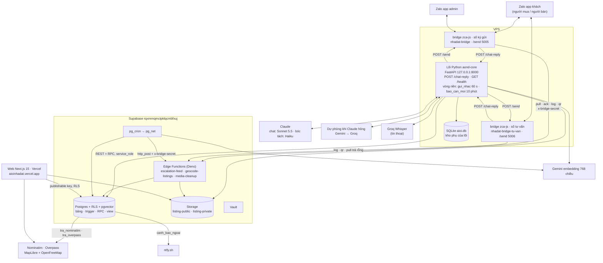
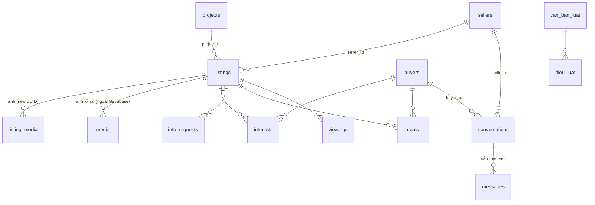
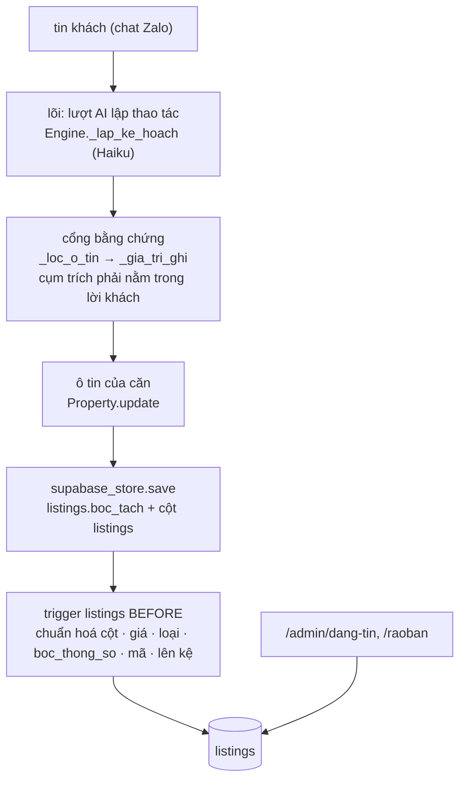
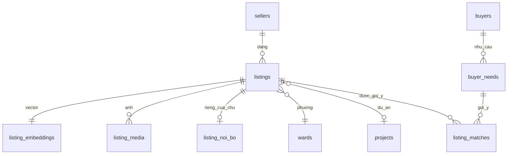

# 07 — Software Requirements Specification

**Hệ thống**: Aioinhadat (AI Ơi Nhà Đất) × nhadat.cc · **Phiên bản**: v3.0 · **Ngày**: 2026-10-28
**Cơ sở**: `02-requirements.md`, `03-user-flows.md`, `04-information-architecture.md`,
code ở HEAD (`src/aioi/`, `bot/`, `app/`) và DB thật project **`rqxmmqmctpklqcmbfxuj`** (Tokyo, gói Free).
Project cũ `tbcdpupiarkuxtntmosl` bị xoá nhầm 08/10/2026; mã đó chỉ còn trong các mục lịch sử.

Tài liệu này tả **hệ thống như đang chạy**. Nguồn của mọi khẳng định là code
trong repo và DB thật. v3.0 viết lại §1, §2, §4 theo kiến trúc lõi Python
(chủ dự án 28/10/2026: "Kiến trúc đúng — bỏ"; "bỏ hẳn CTV đi") `[nguồn: chủ dự án 28/10/2026, chat]`.
§3 chỉ sửa chỗ nhắc bảng đã gỡ và CTV. Các mục `SRS-5.1…` ở §5 là nhật ký sửa, giữ nguyên.
Mục thiết kế chưa dựng chỉ còn một dòng "Không dựng — thay bằng …" để giữ ID
cho `08-traceability.md`.

---

## 1. Giới thiệu

### 1.1 Mục đích
Đặc tả phần mềm đang vận hành để nghiệm thu (`§7`), kiểm thử (`docs/10`) và
mở rộng mà không lệch khỏi yêu cầu ở `02-requirements.md`.

### 1.2 Phạm vi hệ thống

| Mã | Phân hệ | Đường thật |
|---|---|---|
| `WEB` | Website công khai | Next.js ở root repo: `/`, `/[tag]`, `/mua-ban`, `/cho-thue`, `/nha-dat/[code]`, `/du-an`, `/du-an/[slug]`, `/ban-do`, `/moi-gioi`, `/thong-ke`, `/ds/[token]`, `/raoban`, `/tai-khoan`, `/yeu-thich`, `/tinh-lai-vay` |
| `BOT` | Bộ não hội thoại (B và S) | Lõi Python `src/aioi/` trên VPS (`aond-core.service`, cổng 8000), endpoint `POST /chat-reply`; một lõi cho cả người mua lẫn người bán, vai theo ý định từng lượt (SRS-5.1zzzzzzz153) |
| `KENH` | Kênh Zalo | Bridge `zca-js` 2.2.0 (`bot/bridge-zca/index.mjs`) trên tài khoản Zalo cá nhân (clone), HAI tiến trình: số ký gửi (`nhadat-bridge.service`) và số tư vấn người mua (`nhadat-bridge-tu-van.service`, `SO_NHAN=tu_van`) (SRS-5.1zzzzzzz210). Zalo OA không dùng |
| `SEL` | Phía người bán | Cùng lõi, nhánh bán; `/quan-ly` + `/dang-nhap` cho NMG trên web |
| `ADM` | Admin | `/admin`, `/admin/tin-nhan`, `/admin/cau-chuan`, `/admin/danh-gia`, `/admin/dang-tin`, `/admin/ro-hang`; việc nội bộ (câu khách hỏi, lịch xem, cần người thật) đi thẳng admin qua `reminders` → `escalation-feed` → bridge; cảnh báo ntfy |

**CTV không còn là phân hệ** (chủ dự án 28/10/2026: "bỏ hẳn CTV đi"). Mọi việc từng giao CTV nay giao admin, hoặc chủ nhà
khi tin có chủ nhà trên hệ thống (SRS-5.1zzzzzzz165, SRS-5.1zzzzzzz170, SRS-5.1zzzzzzz172, SRS-5.1zzzzzzz173).
Tàn dư CTV còn trong DB / code, chưa dọn: bảng `ctvs`, view `ctv_ranks`, cột `ctv_id` ở `conversations` / `info_requests` /
`reminders` / `deals`, giá trị `assignee = 'ctv'`, hàm `chon_ctv` / `ctv_dang_ganh` / `ctv_sla_phut`, nhánh `ctv` của
`notify_info_request_escalation` / `info_request_sla_tick` cho dòng cũ, `la_nhan_vien` (`src/aioi/mua.py`) còn nhận Zalo ID CTV cho
lệnh `#mã: trả lời`, khối hạng CTV ở `/admin`. Dọn là việc riêng.

### 1.3 Tài liệu tham chiếu
`docs/00`…`docs/06`, `docs/09-open-issues.md`, `docs/10-ke-hoach-kiem-thu.md`, `docs/13-so-do-nhan-va-boc-tach.md` (sơ đồ một lượt chat),
`bot/bridge-zca/VPS.md` (vận hành VPS), `CLAUDE.md` §6 (luật đang áp, mỗi dòng kèm `SRS-…`).

---

## 2. Kiến trúc tổng thể

`[nguồn: src/aioi/server.py, src/aioi/engine.py, bot/bridge-zca/index.mjs, bot/bridge-zca/cai-vps.sh, bot/supabase/functions/, bot/supabase/schema.sql, 28/10/2026]`



Ba điều hay hiểu nhầm:
- **Bộ não chỉ có một: lõi Python.** Edge function `chat-reply`, `zalo-webhook`, `nudge`, `ask-seller`, `ctv-report`,
  `inbound-sweep` đã gỡ 18/10/2026 (SRS-5.1zzzzzzz31, SRS-5.1zzzzzzz46). Prompt chỉ ở `src/aioi/prompts.py`.
- **Tin chủ động cho khách do lõi gửi**, qua `POST /send` của bridge: nhắc `followup` / `sold` / `feedback` / `admin_reply`
  (`gui_nhac.py`, SRS-5.1zzzzzzz216), báo căn mới (`bao_can_moi.py`, SRS-5.1zzzzzzz150), nhắc người bán 5 phút (`followup.py`).
  Tin gửi đúng số khách đang nhắn (`Conversation.so_nhan`).
- **Tin nội bộ cho admin / chủ nhà** đi đường khác: trigger DB đẻ `reminders(kind = 'escalation' | 'report')`, bridge số ký
  gửi kéo qua `escalation-feed`, tin cho admin mở bằng `$$$$$ ` (SRS-5.1zzzzzzz134). Số tư vấn không nhận việc này.

### SRS-2.1 — Tech stack

`[nguồn: package.json, src/aioi/config.py, src/aioi/llm/, bot/bridge-zca/cai-vps.sh, bot/supabase/schema.sql; soát 28/10/2026]`

| Lớp | Công nghệ |
|---|---|
| Lõi hội thoại | Python, FastAPI (`src/aioi/server.py`), chạy `aond-core.service` tại `/opt/aond_core`, cổng 8000 (chỉ 127.0.0.1). Cài và khởi động lại bằng workflow `apply-migration.yml` ô `dung_lai = cai-vps` (`bot/bridge-zca/cai-vps.sh`) |
| Module lõi chính | `engine.py` (phiên chat, định tuyến bán / mua) · `prompts.py` (mọi prompt, `GIONG_VUI`, `AD_FORMAT`, `muc_phi`, `VUNG_NHAN_TIN`) · `schema.py` (`CORE_FIELDS`, `CORE_THEO_LOAI`, `FACETS`, `O_NOI_BO`) · `mua.py` (phía người mua) · `supabase_store.py` (kho Supabase) · `dia_danh.py` · `phap_ly.py` · `cau_mau.py` · `xung_ho.py` · `bao_can_moi.py` · `gui_nhac.py` · `lenh_zalo.py` · `anh_can.py` · `kho_anh.py` · `web.py` · `llm/` |
| Kho trạng thái | Supabase là nguồn chính (`SupabaseConversationStore`); SQLite `aioi.db` trên VPS là kho dự phòng khi thiếu khoá Supabase (`SqliteConversationStore`) |
| Kênh chat | Zalo cá nhân qua bridge `zca-js` 2.2.0 (ghim, SRS-5.1zzzzzzz177), tài khoản clone (quyết định chủ dự án 20/10/2026). Hai số: ký gửi và tư vấn (SRS-5.1zzzzzzz210). Bridge thả tim (`addReaction`), gửi ảnh qua `guiAnhQuaUrl` |
| AI chat | Claude **Sonnet 5.5** cho lượt trả lời khách thật (`MODEL_CHAT` trong `cai-vps.sh` → `AIOI_CHAT_MODEL`, SRS-5.1zzzzzzz235); ID thử theo `AIOI_CHAT_MODEL_THU` (SRS-5.1zzzzzzz234) |
| AI bóc tách | Claude Haiku (`AIOI_EXTRACT_MODEL`, mặc định `claude-haiku-4-5`): lượt lập thao tác, đọc ảnh |
| Dự phòng | `llm/du_phong.py`: Claude hỏng thì Gemini rồi Groq; mỗi lần gọi ≤ 15 s, cả vòng ≤ 40 s (SRS-5.1zzzzzzz117, SRS-5.1zzzzzzz133) |
| Prompt caching | Cắt chuỗi system ở `RANH_GIOI_CACHE` (`llm/base.py`); chỉ phần trước dấu có điểm cache (SRS-5.1zzzzzzz166, SRS-5.1zzzzzzz213) |
| Tìm theo nghĩa | Gemini `gemini-embedding-001`, 768 chiều. Câu khách nhúng lúc chat (`dia_danh.py`); dữ liệu nhúng bằng lịch `nhung-tick`, `nhung-dia-danh-tick`, `nhung-luat-tick`. RPC: `tim_nha` (vector `listings.nhung`), `tim_dia_danh_theo_nghia`, `tim_dieu_luat` |
| Tin thoại | Groq Whisper chép ra chữ trước khi vào lõi (`server.py`, `transcribe_voice_url`) |
| DB | Supabase Postgres, RLS trên mọi bảng, trigger + RPC `security definer`, `pgvector`. Lõi đọc / ghi bằng `service_role` qua REST |
| Serverless | 3 Edge Functions (Deno): `escalation-feed`, `geocode-listings`, `media-cleanup` (`§4`); `_shared/` còn `claude.ts`, `gate.ts`, `geocode.ts`, `tin_nhac.ts`, `extraction/` (`luat-tien.ts`, `luat-lien-he.ts`, `nhan.ts`, `ds-phuong.ts`, `tien-ich.ts`) |
| Lịch / HTTP nội bộ | `pg_cron` + `pg_net` (`net.http_post`). Lịch nhắc tên trong repo: `nhung-tick`, `nhung-dia-danh-tick`, `nhung-luat-tick`, `geocode-tick`, `ctv-sla-tick` (chạy `info_request_sla_tick`), `bot-health-tick`, `media-cleanup-tick`, dọn dữ liệu thử `don_du_lieu_thu()`. Số job thật đếm trong DB |
| Bí mật | `.env` lõi trên VPS (khoá Claude, Gemini `GEMINI_API_KEY`…`_4` lấy từ Vault qua `cai-vps`, Groq, service_role); Vault giữ `BRIDGE_SECRET` và khoá cho hàm DB, đọc qua `get_secret()` chỉ `service_role` |
| Kho file | Supabase Storage (SRS-5.1zzzzzzz56): `listing-public/<uuid tin>/` (ảnh căn, công khai), `listing-private` (sổ đỏ, giấy tờ, PDF, tệp dự án; signed URL). SharePoint / OneDrive đã bỏ |
| Web | Next.js 15 (App Router) + TypeScript + Tailwind 4, Bun, deploy Vercel từ root repo. Link bot gửi lấy từ `src/aioi/web.py` (`AIOI_SITE_URL`, mặc định `https://aioinhadat.vercel.app`) |
| Auth | Supabase Auth: Google OAuth + magic link email (NMG, admin, tài khoản B tự nguyện); không Zalo SSO |
| Bản đồ | MapLibre `maplibre-gl` 6.13.0 + nền OpenFreeMap, nạp qua `napMapLibre()` (`lib/ban-do.ts`), gom cụm `lib/cum-ghim.ts` (SRS-5.1zzzzzzz206, SRS-5.1zzzzzzz217). Toạ độ tin: từ điển `duong` trước, rồi Nominatim qua rpc `tra_nominatim`; tiện ích quanh tin qua rpc `tra_overpass` (SRS-5.1zzzzzzz152, SRS-5.1zzzzzzz224) |
| Cảnh báo | ntfy.sh (`canh_bao_ngoai`), `bot_health_tick` đọc `net._http_response` (NFR-18) |
| Quan trắc | `bot_errors` / `bot_health` / `bot_usage` / `bot_usage_model` + `/admin`; log lõi trên VPS chỉ ra journal từ mức `warning` (SRS-5.1zzzzzzz233); đọc bằng ô `doc-log-loi` |
| Kiểm thử | `bun run test:py` (pytest `tests/`, lõi Python) + `bun run kiem` (tsc, `kieu:bot`, build, `test:bot`, `test:rohang`, `truyvet`); bắn thử production bằng ID thử qua ô `ban-thu-*` của `apply-migration.yml` (`docs/10`) |

### SRS-2.2 — Đường giao tiếp S↔B

`[nguồn: src/aioi/mua.py, src/aioi/engine.py, src/aioi/gui_nhac.py, bot/supabase/schema.sql, 28/10/2026]` Một đường duy nhất, bằng bảng + trigger.
Không có HTTP giữa hai "side", không còn bước CTV.

1. Khách mua hỏi về căn → lõi ghi `info_requests(source = 'buyer_ask')` (`mua.py`). Trigger `route_info_request` giao:
   tin có chủ nhà trên hệ thống → `assignee = 'seller'`, hạn `chu_nha_han_gio()`; không có → `assignee = 'admin'` (migration `20261024a`, SRS-5.1zzzzzzz170).
2. Trigger `notify_info_request_escalation` sinh `reminders(kind = 'escalation')` cho người được giao, kèm mẫu "`#mã: câu trả lời`";
   bridge số ký gửi kéo qua `escalation-feed` rồi nhắn từ tài khoản clone. Chủ nhà quá hạn → nhắc admin ngay.
3. Người trả lời:
   - **Chủ nhà** đang chat với bot: lượt AI đọc ý thấy câu trả lời (`tra_loi_khach_hoi`) → `tra_loi_cau_hoi` đóng câu (`engine._handle`).
   - **Admin** nhắn "`#mã: …`" → `lenh_tra_loi` + `la_nhan_vien` + `tra_loi_theo_ma` (`engine._handle`, `mua.py`).
4. `info_requests.status = 'answered'` → trigger `info_request_bao_lai_khach` đẻ `reminders(kind = 'followup')` cho khách;
   **lõi gửi** qua `gui_nhac.py` (vòng `server._vong_gui_nhac`, 60 s, khung 8–20 giờ), câu mẫu `bao_tra_loi_chu_nha` (SRS-5.1zzzzzzz216).
5. Quá hạn: `info_request_sla_tick` (lịch `ctv-sla-tick`) nhắc admin. Lịch xem (`viewings`) đi thẳng admin (`viewings_bao_ctv_va_email`
   đặt `v_ctv := null`, SRS-5.1zzzzzzz165); admin trả lời `#mã: ok giờ` thì chốt lịch và báo khách.

[deprecated 28/10/2026 — bỏ CTV, chủ dự án] Bản v2.0 của mục này: giao CTV ít việc nhất, SLA 120 phút `ctv_sla_phut()`,
`chat-reply` nhánh `nguoi_noi_bo`, `nudge` gửi followup, vòng nhỏ giọt `ask-seller` / `ask_seller_drip()`. `chat-reply`, `nudge`,
`ask-seller`, `ask_seller_drip()`, `nguoi_noi_bo` đã gỡ; `ctv_sla_phut()` còn là tàn dư.

---

## 3. Mô hình dữ liệu

`[nguồn: information_schema + pg_constraint + pg_policies, DB 04/09/2026; soát lại theo bot/supabase/schema.sql 28/10/2026]`

> **Soát 28/10/2026.** `schema.sql` hiện có **45 bảng** `public`. Đã gỡ, mọi chỗ nhắc dưới đây là LỊCH SỬ: `listing_facts` (SRS-5.1zzzzzzz66,
> ô tin một nguồn `listings.boc_tach`), `required_facts` (`20261019g`, bộ câu hỏi nay ở `src/aioi/schema.py`), `bot_prompts`, `mau_cau`,
> `van_kich`, `inbound_ledger`, `inbound_events`, `ai_ghi_thu`, `ctv_daily_reports`, `du_an_can`, `du_an_tai_lieu`, `project_fact_phieu`
> (`20261018i`), `boc_tach_bong`, `ratings_log`, `project_facts`; trigger `listing_insert_drip`, `bao_tin_moi_khop`,
> `trg_conversations_assign_ctv` + hàm `assign_ctv_round_robin` (`20261025a`); view `listing_missing_facts`, `job_suc_khoe`.
> Bảng mới sau 08/10: `bot_usage_model`, `cau_chuan`, `cau_mau`, `danh_gia_ai`, `du_an_kien_thuc`, `giao_lo`, `kien_thuc_phap_ly`,
> `listing_noi_bo`, `van_ban_luat`, `dieu_luat`, `nhung_viec_luat`, `xa_tinh_khac`. CTV: bỏ hẳn (chủ dự án 28/10/2026), phần CTV còn
> trong DB là tàn dư chưa dọn (§1.2).
Khối: `cột:kiểu`, `!` = NOT NULL, `=` = default, `→` = FK. PK `uuid` trừ khi ghi khác. Enum thật:
`listing_deal(ban, cho_thue)`, `property_type(nha_pho, nha_cap4, chung_cu, dat, biet_thu, phong_tro, mat_bang, toa_nha, dat_nong_nghiep, dat_kinh_doanh, kho_xuong, chua_ro)` (4 loại sau thêm `20260909i`),
`seller_type(ccrb, nmg, unknown)`, `request_status(pending, answered, expired)`, `msg_sender(buyer, seller, bot, ctv, system, human)`,
`unit_status(con_ban, giu_cho, da_coc, da_ban)`.

### SRS-3.0 · Bản đồ 45 bảng và đường ghi ô tin

`[nguồn: pg_class + pg_description, DB 06/09/2026]`

Ba tháng sau mở lại repo, thứ mất trước tiên là *cái nào thuộc về cái nào*. Mục
này là bản đồ đó. Nó KHÔNG đẻ nguồn sự thật thứ hai: chú thích tương ứng đã nằm
trong chính DB (`comment on table/column`, migration `20260906b`), hiện ra ngay
dưới tên bảng trong Supabase Table Editor. Đây là bản in ra giấy của thứ đó.

**Năm nhóm, 45 bảng** (đếm `create table` trong `bot/supabase/schema.sql` 28/10/2026). Tiền tố `[NHÓM]` nằm ngay đầu chú thích mỗi
bảng (`comment on table` trong migration), nên Table Editor xếp A→Z mà mắt vẫn gom được theo việc. `bot_usage_model`, `chat_quota`,
`bridge_dang_nhap` xếp theo việc [giả định BA: chưa thấy dòng `comment on table` của ba bảng này trong migration].

| Nhóm | Bảng |
|---|---|
| `[RỔ HÀNG]` (14) | `listings` `media` `listing_media` `listing_noi_bo` (SRS-5.1zzzzzzz116) `media_cleanup_queue` `projects` `listing_views` `wards` (FR-209) `tien_ich` (FR-204) `duong` (FR-212) `phuong_cu` `quan_cu` (`20260930a`) `giao_lo` (SRS-5.1zzzzzzz43) `xa_tinh_khac` (SRS-5.1zzzzzzz128) |
| `[NGƯỜI & HỘI THOẠI]` (10) | `buyers` `sellers` `conversations` `messages` `interests` `info_requests` `viewings` `deals` `reminders` `danh_gia_ai` (SRS-5.1zzzzzzz104) |
| `[BOT & HÀNG ĐỢI]` (15) | `bot_errors` `bot_health` `bot_usage` `bot_usage_model` `chat_quota` `cau_chuan` (SRS-5.1zzzzzzz88) `cau_mau` (SRS-5.1zzzzzzz106) `nhung_viec` `nhung_viec_du_an` (FR-216) `nhung_viec_dia_danh` (`20260930a`) `nhung_viec_luat` `du_an_kien_thuc` (SRS-5.1zzzzzzz56) `kien_thuc_phap_ly` (SRS-5.1zzzzzzz176) `van_ban_luat` `dieu_luat` (SRS-5.1zzzzzzz231) |
| `[CTV]` (1, tàn dư) | `ctvs` — không còn vai CTV (chủ dự án 28/10/2026); `ctv_daily_reports` đã gỡ (`20261018i`) |
| `[HỆ THỐNG]` (5) | `admins` `app_config` `curated_lists` `property_events` `bridge_dang_nhap` (FR-201; một dòng mỗi số Zalo, SRS-5.1zzzzzzz210) |

**Quan hệ chính** — chỉ khoá ngoại thật, không vẽ luồng chạy:



Một hội thoại có thể gắn CẢ `seller_id` và `buyer_id` (một Zalo = một khách = một hội thoại, SRS-5.1zzzzzzz149). Khoá ngoại
`ctv_id → ctvs` còn ở `conversations`, `info_requests`, `reminders`, `deals` là tàn dư, không vẽ.

Ba chỗ hay hiểu nhầm, nói thẳng ở đây:

- **Không có bảng `buyer_preferences`.** Nhu cầu khách nằm ở cột
  `buyers.preferences` (jsonb).
- **Không có bảng câu hỏi theo loại BĐS.** Bộ câu hỏi theo loại chỉ ở `src/aioi/schema.py` (`CORE_FIELDS` theo nhóm,
  `CORE_THEO_LOAI` đè cho loại riêng, SRS-5.1zzzzzzz68). Bảng `required_facts` đã gỡ (`20261019g`).
- **`media` và `listing_media` là hai đời khác nhau.** `media` trỏ file NGOÀI Supabase (lối cũ). `listing_media` (FR-165) là ảnh
  trong Storage, neo `listings.id`; web đọc qua view `listing_photos_v`. Từ 09/09/2026 không còn `masterDB/` trên máy chủ dự án,
  rổ hàng đến từ tin rao thật qua chat và rổ mẫu `seed_thu` (SRS-5.1zzzzzzz167, SRS-5.1zzzzzzz168).

**Đường ghi ô tin — một nguồn `listings.boc_tach`** (SRS-5.1zzzzzzz66). Hình trạng hiện tại:



Không còn nhánh regex TS và `listing_facts`; luật bậc `bac_nguon()` đã gỡ khỏi DB. Ô chủ nhà nói riêng (`schema.O_NOI_BO`) ghi
bảng `listing_noi_bo`, không vào `boc_tach` công khai (SRS-5.1zzzzzzz116).

**Ranh giới bóc tách ⟂ AI có máy canh** (phần TS còn lại ở `bot/supabase/functions/`; lõi Python không thuộc bài này).
`bot/tests/ranh-gioi.mjs` (nằm trong `bun run test:bot`, nên chạy ở CI mỗi PR) chặn hai chiều: mã bóc tách tiền định
không được import SDK Anthropic / `claude.ts` / gọi RPC; tầng AI không được ghi
bảng nghiệp vụ, chỉ ba RPC đã khai tên (`get_secret`, `log_loi`, `cong_token`).
Bài có ca âm nên luật hỏng thì bài đỏ, không im.

**Đọc rổ hàng bằng mắt người:** view `ro_hang_ban` (20 cột thay cho 56, giá quy
ra tỷ, nhãn tiếng Việt, cột `canh_bao` chỉ đích danh trường nào là máy đoán).
`security_invoker = on`, `anon` bị revoke.

**Nhìn như Excel:** schema `so` (`20260907c`) tách riêng khỏi `public` để Table
Editor / Schema Visualizer không lẫn 38 bảng + 19 view ruột bot (đếm trên DB 18/09/2026). Hai view:
`so.ro_hang` — 9 cột đầu đúng thứ tự sheet Excel gốc Q5 (trong `masterDB/`) (stt · bán
hay thuê · vị trí · diện tích · giá · mô tả · SĐT · người bán), cột thêm xếp
sau, cả bán lẫn cho thuê; `so.nguoi_ban` — mỗi người bán một dòng, đếm tin;
`so.hoi_thoai` (`20260907g`) — log chat đọc được: lúc · ai · nội dung · phía bán/mua,
lọc theo `hoi_thoai` để đọc trọn một cuộc (nguồn `messages`, không SĐT).
PostgREST không phơi schema này, `anon`/`authenticated` bị revoke,
`security_invoker = on`. Khác Excel: cột SĐT là SĐT **người bán đã ký** (60/173
tin), DB không giữ SĐT theo tin (FR-104). `xuat_schema()` chỉ quét `public` nên
`so` không nằm trong `schema.sql`; dựng lại phải chạy thêm hai file migration
(`20260907c`, rồi `20260907f` — ô đọc một dòng: mô tả gộp xuống dòng thành
` · `, vị trí bỏ đuôi `, Quận 5, Hồ Chí Minh`, diện tích dấu phẩy thập phân)
[giả định BA: chấp nhận vì view không mang dữ liệu].

### SRS-3.1 · `listings`

```text
id:uuid!  code:text! unique ('BDS-Q5-0001', trigger listings_fill_code)  legacy_sst:int
seller_id:uuid→sellers  deal:listing_deal!=ban  status:text!=cho_thong_tin
district:text!='Quận 5'  ward:text  street:text  location_raw:text  lat,lng:numeric
property_type:property_type=chua_ro  project_id:uuid→projects  unit_code:text  unit_status:unit_status
area_m2,legal_area_m2,built_area_m2:numeric  frontage_m,length_m,rear_width_m:numeric
floors:int  floors_text:text  floor:int  bedrooms:int  bathrooms:int  direction:text
access_type:text  alley_width_m,distance_to_street_m:numeric
legal_status:text  has_completion:bool  planning_status:text
has_elevator,car_in_house,corner_lot,negotiable:bool  furnishing:text  year_built:int
price_raw:text  price_vnd:bigint  price_per_m2_vnd:bigint(generated)  rent_income_vnd:bigint
description:text  source:text!=import_excel  source_url,cc_link:text
property_type_source,price_source,ward_source:text!=suy_doan  specs_source:text
last_confirmed_at,last_interest_at:timestamptz  created_at,updated_at:timestamptz!
nhan:text[]!='{}' (FR-211, chỉ mục GIN, khoá theo từ điển `_shared/extraction/nhan.ts`; ghi qua RPC `them_nhan_tin`)
```
Soát 28/10/2026: khối trên là bản 04/09. `schema.sql` nay có 63 cột (SRS-5.1zzzzzzz140, OPEN-64): KHÔNG còn `legacy_sst`, `unit_status`,
`source_url`, `cc_link`, `specs_source`, `last_confirmed_at`; thêm `boc_tach` jsonb (ô tin một nguồn, đọc qua `o_boc_tach()`, SRS-5.1zzzzzzz66),
`can_chu_duyet`, `chu_duyet_at`, `gap`, `legacy_code`, `toa_do_muc`, `geocode_at`, `tien_ich_gan`, `tien_ich_at`, `nhung` / `nhung_md5` / `nhung_luc`
(vector cho `tim_nha`). RPC `them_nhan_tin` không còn trong `schema.sql`.
Bản đồ ánh xạ đầy đủ 67 cột (nghĩa, khách nói ví dụ, ghi từ đâu, fact liên quan, lọc ở đâu) + fact → cột + ma trận 12 loại BĐS:
`docs/anh-xa-du-lieu-listings.xlsx` (ảnh chụp 18/09/2026 từ `information_schema` + trigger + `required_facts` + 10 tin bắn thật; đổi schema thì phải làm lại — đã lệch: `required_facts` gỡ 19/10).

- CHECK `status ∈ {cho_thong_tin, dang_ban, dang_quan_tam, da_coc, da_chot, an}` (FR-139; `da_coc` có trong `schema.sql` 28/10); `access_type ∈ {mat_tien, hem_xe_tai, hem_xe_hoi, hem_xe_may, hem}`;
  `legal_status ∈ {so_hong_rieng, so_hong_chung, so_hong, hdmb, giay_tay}`; `furnishing ∈ {full, co_ban, khong}`; `bedrooms 1..20`;
  `*_source ∈ {suy_doan, chu_xac_nhan, admin}`; `specs_source ∈ {boc_mo_ta, admin, chu_xac_nhan}` (FR-164/172).
- Trigger BEFORE (theo tên, `schema.sql` 28/10): `trg_listings_chuan_hoa_cot` · `trg_listings_fill_property_type` (FR-150) · `trg_listings_price_vnd` (FR-154) ·
  `trg_y_listings_boc_thong_so` (FR-172) · `trg_z_listings_normalize_status` · `trg_zy_listings_chan_so` · `trg_zz_listings_dang_tin` (lên kệ, FR-144) ·
  `trg_listings_zz_doi_ma` · `trg_listings_zz_fill_code` · `trg_listings_zz_toa_do`.
  AFTER: `trg_listings_bao_can_da_chot` (FR-108), `trg_listings_day_ro_ccrb`, `trg_pe_listings` (FR-70).
  Đã gỡ: `listing_insert_drip` (FR-129, `20261018i`), `bao_tin_moi_khop` (FR-64, `20261025h`).
- Index lọc: `(deal, price_vnd)`, `(deal, status, access_type)`, `(deal, status, floors)`, `(district, status)`; unique partial `(project_id, unit_code)`.
- Policy: `anon_read_listings` chỉ `dang_ban | dang_quan_tam | da_chot`; `listings_own_read/insert` (NMG tin của mình); `listings_admin_read/update`.
- Luật: `area_m2` là diện tích chính (chung cư = tim tường), `legal_area_m2` là công nhận — hai cột khác nhau; `description` giữ nguyên văn
  câu rao, không trigger nào sửa (FR-91/153). [LỊCH SỬ] Luật bậc nguồn cho fact (`chu_xac_nhan` > `admin` > `suy_doan`, FR-163 a,
  FR-164 a) chạy trên `listing_facts` + `bac_nguon()`, cả hai đã gỡ; nay ô tin chỉ ghi điều khách nói qua cổng bằng chứng của lõi (SRS-5.1zzzzzzz73).

### SRS-3.2 · `property_events` — FR-70, FR-73

```text
id:bigserial  listing_id:uuid!→listings cascade  event_type:text!  buyer_id:uuid→buyers set null  at:timestamptz!=now()  meta:jsonb
```
- CHECK `event_type ∈ {view, asked, interest, photos, viewing, deal, match_sent, status}`; index `(listing_id, at desc)`, `(at desc)`; policy `property_events_admin_read`.
- Chỉ trigger `trg_property_event()` ghi (`ghi_su_kien_bds`, không bao giờ ném): `listing_views` → `view`, `info_requests` `buyer_ask` → `asked`,
  `interests` → `interest`, `viewings` → `viewing`, `deals` → `deal`, `reminders` match sent → `match_sent`, `listings` đổi `status` → `status`. `photos` chưa có nguồn sinh.
- `hot_score` (FR-73) = view `bds_hot` tính lúc đọc (số sự kiện 60 ngày), không có cột/job.

### SRS-3.3 · `buyers`

```text
id:uuid!  zalo_user_id:text unique  auth_user_id:uuid unique→auth.users  name:text  phone:text
preferences:jsonb='{}'  last_contact_at:timestamptz  notes:text  created_at:timestamptz!
```
- `preferences` = hồ sơ nhu cầu tích luỹ, nay do lõi ghi (`mua.py`, `BuyerLead`); `merge_buyer_prefs()` đã gỡ. Cờ tắt báo căn mới:
  `buyers.bao_can_moi` (SRS-5.1zzzzzzz175).
- `phone` chỉ khi B tự cung cấp ở luồng đặt lịch (NFR-07); `/admin` không SELECT cột này. Policy `buyers_self_read/insert/update`, `buyers_admin_read`.
- Không có `connection_status`/`fingerprint_ids`: vết giữ chân ở `reminders.kind = reengage` (FR-63); fingerprint không dựng (OPEN-14).

### SRS-3.4 · `sellers`

```text
id:uuid!  zalo_user_id:text unique  auth_user_id:uuid unique→auth.users  phone:text unique  phone_proxy:text  name:text
seller_type:seller_type!=unknown  rating_sum:int!=0  rating_count:int!=0  active_listing_id:uuid→listings set null  created_at:timestamptz!
```
- `seller_type` quyết định phí (CCRB 1 %, NMG 0,5 %, FR-101). Hồ sơ mở từ chat do lõi tạo (`supabase_store._get_or_create_seller`);
  `mo_ho_so_nguoi_ban` đã gỡ. Vai chỉ nhận khi cụm trích GỌI TÊN vai (`_vai_co_bang_chung`, SRS-5.1zzzzzzz213). Khách chỉ ở vai mua
  không có dòng `sellers` (SRS-5.1zzzzzzz149).
- `active_listing_id` = căn bot đang hỏi (FR-157), trigger `info_request_set_active_listing` giữ. `ghi_danh_gia()` đã gỡ; khách chấm sao
  cho AI ghi bảng `danh_gia_ai` (SRS-5.1zzzzzzz104).
- Policy `sellers_self_read/insert`, `sellers_admin_read/update`. Không có `fee_rate`, `email`, `contract_status`.

### SRS-3.5 · `conversations`, `messages` — FR-71, FR-72, FR-131, FR-141

```text
conversations  id:uuid!  buyer_id:uuid→buyers  seller_id:uuid→sellers  ctv_id:uuid→ctvs  channel:text!=zalo_oa  started_at:timestamptz!
               last_message_at:timestamptz  needs_human:bool!=false  needs_human_at,human_touch_at,human_escalated_at:timestamptz
messages       id:uuid!  conversation_id:uuid!→conversations  sender:msg_sender!  body:text!  zalo_msg_id:text unique  seq:bigint! unique  created_at:timestamptz!
```
- CHECK `conversations_co_vai_check` (`buyer_id` HOẶC `seller_id`, được cả hai — SRS-5.1zzzzzzz149; bản cũ là XOR `conversations_mot_vai`);
  unique partial `(buyer_id)`, `(seller_id)` — **một hội thoại/khách, không bao giờ đóng** (FR-131). Lõi ghi / đọc qua
  `supabase_store._hoi_thoai_chung` / `_tim_hoi_thoai`. Cột `ctv_id` là tàn dư. Thêm `human_hold` (admin giữ hội thoại, SRS-5.1zzzzzzz82).
  "Cuộc trò chuyện" 30 phút của FR-72 tính lúc đọc ở view `hoi_thoai_phien`.
- Trigger: `conversations_email_upset` (`needs_human` false→true → `[UPSET]`); `assign_ctv_round_robin` đã gỡ (`20261025a`, SRS-5.1zzzzzzz172);
  `messages_bump_last_message` giữ `last_message_at = greatest(cũ, mới)` — ứng dụng không ghi tay (FR-171 h).
- `seq` là thứ tự tất định (FR-162). Policy chỉ `*_admin_read`; lõi ghi bằng `service_role`.

### SRS-3.6 · `info_requests` — FR-40…FR-44, FR-76, FR-110, FR-140, FR-173

```text
id:uuid!  listing_id:uuid!→listings cascade  buyer_id:uuid→buyers  question:text!  answer:text  status:request_status!=pending
source:text!=seller_flow  assignee:text  ctv_id:uuid→ctvs  sla_due_at,sla_missed_at,reminded_at,answered_at:timestamptz  created_at:timestamptz!
```
- CHECK `assignee ∈ {seller, ctv, admin}` — `ctv` chỉ còn ở dòng cũ; dòng mới là `seller` hoặc `admin` (`route_info_request`, `20261024a`).
  `source ∈ {seller_flow, buyer_ask}` (theo code); index partial `(sla_due_at) where pending and sla_missed_at is null`. Cột `ctv_id` là tàn dư.
- Trigger: `route_info_request` (BEFORE, giao chủ nhà hoặc admin + hạn), `notify_info_request_escalation` (bỏ qua `xac_nhan_lich`/`con_ban`),
  `info_request_bao_lai_khach` (`answered` → followup; `xac_nhan_lich` → `viewings.status='confirmed'`), `huy_nhac_khi_da_tra_loi`,
  `info_request_set_active_listing`, `trg_info_request_thong_bao_khach_hoi`, `trg_pe_info_requests`.
- `question` với `buyer_ask` là chữ tự do. [LỊCH SỬ] `seller_flow` từng mang `fact_key` của `required_facts` và câu trả lời vào cột qua
  `listing_facts_sync_cols`; cả hai đã gỡ. Policy `info_requests_admin_read`.

### SRS-3.7 · `viewings` — FR-50…FR-57, FR-65

```text
id:uuid!  listing_id:uuid→listings  listing_code:text  buyer_id:uuid→buyers  guide:text  slot:timestamptz  time_text:text  phone:text
status:text!=proposed  buyer_rating:int  note:text  source:text=bot  created_at:timestamptz!
```
- CHECK `status ∈ {proposed, pending, confirmed, done, cancelled}`; `buyer_rating 1..5`; `viewings_can_neo` (`listing_id` hoặc `listing_code`).
- INSERT → `viewings_bao_ctv_va_email`: nhắc **admin** ngay (`v_ctv := null`, `20261023g`, SRS-5.1zzzzzzz165; tên hàm còn chữ "ctv" là tàn dư),
  mở câu `xac_nhan_lich` (`buyer_ask`), `email_admin('VIEWING')` (FR-52/57/81).
- Nhắc trước giờ xem = `reminders.kind='viewing'` kèm link bản đồ khi có toạ độ (FR-54); `viewing` sent → `feedback` +4 h (FR-56), lõi gửi
  (`gui_nhac.py`). `ghi_danh_gia()` đã gỡ. Số điện thoại khách ghi `viewings.phone` khi chốt lịch (`mua.ghi_sdt_hen_xem`, SRS-5.1zzzzzzz148).
- `phone` chỉ điền khi B đồng ý ở bước này (NFR-07). Policy `viewings_admin_read`.

### SRS-3.8 · `interests`, `listing_facts`, `deals` — FR-108, FR-112, FR-140, FR-153

```text
interests      buyer_id:uuid!→buyers cascade  listing_id:uuid!→listings cascade  created_at:timestamptz!   (PK cặp)
listing_facts  [ĐÃ GỠ 19/10/2026, SRS-5.1zzzzzzz66 — ô tin một nguồn listings.boc_tach]
deals          id:uuid!  listing_id:uuid!→listings  buyer_id:uuid→buyers  ctv_id:uuid→ctvs (tàn dư)  price_vnd:bigint  fee_pct:numeric  closed_at  created_at
               unique nulls not distinct (listing_id, buyer_id)
```
- `interests`: `mark_listing_interest(codes, buyer_id)` ghi cho mọi căn khách nhắc/bot gợi/xin hình/nhờ hỏi chủ; tin sang `da_chot` → mỗi khách
  trong `interests` nhận `reminders.kind='sold'` (FR-108), lõi gửi (`gui_nhac.py`). Khách chê căn → `interests.trang_thai = khong_hop`
  (SRS-5.1zzzzzzz175), kèm `ly_do`.
- [LỊCH SỬ] `listing_facts` / `ghi_fact_listing()` / `listing_facts_sync_cols`: đã gỡ. Ô chủ nhà nói riêng nằm ở `listing_noi_bo` (chỉ admin).
- `deals`: căn cứ phí (`fee_pct` null khi chốt lúc `unknown`, OPEN-28); `deals_chan_xoa_da_chot` cấm xoá deal đã chốt.
- Bất biến ẩn danh (FR-104/105): view/policy công khai không bao giờ trả `phone`, `zalo_user_id`, số nhà; trong hội thoại bot khai mọi thứ đã lưu
  về căn trừ liên hệ người bán (OPEN-36). [LỊCH SỬ] `locLienHe()` là hàm của `chat-reply` TS đã gỡ; luật che liên hệ còn ở
  `_shared/extraction/luat-lien-he.ts` (web dùng).

### SRS-3.8a · Hai luật chữ nghĩa bắt buộc

`[nguồn: chat-reply v48 — LỊCH SỬ; luật chữ nghĩa còn áp cho dữ liệu]`
- **`deal` có hai bảng từ vựng**: cột `listings.deal` = `ban | cho_thue`; JSON `buyers.preferences` và schema model = `ban | thue`. Bản TS dùng `dealCol()` (FR-163, đã gỡ cùng `chat-reply`); lõi Python phải tự giữ đúng hai bảng này.
- **Không đặt `\b` cạnh chữ tiếng Việt có dấu** — `\w` của JS chỉ là ASCII. Tự dựng biên (`(^|[^a-zà-ỹ])…(?![a-zà-ỹ])`) hoặc khớp trên bản bỏ dấu `boDau()` (FR-161).

### SRS-3.8b · Bảng phụ trợ

```text
curated_lists        id:uuid!  token:text! unique =24 hex  buyer_id:uuid→buyers set null  listing_ids:uuid[]! (1..60)  title  created_at
                     expires_at:=now()+30 ngày                                    -- FR-100; RLS, không policy; đọc/tạo qua RPC (SRS-4.3)
listing_media        id:uuid!  listing_id:uuid!→listings cascade  bucket:text!  storage_path:text!  media_type:text!  mime_type:text!
                     sort_order:int!=0  is_cover:bool!=false  created_at         -- FR-165
                     CHECK bucket ∈ {listing-public, listing-private}; media_type ∈ {mat_tien, trong_nha, hem, so_do, giay_to, khac};
                     so_do/giay_to ⇒ bucket riêng; is_cover ⇒ bucket công khai; storage_path bắt đầu '<listing_id>/'; unique (bucket, storage_path);
                     unique partial một bìa/tin; trigger listing_media_giu_bia, listing_media_xep_hang_don (→ media_cleanup_queue)
media_cleanup_queue  id:uuid!  bucket,storage_path:text!  trang_thai:text!=cho ∈ {cho, dang_lam, xong, loi, chet}  attempts:int!=0  last_error
                     next_retry_at  created_at  updated_at                          -- FR-165 e, FR-166 g
inbound_events       [ĐÃ GỠ 18/10/2026, 20261018i] -- FR-162
inbound_ledger       [ĐÃ GỠ 18/10/2026, 20261018i] -- FR-162, FR-166
reminders            id:uuid!  kind:text! ∈ {promise, reengage, viewing, followup, escalation, report, match, feedback, sold, rating, admin_reply}
                     buyer_id  seller_id  ctv_id (tàn dư)  listing_id  viewing_id (FK cascade)  due_at:timestamptz!  note:text
                     status:text!=pending ∈ {pending, sent, cancelled, dead}  sent_at  locked_at  locked_by  attempts:int!=0  next_retry_at  last_error
                     unique partial: (buyer_id, listing_id) match; (buyer_id, listing_id) sold; (viewing_id) feedback; (buyer_id) reengage pending
                     -- FR-32/60…64/108/110/133/166 f; policy reminders_admin_read/update
                     -- 28/10: lõi gửi followup / sold / feedback / admin_reply (gui_nhac.py, SRS-5.1zzzzzzz216); escalation / report đi escalation-feed;
                     --        match là sổ báo căn mới của lõi (bao_can_moi.py, SRS-5.1zzzzzzz150)
ratings_log          [ĐÃ GỠ] -- FR-65; khách chấm sao AI nay ở danh_gia_ai (SRS-5.1zzzzzzz104)
ctvs                 id:uuid!  name:text!  zalo_user_id unique  phone  active:bool!=true  last_assigned_at  created_at   -- FR-136/173; TÀN DƯ, không còn vai CTV (28/10/2026)
ctv_daily_reports    [ĐÃ GỠ 18/10/2026, 20261018i] -- FR-137
required_facts       [ĐÃ GỠ 19/10/2026, 20261019g] -- FR-153/177; bộ câu hỏi theo loại nay ở src/aioi/schema.py (CORE_FIELDS, CORE_THEO_LOAI)
listing_views        auth_user_id:uuid!→auth.users  listing_id:uuid!→listings  viewed_at; policy views_own_all   -- FR-126
admins               email:text! PK  zalo_user_id  zalo_phone; policy admins_self_read
app_config           key PK  value!  ghi_chu  (admin_email, ntfy_topic, functions_base_url, storage_public_base_url, publishable_key)
bot_prompts          [ĐÃ GỠ 18/10/2026, 20261018i] -- FR-138; prompt chỉ ở src/aioi/prompts.py
cau_mau / cau_chuan  câu bot nói nguyên văn (đè `cau_mau.MAC_DINH`) / câu chuẩn người chấm sửa làm ví dụ -- SRS-5.1zzzzzzz106, SRS-5.1zzzzzzz88; sửa ở /admin/cau-chuan
wards                ten:text! PK (tên MỚI không tiền tố, khoá tra Nominatim)  loai! ∈ {phuong, xa, dac_khu}  ten_day_du!  quan_cu! ("Quận 9" — chuỗi bocQuan/mã tin)
                     don_vi_2025:text[]!  tinh_cu! ∈ {TP.HCM, Bình Dương, Bà Rịa – Vũng Tàu}  don_vi_cu  lat,lng:numeric(9,6)  ma_hanh_chinh  nguon!  ghi_chu  created_at
                     -- FR-209 / FR-174 đợt 2 (20260915a): 168 dòng, nguồn NQ 1685 + Wikipedia; RLS bật, revoke anon/authenticated, chỉ service_role; xuat_schema() KHÔNG xuất dữ liệu → dựng lại chạy thêm migration
                     nhung:vector(768)  nhung_md5  nhung_luc   -- 20260930a: vector nghĩa (Gemini) của van_ban_dia_danh('wards', ten); cron nhung-dia-danh-tick
duong                id:uuid PK  ten:text! (có dấu, không tiền tố "Đường")  ten_khong_dau:text (generated: bo_dau(ten), index)  tinh! ∈ {TP.HCM, Tây Ninh, Đồng Nai} (tỉnh MỚI)
                     tinh_cu ∈ {TP.HCM, Bình Dương, Bà Rịa – Vũng Tàu}  phuong:text!='' (wards.ten_day_du)  quan_cu  nguon!  created_at; unique (ten, tinh, phuong)
                     -- FR-212 (20260921b): từ điển tên đường từ OSM/Overpass theo phường mới; RPC tim_duong(ten, quan, toi_da) khớp đúng/gần (fuzzystrmatch); chỉ service_role; dữ liệu nạp bằng scripts/nap-duong.mjs
                     loai ∈ {duong, so, hem}  so_hem ('137', '137/28')  duong_me  lat,lng (tâm OSM)  nhung:vector(768) (không nhúng hẻm)  nhung_md5  nhung_luc   -- 20260930a: giữ đường số + hẻm có toạ độ (nap-duong.mjs out center)
phuong_cu            id PK  ten! ('Phường 12', 'Phường Thảo Điền')  loai ∈ {phuong, xa, thi_tran}  quan_cu!  phuong_moi!→wards.ten  toan_bo!  lat,lng (tâm phường mới)  nhung  -- 20260930a: 487 dòng tách từ wards.don_vi_cu; unique (ten, quan_cu, phuong_moi)
quan_cu              ten PK ('Quận Gò Vấp')  lat,lng (trung bình tâm phường mới)  so_phuong_moi  nhung  -- 20260930a: quận / huyện / TP cũ trước 07/2025
media                bảng cũ đường OneDrive, còn policy anon đọc ảnh approved, không còn nguồn ghi — dọn cùng OPEN-18
```
- Không dựng: `tags`/`property_tags` (tag là hằng `lib/tags.ts`, 64 tag, FR-12; OPEN-06), `saved_criteria` (FR-64 đọc `buyers.preferences`),
  `escalations` (bốn loại đi `email_admin()`; vết việc ở `reminders`/`viewings`/`info_requests`), `photos` (thay bởi `listing_media`).

### SRS-3.9 · Bảo mật dữ liệu

`[nguồn: pg_policies, pg_class.relacl, storage.policies, DB 04/09/2026]` Anon key là khoá **công khai** (trong bundle JS và bridge) nên RLS + GRANT là bức tường duy nhất:

1. Vai `anon` chỉ SELECT; `authenticated` ghi có policy gác (`buyers`, `sellers`, `listings` nháp, `listing_views`, `listing_media` tin của mình); không ai có TRUNCATE (FR-167).
2. Bảng chỉ cho bot (`conversations`, `messages`, `info_requests`, `viewings`, `deals`, `interests`, `ctvs` (tàn dư), `listing_noi_bo`,
   `curated_lists`, `media_cleanup_queue`, `app_config`; bản 04/09 còn `ctv_daily_reports`, `bot_prompts`, `required_facts`, `inbound_*`,
   `ratings_log` — đã gỡ) bật RLS, chỉ policy đọc cho admin hoặc không policy — anon 0 dòng; cảnh báo `rls_enabled_no_policy` là kỳ vọng.
3. Hàm là nội bộ trừ khi chứng minh ngược lại: EXECUTE mặc định chỉ `service_role`/`postgres`; ngoại lệ cố ý là hàm thuần `immutable` (`bo_dau`, `boc_thong_so`,
   `khu_khop`, `seller_rank`, `chuan_hoa_*`…; `bac_nguon` đã gỡ), `log_loi` (web Next chạy bằng publishable key), `doc_danh_sach` (anon), và cho `authenticated`:
   `admin_dang_tin`, `tao_danh_sach`, `la_admin`, `tin_cua_toi`, `thu_muc_dau_uuid`, `parse_vnd`, `guess_property_type`. Mọi hàm ghim `search_path`.
4. View công khai phải là **SECURITY DEFINER tự chứa** (`agents_public`, `listing_photos_v`), chỉ lộ cột không định danh, chỉ tin đã lên kệ; view không dùng cho anon
   để `security_invoker` và revoke (`public_listings`, `public_media`, `media_mo_coi_*`; `listing_missing_facts`, `job_suc_khoe` không còn trong `schema.sql` 28/10).
   View admin (`ctv_ranks` — tàn dư CTV, `nmg_hoat_dong`, `bds_hot`, `hoi_thoai_*`, `khach_can_nguoi_that`; `bot_do_tre` không còn trong `schema.sql` 28/10) gác `auth.role() = 'service_role'` hoặc email trong `admins` (FR-167 c).
5. Vault không chạm anon: `get_secret()` chỉ `postgres`/`service_role`.
6. Storage: `listing-private` không có route public; đọc duy nhất bằng signed URL 900 s do admin ký ở `/admin` (`storage_admin_private_all`, NFR-06). Bucket công khai:
   `storage_admin_public_all`; người bán chỉ INSERT/DELETE đường dẫn có thư mục đầu = UUID tin của mình (`tin_cua_toi(thu_muc_dau_uuid(name))`, FR-96).
   `listing_media` công khai chỉ đọc được khi TIN đã lên kệ (`listing_media_doc_cong_khai`, FR-167 c).
7. Cổng edge function (`_shared/gate.ts`): 3 function còn lại (`escalation-feed`, `geocode-listings`, `media-cleanup`) qua nếu `Authorization` là service key hoặc header `x-bridge-secret` khớp `BRIDGE_SECRET`; chưa đặt secret thì
   fail-open nhưng ghi `bot_errors` nguồn `<function> CONG MO`; bí mật đọc qua `secretOf()` (env trước, Vault sau). Mọi hàm SQL gọi `net.http_post` tới function
   phải mang `x-bridge-secret`, trừ `canh_bao_ngoai` (FR-151 b, FR-167 b).
8. [deprecated 28/10/2026] `zalo-webhook` đã gỡ (SRS-5.1zzzzzzz46); không còn cửa Zalo OA. Lõi `aond-core` chỉ nghe 127.0.0.1, bridge gọi
   trong cùng máy; `/send` của bridge cũng chỉ nghe 127.0.0.1.

Hồi quy: TS-SEC-01…10, TS-SEC2 (`docs/10`) sau mọi migration đụng RLS/GRANT.

### SRS-3.10 · `projects` — FR-113…FR-117

```text
id:uuid!  name:text!  slug:text unique  developer  district  ward  province  location_raw  lat,lng:numeric  legal_status  amenities:jsonb
floor_plans:jsonb  images:jsonb  specs:jsonb  unit_types:jsonb  description  price_min,price_max:bigint  priority:int!=100  is_partner:bool!=false
handover_date:date  handover:text  status_text  source  source_url  created_at  updated_at
```
- `listings.project_id/unit_code/floor/direction/unit_status` nối căn với dự án; unique partial `(project_id, unit_code)`. Policy `anon_read_projects` (true); `match_projects(text)` tìm dự án khách nhắc.
- Luật thừa hưởng (FR-115/116): câu tầng dự án trả từ `projects`, không sinh `info_requests`; "căn X còn không" đọc `unit_status`; `last_confirmed_at` > 7 ngày hoặc null → "để em xác nhận lại chủ".
  Soát 28/10/2026: `listings.unit_status` và `listings.last_confirmed_at` không còn trong `schema.sql` (SRS-5.1zzzzzzz140). Kiến thức dự án lõi học
  được nằm ở `du_an_kien_thuc`; phía mua tra qua `supabase_store.tra_du_an` (SRS-5.1zzzzzzz184).

### SRS-3.11 · Tài khoản, admin và view quan trắc hội thoại — FR-124…FR-128, FR-71/74/76/77/78/80

- `sellers.auth_user_id`, `buyers.auth_user_id` nối Supabase Auth (Google OAuth + magic link). CCRB không cần tài khoản.
- `admins(email)`: mọi policy `*_admin_read/update` kiểm `exists (select 1 from admins where email = auth.jwt()->>'email')`. Thêm admin = insert email.
  Các bảng buyer side (`info_requests`, `viewings`, `buyers`, `conversations`, `messages`; `ctvs` là tàn dư) chỉ mở SELECT cho admin; ghi thuộc lõi / trigger / RPC admin.
- `agents_public` (definer, tự chứa): `id, name, seller_type, rating_sum, rating_count, listing_count, closed_count, rank` — không bao giờ `phone`/`zalo_user_id` (FR-125).
- `listing_views` (own-only) là nền "tin đã xem"; `TrackView` chỉ chạy khi có phiên đăng nhập.
- View admin: `hoi_thoai_thong_ke` (30 ngày theo ngày VN, FR-71), `khach_can_nguoi_that` (FR-77), `hoi_thoai_phien` (FR-72), `bds_hot` (FR-73); `bot_do_tre` (NFR-01) không còn trong `schema.sql` 28/10, thời gian lượt nay đo ở `thoi_gian_ms` của `/chat-reply`. `/admin` đọc bằng JWT admin, có CSV.
- Kỷ luật cột: DB quyết "ai đọc", web quyết "đọc cột nào" — `app/admin/page.tsx` không SELECT `buyers.phone`/`ctvs.phone` (NFR-07).

### SRS-3.12 · Bảng vận hành và hàm RPC — FR-146, FR-151, FR-152, FR-159, FR-166…FR-173

```text
bot_usage   day:date! PK (giờ VN)  model_calls:int!=0  capped_at  in_tokens,out_tokens,cache_write_tokens,cache_read_tokens:bigint!=0  -- FR-151 a, FR-169
bot_usage_model  day:date! model:text! PK(day,model)  calls:int!=0  in_tokens,out_tokens,cache_write_tokens,cache_read_tokens:bigint!=0  -- SRS-5.1zv/zw: chữ-máy + lượt theo model, /admin quy ra đô đúng giá từng model
bot_errors  id:bigserial  at:timestamptz!  source:text!  status_code:int  detail:text; index (at desc), (source, at desc)      -- FR-152
bot_health  who:text! PK  at:timestamptz!  last_id:bigint!=0                                                                    -- FR-152
```
Cả ba: RLS, policy `*_admin_read`, ghi chỉ `service_role`. `bot_errors` là sổ duy nhất còn lại khi log function (1 ngày, bậc Free) trôi — mọi `catch` phải nối `ghiLoi()`/`log_loi()` (FR-152 d).

> **Soát 28/10/2026** (đối chiếu `bot/supabase/schema.sql`): các hàm sau trong bảng dưới **không còn** — dòng nhắc chúng là LỊCH SỬ:
> `ensure_buyer_conversation`, `ensure_seller_conversation`, `mo_ho_so_nguoi_ban`, `nguoi_noi_bo`, `merge_buyer_prefs`, `ghi_fact_listing`,
> `tao_followup`, `ghi_danh_gia`, `bao_tin_moi_khop`, `info_request_timeout_tick`, `stale_listing_tick`, `seller_drip_tick`, `ask_seller_drip`,
> `trg_listing_drip`, `nudge_tick`, `ctv_report_tick`, `inbound_sweep_tick`, `bo_dem_nhac_treo`, `claim_inbound`, `bao_hong_inbound`,
> `viec_inbound_bo_roi`, `ghi_su_kien_inbound`, `nhan_viec_nhac`, `bao_hong_nhac`, `nha_viec_nhac`, `lan_thu_ke`, `ap_thong_so`,
> `listing_facts_sync_cols`, `chuan_hoa_lai_gia`, `guess_property_type_answer`, `listings_try_publish`, `listings_autopublish`,
> `seller_hoi_bu_tick`, `ghi_boc_tach`, `trg_fact_vao_boc_tach`, `trg_vi_tri_vao_cot`, `ngu_canh_tin`, `mau_cau_fewshot`, `bac_nguon`,
> `cat_truoc_phu_dinh`, `tim_phuong_theo_nghia`, `dia_danh_gan`, `duong_gan_duong`, `phuong_giao_hai_duong`, `tim_hem`, `them_nhan_tin`;
> view `listing_missing_facts`, `job_suc_khoe`. Hàm CTV còn (`ctv_sla_phut`, `chon_ctv`, `ctv_dang_ganh`, view `ctv_ranks`) là tàn dư.
> Hàm lõi Python gọi hiện nay: bảng RPC ở §4. Hàm mới đáng kể sau 08/10: `tim_nha`, `tim_dia_danh`, `tim_dieu_luat`, `tra_nominatim`,
> `tra_overpass`, `tim_moc`, `ban_do_khung`, `admin_gui_tin`, `giao_lo_cua`, `chuan_dia_ban`, `o_boc_tach`, `la_id_thu`, `reset_nguoi_test`.

`[nguồn: pg_proc + proacl, DB 04/09/2026]` Quyền: **SR** = chỉ `service_role`/`postgres`; **trig** = hàm trigger; **thuần** = ai cũng gọi được; **auth** = thêm `authenticated`; **anon** = mở cho web.

| Hàm / view | Việc | Quyền |
|---|---|---|
| `ensure_buyer_conversation` / `ensure_seller_conversation` | Mở/lấy hồ sơ + hội thoại duy nhất (advisory lock), trả kèm `ctv_id`, `human_touch_at` | SR |
| `mo_ho_so_nguoi_ban(zalo, seller_type)` / `nguoi_noi_bo(zalo)` | Mở `sellers` idempotent kèm nhãn, không ghi đè nhãn (FR-159) / tra CTV-admin (FR-173 d) | SR |
| `merge_buyer_prefs` / `ghi_fact_listing` / `mark_listing_interest` / `tao_followup` / `ghi_danh_gia` | Hồ sơ nhu cầu (FR-130) / cửa ghi fact duy nhất / `interests` + `dang_quan_tam` (FR-108/139) / followup +150' một lần/24 h (FR-32) / sao → `viewings` + `sellers.rating_*`, idempotent (FR-65) | SR |
| `can_cung_khu(buyer, listing, limit)` / `khu_khop` | 2–3 căn cùng phường/quận, giá 0,7–1,15×, trừ căn đã gửi (FR-62/108/110) | SR / thuần |
| `bao_tin_moi_khop` / `bao_can_da_chot` + trigger | Tin vừa `dang_ban` → `reminders.match` cho khách khớp, van 1/khách/24 h (FR-64) / tin `da_chot` → `reminders.sold` (FR-108) | SR / trig |
| `reminders_hen_hoi_cam_nhan` / `messages_bump_last_message` | `viewing` sent → `feedback` +4 h (FR-56) / giữ `last_message_at` (FR-171 h) | trig |
| `route_info_request` / `notify_info_request_escalation` / `info_request_bao_lai_khach` | Giao việc + SLA / nhắc người được giao / báo lại khách, lật lịch `confirmed` (FR-140, FR-173, FR-52) | trig |
| `viewings_bao_ctv_va_email` / `conversations_email_upset` / `reminders_email_voice` | `[VIEWING]` + nhắc CTV + câu `xac_nhan_lich` / `[UPSET]` / `[VOICE]` (FR-52/57/77/79/81) | trig |
| `email_admin(loai, uid, body, listing)` / `canh_bao_ngoai(title, text, priority, p_email)` | Ghép `[LOẠI] <uid>` → ntfy; `admin_email` rỗng → không gửi (FR-81) / `net.http_post` tới ntfy.sh, không qua bridge (FR-152 e) | SR |
| `info_request_sla_tick` / `info_request_timeout_tick` / `stale_listing_tick` | Quá 120' → admin + `[QUESTION]` (FR-173 c) / 24 h nhắc, 48 h `expired` + followup căn khác (FR-110) / tin im 30 ngày → hỏi `con_ban`, ≤ 5 tin/ngày (FR-103) | SR (cron) |
| `seller_drip_tick` / `ask_seller_drip` / `trg_listing_drip` | Gọi `ask-seller` hỏi nhỏ giọt, mang `x-bridge-secret` (FR-129/144) | SR / trig |
| `nudge_tick` / `ctv_report_tick` / `media_cleanup_tick` / `inbound_sweep_tick` | Gọi edge function tương ứng; chỉ gọi HTTP khi có việc (FR-166 d, FR-171 c) | SR (cron) |
| `bot_health_tick` / `beat(who)` / `bo_dem_nhac_treo(gio)` | Quét `net._http_response` không 2xx → `bot_errors`, nhịp tim bridge, gộp báo 1 tin/giờ, dọn sổ 30 ngày (FR-152, NFR-18) / nhịp tim / đếm nhắc treo | SR |
| `log_loi(source, detail, code)` / `bat_het_tien_api()` | Cửa ghi lỗi, van 20 dòng/nguồn/giờ, 200/giờ (FR-171 b) / dấu hiệu hết tiền AI → `HET TIEN API`, ghi thẳng, hãm 6 h (FR-168) | anon / trig |
| `bump_model_quota(limit)` / `cong_token(..., p_model)` | Trần lượt gọi model/ngày; cộng số chữ vào `bot_usage` (theo ngày) và `bot_usage_model` (theo ngày × model, SRS-5.1zv) (FR-151 a, FR-169) | SR |
| `claim_inbound` / `bao_hong_inbound` / `viec_inbound_bo_roi` / `ghi_su_kien_inbound` | Sổ idempotency tin đến: giành job atomic, 8 lần → `dead`, tìm việc bỏ rơi 24 h (FR-162, FR-166) | SR |
| `nhan_viec_nhac` / `bao_hong_nhac` / `nha_viec_nhac(id, worker)` | Hàng đợi nhắc: thuê 5' `skip locked`; hỏng → lùi dần, 5 lần `dead`; chưa thử → trả lại nguyên vẹn (FR-166 f) | SR |
| `nhan_viec_don_media` / `chon_viec_don_chet` / `lan_thu_ke(attempts)` | Hàng đợi dọn file `attempts < 6`; khoảng chờ nhân đôi, trần 1 h, nhiễu ±20 % (FR-165 e, FR-166) | SR |
| `boc_thong_so(text, type)` / `boc_ten_duong` / `ap_thong_so(listing, j, bac, de)` / `listings_boc_thong_so` | Bóc thông số (trên `bo_dau`) → cột theo luật bậc (FR-172) | thuần / thuần / SR / trig |
| `listing_facts_sync_cols` / `listings_fill_code` / `next_listing_code` | Fact → cột (SRS-3.14) / cấp mã tin chỉ trong trigger (FR-158, FR-167) | trig / trig / SR |
| `listings_set_price_vnd` / `parse_vnd` / `chuan_hoa_gia_raw` / `chuan_hoa_lai_gia` | Giá chữ → số (FR-154) | trig / auth / thuần / SR |
| `listings_fill_property_type` / `guess_property_type` / `guess_property_type_answer` | Loại BĐS từ mô tả; không đoán ra thì `chua_ro` (FR-150) | trig / auth / SR |
| `listings_quyet_dinh_dang_tin` / `listing_du_dang_tin` / `listings_try_publish` / `listings_autopublish` | Tự lên kệ khi đủ giá + m2 + phường (FR-144); tin từ chat (`can_chu_duyet`) còn cần `diem_tin ≥ 70` + `chu_duyet_at` (FR-177 d) | trig / thuần / SR |
| `diem_tin` / `seller_hoi_bu_tick` / `seller_drip_tick` / `ghi_boc_tach` / `trg_fact_vao_boc_tach` / `trg_vi_tri_vao_cot` | FR-177 f–h (`20260909a`): điểm 8 mục (ảnh 4/7/10 theo số tấm), hỏi bù 5 phút sau khi gật rồi nhịp 30 phút tới khi hết câu hoặc `listings.chu_noi_du_at`; `listings.boc_tach` jsonb gom mọi thứ bóc được (bỏ null); `listings.gap`; fact `vi_tri` → `location_raw` | SR / cron / trig |
| `mau_cau` / `ngu_canh_tin` / `mau_cau_fewshot` / `so.mau_cau` | FR-180 (`20260909c`): mẫu câu chuẩn anh/sếp sửa tay từ câu bot thật; bot dán 12 mẫu mới nhất/phía vào system prompt; xuất JSONL để fine-tune (`scripts/xuat-mau-cau.mjs`, `train/`) | bảng / SR / view |
| `diem_tin(listings)` / `diem_tin(uuid)` | Điểm đầy đủ tin 0–100, 7 tiêu chí 15/20/15/10/10/20/10, tiền định từ cột + fact → `{diem, chi_tiet, thieu[], co_anh}` (FR-177 d) | SR |
| `admin_xoa_khach(zalo)` / `admin_xoa_het_khach_va_ro_hang('XOA HET')` / `don_du_lieu_thu()` | Xoá một khách (`/admin/tin-nhan`) / XOÁ HÀNG LOẠT khách + rổ hàng để test lại, đòi đúng chữ, dấu `bot_health(xoa_het)` (FR-210, nút tab CRM) / dọn người thử 21:00 (FR-197) | auth (`la_admin()` trong thân) |
| `admin_dang_tin(jsonb)` / `tao_danh_sach` / `doc_danh_sach(token)` | Cửa đăng tin admin (FR-156/174) / danh sách riêng (FR-100) | auth / auth / anon |
| `la_admin` / `tin_cua_toi(listing)` / `thu_muc_dau_uuid(name)` / `get_secret` / `cau_hinh(key)` | Gác policy storage + `listing_media` (FR-96) / Vault / `app_config` | auth / SR |
| `seller_rank` / `bac_nguon` / `ctv_sla_phut` / `bo_dau` / `chuan_hoa_phuong` / `cat_truoc_phu_dinh` / `match_projects` | Hàm thuần dùng chung | thuần (`match_projects` SR) |
| `tim_duong(ten, quan, toi_da)` | FR-212 (`20260921b`): tra từ điển `duong` — khớp đúng + khớp gần (Levenshtein ≤ toi_da trên chữ bỏ dấu, `fuzzystrmatch`), mỗi tên một dòng gom phường/quận/tỉnh, ưu tiên quận trùng | SR |
| `tim_dia_danh_theo_nghia(vec, loai[], lat, lng, n)` / `tim_phuong_theo_nghia(vec, n)` | `20260930a`: địa danh (phường mới / cũ, quận cũ, đường, đường số, dự án) gần NGHĨA nhất với vector câu khách, trừ điểm theo khoảng cách tới điểm neo (1 km = −0,01, tối đa −0,2). Kết quả là ỨNG VIÊN (SRS-5.1a) | SR |
| `dia_danh_gan(lat, lng, bán kính, loai[], n)` / `duong_gan_duong(ten, phuong, bán kính, n)` / `phuong_giao_hai_duong(d1, d2, bán kính)` / `tim_hem(cap_hem[], duong_me, phuong)` / `khoang_cach_m(...)` | `20260930a`: VỊ TRÍ — địa danh quanh một điểm; đường nào gần đường nào; phường có cả hai con đường gần nhau; hẻm theo số (hẻm nhỏ nhất trước) + đường mẹ; haversine (không PostGIS). `tim_duong` bỏ hàng hẻm khỏi khớp tên | SR / thuần |
| `nhung_dia_danh_tick()` / `van_ban_dia_danh(bang, khoa)` | `20260930a`: cron `nhung-dia-danh-tick` 2 phút nhúng quận cũ → phường mới → phường cũ → đường (không hẻm) SAU hàng chờ tin rao + dự án, chung công tắc `tim_theo_nghia` và mốc tạm dừng Gemini | cron / SR |
| view `ctv_ranks`, `nmg_hoat_dong`, `seller_ranks`, `job_suc_khoe`, `listing_missing_facts`, `media_mo_coi_db/storage` | Hạng CTV (FR-173 e); NMG hoạt động (I5); hạng người rao (FR-155); ba hàng đợi (FR-166); câu còn thiếu (FR-153); file mồ côi (FR-165) | admin/SR; `seller_ranks` invoker; còn lại SR |

[LỊCH SỬ] Cửa `mark_sent` của `chat-reply` TS ghi `inbound_ledger.sent_bubbles/sent_at` (FR-162). Lõi Python vẫn nhận trường `mark_sent`
nhưng chỉ trả rỗng; `inbound_ledger` đã gỡ.

### SRS-3.13 · Tầng cache của web — NFR-17, FR-171 j

`[nguồn: app/**/page.tsx]`

| Nhóm | Route | Cách |
|---|---|---|
| Tĩnh/ISR | `/`, `/ban-do` (300 s); `/moi-gioi`, `/thong-ke`, `sitemap` (3600 s) | `export const revalidate` |
| Động có tham số đường dẫn | `/nha-dat/[code]` (300 s), `/[tag]`, `/du-an/[slug]` (3600 s) | `revalidate` **bắt buộc kèm** `generateStaticParams()` — thiếu là route thành `ƒ`, mỗi lượt xem một lambda |
| Đọc `searchParams` | `/mua-ban`, `/cho-thue` | ISR không với tới → truy vấn bọc `unstable_cache` (300 s) khoá theo bộ lọc; không `revalidate` |
| Bí mật | `/ds/[token]`, `/admin`, `/quan-ly` | động (`ƒ`) có chủ ý |

- Luật: trang tin phải là `●`/`○` trong bảng route sau `bun run build`; thấy `ƒ` là hỏng (TS-CACHE).
- Trong một lần dựng: `getListing` bọc `React.cache`; danh sách đọc `CARD_COLS`, bản đồ `MAP_COLS`, không `select("*")`; `/admin` gom truy vấn vào một `Promise.all`.

### SRS-3.14 · Bộ câu hỏi theo loại, bậc nguồn, hạng người rao, cửa đăng tin admin — FR-153…FR-156, FR-164, FR-172

> **Soát 28/10/2026.** Phần "bộ câu hỏi theo loại" và "bậc nguồn" dưới đây là LỊCH SỬ: `required_facts` (gỡ `20261019g`), `listing_facts`
> (gỡ, SRS-5.1zzzzzzz66), view `listing_missing_facts`, trigger `listing_facts_sync_cols`, `bac_nguon()`, `chonCauKe()` (TS) đều không còn.
> Hiện nay bộ câu hỏi theo loại chỉ ở `src/aioi/schema.py`: `CORE_FIELDS` theo nhóm, `CORE_THEO_LOAI` đè cho loại riêng (SRS-5.1zzzzzzz68),
> `FACETS` / `FACET_CHINH` cho ngưỡng soạn bài (`Property.minimal_missing`, `summary_ready`, SRS-5.1zzzzzzz200, SRS-5.1zzzzzzz202), hỏi sau
> khi tin lên web theo `CUM_SAU_DANG`, ô riêng chủ nhà `O_NOI_BO` → bảng `listing_noi_bo`. Ô tin ghi vào `listings.boc_tach`.
> Còn đúng: `boc_tach_nhom` / `jsonb_bo_rong` / view `boc_tach_v`, hạng người rao (`seller_rank`, `seller_ranks`), cửa `admin_dang_tin`.

Đặc tính riêng theo loại không nằm ở cột riêng mà ở cặp `required_facts × listing_facts`:
`listing_missing_facts = required_facts ⋈ property_type − listing_facts − {fact_key mà cột tương ứng đã có}` (FR-172 d; ánh xạ `ket_cau↔floors`,
`do_rong_hem/do_rong_duong↔alley_width_m|mat_tien`, `phap_ly↔legal_status`, `huong↔direction`, `so_phong_ngu↔bedrooms`, `tang↔floor`, `dien_tich*↔area_m2`,
`nam_xay↔year_built`, `noi_that↔furnishing`, `mat_tien↔frontage_m`, `quy_hoach↔planning_status`). Đổi `property_type` = đổi bộ câu hỏi ở lượt kế, không migration.

| Loại | Bộ câu hỏi (`required_facts`, theo `nhom` rồi priority — FR-177 a, `20260907h`; thứ tự TRONG nhóm cơ bản do `chonCauKe()` bám câu chủ nhà vừa nói) |
|---|---|
| `nha_pho` | cơ bản: phuong, dien_tich_dat, gia · chuyên môn: do_rong_hem, ket_cau, so_phong_ngu, phap_ly, hinh_anh · phụ (không hỏi): huong, quy_hoach, nam_xay |
| `nha_cap4` | cơ bản: phuong, dien_tich_dat, gia · chuyên môn: dien_tich_dat→do_rong_hem, phap_ly, hien_trang, so_phong_ngu, hinh_anh · phụ: quy_hoach |
| `chung_cu` | cơ bản: phuong, dien_tich_tim_tuong, gia · chuyên môn: phap_ly, so_phong_ngu, tang, phi_quan_ly, noi_that, hinh_anh · phụ: huong |
| `dat` | cơ bản: phuong, dien_tich, tho_cu, gia · chuyên môn: phap_ly, do_rong_duong, hinh_anh · phụ: quy_hoach |
| `biet_thu` | cơ bản: phuong, dien_tich_dat, gia · chuyên môn: ket_cau, phap_ly, san_vuon, do_rong_hem, so_phong_ngu, hinh_anh · phụ: huong |
| `phong_tro` | cơ bản: phuong, dien_tich, gia · chuyên môn: gia_dien_nuoc, gio_giac, noi_that, hinh_anh |
| `mat_bang` | cơ bản: phuong, dien_tich, mat_tien, gia · chuyên môn: thoi_han_thue, nganh_hang_phu_hop, hinh_anh |
| `chua_ro` | loai_bds, phuong, gia |
| `toa_nha` (20260909i) | cơ bản: vi_tri, phuong, dien_tich_dat, gia · chuyên môn: so_phong, ty_le_lap_day, doanh_thu, ket_cau, thang_may, pccc, phap_ly, do_rong_hem, hinh_anh · sau đăng: the_chap, ly_do_ban, thuong_luong |
| `dat_nong_nghiep` (20260909i) | cơ bản: vi_tri, phuong, dien_tich, gia · chuyên môn: quy_hoach, len_tho_cu, duong_vao, nguon_nuoc, ranh_gioi, phap_ly, hinh_anh · sau đăng: ly_do_ban, thuong_luong |
| `dat_kinh_doanh` (20260909i) | cơ bản: vi_tri, phuong, dien_tich, gia · chuyên môn: thoi_han_su_dung, hinh_thuc_thue_dat, muc_dich, do_rong_duong, phap_ly, hinh_anh · sau đăng: ly_do_ban, thuong_luong |
| `kho_xuong` (20260909i) | cơ bản: vi_tri, phuong, dien_tich, gia · chuyên môn: chieu_cao, tai_trong_san, tram_bien_ap, xu_ly_nuoc_thai, duong_container, phap_ly, thoi_han_su_dung, (thuê) tien_coc, thoi_han_thue, hinh_anh · sau đăng: (thuê) truot_gia, fit_out, ly_do_ban |
| *mọi loại nhà/chung cư/đất* | **sau đăng** (`sau_dang`, 30+, chỉ vòng hỏi bù): so_wc, cach_mat_tien, hem_thong, ngap_nuoc, hien_trang_su_dung, the_chap, tien_ich_gan, ly_do_ban, thuong_luong; chung cư: view, can_goc, phi_gui_xe, so_huu; đất: hinh_dang, mat_do_xd, tang_cao_toi_da; thuê: fit_out |

JSON chia nhóm của một tin (FR-187, `20260909i`): `boc_tach_nhom(listings) → jsonb` 12 nhóm (tin · nguoi_rao · vi_tri · thong_so · phap_ly · gia · cho_thue · khai_thac · anh · bo_sung · cham_soc · diem), `jsonb_bo_rong()` bỏ null; view `boc_tach_v` (RLS admin) cho `/admin/ro-hang(/json)`, `so.boc_tach` cho Table Editor. Cột `listings.boc_tach` phẳng vẫn giữ (trigger ghi, `boc_thong_so` đọc).

Fact ngoài bảng nhưng có nghĩa (FR-177 e): `bo_sung` (câu lệch không nhận ra fact nào — ghi nguyên văn, `boc_thong_so` vẫn quét), `tiem_nang` (tiềm năng sử dụng, chỉ khi chủ tự kể), `duyet_tin` (lượt gật bản nháp; câu chờ cùng tên trong `info_requests`).

- Trigger `listing_facts_sync_cols` đổ fact vào cột (fact giữ nguyên văn, chuẩn hoá chỉ trên đường vào cột): `so_phong_ngu → bedrooms` (1…20);
  `dien_tich/dien_tich_dat → area_m2` (5…5000), `dien_tich_tim_tuong → area_m2` **chỉ** `chung_cu` (FR-163); `tang → floor` (0…80); `huong → direction`;
  `gia → price_raw + price_source` (`parse_vnd` 1e8…1e12, thuê dải riêng; `price_vnd` do trigger dẫn xuất); `phuong → ward + ward_source` (`chuan_hoa_phuong`);
  `loai_bds → property_type + property_type_source` (`guess_property_type_answer`, không đọc ra thì không ghi); khoá khác → cụm cột FR-172 qua `boc_thong_so()` → `ap_thong_so()`.
- Luật bậc `bac_nguon()`: `chu_xac_nhan` (3) > `admin` (2) > `suy_doan`/`boc_mo_ta` (1); ghi khi bậc fact ≥ bậc cột, cùng bậc thì mới nhất thắng.
  Mô tả đổi mà `specs_source` còn `boc_mo_ta` thì bóc lại; không bao giờ đè lời chủ nhà/admin.
- Hạng người rao (FR-155): `seller_rank()` + view `seller_ranks` (`id, name, seller_type, active_count, closed_count, total_count, rank`) tính lúc đọc, không lưu cột.
- Cửa đăng tin admin (FR-156/174): `admin_dang_tin(jsonb) → {id, code, price_vnd, seller_id}` — kiểm `admins` (42501 nếu không), tìm/tạo `sellers`,
  `lock table listings in share row exclusive mode`, mã kế tiếp, insert (trigger giá/loại tự chạy); `district` từ form, mặc định "Quận 5".
  Là RPC chứ không policy INSERT để admin gọi được hàm mà không đọc được bảng `sellers` (SĐT thật).

---

## 4. Đặc tả giao diện lập trình

`[nguồn: src/aioi/server.py, bot/bridge-zca/index.mjs, src/aioi/followup.py, bot/supabase/functions/*, src/aioi/*.py, app/api/*; soát 28/10/2026]`
Giao diện thật có bốn lớp: **HTTP của lõi** (chỉ 127.0.0.1 trên VPS), **HTTP của bridge** (chỉ 127.0.0.1), **3 Edge Functions**
(`POST {SUPABASE_URL}/functions/v1/<name>`, cổng SRS-3.9 (7)) và **RPC / REST Supabase** lõi gọi bằng `service_role`. Cộng hai route Next.
Không có REST `/api/*` giữa các "side".

**Lõi `aond-core` (`src/aioi/server.py`)**

| Endpoint | Vào | Ra / việc | Ai gọi |
|---|---|---|---|
| `POST /chat-reply` | `ZaloBridgePayload`: `external_user_id`, `text`, `image_urls` / `image_url`, `file_url` / `file_name`, `sticker_url` / `sticker_text`, `gioi_tinh`, `so_nhan`, `msg_id`, `sender_name`, `human_note`, `mark_sent` | `ZaloBridgeResponse`: `replies[]`, `nhip_go[]`, `photos[]`, `tha_tim`, `assistant_name`, `captured`, `next_field`, điểm, `thoi_gian_ms`. Một lượt chat (`docs/13`). `human_note` = admin gõ tay → ghi lịch sử, bot nhường sân; `mark_sent` trả rỗng | bridge (hai số) |
| `GET /health` | — | `status`, `provider`, `chat_model`, `stt`, `drive`, `dia_danh` | `cai-vps.sh` sau khởi động lại |
| `POST /message` | `IncomingMessage` | lượt chat không qua bridge (không gom tin, không ảnh) | ô bắn thử `ban-thu-luan` (`bot/tests/ban-thu-luan.sh`, gọi một lõi thử ở cổng 8001), `tests/test_server.py` |
| `POST /trigger-followup/{user_key}`, `POST /reset/{user_key}`, `POST /reset-all` | — | bắn nhắc 5 phút / xoá phiên một khách / xoá mọi phiên | vận hành tay trên VPS |

Vòng nền trong cùng tiến trình: `_vong_gui_nhac` (60 s, `gui_nhac.py`, tắt `GUI_NHAC=tat`) và `_vong_bao_can_moi` (10 phút,
`bao_can_moi.py`, tắt `BAO_CAN_MOI=tat`).

**Bridge (`bot/bridge-zca/index.mjs`)**

| Endpoint | Vào | Việc | Ai gọi |
|---|---|---|---|
| `POST /send` (127.0.0.1:5005 số ký gửi, :5006 số tư vấn — `SEND_PORT`) | `{threadId, message, photos?}` | gửi tin chủ động, ảnh chỉ `https://`, tối đa 4, sau chữ; trả `{ok, anh_da_gui}` | lõi: `followup.py` (`BRIDGE_SEND_URL`, `BRIDGE_SEND_URL_TU_VAN`), `gui_nhac.py`, `bao_can_moi.py` |
| cổng QR tạm (8787 / 8788 — `QR_PORT`) | — | ảnh QR đăng nhập Zalo, đường dẫn có token ngẫu nhiên | người vận hành |

**Edge Functions (còn 3)**

| Function | Vào | Việc | Ai gọi hợp lệ |
|---|---|---|---|
| `escalation-feed` | `{action: pull \| ack \| log \| qr, so_nhan}` | `pull`: trả việc `reminders(kind ∈ escalation, report)` kèm `text` soạn sẵn + đích, cờ `noi_bo`; số tư vấn nhận hàng rỗng. `ack`: đánh dấu đã gửi. `log`: ghi `bot_errors` hộ bridge. `qr`: trạng thái đăng nhập + ảnh QR vào `bridge_dang_nhap`. Mỗi lượt gõ cửa là nhịp tim bridge | bridge, header `x-bridge-secret` |
| `geocode-listings` | `{}` | điền `lat/lng` (từ điển `duong` trước, rồi rpc `tra_nominatim`; mức đường, bỏ số nhà); tiện ích OSM trong 3 km qua rpc `tra_overpass` vào `tien_ich` + `listings.tien_ich_gan`; geocode dần `projects` | cron `geocode-tick` 10 phút, chỉ khi `tin_can_geocode` / `du_an_can_geocode` có việc |
| `media-cleanup` | `{}` | xoá file trong `media_cleanup_queue` qua Storage API | cron `media-cleanup-tick` |

[deprecated 28/10/2026 — gỡ 18/10/2026, SRS-5.1zzzzzzz31 / SRS-5.1zzzzzzz46] `chat-reply` (Edge Function TS), `zalo-webhook`,
`nudge`, `ask-seller`, `ctv-report`, `inbound-sweep`. Mục `SRS-5.1`…`SRS-5.4` ở §5 mô tả chúng là lịch sử.

**RPC lõi gọi** (tên thấy trong `src/aioi/*.py`, gọi qua `/rest/v1/rpc/<tên>`)

| RPC | Việc | Gọi từ |
|---|---|---|
| `tim_nha` | tìm căn cho khách mua: lọc cứng bán / thuê / loại / giá, cộng điểm khu vực, diện tích, phòng ngủ, xe hơi, tiện ích, vector (SRS-5.1zzzzzzz138, SRS-5.1zzzzzzz179) | `mua.py` |
| `parse_vnd` | giá chữ → số (luật một nguồn với `luat-tien.ts`) | `mua.py` |
| `mark_listing_interest` | ghi `interests` cho căn khách quan tâm | `mua.py` |
| `match_projects` | tìm dự án theo tên | `supabase_store.py` |
| `chuan_dia_ban`, `boc_thong_so` | chuẩn địa bàn; bóc thông số từ chữ | `supabase_store.py` |
| `la_id_thu` | tách dữ liệu thử / thật | `supabase_store.py` |
| `log_loi` | ghi `bot_errors` | `supabase_store.py` |
| `tim_duong`, `tim_dia_danh`, `tim_dia_danh_theo_nghia`, `tim_dieu_luat`, `tra_nominatim` | tra đường / phường / quận / dự án theo chữ và theo nghĩa; điều luật gần nghĩa (SRS-5.1zzzzzzz231); phường theo số nhà (SRS-5.1zzzzzzz236) | `dia_danh.py` |
| `giao_lo_cua` | phường của ngã tư | `giao_lo.py` |
| `bump_user_quota`, `bump_model_quota`, `get_secret` | trần lượt theo người / ngày, trần lượt model / ngày | `han_muc.py` |
| `cong_token` | cộng token vào `bot_usage` / `bot_usage_model` | `so_token.py` |

Bảng lõi đọc / ghi thẳng qua REST (không RPC): `listings`, `listing_media`, `listing_noi_bo`, `sellers`, `buyers`, `conversations`,
`messages`, `interests`, `info_requests`, `viewings`, `deals`, `reminders`, `danh_gia_ai`, `cau_mau`, `cau_chuan`, `kien_thuc_phap_ly`,
`duong`, `xa_tinh_khac`, view `listing_photos_v`. Ghi ô tin một nguồn `listings.boc_tach` (SRS-5.1zzzzzzz66).

### SRS-4.1 · B Side → S Side: câu hỏi (FR-41)
Không dựng REST — thay bằng `info_requests(source='buyer_ask')` do lõi ghi (`mua.py`) + trigger `route_info_request` /
`notify_info_request_escalation`; giao chủ nhà hoặc admin, không CTV (SRS-2.2).

### SRS-4.2 · S Side → B Side: trả lời (FR-43, FR-44)
Không dựng REST — chủ nhà trả lời trong chat (lượt AI đọc `tra_loi_khach_hoi` → `tra_loi_cau_hoi`) hoặc admin nhắn "`#mã: trả lời`"
(`tra_loi_theo_ma`) → `answered` → trigger `info_request_bao_lai_khach` → `reminders(kind = 'followup')` → lõi gửi (`gui_nhac.py`).
[deprecated 28/10/2026] Bản cũ: `chat-reply` → `ghi_fact_listing` → `listing_facts_sync_cols` → `nudge` gửi; cả bốn đã gỡ.

### SRS-4.3 · Danh sách riêng cho khách (FR-100)
RPC thay cho HTTP: `tao_danh_sach(p_listing_codes text[], p_title, p_buyer_id) → {token, path, expires_at, n}` (admin qua `admins` hoặc `service_role`; mã lạ → lỗi) và
`doc_danh_sach(p_token) → {title, created_at, expires_at, listings[CARD_COLS]}` hoặc NULL (chỉ tin lên kệ, không trả `buyer_id`).
Trang `app/ds/[token]` đặt `<meta robots noindex, nofollow>`; `robots.txt` chặn `/ds/`; hết hạn → trang báo + hộp Zalo.

### SRS-4.4 · Nhận tin Zalo (FR-162)
Một cửa vào: bridge `bot/bridge-zca/index.mjs` (zca-js 2.2.0, tài khoản clone, chạy trên VPS) gọi `POST http://127.0.0.1:8000/chat-reply`
(`CHAT_REPLY_URL`), mỗi tin kèm `msg_id`, `so_nhan`. Lõi gom các tin chờ của cùng khách thành một lượt (`_xep_cho`, `_lay_cho`) và
giữ một lượt một lúc mỗi khách (`Engine.khoa_luot`). Bridge gửi `replies[]` theo `nhip_go[]`, rồi ảnh `photos[]`, rồi thả tim nếu `tha_tim`.
Lượt hỏng: lõi trả câu mẫu `giu_cho` và tự thử lại nền.
[deprecated 28/10/2026] Cửa Zalo OA `zalo-webhook`, sổ `inbound_events` / `inbound_ledger`, `claim_inbound`, `inbound-sweep`: đã gỡ (SRS-5.1zzzzzzz46).

### SRS-4.5 · `POST /api/search` (FR-09)
`app/api/search/route.ts` + `lib/parse-query.ts`: `{q}` → `{q, filters, confidence, title, url, empty}`; không đụng DB, không xác thực. `filters` dùng tên cột thật
(`deal`, `types[]`, `ward`, `district`, `priceMin/Max/Approx` — "8 tỉ" → ±15 %, `access` mt|hxh|hem, `bedrooms`, `areaMin/Max`, `street`, `landmark`).
`url` = `/{tag}` khi tổ hợp khớp đúng một tag, không thì `/mua-ban|/cho-thue?…`; `GET ?go=1` trả 302 cho form không JS. Kết quả do trang đích truy vấn (một nơi lọc);
0 kết quả → chip lọc + hộp Zalo mang câu gốc, không `relaxed`.

### SRS-4.6 · `POST /api/listing/parse` (FR-92)
`app/api/listing/parse/route.ts`: `{text}` (nhận cả `raw_pitch`; `GET ?text=`) → `{text, fields, confidence, needs_review[]}` bằng luật `parseListing` (không DB, không model).
Trường: deal, property_type, ward, district, street, landmark, bedrooms, price_raw/price_vnd, access_type, alley_width_m, frontage_m/length_m/rear_width_m, area_m2, floors,
legal_status, has_completion, negotiable, direction, has_elevator, car_in_house, corner_lot, furnishing. Là bản xem trước cho `/raoban`; đường bóc thật lúc đăng là `boc_thong_so()` ở DB (FR-172).

### SRS-4.7 · Zalo deep link kèm ngữ cảnh (FR-14)
`zaloLink(context)` (`lib/format.ts`) → `{ZALO_OA_URL}?ref=<ngữ cảnh>` chữ thường (`#mã`, `search:<câu>`, `tag:<slug>`, `ds:<8 ký tự token>`, `du-an:<slug>`).
Không có bảng token/TTL, không nối fingerprint (OPEN-14); lõi chưa đọc `ref` ở tin đầu.

---

## 5. Đặc tả xử lý

### SRS-5.1 · Chu trình `chat-reply` v48

`[nguồn: bot/supabase/functions/chat-reply/index.ts]`

```text
1. Cổng 1: bí mật (service key | x-bridge-secret); nạp bot_prompts + trần lượt, nhớ tạm 60 s (FR-171 h).
   mark_sent? → ghi inbound_ledger, return.  human_note? → nhường sân 30' (FR-141), return
2. Sổ inbound: claim_inbound(msg_id) → in_flight/completed thì trả lại reply đã lưu (FR-162)
3. Chuẩn hoá: tKD = boDau(text); mọi cổng regex khớp CẢ có dấu lẫn không dấu (FR-161)
4. Cổng 2: bump_model_quota(cap) — vượt trần → nhánh dự phòng regex, admin được báo một lần/ngày (FR-151 a)
5. Người nội bộ (nguoi_noi_bo) nhắn "#mã: trả lời" → ghi_fact_listing + đóng info_requests, return (FR-173 d)
6. Phân vai (FR-159): đã có hồ sơ bán → BÁN; tự nhận có BĐS → mo_ho_so_nguoi_ban (nhãn ccrb/nmg) → BÁN;
   câu mập mờ ở tin đầu → hỏi vai một lần, không gọi model; mặc định → MUA
7. Nhánh BÁN: câu rao mới → listings nháp (bocQuan, dealCol); trả lời drip → ghi_fact_listing (FR-164);
   lời hứa (PROMISE_RE) → reminders.promise (FR-133); tin đủ đăng thì ngừng drip (FR-144)
8. Nhánh MUA: ensure_buyer_conversation; trần 100 tin/24 h (FR-146); merge_buyer_prefs từ model (fallback regex);
   prompt 2 khối (chung: luật + few-shot + dự án nhà mình, cache 1 h; riêng: KHO ≤ 6 tin theo hồ sơ + giá TB phường FR-99,
   căn khách nhắc, CĂN TRONG DỰ ÁN ≤ 5 + unit_status FR-116, CĂN TƯƠNG TỰ FR-31); structured output → ≤ 2 bong bóng, ≤ 3 listing
9. Cổng regex trên tKD: xin hình → ≤ 4 ảnh/lượt + photo_offset (FR-27); "N sao" trong 48 h sau feedback → ghi_danh_gia (FR-65);
   muốn gọi/voice → needs_human + reminders.escalation "VOICE:" (FR-79); tiêu cực/cần người → needs_human (FR-77/141);
   đặt lịch → viewings (xin SĐT đúng kịch bản, từ chối vẫn đặt được, NFR-07); đồng ý chốt → deals + da_chot (FR-142)
10. Câu cần xác minh (còn bán/sổ/quy hoạch/hoàn công…) → info_requests buyer_ask + câu giữ nhịp FR-45; không tự khẳng định (RSK-03)
11. Lọc liên hệ: mọi fact/địa chỉ vào prompt và mọi bong bóng gửi người MUA qua locLienHe() — SĐT/Zalo → "[liên hệ qua Zalo]", bỏ số nhà (FR-105)
12. Hậu kỳ song song: messages, mark_listing_interest, tao_followup, cong_token (FR-169), ledger completed; mọi catch → ghiLoi
```

Bất biến kiểm thử được: I1 ≤ 3 listing/tin (FR-24); I2 tin chủ động kết thúc bằng câu hỏi (FR-63, `06 §6.8`); I3 câu thuộc {còn bán, sổ, quy hoạch, hoàn công}
luôn sinh `info_requests`; I4 không hỏi SĐT ngoài đặt lịch (NFR-07).

### SRS-5.1a · Địa chỉ và phường của người bán (30/09/2026)

`[nguồn: chủ dự án chạy `bun run chat` trên máy 30/09/2026; bot/supabase/functions/_shared/extraction/khop-phuong.ts; bot/tests/khop-phuong.mjs; e2e AHT-01…07]`

Không cấp FR (chủ dự án 30/09/2026 bỏ bước cấp FR trước khi sửa, xem `docs/11 §11.2`). Ca gốc, gõ như khách Zalo:

> "nhà chú ở 137/28 đường số 59 phường an hội tây nhé" → rồi mới "chú muốn bán 15 tỏi có tl, nhà 45m2 5 tấm nhé"

Bot không nhận địa chỉ, hỏi lại phường; khách "phường an hội tây quận gò vấp" → bot ghi **"Phường An Hội"** (sai: An Hội Tây và An Hội Đông là hai phường). Bốn nguyên nhân, bốn chỗ sửa:

| # | Nguyên nhân | Sửa |
|---|---|---|
| 1 | **Phường viết thường có dấu lọt khe giữa hai luật.** `phuongTenCauRao` chỉ nhận tên viết hoa ("Phường An Hội Tây"); nhánh tra `wards` chỉ chạy khi CẢ câu không dấu, và còn dính đuôi "nhé" ("an hoi tay nhe"). | Chủ dự án: *"cái này để cho AI đọc chứ cho máy đọc người ta viết có chuẩn 100% đâu"*. AI đọc phường (luật `boc-rao.ts`: tên đủ mọi chữ, không cắt). Máy chỉ làm một việc chắc: **chốt** mọi tên phường (của AI hoặc luật) với 168 phường có thật trong `wards` — `chotPhuong()`: bỏ dấu, bỏ tiền tố "phường/p./xã", bỏ chữ đệm; câu khách chứa trọn một tên phường thì **tên dài nhất thắng**. Khớp được thì biết luôn quận cũ (`wards.quan_cu`), không hỏi lại quận. |
| 2 | **Giá trị AI đọc được ghi thẳng.** Câu trả lời phường ở chế độ `chinh`: `loaiDapAn` (AI) đi vào `ghi_fact_listing`, đè cả bản đã chuẩn hoá — không ai đối chiếu với phường có thật. | Trước khi ghi, `chotPhuong(AI, câu khách, wards)`. Không khớp chữ mà là một tên phường chữ → tìm theo **nghĩa** (vector, `tim_phuong_theo_nghia`, ngưỡng 0,8) và **hỏi xác nhận** ("Dạ chú nói Phường X (Quận Y cũ) đúng không ạ?") — không ghi; khách gật thì đường gợi ý FR-209 ghi. |
| 3 | **Địa chỉ nói TRƯỚC câu rao bị mất.** Lúc đó chưa có tin nên không có chỗ ghi; tới lúc tạo tin chỉ đọc câu hiện tại. | Người CHƯA có tin nào: các tin họ nhắn trước câu rao (≤ 9 tin gần nhất, `truocTin`) cũng là lời về căn sắp rao. AI đọc cả đoạn; luật lấy địa chỉ / phường ở đó khi câu rao không nói. |
| 4 | **Số nhà hẻm bị rơi.** Luật bóc vị trí đọc "137/28 đường số 59" ra "đường số 59". | `ghepSoNhaHem` ghép lại số đứng ngay trước. |

**Quy ước số nhà TP.HCM** (chủ dự án 30/09): **"137/28 đường số 59" là HẺM 137 của đường số 59, NHÀ SỐ 28 trong hẻm** — số sau dấu "/" cuối là số nhà, phần trước là hẻm ("137/28/5" = nhà 5 trong hẻm 137/28). Không phải "nhà 137 hẻm 28". `tachSoNhaHem()` (bỏ "đường 3/2", "1/2 tỷ", ngày tháng); câu hỏi hẻm gọi đúng số hẻm ("Nhà mình nằm trong hẻm 137 đúng không…"); luật AI ghi rõ quy ước này và cấm đảo / bỏ số.

**AI đọc phường, máy chỉ xác nhận** (chủ dự án 30/09, sau khi chat thử "bán nhà cấp 4 Vĩnh Lộc B": *"sao lại nhận tên đúng chữ mới nhận, phải dùng AI để xem chứ, xóa hết mấy luật kia đi"* → *"dùng api key cho hết các trường hợp"*). Đã GỠ các luật dò tên phường trong câu (khớp chữ sau "phường / xã / ở", đổi tên cũ bằng luật). Nay: câu lệnh AI bóc tách có sẵn DANH SÁCH 168 phường mới + 487 tên cũ → mới (`_shared/extraction/ds-phuong.ts`, sinh từ `wards`) — AI tự hiểu "Vĩnh Lộc B" là Xã Tân Vĩnh Lộc, "bên Thảo Điền" là Phường An Khánh, gõ sai, thiếu chữ "xã". Máy chỉ KIỂM (`khop-phuong.ts`, trong `kiem-bang-chung`): tên AI trả phải là phường có thật (tên cũ chỉ về một phường mới thì tự đổi), và trích dẫn phải nhắc phường đó (tên mới hoặc tên cũ, lệch ≤ 2 chữ cái; "vĩnh lộc b" không tính là nhắc Xã Vĩnh Lộc). AI cắt / bịa tên ("An Hội") → bỏ. **Không có khoá Anthropic thì không có AI** — `bun run chat` chỉ chạy luật và sẽ không đọc được nơi chốn nói kiểu tự nhiên.

**Hẻm trong hẻm** (chủ dự án 30/09: *"còn mấy hẻm khác còn nhiều / nhỏ và nhỏ hơn nữa"*): `tachSoNhaHem` trả đủ các cấp — "12/3/4/5A" = nhà 5A, hẻm 12 → 12/3 → 12/3/4 (`capHem`); câu hỏi hẻm gọi hẻm nhỏ nhất.

**Từ điển địa danh có TOẠ ĐỘ** (chủ dự án 30/09: *"vector đường lớn phường quận mới và cũ và dự án đi, sau khi người ta nhắc tới gần đúng sẽ biết cái nào đúng và sửa vào, kết hợp với vị trí nữa, để biết đường nào gần đường nào"*). `20260930a` + `scripts/nap-duong.mjs`:

| Địa danh | Nguồn | Vector | Toạ độ |
|---|---|---|---|
| Đường tên riêng | OSM, theo phường mới | có | tâm các đoạn (`out center`) |
| Đường số ("Đường số 59", "Đường N1") — trước BỎ | OSM, theo phường mới | có | có |
| Hẻm ("Hẻm 137 Đường số 59", "Hẻm 448/84 Phan Huy Ích") — trước BỎ | OSM, theo phường mới; `so_hem` + `duong_me` | **không** (số + tên mẹ tra thẳng chắc hơn; vài chục nghìn hẻm sẽ ngốn cả tuần hạn mức free) | có |
| Phường mới (168) | `wards` | có | tâm (Wikipedia) |
| Phường / xã cũ (487) | `phuong_cu`, tách `wards.don_vi_cu` | có | tâm phường mới |
| Quận / huyện / TP cũ | `quan_cu` | có | trung bình tâm phường mới |
| Dự án (1.639) | `projects` (đã nhúng từ `20260923h`) | có | `projects.lat/lng` |

Thử thật 30/09 trên Overpass (chỉ đọc): phường An Hội Tây có 13 đường tên riêng, 6 đường số (có "Đường số 59"), **793 hẻm** có tên. Nhúng: `wards` + `quan_cu` + `phuong_cu` vài phút, đường cỡ một ngày ở hạn mức free (20 / 2 phút, sau tin rao + dự án).

**Bot dùng vị trí thế nào** — khớp CHỮ trước (chắc, miễn phí), rồi VỊ TRÍ, vector sau cùng:

1. **Số hẻm** — "137/28 đường số 59": `tim_hem([137], 'đường số 59')` → đúng một phường → hỏi xác nhận "Em tra thấy hẻm 137 đường số 59 thuộc Phường An Hội Tây (Quận Gò Vấp cũ), đúng không…".
2. **Hai con đường** — "hẻm Trần Bình Trọng gần An Dương Vương" (`duongNhacKem`: gần / góc / giao / ngã tư / cạnh / sát…): `phuong_giao_hai_duong` → phường nơi hai đường gần nhau; nhiều phường thì chỉ nhận phường **gần nhất rõ rệt** (≤ 400 m, phường kế xa gấp đôi + 200 m — `chonPhuongGanNhat`). Trần Bình Trọng có ở Chợ Quán, Vườn Lài, Bình Lợi Trung; gần An Dương Vương chỉ có đoạn Chợ Quán.
3. **Đường số** khi đã biết quận — tra `duong` theo khoá "duong so 59" (`khoaDuongSo`).
4. **Tên phường cũ** — "phường thảo điền" → Phường An Khánh (Quận 2 theo `wards`) khi chỉ MỘT phường mới nhận nó (`doiPhuongCu`); phường cũ bị chia (An Phú, Thủ Đức → An Khánh + Bình Trưng) → không đoán. Phường đánh số ("Phường 12") vẫn đi đường cũ vì rổ hàng đang ghi theo số.
5. **Gần đúng + vị trí khớp → SỬA LUÔN**: tên đường sai 1–2 chữ mà con đường đó có trong phường / quận đã biết của căn → sửa, không hỏi (`chonDuong` với phường / quận; trước: luôn hỏi). Phường tìm theo nghĩa ≥ 0,9, bỏ xa ứng viên nhì ≥ 0,03 VÀ đúng quận đã biết → sửa (`nghiaDuChac`). Thiếu vị trí để đối chiếu → hỏi xác nhận như cũ.

**Việc tay sau khi áp migration:** chạy lại `node scripts/nap-duong.mjs` (cần service_role trong `scripts/.env`) để nạp đường số + hẻm + toạ độ — chưa nạp thì các bước 1–3 không có dữ liệu và bot đi đường cũ. Bật `app_config.tim_theo_nghia = 'bat'` (nếu đang tắt) để cron nhúng.

**Đã chạy thử migration trên Postgres thật** (PGlite + pgvector, dựng giả `cron`/`net`/`log_loi`, 168 phường thật): áp được, áp lại lần hai không lỗi; 20 phép kiểm (487 phường cũ, quận cũ có toạ độ, `tim_hem`, `dia_danh_gan`, `duong_gan_duong`, `phuong_giao_hai_duong`, `tim_duong` bỏ hẻm, tick gửi 20 việc quận cũ trước, không nhúng hẻm, `tim_dia_danh_theo_nghia` trả khoảng cách). Phần tick GHI vector không chạy được trên PGlite (UPDATE trong vòng FOR — giới hạn của PGlite); `nhung_tick` production cùng khuôn đang chạy thật.

**Lệch đã biết, chưa sửa:** "toi" KHÔNG dấu — luật TS `docTien` đọc "15 toi" là 15 tỷ, `parse_vnd` SQL trả NULL (hỏi `doi_chieu_tien_cong_khai` 30/09). Bảng ca `bot/tests/luat/tien.json` chưa có ca này nên cổng đối chiếu tiền không bắt. "tỏi" CÓ dấu thì hai bản khớp (15 tỷ). Mock `parseVnd` của e2e / chat thử trước đây thiếu cả "tỏi" có dấu (bot báo "chưa đọc ra số" dù production đọc được) — đã sửa, ca T01 của bộ đo bóc tách từ đó đạt.

**Kiểm:** `bun bot/tests/khop-phuong.mjs` (42 ca: 168 phường thật, 487 phường cũ, hẻm nhiều cấp, `nghiaDuChac`), `bun bot/tests/phan-loai-duong.mjs` (20 ca: đường / đường số / hẻm + gom toạ độ), `bun bot/tests/tra-duong.mjs` (51 ca, thêm đường nhắc kèm, phường gần nhất, sửa khi vị trí khớp) — cả ba trong `test:bot`; e2e AHT-01…11 (địa chỉ nói trước, phường thường có dấu, AI cắt "An Hội", tra hẻm 137 đường số 59, Trần Bình Trọng gần An Dương Vương, phường Thảo Điền cũ, 'pham the hier quận 8' sửa luôn); DUONG-02/03/04/08 nay dùng 'quận 7' (đường gần giống KHÔNG có trong quận khách nói → vẫn hỏi); HX-01 đòi "nằm trong hẻm 105". Mock `napPhuongThat()` / `napPhuongCuThat()` nạp `wards` / `phuong_cu` thật cho `bun run chat` và ca AHT (mặc định e2e vẫn để trống vì nhiều ca cố ý dựng bảng riêng).

### SRS-5.2 · Xếp hạng gợi ý

`[nguồn: chat-reply v48]` Không có công thức trọng số; hai luật đang chạy:

- **KHO theo hồ sơ** (FR-130): lọc `deal` (qua `dealCol`), đúng số phường (`ward ilike 'Phường N'`), `bedrooms ≥`, `price_vnd` trong dải `budgetRangeVnd()`
  ("tầm 5 tỷ" → ≤ 5,75 tỷ; "5–6 tỷ" → 4,75–6,6 tỷ; đọc "5 tỷ 8", "5 tới 6"), chỉ `dang_ban | dang_quan_tam` có giá số; `created_at` giảm dần, lấy 6, model chọn ≤ 3.
- **CĂN TƯƠNG TỰ** (FR-31): khi căn khách hỏi đã `da_chot`/`an` hoặc câu có "giống vầy/tương tự/na ná": gốc = căn khách nhắc (không có → mã cuối bot nói trong 12 tin);
  ứng viên cùng `deal`, lên kệ, giá 0,7–1,3× gốc, bước 1 cùng `ward` (≤ 6), < 3 thì thêm cùng `district`; điểm = 4·[cùng ward] + 2·[cùng access_type] + 1·[cùng property_type]; lấy 3.
- Phía DB, `can_cung_khu()` dùng cho nhắc (reengage/sold/followup): cùng phường ưu tiên rồi cùng quận, giá 0,7–1,15×, trừ căn đã gửi.
- **Loại hẻm + theo nghĩa** (FR-216, 23/09/2026): `prefs.alley` lọc cứng `access_type` (`locLoaiHem`). Công tắc `app_config.tim_theo_nghia = bat` thì KHO lấy 30 căn đã lọc cứng, nhúng câu khách (Gemini `gemini-embedding-001`, 768 chiều, RETRIEVAL_QUERY) rồi `tim_tin_theo_nghia(p_vec, p_codes)` xếp theo cosine với `listings.nhung` (cron `nhung-tick` nhúng tin, RETRIEVAL_DOCUMENT), cắt 6. Hỏng → thứ tự `gap`, `created_at` như cũ.
- Chưa có: loại listing B đã từ chối sau khi xem (UF-07); `bds_hot` chưa tham gia xếp hạng.

### SRS-5.3 · Job định kỳ

`[nguồn: cron.job, DB 04/09/2026]` Giờ cron là UTC (1–13 = 8 h–20 h VN).

| Job | Lịch | Gọi gì |
|---|---|---|
| `inbound-sweep-tick` | `* * * * *` | `inbound_sweep_tick()` → `inbound-sweep` chỉ khi có việc bỏ rơi (FR-166 d) |
| `media-cleanup-tick` | `*/5 * * * *` | `media_cleanup_tick()` → `media-cleanup` chỉ khi có việc nhận được (FR-165 e) |
| `bot-health-tick` | `*/15 * * * *` | `bot_health_tick()` — SQL thuần (FR-152, NFR-18) |
| `nhung-tick` | `*/2 * * * *` | `nhung_tick()` — thu vector Gemini lượt trước từ `net._http_response`, gửi ≤ `nhung_moi_tick` (10) tin rao rồi dự án mới/đổi; Gemini từ chối thì tạm dừng 2 → 60 phút; chỉ gửi khi `tim_theo_nghia = bat` (FR-216 g) |
| `ctv-sla-tick` | `*/15 1-13 * * *` | `info_request_sla_tick()` (FR-173 c) |
| `nudge-tick` | `7,37 1-13 * * *` | `nudge_tick()` → `nudge` (FR-32/54/56/60…64/108/110/133) |
| `seller-drip-tick` | `22,52 1-13 * * *` | `seller_drip_tick()` → `ask-seller` (FR-129/144) |
| `info-timeout-tick` | `3 1-13 * * *` | `info_request_timeout_tick()` (FR-110) |
| `media-chet-tick` | `0 * * * *` | `chon_viec_don_chet()` (FR-166 g) |
| `stale-listing-tick` | `0 2 * * *` (9 h VN) | `stale_listing_tick()` (FR-103) |
| `ctv-report-tick` | `0 10 * * *` (17 h VN) | `ctv_report_tick()` → `ctv-report` (FR-137/149/173 e) |
| `listing-interest-decay` | `0 20 * * *` | SQL: `dang_quan_tam` quá 7 ngày → `dang_ban` (FR-139) |
| `soat-du-lieu-tick` | `5 1 * * *` (8:05 VN) | `soat_du_lieu_tick()` — soi dữ liệu tin thật, có chỗ nghi lỗi thì một tin 🔎 cho admin (FR-245) |
| `cron-don-so` | `15 18 * * *` | SQL: xoá `cron.job_run_details` quá 7 ngày (FR-171 d) |

- Luật: không tin `cron.job_run_details.status` — `net.http_post` trả về khi xếp hàng nên luôn `succeeded`; kết quả thật ở `net._http_response` → `bot_health_tick()` → `bot_errors` (NFR-18).
- Không dựng job riêng cho `recompute_hot_score` (view `bds_hot`), `match_new_listings` (trigger `bao_tin_moi_khop`), `close_conversations` (FR-131).

### SRS-5.4 · `nudge` v25 và cờ cần người thật — FR-60…FR-64, FR-77, FR-133, FR-147

`[nguồn: bot/supabase/functions/nudge/index.ts]`

```text
1. Cổng bí mật (congBiMat); tự chặn ngoài 8 h–21 h VN; dry_run không giành việc
2. nhan_viec_nhac(kinds, limit, worker) — hợp đồng thuê 5', hai lượt chồng nhau không gửi đúp (FR-166 f)
3. Theo kind:
   promise   → nhắc khéo một tin đúng giờ hẹn (FR-133)
   viewing   → nhắc trước ~45', kèm "Bản đồ: maps.google.com/?q=lat,lng" khi có toạ độ (FR-54); sent → trigger hẹn feedback +4 h
   reengage  → khách im ĐỦ 5 ngày: một lần/lượt im (FR-60), góc xoay vòng tất định theo số lần đã hỏi
               (can_cuoi · tien_do · xem_anh · tieu_chi · dat_lich · thi_truong, FR-61) + kho can_cung_khu (FR-62);
               im ≥ 6 ngày → BUỘC mẫu KEEPALIVE cố định "nhắn lại một chữ kẻo Zalo ngắt" (FR-63)
   followup  → "chủ nhà chưa phản hồi #mã…" (FR-110) / "lịch xem #mã đã được xác nhận…" (FR-52) mẫu cố định; còn lại qua model (FR-32)
   match     → "vừa có căn mới khớp tiêu chí: <note>" mẫu cố định (FR-64)
   feedback  → hỏi cảm nhận + xin chấm sao 1–5 (FR-56/65)
   sold      → "#mã đã chốt · thay thế: …" mẫu cố định (FR-108)
   escalation/report → gửi qua OA nếu có token, không thì để bridge kéo qua escalation-feed; CTV không chạm sau 30' → admin (FR-147)
4. Gửi (sendZalo) → sent; hụt có thử → bao_hong_nhac (lùi dần, 5 lần dead); chưa thử được → nha_viec_nhac
5. Mọi tin chủ động kết thúc bằng câu hỏi; ≤ 1 emoji, ≤ 2 bong bóng (06 §6.8)
```

Phát hiện phản ứng tiêu cực (FR-77): cờ `conversations.needs_human` là proxy — `chat-reply` bật khi model/regex thấy khách bực, đòi người thật, muốn gọi, hoặc câu hỏi
lặp không có trả lời; trigger `conversations_email_upset` gửi `[UPSET]` kèm 3 tin khách gần nhất; `/admin` thẻ "Khách cần người thật" đọc `khach_can_nguoi_that`.
Chưa có: nhánh từ đánh giá ≤ 3 sao, `unfollow`.

### SRS-5.5 · Email / cảnh báo ngoài — FR-81, FR-152 e

- Đường đi: sự kiện → `email_admin(loai, zalo_uid, body, listing_id)` → `canh_bao_ngoai(title, text, priority, p_email=true)` → `net.http_post` tới `https://ntfy.sh`
  body `{topic: app_config.ntfy_topic, title: "[LOẠI] <uid>", message, priority, email: app_config.admin_email}`.
- Bốn nguồn: `[VIEWING]` trigger `viewings` INSERT; `[UPSET]` `needs_human` false→true; `[QUESTION]` `info_request_sla_tick` (trừ `xac_nhan_lich`); `[VOICE]` `reminders` note "VOICE:".
- Thân: các trường sự kiện + "BĐS: #mã · địa chỉ · giá · m2" + 300 ký tự mô tả + giờ VN; không có link admin.
- `admin_email` rỗng → `email_admin` không gửi gì (topic ntfy là kênh sức khoẻ bot); ntfy.sh từ chối email ẩn danh (400) — cần tài khoản ntfy + secret Vault `NTFY_TOKEN`
  (`Authorization: Bearer`). Hiện `admin_email` rỗng, `NTFY_TOKEN` chưa có.
- Không hàng đợi/retry riêng: pg_net gửi một lần, kết quả `net._http_response` → `bot_health_tick` → `bot_errors`; việc thật vẫn ở `reminders`/`viewings`/`info_requests` nên email hụt không mất việc.

---

### SRS-5.1b · Công tắc `luat_loi_bot` — bớt luật sửa lời bot (30/09/2026)

`[nguồn: chủ dự án 30/09/2026 "nhiều quy tắc quá xem bỏ cái nào dc ko, quy tắc nhiều ngu con bot ra, cập nhật lại cái nào cần thì để lại cho ai nó làm"; bot/supabase/functions/chat-reply/index.ts; e2e LUAT-GON-gon / LUAT-GON-du]`

Không cấp FR (CLAUDE.md §6, 30/09/2026). Lời model gửi người bán đi qua khoảng 35 luật hậu kiểm. Kiểm kê chia ba nhóm:

| Nhóm | Luật | Chế độ `gon` |
|---|---|---|
| Chống BỊA / hứa sai | `boTienBia`, `boViTriBia`, `boKhenKhongCanCu`, `boMenhDeKhenSai`, `boCauGhiTienKhongCo`, `boCauM2KhongCo`, `boHuaDaDang`, `boHuaHoiChuNha`, `suaGapTheoDeal`, `laLoiMeta`, `chanNhanLaNguoi` | giữ |
| Khớp câu hỏi với ô đang hỏi (sai là ghi nhầm ô) | `motCauHoi`, `thayCauHoiLech`, `giuVeCauMau`, `boHoiLaiDaCo`, `boHoiHoanCong` | giữ |
| Xưng hô, định dạng, chống lặp | `doiTuXung`, `botXungEm`, `boGachCheo`, `boDoanGioiDauCau`, `boGachDai`, `boCauTrung`, `boCauLapLai`, `goiCanHo`, `goiDat` | giữ |
| **Sửa VĂN mà câu lệnh model đã dặn** | `themXinLoiKhiHieuNham` (prompt dòng "Hiểu nhầm … mở bằng một câu xin lỗi"), `boCauKhen` + `boKhenViTri` + `suaKhenNguocNghia` (prompt "Khen ít"), `boKhenThiTruong` (**trái prompt**: prompt dạy "hẻm xe hơi tới cửa là khách chuộng lắm", luật cắt đúng câu đó) | **tắt** |

`app_config.luat_loi_bot`: không có dòng hoặc `gon` = tắt năm luật nhóm cuối; `du` = bật lại, có hiệu lực lượt kế, không cần deploy. **06/10/2026 (SRS-5.1zzn): `gon` nay tắt cả nhóm "xưng hô, định dạng, chống lặp" ở bảng trên (trừ `doiTuXung`) và các van sửa văn của nhánh mua; mọi van kích đều ghi sổ `van_kich`.** Luật BÓC TÁCH không đổi: ở chế độ `chinh` luật tìm-chuỗi đã chỉ chạy khi AI không trả (SRS-5.1a).

Nguyên nhân chính làm bot "ngu" đo được cùng ngày không nằm ở luật: 24h qua **mọi** lượt gọi Claude trả `400 invalid_request_error: Your credit balance is too low` (24 lần, `bot_errors` nguồn `model chinh hong - doi sang Groq …`) → rơi sang Groq; 9 lượt cả chuỗi dự phòng hỏng, lỗi cuối là Gemini 503 (7 lượt AI bóc tách → luật tìm-chuỗi gánh; 2 lượt model trả lời → câu mẫu). `ban-thu.yml` nay in chế độ `boc_tach_ai`, số lỗi model 24h và thông điệp lỗi model chính mới nhất (đã che dãy số dài).

Kiểm: e2e `LUAT-GON-gon` (câu "khách mua … hỏi nhiều lắm" của model giữ nguyên), `LUAT-GON-du` (bị cắt như cũ); bộ e2e cũ chạy ở `du` (mock mặc định) nên các luật vẫn còn được kiểm; `bun run chat` chạy ở `gon` như production.

### SRS-5.1c · AI bóc tách chết vì câu lệnh quá dài; câu rao vào tin rỗng (30/09/2026)

`[nguồn: bắn thật thu-groq-01, thu-groq-02 ngày 30/09/2026 sau khi đặt MODEL_TRUOC=groq; bot/supabase/functions/_shared/ai/boc-rao.ts; e2e FR250-E1b]`

Ca gốc: "em cần bán nhà" → "nhà hẻm xe hơi 137/28 đường số 59 an hội tây gò vấp, 4x15, 3 tầng, giá 6 tỷ 2" → bot ghi CẢ CÂU vào "thông tin bổ sung", chỉ ra Quận Gò Vấp, rồi hỏi lại giá.

| Lỗi | Nguyên nhân | Sửa |
|---|---|---|
| AI bóc tách hỏng cả chuỗi (Groq → Gemini → Claude) | Câu lệnh bóc tách ~36.000 ký tự: luật ~10k + ví dụ ~8k + **danh sách 655 phường ~18k** (thêm 30/09). Groq bản miễn phí có trần chữ mỗi phút; câu lệnh 14k chữ đã từng bị trả "Request too large" (ghi chú 15/09 trong `groq.ts`). Gemini đang 503, Claude hết tiền. Lỗi Groq không vào sổ vì 413 được coi là "xoay model bình thường" | `danhSachPhuongChoAi(cau)`: chỉ gửi các phường câu khách NHẮC tới (tên mới / cũ, lệch 1–2 chữ cái), đặt trong phần tin nhắn (phần system giữ cố định để cache). Câu không nhắc phường nào → không gửi danh sách |
| Câu rao đủ chi tiết thành câu trả lời địa chỉ | Tin rỗng (từ "em cần bán nhà") đang hỏi `vi_tri`, câu rao CÙNG LOẠI nhà nên `khacLoai` không bật → đi vòng câu treo → AI chết → `lech` → `bo_sung` | Tin đang hỏi còn rỗng (`laTinRong`) mà câu là câu rao có chi tiết (`wantsSell && coChiTiet`) → `raoMoiKhiDangHoi` → đường tạo tin, điền vào tin rỗng |

Còn hở (chưa sửa): AI còn sống nhưng không trả ngang/dài thì luật "4x15" không đọc (`ndRao` chỉ chạy khi `!aiRao`).

Kiểm: e2e `FR250-E1b` (AI ném "Groq 413" → một tin, 6,2 tỷ, 4x15, Phường An Hội Tây, không vào bổ sung); `khop-phuong.mjs` +3 (danh sách lọc theo câu "thảo điền" < 1.500 ký tự, câu không nhắc phường → rỗng, "vinh loc b" không dấu → Tân Vĩnh Lộc).

### SRS-5.1d · Phạm vi AI ⟂ code, tìm theo nghĩa, bảng câu hỏi theo loại BĐS (30/09/2026)

`[nguồn: chủ dự án 30/09/2026 "có chỗ nào ghi phạm vi của bot và của AI ngoài, search schematic được cái nào, các trường cần ghi lại của các trường hợp bds" → "đưa vào pdf với docs luôn đi"; đọc mã chat-reply, _shared/, schema.sql; bảng required_facts đọc trên production 30/09 qua ban-thu.yml]`

**Phạm vi.** Trước mục này không có một chỗ nói gọn — rải ở CLAUDE.md §6, `docs/02` FR-194 / FR-205 / FR-208, đoạn "Ranh giới bóc tách ⟂ AI" ở trên và `bot/tests/ranh-gioi.mjs` (máy canh hai chiều).

| AI (Groq → Gemini → Claude, `MODEL_TRUOC`) làm | Code làm |
|---|---|
| Soạn lời trả lời (người bán, người mua, chăm sóc chung) | Kiểm bằng chứng từng giá trị AI đưa (`kiem-bang-chung.ts`: trích dẫn có thật · đọc lại được · ngữ cảnh không phản) |
| Đọc tin người bán: đề xuất trường + trích dẫn nguyên văn (`_shared/ai/boc-rao.ts`) | Ghi DB — tầng AI không được ghi bảng nghiệp vụ (`ranh-gioi.mjs`) |
| Phân vai bán / mua khi luật không kết luận (`phan-vai-loc.ts` kiểm bằng chứng) | Tạo tin, chọn câu hỏi kế (`required_facts` → `listing_missing_facts` → `chonCauKe`), điểm tin, lên kệ (trigger) |
| Đọc hồ sơ người mua (`BuyerTurn`) | Lọc kho, chặn bịa / hứa sai trên lời AI (mục 7 bản đồ; SRS-5.1b) |
| Phân loại ảnh, gán mảnh câu vào căn, vét dự án, đọc ý "gần chợ / trường" | Định tuyến câu hỏi chủ / CTV / admin, nhắc nhở, lịch xem, chốt |
| Nhúng vector câu tìm (Gemini embed) | Nhúng vector tài liệu (cron `nhung-tick`, `nhung-dia-danh-tick`) và chọn kết quả |

**Tìm theo nghĩa (vector 768 chiều).** Sáu bảng có cột `nhung`: `listings`, `projects`, `wards`, `phuong_cu`, `quan_cu`, `duong`.

| Hàm | Tìm gì | Bot gọi? |
|---|---|---|
| `tim_tin_theo_nghia` | Tin rao gần nghĩa câu người mua | Có — xếp lại kho người mua |
| `tim_phuong_theo_nghia` | Phường mới gần nghĩa | Có — người bán gõ sai tên phường (đủ chắc thì sửa, không thì hỏi xác nhận) |
| `tim_dia_danh_theo_nghia` | Phường mới / cũ, quận cũ, đường, dự án, trừ điểm theo khoảng cách | Có (từ SRS-5.1e) — tên ĐƯỜNG lệch > 2 ký tự, chỉ hỏi xác nhận |
| `tim_du_an_theo_nghia` | Dự án | Có (từ SRS-5.1e) — khi `match_projects` (khớp chữ) không ra |

Tra theo chữ / toạ độ (không vector) bot đang dùng: `tim_duong`, `tim_hem`, `phuong_giao_hai_duong`, `tin_gan_moc`. Độ phủ 30/09: phường mới 168/168, phường cũ 487/487, quận cũ 45/45, dự án 1.639, đường 299/10.083 (đang nhúng), hẻm 0 (chưa chạy `scripts/nap-duong.mjs`).

**Bảng câu hỏi theo loại BĐS.** Nguồn sự thật là bảng `required_facts` trên DB (migration `20260909i` … `20260928i`); bảng dưới là ẢNH CHỤP 30/09/2026 — in lại bản mới bằng `ban-thu.yml` (khối "Câu hỏi theo loại BĐS"). Nhóm `co_ban` hỏi khi rao theo thứ tự ưu tiên; `sau_dang` hỏi bù sau khi lên kệ (`ask-seller`); `phu` KHÔNG BAO GIỜ hỏi (`listing_missing_facts` lọc bỏ).

| Loại | Hỏi khi rao (co_ban, theo thứ tự) | Thêm khi BÁN | Thêm khi CHO THUÊ |
|---|---|---|---|
| `nha_pho` | vi_tri → dien_tich_dat → ket_cau → do_rong_hem → gia → phap_ly → so_phong_ngu → phuong → gap → hinh_anh | sau_dang: nguoi_dung_ten, the_chap, quy_hoach, tranh_chap, dien_tich_khop_so, noi_that | co_ban: noi_that, tien_coc, thoi_han_thue, truot_gia; phu: quy_hoach; sau_dang: the_chap, fit_out |
| `nha_cap4` | vi_tri → dien_tich_dat → hien_trang → do_rong_hem → gia → phap_ly → so_phong_ngu → phuong → gap → hinh_anh | sau_dang: nguoi_dung_ten, the_chap, quy_hoach, tranh_chap, dien_tich_khop_so | co_ban: noi_that, tien_coc, thoi_han_thue; phu: quy_hoach; sau_dang: the_chap |
| `biet_thu` | vi_tri → dien_tich_dat → ket_cau → san_vuon → do_rong_hem → khu_compound → gia → phap_ly → so_phong_ngu → phuong → gap → hinh_anh | sau_dang: nguoi_dung_ten, the_chap, quy_hoach, tranh_chap, dien_tich_khop_so, noi_that | co_ban: noi_that, tien_coc, thoi_han_thue; sau_dang: the_chap, fit_out |
| `chung_cu` | vi_tri → dien_tich_tim_tuong → so_phong_ngu → tang → huong → noi_that → gia → phi_quan_ly → phap_ly → phuong → gap → hinh_anh | sau_dang: nguoi_dung_ten, the_chap, tranh_chap | co_ban: tien_coc, thoi_han_thue; sau_dang: the_chap, fit_out |
| `dat` | vi_tri → dien_tich → gia → do_rong_duong → huong → ha_tang → tho_cu → xay_dung → phap_ly → phuong → gap → hinh_anh | sau_dang: nguoi_dung_ten, the_chap, quy_hoach, tranh_chap | phu: quy_hoach; sau_dang: the_chap |
| `dat_nong_nghiep` | vi_tri → dien_tich → gia → duong_vao → nguon_nuoc → ranh_gioi → len_tho_cu → phap_ly → phuong → gap → hinh_anh | co_ban: quy_hoach; sau_dang: nguoi_dung_ten, the_chap, tranh_chap | co_ban: quy_hoach; sau_dang: the_chap |
| `dat_kinh_doanh` | vi_tri → dien_tich → gia → do_rong_duong → muc_dich → thoi_han_su_dung → hinh_thuc_thue_dat → phap_ly → phuong → gap → hinh_anh | sau_dang: nguoi_dung_ten, the_chap, quy_hoach, tranh_chap | sau_dang: quy_hoach |
| `kho_xuong` | vi_tri → dien_tich → chieu_cao → tai_trong_san → duong_container → tram_bien_ap → xu_ly_nuoc_thai → gia → thoi_han_su_dung → phap_ly → phuong → gap → hinh_anh | sau_dang: nguoi_dung_ten, the_chap, quy_hoach, tranh_chap, dien_tich_khop_so | co_ban: tien_coc, thoi_han_thue; sau_dang: truot_gia, fit_out, the_chap |
| `toa_nha` | vi_tri → dien_tich_dat → ket_cau → so_phong → thang_may → do_rong_hem → ty_le_lap_day → doanh_thu → gia → pccc → phap_ly → phuong → gap → hinh_anh | sau_dang: nguoi_dung_ten, the_chap, quy_hoach, tranh_chap, dien_tich_khop_so | sau_dang: the_chap |
| `mat_bang` | vi_tri → dien_tich → mat_tien → nganh_hang_phu_hop → gia → tien_coc → thoi_han_thue → truot_gia → phuong → gap → hinh_anh | — | — |
| `phong_tro` | vi_tri → dien_tich → noi_that → gio_giac → gia → gia_dien_nuoc → tien_coc → phuong → gap → hinh_anh | — | — |
| `chua_ro` | loai_bds → vi_tri → gia → phuong | — | — |

Hỏi bù chung (`sau_dang`, mọi giao dịch) theo loại:

| Loại | sau_dang | phu (không hỏi) |
|---|---|---|
| `nha_pho` | so_wc, tang_phu, cach_mat_tien, hem_thong, ngap_nuoc, hien_trang_su_dung, tien_ich_gan, ly_do_ban, thuong_luong, tiem_nang | huong, nam_xay |
| `nha_cap4` | so_wc, tang_phu, cach_mat_tien, hem_thong, ngap_nuoc, hien_trang_su_dung, tien_ich_gan, ly_do_ban, thuong_luong, tiem_nang, huong, no_hau | — |
| `biet_thu` | so_wc, tang_phu, thang_may, hem_thong, ngap_nuoc, hien_trang_su_dung, tien_ich_gan, ly_do_ban, thuong_luong, nam_xay | huong |
| `chung_cu` | view, can_goc, phi_gui_xe, so_huu, hien_trang_su_dung, ly_do_ban, thuong_luong, so_wc, toa_thap, nam_xay | — |
| `dat` | hinh_dang, mat_do_xd, tang_cao_toi_da, ly_do_ban, thuong_luong, no_hau, cach_mat_tien | — |
| `dat_nong_nghiep` | ly_do_ban, thuong_luong, tho_cu, hinh_dang | — |
| `dat_kinh_doanh` | ly_do_ban, thuong_luong, tram_bien_ap, duong_container | — |
| `kho_xuong` | ly_do_ban, pccc, thuong_luong | — |
| `toa_nha` | tang_phu, ly_do_ban, thuong_luong, huong, nam_xay, noi_that | — |
| `mat_bang` | fit_out | — |

Nhãn tiếng Việt của từng khoá: `FACT_LABELS` trong `_shared/prompts.ts` (ví dụ `vi_tri@chung_cu` = "dự án và toà / block"). Ngoài bảng này, fact còn được ghi khi khách tự nói (AI hoặc luật đọc ra) dù bot chưa hỏi — `nhanDienNhieuFact`, `docAiChinh`.

Bản in có sơ đồ: `train/out/ban-do-bot-30-09-2026.pdf` (không commit — ảnh chụp để đọc, nguồn sự thật vẫn là `docs/` và code).

### SRS-5.1e · Tên dự án / tên đường gõ sai: tìm theo nghĩa, máy xác nhận tên (30/09/2026)

`[nguồn: chủ dự án 30/09/2026 "2 hàm tìm theo nghĩa cho địa danh và dự án đang nằm không trong DB … làm đi, chưa merg thì merg vào"; bot/supabase/functions/_shared/extraction/khop-ten-nghia.ts; e2e NGHIA-DA-01…03, NGHIA-DUONG-01; bot/tests/khop-ten-nghia.mjs]`

Trước đây dự án chỉ khớp bằng chữ (`match_projects`: tên nằm trọn trong câu / cụm 3 từ / một từ hiếm) và tên đường chỉ khớp khi lệch ≤ 2 ký tự (`tim_duong`). "vinhome gran park", "huyn tan fat" rơi cả hai → tin không gắn dự án, địa chỉ giữ chữ sai.

Đường mới: khớp chữ không ra → **vector tìm, máy xác nhận**.

| Bước | Dự án | Tên đường |
|---|---|---|
| Khi nào chạy | `match_projects` không ra, có tên để tìm (AI đọc `du_an`, hoặc `tenDuAnTrongCau` — nay cắt ở thông số đầu tiên "2pn / 70m2 / giá") | `tim_duong` không ra (lệch > 2 ký tự) |
| Tìm | `tim_du_an_theo_nghia(vector "Dự án <tên>", 5)` | `tim_dia_danh_theo_nghia(vector "Đường <tên>, <quận>", loại đường / đường số, 8)`, lọc đúng quận nếu đã biết |
| Máy xác nhận (`chonUngVienNghia`) | tên còn gần chữ khách gõ (bỏ dấu, bỏ từ chung, lệch ≤ ¼ độ dài, tối đa 4 ký tự; chữ số phải y hệt), gần nghĩa ≥ 0,55, ra đúng MỘT tên | như dự án |
| Nhận thì | gắn `project_id` (câu rao, câu trả lời vị trí), nạp kiến thức dự án cho người mua | chỉ HỎI XÁC NHẬN (`boc_tach.duong_goi_y`, đường gợi ý FR-212 sẵn có), không ghi thẳng |

Vì sao cần bước máy xác nhận: "gần nghĩa" không phải "đúng tên" — vector đặt "Vinhomes Central Park" sát "Vinhomes Grand Park". Chạy khi `tim_nghia_san_sang()` (công tắc `tim_theo_nghia = bat`, không tạm dừng, có `GEMINI_API_KEY`); tắt / chưa nhúng / không ứng viên nào đạt → null, bot đi đường cũ (không vào sổ); Gemini nhúng hỏng hoặc quá giờ, RPC hỏng → null VÀ vào sổ (`chat-reply tim du an theo nghia` / `… tim duong theo nghia`) — bắn thật 30/09 "sunrize city" không gắn dự án mà không để lại dấu vết, trong khi chính câu nhúng đó chạy tay qua `ban-thu.yml` (tuỳ chọn `do_nghia`) ra Sunrise City đứng đầu (0,730). Độ phủ vector đường còn thấp (299/10.083 lúc viết, cron nhúng dần) nên tên đường chưa nhúng vẫn chưa gợi ý được.

**Vẫn cần khoá Google (Gemini).** Vector câu tìm do Gemini embed (`gemini-embedding-001`, `_shared/ai/nhung.ts`); vector tài liệu do cron DB gọi Gemini. Không có `GEMINI_API_KEY` thì mọi tìm theo nghĩa (tin rao người mua, phường, dự án, đường) tắt. Gemini còn là nguồn dự phòng thứ hai của chuỗi model trả lời (FR-194 d). Nominatim (tra phường từ tên đường) là OpenStreetMap, không cần khoá Google.

**Bắn thật 30/09 sau deploy — hai lỗi, không phải Gemini.** "bán căn hộ sunrize city 2pn 70m2 giá 3 tỷ" không gắn dự án, sổ lỗi trống. (1) Lượt AI im: `tenDuAnTrongCau` chỉ bắt tên sau chữ "dự án / khu đô thị / khu dân cư" → tên rỗng, không tìm. Thêm `tenSauCanHo` (tên sau "căn hộ / chung cư", bỏ chữ đệm "chính chủ, tầng, view, 2pn…") — CHỈ làm đầu vào tìm theo nghĩa, không ghi thành fact tên dự án. (2) Lượt AI đọc ra "Sunrize City": vector trả "Sunrise City" (0,730) và "Khu Căn Hộ Sunrise" (0,697); bỏ từ chung thì cả hai còn lõi "sunrise" → hai tên → không chọn. Nay nhiều tên qua thì phân xử trên tên ĐẦY ĐỦ (giữ từ chung): "sunrizecity" gần "sunrisecity", xa "khucanhosunrise". Lượt bắn đạt (v285) lộ thêm lời bot "Cảm ơn em đã ghi nhận bán căn hộ…" — model cảm ơn khách vì việc bot làm; `botXungEm` (luôn chạy, cả chế độ `gon`) nay đổi "cảm ơn (em/mình/anh chị…) đã ghi nhận / ghi lại / lưu lại" thành "Dạ em ghi nhận…" (`van-tra-loi.mjs`).

Kiểm: e2e `NGHIA-DA-01` (gắn Grand Park dù vector xếp Central Park gần hơn), `NGHIA-DA-02` (vector chỉ trả tên không gần chữ → không gắn), `NGHIA-DA-03` (công tắc tắt → không nhúng), `NGHIA-DA-04` ("bán căn hộ sunrize city", không chữ "dự án" → gắn Sunrise City, quận 7 từ dự án), `NGHIA-DA-05` ("căn hộ chính chủ" → không nhúng), `NGHIA-DUONG-01` ("huyn tan fat" → hỏi xác nhận Huỳnh Tấn Phát, địa chỉ chưa sửa); `khop-ten-nghia.mjs` 19 ca (trong `test:bot`).

### SRS-5.1f · Bắn thử vector: 4 lỗi ghi sai / văn bản nhúng không dấu (30/09/2026)

Ca gốc: `ban-thu.yml` tuỳ chọn `soi_vector` (in `van_ban_nhung()` của tin ID thử, nhúng thật, đo độ gần câu tìm), hai kịch bản — nhà phố hẻm xe hơi Trần Bình Trọng Q5 và nhà cấp 4 Lê Văn Sỹ Q3, ba lượt nhắn mỗi kịch bản. Thông tin khách nói ĐỀU vào văn bản nhúng; câu tìm đúng nhu cầu gần hơn câu lạc đề (0,73–0,74 so với 0,60–0,61). Tin chỉ được cron `nhung-tick` nhúng khi đã lên kệ — đúng thiết kế. Bốn lỗi lộ ra:

| # | Triệu chứng | Nguyên nhân | Sửa | Kiểm |
|---|---|---|---|---|
| 1 | "nhà có 1 phòng ngủ ngay tầng trệt cho người già" → số phòng ngủ = 1; chi tiết "phòng ngủ tầng trệt" mất khỏi vector | Kiểm bằng chứng chỉ đòi chữ "ngủ/PN" trong trích dẫn; luật tìm-chuỗi coi mọi "N phòng ngủ" là tổng số, luật kết cấu bắt chữ "trệt" | `soPhongNguTheoTang` / `cumPhongNguTheoTang` (`khop-cau-tra-loi.ts`): số phòng ngủ đi kèm chữ chỉ chỗ ("ở / ngay / dưới / trên / nằm / tại" + tầng / trệt / lầu) hoặc "trệt" là phòng ngủ THEO TẦNG — kiểm bằng chứng bỏ (`phong_ngu_theo_tang`), luật không ghi số phòng ngủ / kết cấu, `kiemKienThuc` giữ nguyên vế làm thông tin bổ sung (vế model cắt ngắn trùng ý thì bỏ). "2pn tầng 12" (căn hộ ở tầng 12) vẫn là 2 phòng ngủ. Bắn lại sau deploy (v287) vẫn ra "số phòng ngủ: 1": trigger fact → cột gọi `boc_thong_so()` trên chính câu bổ sung và điền ô trống — migration `20260930d` bỏ cụm phòng ngủ theo tầng (kể cả "tầng trệt", "lầu 2") trước khi đọc phòng ngủ / kết cấu. Bắn lại v288 vẫn còn fact `so_phong_ngu = 1` nguồn `seller_chat`: đường lời sửa FR-164 bắt mọi "N phòng ngủ" — nay bỏ qua phòng ngủ theo tầng | `kiem-bang-chung.mjs` (7 ca), `fr176` (2 ca), `do-boc:nen` (R02); `rpc/boc_thong_so` trên DB: câu gốc → `{}`, "76m2 2pn tầng 12" → 2 PN; e2e `CHU-PN-TANG` (đỏ khi gỡ chặn ở FR-164) |
| 2 | "nhà có giếng trời" → "nguồn nước tưới" | Luật nguồn nước bắt chữ "giếng" | `gieng(?!\s*troi)` | `fr176` (2 ca) |
| 3 | Khách tả "…cho người già, …đi bộ ra chợ 5 phút" → bot "tin mình đang ghi giá 8 tỷ ạ, anh chị nhắn giá đúng là em sửa lại liền" | `laXinBoTruong` dò trên bản bỏ dấu: "đi bộ" = "đi bỏ", "già" = "giá" | Tin có dấu thì chỉ nhận "xoá / bỏ / gỡ / huỷ" viết đúng dấu; tin không dấu thì bỏ cụm "đi bộ" trước khi dò | `van-tra-loi.mjs` (5 ca) |
| 4 | Văn bản nhúng có "bo sung:", "nguon nuoc:", "Đặc điểm: yen tinh, san vuon", địa chỉ lặp "Trần Bình Trọng, Trần Bình Trọng" | `van_ban_nhung()` in khoá snake_case bỏ gạch; nối location_raw với street dù đã chứa | Migration `20260930c`: tên ô qua `nhan_fact()`, nhãn qua hàm mới `ten_nhan()` (bản SQL của `TU_DIEN_NHAN`), street / ward / district có trong location_raw thì không lặp. Văn bản đổi → md5 đổi → tin trên kệ được nhúng lại ở lượt cron kế | `bot/tests/ten-nhan-sql.mjs` (trong `test:bot`): `ten_nhan()` trong `schema.sql` phải khớp `nhan.ts` — thêm nhãn là thêm dòng bằng migration mới |

### SRS-5.1g · Khoá Gemini dự phòng `GEMINI_API_KEY_2` (30/09/2026)

Ca gốc: 30/09 Gemini embed trả 429 (hết hạn mức) cả buổi — cron nhúng 10.083 tên đường ăn hết hạn mức của khoá duy nhất, `nhung_tam_dung_den` bật, `tim_nghia_san_sang()` tắt luôn tìm theo nghĩa của khách; bắn thử vector không đo được độ gần. Chủ dự án đưa thêm một khoá Gemini free: "đưa vào kẻo lâu lâu thiếu api ko gọi dc".

| Chỗ | Trước | Sau |
|---|---|---|
| Nhúng câu tìm (`_shared/ai/nhung.ts` `nhungCauTim`) | một khoá | danh sách khoá `GEMINI_API_KEY` → `GEMINI_API_KEY_2`; 429 thì thử khoá sau, lỗi khác ném luôn |
| Model trả lời (`_shared/claude.ts`) | một nguồn Gemini | thêm nguồn Gemini chạy khoá 2 vào chuỗi dự phòng |
| Cron `nhung_tick`, `nhung_dia_danh_tick` (migration `20260930e`) | khoá chính | khoá 2 nếu có (việc nhúng nền), để khoá chính còn hạn mức cho khách |
| `tim_nghia_san_sang()` | cron tạm dừng là tắt tìm theo nghĩa | có khoá 2 thì cron tạm dừng không chặn câu tìm của khách |

Khoá nằm trong Supabase Vault (`get_secret`), KHÔNG trong repo (công khai) hay input workflow (log công khai): `select vault.create_secret('<khoá>', 'GEMINI_API_KEY_2', 'Gemini dự phòng');`. Chưa có khoá 2 thì mọi đường y như cũ. Hai khoá cùng một Google project thì chung hạn mức — dự phòng chỉ có tác dụng khi khoá 2 thuộc project khác [giả định BA, chưa kiểm được project của khoá]. Kiểm: `bot/tests/khoa-gemini.mjs` (5 ca, fetch giả).

### SRS-5.1h · Người mua: kho lọc đúng quận / loại / "dưới", đưa căn khi đổi ngân sách (30/09/2026)

Ca gốc: bắn thử người mua 30/09 bằng ID thử `lx-mua-*` trên production (v290).

| Ca | Triệu chứng | Nguyên nhân | Sửa |
|---|---|---|---|
| C "tìm căn hộ quận 7 2 phòng ngủ dưới 3 tỷ" | bot "Dạ có" rồi đưa nhà phố Quận 5 6,5 tỷ | `budgetRangeVnd`: chữ "hon" không ranh giới khớp trong "p**hòn**g ngủ" → {min 2,85 tỷ}, "dưới" bị lờ; kho chỉ lọc số phường, không lọc quận, không lọc loại | ranh giới từ, "dưới / tối đa / không quá" thắng; khu vực MỘT quận → lọc `district` (tin chưa ghi quận vẫn giữ); loại nói chắc trong câu hoặc hồ sơ ("căn hộ", "đất", "nhà phố"…) → lọc `property_type` (`chua_ro` / trống vẫn giữ), cả ở truy vấn căn gần ngân sách (`loaiKhoTuHoSo`, `loaiNhaTrongCau`) |
| D "dưới 6 tỷ" → "vậy 7 tỷ cũng được em" | kho có căn mà hai lượt model chỉ hỏi cùng một câu "hẻm xe hơi hay mặt tiền" | FR-218 b chỉ đưa căn khi khách CHƯA từng được đưa căn | lượt khách VỪA ĐỔI ngân sách đã lưu → đưa 2 căn đầu kho như FR-218 b (không mã tin), bỏ câu hỏi dò và câu hỏi lặp ý câu bot vừa hỏi (`boCauHoiLap`) |
| Địa chỉ lặp | "Nguyễn Trãi Nguyễn Trãi P2" | model viết lặp | `boLapCum`: cụm 2–5 chữ lặp liền nhau → một lần (bỏ qua bong bóng 🤖 💾 📝 📋) |
| Khu vực "q5" | hồ sơ lưu nguyên "q5" | ghi thẳng chữ model | `chuanKhuVucMua`: "q5 / quan 5 / Q.10" → "Quận N", "p2" → "Phường N" |
| Hứa lọc trước danh sách (bắn lại v291) | "Dạ vậy em sẽ lọc thêm mấy căn nữa cho mình ạ, chờ em một tí." ngay trước bong bóng danh sách căn | câu hứa của model giữ nguyên khi code chèn danh sách | `boCauHuaLoc`: lượt code chèn danh sách căn thì bỏ câu hứa "em (sẽ) lọc / tìm thêm", "chờ em một tí" (câu hỏi giữ) |
| Câu ảnh không ai hỏi (bắn lại v291) | "căn nào rẻ nhất" → bot chen "Căn này chủ nhà chưa gửi hình ạ…" | model tự hứa gửi hình cho căn 0 ảnh; luật 23/09 luôn thay câu hứa bằng lời thật | khách KHÔNG xin hình → chỉ bỏ câu hứa (`chanHuaGuiHinh(…, null)`); khách xin hình → vẫn nói "chủ nhà chưa gửi hình" |

Kiểm: `bot/tests/van-tra-loi.mjs` (hàm thuần), e2e `MUA-C1`, `MUA-D1`, `MUA-D1b`, `MUA-D2`, `GVF-10`, `GVF-10b`, `GVF-21`; `BLDL-11` / `BLDL-11b` nay chờ "Quận 5" đã chuẩn. Workflow `ban-thu` in thêm khoá AI nào có (có / không, không in giá trị) và ô `soi_gemini` gọi thử Gemini bằng từng khoá.

### SRS-5.1i · Người bán: tầng không phải số nhà, pháp lý kèm câu khác, khen tiện ích bịa, sửa nháp nhiều ý (30/09/2026)

Ca gốc: bắn thử bán trên production v292 (ID thử `lx-ban-292a`, `lx-ban-292b`); Gemini khoá 1 trả 429, Claude hết tiền → Groq trả lời.

| Ca | Triệu chứng | Nguyên nhân | Sửa |
|---|---|---|---|
| "căn hộ … tầng 15 dự án Sunrise City quận 7" | địa chỉ "15 dự án Sunrise City" | `bocViTriRao` nhận "số + chữ ngay trước quận" là số nhà, không xét chữ đứng TRƯỚC số | số đứng sau "tầng / lầu / lô / căn / block / tháp / toà / phòng" không phải số nhà |
| Hỏi phí quản lý, "sổ hồng rồi em, phí quản lý 15k/m2" | pháp lý không ghi → bot hỏi lại "đã ra sổ hồng chưa"; phí ghi "15 nghìn" | chế độ `chinh`: AI chỉ trả phí, im pháp lý; luật "sổ hồng" bị gạt vì chỉ "sổ hồng riêng" mới là chắc; AI bỏ "/m2" | `phapLyCoSo`: "(có / đã có) sổ hồng / sổ đỏ (rồi…)" không phủ định là câu pháp lý chắc, giữ đúng chữ khách; `kiemTraLoiCau` + `chonDeGhi(phi_quan_ly)` gắn lại đơn vị "/m2 · /tháng · /năm" khách nói |
| "Sunrise City có hồ bơi chân mây rộng" | khen tiện ích dữ liệu dự án không có | lưới khen chỉ soát hẻm / ô tô / sổ / mặt tiền | `KHEN_CAN_BANG_CHUNG` thêm tiện ích (hồ bơi, gym, công viên, siêu thị, trường, bệnh viện, an ninh…): chủ nhà không nói thì bỏ vế |
| Chờ duyệt nháp, "chính chủ đứng tên, không thế chấp" | cả câu vào ô đứng tên, thế chấp mất; gửi lại nháp y hệt kèm "Em sửa lại rồi" | nhánh sửa nháp chỉ ghi MỘT fact; luôn gửi lại nháp | câu có ≥ 2 ý luật nhận ra thì ghi từng ý; thân nháp mới (trước dòng điểm) y hệt bản vừa gửi → "Dạ em ghi thêm rồi ạ…", không gửi lại |
| "Cảm ơn mình đã chia sẻ Mình muốn bán gấp…" | thiếu dấu chấm | `boMenhDeKhenSai` cắt vế khen sai sau dấu phẩy, vế còn lại mất dấu kết | giữ dấu kết của câu gốc |

Kiểm: `bot/tests/van-tra-loi.mjs`, `bot/tests/kiem-bang-chung.mjs`, e2e `NHAP-S1`, `NHAP-S2`, `SOHONG-01`.

### SRS-5.1j · Bắn thử 01/10: dự án trùng tên xã, đường trước đất, hứa tự kiểm, tên quận làm đường, "xe máy", "Chợ Lớn" (01/10/2026)

Ca gốc: bắn thử production v293 (ID thử `lx-ban-293c`, `lx-ban-293d`, `lx-mua-293e`).

| Ca | Triệu chứng | Nguyên nhân | Sửa |
|---|---|---|---|
| "đất … xã Tân Thạnh Đông Củ Chi" | gắn dự án "Khu dân cư Tân Thạnh Đông" | `duAnLaTenDuong` chỉ loại dự án trùng tên ĐƯỜNG | loại cả dự án chỉ trùng tên xã / phường / thị trấn đứng sau chữ "xã / phường / p / tt" |
| "đường nhựa 6m" (đất) | bản tin "Đường vào: hẻm xe tải 6m" | trigger `listing_facts_sync_cols` xếp loại đường vào theo bề rộng cho cả `do_rong_duong` | migration `20261001a`: fact `do_rong_duong` → `access_type = 'mat_tien'` (đã có thì giữ) |
| Hỏi "vướng cột điện / hố ga", chủ nói khác | bot "Để em kiểm tra xem cột điện … có chạy qua lô không nha?" | lời model hứa tự kiểm — bot không có cách kiểm | `boHuaTuKiemTra`: bỏ câu "(để) em (sẽ) kiểm tra / xác minh / check…"; câu bị bỏ là câu hỏi duy nhất thì hỏi lại bằng câu mẫu ô kế |
| "nhà cấp 4 hẻm 3m Bình Thạnh 4x12" | địa chỉ "hẻm 3m Bình Thạnh" | `bocViTriRao` lấy tên quận làm tên đường | tên đường là tên quận (Bình Thạnh, Phú Nhuận, Gò Vấp, Quận N…) → không ghi, bot hỏi địa chỉ |
| Cùng tin | 🤖 "hẻm xe hơi 3m" mà bot nói "hẻm 3 m thuận tiện cho xe máy" | model tự hạ loại hẻm | `KHEN_CAN_BANG_CHUNG`: "xe máy" chủ không nói thì bỏ vế |
| Mua Q10 "gần chợ" | "em lọc … từ chợ, chợ và quanh khu Chợ Lớn Quận 10" | `boTenRiengBia` chỉ bắt "chợ" viết thường | bắt cả chữ hoa đầu ("Chợ Lớn"); gọt xong gộp cụm loại lặp ("chợ, chợ") |

Đã đối chiếu, KHÔNG phải lỗi: "xã Tân Thạnh Đông" → "Xã Phú Hòa Đông" đúng bảng sáp nhập `PHUONG_CU`; "Phường 26" Bình Thạnh giữ số cũ như kho đang lưu (đổi riêng sẽ lệch bộ lọc phường số).

Kiểm: `bot/tests/van-tra-loi.mjs` (9 ca mới).

### SRS-5.1k · "ko có phường" bị ghi làm tên phường (01/10/2026)

Ca gốc: chủ dự án test Zalo 01/10 — bot hỏi "Nhà mình ở phường nào", khách "ko có phường" → 🤖 "Bóc tách được: phường: \"ko có phường\"".

| Đường | Nguyên nhân | Sửa |
|---|---|---|
| AI (`chinh`) | `kiemDeXuat` nhận tên phường chữ khi chữ có trong tin và tin có chữ "phường" — "ko có phường" qua | `KHONG_BIET_PHUONG` (không / không có / không biết / quên…) → `phuong_khong_co_that` |
| Luật | `phanLoaiCauTraLoi` coi câu ngắn ≤ 4 tiếng là tên phường; `laBoSungRac` để "ko có" vào ô bổ sung | cùng mẫu: câu phường trả `lech` (câu treo, không ghi), bổ sung bỏ |

Kiểm: `bot/tests/kiem-bang-chung.mjs` (2 ca), e2e `PHUONG-KC` (3 câu).

### SRS-5.1l · Chế độ bóc tách `ai`: AI quyết, máy chỉ chặn bịa (01/10/2026)

Chủ dự án 01/10: "bóc thông số không biết từ đồng nghĩa hoặc viết gần giống… thay bằng câu lệnh cho AI bóc tách và điền vào DB". Ca gốc: "xhr" (gõ sai "shr") khi hỏi pháp lý → AI đọc được nhưng lớp kiểm bằng chứng soát từ khoá (`phapLyMa`) loại, ô pháp lý trống.

Công tắc `app_config.boc_tach_ai = 'ai'` (migration `20261001b`), đi chung đường `chinh` với ba khác biệt:

| Chỗ | `chinh` | `ai` |
|---|---|---|
| Cổng gọi AI | regex `coMuiDuLieuRao` / `coNoiDungTraLoi` | mọi tin của người đang rao hoặc đang có câu treo |
| Câu lệnh (`boc-rao.ts`) | `LUAT` | `LUAT` + `LUAT_CHUAN_HOA`: hiểu viết tắt / gõ sai / tiếng lóng, viết giá trị bằng từ chuẩn của nghề, "ko có phường" thì không đưa |
| Kiểm bằng chứng (`kiem-bang-chung.ts`) | soát từ khoá từng ô (loại BĐS, gấp, thương lượng, pháp lý, hình dạng chữ…) | `kiemGiaTriNhe`: trích dẫn có trong tin (khớp mờ), tiền / số đọc từ cụm trích, giá trị trong danh sách, quận / phường có thật |
| AI im / nói không trả lời | luật "chắc" gỡ lại (`luatChacCauTreo`, `giuLuat`, `KHOA_LUAT_DO_KHI_AI_IM`, `phapLyChac`…) | không gỡ — AI quyết |

Chưa đổi (bước sau): các trigger SQL đoán từ chữ (`guess_property_type`, `boc_thong_so`, `listing_facts_sync_cols`), luồng sửa lời FR-164, nhiều căn, duyệt nháp vẫn là luật. Lùi: đổi công tắc về `chinh`.

Kiểm: `bot/tests/kiem-bang-chung.mjs` (11 ca `[ai]`), e2e `AIM-00…02`.

Bắn thử production 01/10 (10 kịch bản `lx-ai-01…10`, Claude Haiku bóc tách; `ban-thu.yml` nay in đề xuất AI từng lượt từ `boc_tach_bong`). Đạt: rao đủ, không dấu viết tắt (`hxh`, `shr`, `9ty5`), đất Củ Chi "còn bớt lộc", căn hộ view/hướng, mặt tiền đang cho thuê + cọc, hai căn một tin, "ko có phường" không ghi. Lỗi và sửa:

| Ca | Triệu chứng | Sửa |
|---|---|---|
| `lx-ai-08` "3 tỏi 9 TL" | AI trích "3 tỏi" → giá 3 tỷ, "9 TL" sang thương lượng | `tienCatThieu`: sau cụm trích còn số lẻ không đơn vị mà đọc gộp ra số khác → bỏ, luật tiền đọc nguyên cụm (3,9 tỷ) |
| `lx-ai-03` "xhr" | có lượt AI ghi PHÁP LÝ = "hẻm xe hơi" | kiểm HÌNH DẠNG giá trị AI viết (`HINH_TRUONG_CHU` trên giá trị, không trên chữ khách); câu lệnh: viết tắt không chắc nghĩa thì không đưa |
| `lx-ai-03` "3 lầu" | AI ghi so_tang 3 (quên trệt), bị loại | cụm trích có trệt / lầu / tấm và tính ra đúng một số → lấy số tính ra; câu lệnh + ví dụ mẫu 12 |
| `lx-ai-06` "50m2", "5 tỷ" khi đang hỏi kết cấu | AI trả rỗng (lạc câu hỏi) → diện tích mất, giá vào bổ sung | câu lệnh: lạc câu hỏi vẫn đưa dữ liệu khác; ví dụ mẫu 12 (giới hạn bản chữ ví dụ 8000 → 8600) |

Bắn lại sau v297: "3 tỏi 9 TL" → 3 tỷ 9; "50m2", "5 tỷ" khi hỏi kết cấu ghi đúng; "xhr" không vào sai ô; "3 lầu" ghi kết cấu. Lỗi lời bot còn lại: "Trệt lửng 2 lầu 3 phòng ngủ thì khách gia đình chuộng lắm" khi chủ chỉ nói "hẻm 3m" — lưới `laSoDoBia` chỉ tìm CHỮ SỐ trong tin chủ (số 3 của "hẻm 3m" làm lọt). Sửa: số phòng phải đi cùng đơn vị phòng; `laKetCauBia` — số lầu / tầng / tấm phải đi cùng đơn vị, "lửng" phải có chữ lửng / gác (chỉ câu khẳng định). Kiểm: `van-tra-loi.mjs` KC-01…05.

Hỏi lại xác nhận chữ gõ sai (chủ dự án 01/10: "xhr có thể người ta nhắn shr nhưng viết nhầm, có thể hỏi lại xác nhận"): schema AI thêm `xac_nhan` (khoá · nghĩa đoán · cụm khách gõ); chế độ `ai` nhận khi cụm có trong tin và ô thuộc `KHOA_XAC_NHAN` (pháp lý, nội thất, hướng, kết cấu, hiện trạng, view) — `kiemXacNhan`. Gợi ý cất `boc_tach.xac_nhan_goi_y`, bot hỏi `Dạ "xhr" là sổ hồng riêng đúng không …?` (thay câu hỏi đầu / câu kế); chủ gật (cả câu hoặc vế đầu) mới ghi ô, gợi ý dùng một lần. Kiểm: e2e `AIM-XN1`, `AIM-XN2`.

Còn treo: "bán nhà" trơn vẫn ra nhà phố (ví dụ mẫu 1 và trigger `guess_property_type` coi "nhà" là nhà phố) — bước sau. Bắn 10 người cùng lúc làm `match_projects` quá giờ (DB Free) nên Sunrise City không gắn dự án; bắn lẻ thì không.

### SRS-5.1m · Album ảnh: một lời đáp cho cả đợt, câu pháp lý một ý (01/10/2026)

Ca gốc: chủ dự án test Zalo 01/10 — gửi album 4 ảnh (phòng, bếp…) → bot đáp 4 lượt, mỗi lượt "🤖 Không bóc tách được gì từ tin này." + một câu khen dài; chủ dự án: "gộp lại khen 1 2 câu thôi, nhận ảnh cần hỏi cái gì nữa thì hỏi", "tin nhắn cho người test: đã bóc tách ảnh bếp phòng tắm… và tin nhắn dưới khen đẹp là được; đoạn pháp lý ko cần hỏi gộp lại nhiều quá, từng ý thôi".

| Chỗ | Trước | Sau |
|---|---|---|
| Lượt ảnh trơn (`chat-reply`) | mỗi ảnh một lời đáp | ảnh nào cũng vào kho; chờ 8 giây, có tin chủ nhà MỚI hơn (theo giờ DB `lucTinChu`) thì lượt này im — chỉ lượt ảnh cuối của đợt trả lời |
| Bong bóng 🤖 lượt ảnh | "Không bóc tách được gì" | `🤖 Bóc tách ảnh: N ảnh: mặt tiền, bếp, …` (đọc `listing_media` vừa cất trong 2 phút) — chỉ khi `bao_lai_da_luu` bật |
| Lời khen | "Em nhận được ảnh X rồi ạ. … khách lướt qua là để ý liền." mỗi ảnh | MỘT câu: "Ảnh [loại] đẹp lắm {ac} ạ, [điểm mạnh model thấy]." (ảnh giấy tờ giữ lời đối chiếu sổ) |
| Sau ảnh | "Cảm ơn … nhiều!" | hỏi lại câu đang chờ (câu "gửi ảnh" đã đóng thì thôi) |
| Câu pháp lý tin bán (`phap_ly@ban…`) | sổ riêng/chung + ai đứng tên + cầm tay/thế chấp trong một câu (FR-232, 27/09) | chỉ hỏi sổ; đứng tên / thế chấp vẫn là câu `sau_dang` riêng (ask-seller) |

Cùng ngày (ảnh chụp bản nháp): tiêu đề dài > 120 ký tự bị cắt đuôi "…, SHR, cần bán…" — mất GIÁ → `tieuDeTin` cắt phần giữa, giữ ", giá X" ở cuối; "hình đây" gửi kèm album thành "📝 Thêm: hình đây" → `laBoSungRac` bỏ câu đưa ảnh ("hình đây", "ảnh nè", "gửi hình nhé"). Kiểm: `tin-nhap-rao.mjs`, `boc-cau-rao.mjs`.

Lưu ý: `bot_prompts.cau_hoi_mau` trong DB đè câu mẫu trong code — có khoá `phap_ly@ban` ở DB thì phải sửa cả ở đó (`bun run prompt`).

Kiểm: e2e `ALB-01…03`, `PL232-E3`, `PL232-E3b`, `GVA-03` (đổi kỳ vọng sang câu một ý), `N9`, `ANHNHAM-02`.

### SRS-5.1n · Kết cấu "N tấm / N tầng" hỏi có tính lửng; phòng ngủ hỏi sau gấp; AI im thì luật đỡ ô khác (01/10/2026)

Ca gốc: bắn thật 01/10 trên v302, ba ID thử `lx-tam-01…03` (chế độ `ai`). Chủ dự án cùng ngày: "nhà nếu có 4 tấm, tầng thì hỏi có tính gác lửng ko… mấy cái này gọi chung là kết cấu trong nhà", "nếu có lửng thì note lại là số tầng −1 và thêm note có lửng", "phòng ngủ… hỏi nó sau sau tí đi".

| Chỗ | Trước | Sau |
|---|---|---|
| Kết cấu chỉ có số tấm/tầng ("4 tấm", "4 tầng", không có lầu / trệt / lửng / gác) | DB tự hiểu "trệt + 3 lầu", không hỏi | câu kế: "Dạ kết cấu 4 tấm đó có tính cả gác lửng không {ac} ạ?" (`soTamCanHoiLung`, gợi ý ở `boc_tach.lung_goi_y`, mỗi tin hỏi một lần). Đáp "có" → `floors` = N−1, `floors_text` "trệt + lửng + (N−2) lầu"; "có lửng thêm / chưa tính lửng" → "trệt + lửng + (N−1) lầu"; "không" → "trệt + (N−1) lầu" (`docTraLoiLung`, `ketCauTheoLung`); rồi hỏi lại câu đang chờ. Căn hộ / đất / phòng trọ không hỏi |
| Phường khi khách đáp chuyện khác (lx-tam-01) | đang xác nhận phường, "có lửng nha em" → PHƯỜNG "có lửng" | cụm ≤ 4 tiếng có chữ kết cấu / pháp lý / đường vào / gấp (lửng, gác, lầu, trệt, hẻm, gấp, sổ hồng…) không phải tên phường (`phanLoaiTho`) |
| Chế độ `ai`, khách đáp ô KHÁC câu đang hỏi (lx-tam-02/03) | "không gấp em" khi hỏi phường / phòng ngủ, "sổ hồng riêng" khi hỏi hiện trạng → AI không đưa ô nào, luật bị tắt → "📝 Thêm", ô trống, bot hỏi lại gấp | AI IM HẲN (không ô, không cập nhật, không `xac_nhan`) → luật ghi các ô KHÁC câu đang hỏi (`aiImHan` trong `chat-reply`); câu đang hỏi vẫn theo AI (AI nói "không trả lời" là không — AIM-02) |
| Thứ tự hỏi nhà phố / cấp 4 / biệt thự | … pháp lý 16 → phòng ngủ 21 → phường 22 → gấp 23 → ảnh 24 | … pháp lý → phường → gấp → phòng ngủ 24 → ảnh 25 (migration `20261001c`); câu nối "→ ảnh" (= gửi bản nháp) không nhảy qua phòng ngủ (`chonCauKe`) |

Câu xác nhận do code dựng (tên đường, nghĩa chữ gõ sai, lửng, phường) gửi NGUYÊN VĂN — trước đây câu xác nhận nghĩa (`cauXnKe`) chưa nằm trong danh sách đó nên model có thể nói lại khác đi.

Kiểm: e2e `LUNG-01…04`, `AIM-IM1`, `AIM-IM2`, `N6` (thứ tự mới).

**Bắn lại trên v303 (`lx-tam-11…13`)**: lửng, thứ tự hỏi, "không gấp em" / "sổ hồng riêng" lạc câu đều đúng. Còn hai lỗi, sửa tiếp cùng mục:

| Chỗ | Trước | Sau |
|---|---|---|
| Phường gõ trong câu địa chỉ (lx-tam-12) | "156 đường 59 Tây Thông Hội" → AI đoán "Xã Tân Thông Hội" (Củ Chi) → phường **Xã Củ Chi** cho tin Gò Vấp | dò theo TỪ ĐIỂN bảng `wards` (`timPhuongTrongCau`): khớp đúng, đảo chữ, sai ≤ 1 ký tự; tên ngay sau "đường"/số nhà đầu câu là tên đường; tên trùng quận cũ (Gò Vấp, Bình Thạnh…) cần chữ "phường"; theo sau là chữ cái / số ("Vĩnh Lộc B") thì để đường tra tên cũ lo; nhiều phường khớp → không đoán; khác quận đã biết của tin → không ghi. Tìm ra thì ghi phường (seller_chat) TRƯỚC mọi nhánh, phường / quận AI đoán trong lượt đó bị bỏ. Chỉ dò khi tin chưa có phường hoặc đang hỏi phường |
| Loại nhà (lx-tam-12) | "nhà 4 tầng" → AI ghi `nha_cap4` | chế độ `ai`: `nha_cap4` phải có chữ "cấp 4 / c4" trong tin (`kiemGiaTriNhe`) |

Chủ dự án hỏi "dò bằng schematic hay từ chính xác": phường dò bằng danh sách thật trong DB (168 phường/xã mới), không để AI tự đoán tên — lượt bắn trên cho thấy AI đoán ra một xã có thật nhưng sai chỗ.

Kiểm thêm: `bot/tests/phuong-trong-cau.mjs` (26 ca, bảng `wards` thật), e2e `TDP-01/02`, `kiem-bang-chung.mjs` (nhà 4 tầng ≠ cấp 4).

### SRS-5.1o · Địa chỉ giữ số nhà, hỏi bù một ý, bot có tính cách (01/10/2026)

Ca gốc: bắn lại v304 (`lx-tam-21/22`) và ảnh Zalo chủ dự án gửi cùng ngày (hỏi bù: "Để em kiểm tra giá khu vực và lên danh sách cho khách, em cần mình tuyên bố thêm ba điểm: Quy hoạch… tranh chấp… Diện tích xây khớp với sổ đỏ không ạ?"). Chủ dự án: "sửa luôn lỗi mất số nhà 156… sửa phải sửa cái bao quát tổng thể, từ nguồn sửa về, bot … tính cách của nó thông minh nhanh nhẹn thấu hiểu khách hàng chưa".

| Chỗ | Trước | Sau |
|---|---|---|
| `bocViTriRao` (MỘT hàm, mọi đường ghi địa chỉ: câu rao, câu địa chỉ, câu phường) | mệnh đề bắt đầu từ chữ "đường/hẻm" → số nhà đứng trước rơi ("156 đường 59" → "đường 59…"); "đường 59" (không chữ "số") đọc như số nhà + vơ chữ sau làm tên ("đường 59 Tây Thông Hội"), hoặc trống | giữ số nhà ngay trước chữ mở đầu (kèm "số / nhà / sn", "137/28") trừ khi đó là số đo / tiền / tầng / cấp ("dt 50", "giá 5", "cấp 4"); "đường N" → "đường số N", tên dừng ở con số ("đường 3 tháng 2", "đường 5m" giữ như cũ) |
| Xác nhận chữ AI không chắc (lx-tam-22) | khách gõ rõ "sổ hồng riêng" → "Dạ "sổ hồng riêng" là sổ hồng riêng đúng không ạ?" | chữ khách đã chứa nguyên giá trị thì không hỏi lại (`kiemXacNhan`); câu đó đi đường "AI im → luật đỡ ô khác" |
| Trả lời bản nháp bằng một ô (lx-tam-21) | "3 phòng" → ô phòng ngủ VÀ "📝 Thêm: 3 phòng" | tin ≤ 4 chữ mà AI đã ghi được ô từ đó → không ghi bổ sung |
| Hỏi bù sau khi lên tin (`ask-seller`, nhịp drip) | gom 3 câu một tin, lời do model viết ("tuyên bố ba điểm") | MỘT ý mỗi tin, câu mẫu (`cauHoiMau`), mở đầu "Dạ, em hỏi thêm một ý nha." (lần đầu: cảm ơn); không gọi model. Chế độ batch (CTV gọi tay) giữ 3 câu |
| Tính cách (`TONE_RULES`) | chỉ có luật giọng nhắn | thêm dòng tính cách: nhanh nhẹn, tinh ý, hiểu ý khách như môi giới lành nghề; đọc được chữ gõ tắt / sai / không dấu; nhớ điều khách đã nói; mỗi tin một ý; khách bận / bực thì lùi |

`bot_prompts.tone_rules` trong DB (nếu có) ĐÈ bản trong code — workflow bắn thử nay in TÊN các khoá đang đè (không in nội dung) để biết có cần `bun run prompt --day`.

Kiểm: `boc-cau-rao.mjs` (+10 ca địa chỉ), `kiem-bang-chung.mjs` (+2 ca xác nhận), `deno check` cho `ask-seller`.

Bắn lại trên v305 (`lx-tam-31/32`): số nhà 156, phường từ điển, "sổ hồng riêng" không hỏi lại đều đúng. Còn ba lỗi, sửa tiếp:

| Chỗ | Trước | Sau |
|---|---|---|
| Kết cấu khách nói "không có lửng" (lx-tam-31) | AI cập nhật "trệt + 3 lầu (không có lửng)" → DB thấy chữ "lửng" → nháp in "trệt + LỬNG + 3 lầu" | `boPhuDinhKetCau`: bỏ cụm phủ định (lửng / sân thượng / hầm / áp mái) ở cả đề xuất lẫn cập nhật của AI |
| Câu rao "số 12 hẻm 4m Trần Bình Trọng" (lx-tam-32) | AI trả tên đường trần (số 12 thành mã căn) → địa chỉ "Trần Bình Trọng" | `chonViTri`: phần trước tên đường của luật có SỐ NHÀ thật (không đuôi "m", không đứng sau "hẻm/kiệt/ngõ") → ghép vào tên đường AI |
| Sửa nháp bằng "3 phòng" | luật không nhận → "📝 Thêm: 3 phòng" dù AI đã ghi phòng ngủ | AI đọc ra ô từ câu đó (đã kiểm) thì không ghi bổ sung |
| Tiêu đề tin (bắn lại lx-tam-42) | "Bán nhà cấp 4 hẻm xe hơi 4m 12 hẻm 4m Trần Bình Trọng…" — lặp bề rộng hẻm khi số nhà đứng trước | `tieuDeTin` bỏ "hẻm N m" ở giữa địa chỉ khi vế đường vào đã nói; "hẻm 45" (số hẻm) giữ |

### SRS-5.1p · Dò địa danh chung, số nhà nói lên hẻm hay mặt tiền, dọn sổ lỗi (01/10/2026)

Chủ dự án 01/10: "khi nào người ta đưa tên lên thì có thể đó là đường phường xã quận gì đó, vào search được đúng không … làm hàm dò địa danh chung đi, dò bằng schematic, nếu 137/28 thì là hẻm rồi, đường số 59 hoặc đường có tên là đường lớn"; và "lỗi Claude mới nhất trong sổ lỗi là 'credit balance is too low' — xoá cái sổ này đi".

| Chỗ | Trước | Sau |
|---|---|---|
| Tên trơn khách gõ ("tay thanh", "quan binh thnh", "phường thảo điền") | mỗi bảng một đường tra riêng: `wards` dò trong câu (chỉ phường mới), `tim_duong` (chỉ đường), vector riêng từng loại; quận gõ sai không ra, phường CŨ / gõ sai khi đang hỏi câu khác ghi nguyên chữ thô ("Phường Tay Thnh") | `tim_dia_danh(p_ten)` (`20261001e`) dò MỘT lần cả bốn từ điển (phường mới, phường cũ → phường mới, quận cũ, tên đường; đúng chữ / đảo chữ / sai 1 ký tự); chữ không ra thì tìm theo nghĩa (`tim_dia_danh_theo_nghia`, chỉ nhận khi ≥ 0,9 và tên còn gần chữ gõ). `chonDiaDanh` (`_shared/extraction/dia-danh.ts`) chọn loại: chữ khách gõ trước tên ("phường / quận / đường") quyết, không thì câu đang hỏi quyết giữa phường và đường; tên phường trùng quận cũ ("Gò Vấp") mà khách không gõ "phường" thì không đoán. Phường → ghi phường chuẩn (luật tìm-chuỗi không ghi lại chữ thô); quận → ghi quận khi tin chưa có quận chắc; đường → đường địa chỉ cũ lo |
| Số nhà trơn ("156 Nguyễn Trãi", "156 đường số 59") | không suy gì (quyết định 25/09: "người rao hay bỏ số hẻm") → hỏi "hẻm trước nhà rộng mấy mét" | luật rẽ nhánh `so_nha_mat_tien` (`re-nhanh.ts`): nhà có xây, số nhà không xẹc + tên đường, cả câu rao không có chữ hẻm / kiệt / ngõ → hỏi "Nhà mình mặt tiền đường luôn đúng không …, đường trước nhà rộng mấy mét?" (`do_rong_duong`, DB ghi access_type mặt tiền) thay câu hẻm, giữ đúng thứ tự câu hẻm. "137/28" giữ câu hẻm như cũ (`do_rong_hem@so_nha_hem`) |
| Phường lệch quận (bắn thử v308 `lx-dd-51/53`) | tin Quận 5, khách gõ "tay thnh" → AI ghi Phường Tây Thạnh (Tân Phú); tin Bình Thạnh, "phường thảo điền" → Phường An Khánh (Thủ Đức) — quận và phường của tin mâu thuẫn | chủ dự án: "có, hỏi lại được, tao muốn tương tác với khách nhiều hơn". Phường thuộc quận khác quận tin đã ghi chắc → không ghi (cả đường AI ghi nền), bot hỏi "Dạ Phường X em thấy thuộc Y cũ, mà tin nhà mình em đang ghi Z. Nhà mình ở Y hay Z vậy …?" (gợi ý `phuong_goi_y.doi_quan`). Gật / gọi tên Y → ghi phường + đổi quận; gọi tên Z → giữ quận, hỏi lại phường. Bắn lại v309 (`lx-lq-61`): AI im ở "tay thnh" thì luật ghi chữ thô — nay phường từ điển dò ra (kể cả gõ sai) mà lệch quận cũng hỏi lại; khách gật rồi thì phường gợi ý thắng giá trị AI ("tân phú em" từng thành "Phường Tân Phú"). Bắn lại v310 (`lx-lq-72`): "bình thạnh mà em" (giữ quận) → AI ghi nền "Phường Bình Thạnh" — phường mang đúng tên quận cũ mà khách không gõ chữ "phường" thì không ghi (cùng luật `timPhuongTrongCau`) |
| Sổ lỗi `bot_errors` | dòng "credit balance is too low" cũ vẫn đứng đầu sổ, bắn thử in như lỗi đang có | `20261001d` xoá toàn bộ sổ (cùng cách `20260908e`) |

Kiểm: `bot/tests/dia-danh.mjs` (50 ca), `re-nhanh.mjs` MT-01…07, e2e DD-01…07 + MT-E1/E2 + LQ-01…07 (mock `tim_dia_danh` chép ngữ nghĩa SQL). Đo bằng cách tắt `tim_dia_danh` trong mock: DD-01…04 đường cũ vẫn tự lo; DD-05…07 (quận gõ sai, phường cũ / gõ sai khi đang hỏi câu khác) chỉ đạt khi có hàm mới.

### SRS-5.1q · Khách hỏi lại: AI đọc ý hỏi thay bộ từ khoá (01/10/2026)

Ca gốc: bắn thử v309 (`lx-hn-62`) — "bao lâu thì bán được em" bị ghi làm "thông tin bổ sung" rồi bot nói "Dạ em ghi rồi ạ"; "giá khu này giờ sao em" được đáp "Dạ giá mình đang rao là 15 tỷ ạ". Chủ dự án: "sửa chung chứ đừng sửa mấy kiểu vặt vặt … sửa từ cái gốc nguyên nhân nào mà làm nó sai, sau này có lỗi tương tự như này nữa ko".

**Lớp lỗi (nguyên nhân gốc).** "Tin này có phải khách HỎI không, hỏi chuyện gì" do ba bộ TỪ KHOÁ quyết: `laCauHoiTron` (phải khớp cùng lúc ba danh sách từ hỏi — không có "bao lâu", "hông"), `hoiVeTin` (dò "giá" + "nay" trên chữ BỎ DẤU, nên "khu NÀY" trùng "hồi NÃY"), `dapHoiNguocTienDinh` (thấy từ "phí / ảnh / máy" là đáp câu mẫu). Danh sách từ khoá luôn thiếu cách nói mới, và bỏ dấu làm hai chữ khác nghĩa thành một — mỗi lần vá thêm một từ là chờ câu kế tiếp lọt. Tin lọt khỏi bộ "hỏi" thì rơi xuống nhánh "lệch → ghi nguyên văn vào bổ sung".

| Chỗ | Trước | Sau |
|---|---|---|
| Nhận ra khách hỏi | ba bộ từ khoá | AI (đã đọc mọi tin ở chế độ `ai`) trả thêm `hoi_lai` {co_hoi, cau_hoi chép nguyên văn, chu_de: tin_cua_minh / dich_vu / thi_truong / ve_bot / khac}; code kiểm câu hỏi có trong tin (`docHoiLai`). Từ khoá chỉ còn là lưới đỡ khi AI không chạy |
| Câu hỏi bị ghi làm dữ liệu | được, nếu từ khoá trượt | cả tin chỉ là câu hỏi (AI không đọc ra dữ liệu nào khác) → không bao giờ ghi vào ô nào, không coi là câu trả lời; câu treo vẫn treo |
| Đáp bằng câu mẫu / dữ liệu tin | thấy từ khoá là đáp | chỉ khi ĐÚNG chủ đề AI nói ("giá khu này" là `thi_truong` → không đáp giá rao) |
| Trả lời câu thị trường | model được dặn "chưa nắm thì nói em kiểm tra rồi báo lại" (lời hứa không ai làm) | chỉ dẫn theo chủ đề: thị trường → nói thật chưa có số liệu, không con số, không hứa; dịch vụ → theo hướng dẫn hệ thống, không hứa số ngày; câu đỡ khi model hỏng cũng theo chủ đề |

**Chỗ khác cùng lớp (máy đoán Ý khách bằng từ khoá) còn lại:** `laDongY`, `laNgungRao`, `laDuRoi`, `laGap`, `laRaoLai`, `laXinBoTruong`, nhận "bận / hoãn", `laXinXoaDuLieu`, `laDiemCham`. Chiều KHỚP NHẦM của các luật này đã có cổng (`bot/tests/luat/khong-duoc-kich.json`), chiều BỎ SÓT thì chưa — cùng hình lỗi trên. Hướng xử lý giống nhau: thêm ý đó vào `hoi_lai`/một trường AI tương tự, từ khoá lùi xuống lưới đỡ; làm từng ý, mỗi ý có bộ câu đo.

Kiểm: e2e HN-01…05 (đã thử tắt hàm mới: HN-01, 02, 04 đỏ — HN-04 "khu này dễ bán hông em" là cách nói chưa từng bắn, đỏ cùng lý do), `kiem-bang-chung.mjs` HL-01…05.

Bắn lại v312 (`lx-hn-91/92/93`) — đỡ được phần lớn (không còn đáp giá rao cho "giá khu này", "bao lâu bán được" không vào bổ sung, phí / bot là ai / giá đã ghi đúng), lòi thêm hai chỗ CÙNG LỚP:

| Chỗ | Trước | Sau |
|---|---|---|
| "AI im → luật đọc ô khác" (SRS-5.1n) | AI chỉ nói "đây là câu hỏi" (không ô nào) bị coi là im → luật đọc "ký hợp đồng gì không em" ra pháp lý = "ký hợp đồng gì không" | AI nói là câu hỏi thì không im; ghi bổ sung cũng chặn khi AI hoặc lưới từ khoá thấy dáng hỏi |
| Câu hệ thống KHÔNG có dữ liệu (giá khu vực; độc quyền, hợp đồng, ai xem tin, bao lâu bán) | model tự trả lời: hứa "kiểm tra rồi nhắn lại", khẳng định "không độc quyền" (không có trong luật phí / kịch bản), khen "khách tìm nhiều lắm" | câu tiền định nói thật ("chưa có số liệu…", "em nhờ anh chị phụ trách trả lời chính xác") + tạo nhắc việc `escalation` cho người phụ trách (một lần / 24 giờ / câu) — lời hứa có việc thật đi kèm |
| "tin của anh ai xem được vậy" | đáp số khách quan tâm (`hoiVeTin` "khach") | câu mẫu dữ liệu tin chỉ khi AI nói chủ đề `tin_cua_minh` |
| Nhìn thấy AI đọc gì | sổ `boc_tach_bong` không lưu | lưu `da_ghi.hoi_lai`; workflow bắn thử in "khách hỏi: chủ đề «câu»" |

Thêm kiểm: e2e HN-06…08 (tắt bản sửa: đỏ cả ba).

Bắn lại v313 (`lx-hn-a1/a2/a3`): 12 câu hỏi lại, không câu nào bị ghi làm dữ liệu; AI đọc đúng chủ đề 11/12. Câu sai: "ben minh co bat doc quyen ko" — AI chép câu BOT vừa hỏi ("nhà mình phường mấy…") làm câu hỏi của khách. Bản đầu của `docHoiLai` gặp trích không có trong tin thì "lấy cả tin" — giấu lỗi của AI. Nay trích không có trong tin khách = lượt đó AI không đáng tin → rơi về lưới từ khoá (cùng nguyên tắc kiểm bằng chứng của mọi trường AI); mô tả trường dặn rõ "không chép câu bot". Kiểm: `kiem-bang-chung.mjs` HL-05…07.

### SRS-5.1r · Ô thông số theo loại BĐS trên web (01/10/2026)

Ca gốc: chủ dự án xem form sửa tin ở `/admin`: "nếu mà các loại bds khác thì bên trong tab này đâu phải là phòng ngủ đâu".

**Lớp lỗi.** Bot hỏi theo LOẠI (bảng `required_facts`: đất không có câu phòng ngủ, căn hộ không có ngang × dài), còn web dùng MỘT bộ ô cho mọi loại — form admin luôn có Ngang / Dài / Phòng ngủ / Kết cấu; trang tin, thẻ tin hiện "N PN" hễ cột có số (kể cả lô đất lỡ có số); bộ lọc tìm kiếm luôn có hàng "Phòng ngủ". Hai nơi không có gì nối với nhau nên lệch mà không ai thấy.

| Chỗ | Trước | Sau |
|---|---|---|
| Bảng ô theo loại | không có | `O_THEO_LOAI` (`lib/format.ts`, cạnh `TYPE_LABEL`): phòng ngủ / kết cấu / ngang × dài cho từng loại; chưa rõ loại → đủ ô |
| Form sửa tin `/admin` | một bộ ô cho mọi loại | theo `O_THEO_LOAI`; ô đang có giá trị vẫn hiện để admin thấy và xoá |
| Trang tin, thẻ tin | "N PN" khi cột có số | chỉ khi loại có phòng ngủ |
| Bộ lọc tìm kiếm | hàng "Phòng ngủ" luôn hiện | ẩn khi loại đang lọc không có phòng ngủ |

**Chỗ khác cùng lớp:** bản nháp tin (`tin-nhap.ts`) đọc theo fact đã có nên không in ô thừa; `ListingBrowse` lọc `bedrooms` vẫn chạy được khi không chọn loại (cố ý). Chưa soát: trang dự án `app/du-an`.

Kiểm: `bot/tests/o-theo-loai.mjs` (trong `test:bot`) — ô phòng ngủ của từng loại phải trùng việc bot có câu `so_phong_ngu` cho loại đó (bảng câu của mock e2e, chép từ bảng thật); loại bot hỏi kết cấu phải có ô kết cấu.

### SRS-5.1s · Không hỏi lại câu đã hỏi; viết tắt chuẩn không rơi; form nhà không có ô phòng ngủ trống (01/10/2026)

Ca gốc (bắn thử 10 tin `lx-tt-01…10`, v314): "Dạ nhà mình ở đường nào vậy?" hai lượt liền (`lx-tt-08`), "phường nào" hai lần ở 5/10 tin; cùng tin `lx-tt-08` đang hỏi phường, khách nhắn "shr" → "🤖 Không bóc tách được gì", pháp lý trống. Chủ dự án: "cái số 3 cần làm kĩ để nó không được hỏi lại lần nào hết"; "chỉ nói hẻm 3m mà nó hiểu là hẻm xe hơi là tốt" (giữ luật hẻm ≥ 3m = hẻm xe hơi, không đổi).

**1. Hỏi lại câu treo.**
- *Lớp lỗi:* đường câu lệch trong `chat-reply` có MẶC ĐỊNH là hỏi lại câu treo khi khách chưa trả lời; mỗi bản vá cũ gỡ MỘT ngoại lệ (FR-233 câu lệch đã ghi chú, FR-234 nói sang ô khác — trừ bốn ô lõi diện tích / giá / vị trí / phường được hỏi lại một lần). Ô lõi, câu "ừ", câu hỏi ngược, lời dặn xưng hô… vẫn rơi vào mặc định → hỏi lại.
- *Sửa:* đảo mặc định — một câu chỉ hỏi MỘT lần trong chat; khách nói gì khác thì ghi được gì ghi nấy, câu treo `expired`, đi tiếp câu kế (câu `expired` thì vòng hỏi bù `ask-seller` cũng không hỏi lại — FR-186 o). Còn hỏi tiếp CHỈ khi khách trả lời MỘT PHẦN của chính câu đó (chỉ quận khi hỏi phường, chỉ quận / số nhà khi hỏi địa chỉ, chỉ ngang khi hỏi diện tích — câu kế hỏi phần còn thiếu) và các câu chốt luồng (`duyet_tin`, `loai_bds`, `xac_nhan_lich`, `con_ban`, `ngung_rao_can_nao`).
- *Chỗ khác cùng lớp:* `HOI_MOT_LAN` (câu mềm hỏi một lần) và FR-234 nay là trường hợp riêng của luật chung, giữ nguyên. Còn một đường hỏi lại có chủ đích: bản nháp thiếu giá thì mở lại câu giá (`thieuDiem`) — kèm lời giải thích "tin còn thiếu giá để đăng", không phải lặp liền. Hỏi bù (`ask-seller`) KHÔNG hỏi lại câu đã `expired` (FR-186 o) — bản trước của mục này ghi sai là "vẫn hỏi lại cách ngày", sửa 01/10.
- *Kiểm:* e2e `HL1-01…06` (phường + "sổ hồng riêng" / "ko gap" / "ừ" / kể chuyện / hỏi phí; "quận 10 em" vẫn hỏi phường). Tắt bản sửa: HL1-01, 02, 05 đỏ (03, 04 đã được FR-233/234 lo). 18 ca cũ khẳng định "câu vẫn treo, hỏi lại" (G1, G3, G6, N15, HN-01…04, AIBOC-10/13, BON-01, HN-3/5, CHU-8, GOVAP-03b, GVD-07, GVE-13, FR240-E3, GOP-02, RENHANH-04b) đổi theo luật mới — vẫn giữ phần kiểm dữ liệu ghi.

**2. Viết tắt chuẩn rơi mất ("shr").**
- *Lớp lỗi:* chế độ `ai` cho AI đánh dấu chữ "không chắc nghĩa" (`xac_nhan`) để hỏi xác nhận; câu xác nhận chỉ được hỏi ở nhánh có câu kế (`xnKe`, `xnDau`). AI xếp nhầm viết tắt CHUẨN vào đó → nhánh câu lệch bỏ im, dữ liệu mất. Kèm lỗi thứ hai cùng chỗ: luật và AI cùng đọc ra MỘT ô thì chữ thô của luật ("shr") thắng giá trị AI đã chuẩn hoá.
- *Sửa:* `nangXacNhanChac` (`kiem-bang-chung.ts`) — hai bộ đọc độc lập (AI + từ điển tiền định `nhanDienNhieuFact`) cùng đọc cụm trích ra cùng ô thì không còn mơ hồ → ghi thẳng giá trị chuẩn của AI; chỉ AI thấy ("xhr") thì vẫn hỏi lại. Luật và AI cùng ô → giá trị AI. Prompt `LUAT_CHUAN_HOA`: viết tắt chuẩn (shr, hxh, pn, wc, c4…) là chắc, không vào `xac_nhan`. Không thêm từ vào regex nào.
- *Chỗ khác cùng lớp:* mọi lượt AI đều đi qua `bongAi` nên sửa ở một chỗ phủ cả câu rao đầu, câu treo, câu lệch. Câu xác nhận thật ("xhr") nay cũng được hỏi ở nhánh câu lệch vì nhánh đó đi tiếp câu kế (mục 1).
- *Kiểm:* `bot/tests/kiem-bang-chung.mjs` `XNC-01…05` (kể cả "SHR" viết hoa giữa câu — cách nói mới); e2e `XN-CHAC-01` (đỏ khi tắt `nangXacNhanChac`, và đỏ riêng khi tắt "AI thắng luật cùng ô"), `XN-CHAC-02` ("xhr" vẫn hỏi xác nhận).

**3. Form sửa tin của nhà không có ô phòng ngủ trống.** Chủ dự án: "phòng ngủ cũng ko quan trọng" → "bỏ ô phòng ngủ khỏi form với nhà". `O_THEO_LOAI` thêm cột `oPhongNguTrong` (form hiện ô phòng ngủ cả khi trống) tách khỏi `phongNgu` (loại có phòng ngủ — trang tin / thẻ tin vẫn hiện "N PN" khi có). Nhà phố / cấp 4 / biệt thự: không có ô trống; bot đã ghi số thì ô vẫn hiện để admin sửa / xoá. Bot vẫn hỏi phòng ngủ SAU CÙNG như `20261001c`. `bot/tests/o-theo-loai.mjs` thêm luật: ô trống ⇔ bot hỏi phòng ngủ trước pháp lý (ưu tiên < 16); để nhà có ô trống thì đỏ 3 ca.

### SRS-5.1t · AI đọc ngữ cảnh; "ừ" cho câu chọn không ghi; nhận xét phải có căn cứ; câu không áp dụng; cảm xúc chủ nhà (01/10/2026)

Ca gốc (bắn lại v315, `lx-tt-11`, `lx-tt-08`): bot hỏi "Mình cần ra hàng gấp hay được giá thì thôi ạ?", khách "ừ" → ô gấp ghi "được giá thì thôi"; bot nói "Nhà phố hẻm sâu…" khi chủ chỉ gõ "hxh". Chủ dự án: "làm sao để ra luật nó phải đọc thêm 1 2 câu hoặc cả ngữ cảnh phía trước nữa, sửa cả 4 đi" (4 = lỗi "ừ", khen bịa, câu hỏi theo loại BĐS cần AI hiểu, nhận cảm xúc khách báo admin).

**Lớp lỗi chung — AI đọc MỘT tin không ngữ cảnh.** Lượt AI bóc tách (`bocRaoBangModel`) chỉ nhận tin vừa nhắn + câu hỏi MẪU của khoá đang treo (`cauHoiMau`), không thấy câu bot THẬT SỰ vừa nói (model viết lại thành câu chọn "gấp hay được giá thì thôi") và các lượt trước. Câu ngắn ("ừ", "đúng rồi", "cái đó") vì thế bị đoán.
- *Sửa:* AI nhận câu bot vừa nói NGUYÊN VĂN (`cauBotThat`, thay câu mẫu), 4 lượt gần nhất ("BOT: … / CHỦ NHÀ: …", che liên hệ), và câu bot còn định hỏi của căn đang treo. LUAT thêm khối NGỮ CẢNH: ngữ cảnh để HIỂU, MỌI trích dẫn vẫn phải nằm trong tin; câu chọn một trong hai mà khách chỉ gật → không trả lời. Code thêm một lớp kiểm bằng chứng (`kiemTraLoiCau(…, cauBotThat)`): câu bot là câu chọn A/B (`laCauChonHai`) mà cả tin chỉ là lời gật (`laChiGat`) → không có căn cứ cho vế nào, không ghi. Câu có / không ("có cần bán gấp không?") thì "ừ" vẫn là có.
- *Chỗ khác cùng lớp:* lượt AI là MỘT chỗ (`bongAi`) nên mọi nhánh (câu rao, câu treo, câu lệch) có ngữ cảnh. Lời bot (`r1`, `r2`) đã có lịch sử từ FR-176. Còn lại: phân vai tin đầu (`phan-vai.ts`) vẫn đọc một tin — cố ý (tin đầu chưa có ngữ cảnh).

**1. "ừ" thành đáp án** — như trên. Kiểm: e2e `CTX-01` (đỏ khi tắt chặn câu chọn), `CTX-02` (AI nhận ngữ cảnh), `CTX-03` (câu có/không vẫn ghi); `kiem-bang-chung.mjs` `NC-01…05`.

**2. Nhận xét không căn cứ.** *Lớp lỗi:* `KHEN_CAN_BANG_CHUNG` (van-tra-loi.ts) là danh sách cặp cụm khen ↔ cụm bằng chứng viết tay — cụm khen mới ("hẻm sâu", "yên tĩnh") lọt. *Sửa:* `soatNhanXetBangModel` (`_shared/ai/kiem-khen.ts`) — AI liệt kê từng câu NHẬN XÉT trong lời bot kèm căn cứ chép nguyên văn từ lời chủ nhà / thông tin đã ghi; code (`nhanXetKhongCanCu`) kiểm căn cứ có thật, `boCauNhanXet` bỏ câu không căn cứ, KHÔNG bao giờ bỏ câu hỏi. Chạy ở lời đáp câu rao (`r1`) và lời hỏi câu kế (`r2`), chế độ `ai`; AI hỏng → ghi sổ, lưới danh sách cũ vẫn chạy sau. *Chỗ khác cùng lớp:* lời hỏi lại (`r2b`) và nhánh người mua chưa nối (nhánh mua có `boViTriBia`, `boTienBia` riêng). Kiểm: e2e `KHEN-AI-01` (đỏ khi tắt), `KHEN-AI-02` (có căn cứ thì giữ); `NX-01…03`.

**3. Câu hỏi theo loại BĐS cần AI hiểu.** Bảng `required_facts` (13 loại, mỗi loại một bộ câu) vẫn là DANH MỤC; *lớp lỗi* là danh mục cứng không biết căn cụ thể (căn officetel không có phòng ngủ, kho trong khu công nghiệp không có hẻm). *Sửa:* AI nhận "câu bot còn định hỏi" và trả `khong_can_hoi` (khoá + lý do + trích dẫn lời chủ nhà); code (`docKhongCanHoi`) nhận khi khoá có trong danh sách, không phải câu lõi (`CAU_KHONG_DUOC_BO`: giá, diện tích, vị trí, phường, pháp lý, loại, duyệt, ảnh), trích dẫn có trong lời chủ nhà (tin này + 6 tin trước) → cất `listings.boc_tach.khong_hoi`; câu kế (`chat-reply`) và vòng hỏi bù (`ask-seller`) bỏ qua. Kiểm: e2e `KH-01` (câu lõi / trích sai không bỏ), `KH-02` (căn hộ: phòng ngủ vốn là câu kế ngay — đỏ khi tắt); `KHK-01`.

**4. Cảm xúc chủ nhà → báo người phụ trách.** Trước: nhánh bán chỉ bắt "bận / mệt / hỏi hoài" bằng từ khoá (`laHoanLai`), không báo ai. *Sửa:* AI trả `cam_xuc` (`binh_thuong` · `buc` · `nghi_ngo` · `muon_dung` + trích dẫn); code (`docCamXuc`) nhận khi trích có trong tin → việc `escalation` "😟 Zalo …1234 có vẻ bực / đang nghi ngờ bên mình / muốn dừng: «…»" (một lần / 24 giờ / người, xét ở đường ra chung `traLoiSeller`). Bực mà tin không trả lời câu đang hỏi → nhánh hoãn ("em xin lỗi, em hỏi dồn quá", không hỏi tiếp). Từ khoá `laHoanLai` lùi xuống lưới đỡ khi AI không chạy. Kiểm: e2e `CX-01…03` (đỏ khi tắt), `CX-04` (trích không có trong tin → không báo); `CXK-01…03`.
Lưu ý vận hành: việc `escalation` của ID thử cũng đi qua `escalation-feed` như việc thật (feed không lọc `la_id_thu`) — bắn thử cảm xúc có thể làm admin nhận một tin 😟 mang đuôi Zalo ID thử.

### SRS-5.1u · Việc nội bộ không về máy chủ nhà; câu hỏi đầu bỏ câu không áp dụng; trấn an khi nghi ngờ; Gemini 429 giãn nhịp (01/10/2026)

Ca gốc (bắn thử v316 sau SRS-5.1t): (a) `lx-kh-01` rao căn officetel "không có phòng ngủ" → câu hỏi ĐẦU vẫn là phòng ngủ; (b) `lx-cx-01` "bên em có phải lừa đảo không vậy" → bot chỉ đáp "em là trợ lý AI", không nói gì về phí; (c) sổ lỗi mỗi lượt một dòng "Gemini embed 429". Khi soát (b) lộ thêm một lỗi nặng hơn: việc 😟 / ❓ gắn `seller_id` → tầng gửi coi là tin CHO CHỦ NHÀ. Chủ dự án: "sửa cả 3 đi" (mục 4 — lọc tin ID thử báo admin — để nguyên).

**1. Việc nội bộ đi về máy chủ nhà.** *Lớp lỗi:* NGƯỜI NHẬN suy từ một cột ngữ cảnh. `escalation-feed` và `nudge` chọn người nhận seller → CTV → admin theo `reminders.seller_id`, và `escalationText` bọc ghi chú có `seller_id` thành lời chào chủ nhà (FR-144: dòng có seller_id = câu hỏi bù soạn cho chủ nhà). Việc "❓ … hỏi" (PR #384) và "😟 … có vẻ bực" (PR #388) gắn `seller_id` chỉ để làm ngữ cảnh → ghi chú nội bộ ("anh chị phụ trách xem lại cuộc chat…") đi thẳng về Zalo chủ nhà. *Sửa (hai tầng):* chỗ ghi bỏ `seller_id` (giữ `listing_id`); tầng gửi chặn bằng `laTinNoiBo(note)` (`_shared/tin_nhac.ts`): ghi chú mở đầu bằng ký hiệu (❓ 😟 🩺 …) mà không phải "💬 " (tin soạn cho chủ nhà) là nội bộ — feed / nudge không chọn chủ nhà, `escalationText` không bọc. Migration `20261001f` gỡ `seller_id` khỏi việc nội bộ còn chờ gửi và đếm số dòng đã gửi (chỉ số đếm) — áp 01/10/2026: 0 việc còn chờ, 0 đã gửi tới chủ nhà thật, 0 tới ID thử (lỗi có trong code đã deploy nhưng chưa có dòng nào đi ra). *Chỗ khác cùng lớp:* soát mọi `reminders.insert({kind:"escalation"…})` trong `chat-reply` — chỉ hai chỗ trên gắn `seller_id` với ghi chú nội bộ; việc 💬 của `ask-seller` (câu hỏi bù FR-144) đúng là cho chủ nhà và vẫn đi; ✏️ 📐 trong `chat-reply` và các việc do hàm SQL tạo không gắn `seller_id`; tin soạn sẵn (`noi_dung_gui`: lịch xem, lời hứa) đi đường riêng của feed, không qua chặn này. Kiểm: `tin-nhac.mjs` `NB-01…03` (đỏ khi tắt `laTinNoiBo`); e2e `CX-01` (😟) và `HN-06…08` (❓) khẳng định không có `seller_id` (đỏ khi gắn lại); `ban-thu.yml` in `gui_chu_nha` cho từng việc của ID thử.

**2. Câu hỏi đầu sau câu rao chưa lọc câu không áp dụng.** *Lớp lỗi:* SRS-5.1t mục 3 chỉ nối `khong_can_hoi` vào nhánh câu treo; lượt câu rao chưa có tin nên AI không có "câu bot còn định hỏi" và đường chọn câu đầu không đọc `khong_hoi`. *Sửa:* lượt câu rao (chế độ `ai`) đưa AI danh mục câu hay đổi theo loại / theo căn (`CAU_TUY_CAN`); sau khi tạo tin, `khongHoiAi` lọc câu đầu và cất `boc_tach.khong_hoi` (cùng kiểm trích dẫn `docKhongCanHoi`). *Chỗ khác cùng lớp:* ba đường chọn câu — câu đầu (nay lọc), câu kế (đã lọc), hỏi bù `ask-seller` (đã lọc theo `boc_tach.khong_hoi`). Kiểm: e2e `KH-03` "căn hộ studio … không có phòng ngủ riêng" kèm địa chỉ đủ (đỏ khi tắt lọc: câu đầu thành phòng ngủ; đỏ khi bỏ `khongHoiAi`: `khong_hoi` không cất) — cách nói mới so với `KH-01/02`.

**3. Chủ nhà nghi ngờ lừa đảo.** *Lớp lỗi:* AI đọc ra `nghi_ngo` (SRS-5.1t mục 4) nhưng chỉ dùng để báo người phụ trách; lời đáp để model tự soạn, và câu nghi ngờ còn rơi vào bổ sung ("chắc bên này lừa rồi" vào "📝 Thêm" của tin). *Sửa:* `nghi_ngo` (có trích dẫn) → bong bóng trấn an TIỀN ĐỊNH đứng đầu, chỉ nói điều có thật: không thu trước, phí chỉ thu khi giao dịch thành công (1% CCRB / 0,5% NMG, FEE_RULES), đã báo người phụ trách. Câu AI đọc ra cảm xúc (`camAi`) không vào bổ sung. Dedupe việc 😟 tính theo MỨC (bực rồi nghi ngờ = hai việc). *Chỗ khác cùng lớp:* bổ sung có các chặn cùng dạng (câu hỏi `hoiAi`, rác `laBoSungRac`) — nay thêm cảm xúc; nhánh người mua không đọc `cam_xuc`. Kiểm: e2e `CX-05` "chắc bên này lừa rồi" (cách nói mới; đỏ khi tắt trấn an, đỏ khi tắt chặn bổ sung).

**4. Gemini 429 spam sổ lỗi, cạn hạn mức.** *Lớp lỗi:* sự cố KÉO DÀI (hết hạn mức) bị ghi như lỗi từng lượt, và không có gì ngừng gọi. `nhung_dia_danh_tick` dừng cố định 4 phút + `log_loi` mỗi lần; chat-reply `ghiLoi` mỗi câu tìm theo nghĩa. *Sửa:* chat-reply `loiNhung`: gặp "Gemini embed 429" thì đặt `app_config.nhung_tam_dung_den` = +60 phút (chỉ khi mốc cũ đã qua — câu `update … where value < now`), `tim_nghia_san_sang()` thôi mở cửa nên các lượt sau không gọi Gemini; ghi sổ MỘT lần khi vừa đặt mốc. `nhung_dia_danh_tick` (migration `20261001f`) giãn nhịp lũy thừa theo `nhung_lan_loi` như `nhung_tick`, chỉ kéo dài mốc chung, ghi sổ lần đầu và mỗi 12 lần. *Chỗ khác cùng lớp:* `nhung_tick` đã giãn nhịp từ trước; `timPhuongTheoNghia` trước chỉ console.log — nay 429 cũng đặt mốc. Hạn mức bản thân vẫn cần chủ dự án (nạp hoặc thêm `GEMINI_API_KEY_2` vào Vault) — code chỉ ngừng gọi và ngừng ồn. Kiểm: chưa có bài tự động cho `loiNhung` (mock e2e không giả Gemini 429); soát bằng sổ lỗi sau deploy.

**5. "nói thật" thành ô nội thất** (bắn lại v317 sau mục 1–4, `lx-cx-12`: bực → hoãn, rồi "nói thật chứ chị sợ mấy bên online lừa lắm" → `noi_that` = nguyên câu, bot "Dạ em ghi rồi ạ"). *Lớp lỗi:* luật tìm-chuỗi và kiểm bằng chứng so trên chữ BỎ DẤU, mà bỏ dấu làm hai chữ khác nghĩa trùng nhau ("nói thật" = "nội thất" = `noi that`); thêm nữa, AI đọc ra cảm xúc nhưng không đưa ô nào thì bị coi là "AI im hẳn" → luật được đọc ô từ lời bày tỏ. *Sửa (hai tầng):* (a) AI đọc ra cảm xúc có trích dẫn (`camAi`) thì KHÔNG phải im — luật không đọc fact kèm (cùng dạng chặn câu hỏi `hoiAi`); (b) `goNhamDau` (`_shared/extraction/go-nham-dau.ts`) đổi "nói thật" (có dấu, nghĩa đã rõ) → "nói thựt" (cùng nghĩa, cùng độ dài) TRƯỚC khi bỏ dấu, nối vào `boDau` của `khop-cau-tra-loi.ts`, `kiem-bang-chung.ts` (kiểm bằng chứng ô AI), `van-tra-loi.ts` và `chat-reply`. Khách gõ không dấu ("noi that") thì trùng thật sự — để AI đọc theo nghĩa, không thêm từ vào regex. *Chỗ khác cùng lớp:* còn ~10 bản `boDau` chép riêng (`re-nhanh`, `nhan`, `boc-cau-rao`, `tu-van-mua`, `hoi-ve-tin`, `khop-phuong`, `dia-danh`…) chưa nối — các chỗ đó không có luật `noi that` ghi dữ liệu, trừ `boc-cau-rao.ts` (cụm "nội thất|noi that" chỉ chặn cắt vị trí câu rao) và `nhan.ts` ("full noi that"); cặp đồng âm khác khi bỏ dấu (vd bán / bàn, thuê / thuế) CHƯA soát. *Kiểm:* `go-nham-dau.mjs` (`GND-*`, 3 câu "nói thật" mới × 3 câu treo, đỏ khi tắt `goNhamDau`); e2e `CX-06` a/b/c (AI đưa ô nội thất / AI trả lời / AI im — đỏ khi tắt `goNhamDau`), `CX-07` "mấy bên môi giới hối chị gấp gấp rồi lừa, sợ lắm" không ghi ô gấp (đỏ khi tắt chặn `camAi`).

### SRS-5.1v · Đợt 1 chuyển luật sang AI: thông số của tin do AI quyết, regex DB không đè (02/10/2026)

Ca gốc (bắn thử 5 ca v318, `lx-t5-05`): "cho thuê kho xưởng … nằm trong khu công nghiệp nên không có hẻm" → `access_type = hem`, bản nháp "trong hẻm"; "xe container vào tận nơi em" → ô xe container ghi nguyên câu, dính "em". Chủ dự án: "lấy hết các luật bên kia qua cho AI" — chọn 3 đợt, luật chỉ đỡ khi model chết (đợt 2: nhãn môi giới / ngưng rao / hoãn / lọc bổ sung; đợt 3: chọn câu hỏi kế).

**Lớp lỗi — luật tìm-chuỗi quyết dữ liệu ở chỗ AI không thấy.** Chế độ `ai` chỉ đưa AI lên trước ở TS; tầng DB vẫn đọc chữ tự do bằng regex: câu rao vào `description` → trigger `trg_y_listings_boc_thong_so` chạy `boc_thong_so()` (~25 cột, không hiểu phủ định); MỌI fact (kể cả bổ sung, kiến thức) cũng qua `boc_thong_so` trong `listing_facts_sync_cols`. Thêm ~40 khoá (thế chấp, năm xây, thổ cư, xe container…) AI không có chỗ nói nên luật ghi nguyên câu. Soát bằng Postgres thật (bản trước migration): "không có hẻm" → `hem`; bổ sung "nhà mặt tiền nhưng không có hẻm sau, 2 lầu" → `mat_tien` + 3 tầng; "không có thang máy" → CÓ thang máy.

**Sửa:**
- AI có ô cho mọi khoá luật từng ghi một mình (`KHOA_O`, kiem-bang-chung.ts) — trừ câu đứng tên (giữ chữ khách, không xin họ tên). Ô cột mới: `loai_duong_vao` (mặt tiền / hẻm xe tải / xe hơi / xe máy / trong hẻm / không có hẻm), `o_to_vao_nha`, `hoan_cong`, `thang_may`, `can_goc` (có / không, đọc phủ định theo nghĩa), `nam_xay`. Code kiểm: mã trong danh sách, không ngược loại đường khách nói rõ ("hxm" ≠ hẻm xe hơi), "không có hẻm" phải có chữ phủ định / nội khu, năm phải có trong cụm trích. Các khoá này vào `KHOA_FACT_AI_BIET` → luật không ghi khi AI chạy.
- Chế độ `ai`, AI đọc được câu rao → tin mang dấu `boc_tach._thong_so_ai`. Migration `20261002a`: tin mang dấu thì `listings_boc_thong_so` không đọc câu rao; `listing_facts_sync_cols` chỉ lấy cột thuộc ĐÚNG khoá fact (`loc_thong_so_theo_khoa`: pháp lý → giấy tờ, hẻm → đường vào…), không lật loại BĐS từ chữ. Ô `loai_duong_vao` → `access_type`; ô có / không → cột boolean qua `doc_co_khong` (áp cho mọi tin — luật ghi "không có thang máy" cũng hết thành có).
- Gấp / thương lượng: AI nói "co" / "khong" thì ghi chữ chuẩn ("có thương lượng") thay cho cụm khách nói — "bớt lộc" từng để trống cột thương lượng vì regex DB không khớp.
- Ô chữ bỏ tiểu từ / xưng hô cuối (`gonGiaTriFact`, cả luật lẫn AI), trừ câu đứng tên.

**Chỗ khác cùng lớp (còn lại, để đợt 2–3):** tin tạo khi model chết hoặc tin cũ không mang dấu → regex DB như trước (luật đỡ); `listing_facts_sync_deal` (chữ "thue" trong fact loại giao dịch) và `doc_gap` vẫn đọc chữ — chỉ trên đúng khoá của chúng; nhãn môi giới `tinHieuMoiGioi` / `xinDoiNhan` (bắn thử `lx-cx-14`: "mấy bên môi giới hối chị…" báo đổi nhãn), ngưng / rao lại, hoãn, lọc bổ sung, chọn câu hỏi kế (`re-nhanh`) vẫn theo từ khoá. Hàm `xuat_schema()` in cột sinh `price_per_m2_vnd` thành `default <biểu thức>` — `schema.sql` không dựng lại được bảng `listings` từ số không (bài kiểm SQL vá tạm; cần sửa ở `xuat_schema`).

**Bổ sung sau bắn thử v319** (`lx-t6-01/02`): KCN "không có hẻm" → `access_type` trống ✓; "xe hơi không vào được chỉ xe máy" → hẻm xe máy ✓, "không có thang máy" → không ✓; nhưng model bỏ sót "chưa hoàn công", "đang thế chấp", "bớt lộc", và ô xe container ghi mã "co". Sửa: ví dụ mẫu đầu `vi-du-boc-rao.ts` dạy ô có / không đọc phủ định, thế chấp, thương lượng (cách nói khác ca bắn; trần khối ví dụ 8600 → 9500 ký tự, khối nằm trong system có cache); ô chữ mà AI trả "co" / "khong" ghi "có" / "không" (`O-15`); `ban-thu.yml` in thêm các cột có / không và dấu `_thong_so_ai`.

**Kiểm:** `bun run test:sql` (mới, CI job `bot`) — dựng Postgres tạm, nạp `schema.sql`, chạy `bot/tests/sql/thong-so-ai.sql` trên trigger THẬT: 9 ca, bỏ migration thì 5 ca đỏ; e2e `TS-AI-01` (dấu + ô sạch; đỏ khi tắt dấu), `TS-AI-02` (AI chết → không dấu); `kiem-bang-chung.mjs` `O-01…14`; `van-tra-loi.mjs` FR248-a (xe container bỏ "em", "ba anh" giữ).

### SRS-5.1w · Đợt 2 chuyển luật sang AI: ý định, vai người rao, bổ sung, địa chỉ câu rao (02/10/2026)

Chủ dự án 02/10: "lấy hết các luật bên kia qua cho AI" — đợt 2 sau SRS-5.1v (khi được hỏi có làm trợ lý có công cụ ngay không, chọn "làm đợt 2, 3 trước"). Ca gốc: `lx-cx-14` "mấy bên môi giới hối chị gấp gấp rồi lừa, sợ lắm" → báo admin đổi nhãn MÔI GIỚI; `lx-t6-04` câu rao "không có hẻm gì hết" → địa chỉ "hẻm gì hết", tên đường "gì hết".

**Lớp lỗi — quyết định theo từ khoá ở chế độ `ai`.** Ngưng rao / đã bán (`laNgungRao`), rao lại (`laRaoLai`), hoãn (`phanLoaiCauTraLoi` → `hoan`, `laHoanLai`), nhãn tự xưng (`tinHieuMoiGioi`), lọc nguyên câu vào bổ sung (chuỗi `laNoiVoiBot` / tự giới thiệu / `laBoSungRac` / `laCauHoiTron`), địa chỉ câu rao (`bocViTriRao` khi AI không có đường) — đều tìm chữ, không hiểu "của người khác", phủ định, hay cách nói mới.

**Sửa:** AI trả thêm `y_dinh` (binh_thuong · ban_roi · ngung_rao · rao_lai · hoan + trích dẫn) và `vai` (khong_noi · chinh_chu · moi_gioi + trích dẫn) — `boc-rao.ts`; code nhận khi cụm trích có trong tin (`docYDinh`, `docVai`). Chế độ `ai`, AI chạy được: đóng tin / rao lại / hoãn / báo đổi nhãn theo AI (từ khoá một mình không đủ — luật "hoãn" mà AI không nói hoãn thành câu lệch); xét đổi nhãn dời xuống SAU khi lượt AI khởi động (`xetDoiNhan`); bổ sung chỉ còn ý AI đọc ra (`kien_thuc`, nguyên văn), không ghi nguyên câu; câu rao mà AI không có đường thì không lấy địa chỉ luật đoán (câu địa chỉ sẽ được hỏi). AI không chạy → từ khoá như cũ. `max_tokens` lượt bóc 1300 → 2000 (thêm ~40 khoá + 2 trường).

**Chỗ khác cùng lớp (còn lại):** nhãn gán lúc MỞ hồ sơ (tin đầu, `mo_ho_so_nguoi_ban`) vẫn theo `tinHieuMoiGioi` — lúc đó chưa có lượt AI; đổi sau đó đi qua `xetDoiNhan` (báo admin, không tự lật). Xin xoá dữ liệu (`laXinXoaDuLieu`), gật bản nháp (`laDongY`), lời hứa (`PROMISE_RE`) vẫn từ khoá. Chọn câu hỏi kế (`re-nhanh`) — đợt 3.

**Kiểm:** e2e `D2-01…07` (cách nói từ khoá bỏ sót / đọc nhầm: "có người lấy rồi", "hàng xóm bán rồi, nhà chị vẫn bán", "căn này chị tính bán từ năm ngoái mà chưa có thời gian", "mấy bên môi giới gọi chị suốt", "em làm bên sàn", câu rao "không có hẻm gì hết", "chị đang chạy xe, lát nữa nói tiếp") — tắt từng bản sửa đều có ca đỏ; `kiem-bang-chung.mjs` `YD-01…03`, `VAI-01…02`.

### SRS-5.1x · Đợt 3 chuyển luật sang AI: AI chọn câu hỏi kế (02/10/2026)

**Lớp lỗi — câu hỏi kế theo bảng cứng.** Câu kế do `chonCauKe` (nhóm + `priority` của `required_facts` + bảng câu liên quan `LIEN_QUAN`) và `re-nhanh` (từ khoá trong lịch sử mở câu nhánh) quyết — không theo mạch điều chủ nhà vừa nói ngoài vài cặp viết tay.

**Sửa:** AI trả `cau_ke` (khoá + lý do) chọn trong danh sách "Câu bot còn định hỏi" — danh sách nay gồm cả câu lõi và các câu NHÁNH re-nhanh có thể mở (`CAU_NHANH`, đánh dấu "(nhánh)"). Prompt: thông tin cần để lên tin đi trước, rồi câu nối mạch điều chủ nhà vừa nói, rồi câu dễ trả lời; không chọn câu đã trả lời / vừa đưa vào `khong_can_hoi`. Code (`docCauKe`) chỉ nhận khoá có trong danh sách hợp lệ của lượt (`conHoi`: đã bỏ câu hết hạn, câu không áp dụng, câu đang treo, nhóm `sau_dang`); ngoài danh sách / AI không chạy → `chonCauKe` như cũ. Luật nghiệp vụ giữ nguyên: vừa trả lời địa chỉ mà chưa rõ quận → hỏi phường; câu kế là ảnh mà còn thiếu phường → hỏi phường; hết câu đủ điểm → gửi bản nháp.

**Chỗ khác cùng lớp (còn lại):** câu hỏi ĐẦU sau câu rao vẫn theo `chonCauKe` (lượt câu rao AI chỉ thấy danh mục câu tùy căn, chưa thấy danh sách thật của tin); vòng hỏi bù `ask-seller` (cron) vẫn theo thứ tự `priority`; câu nhánh AI chỉ chọn được khi re-nhanh đã mở nó trong lượt (nằm trong `conHoi`).

**Kiểm:** e2e `D3-01` (AI chọn pháp lý → câu treo kế là pháp lý; đỏ khi tắt), `D3-02` (khoá ngoài danh sách → luật chọn); `kiem-bang-chung.mjs` `CK-01`.

### SRS-5.1y · Trợ lý có công cụ — nhánh người mua (02/10/2026)

Chủ dự án: "mày để nó tương tác như 1 chatbot gắn crm bình thường… nghe hiểu các yêu cầu của khách, và ghi lại vào crm", "tao muốn tương tác tự nhiên", rồi "làm trợ lý có công cụ đi" (yêu cầu ví dụ: tìm tiện ích quanh một khu vực).

**Lớp lỗi — model chỉ được ĐIỀN Ô, không được LÀM.** Lượt mua cũ là một lần gọi model trả JSON cố định (`BuyerTurn`): hồ sơ + câu trả lời + vài cờ. Khách nhờ việc gì ngoài các ô đó (tra trường/chợ quanh một khu, xem kỹ một căn chưa nằm trong ngữ cảnh) thì model không có đường làm. Nó hoặc hứa suông, hoặc kể theo trí nhớ, rồi lưới chặn bịa gọt đi. Ngữ cảnh do code đoán trước bằng từ khoá (`coMuiViTri`, `HOI_TIEP_VE_CAN_RE`…) chứ không theo điều khách thật sự nhờ.

**Sửa:**
- `_shared/ai/tro-ly.ts` chạy vòng tool use. Cùng ngữ cảnh (system, kho, hồ sơ, lịch sử) với đường cũ, chỉ thay lời dặn `DAU_RA_JSON` bằng `DAU_RA_CONG_CU`. Model viết thẳng lời nhắn và gọi công cụ:
  - Công cụ **ĐỌC** chạy thật trong lượt:
    - `tim_tien_ich_quanh`: định vị bằng mã căn (toạ độ đã geocode), hoặc mốc trùng tên trong `tien_ich`, hoặc Nominatim qua RPC. Sau đó đọc `tien_ich` trong bán kính 300–3.000 m, code tự đo khoảng cách.
    - `xem_can`: dòng căn + fact đã xác minh + số hình + tiện ích quanh căn.
  - Công cụ **GHI** không đụng DB trong module. Chúng gom về đúng khuôn `LuotMua`, nên mọi bước sau lượt model của đường cũ vẫn chạy y nguyên (ghi hồ sơ, việc hỏi chủ, lịch xem, chốt, nhắc, báo người phụ trách và các lưới chặn bịa). Ánh xạ:
    - `ghi_ho_so_mua` → `profile`
    - `hen_xem_nha` → `viewing`
    - `hoi_chu_nha` → `ask_owner`
    - `gui_hinh` → `send_photos`
    - `chot_can` → `agreed_deal`
    - `hen_bao_lai` → `promise`
    - `bao_nguoi_phu_trach` → `need_human` / `voice_request`
- **Code kiểm trích dẫn** (`trichCoTrongTin`, nay export):
  - Công cụ ghi điều KHÁCH nói (hồ sơ, giờ hẹn, chốt, lời hứa) phải kèm cụm copy từ lời khách. Không có thì không ghi, và model nhận `is_error` để viết lại lời.
  - Một lệnh có trường đạt lẫn trường bị bỏ vẫn tính là lỗi. Bắt ở e2e: lời "em ghi hẻm xe hơi, 3 phòng ngủ" suýt tới khách dù "3 phòng ngủ" không được ghi.
  - SĐT trong lịch xem chỉ nhận khi đúng dãy số đó có trong lời khách.
- **Tiết kiệm vòng gọi:**
  - Model đã viết lời nhắn và chỉ gọi công cụ ghi (đều qua) → xong ngay, không tốn thêm một vòng.
  - Trần 4 vòng.
- **Rơi về đường JSON cũ ngay trong lượt** khi:
  - model từ chối;
  - không có chữ;
  - đầu vào công cụ cụt vì hết trần;
  - hết vòng;
  - model ném lỗi (ghi sổ `chat-reply tro ly`).
- **Lưới chặn bịa coi kết quả công cụ đọc là dữ liệu thật**: `duLieuCongCu` được đưa vào ngữ cảnh của `chanBiaDuKien`, `boDoanPhuongDiaDanh` và `boTenRiengBia`. Nếu không, tên trường do công cụ trả về sẽ bị gọt như tên bịa.
- **Gọi THẲNG Claude** (`anthropicTrucTiep`, model `MODEL`): lưới dự phòng Groq/Gemini (`groq.ts`) dịch lượt gọi sang giọng OpenAI và bỏ `tools`.
- **Công tắc `app_config.tro_ly`** (migration `20261002b`, mặc định dòng mới là `thu`):
  - `tat`: tắt;
  - `thu`: chỉ ID thử theo `la_id_thu`;
  - `bat`: mọi khách mua.
  - Đọc mỗi lượt mua, không nhớ tạm (+1 truy vấn, TOIUU-02/03 nâng trần kèm lý do).
- Payload có `tro_ly: {vong, cong_cu}` (chỉ tên công cụ) để quan sát lượt nào do trợ lý trả lời.

**Chỗ khác cùng lớp (còn lại):**
- Nhánh NGƯỜI BÁN vẫn là các lượt gọi model trả chữ (r1/r2/r3) cộng lượt bóc tách JSON. Chưa có công cụ: ghi thông tin vào tin, tạo tin, ngưng rao, tra tiện ích cho chủ nhà.
- Nhánh mua: ngữ cảnh kho vẫn do code lọc trước theo hồ sơ + câu (`hoSoTamTuCau`, `locLoaiHem`…). Chưa có công cụ `tim_tin` để model tự lọc theo yêu cầu.
- `tien_ich` chỉ nạp quanh các căn đã geocode (3 km), nên khu không có căn nào thì công cụ báo "chưa có dữ liệu". Đúng là nói thật, nhưng còn thiếu dữ liệu.

**Kiểm:**
- `bot/tests/tro-ly.mjs` (32 ca, model giả) gồm:
  - TL-01/02: công cụ đọc, mọi `tool_result` trong MỘT tin user;
  - TL-03: một vòng khi chỉ ghi;
  - TL-04/04b/05: **đỏ khi tắt kiểm trích dẫn**, cách nói mới không dấu ("chieu thu 7 minh qua xem"), SĐT model tự điền bị bỏ;
  - TL-06/07: rơi về, lỗi tra cứu.
- E2E qua handler thật:
  - `TL-E2E-01`: trường trong bán kính, khoảng cách code đo, tên trường không bị gọt, không gọi đường JSON;
  - `TL-E2E-02`: trường bịa không vào hồ sơ, lời sai không tới khách;
  - `TL-E2E-03/04`: công tắc tắt / ID thật → đường JSON;
  - `TL-E2E-05`: trợ lý ném → sổ lỗi + đường JSON.

**Bắn thật lần 1 (02/10, `thu-trl-01`)** — "quanh chợ An Đông có trường tiểu học nào không em" → bot hỏi ngược "chợ An Đông ở đường nào".
- **Lớp lỗi:** câu dặn của đường JSON nằm trong ngữ cảnh chung. Khi `khongThayMoc` (kho căn không định vị được mốc khách nói), câu đó ép "hỏi lại khách nơi đó ở đường nào". Trợ lý cũng đọc câu ấy nên làm theo, không gọi công cụ.
- **Sửa:** ở chế độ trợ lý, câu dặn đổi thành "gọi `tim_tien_ich_quanh` TRƯỚC; công cụ cũng không định vị được thì mới hỏi lại" (`HOI_LAI_NOI_DO_TRO_LY`).
- **Chỗ khác cùng lớp:** các câu dặn khác trong khối kho (ví dụ "CHƯA đủ tiêu chí… chưa gợi ý căn") vẫn dùng chung cho hai chế độ. Chúng không chặn công cụ nào nên chưa đổi.
- **Kiểm:** e2e `TL-E2E-06` (đỏ khi tắt bản sửa).
- **Lần bắn đó không biết lượt nào do trợ lý trả lời.** Vì vậy:
  - payload `tro_ly` nay có thêm `van_goc` (lời model trước các lưới), `du_lieu` (kết quả công cụ đọc) và `ly_do` khi rơi về đường JSON (`vong` 0);
  - `ban-thu` gửi `msg_id` `bt-<ID thử>-…` để sổ inbound lưu payload, rồi in ra cùng hồ sơ mua của ID thử.

**Bắn thật lần 2 (02/10, `thu-trl-03`, `thu-trl-04`).** Payload cho thấy trợ lý chạy thật: lượt 1 gọi `ghi_ho_so_mua`, hồ sơ đúng; lượt hỏi trường quanh chợ gọi đúng `tim_tien_ich_quanh`. Còn ba lỗi:

1. **Công cụ không định vị được "chợ An Đông, Quận 5".**
   - Lớp lỗi: khớp tên mốc (`tien_ich.ten_kd`) và tra Nominatim đều dùng NGUYÊN chuỗi model gửi, kèm đuôi hành chính. "cho an dong quan 5" không bao giờ là tên một mốc, và sau 07/2025 không còn "Quận 5".
   - Sửa: `ungVienKhuVuc` thử thêm bản bỏ đuôi hành chính sau tên (", quận 5", " p12", " q bình thạnh", " tp hcm"). "Phường" chỉ là đuôi khi kèm số hoặc đứng sau dấu phẩy, nên tên đường "Nguyễn Tri Phương" không bị cắt. Nhiều mốc cùng khớp thì lấy tên ngắn nhất.
   - Chỗ khác cùng lớp: `timTinGanMoc` (đường JSON, "nhà gần X") tra theo tên model bóc riêng (`ten`), không kèm quận, nên chưa dính.
   - Kiểm: `tro-ly.mjs` TL-09, e2e `TL-E2E-07`. Cả hai đỏ khi tắt bản sửa.
2. **Ghi CRM thêm chữ khách không nói.** Khách "nhà có 2 con nhỏ" → `nguoi_o_cung` = "vợ chồng + 2 con nhỏ".
   - Lớp lỗi: code kiểm trích dẫn nhưng không kiểm giá trị.
   - Sửa: `giaTriCoTrongLoi` đòi mọi chữ/số của giá trị chữ phải có trong lời khách (bỏ dấu, `tachGop` như `kiemCapNhat`; nay export). Viết lại có dấu từ chữ không dấu vẫn nhận.
   - Chỗ khác cùng lớp: đường JSON cũ ghi `profile` không kiểm gì (đi qua `locHoSoMua`, chỉ lọc vài trường). Chưa sửa, vì đường đó sẽ lùi dần.
   - Kiểm: TL-04c, đỏ khi tắt.
3. **Đoán giới tính ở nhánh mua.** Khách xưng "mình", bot gọi "Dạ được chị ơi".
   - Lớp lỗi: lưới "chưa biết anh hay chị" chỉ có ở nhánh bán, viết inline, và không có dạng gọi "anh ơi / chị ơi".
   - Sửa: gom vào `boGoiDoanGioi` / `boGoiCuoiVaOi` (`van-tra-loi.ts`). Nhánh mua dùng `boGoiDoanGioi`; nhánh bán dùng `boGoiCuoiVaOi`, vì người lớn tuổi không đổi đầu câu thành "Anh chị". Áp cho cả đường trợ lý lẫn đường JSON.
   - Kiểm: `van-tra-loi.mjs` GOI-01…05 ("Anh ơi em gửi" là cách nói mới), e2e `TL-E2E-08`, đỏ khi tắt.

Còn ghi nhận, chưa sửa: kho trống mà khách xin hẹn xem thì model đáp "Dạ được… để em lọc rồi gửi". Lưới kho trống thay vế hứa nhưng còn sót chữ "Dạ được" mở đầu.

**Bắn thật lần 3 (02/10, `thu-trl-05`, `thu-trl-06`).** Định vị đã chạy: "trường quanh chợ An Đông" ra trường thật kèm khoảng cách code đo (THCS Lý Phong ~100 m…). Còn ba lỗi:

1. **Kể khoảng cách theo trí nhớ.** "Còn bệnh viện gần đó thì sao": model KHÔNG gọi công cụ mà tự nói "Bệnh viện Chợ Rẫy khoảng 500m". Lưới gọt tên cắt tên, nhưng còn lại khoảng cách bịa.
   - Lớp lỗi: lời dặn "tra trước khi nói" chỉ là chữ; không có gì trong code đòi con số phải có nguồn.
   - Sửa: `cauKhoangCachKhongNguon` tìm câu có chữ nơi chốn (bệnh viện / trường / chợ / gần / cách…) kèm khoảng cách mà con số không có trong nguồn. Nguồn gồm kết quả công cụ, ngữ cảnh kho/căn, lời khách. Lệch tối đa 8% (tối thiểu 50 m); cụm bán kính "trong ~1 km" không tính là nguồn.
   - Câu không có nguồn → code NHẮC model đúng một lần (tin `[HỆ THỐNG]`, kèm `tool_result` nếu có). Vẫn không có nguồn thì bỏ câu đó.
   - Payload có `nhac_khoang_cach`, `bo_cau`.
   - Chỗ khác cùng lớp: đường JSON cũ cũng có thể kể khoảng cách theo trí nhớ; lưới gọt tên chỉ gọt tên. Chưa áp lưới này cho đường đó, vì đường đó không có công cụ để nhắc.
   - Kiểm: TL-10/10b/10f, e2e `TL-E2E-09`. Đỏ khi tắt.
2. **Số phòng ngủ bịa.** Khách "nhà có 2 con nhỏ" → `bedrooms` = 2. Trích dẫn "2 con nhỏ" có thật, và số không qua kiểm giá trị chữ.
   - Sửa: trích dẫn phải có "phòng"/"pn" kèm đúng số.
   - Kiểm: TL-04d ("3PN" là cách nói mới), đỏ khi tắt.
3. **Gọi theo giới trước dấu phẩy.** "Dạ được anh, để em lọc…" → `boGoiCuoiVaOi` thêm dạng này ("anh, chị" cặp tách phẩy thì giữ).
   - Kiểm: GOI-06, đỏ khi tắt.

**Bắn thật lần 4 (02/10, `thu-trl-07`, `thu-trl-08`) và hai việc chủ dự án giao.** Lần này khoảng cách đã có nguồn (code nhắc → model tra → "Bệnh viện 30 Tháng 4 ~150 m"), CRM không còn ghi "vợ chồng" hay phòng ngủ bịa, không còn gọi "chị". Chủ dự án chọn làm tiếp hai việc:

1. **Kiểm giá trị hồ sơ mua cho đường JSON cũ.**
   - Lớp lỗi: đường cũ ghi `profile` model trả mà không kiểm giá trị. `locHoSoMua` chỉ soi vài trường theo từ khoá trong câu vừa nhắn.
   - Sửa: `locGiaTriHoSo` (`kiem-bang-chung.ts`) xét trường chữ. Giá trị có chữ khách không nói (trong 12 tin gần nhất + tin này) → null (không ghi, không xoá cái đã biết). Số phòng ngủ chỉ giữ khi lời khách có đúng số kèm "phòng"/"pn".
   - `giaTriCoTrongLoi` chuyển xuống tầng tiền định, dùng chung cho trợ lý. Hàm thêm bảng viết tắt (`q`→quận, `hxh`, `pn`, `tỏi`→tỷ, `củ`/`tr`→triệu, "chung cư"↔"căn hộ") và chữ đệm ("tầm", "dưới", "quận", "ở cùng", "muốn"…), vì thiếu bảng này thì bỏ oan bản viết lại đúng nghĩa (e2e NOTES-01 bắt "mẹ già ở cùng").
   - Chỗ khác cùng lớp: nhánh người bán ghi fact qua `kiem-bang-chung` (`kiemDeXuat`, `kiemCapNhat`) — đã có kiểm trích dẫn và giá trị.
   - Kiểm: `kiem-bang-chung.mjs` HS-01…06 ("chung cu q5 3pn hxh 6 toi" là cách nói mới); e2e `HS-E2E-01`. Đỏ khi tắt.
2. **Gọi trường THCS là "trường tiểu học".**
   - Lớp lỗi: dữ liệu công cụ chỉ có loại chung "trường học"; model tự gán cấp theo câu khách hỏi.
   - Sửa: `capTruong` đọc cấp từ tên (mầm non / tiểu học / THCS / THPT / liên cấp / đại học; không đọc được thì "không rõ cấp"). Mỗi dòng trường trong kết quả ghi cấp. Công cụ nhận thêm `cap_truong` để chỉ lấy đúng cấp; không có trường cấp đó thì trả rõ "KHÔNG có trường … nào" kèm các trường gần nhất có ghi cấp.
   - Chỗ khác cùng lớp: các loại khác (bệnh viện công/tư, chợ/siêu thị) cũng chỉ có tên; chưa có câu khách nào hỏi theo thuộc tính con của chúng.
   - Kiểm: `tro-ly.mjs` TL-11, e2e `TL-E2E-10`. Đỏ khi tắt.

Bộ kịch bản bắn thử theo tính năng: `bot/tests/ban-thu/kich-ban.md` (trỏ ở docs/10 §10.7).

**Bắn thật lần 5 — nhóm D của `bot/tests/ban-thu/kich-ban.md` (02/10/2026, `thu-d1`…`thu-d8`, kho 0 tin).**
- **Đạt:** D1 lượt 2 (đúng cấp tiểu học, khoảng cách khớp `du_lieu`), D3 (kho không có căn thì nói thật), D5 (không "Dạ được" mâu thuẫn), D6 (hồ sơ đúng 5 trường), D7 (lọc đúng mầm non), D8 (không tạo chốt).
- **Hỏng 1 — D1 lượt 3** "còn bệnh viện gần đó thì sao". Payload: `vong 0, ly_do khong_ra_cau_tra_loi`. Bot rơi về đường JSON cũ, trả "Bệnh viện tế Phương Châu khoảng 800m, Bệnh viện khoảng 1km": số không nguồn, rồi lưới gọt tên cắt cụt tên bệnh viện.
- **Hỏng 2 — D4, D7:** khách nói "q5" rồi "gần đó có công viên / trường mầm non". Trợ lý truyền khu vực "Quận 5", bước so tên `tien_ich` lấy "Trung tâm Giáo dục thường xuyên Quận 5" (tên chứa chữ "Quận 5") làm tâm. Bot kể tiện ích quanh trường đó như thể quanh nhà khách.
- **Ghi nhận, chưa sửa:**
  - D2/D8 — tin đầu tiên mang ý người mua ("quanh phường bến thành có siêu thị nào", "ok chốt căn đó") vẫn nhận câu chào hỏi người bán. Đó là câu chào chủ dự án chốt (G1); muốn đổi thì cần quyết định.
  - D6 — trợ lý ghi `xung_ho = anh` từ "vợ mình", nhưng lời trả lời vẫn "Anh chị".

**Lớp lỗi.**
- (1) **Lưới chặn bịa nằm TRONG một đường, không nằm ở ĐẦU RA.** Lưới khoảng cách chỉ chạy trong vòng trợ lý. Đường JSON cũ, tức đường rơi về khi trợ lý hỏng, không có lưới đó. "Hết vòng công cụ" lại là một cách hỏng, nên đúng lúc cần chặn nhất thì lưới vắng mặt.
- (2) **Tên đơn vị hành chính được xử lý như tên một điểm.** "Quận 5" được đem so chuỗi với tên tiện ích, giống một mốc nhỏ.

**Sửa.**
- `chayTroLyMua`: vòng CUỐI gửi `tool_choice: none`, model buộc trả lời bằng kết quả đã tra hoặc nói thật chưa tra được. Mọi đường trả `null` gọi `baoHong(lý do, công cụ đã gọi, vòng)`, nên payload có `ly_do` cụ thể (`tu_choi` / `het_vong` / `het_tran_token` / …), không còn chỉ một chữ "không ra câu trả lời".
- `chat-reply`: lưới `cauKhoangCachKhongNguon` chạy cho MỌI đường ở nhánh mua, ngay trước lưới gọt tên. Câu nêu nơi chốn + khoảng cách không có trong kho / dữ liệu công cụ / hội thoại thì bỏ cả câu; bỏ hết thì nói thật "chưa tra được số liệu chắc".
- `tim-moc.ts`: thêm `laKhuVucQuaRong()` (quận / huyện / TP, kể cả "q.10", "quận Bình Thạnh, TP.HCM"; không nhầm "Quang Trung", "Hùng Vương"). `timTienIchQuanh` trả "quá rộng, hỏi khách khu cụ thể" và không đụng DB.

**Chỗ khác cùng lớp.**
- Lưới gọt tên (`boTenRiengBia`), đoán phường (`boDoanPhuongDiaDanh`), một câu hỏi (`motCauHoi`) vốn đã chạy ở đầu ra chung.
- Lưới giá trị hồ sơ (`locGiaTriHoSo`) đã phủ cả hai đường từ lần 4.
- Còn: nhánh BÁN chưa có lưới khoảng cách, vì bot bán ít kể nơi chốn.

**Bài kiểm đỏ khi tắt bản sửa.**
- `tro-ly.mjs`:
  - TL-12/12b/12c: quá rộng / không nhầm tên đường / không đụng DB;
  - TL-13: vòng cuối có `tool_choice none`;
  - TL-13b: `baoHong('het_vong')`.
- e2e:
  - TL-E2E-11: hết vòng → trả lời ở vòng 4, không qua JSON cũ;
  - TL-E2E-12: trợ lý từ chối → `ly_do tu_choi`, đường cũ nói "bệnh viện … 800m" thì câu đó bị bỏ.

**Bắn lại lần 6 — sau bản sửa lần 5 (02/10/2026).**
- **D4, D7 đạt:** "Quận 5 hơi rộng… mình muốn ở quanh đường hay phường nào", không còn chọn đại một điểm.
- **D1 hỏng theo hai cách mới:**
  - (a) Lượt hỏi trường: lời đúng "…và mấy trường khác **trong khoảng 1 km**" bị lưới khoảng cách coi là số không nguồn, vì cụm bán kính trong nguồn bị loại khỏi nguồn. Model bị nhắc, viết lại thành câu hỏi ngược, mất thông tin.
  - (b) Lượt hỏi bệnh viện: tra xong ở vòng 1, vòng 2 model viết "Ghi lại hồ sơ với thông tin khách đã nói rõ:" kèm lệnh ghi. Vòng lặp coi "chỉ có lệnh ghi + có chữ" là xong, khách không nhận câu trả lời nào.

**Lớp lỗi.**
- (a) Lưới coi MỌI cụm "trong X km" trong lời là khoảng cách tới một nơi, kể cả khi đó là nhắc lại bán kính đã tra.
- (b) Điều kiện dừng sớm dựa vào HÌNH DẠNG vòng (chỉ ghi + có chữ), không dựa vào việc lượt đó đã có dữ liệu cần trả lời hay chưa.

**Sửa.**
- `cauKhoangCachKhongNguon`: cụm bán kính trong lời KHỚP bán kính của nguồn (±8% / 50 m) được bỏ ra trước khi soi. Bán kính khác nguồn ("trong vòng 300m có bệnh viện…") vẫn bị bắt.
- `chayTroLyMua`: lượt đã gọi công cụ ĐỌC thì không dừng ở vòng chỉ-có-ghi; gửi kết quả ghi về để model viết lời trả lời từ dữ liệu.

**Chỗ khác cùng lớp.** Dừng sớm chỉ còn ở lượt chưa tra gì, nơi lời đi kèm lệnh ghi là lời trả lời thật.

**Bài kiểm đỏ khi tắt bản sửa.** `tro-ly.mjs`, chạy trên `tro-ly.ts` cũ: 55/57.
- TL-14: "trong khoảng 1 km" khớp bán kính thì không bỏ;
- TL-14b: cách nói mới "trong vòng 300m có bệnh viện" vẫn bắt;
- TL-15: tra rồi thì vòng chỉ-ghi không phải lời cuối.

### SRS-5.1z · Giảm egress / request Supabase về gói Free: không dựng sẵn trang lúc build, không kéo vector (02/10/2026)

Chủ dự án: "giảm mức dùng Supabase của dự án này (project nhadat-cc) để cả tổ chức nằm lại trong gói Free" (egress 11,6/5 GB, log ingestion 13,4/1 GB). Đo trước bằng workflow chỉ đọc `.github/workflows/do-supabase.yml` (PR #400, #401) — số dưới đây là **ĐO** trừ chỗ ghi "ước".

**Số đo 02/10/2026.**
- REST ~290 nghìn request/ngày lúc nhóm đang làm việc (usage API: 30/09 310.665, 01/10 292.772, 28/09 423.908). Ban đêm, khi không có PR, không có bắn thử: ~50 request/giờ. Storage gần 0 (0–16/ngày), nên egress không đến từ ảnh.
- pg_stat_statements từ 22/08: tổng 3,89 triệu request PostgREST. Riêng hai truy vấn của `/du-an/[slug]` (đọc dự án theo slug, đọc tin theo `project_id`) chiếm 1,62 triệu mỗi cái, tức **3,25 triệu, 83%**.
- Nguyên nhân: `generateStaticParams` trả cả 1.639 slug, nên mỗi lượt build dựng sẵn 1.639 trang × 2 truy vấn. Lượt build xảy ra ở CI `kiem.yml` mỗi PR và mỗi lần đẩy lên main, ở Vercel preview, và ở Vercel production.
- Cỡ dòng `projects` dạng JSON: trung bình 11,8 KB, trong đó vector `nhung` 9,8 KB (83%). `match_projects` trả `SETOF projects` mà không chọn cột.
- DB 86 MB. `listings` hiện 0 dòng.
- Log analytics qua Management API: endpoint `logs.all` đã bị gỡ, nên chưa đo được log theo đường dẫn; workflow đã chuyển sang `/analytics/endpoints/logs`.

**Lớp lỗi — chi phí tỉ lệ với SỐ LƯỢT BUILD và SỐ CỘT, không tỉ lệ với người dùng.** Build dựng sẵn mọi dòng của một bảng, và câu đọc không chọn cột nên kéo cả cột lớn mà trang không dùng. Cả hai đều vô hình khi đọc code từng trang: mỗi truy vấn rẻ, chỉ có nhân lên mới đắt.

**Sửa.**

| Chỗ | Trước | Sau |
|---|---|---|
| `app/du-an/[slug]` `generateStaticParams` | trả 1.639 slug | trả `[]`. Route vẫn `●`: `prerender-manifest.dynamicRoutes` có route, `fallback: null`. Đo bằng `next start`: lượt đầu `x-nextjs-cache: MISS`, lượt sau `HIT`, `s-maxage=300` |
| `app/nha-dat/[code]` `generateStaticParams` | trả mọi mã tin lên kệ (~6 truy vấn/tin) | trả `[]`, cùng lý do |
| `app/nha-dat/[code]` `getListing` | `select("*")` | `DETAIL_COLS`: cột trong type `Listing` + `nhan`; bỏ `nhung`, `boc_tach`, `tien_ich_gan` |
| `app/quan-ly` | `select("*")` ×2 | 11 cột trang hiển thị |
| chat-reply: 7 chỗ `rpc("match_projects")` + 1 chỗ `projects.select("*")` | cả dòng, có vector | `.select(COT_DU_AN)`: bỏ `nhung*`, `images`, `floor_plans` |

**Trước → sau (ước, từ số đo trên).**
- Request REST lúc làm việc: ~290 nghìn/ngày → dưới ~50 nghìn/ngày. Hai truy vấn `/du-an` (~80 nghìn/ngày trung bình) chỉ còn chạy khi có người hoặc bot tìm kiếm mở trang. Phần còn lại là bắn thử bot và các trang tĩnh.
- Mỗi lượt build: ~3.300 request → ~200 (88 trang tĩnh).
- Log ingestion đi theo số request, nên giảm cùng tỉ lệ.
- Mỗi dòng dự án bot đọc: ~11,8 KB → ~2 KB.

**Chỗ khác cùng lớp.**
- Đã soát: `generateStaticParams` của `/[tag]` lấy từ từ điển, không hỏi DB, nên giữ nguyên.
- Còn `select("*")` trên bảng nhỏ (`project_facts_cho_duyet`, `mau_cau` ở admin, `agents_public`), không có cột vector: chưa sửa.
- Admin `/admin` hỏi `bridge_dang_nhap` mỗi 4 giây, nhưng `qr_png` đo được 0 byte: chưa sửa.
- `bot_errors` nhận ~2.950 dòng `pg_net`/ngày (lượt gọi Gemini nhúng bị 429 hoặc timeout): chưa sửa, cần quyết định riêng về nhịp nhúng.

**Bài kiểm đỏ khi tắt bản sửa.** `bot/tests/giam-egress.mjs` (trong `test:bot`) soi mã nguồn ba luật:
- G-01: `generateStaticParams` không được hỏi DB;
- G-02: mọi `match_projects` phải có `.select`;
- G-03: không có `select("*")` trên `listings`/`projects`.

Trả lại bản cũ thì đỏ: G-01 đỏ ở `/du-an` và `/nha-dat`, G-02 đỏ đủ 7 chỗ. Hai ca tự kiểm bảo đảm regex còn bắt được mẫu cũ. Cách nói mới bài kiểm bắt: `client.rpc("match_projects", …).then(...)` không qua `.select`.

**Đợt 2 — còi Gemini (migration `20261002c`, cùng ngày).** Chủ dự án: "key nào hết thì xóa".
- **Đo bằng `kiem-khoa.yml`** (chỉ đọc: thử từng khoá bằng một lượt gọi nhỏ nhất, không in giá trị khoá). `ANTHROPIC_API_KEY`, `GROQ_API_KEY`, `GEMINI_API_KEY` đều trả HTTP 200. `GEMINI_API_KEY_2` không có trong Vault. **Không khoá nào hết tiền, không có gì để xoá.**
- **3 dòng "HET TIEN API" ngày 01/10 đều từ `nhung-dia-danh-tick`.** Câu 429 của Gemini có chữ "billing", nên trigger `bat_het_tien_api` báo nhầm "BỘ NÃO ĐANG CÂM".
- **2.951/2.952 dòng `pg_net`/24h là Gemini 429 `RESOURCE_EXHAUSTED`** của lượt nhúng nền. `bot_health_tick` chép chúng vào `bot_errors`.

**Lớp lỗi — lọc theo DANH SÁCH TÊN thay vì theo loại.**
- `bat_het_tien_api` liệt kê đúng tên `'nhung-tick'`; khi thêm cron mới `nhung-dia-danh-tick` (30/09) thì không ai thêm tên vào danh sách.
- `bot_health_tick` chép mọi phản hồi pg_net không phải 2xx, kể cả 429 mà cron nhúng đã tự xử lý — đúng hình lỗi "đường đi đúng thiết kế không được ghi vào sổ lỗi" (CLAUDE.md, 08/09).

**Sửa.**
- (1) `bat_het_tien_api` lọc theo tiền tố `new.source like 'nhung%'`, và bỏ qua mọi lỗi Gemini (`resource_exhausted`, `generativelanguage`, `gemini`).
- (2) `bot_health_tick` bỏ phản hồi `429` có `RESOURCE_EXHAUSTED`.
- (3) `nhung_tick` / `nhung_dia_danh_tick`: khi Gemini báo hết hạn mức NGÀY (`quotaId …PerDay…`), dừng tới 08:00 UTC kế tiếp, tức lúc Google cấp lại hạn mức (nửa đêm giờ Thái Bình Dương), thay vì cứ 60 phút gửi thêm một mẻ 20 lượt 429.

**Trước → sau (ước).**
- `bot_errors` nguồn pg_net: ~2.950 dòng/ngày → ~1 dòng/ngày.
- Báo nhầm "hết tiền": 3 lần/ngày → 0.
- Lượt gọi Gemini bị từ chối mỗi ngày khi đã hết hạn mức ngày: hàng trăm → tối đa một mẻ.

**Chỗ khác cùng lớp.**
- `bat_het_tien_api` vẫn dò chữ `%billing%` trong mọi nguồn khác. Nay Gemini đã bị loại riêng, Anthropic thật vẫn bắt được bằng chữ `credit balance` và mã 402.
- **Còn treo, cần chủ dự án:** `GEMINI_API_KEY_2` chưa có trong Vault, nên nhúng nền đang dùng CHUNG hạn mức với câu tìm theo nghĩa của khách. Ý định của `20260930e` là khoá thứ hai gánh việc nhúng nền; muốn tách hạn mức thì tạo khoá ở một Google project khác, đặt vào Vault tên `GEMINI_API_KEY_2`.

**Bài kiểm đỏ khi tắt bản sửa.**
- `bot/tests/coi-gemini.mjs` (trong `test:bot`) soi `schema.sql` (sinh từ DB): CG-01 lọc `'nhung%'` + lỗi Gemini, CG-02 không chép 429 RESOURCE_EXHAUSTED, CG-03 hai cron dừng theo `PerDay`.
- Chạy trên `schema.sql` trước migration: 0/5 đạt.

### SRS-5.1za · Tin rao dán nguyên khối: AI ghi ô thay luật, AI đọc lại nguyên văn tin chủ nhà, bỏ qua thả cảm xúc (02/10/2026)

**Ca gốc** (test Zalo của chủ dự án, ảnh 02/10/2026). Người bán có hai tin: A là nhà phố ở Trương Đình Hội; B là tin vỏ rỗng (chưa loại, chưa giá, chưa diện tích, chưa địa chỉ) đang chờ câu "loại nhà". Người bán dán nguyên tin rao của A: "BÁN NHÀ PHỐ 6 TẦNG CÓ THANG MÁY – TRƯƠNG ĐÌNH HỘI… Diện tích đất: 4m x 11m… Kết cấu: 6 tầng, có thang máy…". Bot làm sai bốn chỗ:
- Ghi tiêu đề làm "kết cấu".
- In "có thang máy không có thang máy".
- Hỏi "nhà mình là nhà phố, chung cư hay đất" (câu của tin B).
- Coi "[khách thả cảm xúc /-strong]" là câu trả lời, rồi hỏi lại lần ba.

Chủ dự án: "xóa luôn mấy luật này đi… để AI viết ổn hơn, và để AI có cache để đọc lại nguyên tin nhắn của khách để ko mất".

**Lớp lỗi — máy đoán nghĩa bằng từ khoá ở những nhánh AI không đi qua.** Ở chế độ `ai`, lượt bóc tách chính do AI quyết. Nhưng ba nhánh phụ vẫn để luật quyết:
- **Nhánh chia mảnh theo tin (FR-214).** AI chỉ chia câu theo mã tin. Các ô của mảnh do regex `nhanDienNhieuFact` ghi.
- **Câu "loại nhà" khi AI không thấy loại.** Câu bị đem đoán bằng RPC `guess_property_type_answer`. Hàm này xét "đất" trước "nhà phố", nên câu "Diện tích đất 4m x 11m" ra loại ĐẤT.
- **Tin thả cảm xúc.** Không nhánh nào phân biệt lời GẬT với câu trả lời có nội dung.

Thêm vào đó, AI bóc tách chỉ thấy 4 lượt gần nhất, mỗi lượt cắt còn 220 chữ, và tin hiện tại bị cắt ở 1.200 chữ. Các nhãn in ra (🤖, 📝) lấy từ FACT_LABELS, mà FACT_LABELS là câu HỎI.

**Sửa:**
- **Chia mảnh:** mỗi mảnh của tin khác qua `bocRaoBangModel` → `kiemDeXuat` → `docAiChinh` (cùng lớp kiểm bằng chứng như câu rao). Mảnh mở tin mới (MOI) lấy luôn loại do AI đọc. `nhanDienNhieuFact` và regex tiền chỉ còn đỡ khi công tắc không phải `ai`/`chinh` hoặc model lỗi.
- **Tin vỏ rỗng:** mọi mảnh đã về tin khác mà tin đang chờ câu là vỏ rỗng thì làm bốn việc: thôi câu của vỏ (`expired`), chuyển `active_listing_id` sang tin vừa nhận dữ kiện, chọn câu kế của tin đó (`chonCauKe`, bỏ nhóm `sau_dang`) và hỏi câu đó. Vỏ rỗng không bị xoá.
- **Câu "loại nhà":** AI đã đọc tin thì AI quyết; AI không thấy loại thì hỏi lại. `guess_property_type_answer` chỉ chạy khi AI không chạy. Lỗi RPC nay được ghi vào sổ.
- **Thả cảm xúc** (`laThaCamXuc`): chỉ là gật cho các câu xin đồng ý (`CAU_GAT_DUOC`: `duyet_tin`, `xac_nhan_lich`, `con_ban`). Với câu khác, bot im và câu đang hỏi vẫn chờ.
- **"Bộ nhớ" tin chủ nhà:** truy vấn lịch sử lấy 40 tin thay vì 9 (vẫn một truy vấn). Nguyên văn các tin của người nhắn (tối đa 6.000 chữ, đã che liên hệ, bỏ tin thả cảm xúc) vào câu lệnh bóc tách ở khối "Các tin CHỦ NHÀ đã nhắn TRƯỚC". Khối này để AI hiểu ngữ cảnh; trích dẫn vẫn phải nằm trong tin hiện tại. Tin hiện tại cắt ở 4.000 chữ thay vì 1.200.
- **Nhãn in:** `nhanNgan` trong `bao_lai.ts` là một nguồn nhãn ngắn cho cả 🤖 lẫn 📝 ("thang máy: có", "khu: …"). 📝 in dạng "nhãn: giá trị".

**Chỗ khác cùng lớp:**
- **Đã sửa:** ba nhánh trên.
- **Còn lại:** nhánh `factRoi` (thông số rơi khi không có câu chờ) ở chế độ tắt; `docLaiGhiChu` (vẫn cắt 1.200 chữ, nhưng chạy qua AI); các trigger DB đọc `description` bằng regex khi tin không có dấu `_thong_so_ai`; luật mở tin mới trong cổng `wantsSell`. Danh sách đầy đủ nằm ở lượt soát kèm PR này.

**Kiểm:** e2e `ZR-01`…`ZR-06`. Cả sáu đều đỏ khi gỡ bản sửa (đã chạy thử, giữ nguyên bài kiểm). Cách nói mới chưa từng bắn: thả "❤️" (khác "/-strong"), và "diện tích đất 4m x 11m nha em" khi đang hỏi loại nhà.

### SRS-5.1zb · Đối chiếu AI ↔ code: chỗ regex còn đọc nghĩa câu khách khi AI đã đọc (02/10/2026)

**Ca gốc:** chủ dự án hỏi "còn mấy hàm bằng code nữa, hàm nào dễ gây lệch, soát lại đi" và "cần đối chiếu sửa gì về luật bóc tách giữa AI và code tay". Sau lượt soát, chủ dự án chốt "làm hết cả hai nhóm".

Lượt soát tìm khoảng 25 chỗ regex/từ khoá còn quyết NGHĨA câu khách. Các chỗ nặng là chỗ chạy TRƯỚC hoặc THAY lượt AI dù AI đã đọc tin. Có thêm một bẫy cấu trúc: ô nào luật đã ghi thì AI không đè (`chonDeGhi`), nên luật ghi sai trước thì AI không gỡ được.

**Lớp lỗi — hai tầng đọc cùng một câu, tầng từ khoá đi trước.** Chế độ `ai` chỉ đảo tầng ở đường câu treo chính. Các đường phụ vẫn đọc bằng từ khoá. Chúng đều có kết quả AI trong tay (`bongAi`) mà không hỏi. Cụ thể:
- quận của tin;
- lời sửa có nhãn;
- sửa bản nháp;
- "đủ rồi", "đăng đi";
- mở tin mới;
- ô AI để trống ở câu rao;
- trigger DB đoán loại.

Lớp lệch thứ hai: prompt và code không có gì đối chiếu với nhau. AI đọc "nở hậu 5m" thì code không có ô để ghi.

**Sửa** (chỗ nào cũng: AI đã đọc thì AI quyết; luật chỉ chạy khi AI không chạy):

| Chỗ | Trước | Nay |
|---|---|---|
| `capNhatQuan` (mọi câu trả lời câu treo) | `bocQuan` dò quận trên cả câu rồi GHI ĐÈ: "hướng Đông, ra Quận 1 có 5 phút" → Quận 1 | Quận lấy của AI (prompt: quận/phường/đường là NƠI CĂN NHÀ NẰM). Tin đã có quận thật thì chỉ đổi khi đang hỏi địa chỉ (`CAU_DIA_CHI`) |
| Bắt lời sửa FR-164 (`batSua`) | regex có nhãn ghi trước AI: "căn kế bên giá 9 tỷ đó em, anh để 8 tỷ 5" → ghi "9 tỷ đó em" | Chỉ giữ ô AI cũng đọc ra, lấy giá trị của AI |
| Sửa bản nháp (`duyet_tin`) | `nhanDienNhieuFact`: "ghi thêm giùm em, nói thật nhà để trống" → ô hiện trạng sử dụng = nguyên câu | Ô của AI. AI không thấy ô nào thì câu là ghi chú thêm |
| "Đủ rồi" giữa vòng hỏi | `laDuRoi`: "xây kín hết rồi em" khớp "hết rồi" → đóng mọi câu | Ý định AI `du_roi` (mới, có trích dẫn) |
| "Đăng đi" (`chuMuonDang`) | "nha dang cho thue" khớp "dang" → "em đăng liền" | Ý định AI `du_roi` |
| Mở tin mới khi đang hỏi | từ khoá "nữa / thêm", quận khác, loại khác: "bán nhà này 5 tỷ nữa là chốt" → tin trùng | Trường AI `can_khac` (mới). AI không nói thì luật như cũ |
| Câu rao: ô AI để trống | luật điền thay: "chưa cần bán gấp đâu em" → GẤP; "nhà mua 3 tỷ năm 2018" → giá 3 tỷ | AI đã đọc thì trống là khách không nói (`chiAi`). Loại giao dịch đoán bằng từ khoá không còn đưa vào `docAiChinh` |
| `aiImHan` | AI chỉ đưa kiến thức thêm vẫn bị coi là "im" | Có kiến thức thêm là AI đã đọc |
| Trigger `listings_fill_property_type` | không xét dấu AI: "có kho chứa đồ" → kho_xuong | Migration `20261002d`: tin mang `_thong_so_ai` thì không đoán; mock e2e theo cùng luật |
| Chia mảnh, mảnh mở tin mới | loại / quận / địa chỉ bằng regex, deal cứng "ban", không mang dấu AI | Lấy của AI và mang dấu `_thong_so_ai` |
| Nở hậu | AI đọc ra mà `docAiChinh` bỏ (`khoa_khong_co_cho_ghi`) | Ghi fact `no_hau` ("5m"), thêm vào `KHOA_FACT_AI_BIET` |

**Chỗ khác cùng lớp còn lại:**
- Tin rao nhiều căn (`nhanDienNhieuCan` / `tachTheoCan`): AI đứng ngoài có chủ đích.
- Cổng `wantsSell` cho người mới: phân vai bằng model chỉ chạy khi regex không quyết. Với người đang có câu treo thì nay `can_khac` quyết.
- `re-nhanh`, `raoSuong`, `canGanManh`: chỉ rẽ luồng, rủi ro thấp.
- Các trigger DB đọc câu trả lời đã chuẩn hoá (C).

Regex dự phòng **không xoá**: CLAUDE.md quy định từ khoá phải còn làm lưới đỡ khi AI không chạy, và mọi chỗ trên nay chỉ chạy luật khi AI không chạy.

**Kiểm:**
- e2e `DC-E2E-01`…`09`: cả mười ca đỏ khi gỡ bản sửa (đã chạy thử, giữ nguyên bài kiểm). Mỗi ca dùng một cách nói mới, ví dụ "giá thì mình tham khảo mấy căn bên quận 7 đã em", "thôi em lên luôn đi, nhiêu đó được rồi", "phía sau nở ra 5m".
- Bài kiểm tĩnh mới `bot/tests/doi-chieu-ai.mjs` (trong `test:bot`) có năm nhóm:
  - DC-01: mọi khoá AI nói được phải có đường ghi, `dai` là ngoại lệ ghi rõ lý do;
  - DC-02: mọi khoá có tên trong câu lệnh;
  - DC-03: danh sách loại BĐS trong câu lệnh = bảng code;
  - DC-04: mọi ý định AI nói được đều qua `docYDinh`;
  - DC-05: sáu chỗ trên hỏi AI trước.
- Một số mock e2e chế độ `ai` từng để AI trả rỗng rồi trông vào luật điền giá. Nay mock đưa đủ thứ AI thật đọc ra.

### SRS-5.1zc · Ý gấp đi kèm giá trong cùng một tin (02/10/2026)

**Ca gốc** (chủ dự án test tay): "16 tỉ em ạ rao khi nào dc giá thì thôi" → bot chỉ ghi giá 16 tỷ, mất ý KHÔNG GẤP, rồi vẫn hỏi có gấp không.

**Lớp lỗi — câu lệnh chỉ nêu giá trị của ô, không dạy nghĩa; tin nhiều ý thì model chỉ trả ô của câu đang hỏi.** Dòng `gap` trong
`boc-rao.ts` chỉ ghi `"co" | "khong"`. Ví dụ mẫu dạy "lạc câu hỏi vẫn đưa dữ liệu khác", nhưng không có ví dụ nào cho ý gấp nói bằng
lời ("được giá thì bán", "từ từ"). **Chỗ khác cùng lớp:** `thuong_luong` (đã có chuẩn hoá "bớt lộc / còn TL" ở khối CHUẨN HOÁ), `ly_do_ban`
nói chung câu với giá — chưa có ca hỏng, để bộ kịch bản Nhóm L canh.

**Sửa:** dòng `gap` trong LUAT đọc theo nghĩa ("được giá thì bán / thì thôi", "rao khi nào được giá", "không vội", "từ từ" → khong;
"cần tiền gấp", "kẹt tiền" → co) và dặn tin có cả giá lẫn ý gấp thì đưa CẢ HAI trường. Không thêm ví dụ mẫu vì bản chữ ví dụ đã chạm trần
9.500 ký tự (`vi-du-boc-rao.mjs`).

**Kiểm:** `doi-chieu-ai.mjs` DC-06 (đỏ khi gỡ dòng luật). Vì đây là lời dạy model, mock e2e không đo được — đo thật bằng ca **L4** của
`bot/tests/ban-thu/kich-ban.md` Nhóm L (bộ thử lẻ từng câu mới) sau deploy.

### SRS-5.1zd · Bắn thật 12 cách nói "gấp": luật không ghi ô phán đoán khi AI im; tin "nhà" luôn có loại (02/10/2026)

**Ca gốc** (bắn thật `ban-thu`, 12 ID thử `thu-gap-01…12`, sau deploy #409; model bóc tách đang chạy: `claude-haiku-4-5`).
Mỗi ID nhắn câu rao "ban nha hem 4m Ton Dan quan 4…" rồi một cách nói gấp / không gấp:
- Đúng 4/12: "không vội", "ko gấp", "cần tiền gấp", "bán gấp".
- Sai nghĩa:
  - "chưa cần tiền, bán chơi thôi" → gấp = "cần tiền";
  - "hong có gấp gì hết" → gấp = "gấp", cột gấp = TRUE.
- Không ghi: "16 tỉ em ạ rao khi nào dc giá thì thôi", "giá tốt thì bán, không thì để đó", "cần ra hàng sớm".
- Câu "ngộp ngân hàng rồi, cắt lỗ cũng bán" bị đọc là bực → bot xin lỗi "em hỏi dồn quá".
- Thêm: **10/12 tin để trống loại**. Từ #408 trigger DB thôi đoán loại, mà AI không đưa `loai_bds` cho câu không dấu "ban nha hem", nên bot hỏi "nhà phố hay chung cư" cho mọi tin.

**Lớp lỗi — luật tìm-chuỗi ghi ô PHÁN ĐOÁN khi AI im.** Mọi ô sai đều có nguồn `seller_chat` (luật), không phải AI. AI không đưa ô gấp nên bị coi là "im hẳn" (`aiImHan`), và hai đường đỡ cho luật ghi các ô KHÁC câu đang hỏi:
- `factKem`;
- `giuLuat` (`kq.chuyenSang`).

Luật cắt một mẩu câu, mất phủ định. Bài `AIM-IM1` cũ còn khẳng định đúng hành vi này ("AI im thì luật ghi gấp").

**Chỗ khác cùng lớp:** mọi ô cần hiểu nghĩa cả câu: thương lượng, lý do bán, tiềm năng, hiện trạng, nội thất, mục đích. Nay chúng chung một danh sách `KHOA_CAN_HIEU_NGHIA`. Các ô dữ kiện chắc vẫn để luật đỡ khi AI im: số đo, số phòng, pháp lý chắc (`KHOA_LUAT_DO_KHI_AI_IM`).

**Sửa:**
- (1) AI đã chạy mà im → luật KHÔNG ghi ô trong `KHOA_CAN_HIEU_NGHIA`, ở cả `factKem` lẫn `giuLuat`.
- (2) Câu lệnh, ô gấp:
  - `gia_tri` CHỈ là co/khong;
  - danh sách cách nói lấy từ đúng các ca bắn hỏng (khong: "giá tốt thì bán, không thì để đó", "chưa cần tiền", "hong có gấp"…; co: "kẹt bank", "ngộp ngân hàng", "cắt lỗ cũng bán", "cần ra hàng sớm"…).
- (3) Câu lệnh, loại BĐS: tin rao có chữ "nhà" (kể cả không dấu "ban nha hem") LUÔN đưa `loai_bds` = nha_pho, trừ khi nói cấp 4 / biệt thự / chung cư / phòng trọ.
- (4) Ô cảm xúc: "ngộp ngân hàng / kẹt bank / cắt lỗ" là áp lực tiền, không phải bực với bot.

**Kiểm:**
- e2e `DC-E2E-10` (ba câu hỏng thật, AI im → không ghi gấp): hai câu đỏ khi gỡ bản sửa (đã chạy). Câu thứ ba ("giá tốt thì bán…") luật cũ vốn không đọc ra.
- `AIM-IM1` đổi theo luật mới; `AIM-IM1b`: AI đọc gấp = khong thì ghi.
- `doi-chieu-ai.mjs` DC-07 (câu lệnh).
- Đo thật: bắn lại 12 ID `thu-gap-*` sau deploy, so với bảng trên.

### SRS-5.1ze · Test tay 16:16: khoá AI sai không bỏ cả lượt; nguồn của điều bot nói; xưng hô, kết cấu lửng; model Sonnet 4.6 (02/10/2026)

**Ca gốc** (chủ dự án test tay trên Zalo 02/10, 16:16–16:33; thêm bắn thử `thu-gapb-*` cùng ngày):
- (a) Sổ lỗi có `Failed to parse structured output … invalid_value` → lượt bóc tách đó coi như AI im, kể cả các ô AI đọc đúng.
- (b) Khách "Nhà ở khu Ny'ah phú định" → bot hỏi "Nhà phố 4-6 tầng có thang máy thì bao nhiêu phòng ngủ". Khách hỏi lại "Sao em biết nhà 4-6 tầng" → bot đáp "Dạ em là trợ lý AI…" rồi hỏi "kết cấu 6 tầng đó có tính cả gác lửng không". Khách đáp "Nhà a 4 tầng tính cả lửng" → bản nháp ghi "trệt + lửng + 4 lầu".
- (c) Khách "Ừ anh đang muốn bán căn nhà…", "Nhà a 4 tầng…" → bot gọi "anh chị" suốt cuộc chat.
- (d) "16 tỉ em ạ rao khi nào được giá thì bán" chỉ ra giá; hai tin sau bot lại hỏi "cần ra hàng gấp hay được giá thì thôi".

Chủ dự án: "nếu lấy thông tin ra thì phải ghi vì sao có cái này, người ta hỏi sao em biết nhà 4-6 tầng nó ko trả lời dc"; "nếu thông tin chung chung, thông tin dự án sẽ ghi là theo em biết là …"; "đổi sang sonet 4.6 đi".

**Lớp lỗi:**
- (1) **MỘT giá trị sai trong đầu ra có khuôn làm mất CẢ đầu ra.** `zodOutputFormat()` của SDK gỡ `enum` khỏi JSON Schema gửi đi, nên model không bị ràng buộc theo danh sách khoá. `parse` của SDK và `safeParse` ở nơi gọi gặp một phần tử sai là ném / trả null.
- (2) **Dữ kiện CHUNG đưa vào ngữ cảnh model mà không đánh dấu phạm vi và nguồn.** Khối DỰ ÁN mang `specs` của cả dự án, lệnh lại dặn "mọi con số về dự án lấy từ khối này". Model dùng nó như dữ kiện của căn chủ nhà, và khi bị hỏi thì không biết nói nguồn.
- (3) **Đoán ý bằng từ khoá:**
  - `soTamCanHoiLung` đọc "6 tầng" trong câu HỎI của khách thành kết cấu;
  - `tuXungTuCau` là danh sách mẫu câu, câu mở bằng "Ừ" lọt.

**Chỗ khác cùng lớp:**
- (1) Mọi lượt AI dùng khuôn zod: `boc-rao`, `gan-manh`, `phan-vai`, `boc-gan`, `boc-du-an`, `kiem-khen` → cả 6 nay đọc lỏng qua `_shared/ai/doc-long.ts`.
  - Còn lại `phan-loai-anh` (đọc thẳng `parsed_output`, không có danh sách khoá dài) và nhánh mua `BUYER_FORMAT` (đã có đường đọc chữ `docLuotMuaTuChu`).
- (2) Khối DỰ ÁN là khối kiến thức chung duy nhất vào ngữ cảnh nhánh bán. Giá khu vực vốn đã bị chặn ("chưa có số liệu").
- (3) Câu lửng và tự xưng đã đưa sang AI. Các luật tự xưng khác (`batXungHo`) vẫn chạy làm lưới đỡ.

**Sửa:**
- (1) `docLong` / `dinhDangLong`: phần tử mảng sai thì bỏ riêng phần tử đó; trường cấp một sai thì đặt null.
- (2) Khối DỰ ÁN ở nhánh bán:
  - bỏ `specs`, mô tả cắt ngắn;
  - lệnh nói rõ đây là thông tin cả dự án, không dùng để nói / hỏi căn của chủ nhà;
  - nhắc tới thì mở bằng "Theo em biết, dự án … ".
  - Thêm chủ đề hỏi ngược `nguon` ("sao em biết…", "ai nói em vậy"): lệnh model nói thật nguồn — chủ nhà đã nói, kho dự án ("Theo em biết…"), hoặc nhận nói nhầm và xin lỗi. Không đáp "em là trợ lý AI".
- (3) Câu lửng:
  - chế độ `ai` chỉ hỏi khi AI đọc ra `ket_cau` / `so_tang` trong tin này;
  - luật đỡ không nhận khoảng "4-6 tầng";
  - câu đáp có số tầng ("4 tầng tính cả lửng") → số khách nói thắng số bot hỏi;
  - câu đáp ≤ 8 chữ không đi tiếp luồng thường (luồng đó từng ghi lại "4 tầng").
- (4) AI đọc khách tự xưng (`tu_xung`, code kiểm trích dẫn `docTuXung`) → ghi hồ sơ, gọi đúng ngay lượt đó.
- (5) `khong_can_hoi` dạy thêm "chủ nhà ĐÃ trả lời / nói vòng" (vd "rao khi nào được giá thì bán" là đã trả lời câu gấp), để bot không hỏi lại.
- (6) Model chính mặc định `claude-sonnet-4-6` (`_shared/claude.ts`; secret `ANTHROPIC_MODEL` đặt cùng ngày qua `ban-thu`). **03/10/2026**: tài khoản Anthropic hết credit lần nữa (~09:05 UTC, sổ lỗi `400 credit balance is too low`, bot rơi về Groq → Gemini 503 → luật); chủ dự án: "lại hết rồi đổi sang haiku đi" → secret và mặc định code về `claude-haiku-4-5-20251001`. Lưu ý: đổi model KHÔNG chạy được khi credit = 0 — chỉ giảm tốc độ đốt sau khi nạp; ba điểm Haiku từng đọc sót (SRS-5.1ze) có thể quay lại, cần đo lại `do-boc.yml` sau khi nạp.

**Kiểm (đỏ khi gỡ bản sửa — đã chạy, giữ test, stash code):**
- e2e `KHOA-SAI-01`, `LUNG-05/06/07`, `XH-AI-01`, `HN-09/10`. Cách nói mới chưa từng bắn: "sao em biết nhà 6 tầng vậy", "ai nói với em là có thang máy vậy", "ừm nhà a ở Lê Văn Sỹ…".
- `LUNG-08` và `XH-AI-02` là ca xuôi / ca âm.
- `doi-chieu-ai.mjs` DC-08…11 (câu lệnh).

**Bắn lại sau deploy #411** (model `claude-sonnet-4-6`; ID thử `thu-tay-01` phát lại nguyên đoạn chat test tay, `thu-gapc-01…06`):
- Đã đúng: bot gọi "anh" từ tin thứ hai; không còn "4-6 tầng"; "16 tỉ em ạ rao khi nào được giá thì bán" → giá 16 tỷ + gấp "không gấp", và không hỏi lại câu gấp; "Sao em biết nhà 4-6 tầng" → bot nhận nói nhầm, xin lỗi, hỏi lại số tầng.
- Độ trễ: mỗi lượt AI bóc tách 8–11 giây (lượt câu rao đầu 15–25 giây), chậm hơn Haiku.
- Còn hỏng → sửa tiếp trong PR sau #411:
  - (a) "Nhà a 4 tầng tính cả lửng" → AI so_tang 3 (đúng nghĩa: 3 tầng không tính lửng), lưới bỏ vì số 3 không có trong cụm, nên không ghi gì mà bot vẫn nói "em ghi rồi". Sửa: cụm có số tấm/tầng + lửng nằm trong / có thêm lửng → ghi `ket_cau` tính bằng `ketCauTheoLung` (kiểm `LUNG-K1…3`, đỏ khi gỡ bản sửa; "5 tấm có thêm lửng" là cách nói mới).
  - (b) Một bong bóng chỉ còn ")" sau chuỗi lọc → đường ra bỏ dòng không còn chữ / số / biểu tượng.
  - (c) 5/6 câu gấp đứng riêng lúc bot đang hỏi phường ("được giá thì bán em", "không vội…", "chưa cần tiền…", "giá tốt thì bán…", "cần tiền gấp em ơi") → AI trả `truong` rỗng; chỉ "kẹt bank, muốn ra nhanh trong tháng" ghi được. Chưa rõ AI xếp câu vào đâu → sổ đo `boc_tach_bong.da_ghi.ai_khac` (trả lời câu đang hỏi, câu không cần hỏi, ý định, cảm xúc) và `ban-thu` in ra, để bắn lại tìm nguyên nhân.

**Bắn lại sau #412** (`thu-gapd-01…06`, sổ đo `ai_khac` mới):
- "Nhà a 4 tầng tính cả lửng" → kết cấu "trệt + lửng + 2 lầu" (đúng).
- Nguyên nhân câu gấp đứng riêng: AI đọc ĐÚNG nghĩa cả 5 câu nhưng chỉ đưa vào `khong_can_hoi` ("Chủ nhà nói được giá thì bán, tức không gấp", "Chủ nhà đã cho biết cần tiền gấp"), `truong` rỗng → không ghi. Lớp lỗi: một ý AI nói ở trường "phụ" mà code chỉ đọc giá trị ở `truong`. Sửa: `khong_can_hoi` có thêm `gia_tri`; câu "đã trả lời" kèm giá trị mà `truong` chưa có khoá đó → thành đề xuất thường (qua `kiemDeXuat` như mọi ô). Kiểm: e2e `GAP-KCH-01/02` đỏ khi gỡ bản sửa ("đang kẹt tiền lắm em" là cách nói mới), `GAP-KCH-03` (câu không áp dụng, không có giá trị → không ghi).

**Chưa sửa (ghi lại):**
- Hai tin liền nhau "Đường Trương Đình hkojj" / "Hội" (cách 7 giây) chạy hai lượt song song → hai câu trả lời, địa chỉ ghi "Trương Đình". Cần gom tin liền nhau ở tầng nhận tin — việc riêng.

### SRS-5.1zf · Bỏ luật từ khoá, đợt 1: GẬT / ĐỒNG Ý / BẢO ĐĂNG do AI quyết (02/10/2026)

**Ca gốc / yêu cầu**: chủ dự án 02/10 — "xóa sạch hoặc các luật nhận hàm trong bot bắt đúng từ khóa để ai nhận các phần đó được ko". Chủ dự án chọn: giữ lưới đỡ (luật chỉ chạy khi AI hỏng), làm theo đợt.

Kiểm kê (cùng ngày, chỉ đọc mã) đếm được:
- 89 chỗ ở nhánh bán và 23 chỗ ở nhánh mua mà luật từ khoá vẫn quyết luồng hoặc ghi dữ liệu dù AI đã chạy;
- 18 + 2 chỗ chỉ chạy khi AI hỏng;
- 15 + 3 chỗ không đoán ý (định dạng, che SĐT, lọc lời bot).

Thứ tự đợt:
1. Gật / đồng ý / đăng đi.
2. Xưng hô, chào, hoãn, lời hứa.
3. Câu hỏi ngược và yêu cầu meta.
4. Địa chỉ, phường, quận.
5. Số đo, lời sửa.
6. Mở tin, nhiều căn, "cả lô".
7. Phân vai mua/bán.
8. Nhánh mua.

**Lớp lỗi**: máy đoán ý "gật" bằng danh sách từ (`laDongY`, `laBaoDang`, regex "đúng rồi|ok…") ở khoảng 10 chỗ. Cách nói ngoài danh sách thì trượt; tin có chữ trong danh sách mà ý khác thì bị nhận nhầm.

**Chỗ khác cùng lớp — đã chuyển sang AI** (AI trước; luật chỉ chạy khi AI không chạy):
- gật sau lời hoãn của bot (FR-235). Khối này dời xuống sau lúc khởi động lượt AI;
- gật lúc duyệt bản nháp: gật mà không kèm dữ liệu → duyệt; gật kèm dữ liệu → lời sửa; "đủ rồi" → `y_dinh.du_roi`;
- bảo đăng lúc duyệt, và bảo đăng trong câu hoãn;
- gật lúc duyệt không phải lời ngưng rao;
- gật phường gợi ý (cả khi kèm câu rao mới), gật tên đường gợi ý (FR-212), gật xác nhận viết tắt;
- câu "ack" gật cho câu treo hết hạn;
- "đủ rồi" lúc duyệt và "đủ rồi" ngoài vòng hỏi.

**Còn lại** (đợt sau): xem danh sách đợt 2–8 ở trên.

**Sửa**:
- **Lượt AI nhỏ riêng** `_shared/ai/doc-y-luot.ts` ("Ý NGẮN CỦA LƯỢT": `dong_y` / `dong_y_dang` / `khong_dong_y` / `khong_noi` + trích dẫn), chạy song song với lượt bóc tách nên không thêm thời gian chờ. Lượt hỏng thì luật đỡ. Bản đầu (#414) thêm `dong_y` thẳng vào khuôn bóc tách và làm mọi lượt bóc tách trên production trả 400 "The compiled grammar is too large". Đã revert (#415) sau khoảng 5 phút. Bản thu gọn (enum phẳng, bỏ enum `xac_nhan.khoa`) bắn thử vẫn vượt giới hạn. Nay khuôn bóc tách giữ nguyên 14 trường; `doi-chieu-ai.mjs` DC-13 đỏ khi thêm trường. Các ý hội thoại của đợt sau cũng đi lượt nhỏ này;
- `docDongY` (code kiểm trích dẫn; gật bằng emoji thì cụm là emoji);
- chat-reply thêm các hàm `dongYAi`, `gatLuot`, `baoDangLuot`, `gatTach`. Phần còn lại sau cụm gật lấy theo cụm AI trích.

**Kiểm**:
- e2e `DY-01…04`. Cách nói mới luật không biết: "ổn áp rồi em, triển luôn", "ừa vậy cũng được". `DY-02` là ca "ok" mà AI đọc là không gật.
- `DY-01/02/04` đỏ khi gỡ bản sửa (đã chạy). `DY-03` là ca gật kèm giá thì không duyệt.
- `AIM-XN2`, `LQ-03` cập nhật: mock AI phải nói `dong_y`.
- `doi-chieu-ai.mjs` DC-12 đỏ khi có lời gọi `laDongY` / `laBaoDang` trần mới (dòng lưới đỡ ghi chú "lưới đỡ").

### SRS-5.1zg · Bỏ luật từ khoá, đợt 3: YÊU CẦU của chủ nhà do AI đọc; "bao lâu bán", "tin lên chưa", hình và tiện ích bên mua (02/10/2026)

**Ca gốc / yêu cầu**: thử 10 yêu cầu cơ bản trên production cùng ngày (ID `thu-`).
- Chủ nhà hỏi "bao lâu bán được" → bot chuyển người phụ trách ("em nhờ anh chị phụ trách…").
- "Tin lên chưa" → chỉ đáp "đang chờ thêm thông tin", không nói thiếu gì.
- Người mua xin "hình căn đó" khi chưa rõ căn → bot hứa suông.
- Người mua hỏi "gần chợ không" → câu trả lời lủng củng.

Chủ dự án 02/10: "sửa luôn mấy chỗ đó trong đợt 3 đi, bao lâu bán được thì sau sẽ thống kê theo khu vực, Người mua hỏi gần tiện ích nào thì xem trên gg đi, hình căn đó ko có thì hỏi lại người mua là đúng luồng" → "dùng gửi link trước đi".

**Lớp lỗi**: máy đoán YÊU CẦU của khách bằng từ khoá, gồm bốn hàm:
- `hoiVeTin`: dáng hỏi + danh sách chữ;
- `laXinSoKhach`: "cho/gửi/xin … số/zalo … khách";
- `laXinXoaDuLieu`: "xoá/reset/dọn/gỡ" + "dữ liệu/tin/hệ thống…";
- `laXinBoTruong`: xoá/bỏ + nhầm/sai.

Cách nói ngoài danh sách thì trượt: "có mống nào hỏi chưa", "đưa a cách liên lạc người mua", "dẹp hết đi". Câu có chữ trong danh sách nhưng ý khác thì bị nhận nhầm: "em gửi thông tin khách hỏi cho anh xem với" bị đọc thành xin số khách.

Bên mua cùng lớp: `KHACH_XIN_HINH_RE` ("hình|ảnh|photo") quyết khách có xin hình không. "Cho em coi mặt tiền căn đó" thì trượt; "ảnh hưởng" thì dính.

Câu "bao lâu bán được" còn một lớp phụ: câu hỏi dịch vụ mà hệ thống TRẢ LỜI ĐƯỢC lại bị gộp vào nhóm "chưa có dữ liệu" (`dapChuaCoDuLieu`) nên bị chuyển người.

**Chỗ khác cùng lớp — đã chuyển sang AI** (AI trước; luật chỉ chạy khi AI không chạy):
- khối hỏi về tin (10 loại + loại mới `bao_lau_ban`). Phủ quyết `hoiLaiAi` nay chỉ còn ở nhánh lưới đỡ;
- xin bỏ ô (AI chỉ ô, `yeu_cau_o`);
- xin số khách;
- xin xoá dữ liệu: khối riêng, câu duyệt bản nháp, câu hỏi ngược, câu chấm điểm (`xinXoaLuot`);
- câu chấm điểm không phải câu hỏi về tin;
- bên mua: khách xin hình (`xin_hinh`).

**Còn lại**: `boDiem` (bỏ câu chấm điểm đang treo) còn gọi `hoiVeTin` vì chạy TRƯỚC lượt AI. Ngoại lệ này được ghi trong DC-14. Đợt 2, 4–8 làm sau.

**Sửa**:
- `_shared/ai/doc-y-luot.ts` (lượt AI nhỏ, KHÔNG phải khuôn bóc tách 14 trường — xem SRS-5.1zf):
  - thêm `yeu_cau` (15 giá trị), `yeu_cau_trich`, `yeu_cau_o`;
  - mỗi ô đọc riêng: ô hỏng thì `undefined` và luật đỡ đúng việc đó, ô kia vẫn dùng.
- `docYeuCau` (kiem-bang-chung.ts): cụm trích phải có trong tin. Trích bịa → coi như không có yêu cầu.
- `hoi-ve-tin.ts`: hỏi trạng thái / nơi đăng / bao lâu bán khi tin chưa lên kệ → nói còn thiếu gì. Nguồn là `diem_tin` + giá chưa đọc ra số, cùng nguồn với câu "chỉ cần thêm…" khi chủ bảo đăng. Đủ điểm mà chưa duyệt → nhắc duyệt bản nháp.
- "Bao lâu bán được" (`dapBaoLauBan`): tuỳ giá và khu vực, KHÔNG hứa số ngày, nói điều giúp bán nhanh. Không chuyển người phụ trách. Chưa có tin vẫn trả lời. **Thống kê thời gian bán theo khu vực chưa làm** `[giả định BA: việc sau]`, nên bot không hứa sẽ gửi số liệu.
- Nhánh mua, `BuyerTurn` thêm hai ô (đường JSON không dùng structured output nên không đụng giới hạn grammar):
  - `xin_hinh`: cụm trích phải có trong tin khách. Xin hình mà không biết căn nào (không mã, không căn đang nói) → bỏ lời hứa gửi hình, hỏi lại "đang nói căn nào". Căn đang nói (`canDangNoi`) nay cũng được dùng khi khách xin hình.
  - `hoi_tien_ich`: giữ câu trả lời từ kho / OSM, thêm link Google Maps tìm sẵn (`maps/search/?api=1&query=<loại> gần <chỗ>`). Chỗ tìm theo thứ tự: nơi khách nói (phải có trong lời khách); căn đang nói (tên đường + phường + quận, không số nhà); khu vực trong hồ sơ. Không biết chỗ thì không gửi link. Trợ lý có công cụ (`tro_ly`) gọi `tim_tien_ich_quanh` cũng ra cùng link.

**Kiểm**:
- e2e `YC-01…07`, `MUA-HINH-01`, `MUA-MAP-01/02`. Cách nói mới luật không biết:
  - "bao lâu thì có người mua vậy em";
  - "nay có mống nào hỏi căn nhà chưa";
  - "đưa a cách liên lạc với người mua đi";
  - "anh không muốn lưu gì bên em nữa, dẹp hết đi";
  - "cho em coi mặt tiền căn đó ra sao".
- Gỡ bản sửa (stash `bot/supabase/functions`) → 8 ca đỏ (đã chạy). `YC-07` (trích bịa) và `MUA-MAP-02` (chỗ bịa) là ca chặn, xanh cả hai phía.
- `doi-chieu-ai.mjs`:
  - DC-14 đỏ khi có lời gọi `hoiVeTin` / `laXin…` trần mới;
  - DC-15 canh câu "bao lâu bán" không hứa số ngày.

### SRS-5.1zh · Bắn thử câu đơn giản luồng người bán: "đăng đi" không đăng, phường sang quận khác, "đang bận" thành rao mới, bong bóng ")" (02/10/2026)

**Ca gốc**: 19 kịch bản câu đơn giản bắn production cùng ngày (ID `thu-kb-*`). Chủ dự án: "tao đang test để người vào gửi bán đã mà" → sửa luồng người bán trước, bên mua để sau.

**1. "ok đăng đi" — bot nói "em rao với thông tin hiện tại nha (85/100)", tin vẫn `cho_thong_tin`.**
- **Lớp lỗi**: hai nhánh luồng dùng CÙNG một tín hiệu AI. "Đủ rồi" và "bảo đăng" cùng đọc `y_dinh = du_roi` (SRS-5.1zb). Nhánh "đủ rồi" đứng trước nên luôn chặn nhánh đăng.
- **Lớp lỗi phụ**: câu "em rao với thông tin hiện tại" là lời hứa không có việc đi kèm. `chu_noi_du_at` chỉ ngừng hỏi bù, không đưa tin lên kệ.
- **Sửa**:
  - Bảo đăng (lượt AI nhỏ `dong_y_dang`; `laBaoDang` khi AI không chạy) → nhường cho nhánh đăng: đóng dấu duyệt, đủ thì lên kệ, thiếu thì nói thiếu gì.
  - Chỉ "đủ rồi" mà tin chưa lên kệ, chưa duyệt → đủ điểm thì gửi bản nháp; chưa đủ thì "em thôi hỏi, tin chưa lên kệ được vì còn thiếu …".
- **Chỗ khác cùng lớp**: nhánh duyệt bản nháp (`gatDuyet`) đã tách gật với "đủ rồi" từ SRS-5.1zf. Chưa thấy chỗ thứ ba.

**2. "nhà ở Phú Nhuận" → ghi phường "Phú Thuận" (Quận 7).**
- **Lớp lỗi**: khớp gần đúng (sai 1 chữ) chạy cả trên cụm mà khớp ĐÚNG đã cố ý bỏ. `timPhuongTrongCau` bỏ phường "Phú Nhuận" vì cụm trùng tên quận cũ, nhưng cùng cụm đó lại khớp sai-một-chữ với "Phú Thuận".
- **Sửa**: cụm đúng bằng tên một quận (không có chữ "phường" đứng trước) không đem so gần đúng với phường nào.
- **Chỗ khác cùng lớp**: `giaiDiaDanh` (tra vector địa danh) khi chưa biết quận — chưa soát, ghi lại.

**3. "anh đang bận tí nói sau nha" → bot hỏi "căn đó hay căn khác".**
- **Lớp lỗi**: đoán ý bằng từ khoá trên chữ bỏ dấu. "đang bận" → "dang ban" (= "đang bán", `coYDinhRao`); "nha" (hư từ) → "nhà" (`coLoaiRo`). AI đã đọc đúng `y_dinh = hoan`.
- **Sửa**: chế độ `ai` → ý rao do AI đọc (`aiDocRaoLuot`: đề xuất `loai_giao_dich` / `loai_bds` có trích dẫn, hoặc `can_khac`). Từ khoá chỉ là lưới đỡ.
- **Chỗ khác cùng lớp**: `coYDinhRao` / `coLoaiBDS` còn dùng ở đường mở tin mới. Thuộc đợt 6 (mở tin / nhiều căn), chưa sửa.

**4. Bong bóng "Theo em biết, )", "Hẻm 5m Lê Văn Sỹ thì ) Em tra thấy…"** (lần thứ 3 gặp).
- **Lớp lỗi**: cắt một CỤM theo trích dẫn AI (`boCauNhanXet`). AI trích nhận xét không kèm mặt cười ":)", code cắt cụm rồi gọt ":" đầu phần sau, trơ lại ")".
- **Sửa**:
  - Câu khẳng định chứa nhận xét → bỏ CẢ câu (`tachCau` coi ":)" là dấu hết câu nên mặt cười đi theo).
  - Câu có hỏi vẫn chỉ cắt vế, nhưng gọt luôn mặt cười đầu phần sau (`MAT_CUOI_DAU`).

**5. "chúc mừng anh đã bán được căn căn chưa rõ địa chỉ"** dù tin có Quận Tân Bình.
- **Sửa**: ba chỗ dựng tên căn (ngưng rao, rao lại, căn cũ hay mới) dùng chung `tenCanDocLen`: đường / phường / quận; chỉ có quận → "ở Quận …".
- **Lời dặn model câu "sao em biết"**: chưa hề nói điều đó (chỉ mới hỏi) thì nói đang hỏi để ghi đúng, không chối là chưa hỏi.

**Chưa làm**:
- Ngưỡng tự suy loại hẻm theo bề rộng nằm trong trigger SQL: từ 3m là hẻm xe hơi, từ 6m là hẻm xe tải ("hẻm 3m" thành "hẻm xe hơi 3m"). Đây là quyết định nghiệp vụ, chờ chủ dự án.
- Bên mua (bịa giá thị trường, "em là ai", hồ sơ ghi "gần trường" vào khu vực) — để sau theo lệnh chủ dự án.

**Kiểm**:
- e2e `ZH-01…04`.
- `kiem-bang-chung.mjs` `NX-04…06`.
- `phuong-trong-cau.mjs`: 4 ca mới, gồm cách nói mới "căn này ở phú nhuận em", "o phu nhuan".
- Gỡ bản sửa → ZH 4/4 đỏ, NX 3/3 đỏ (đúng nguyên văn bong bóng production), phường 3/3 đỏ (đã chạy).

### SRS-5.1zi · Ngưỡng suy loại hẻm theo bề rộng; lời bot nói "hệ thống"; câu khen mở đầu trỏ ngược (03/10/2026)

**Ca gốc**: bắn lại câu đơn giản luồng người bán sau SRS-5.1zh (`thu-kb2-*`). Chủ dự án 03/10: ngưỡng hẻm "tự quyết đi"; câu "độc quyền" chưa có chính sách (giữ chuyển người phụ trách); "fix mấy lỗi kia đi".

**1. "hẻm 3m Tân Bình" lên bản tin thành "hẻm xe hơi 3m"** — chủ không nói xe hơi vào được.
- **Lớp lỗi**: suy một dữ kiện chủ KHÔNG nói từ một con số, ngưỡng quá rộng: từ 3m là xe hơi.
- **Quyết định** (chủ dự án giao): < 3m → hẻm xe máy; 3m ≤ rộng < 3,5m → `hem` (chưa rõ, bản tin chỉ ghi "trong hẻm 3m"); từ 3,5m → hẻm xe hơi; từ 6m → hẻm xe tải. Chủ nói thẳng "hxh" / "xe hơi vào được" thì theo lời chủ.
- **Sửa**: migration `20261003a_nguong_hem_xe_hoi`, sửa hai chỗ cùng lớp trong DB: `boc_thong_so` (đọc câu rao) và `listing_facts_sync_cols` (đáp ô độ rộng hẻm). Không có chỗ thứ ba (soát `schema.sql` và TS: chỉ còn ngưỡng tiềm năng ≥ 4m, khác việc).
- Prompt AI bóc tách không suy loại hẻm theo bề rộng (đã soát `boc-rao.ts`).

**2. "Phí thì hệ thống đã gửi cho mình rồi nha."**
- **Lớp lỗi**: lời dặn model nói về máy ("hệ thống ĐÃ trả lời ở bong bóng trước", "hệ thống tự ghi"…), model chép nguyên chữ ra cho khách.
- **Sửa**:
  - Hai lời dặn "câu hỏi ngược đã được trả lời" bỏ chữ "hệ thống", dặn thêm KHÔNG nói chữ đó.
  - Đường ra (bán và mua) bỏ câu KHẲNG ĐỊNH có "hệ thống" làm một việc (gửi / trả lời / báo / ghi / lưu / nhắn / cập nhật) — `boCauNoiHeThong`. Câu hỏi giữ ("Xưởng có hệ thống xử lý nước thải chưa?" là câu hỏi mẫu thật).
- **Chỗ khác cùng lớp**: còn nhiều lời dặn khác nhắc "hệ thống" (CHI_DAN_CHU_DE, prompts.ts) — bộ lọc đường ra phủ cả, không sửa từng lời dặn.

**3. "Khách hay chú ý điểm này lắm :)." đứng trơ đầu bong bóng.**
- **Lớp lỗi**: câu trỏ ngược ("điểm này") mất chỗ trỏ — câu trước bị lọc (`boCauNhanXet`) hoặc model viết cụt. Không xác nhận được nguồn: không có quyền đọc log edge function.
- **Sửa**: đường ra người bán bỏ câu khẳng định ngắn (≤ 12 chữ) MỞ ĐẦU bong bóng có "điểm này / cái này / chỗ này / điều này…" — `boCauTroNguocDauBong`.

**Giữ nguyên**: "để em kiểm tra giá khu vực" là lý do hỏi địa chỉ chủ dự án chốt (prompts.ts, câu mẫu `vi_tri@lan_dau`, ảnh Zalo 01/10) — không phải lỗi.

**Kiểm**:
- `bot/tests/sql/nguong-hem.sql`: 9 ca trên Postgres thật. Thiếu migration → 2 ca đỏ (3m ra `hem_xe_hoi`).
- `van-tra-loi.mjs` `HT-01…03`, `TN-01…03`. Cách nói mới: "he thong tu ghi nhan" không dấu, "Cái này nhiều người hỏi lắm á".
- e2e `ZH-05`: gỡ bản sửa ở chat-reply → đỏ (đã chạy).

### SRS-5.1zj · Địa chỉ: tên đường bằng số / mã, số hẻm có "/", số nhà trước "hẻm"; "Tin đã lên rồi" khi chưa lên (03/10/2026)

**Ca gốc**: chủ dự án 03/10 hỏi "đường có tên và hẻm có số nó hiểu ko" → bắn production 12 kiểu địa chỉ (`thu-dc-*`). Đúng 7/12. Sai:
- (a) "mặt tiền đường 3/2", "đường 30/4", "đất đường D2" — AI đọc đúng `duong`, tin vẫn KHÔNG có địa chỉ.
- (b) "hẻm 18/5 đường Cách Mạng Tháng 8" → chỉ còn "Cách Mạng Tháng 8".
- (c) "số 88 hẻm 6m Tân Kỳ Tân Quý" → cột `street` "hẻm 6m Tân Kỳ Tân Quý".
- (d) câu không dấu: bot nói "Tin đã lên rồi nha" khi tin còn `cho_thong_tin`.

**Lớp lỗi**:
- (a) Ngưỡng độ dài địa chỉ viết cho tên đường bằng CHỮ: `kiemDeXuat` ≥ 4 ký tự; chỗ tạo tin `viTriDu` ≥ 6 ký tự hoặc hai chữ. Tên đường bằng số / mã một chữ ngắn bị gạt.
- (b) `chonViTri` coi số ngay sau "hẻm" là mập mờ với bề rộng (vì "hẻm 4" có thể là hẻm rộng 4m), kể cả số có "/" hay số lớn.
- (c) `boc_ten_duong` gọt "hẻm …" chỉ khi chuỗi BẮT ĐẦU bằng hẻm, rồi mới gọt số nhà đầu chuỗi. Thứ tự ngược nên số nhà đứng trước hẻm làm "hẻm 6m" ở lại. Cùng lớp: "156/12/4 đường 59" ra street "đường 59".
- (d) Luật chặn lời "đã đăng" (`DA_DANG_RE`) chỉ bắt "đã lên web / kệ / tin"; chủ ngữ "tin" đứng trước ("tin đã lên rồi") lọt.

**Sửa**:
- `tenDuongDayDu`: tên đường bằng số / mã → "đường 3/2", "đường D2". Áp ở `kiemDeXuat` (tạo tin) và `giaTriChoCauTreo` (câu hỏi địa chỉ).
- `chonViTri`: số sau "hẻm" có "/" hoặc > 12 là số hẻm thật, giữ.
- Migration `20261003b_ten_duong_so_nha_truoc_hem`: `boc_ten_duong` bỏ số nhà đứng ngay trước "hẻm / đường / phố" TRƯỚC tiên.
- `DA_DANG_RE`: thêm "tin (mình) đã / vừa lên / đăng", "tin lên rồi".

**Chỗ khác cùng lớp**:
- Ngưỡng độ dài ở câu trả lời địa chỉ (`giaTriChoCauTreo`) đã đi qua `tenDuongDayDu`.
- `viTriDu` giữ nguyên vì giá trị đến nó đã có chữ "đường".
- "hẻm 4 Trần Phú" (số nhỏ, không "/") vẫn để AI quyết, vì thật sự mập mờ.

**Kiểm**:
- `kiem-bang-chung.mjs` `DC-01…08`, gồm cách nói mới "N12", "hẻm 284 đường Lê Văn Sỹ".
- `van-tra-loi.mjs` `DD-01…03` (mới).
- e2e `ZH-06`.
- `bot/tests/sql/ten-duong.sql` 10 ca trên Postgres thật. Thiếu migration → 3 ca đỏ.
- Gỡ bản sửa → `ZH-06` đỏ, `DD-01` đỏ (đã chạy).

### SRS-5.1zk · Địa chỉ do AI ghi thẳng; số hẻm khác bề rộng hẻm (03/10/2026)

**Ca gốc**: chủ dự án 03/10: "mấy hàm sql ngu quá thay bằng AI tự ghi đi, hẻm số người ta sẽ ghi số còn độ rộng thì sẽ ghi 4m 4 mét, dạy AI đi" — sau SRS-5.1zj, khi địa chỉ vẫn đi qua một chuỗi luật (`chonViTri`, `ghepSoNhaHem`, `gotDiaChi` trong code; `boc_ten_duong` trong SQL) mà mỗi lượt bắn lại lộ một hình mới. Chủ dự án cũng chốt: "hẻm 4m" → "hẻm xe hơi 4m" là đúng, giữ ngưỡng bề rộng.

**Lớp lỗi**: máy đoán CẤU TRÚC địa chỉ bằng regex trên chữ khách — số sau "hẻm" là số hẻm hay bề rộng, đâu là số nhà, đâu là tên đường. AI đã đọc địa chỉ có trích dẫn, nhưng ở chế độ `ai` luật vẫn ghép / gọt lại sau AI (`chonViTri` lấy bản luật dài hơn, nên "6m" quay lại địa chỉ), và cột `street` vẫn do `boc_ten_duong()` (SQL) đoán từ chữ địa chỉ.

**Sửa** (chỉ chế độ `ai`; chế độ khác giữ đường luật cũ):
- Prompt `boc-rao.ts`: `duong` là địa chỉ đầy đủ (số nhà, số hẻm, tên đường), KHÔNG mang bề rộng. Khoá mới `ten_duong` (chỉ tên đường, cùng trích dẫn). Luật "số hẻm khác bề rộng": số sau "hẻm" không có m / mét / rộng là số hẻm; "hẻm 4" trần là mập mờ → không `do_rong_hem`. `loai_duong_vao` theo bề rộng: < 3m xe máy, 3–3,5m hẻm, ≥ 3,5m xe hơi, ≥ 6m xe tải.
- Ví dụ mẫu mới "bán nhà 88 hẻm 6m Tân Kỳ Tân Quý" (`vi-du-boc-rao.ts`). Trần bản chữ ví dụ 9500 → 10200 ký tự.
- `kiemDeXuat`: với `duong` / `ten_duong`, giá trị được so với cụm trích đã bỏ cụm bề rộng (số + m / mét). Chỉ bớt chữ, không thêm — giá trị thêm chữ lạ, hay đổi "6m" thành số hẻm "6", vẫn bị loại.
- `docAiChinh` trả `tenDuong` (bỏ chữ "đường" đầu, tên bằng số giữ "đường 3/2"). `ten_duong` không có fact nên không vào danh sách bỏ.
- `chat-reply`: lúc tạo tin và lúc trả lời câu địa chỉ, địa chỉ AI đi thẳng (không `chonViTri` / `ghepSoNhaHem` / `gotDiaChi`; từ điển `duong` FR-212 vẫn sửa dấu). Tên đường AI ghi cột `street` ở `traLoiSeller`, chỉ khi tên đó nằm trong `location_raw` đã ghi (`tenTrongDiaChi`, so bỏ dấu, lấy đúng chữ trong địa chỉ).

**Chỗ khác cùng lớp**:
- Đã chuyển: tạo tin (`viTriCau`), câu trả lời địa chỉ (`dapAnAi`, `dapAnGhi`), cột `street`.
- Bắn thử từ nhánh (`thu-dc4-01…12`, 03/10) bắt thêm một chỗ: đang hỏi PHƯỜNG mà khách đáp bằng địa chỉ ("nhà ở 77 hẻm 3m Xô Viết Nghệ Tĩnh") vẫn đi `bocViTriRao` → địa chỉ giữ "3m". Đã chuyển (`viTriTuCau`, cả nhánh phường từ điển).
- Còn luật, cố ý giữ: `soNhaDau` (số nhà có "/" đầu câu khi đang hỏi câu khác) — AI cũng gộp qua `cap_nhat` (FR-226), chưa gỡ vì chưa có ca hỏng. `boc_ten_duong()` vẫn chạy khi AI không có `ten_duong` (AI hỏng, chế độ khác, sửa từ admin). `trg_vi_tri_vao_cot` giữ `street` khi nó khác `boc_ten_duong(địa chỉ cũ)` — admin / CTV đổi địa chỉ sau khi AI đã ghi street thì street có thể cũ; chưa sửa (đổi trigger cần migration, chờ ca thật).

**Kiểm**:
- `kiem-bang-chung.mjs` `DC-09…14`: bỏ "6m" khỏi trích dẫn qua kiểm; cách nói mới "hẻm rộng 4 mét"; thêm chữ lạ / biến bề rộng thành số hẻm bị loại; `ten_duong` → `tenDuong`.
- `vi-du-boc-rao.mjs`: ví dụ mới qua kiểm bằng chứng.
- e2e `ZH-07` (tạo tin: địa chỉ "88 hẻm Tân Kỳ Tân Quý", street "Tân Kỳ Tân Quý"), `ZH-08` (trả lời câu địa chỉ "45 hẻm rộng 4 mét Cộng Hòa" — cách nói mới), `ZH-09` (trả lời câu phường bằng địa chỉ).
- Gỡ bản sửa (stash `bot/supabase/functions`) → `ZH-07`, `ZH-08`, `DC-09`, `DC-10`, `DC-11`, `DC-14` đỏ; gỡ riêng bản sửa nhánh phường → `ZH-09` đỏ (đã chạy).
- Bắn production từ nhánh 12 kiểu: số hẻm ("hẻm 45", "hẻm 18/5", "25 hẻm 120"), bề rộng ("hẻm 6m", "hẻm rộng 5 mét", "hẻm rộng 2m5"), tên đường bằng số / mã ("3/2", "D2", "đường số 59"), không dấu; 11/12 đúng địa chỉ + street, sổ lỗi rỗng. Ca hỏng là ca nhánh phường ở trên.

### SRS-5.1zl · Giảm egress Supabase đợt 2: đo theo đường dẫn, bot không kéo nguyên bảng prompt, web không dựng sẵn trang tag, cache 3 giờ (03/10/2026)

**Bối cảnh**: chủ dự án ở lại gói Free; sau khi tách tổ chức (sau 13/10) mỗi tổ chức chỉ còn 5 GB egress/tháng (~160 MB/ngày), lố lần sau là khoá ngay. Mục tiêu nhadat-cc dưới 50–100 MB/ngày. Đợt 1 là SRS-5.1z (02/10).

**Đo** (số dưới là ĐO, trừ chỗ ghi "ước"):
- `do-supabase.yml` nay đọc bảng log hợp nhất `logs` (bảng `edge_logs` cũ báo "does not exist"). 24 giờ 02/10 06:00 → 03/10 06:00 UTC: 60.451 request qua gateway; `/rest/v1/listings` 25.155, `/rest/v1/projects` 14.671.
- Theo giờ: riêng 06:00–08:00 ngày 02/10 có 16.695 `listings` + 14.369 `projects` — lượt build cuối trước khi đợt 1 lên. Từ 08:00 ngày 02/10: ban đêm gần 0; giờ làm việc 600–1.500 `listings`/giờ, `projects` dưới 40/giờ. Gần hết từ client Node `supabase-js/2.112.4` — bản khoá trong `bun.lock` của web (bản dựng ở CI, Vercel preview, Vercel production, và ISR khi có người xem).
- Cột `content_length` của log thường trống (phản hồi chunked), nên tổng byte theo log thấp hơn thật — chỉ tin được SỐ LƯỢT. Egress tính bằng byte xem ở Dashboard → Usage.
- Một lượt bot: chat-reply nay đếm số lần gọi + byte phản hồi theo đường dẫn, ghi `_luu_luong` vào sổ inbound (`ban-thu` in ra). Trước sửa: 31–60 lần gọi, 47–65 KB mỗi lượt; riêng `bot_prompts` 37,9 KB (60–80% byte của lượt), `wards` 17 KB ở lượt đầu người bán.

**Lớp lỗi**: chi phí tỉ lệ với SỐ LƯỢT CHẠY không liên quan tới người dùng — mỗi lượt build dựng lại trang có hỏi DB; mỗi lượt bot kéo lại nguyên một bảng cấu hình gần như không đổi; trang công khai làm mới mỗi 5 phút dù dữ liệu đổi vài lần một ngày.

**Đã thử và bỏ**: nhớ tạm theo isolate (prompt so phiên `updated_at`, `wards`, bí mật Vault). Đo lại cùng kịch bản: không giảm byte nào, `bot_prompts` còn tăng thành 2 lần gọi — mỗi lượt bot chạy trên một isolate mới, nhớ trong bộ nhớ không sống tới lượt sau. Đã gỡ.

**Sửa**:

| Chỗ | Trước | Sau |
|---|---|---|
| chat-reply nạp `bot_prompts` | `select("key, content")` cả bảng mỗi lượt (~38 KB) | RPC `doc_prompt_khac` (migration `20261003c`): gửi SHA-256 bản prompt trong code, chỉ nhận khoá DB KHÁC code. RPC hỏng → đọc cả bảng như cũ + ghi sổ |
| `app/[tag]` | dựng sẵn 23 trang lúc build (tin + ảnh bìa) | `generateStaticParams` trả `[]`, `dynamicParams = true`; slug lạ vẫn 404 qua `notFound()` |
| Cache trang công khai | `/`, `/ban-do`, `ListingBrowse`, ảnh (`lib/photos.ts`): 5 phút; `/nha-dat/[code]`: 5 phút | 3 giờ; `/nha-dat/[code]`: 1 giờ |

**Trước → sau**:
- Một lượt bot (đo, cùng kịch bản `thu-eg*`): người mua 48 KB → 21 KB; người bán lượt đầu 65 KB → 38 KB, lượt sau 48 KB → 21 KB. `doc_prompt_khac` vẫn trả 11,4 KB vì vài khoá trong DB đang lệch bản code — `bun run prompt` chỉ ra khoá nào; đồng bộ xong thì phần này về ~0.
- Mỗi lượt build (ước): bớt 23 trang tag × 2 truy vấn.
- Trang công khai đang có người / bot quét (ước): làm mới tối đa 12 lần/giờ → 1 lần/3 giờ mỗi trang.
- Đánh đổi: tin mới hiện trên trang chủ / danh sách / trang tag chậm tối đa 3 giờ (trang chi tiết tin dựng khi có người mở nên vẫn xem được ngay). Muốn nhanh hơn thì gọi `revalidateTag("listings")` khi tin lên kệ — chưa làm.

**Chỗ khác cùng lớp (còn lại)**:
- `wards` 17 KB ở lượt đầu người bán (dò phường trong câu bằng JS trên cả bảng): chưa sửa. Hướng: dò bằng SQL.
- `get_secret` 3–8 lần mỗi lượt (byte nhỏ, nhưng mỗi lần là một dòng log).
- CI `kiem.yml` vẫn build web trên DB thật (các trang ○ còn lại: trang chủ, bản đồ, thống kê, sitemap, môi giới).

**Kiểm**:
- `bot/tests/giam-egress.mjs`: G-04 mọi `generateStaticParams` trả `[]`; G-05 trang / thành phần công khai không cache dưới 3.600 s; G-06 chat-reply đọc `bot_prompts` qua `doc_prompt_khac`. Gỡ bản sửa web → G-04 đỏ ở `/[tag]`, G-05 đỏ 5 chỗ (đã chạy).
- e2e `EG-01`: lượt bot gọi `doc_prompt_khac`, không select cả bảng; khoá trùng code không trả, khoá sửa tay có trả. Gỡ bản sửa chat-reply → đỏ (đã chạy).
- `bot/tests/sql/doc-prompt-khac.sql` trên Postgres thật; thiếu migration → đỏ (đã chạy).

### SRS-5.1zm · Mỗi lượt người bán chỉ một câu hỏi, tính trên cả lượt (03/10/2026)

**Ca gốc**: chủ dự án chốt 03/10: "tiêu chí là 1 câu, ngoại lệ thì có thể hỏi tầm 2 3 vấn đề gần nhau 1 lần cũng được". Soát các hội thoại bắn thử trong máy: phía bán, luật cũ chỉ cắt câu hỏi thứ hai TRONG một bong bóng. Một lượt có bong bóng trả lời kèm câu hỏi ("…Anh còn thắc mắc gì không ạ?") cộng bong bóng câu kế ("Nhà mình mấy tầng ạ?") thì vẫn thành hai câu hỏi.

**Lớp lỗi**: luật "một câu hỏi" (`motCauHoi`, FR-177) áp theo TỪNG bong bóng, trong khi chủ nhà đọc theo cả LƯỢT.

**Sửa**: `motCauHoiLuot` (`_shared/extraction/van-tra-loi.ts`) chạy trong `traLoiSeller` — đường ra duy nhất của nhánh bán, nên mọi câu (tiền định lẫn model) đều qua. Cả lượt chỉ một bong bóng được hỏi: giữ bong bóng hỏi CUỐI (thường là câu hệ thống chọn). Bong bóng hỏi phía trước bỏ các câu hỏi, giữ phần còn lại; còn rỗng thì bỏ luôn bong bóng. Bong bóng giữ lại được gộp 2–3 ý gần nhau trong một câu ("mấy tầng, mấy phòng") và không bị cắt bên trong. Mẫu đánh giá `danh_gia` (2 ý về cách chăm sóc trong một bong bóng) thuộc ngoại lệ này nên giữ nguyên.

**Chỗ khác cùng lớp**:
- Nhánh MUA: `motCauHoi` vẫn áp từng bong bóng. Soát thấy lượt có 2 bong bóng hỏi (hỏi loại nhà + mời xem căn gần giá nhất). Chưa đổi: chủ dự án đang chỉ test phía bán, và bỏ câu mời xem căn là đổi luồng bán hàng — cần chủ dự án chốt.
- Lời model vẫn được dặn trong prompt "không hỏi dồn"; prompt trong DB đè code nên luật nằm ở code, không trông vào prompt.

**Kiểm**:
- `bot/tests/van-tra-loi.mjs` `MCL-01…06`, trong đó MCL-04 là cách nói mới (câu hỏi lẫn trong bong bóng nhiều dòng), MCL-06 soi `traLoiSeller` có gọi `motCauHoiLuot`.
- Gỡ bản sửa trong chat-reply → MCL-06 đỏ (đã chạy). e2e 903/903 xanh, không ca cũ nào đổi.

### SRS-5.1zn · "Hẻm 3m" theo ngưỡng; bỏ lời hứa "em đăng liền" khi tin chưa lên kệ; đo bóc tách trên production bằng workflow (03/10/2026)

**Ca gốc** (bắn thử 03/10 sau SRS-5.1zm):
- (a) `thu-mc-05`: "bán nhà hẻm 3m Tân Bình" → AI ghi "hẻm xe máy". Theo ngưỡng chủ dự án chốt (`20261003a`), 3–<3,5m là "trong hẻm".
- (b) `thu-mc-06`: tin còn thiếu tầng, phòng, pháp lý mà bot nói "…khách hỏi nhiều lắm, em đăng liền nha :)".

**Lớp lỗi**:
- (a) Ngưỡng bề rộng chỉ được DẠY trong prompt; code nhận mọi loại hẻm AI đưa nếu khách không nói ngược chữ (`kiemLoaiDuongVao` chỉ bắt "xe hơi"↔"xe máy" trái lời khách).
- (b) Lưới chặn lời "đã đăng" (`DA_DANG_RE`) chỉ bắt thì QUÁ KHỨ ("đã đăng", "tin lên rồi"); lời HỨA đăng ngay lọt.

**Sửa**:
- (a) `kiemLoaiDuongVao`: khách KHÔNG nói xe hơi / xe máy / xe tải mà cụm trích có bề rộng (số + m / mét, kể cả "3m5") → loại hẻm phải đúng ngưỡng; lệch thì bỏ đề xuất (`loai_duong_lech_be_rong`), trigger DB xếp loại từ `do_rong_hem` theo cùng ngưỡng. Khách nói thẳng "hẻm xe hơi 3m" → theo lời khách.
- (b) `DA_DANG_RE` thêm "em (sẽ) đăng / up / đưa lên / lên tin (tin) liền / ngay / luôn"; trừ câu có điều kiện ("…là / thì / xong / để / rồi / khi em đăng liền"). Chỉ áp khi tin chưa lên kệ (chỗ gọi `boHuaDaDang` sẵn có).
- Workflow mới `do-boc.yml` + `bot/tests/do-boc/ban-production.mjs`: làm tự động các bước README bộ đo — bắn Zalo thử `do-*` mẻ ≤ 20 người, đợi từng lượt, đổ trạng thái, chấm `chay.mjs --tu-trang-thai`, dọn `reset_nguoi_test` (kể cả khi hỏng). Trước đây đo production phải làm tay, nên số % gần nhất là của 23/09.

**Chỗ khác cùng lớp**:
- (a) Bề rộng ĐƯỜNG trước đất (`do_rong_duong`) không xếp loại hẻm — trigger đã ghi là mặt tiền (`20261001a`), không đụng.
- (b) Các lời hứa việc hệ thống chưa làm khác ("em kiểm tra giá khu vực") chủ dự án cho giữ (03/10: "sau sẽ có data").

**Kiểm**:
- `kiem-bang-chung.mjs` `HR-01…06`, trong đó HR-05 "hẻm rộng 3 mét" là cách nói mới.
- `van-tra-loi.mjs` `DD-07…09`, trong đó DD-09 "Em up tin ngay cho anh nhé" là cách nói mới, DD-08 câu có điều kiện được giữ.
- Gỡ bản sửa → HR-01/02/05 và DD-07/09 đỏ (đã chạy).

### SRS-5.1zo · Gắn dự án chỉ khi AI đọc ra tên dự án; không tra kho bằng cả câu rao (03/10/2026)

**Ca gốc**: bắn thử `thu-dc4-11` (03/10): "bán nhà hẻm xe hơi 6 mét Phan Xích Long Phú Nhuận, 4x15, giá 10 tỷ". Tin bị gắn dự án "KDC Phước Long B - Phú Nhuận" và nhận phường Phước Long B (thuộc TP Thủ Đức) cho nhà ở Phú Nhuận. Lượt AI bóc tách KHÔNG đề xuất dự án nào.

**Lớp lỗi**: máy đoán dự án bằng so chữ gần đúng trên CẢ câu rao. `match_projects(p_text = câu rao)` cho "Phan Xích Long … Phú Nhuận" ra "KDC Phước Long B - Phú Nhuận". Lưới cũ `duAnLaTenDuong` chỉ chặn khi tên dự án chứa tên đường nên không bắt được ca này. Đúng lớp "đoán ý bằng chữ" mà quy ước 01/10 yêu cầu chuyển cho AI.

**Sửa** (chế độ `ai`; chế độ khác giữ như cũ):
- Lúc tạo tin: chỉ tra kho khi AI đọc ra `du_an` (có trích dẫn), và tra bằng TÊN AI đọc, không bằng cả câu. AI không nói dự án thì tin là hàng lẻ, không tìm theo nghĩa bằng tên đoán từ regex.
- Câu trả lời địa chỉ (`vi_tri`): cùng luật — chỉ khi AI có `du_an_ten`.

**Chỗ khác cùng lớp**:
- Còn tra bằng chữ khách, cố ý giữ vì đã có cổng: nhánh nhiều căn (`match_projects(c.goc)`, chỉ khi căn hộ hoặc có chữ dự án / tower / park…), mảnh tin căn hộ (`loaiM === "chung_cu"`).
- Khối ngữ cảnh dự án cho lời bot (`coDauHieuDuAn`) chỉ đọc để trả lời, không ghi vào tin.
- Nhánh MUA (`match_projects(text)`) chưa đổi — chủ dự án đang test phía bán.

**Kiểm**:
- e2e `ZH-10`: AI không nói dự án, kho khớp gần đúng → không gắn dự án, không lấy phường của dự án.
- e2e `ZH-11`: AI đọc ra "Sunrise City" → tra kho bằng tên đó, gắn đúng.
- Gỡ bản sửa → cả hai đỏ (đã chạy).

### SRS-5.1zp · Tin nhiều căn: mỗi căn lấy kết quả AI của CHÍNH căn đó (03/10/2026)

**Ca gốc**: bộ đo production 03/10, ca `N06`: "Bán 2 nhà: nhà 1 ở Tân Bình 4x15 6 tỷ, nhà 2 ở Gò Vấp 4x16 5 tỷ 5". Ra hai tin, cả hai đều Quận Tân Bình. Log AI cho thấy AI đọc đúng (căn 2 ở Gò Vấp), nhưng nhánh tách nhiều căn không dùng kết quả AI.

**Lớp lỗi**: một trường đọc từ CẢ CÂU bị gán cho từng PHẦN của câu. Bộ tách nhiều căn (`nhanDienNhieuCan`) chỉ đọc quận khi có chữ "quận", nên căn 2 không có quận riêng và rơi về `quanCau` (quận đầu tiên của cả câu).

**Sửa** (chế độ `ai`): trong khối nhiều căn, lấy đề xuất AI đã qua kiểm bằng chứng và gán cho từng căn:
- theo `can` khi AI có đánh số căn;
- không có số căn thì theo cụm trích nằm trong đoạn chữ của căn đó.

Đề xuất không thuộc căn nào (ví dụ "sổ hồng" nói chung) áp cho mọi căn. Quận, giá, diện tích, ngang×dài, loại và fact của căn đều lấy từ AI. Luật tách mảnh chỉ còn là lưới đỡ khi AI không chạy.

**Chỗ khác cùng lớp**:
- Mảnh tin (`aiManh`, dòng tạo tin theo mảnh) đã đọc theo `m.trich` của mảnh, không theo cả câu.
- Tạo một tin (`quanDoc = quanAi ?? bocQuan(cả câu)`): bắn thử sau deploy bắt đúng ca này (AI bóc tách hỏng lượt đó, tin bán căn hộ q7 mang Bình Thạnh) — đã sửa ở SRS-5.1zu.

**Kiểm**:
- e2e `ZH-12` (AI có `can`): hai tin Tân Bình / Gò Vấp.
- e2e `ZH-13` (cách nói mới, không dấu, AI không đánh `can`): "ban 2 can: can 1 phu nhuan …, can 2 binh thanh …".
- Gỡ bản sửa thì cả hai đỏ (đã chạy).

### SRS-5.1zq · Quận ngoài TP.HCM: kiểm bằng chứng nhận tên vùng (03/10/2026)

**Ca gốc**: `S01` "bán đất Nhơn Trạch 2 tỷ". AI ghi quận "Huyện Nhơn Trạch", nhưng lớp kiểm bỏ trường đó (`quan_khong_khop_trich_dan`), nên tin không có quận.

**Lớp lỗi**: lớp kiểm và lớp chuẩn hoá chỉ biết danh sách quận TP.HCM (`bocQuan`):
- `kiemGiaTri` so giá trị AI với tên chuẩn của cụm trích. Vùng ngoài TP.HCM chỉ khớp khi AI viết đúng nguyên chữ "Đồng Nai".
- `docAiChinh` chuẩn hoá quận bằng `bocQuan` và trả null cho mọi vùng ngoài.

**Sửa**: cả hai chỗ chuẩn hoá qua `bocQuan ?? vungNgoai().ten`. Đây là cùng cách đường luật vẫn ghi cột `district` cho vùng ngoài (Nhơn Trạch → "Đồng Nai", Ba Đình → "Hà Nội"). Một ca cũ trong `kiem-bang-chung.mjs` từng mong "quận Ba Đình → null" nay mong "Hà Nội", cho khớp với đường luật. Thêm ca: quận không đọc ra được ("Quận Xyz") vẫn ra null.

**Chỗ khác cùng lớp**: `chonDeGhi` / `soSanhVoiDb` so quận đã qua `docAiChinh` nên được sửa theo. Phường ngoài TP.HCM không có bảng (`wards` chỉ có TP.HCM), nên AI có ghi phường vùng ngoài thì vẫn bị bỏ. Cố ý, vì chưa có dữ liệu.

**Kiểm**: `kiem-bang-chung.mjs` S01-a…d, trong đó S01-b là cách nói mới, không dấu: "nhon trach" + "Nhơn Trạch, Đồng Nai". Gỡ bản sửa thì đỏ (đã chạy).

### SRS-5.1zr · Diện tích căn hộ AI ghi vào ô "sàn" vẫn đổ `area_m2` (03/10/2026)

**Ca gốc**: `R02`, căn hộ 76m2. AI ghi `dien_tich_san` 76. Trigger `listing_facts_sync_cols` đổ `dien_tich_san` vào `built_area_m2`, nên `area_m2` trống.

**Lớp lỗi**: hai ô gần nghĩa mà prompt tả mơ hồ ("diện tích sàn / sử dụng"). Với căn hộ, diện tích sàn CHÍNH LÀ diện tích căn. Code tin tên ô AI chọn mà không xét loại BĐS.

**Sửa**:
- Prompt: `dien_tich_san` chỉ dùng cho TỔNG sàn nhà nhiều tầng; diện tích căn hộ ghi `dien_tich`.
- `docAiChinh`: tin là căn hộ (AI nói, hoặc DB đã ghi `chung_cu`) mà chỉ có `dien_tich_san` thì đổi thành `dien_tich`.

Nhà phố có cả hai ô thì giữ nguyên.

**Chỗ khác cùng lớp**: cặp ô gần nghĩa khác cũng phụ thuộc loại BĐS:
- `dien_tich_dat` / `dien_tich` với đất: trigger đã gộp.
- `tang` / `so_tang` với căn hộ: e2e R02 cũ đã có ca "2pn tầng 12".

Chưa thấy ca lỗi mới.

**Kiểm**: `kiem-bang-chung.mjs`:
- R02-a: căn hộ AI nói loại;
- R02-b: cách nói mới, loại lấy từ DB, "68 mét vuông";
- R02-c: nhà phố giữ diện tích sàn riêng.

Gỡ bản sửa thì R02-a/b đỏ (đã chạy).

### SRS-5.1zs · "3 tầng" bị AI đổi thành 4: sửa theo cụm thay vì bỏ cả ô (03/10/2026)

**Ca gốc**: `S07` rớt trong lượt đo 20 người cùng lúc. Đo lại riêng 3 lần (`thu-s07-a/b/c`, workflow `ban-thu`) với câu "4x16, 3 tầng":
- 2/3 lượt AI ghi `so_tang` = 4;
- lớp kiểm bỏ ô (`so_tang_khong_khop_trich_dan`), tin không có số tầng mà bot vẫn hỏi "3 tầng đó có tính gác lửng không".

Không phải lỗi do tải. Đây là lỗi lặp được (2/3).

**Lớp lỗi**: prompt dạy "so_tang LUÔN tính cả trệt" (đúng với LẦU). AI áp luôn cho TẦNG, mà "N tầng" vốn đã gồm trệt. Lưới sửa số tầng theo cụm (01/10) chỉ nhận trệt / lầu / tấm, thiếu "tầng". Nên giá trị lệch bị bỏ thay vì được sửa.

**Sửa**:
- Lưới sửa theo cụm nhận cả "tầng": cụm cho ra đúng MỘT số tầng thì lấy số đó.
- Prompt ghi rõ "3 tầng" = 3, chỉ LẦU mới cộng 1.

**Chỗ khác cùng lớp**: ca "4 tầng tính cả lửng" (SRS-5.1ze) vẫn đi nhánh `ketCauTheoLung` phía sau, không đổi. Các ô số khác (phòng ngủ, WC) không có phép tính ra số nên bỏ khi lệch là đúng.

**Kiểm**: `kiem-bang-chung.mjs`:
- S07-a: "3 tầng", AI 4 → 3;
- S07-b: cách nói mới, "nhà 5 tang" không dấu, AI 6 → 5;
- S07-c: "trệt 3 lầu" = 4 không đổi.

Gỡ bản sửa thì S07-a/b đỏ (đã chạy).

### SRS-5.1zt · Một câu vừa bán vừa mua: ghi cả hồ sơ mua (03/10/2026)

**Ca gốc**: `X04` "em bán căn hộ q7 3 tỷ để mua nhà Bình Thạnh 6 tỷ". Tin bán tạo đúng, nhưng hồ sơ mua trống. Vế mua rơi vào ô lý do bán.

**Lớp lỗi**: cổng chọn đường chỉ chọn MỘT vai cho cả câu (`hoiMua = … && !wantsSell`). Khuôn bóc tách tin bán không có chỗ cho nhu cầu mua. X01/X03 đạt chỉ vì vế mua nằm ở tin nhắn riêng.

**Sửa** (chế độ `ai`):
- Lượt AI nhỏ "ý của lượt" (`doc-y-luot.ts`) thêm ô `mua_kem` (khu vực, ngân sách, loại, trích dẫn). Ô này ở lượt nhỏ vì khuôn bóc tách đã sát giới hạn grammar.
- Code kiểm `docMuaKem`: cụm trích có trong tin. Khu vực phải nằm trong cụm trích. Ngân sách phải khớp một lượng tiền TRONG cụm trích, nên giá căn đang bán không lọt.
- Đường ra duy nhất của nhánh bán (`traLoiSeller`) ghi hồ sơ mua cho CÙNG người (`ensure_buyer_conversation` + `merge_buyer_prefs`, một người một hội thoại).
- Câu báo "Dạ còn nhu cầu mua của anh (…), em cũng lưu vào hồ sơ rồi ạ." gắn SAU các bộ lọc lời model. Lý do: `boCauGhiTienKhongCo` gọt câu "lưu … 6 tỷ" vì 6 tỷ không phải giá tin bán.
- AI không chạy thì không đoán vế mua bằng từ khoá.

**Chỗ khác cùng lớp**:
- Cổng một vai còn ở chiều ngược: người MUA nói kèm "nhà anh cũng đang bán". Nhánh mua có `wantsSell` chặn trước nên vế bán đi nhánh bán, vế mua rơi. Chưa đo, chưa sửa.
- Nhu cầu mua vẫn là một hồ sơ mỗi người (`buyers.preferences`); nhiều nhu cầu mua là việc T4 riêng.

**Kiểm**:
- `kiem-bang-chung.mjs` X04-a…e: khu / giá của căn bán không lọt, trích bịa thì null. X04-e là cách nói mới: "bán xong anh tính mua căn hộ quận 2 tầm 5 tỷ rưỡi".
- e2e `ZH-14` (hồ sơ mua + câu báo + tin bán vẫn Quận 7), `ZH-15` (AI lấy nhầm vế bán thì không ghi gì), `ZH-16` (cách nói mới).
- Gỡ bản sửa thì X04-b, ZH-14, ZH-16 đỏ (đã chạy).

### SRS-5.1zu · Câu nhắc nhiều quận: luật không đoán quận cho tin (03/10/2026)

**Ca gốc**: bắn thử `thu-x04-r` sau khi deploy SRS-5.1zt: "em bán căn hộ q7 3 tỷ để mua nhà Bình Thạnh 6 tỷ". Lượt AI bóc tách hỏng (sổ lỗi: model trả 503); lượt AI nhỏ vẫn chạy nên hồ sơ mua ghi đúng, nhưng tin BÁN mang quận Bình Thạnh.

**Lớp lỗi**: như SRS-5.1zp — một trường đọc từ CẢ CÂU gán cho một phần. `bocQuan` trả quận ĐẦU TIÊN khớp (tên quận xét trước quận số), nên câu có hai quận luôn ra một quận, có khi là quận của vế khác.

**Sửa**: `cacQuanTrong(câu)` (`_shared/dia_ban.ts`) đọc quận theo từng vế (dấu câu, "để", "và", "còn", "rồi"…), gộp huyện với tỉnh của nó ("Cần Đước, Long An" = "Long An") mà không gộp "Quận 1" với "Quận 10".
- Tạo một tin: AI không nói quận và câu có nhiều quận → bỏ vế MUA AI lượt nhỏ đọc ra (nếu có) rồi đọc lại; còn đúng một quận thì dùng, còn nhiều thì để trống (bot hỏi).
- Nhánh nhiều căn: căn thiếu chữ "quận" ("1 lô đất Long An 2 tỷ") đọc quận trong ĐOẠN của chính căn trước; câu nhiều quận thì không có "quận của cả câu" (`quanCau` = null) để mượn. Bản đầu thiếu bước đọc theo đoạn nên cổng `do-boc:nen` tụt (N07, N11) — CI bắt được; nay 511/572 trường (nền cũ 510), `nen.json` cập nhật theo.
- Câu một quận: giữ nguyên như cũ.

**Chỗ khác cùng lớp**: `quanRaoMoi` (so căn khác quận) chỉ chạy khi AI không nói `can_khac`; mảnh tin đọc theo mảnh. Chưa thấy chỗ khác ghi quận từ cả câu.

**Kiểm**: `kiem-bang-chung.mjs` ZU-a…c; e2e `ZH-17` (AI hỏng + có vế mua → tin bán Quận 7), `ZH-18` (cách nói mới, không dấu, hai quận, không vế mua → để trống). Gỡ bản sửa → ZH-17/18 đỏ (đã chạy). Ca cũ FR240-E3 ("Cần Đước, Long An") đỏ ở bản đầu vì đếm thành hai nơi — đã sửa phần gộp.

### SRS-5.1zv · /admin tính tiền model theo đúng model; sổ chữ-máy theo (ngày × model) (04/10/2026)

**Ca gốc**: chủ dự án 04/10 hỏi "tại vì dùng AI nên tốn nhiều hơn à" sau khi credit Anthropic hết lần hai. Soát `/admin`: thẻ "Chi phí Model" quy chữ-máy ra đô bằng hai hằng số `GIA_VAO = 5`, `GIA_RA = 25` — giá Opus — cho MỌI token trong `bot_usage`. Bot chạy Sonnet 4.6 từ 02/10 (giá 3/15) và Haiku 4.5 từ 03/10 (giá 1/5): số đô trên `/admin` cao hơn thật 1,7× rồi 5×. Sổ `bot_usage` còn gộp cả token của Groq/Gemini (đường dự phòng FR-194 ghi qua cùng `cong_token`), vốn không trừ credit Anthropic.

**Lớp lỗi**: một bảng giá cố định cho một sổ gộp nhiều nguồn. Sổ không ghi model, nên không có cách nào tính đúng dù biết giá — cùng lớp với "dấu vết chết" ở FR-192 (đọc dấu vết thay vì sự thật). Chỗ khác cùng lớp: `quota_tieu_hao().token_hom_nay` gộp mọi model (giữ, vì nó chỉ đếm chữ, không quy tiền); hệ số ghi cache `HE_SO_NAP = 2` giả định mọi lượt dùng `ttl: "1h"` trong khi chỉ lượt trả lời chính dùng 1h, các lượt bóc tách mặc định 5 phút (1,25×) — sổ không phân biệt, giữ 2× làm ước lượng TRÊN, ghi rõ trong `lib/gia-model.ts`.

**Sửa** (`20261004a`):
- Bảng `bot_usage_model (day, model, …)`, RLS + policy admin như `bot_usage` (revoke anon/authenticated trước khi grant — bảng mới ở project này mặc định lộ). `bot_usage` giữ nguyên cho trần lượt và `quota_tieu_hao`.
- `cong_token(…, p_model text default null)`: DROP bản 4 tham số trước (kẻo hai hàm trùng tên → PGRST203, cổng soát-db đỏ); ghi cả hai bảng; `p_model` null → `'khac'`.
- Model THẬT gắn vào `usage.model` ở hai lớp bọc: `bocLocThamSo` (Claude, lấy `response.model`) và `bocDuPhong` (Groq/Gemini: `"Groq:<model>"`). `doTien` chuyền `p_model` — 16 chỗ gọi không phải sửa.
- `/admin`: bảng giá theo model ở `lib/gia-model.ts` (một nguồn); mỗi ngày hiện tổng đô + từng model (nhãn · số chữ · đô); dòng không rõ model → "chưa rõ", không đoán; Groq/Gemini = 0 đô. "Quota tiêu hao" lấy đô hôm nay từ sổ theo model.

**Kiểm**: `bot/tests/gia-model.mjs` (trong `test:bot`): Haiku 1/5, Sonnet 3/15, Opus theo đời; `khac`/model lạ → null; bảng giá cũ cao hơn Haiku thật đúng 5×; tổng chỉ cộng dòng có giá. `bun run kiem` xanh. Sau khi áp migration: `/admin` hiện dòng Haiku riêng cho 04/10; dòng trước 04/10 hiện "chưa rõ".

### SRS-5.1zw · Đo tiền model trước khi cắt: đô/lượt và tỷ lệ cache theo model; chốt chạy cả bộ đo production; cảnh báo cache không chạy (04/10/2026)

**Bối cảnh**: chủ dự án hỏi "có cách nào đỡ tốn hơn mà bot không ngu hơn không", rồi chốt làm ba việc không đổi hành vi bot: (1) đo trước, (2) cắt tiền test, (4) bẫy cache của Haiku. Bot chưa release, test còn nhiều nên tiền test là phần lớn.

**(1) Đo theo model** (`20261004b`): `bot_usage_model.calls` — mỗi `cong_token` = một lượt gọi đã trả về. `/admin` mỗi model hiện lượt · chữ · đô · **đô/lượt** · **% đọc cache**. Trước đó chỉ có lượt gộp cả ngày (`bot_usage.model_calls`) nên không tính được đô/lượt theo model.

**(2) Chốt chạy cả bộ đo production** (`do-boc.yml`): in ước lượng `ca · tin · ~lượt AI` (3 lượt/tin) trước khi bắn; để trống `nhom` phải gõ đúng `"ca bo"` vào ô `du_bo`, không thì dừng. Lý do: một lượt đủ bộ ≈ 450 lượt AI (149 tin × 3, chưa kể hỏi bù); ngày 03/10 một lượt đủ bộ + ~12 `ban-thu` là phần đáng kể của credit hết. Bộ e2e offline 912 ca là miễn phí — dựa vào nó trước. Ghi ở README bộ đo và `CLAUDE.md`.

**(4) Bẫy cache theo model**: Anthropic chỉ cache prompt dài hơn một **ngưỡng tối thiểu theo model**, dưới ngưỡng thì `cache_control` im lặng không tác dụng (không lỗi, `cache_creation_input_tokens = 0`). Ngưỡng không đều theo đời: Haiku 4.5 / Opus 4.6 = 4.096 token; Sonnet 4.6 / 4.5 = 1.024; Opus 5.5 / Sonnet 5.5 = 512 (bảng trong tài liệu prompt caching, đọc 04/10/2026). Đổi Sonnet → Haiku ngày 03/10 là ngưỡng nhảy 1.024 → 4.096. Ước lượng từ code (≈ 3 ký tự/token, chưa đo): lượt bóc tách ≈ 8.100 token (cache được); lượt trả lời chính `SELLER_SYSTEM` ≈ 2.800–3.500 token (**có thể dưới ngưỡng** trên Haiku); các lượt nhỏ (ý-lượt ≈ 900, phân vai ≈ 300, gán mảnh / soát khen / dự án ≈ 250, nhãn mua ≈ 500) chắc chắn dưới ngưỡng — nhưng nhỏ nên tiền ít. Code: `lib/gia-model.ts` `nguongCache()`, `tyLeDocCache()`, `canhBaoCache()` — `/admin` in dòng cảnh báo khi một model Claude đã gửi ≥ 20.000 chữ đầu vào trong ngày mà không đọc lại cache lần nào, kèm ngưỡng của model đó. Chưa sửa prompt để vượt ngưỡng: sửa là đổi hành vi bot, chờ số đo xác nhận rồi mới quyết.

**Chỗ khác cùng lớp**: hệ số ghi cache trên `/admin` vẫn là 2× cho mọi lượt (xem SRS-5.1zv) trong khi chỉ lượt trả lời chính dùng `ttl: "1h"`, các lượt bóc tách dùng 5 phút (1,25×) — sổ chưa tách hai loại ghi (`usage.cache_creation.ephemeral_5m/1h_input_tokens` có trong phản hồi API, chưa ghi); để sau nếu số đo cần.

**Kiểm**: `bot/tests/gia-model.mjs` (ngưỡng theo model; tỷ lệ đọc cache; cảnh báo chỉ khi ≥ 20k chữ vào, 0 đọc, model Claude). Workflow: ô `nhom` trống + `du_bo` khác `"ca bo"` → dừng với lời báo (kiểm tay sau khi merge: dispatch không điền gì phải đỏ ở bước đầu, không bắn tin nào).

### SRS-5.1zx · Cách gọi khách học được từ TIN CŨ, ở mọi chế độ bóc tách; hỏi bù không gọi "mình" khi khách đã xưng (05/10/2026)

**Ca gốc** `[nguồn: hội thoại test 02/10/2026 16:19–16:33, chủ dự án gửi ảnh 05/10]`: chủ nhà nhắn "Anh nói đó được giá thì thôi" rồi "Nhà a 4 tầng tính cả lửng"; bot vẫn "anh chị" suốt, và tin hỏi bù (`ask-seller`) ngày 04/10 gửi "Nhà có dính quy hoạch hay lộ giới gì không **mình**?" — hai ngày sau khi khách đã xưng "anh" hai lần. Chủ dự án: "nó đã biết và người ta đã xưng anh, a rồi mà… đợt trước cứ vá theo từng cái cụ thể quá mà không vá chung".

**(1) Lớp lỗi**: cách gọi khách chỉ được học ở **đúng lượt** có câu tự xưng, bằng luật tìm-chuỗi (`tuXungTuCau`), và đường AI đọc tự xưng (SRS-5.1ze) chỉ chạy ở chế độ `ai`, chỉ nhận trích dẫn nằm trong **tin hiện tại**. Lượt đó luật bỏ sót (cả hai câu trên đều sót: "Anh nói…" không có động từ trong danh sách, "Nhà a 4…" chữ tắt "a" sau danh từ) hoặc AI chưa bật (bản 5.1ze merge 17:20 cùng ngày, sau hội thoại) là `sellers.xung_ho` trống **mãi**: không chỗ nào đọc lại tin cũ, và `ask-seller` / `nudge` chỉ đọc cột, không học. Đây không phải lỗi của một câu, mà của cơ chế "học một lần, không nhìn lại".

**(2) Chỗ khác cùng lớp** (soát 05/10): nhánh BÁN `chat-reply` (đã sửa); `ask-seller` hỏi bù (đã sửa); nhánh MUA dùng `batXungHo ?? tuXungTuCau` trên tin hiện tại rồi ghi `buyers.preferences.xung_ho` (SRS-5.1h có lưới đoán giới tính) — **chưa** quét lịch sử, để sau nếu bắn thử thấy; `nudge` không soạn câu gọi khách nên không dính.

**(3) Sửa**: một hàm chung `hocXungHoTuLichSu(tinKhach[])` (`khop-cau-tra-loi.ts`) quét tin cũ của khách cũ → mới, câu tự xưng mới nhất thắng. `chat-reply`: khối nạp lịch sử dời lên trước lúc chốt cách gọi; hồ sơ trống → học từ `tinChuNhaGoc()` và ghi `sellers.xung_ho` + `suyTuXungHo`; AI đọc tự xưng bỏ cổng `laCheDoAi` (có lượt bóc tách là đọc) và `docTuXung(v, tin, tinTruoc)` nhận trích dẫn nằm trong tin cũ (AI vốn đã thấy khối "Các tin CHỦ NHÀ đã nhắn TRƯỚC"; schema `tu_xung` nói rõ điều đó). `ask-seller`: hồ sơ trống → đọc 30 tin cũ của chủ nhà (`conversations!messages_conversation_id_fkey!inner`), học, ghi lại hồ sơ rồi mới soạn. Lưới luật thêm hai dáng câu thật (nhắc lại lời mình "anh nói / bảo / kể / định / chốt"; "nhà|căn|đất|lô + a|c + số") — lưới đỡ, AI vẫn là đường chính. **Không đổi** chính sách gọi "mình" khi thật sự chưa biết (câu hỏi riêng, chủ dự án chưa chốt).

**(4) Kiểm, đỏ khi tắt bản sửa**: e2e `XH-AI-03` (chế độ `chinh`, AI đọc "nhà a" → "anh"), `XH-AI-04` (lượt 1 AI im, lượt 2 "Shr" + AI trích "thì anh mới bán" từ tin cũ → "anh"), `XH-LS-01` (hồ sơ trống, lịch sử có "Nhà a 4 tầng tính cả lửng", AI im → luật học từ lịch sử, không "anh chị", không "…mình?"); tắt phần sửa ở `chat-reply` thì 3/915 đỏ (chạy thử 05/10). Đơn vị: `van-tra-loi.mjs` (hai câu gốc + cách nói MỚI "Chị bảo rồi mà, 4 tỷ 2 là chốt", "a định bán tầm 6 tỷ"; âm: "anh ấy nói giá 5 tỷ", "nhà A3 khu Him Lam"; `hocXungHoTuLichSu` mới nhất thắng, lời dặn thắng), `kiem-bang-chung.mjs` XH-LS-01…05 (trích từ tin cũ nhận; không tin cũ / trích không có / sai chữ → bỏ). `ask-seller` không có bộ e2e riêng: kiểm kiểu (`kieu:bot`) + hàm chung đã kiểm; cần một lượt hỏi bù thật sau deploy để xác nhận.

### SRS-5.1zy · Tin rao dạng danh sách "Nhãn: giá trị": luật đỡ đọc được diện tích đất, diện tích sàn, giá thập phân (05/10/2026)

**Ca gốc** `[nguồn: hội thoại test 02/10 & 04/10/2026, chủ dự án gửi 05/10]`: chủ nhà dán nguyên tin rao nhiều dòng ("Giá: 6,95 tỷ", "• Diện tích đất: 4m x 11m", "• Tổng diện tích sàn: 245m²", "• Kết cấu: 6 tầng, có thang máy", "• 3 phòng ngủ, 4 WC"). Lượt 02/10 (AI Sonnet): đất 44 ✓, **sàn 245 không ghi**. Lượt 04/10 credit = 0 → luật đỡ: **giá "95 tỷ"**, kết cấu = nguyên dòng tiêu đề, "4 WC" thành vị trí, không có diện tích nào, rồi hỏi "4x11m là sổ đỏ hay sàn ạ?". Chủ dự án: "trong đoạn chat nó không bóc tách được dt sổ với diện tích sàn".

**(1) Lớp lỗi**: luật đỡ được viết cho CÂU NÓI một dòng, không cho TIN RAO DẠNG DANH SÁCH. Bốn cơ chế cùng hỏng trên dạng này: (a) tách mảnh ở MỌI dấu phẩy nên "6,95 tỷ" vỡ thành "95 tỷ" (trigger `gia` nhận 95 tỷ vì nằm trong khoảng); (b) dấu hai chấm sau nhãn làm luật "chữ sàn đứng ngay trước số" không khớp (`SAN_NGAY_TRUOC`, `DIEN_TICH_SAN_RE`) → 245 thành diện tích ĐẤT ở `dienTichCauRao`, và không ra fact sàn; (c) `\b` sau "m²" không bao giờ khớp vì "²" không phải chữ; (d) mảnh "4 WC" khớp dáng "số nhà + tên đường", dòng tiêu đề viết hoa chiếm ô kết cấu trước dòng "Kết cấu: …". Đường AI không dính (a)–(d); sàn 245 thiếu ở 02/10 vì luật prompt `dien_tich_san` = tổng sàn nhà nhiều tầng mới thêm 03/10 (SRS-5.1zr), chưa đo lại vì hết credit.

**(2) Chỗ khác cùng lớp**: mọi luật đọc chữ không dấu trong `khop-cau-tra-loi.ts` dùng chung `boDau` (đã sửa "²" ở đó, một chỗ); `tachGop` của kiểm bằng chứng đã đổi "," giữa hai số thành "." từ trước (không dính); `nhanDienFact` một dòng (câu trả lời) vẫn nhận "Nhãn: giá trị" qua `chuanNhan` ở `nhanDienNhieuFact`; mock e2e đoán loại ĐẤT lỏng hơn SQL thật (`guess_property_type` loại trừ câu có tầng / lầu / PN / WC) → mock cho "dat" trong khi DB thật cho nha_pho, đã thêm đúng điều kiện đó vào mock.

**(3) Sửa** (`khop-cau-tra-loi.ts`, `boc-cau-rao.ts`): dấu phẩy giữa hai chữ số không phải ranh mảnh; mảnh "Nhãn: giá trị" đọc như "Nhãn giá trị" (bỏ cả đầu dòng •/-/emoji), nhãn bỏ khỏi đáp án chỉ khi mảnh gốc có dấu hai chấm; `boDau` đổi "²" → "2"; `SAN_NGAY_TRUOC` / `DIEN_TICH_SAN_RE` nhận dấu hai chấm; mảnh "ngang x dài" đứng riêng → fact `dien_tich` "4x11" (như đường AI, trigger `boc_thong_so` nhân ra 44); "N wc/pn/phòng" không phải số nhà; ô đã có đáp án dài hơn 40 chữ (tiêu đề) thì đáp án ngắn đến sau thay thế. Không thêm luật đoán nghĩa mới; AI vẫn là đường chính.

**(4) Kiểm**: `van-tra-loi.mjs` DS-01…11 (tin gốc + cách nói mới "DTSD: 180m2", "Diện tích sử dụng: 300 m2", "Đất: 5 x 20m", "Giá: 3,2 tỷ, có bớt lộc"; giữ "4x15, 7 tỷ 2" và "3PN,2WC" vẫn tách), `boc-cau-rao.mjs` DS-12…14; bộ 42 ca, FR-176, kiểm bằng chứng không đổi. Bộ đo thêm ca **Z01** (tin gốc, nhóm `ban1`) với khoá mới `dt_san` (cột `built_area_m2`, thêm vào `cham.mjs`, `chay.mjs`, SQL trạng thái trong README): chế độ luật một mình 9/10 trường (sàn không có vì mock không ánh xạ fact → cột, chỉ đo được trên production); `nen.json` không đổi (Z01 chưa đạt trọn). Đo AI thật cần credit: chạy `do-boc.yml` nhóm `ban1` sau khi nạp.

### SRS-5.1zz · Soát luật bóc tách: sáu chỗ hai luật nói hai hướng; bot tự xưng "mình" — luật phủ định + lưới mệnh đề (05/10/2026)

**Bối cảnh** `[nguồn: chủ dự án 05/10/2026: "M xem có chỗ nào thiếu logic không. Sao lâu lâu nó cứ xưng mình" → "tôi muốn bạn sửa đống này"]`. Soát prompt bóc tách (`_shared/ai/boc-rao.ts`) đối chiếu với schema và code ghi: 77 khoá đều được nhắc tên, không khoá mồ côi; lỗ nằm ở chỗ hai luật mâu thuẫn hoặc hai tên cho một ô.

**A. Sáu chỗ sửa trong luật / code ghi**

1. **Hợp đồng thuê đang chạy của căn bán có hai đích**: dòng `thoi_han_thue` bảo vào `kien_thuc`, ô chữ lại có `han_hop_dong_thue`. Nay prompt chỉ một đích: `han_hop_dong_thue`, không vào `kien_thuc`.
2. **`so_tang` và `ket_cau` cùng đổ về fact `ket_cau`**, `chonDeGhi` ghi khoá AI liệt kê TRƯỚC, prompt liệt kê `so_tang` trước → "3 tầng" đè mất "trệt 2 lầu". Nay code xét `ket_cau` trước bất kể thứ tự (cụm chữ là ô chính), `so_tang` thành `fact_da_co`; prompt nói rõ. Kiểm: `kiem-bang-chung.mjs` r5 (hai thứ tự) + r5c (chỉ `so_tang` vẫn ghi).
3. **`hien_trang` ↔ `hien_trang_su_dung` chồng nhau**: prompt định nghĩa `hien_trang` = tình trạng căn nhà (mới / cũ / cần sửa / bàn giao thô), `hien_trang_su_dung` = đang ở / đang cho thuê / để trống, ghi ở cả hai chỗ nhắc.
4. **Một ô hai tên** (`duong` ở `truong`, `vi_tri` ở "Thông tin đang ghi" và `cap_nhat`): prompt nói thẳng hai tên là một ô, ở cả hai chỗ.
5. **Chế độ chuẩn hoá tự mâu thuẫn** ("khách nói KHÔNG có → không đưa" đụng "không có hẻm → `khong_hem`"): thêm ngoại lệ cho các ô có/không (`gap`, `thuong_luong`, `o_to_vao_nha`, `hoan_cong`, `thang_may`, `can_goc`, `loai_duong_vao`): "không gấp", "chưa hoàn công", "không có hẻm" là câu trả lời, vẫn đưa.
6. **Tiếng ồn trong sổ bỏ**: `quan`, `ma_can`, `gia_m2` không có chỗ ghi FACT nên `chonDeGhi` luôn đánh "bỏ, khoá không có chỗ ghi" dù `docAiChinh` đọc chúng vào cột lõi. Nay `docAiChinh` lọc ba khoá đó khỏi `bo` khi đã đọc được; quận lạ / mã căn sai dạng vẫn báo bỏ. Kiểm: ON-01, ON-02.

**B. Bot tự xưng "mình"**

- **Lớp lỗi**: "mình" trong tiếng Việt vừa là tôi vừa là bạn. Prompt dùng "mình" = KHÁCH ~90 lần (câu mẫu "Nhà mình…", ví dụ) mà luật "em tự xưng em" chỉ hai dòng, không có ví dụ sai / đúng → model (Haiku, và Groq / Gemini đang gánh khi credit = 0) học "mình" là đại từ chính rồi dùng cho bản thân. Lưới đỡ `botXungEm` (30/09) chỉ bắt ba mẫu câu — đúng lớp "vá bằng danh sách mẫu câu".
- **Chỗ khác cùng lớp**: nhánh mua có `suaTuXungMua` ("chúng mình" → "bên em", "bạn" → "mình") — cũng mẫu câu, nhưng cùng chạy qua `botXungEm`? Không: nhánh mua chỉ gọi `suaTuXungMua`. Để sau nếu bắn thử nhánh mua thấy; `ask-seller` dùng câu mẫu tiền định nên không dính.
- **Sửa**: (1) `TONE_RULES` và `HUMAN_CHAT_RULES` thêm luật phủ định có cặp sai / đúng ("mình ghi nhận rồi" → "em ghi nhận rồi", "cho mình xin" → "cho em xin", "để mình kiểm tra" → "để em kiểm tra"); `docs/06 §6.8` ghi trước. (2) `botXungEm` thành MỘT luật mệnh đề: "mình" mở mệnh đề (đầu câu, sau dấu, sau Dạ / Để / Rồi / Nên / Vậy / Thôi / Giờ) + động từ việc của bot (`VIEC_BOT`: ghi nhận, lưu, tạo tin, đăng, kiểm tra, xem lại, báo, sửa, cập nhật, tìm, lọc, chuyển, kết nối, hẹn, soạn, chốt, nhắn, hỏi lại, "gửi anh/chị/…"), mệnh đề không có chữ "em" → "em". "Mình gửi em thêm hình nha" (có "em"), "Mình chụp thêm hình nha" (việc của khách), "Nhà mình" (sau danh từ) giữ nguyên. Ba mẫu cũ vẫn chạy sau.
- **Kiểm, đỏ khi tắt bản sửa**: `van-tra-loi.mjs` XM (cách nói mới "Để mình kiểm tra lại rồi báo anh nha", "mình gửi anh bản nháp", "Rồi mình báo anh sau"; giữ "Mình gửi em thêm hình", "Mình chụp thêm hình", "Dạ mình cho em hỏi giá"); e2e `XM-E2E-01` (model trả "Dạ, mình cập nhật lại rồi ạ. Để mình xem lại rồi báo anh nha. Nhà mình mấy toilet ạ?" → đường ra không còn "mình cập nhật / Để mình xem lại", còn "Nhà mình").
- **Việc còn lại ngoài repo**: bản `bot_prompts` trên DB đè bản code — sau khi merge, chủ dự án chạy `bun run prompt --day` (cần `SUPABASE_SERVICE_ROLE_KEY` trong `scripts/.env`), không thì bot vẫn chạy câu dặn cũ.

### SRS-5.1zza · Bỏ "mình" làm cách gọi khách: chưa biết thì "anh chị", lớn tuổi thì "cô chú"; đẩy prompt lên DB từ CI (05/10/2026)

**Bối cảnh** `[nguồn: chủ dự án 05/10/2026, ảnh test 16:30 "Dạ em cảm ơn mình" → "bỏ 'mình' luôn đi, chưa biết thì gọi anh chị"]`. Quyết định 22/09 ("chưa rõ chú hay cô thì gọi mình") và câu dặn "chưa biết thì gọi mình" làm câu mẫu điền "mình" vào ô cách gọi: "cảm ơn mình", "…không mình?", "Sổ nhà mình do chính mình đứng tên" — tiếng Việt "mình" vừa là tôi vừa là bạn nên đọc như bot tự xưng. Đảo quyết định 22/09.

**(1) Lớp lỗi**: cách gọi khi hồ sơ trống được điền RẢI ở ~20 chỗ (`goiNguoi ?? "mình"`, `goiMua ?? "mình"`, `ask-seller`, lời chào người lớn tuổi, lọc "anh ơi" → "mình ơi", "bạn" → "mình"), không có một chỗ quyết. Đổi chính sách là phải tìm đủ 20 chỗ.

**(2) Sửa**: `cachGoiKhach(xungHo, nhomTuoi)` (`khop-cau-tra-loi.ts`) là chỗ DUY NHẤT: `xungHo ?? (lon_tuoi ? "cô chú" : "anh chị")`. `chat-reply` (bán + mua), `ask-seller` (thêm `nhom_tuoi` vào select, `doiTuXung` nhận nhóm tuổi để xưng cháu), `van-tra-loi` (`boGoiCuoiVaOi`: "anh ơi" → "anh chị ơi", trước dấu phẩy → "anh chị"; `suaTuXungMua`: "bạn" → "anh chị"; `themXinLoiKhiHieuNham` không còn ngoại lệ "mình") đều gọi hàm đó. Câu mẫu cố định có "mình" làm tân ngữ ("rao tích cực cho mình", "hỏi thêm mình", "báo mình", "gọi lại cho mình") đổi sang `{ac}` hoặc bỏ đại từ; cụm sở hữu "nhà mình", "sổ nhà mình" GIỮ (nhà của khách, không gây hiểu lầm). Prompt: "chưa biết thì gọi anh chị hoặc bỏ đại từ; KHÔNG dùng mình làm đại từ (không gọi khách mình, không tự xưng mình)", `docs/06` bảng nhân xưng đổi theo.

**(3) Kiểm**: `van-tra-loi.mjs` GOI-01/02/06 (→ "anh chị ơi", "anh chị,"), "bạn" → "anh chị"; e2e GVD-03/06 (người lớn tuổi chưa rõ → "Cô chú"), TL-E2E-08 ("chị ơi" → "anh chị ơi"), V1.3 (câu mẫu đè từ DB điền "anh chị"); 916 ca e2e. Lưới `botXungEm` (SRS-5.1zz) vẫn chạy cho trường hợp model tự xưng "mình".

**(4) Đẩy prompt lên DB từ CI**: `bot_prompts` đè code lúc chạy, nên sửa `prompts.ts` mà không `bun run prompt --day` là bot vẫn nói câu cũ. Máy chạy phiên Claude không có `SUPABASE_SERVICE_ROLE_KEY`. `scripts/dong-bo-prompt.mjs` nay chạy thêm được bằng `SUPABASE_ACCESS_TOKEN` (Management API, cùng đường `ban-thu.yml`): đọc `bot_prompts` bằng SQL, ghi bằng `insert … on conflict (key) do update` với dollar-quote. Workflow mới `dong-bo-prompt.yml` (dispatch; ô `day` = đẩy, trống = chỉ so). **Sau khi merge PR này: chạy `dong-bo-prompt.yml` với `day` bật, rồi deploy `chat-reply` + `ask-seller`.**

### SRS-5.1zzb · Đáp có/không kèm tiểu từ ("có em ơi") bị coi là không trả lời (05/10/2026)

`[nguồn: test Zalo 05/10 17:30]` Bot hỏi "4 tầng có tính gác lửng không?", khách "có em ơi" → không ghi lửng, bot hỏi câu khác.

- **Lớp lỗi**: `docTraLoiLung` dùng danh sách từ được phép (`TU_DAP_LUNG`), thiếu "ơi", "đâu" → câu đáp rõ ràng rơi ra. Các câu trả lời khác đi qua bộ lọc tiểu từ chung nên không dính; AI chưa được hỏi câu lửng (câu phụ, không phải `cauDangHoi`), để sau.
- **Sửa**: lọc tiểu từ bằng bộ chung (`DEM_CUOI_DAP_AN`, `TIEU_TU_DAU`) trước khi đọc; `DEM_CUOI_DAP_AN` thêm "đâu". Không thêm từ vào danh sách riêng.
- **Kiểm, đỏ khi tắt**: `van-tra-loi.mjs` LUNG-TU ("có em ơi", "có nha em", "dạ có anh ơi" → có; "ko có đâu em" → không; "có sân thượng nữa em" vẫn null); e2e `LUNG-02b`.

### SRS-5.1zzc · Keep-alive người bán theo SRD §VI: 5 ngày, 1–2 căn/người/ngày; trả lời "còn bán không" do AI đọc (05/10/2026)

`[nguồn: SRD Aioinhadat §VI, kịch bản 2.4; chủ dự án 05/10 "thôi làm cho giống luôn"; thăm dò e2e 05/10]` FR-191 đã có `seller_keep_alive_tick` (6 ngày, theo tin), nhưng đường TRẢ LỜI hỏng: "còn em" → answered mà không đóng dấu, đáp "em ghi nhận"; "vẫn đang bán nha" → hỏi "căn đó hay căn khác"; "ừ" → câu bị thôi; "bán rồi em" → hỏi "căn nào" dù câu đã gắn căn.

- **Lớp lỗi**: câu chờ `con_ban` không có chỗ xử lý riêng — câu trả lời rơi vào các nhánh chung (rao căn mới, câu lệch, báo bán nhiều căn) vốn không biết bot vừa hỏi gì; và tin keep-alive do SQL đẻ không vào `messages` nên AI của lượt kế cũng không biết bot vừa hỏi.
- **Sửa**: (1) `20261005a` `seller_keep_alive_tick`: quét theo NGƯỜI im > 5 ngày, mỗi người một lượt / 5 ngày, ngẫu nhiên 1–2 căn (`dang_ban`/`dang_quan_tam`); câu "còn bán không" gửi `💬` nguyên văn và ghi vào `messages`. (2) chat-reply: khối riêng khi `pendingReq.question === "con_ban"` — AI quyết (`dong_y` với câu bot vừa hỏi = còn; `y_dinh` ban_roi/ngung_rao; `khong_dong_y` không nói bán rồi = tạm ngưng `an`); `docTraLoiConBan` chỉ khi AI không chạy. Còn → `answered`, `listings.last_confirmed_at`, `property_events{status, con_ban}`, đáp "em giữ tin căn X". Bán rồi / ngưng → khối FR-184 đóng ĐÚNG căn của câu hỏi, không hỏi "căn nào". (3) `laNgungRao`: "ngưng bán rồi" là DỪNG, không phải bán rồi.
- **Chỗ khác cùng lớp**: `xac_nhan_lich`, `duyet_tin` đã có khối riêng; `ngung_rao_can_nao` có; `danh_gia` có. Hết câu chờ chưa có chỗ xử lý. Chat thử "nhà bình thường" cùng ngày lộ thêm: đang duyệt bản nháp, "ừ còn bán, em cứ đăng đi" bị `laRaoLai` đọc thành RAO LẠI ("còn bán" + "đăng") → nay lời bảo đăng khi đang duyệt không vào nhánh rao lại (e2e CB-06).
- **Kiểm, đỏ khi tắt**: `fr177` (docTraLoiConBan 23 ca, "ngưng bán rồi" → rut); e2e CB-01 (6 cách nói, luật đỡ), CB-02 (hỏi phí → câu còn treo), CB-03/04/05 (AI: "y như cũ em nhé" → còn; "thôi em" → ngưng; "có người lấy rồi" → bán — ba cách nói luật không bắt).
- **Áp migration từ phiên không có service_role**: `apply-migration.yml` thêm ô `commit_schema` = "commit" → sau khi áp, workflow commit `bot/supabase/schema.sql` vừa xuất về đúng nhánh đang dispatch (không bao giờ về `main`); artifact giữ như cũ.

### SRS-5.1zzd · Điểm người rao = 50 % hoàn chỉnh + 50 % kịp thời phản hồi; chỉ ghi, không nhắn (05/10/2026)

`[nguồn: SRD §IV.1; chủ dự án 05/10 "cái này ghi vào db thôi ko cần thông báo"]` `diem_phan_hoi(seller_id)` đo theo `messages` 90 ngày: lượt bot nhắn → chủ trả lời sau bao lâu (≤ 1 giờ 100 · ≤ 12 giờ 80 · ≤ 24 giờ 60 · ≤ 3 ngày 30 · không trả lời 0). Không đo bằng `info_requests` vì `expired` còn dùng cho câu bot TỰ thôi hỏi (FR-233). `diem_nguoi_ban` = (0,5 × trung bình `diem_tin` + 0,5 × `diem_phan_hoi`) × hệ số quy mô; chưa đo được phản hồi thì 100 % hoàn chỉnh (như FR-183). Lộ ở `seller_ranks` (`diem_hoan_chinh`, `diem_phan_hoi`, `so_luot_phan_hoi`) và `so.nguoi_ban`. KHÔNG có tin "điểm giảm còn X" (SRD 3.3) theo lệnh chủ dự án. Cổng đăng tin (`diem_tin` ≥ 70) không đổi.

### SRS-5.1zze · Chuẩn NMG (≥ 10 BĐS, chốt ≥ 5 %/6 tháng) ghi vào view, không báo NMG (05/10/2026)

`[nguồn: SRD §V; chủ dự án 05/10 "ko cần thông báo cho họ"]` `chuan_nmg(seller_id)` → `{dang_rao, chot_6_thang, tong_6_thang, ty_le_chot, dat_chuan}`; cột `dat_chuan_nmg` trên `seller_ranks` và `so.nguoi_ban` (null với CCRB). Không có hành động tự động nào dưới chuẩn — admin xem ở `/admin`.

### SRS-5.1zzf · Hạng theo điểm (OPEN-26 chốt) và ba đặc quyền hạng (05/10/2026)

`[nguồn: SRD §IV.3; chủ dự án 05/10]` Hạng = `hang_theo_diem(diem_nguoi_rao)`: Đồng < 50 · Bạc 50–79 · Vàng ≥ 80 — `seller_ranks.rank`, `so.nguoi_ban.hang` đổi theo; `agents_public` (view công khai, hạng ẩn khỏi web) giữ `seller_rank()` theo số đếm vì anon không gọi được điểm. Đặc quyền:
- **Đồng tối đa 5 căn**: `con_duoc_rao(seller_id)` (DB); chat-reply hỏi trước khi mở tin mới (câu rao thường và câu nhiều căn), hết trần thì nói thật + cách lên Bạc, không mở tin. Điền tin rỗng thì không chặn.
- **Vàng ưu tiên khách nét** (mọi người bán Vàng, chính chủ lẫn môi giới — chủ dự án chốt 06/10, SRS-5.1zzx): khách MUA đủ khu vực + ngân sách (`minimumMet`) → `hang_cua_nguoi_ban(ids)` một lượt, tin của người bán Vàng lên đầu KHO, thứ tự còn lại giữ (gấp → nghĩa → mới). `CAN_COLS` thêm `seller_id`.
- **CCRB Vàng → 20 NMG lõi**: trigger `trg_listings_day_ro_ccrb` khi tin sang `dang_ban` → `day_ro_ccrb_toi_nmg`: tin "💬 Căn chính chủ mới lên kệ…" cho ≤ 20 NMG có Zalo (Vàng → đang hoạt động → điểm), mỗi NMG ≤ 1 tin/ngày, bridge gửi nguyên văn.
- **Kiểm**: e2e HD-01/02 (trần Đồng, RPC giả), VG-01/02 (Vàng lên đầu kho / đối chứng). Hàm SQL kiểm trên DB sau khi áp (`seller_ranks` có dòng, `con_duoc_rao` trả `duoc`).

### SRS-5.1zzg · Live Chat Monitor ba nhãn (05/10/2026)

`[nguồn: SRD §VII]` View `hoi_thoai_nhan` (admin/service_role): mỗi hội thoại một nhãn — `NEED_HUMAN` (cờ cần người thật chưa ai chạm, hoặc `human_hold`), `WAITING_HINT` (khách hỏi mà câu đang treo chờ chủ nhà/CTV, hoặc tin cuối của khách > 10 phút chưa có tin bot), `AI_HANDLING` (còn lại) + `ly_do`. `/admin/tin-nhan` hiện nhãn trên từng hội thoại và lọc theo nhãn; view chưa áp thì màn vẫn chạy (không nhãn). Nút cướp quyền đã có từ FR-189 (Giữ khách / Trả bot).

### SRS-5.1zzh · Khách hỏi về một dự án: không ghi phường / dự án từ câu hỏi, trả lời rồi hỏi "có căn ở đó cần bán không" (05/10/2026)

`[nguồn: Zalo thật 05/10 18:09 — "em biết dự án ny'ah phú định không" → 🤖 phường: "Phường Phú Định"; chủ dự án: "nó phải hiểu schematic chứ ko phải là từ cứng", "người ta đang hỏi về dự án mà có thể họ sẽ hỏi để bán nhà khác"]`

- **Lớp lỗi**: từ điển địa danh (`ghiPhuongTrongCau`) và khối dự án (`duAnBiet` gắn `project_id`) đọc TÊN trong câu rồi ghi thẳng, không hỏi kết quả AI của lượt — cùng lớp "máy đoán ý bằng từ khoá" (SRS-5.1q).
- **Sửa**: (1) từ điển phường chỉ chạy khi AI không chạy, hoặc bot đang hỏi phường/địa chỉ, hoặc câu có nhãn tường minh ("phường X", "quận Y"); tên đứng trần trong câu nói chuyện khác → chỉ ghi khi AI đọc ra ô phường/địa chỉ/quận; AI nói cả tin là câu hỏi → không ghi. (2) Không gắn dự án vào tin khi AI nói cả tin là câu hỏi hoặc chủ đề `du_an`. (3) `boc-rao` thêm chủ đề `hoi_lai.chu_de = du_an` + luật "tên dự án / phường trong câu hỏi không vào du_an_ten/phuong/quan"; `CHI_DAN_CHU_DE.du_an`: trả lời từ khối DỰ ÁN ("Theo em biết, dự án …") hoặc nói thật chưa nắm, rồi hỏi đúng một câu "có căn ở dự án đó cần bán không" thay câu kế; `cauHoiLaiDuPhong` khi model hỏng.
- **Chỗ khác cùng lớp**: `tenDiaDanhTron` / `giaiDiaDanh` đi qua cùng cổng `ghiPhuongTrongCau` (đã gác); `match_projects` khi tạo tin mới (câu rao, không phải câu hỏi — giữ); từ điển đường `tim_duong` chỉ chạy trên ô địa chỉ AI/luật đã đọc (không đọc cả câu). Còn mở: hai tin cách 10 giây sinh hai bong bóng 🤖 trùng + hỏi phòng ngủ hai lần (log 18:10:14/18:10:17) — chưa tái hiện được offline, theo dõi log kế.
- **Kiểm, đỏ khi tắt**: e2e PD-01 (câu hỏi → không ghi phường), PD-02 (đối chứng "nhà anh ở phú định" → ghi), PD-03 (dự án có trong kho → không gắn `project_id`, prompt có khối DỰ ÁN + dặn hỏi "có căn ở dự án đó cần bán"), PD-04 (không có trong kho → dặn nói thật). TDP-01, DD-02…07, LQ-05/06 (từ điển vẫn chạy khi bot đang hỏi phường / có nhãn) giữ xanh.

### SRS-5.1zzi · Văn phong demo AOND: bớt luật viết máy, model tự đặt câu từ Ý cần hỏi; 🤖 chỉ cho admin; dẫn phí sau khi tin lên kệ (05/10/2026)

`[nguồn: chủ dự án 05/10/2026 — "mình bớt luật viết máy mà phụ thuộc AI hơn như này đi ha, sếp tao muốn văn phong như nó"; "Uk đổi đi"; demo "Tệp của Luan Ngo-Tran - AOND" (src/aioi/prompts.py build_chat_system / build_listing_proposal_system / build_fee_followup_system, engine.py handle)]`

- **Demo làm gì**: một lượt chat = một lệnh gọi model (persona + bối cảnh kinh doanh + lịch sử + một dòng "trường cần hỏi tiếp"), lời model gửi thẳng, không lớp sửa lời; bóc tách là lệnh gọi riêng (tool use → thao tác, áp tất định, thao tác phá dữ liệu chờ xác nhận); thứ tự hỏi là danh sách cứng (`missing_fields()[0]`); đủ 75% ra "Em sẽ rao như vầy nhé… Anh thấy hấp dẫn chưa ạ?"; duyệt xong dẫn sang phí. Regex chỉ để che SĐT/CCCD và xác nhận lệnh xoá. **Bóc tách của demo KHÔNG học** — ngay ảnh chụp 05/10 thấy: bịa đường "Phan Chu Trinh", "MT 3.2 nở hậu 5.4" vào ô `lo_gioi_hem`, "391/34" ghi đè mất địa chỉ cũ, `ma_so_can` = tên đường, "đứng tên tôi" → bot nói "sổ hồng chính chủ", "trống, tôi đang ở" nhận luôn; bóc tách của mình (trích dẫn, kiểm bằng chứng, từ điển đường/phường, ghi thêm không ghi đè) giữ nguyên.
- **Lớp lỗi (cùng lớp SRS-5.1q)**: lời bot bị gò bởi (1) câu lệnh mỗi lượt mười dòng "KHÔNG…" + một "câu gợi ý" sẵn để model chỉ nói lại, (2) hơn 80 hàm van `van-tra-loi.ts` sửa giọng sau lời model, (3) bong bóng 🤖 chữ máy đứng trước lời bot mỗi lượt. Mỗi luật sinh từ một lỗi thật, cộng lại thành giọng máy.
- **Sửa**: (a) `prompts.ts` `TONE_RULES` / `SELLER_SCRIPT_RULES` / `SELLER_FEWSHOT` / `FEE_RULES` viết lại theo văn phong demo (khen vài chữ rồi hỏi đúng một ý, ~30 từ, xưng em gọi anh chị, "hình như là…"); giữ các dòng lưới: không bịa, không gạch chéo, không emoji hình, không khen hai tin liền (lời dặn 18/09 và 21/09 của chủ dự án — demo khen mỗi câu và dùng 😊🔥, cố ý KHÔNG chép). (b) Câu lệnh lượt rao (r1) và lượt hỏi tiếp (r2) rút về khuôn `ĐÃ BIẾT về căn` / `CHỦ NHÀ VỪA NHẮN` / `CẦN HỎI: <ý>`; câu mẫu chỉ đi kèm khi là câu CODE tra ra mang lựa chọn cụ thể (tên đường, phường, nghĩa viết tắt, câu hẻm có số hẻm) hoặc khi chủ dự án ĐÃ SỬA câu đó ở dashboard (`cauMauDaSua`, đọc khoá trong `bot_prompts.cau_hoi_mau`) — quyền kiểm soát 09/09 giữ nguyên; ý phường khi chưa rõ quận ghi "phường và quận (tin chưa rõ quận)". Lưới cũ `laHoiLechKhoa` / `giuVeCauMau` / `boHoiLaiDaCo` vẫn thay câu mẫu khi câu model lệch ô. (c) `bao_lai_da_luu` thêm chế độ **`admin`**: 🤖 vẫn dựng và ghi `messages` (sender bot) cho /admin và `so.hoi_thoai`, KHÔNG gửi khách; lời ghi nhận của model vì thế giữ nguyên (không `boCauGhiNhan`); trả `bao_lai_admin` trong body. Bật bằng Table Editor, không cần deploy. (d) `CAU_TIEN_DINH`: `nhap_tieu_de` "📋 Em sẽ rao như vầy nhé {ac}:", `nhap_hoi_duyet` "{Ac} thấy hấp dẫn chưa ạ? …"; thân bản nháp vẫn máy dựng từ cột (`tin-nhap.ts`, quyết định 09/09 "như tin rao thật, không bịa"). (e) `dang_xong_phi` "Em cho chào căn {loai} của {ac} ngay ạ, mà {ac} biết phí bên em chưa ạ?" nối sau `dang_xong` khi lịch sử bot chưa từng nói phí (`daNoiPhi`); body `dan_phi`. (f) Hai van sửa văn `boCauNoiHeThong` / `boCauTroNguocDauBong` theo công tắc `luat_loi_bot` (gọn = tắt, như năm van 30/09).
- **Giữ (lưới an toàn, không phải giọng)**: che liên hệ, bóc tách AI có trích dẫn, code chọn HỎI Ý NÀO (`listing_missing_facts` + câu treo — demo cũng vậy), chặn bịa số/tên dự án/căn/lời hứa (`boCauGhiTienKhongCo`, `boCauM2KhongCo`, `boTienBia`, `boViTriBia`, `chanHuaGuiHinh`, `boHuaDaDang`, `chanHuaCoHang`, `soatNhanXet`, `boKhenKhongCanCu`), một câu hỏi mỗi lượt, xưng hô, xác nhận trước khi ngưng rao / xoá, cảm xúc, người thật cầm cuộc.
- **Chỗ khác cùng lớp**: r2b (hỏi lại khi trả lời lệch) và r3 (chăm sóc chung) vẫn câu lệnh cũ — mang tình huống thật (`viSao`), để đợt sau; `HUMAN_CHAT_RULES` nhánh mua chưa đổi. Bộ e2e còn ~100 ca khẳng định chữ 🤖 trong replies, chạy ở chế độ `thay_doi`/`day_du` nên vẫn đúng.
- **Kiểm, đỏ khi tắt**: e2e AOND-01 (r1 có `CẦN HỎI:`, không "Câu gợi ý"), AOND-02 (`admin`: 🤖 không trong replies, có `bao_lai_admin` + dòng `messages`), AOND-03 (r2 khuôn ĐÃ BIẾT có 60m2 · 6 tỷ · Trần Bình Trọng + CHỦ NHÀ VỪA NHẮN + CẦN HỎI), AOND-04 (admin: lời ghi nhận model giữ), AOND-05 (NHAP-02: tin lên kệ chưa nói phí → `dan_phi`), AOND-06 (H8: đã nói phí → không dẫn lần hai); V1.3 (câu mẫu chủ dự án sửa ở dashboard vẫn tới model), HX-01 (câu hẻm có số hẻm vẫn tới model), RENHANH-03 (nhánh kèm các ý), KHEN-01/03 ("không khen (mấy tin gần đây em khen rồi)"); `bot/tests/tin-nhap-rao.mjs` tiêu đề mới. Cách nói MỚI chưa bắn: "Em cho chào căn nhà của anh ngay ạ, mà anh biết phí bên em chưa ạ?" → "chưa" (lượt kế, r3 đọc lịch sử, trả theo FEE_RULES). **Đo giọng**: bắn lại bộ đo giọng (docs/10 TS-NGUOI) sau khi deploy, so với bản 15/09.
- **Vận hành**: deploy `chat-reply`; `bun run prompt --day` (hoặc workflow `dong-bo-prompt`) để `bot_prompts` 4 khoá khớp code; Table Editor `app_config.bao_lai_da_luu` = `admin` (chủ dự án quyết); `luat_loi_bot` để trống (= gọn).

### SRS-5.1zzj · Tài liệu dự án qua chat: bảng giá / phân lô / brochure (ảnh, PDF) → kho CĂN DỰ ÁN, khối CĂN TRONG DỰ ÁN, rao "căn A12" tự điền (05/10/2026)

`[nguồn: chủ dự án 05/10/2026 — "Lấy đi" (năm mục từ demo AOND: projects.py / inventory.py / handle_media_batch / bulk.py / drive.py / delivery.py / _DESTRUCTIVE_OPS)]`

- **Khoảng trống**: Zalo OA webhook chỉ nhận `user_send_text` / `user_send_image`, bridge coi mọi `href` là ảnh; `chat-reply` chỉ có `image_url`; không có bảng căn của dự án (`listings.unit_code` là căn CỦA một người, không phải kho). Demo AOND: người bán dán bảng giá / phân lô, model đọc ra từng căn theo mã lô thành kiến thức chung, seller sau "thêm căn A5" là có sẵn diện tích, mẫu nhà.
- **Làm**: (1) `20261006a`: bảng `du_an_tai_lieu` (tham chiếu file ở bucket riêng tư `listing-private/du-an/<project>/…`, `loai`, `so_can_doc`, `noi_dung` jsonb giữ kết quả đọc khi CHƯA biết dự án) và `du_an_can` (unique `project_id, ma_can`; `gia_raw` → `price_vnd` bằng trigger gọi `parse_vnd` — cùng bảng ca với TS; `trang_thai` cho_duyet mặc định, admin đọc qua `la_admin()`); RPC `can_du_an(project, giới hạn)` cho bot. (2) `_shared/kho_tep.ts`: `taiTep` theo chuyển hướng ≤ 4 bước, MỖI bước kiểm máy chủ (`hostAnToan`: localhost / IP riêng / link-local / `::ffff:` bị chặn, phân giải DNS bằng `Deno.resolveDns`), trần 20 MB, hạn 20 s; `loaiTep` nhận diện bằng BYTE ĐẦU (%PDF, JPEG/PNG/WEBP/GIF, zip có `xl/`), tên và mime chỉ đỡ; `docCsv` RFC 4180; `docXlsx` nạp `npm:xlsx` TRỄ. (3) `_shared/ai/doc-tai-lieu-du-an.ts`: model đọc ảnh (URL / base64) hoặc PDF (document base64) ra `{loai, ten_du_an, chu_dau_tu, mau_nha[], can[], tien_ich[], ro_net}`, chép nguyên chữ, không suy diễn, gọt SĐT, ≤ 200 căn. (4) `chat-reply`: nhận `file_url` / `file_name` / `link_url` (file CDN Zalo cùng danh sách máy chủ với ảnh); ảnh phân loại `tai_lieu_du_an` (loại mới ở `phan-loai-anh.ts`) đi đường tài liệu, không cất `listing_media`; dự án = tin đang hỏi → tên trong tài liệu (`match_projects`, vector) → tạo `projects` mới `source=nguoi_ban` → không có tên thì hỏi "đây là dự án nào", giữ `noi_dung`, lượt sau chủ nhà nhắc tên có trong kho thì gắn và ghi căn (`ganTaiLieuTreo`); mẫu nhà vào `projects.unit_types`; khối `CĂN TRONG DỰ ÁN <tên> (kho N căn — giá là giá NIÊM YẾT…)` nối vào `boiCanh` phía bán khi tin / câu nhắc dự án có kho; tin rao "căn A12" (`unit_code` + `project_id`) → `dienTuKhoDuAn`: điền `area_m2` / `floor` còn trống, fact `bo_sung` "theo kho dự án, căn A12: mẫu…, giá niêm yết…" (KHÔNG đụng `price_raw` — giá rao là của chủ nhà).
- **Giữ / không làm**: giá niêm yết không bao giờ thành giá rao; tài liệu vào bucket riêng tư (brochure in SĐT môi giới); bong bóng tài liệu / nhập bảng là chữ code ghép từ dữ liệu vừa ghi nên hai van `boCauM2KhongCo` / `boCauGhiTienKhongCo` bỏ qua chúng (`bongDuLieu`). Chưa làm: trang /admin duyệt `du_an_can` (đọc được qua Table Editor), gộp dự án tạo trùng.
- **Chỗ khác cùng lớp**: nhánh MUA vẫn chỉ nhận ảnh; `project_facts` (chữ) và `du_an_can` (căn) là hai kho cạnh nhau — cùng dự án, chưa có màn hình chung.
- **Kiểm, đỏ khi tắt**: `bot/tests/kho-tep.mjs` 37 ca (SSRF, chuyển hướng về 127.0.0.1, byte đầu, CSV, link Drive, m²/tầng từ chữ); e2e AOND-F2 (PDF → 2 căn, file ở `listing-private/du-an/`), F2b (lời đáp + mẫu nhà), F2c/F2d (chưa rõ dự án → hỏi → gắn), F3 (rao căn A12 → `area_m2` 100 từ kho, giá rao 13 tỷ giữ nguyên, fact kho), F3b (khối CĂN TRONG DỰ ÁN tới model); webhook TEP-1/2 (`user_send_file`, `user_send_link` → bộ não). **Chưa bắn production** (cần bảng giá thật; mỗi tài liệu một lượt model có mắt, ~6.000 token ra).

### SRS-5.1zzk · Nhập rổ hàng từ bảng CSV / XLSX của môi giới — mỗi dòng một tin, ánh xạ cột tất định (05/10/2026)

`[nguồn: demo AOND bulk.py — "the fastest way to grow the rổ hàng: a broker keeps their basket in Excel; export to CSV and import → one listing per row. Deterministic column mapping (no LLM)"]`

- **Làm**: `_shared/nhap-ro-hang.ts` — bảng bí danh tiêu đề (bỏ dấu, Việt / Anh: địa chỉ, phường, quận, diện tích, giá, kết cấu, phòng ngủ, pháp lý, hướng, dự án, mã căn, mô tả, hẻm, giao dịch, loại); tiêu đề có SĐT / điện thoại / Zalo / CCCD / email → `bo_qua` dù viết thế nào (§5: không bao giờ nhập); `docLoaiBds`, `docPhapLy`, `docM2` ("4x15" → 60), `bangThanhTin` → `DongNhap[]` kèm `thieu[]`; `cauRaoTuDong` ghép câu rao làm `description` để trigger DB bóc như câu rao thường. `chat-reply` `nhapRoHangTuBang`: trần hạng (`con_duoc_rao`) vẫn áp, tối đa 50 dòng, tin `cho_thong_tin` + `can_chu_duyet` (hỏi bù lo phần thiếu), dự án khớp tên → `project_id` + `unit_code` (trùng `listings_project_unit_uniq` → bỏ mã), căn có trong kho dự án → `dienTuKhoDuAn`; `ghi_boc_tach {nguon: bang_nhap, ten_tep, dong}`; đáp `📥 Em nhập N căn…` liệt kê + cột chưa nhận + dòng thiếu gì. XLSX đọc sheet đầu qua `npm:xlsx` (nạp trễ; e2e giả lập bằng `globalThis.__docXlsx`).
- **Kiểm**: `kho-tep.mjs` (ánh xạ cột, SĐT không vào ô nào, loại / pháp lý / m²); e2e AOND-F1 (CSV qua `file_url` → 2 tin, 📥), F1b (SĐT không trong tin, 4x15 → 60, sổ chung / SHR, `cho_thong_tin` + `can_chu_duyet`). Chưa có: trang /admin tải CSV cho một người bán (môi giới gửi qua Zalo là đủ cho bước đầu).

### SRS-5.1zzl · Gom nhiều căn một câu — "chỉ giữ căn A, ẩn hết còn lại", "gỡ hết đi": hỏi xác nhận trước khi ẩn; link Drive và file PDF (05/10/2026)

`[nguồn: demo AOND engine.py `_DESTRUCTIVE_OPS` / `pending_destructive` — "a misread or garbled message must never silently wipe the rổ. Hold them for an explicit CONFIRM"; drive.py / fetch.py]`

- **Lớp lỗi cũ**: FR-184 chỉ ngưng MỘT căn; "ẩn hết mấy căn còn lại" khớp `con lai` trong `chonCanTheoCau` → chọn căn CUỐI; "trừ căn Trần Hưng Đạo" khớp địa chỉ căn muốn GIỮ. Cùng lớp "máy đoán ý bằng từ khoá".
- **Làm**: AI đọc ý ở `doc-y-luot.ts` (ô `ngung_hang_loat {kieu chi_giu | an_het, giu[], trich_dan}`, `max_tokens` 250 → 350; để ở doc-y-luot vì `boc-rao` sát trần kích thước ngữ pháp), `docNgungHangLoat` kiểm trích dẫn; luật `laNgungHangLoat` chỉ đỡ khi AI không chạy (bảng `khong-duoc-kich.json`: 5 câu phải kích, 14 câu không). **Người đang rao ≥ 2 căn → mọi tin đều qua lượt AI** (trước đây chỉ khi có mùi dữ liệu / câu treo / câu rao — "dẹp mấy căn kia" không có mùi nào). Khối mới TRƯỚC FR-184: ≥ 2 căn mở → giữ = `chonCanTheoCau` từng cụm `giu`; chưa chỉ được căn giữ → hỏi; mở `info_requests.xac_nhan_ngung_hang_loat` (answer = JSON `{an[], giu[]}`), đáp liệt kê căn sẽ ẩn + "Nhắn \"ừ\" là em ẩn, \"thôi\" là em giữ nguyên" (tránh mẫu câu `gatSauHoan`). Lượt sau: gật (`gatLuot`) → `status an` + `chu_noi_du_at` + đóng câu treo + huỷ nhắc + `ghi_boc_tach {ket_thuc: rut}` cho từng căn; từ chối (AI `khong_dong_y` hay "không / thôi / khoan / giữ nguyên") → giữ nguyên; nói chuyện khác → bỏ câu xác nhận, không ẩn gì. Khoá mới vào `CAU_GAT_DUOC` (thả tim = gật), `CAU_KHONG_LAY_AI`, `CAU_CHOT_LUONG`, `BO_QUA`, `FACT_LABELS`, `CAU_HOI_MAU`, `NHAN_HOI_LAI`. Rao lại vẫn từng căn (FR-184) — "rao lại hết" để sau.
- **Link**: `timLinkTrongChu` + `link_url` từ webhook (`user_send_link`); Google Drive: file công khai tải không cần khoá (`uc?export=download`), THƯ MỤC cần `GOOGLE_API_KEY` trong Vault (`docBiMat`) — chưa có khoá thì nói thẳng "gửi từng file"; link mạng xã hội / bản đồ / nhadat.cc bỏ qua; HTML → "chưa đọc được định dạng". Khoá API không bao giờ vào sổ lỗi (chỉ ghi tên file).
- **Kiểm, đỏ khi tắt**: e2e AOND-F4/F4b (luật đỡ: "ngưng rao hết trừ căn Trần Hưng Đạo" → hỏi, "ừ" → 0002 an, 0001 giữ), F5/F5b ("gỡ hết đi" → "thôi" → giữ nguyên, câu expired), F6 (AI đọc cách nói MỚI luật không bắt: "mấy căn kia dẹp giúp anh, giữ mỗi căn Nguyễn Trãi"), F6b (AI nói null → không mở); F1e (link HTML); `luat-pha-du-lieu.mjs` nền 3 → 4 / 4 → 5 có lý do; `kho-tep.mjs` (Drive link, SSRF). Cách nói mới chưa bắn: "bỏ hết mấy căn kia, để lại căn hẻm 4m thôi".

### SRS-5.1zzm · Nhịp gửi như người đang gõ — công tắc `app_config.nhip_go` (05/10/2026)

`[nguồn: demo AOND delivery.py `typing_delay` (25 ký tự/giây, có trần); quyết định 25/08/2026 "KHÔNG delay nhân tạo" vẫn là mặc định]`

- **Làm**: `_shared/nhip-gui.ts` `thoiGianGo` (độ dài tin TRƯỚC / 25 ký tự·giây, kẹp 600–2.500 ms), `nhipGui(bubbles, bật)` → phần tử 0 luôn 0; `chat-reply` đọc công tắc cùng gói `napCauHinh` (60 s, không thêm truy vấn mỗi lượt) và trả `nhip_go[]` trong body khi ≥ 2 bong bóng; webhook OA và bridge dùng `nhip_go[i] ?? 300` — MỘT nhịp cho hai kênh, bridge (Node) không tự tính. Mặc định (`tat` / không có dòng) giữ nguyên 300 ms của 25/08. Bộ e2e: `globalThis.__khongNhoCauHinh` để đổi công tắc giữa chừng.
- **Kiểm**: `kho-tep.mjs` (thoiGianGo, nhipGui); e2e AOND-F1c (mặc định `[0, 300]`), F1d (bật → `[0, 600…2500]`); webhook TEP-3 (nhip_go `[0, 700]` → hai bong bóng cách ≥ 700 ms).

### SRS-5.1zzn · Van sửa lời: sổ `van_kich` đo van nào kích, và `luat_loi_bot = gon` tắt TOÀN BỘ van sửa văn (06/10/2026)

`[nguồn: chủ dự án 06/10/2026 — "xem lại luật sửa giọng có đang tồn tại gì, nên sửa giống AOND ko" → "Làm bước 1 và 2 đi"; kiểm kê `van-tra-loi.ts` 86 hàm (78 đang gọi) cùng ngày; demo AOND `engine.py` không có lớp sửa văn nào — chỉ che SĐT trên tóm tắt tài liệu và cắt bong bóng theo câu]`

- **Kiểm kê trước khi sửa**: lời model người bán đi qua ba trạm — ngay sau r1 (9 van), ngay sau r2 (21 van), `traLoiSeller` (18 van); nhánh mua ~30 van. Chỉ 7 van treo theo công tắc (SRS-5.1b). **Không chỗ nào ghi van nào đã kích**, nên mọi nhận định "van cắt giọng" đều chưa có số. Phân ba nhóm: (a) **an toàn** ~22 (che liên hệ, nhận là người, bịa tiền / m² / căn / tên / vị trí / đặc điểm, lời hứa, khen không căn cứ) — chỗ demo AOND hỏng trong ảnh 05/10; (b) **ghi đúng ô** ~13 (một câu hỏi, câu lệch khoá → câu mẫu, hỏi lại ô đã có, hoàn công, gấp theo deal); (c) **sửa văn thuần** ~25 (gạch dài, gạch chéo, "mình", xưng hô đoán giới, câu ghi nhận trùng, câu lặp, khen, "hệ thống", chào lại, hỏi mục đích, gọi "căn hộ / lô đất").
- **Lớp lỗi**: mỗi lỗi giọng thật từng đẻ một van, van chồng van (6 hàm riêng về khen), chạy SAU lời model nên prompt mới 05/10 không đo được hiệu quả — cùng lớp SRS-5.1zzi ("lời bot bị gò bởi lớp van sửa giọng").
- **Bước 1 — sổ van** (`_shared/extraction/so-van.ts`, bảng `van_kich` `20261006b`): `theoDoiVan(so, () => bien)` đặt sau mỗi van (`mocVan("tên")`), lời đổi thì ghi {van, trước, sau} (cắt 600 chữ; trigger `van_kich_che_so` gọt mọi dãy ≥ 9 chữ số — §5); cuối lượt MỘT câu insert, chỉ khi có van đổi lời; body trả `van_kich: [tên…]` cho e2e / `ban-thu` đọc. View `van_kich_7_ngay` (admin): van nào kích bao nhiêu lần theo nhánh — **đọc bảng này trước khi quyết bỏ một van**. `don_van_kich()` xoá quá 30 ngày.
- **Bước 2 — công tắc**: `loiBotDu()` đưa lên tầng handler (nhánh mua đọc được); `gon` (mặc định) nay TẮT cả nhóm (c): bán — `botXungEm`, `boGoiCuoiVaOi`, `boGachCheo`, `boDoanGioiDauCau`, `boCauTrung`, `boGachDai`, `boCauGhiNhan` (cả hai chỗ), `boCauSuaLaiModel`, `boCauLapLai`, `goiCanHo`, `goiDat`, `boChaoLai` (r3); mua — `boLapCum`, `themXinLoiKhiHieuNham`, `suaBotXungNhamKhach`, `boCauTrung`, `boGachCheo`, `boGoiDoanGioi`, `boHoiMucDich`, `boCauNoiHeThong`, `suaTuXungMua`, `boGachDai`. **Giữ luôn chạy**: nhóm (a), nhóm (b), `doiTuXung` (áp cách gọi ĐÃ BIẾT lên câu tiền định — dữ liệu, không phải giọng), `boGhiNhanSuong` (nói "đã ghi" khi không ghi gì = lời sai), `boMaTinKhach` (FR-178 mã tin không đọc cho khách — luật sản phẩm), `chanNhanLaNguoi`, `locLienHeBot`, lưới hứa / bịa. `du` bật lại hết, không cần deploy.
- **Hệ quả cần biết khi `gon`**: có thể lọt lại "anh/chị" gạch chéo, gạch dài, bot tự xưng "mình", khách lớn tuổi được gọi "anh chị" thay "cô chú" ở lời model (câu tiền định vẫn đúng). Prompt đã dặn cả bốn; model tuân bao nhiêu phần trăm thì `van_kich_7_ngay` ở chế độ `du` trả lời (bật `du` một tuần để đo, rồi về `gon`). Lỗi nào lọt nhiều → sửa prompt / ví dụ mẫu trước, bật lại van là bước cuối.
- **Chỗ khác cùng lớp**: câu mẫu dán khi câu hỏi lệch khoá (`giuVeCauMau` / `thayCauHoiLech`) vẫn là chữ code — bước 3 (chưa làm): gọi lại model một lần với ghi chú thay vì dán câu mẫu. r2b / r3 còn câu lệnh cũ (SRS-5.1zzi).
- **Kiểm, đỏ khi tắt**: e2e VAN-01/02 (`gon`: "—", "anh/chị", "cho mình xin" của model giữ nguyên; sổ không có ba van đó), VAN-03/04 (`du`: sửa như cũ; `body.van_kich` và bảng `van_kich` có dòng nhánh `ban`, trước ≠ sau, có `conversation_id`); LUAT-GON-gon/du giữ xanh; bộ e2e còn lại chạy ở `du` (mock mặc định) nên các van vẫn được kiểm. Cách nói MỚI chưa bắn: model viết "Mình ghi nhận rồi — anh/chị yên tâm" ở nhánh MUA với `gon`.
- **Bắn thử production 06/10 (trước khi vá, Haiku 4.5, `luat_loi_bot` trống = gọn cũ)**: `thu-srd-a1` chủ nhà 8 lượt — nhịp khen vài chữ + hỏi một ý đúng văn phong AOND, bản nháp "Em sẽ rao như vầy nhé anh" 85/100; lỗi: lượt "Sổ riêng, anh đứng tên" bot chỉ đáp "Dạ em cảm ơn anh." không hỏi tiếp (lượt kéo dài ~2 phút), lượt giá bot đọc lại số "10 tỷ có thương lượng em ghi rồi" và viết "không rush". `thu-nmg-a1` môi giới 2 căn — câu "Em có 2 căn gửi bán: căn 1 …; căn 2 …" chỉ tạo MỘT tin (căn Trần Phú mất) và gắn nhãn "căn góc / 2 mặt tiền" nhầm từ "mặt tiền Trần Phú" sang căn 1; "Anh là môi giới nha" bị AI đọc thành câu hỏi về bot ("Em là trợ lý AI…") thay vì vai NMG; "chỉ giữ căn Trần Phú" → ẩn căn duy nhất rồi lượt sau nói "Tin căn Trần Phú của anh đang rao" dù tin đó không tồn tại (lời sai). Bốn lỗi này là việc riêng, chưa vá trong mục này.

### SRS-5.1zzo · Bốn lớp lỗi từ hai lượt bắn thử 06/10 sửa ở GỐC: ô chờ phải có câu hỏi · cổng nhiều căn do AI · "khách hỏi" phải có bằng chứng · trạng thái tin đối chiếu DB (06/10/2026)

`[nguồn: chủ dự án 06/10/2026 — "mấy giọng đó nó có quy định ko, fix lỗi trên 1 cách toàn cục đi, ko dc fix cục bộ"; log `ban-thu.yml` hai lượt `thu-srd-a1` (chủ nhà 8 lượt) và `thu-srd-b1` (môi giới 2 căn), Haiku 4.5, `luat_loi_bot` trống; demo AOND `src/aioi/prompts.py` — giọng chỉ quy định trong prompt (`build_chat_system`: ~30 từ, khen trước rồi hỏi đúng 1 ý, xưng em / anh chị, trung thực, viết trọn vẹn; `build_listing_proposal_system`: "Em sẽ rao như vầy nhé… Anh thấy hấp dẫn chưa ạ?"), `engine.py` không có lớp sửa văn]`

Trả lời câu hỏi "giọng demo AOND có quy định không": **có, nhưng chỉ bằng prompt** — không có van hậu kiểm nào; bản 05/10 (SRS-5.1zzi) đã chép các ý đó vào `TONE_RULES` / `SELLER_SCRIPT_RULES`, và 06/10 (SRS-5.1zzn) đã tắt van sửa văn. Bốn lỗi của hai lượt bắn thử KHÔNG phải lỗi giọng mà là bốn CƠ CHẾ sai, mỗi lỗi một lớp, sửa ở lớp:

| # | Ca gốc (bắn thử) | Lớp lỗi (cơ chế cho câu lọt) | Sửa ở gốc | Chỗ khác cùng lớp |
|---|---|---|---|---|
| 1 | "Sổ riêng, anh đứng tên" → bot "Dạ em cảm ơn anh." (không hỏi). Câu giá đã hết hạn (`expired`, khách lờ lượt trước) nên không vào `nextKey`; tin thiếu điểm → nhánh `thieuDiem` MỞ LẠI ô giá nhưng câu hỏi giao model viết, model không hỏi | **Mở ô chờ mà không hỏi**: code mở `info_requests` cho ô kế rồi tin lời model có câu hỏi; các van cũ chỉ bắt câu hỏi LỆCH khoá (`laHoiLechKhoa`) hay RÚT vế (`giuVeCauMau`), không bắt "không có câu hỏi" | `coCauHoi` / `damBaoCauHoi` (`van-tra-loi.ts`, lớp GHI ĐÚNG Ô — luôn bật, không treo `luat_loi_bot`): lời không có câu hỏi → nối câu hỏi của ô đã mở (câu mẫu `nextKey`; nhánh thiếu điểm: câu giá nếu thiếu giá, không thì "cho em hỏi thêm <thiếu>") | Áp cả ba trạm model mở ô: r1 (`firstKey`), r2 (`nextKey` / `thieuDiem`), r2b (hỏi lại ô treo). Nhánh mua: model tự chọn hỏi gì, không có ô chờ → không thuộc lớp này |
| 2 | "Em có 2 căn gửi bán: căn 1 hẻm 5m Phạm Văn Chí P7 Q6, 4x12, 6.9 tỷ; căn 2 mặt tiền Trần Phú Q5, 4x20, 18 tỷ" → MỘT tin, nhãn "căn góc / 2 mặt tiền" (của căn 2) dán lên căn 1, quận mất ("chưa rõ quận" vì Q6 / Q5 xung đột), căn Trần Phú không tồn tại → lượt sau bot nói về nó | **Cổng "tin nhiều căn" do regex quyết**: `nhanDienNhieuCan` cắt theo dấu phẩy rồi đòi mỗi mảnh "căn N" có giá / kích thước NGAY TRONG MẢNH — câu thật dùng dấu phẩy phân cách thông số → 0 căn; trong khi AI đã trả `so_can = 2` và đánh số `can` từng đề xuất, nhưng kết quả đó chỉ được dùng SAU khi regex đã mở cổng (SRS-5.1zp) | `canTheoAi` (`kiem-bang-chung.ts`): từ đề xuất đã qua `kiemDeXuat` có ≥ 2 số `can` → dựng danh sách căn (đoạn chữ = từ cụm trích đầu của căn, kéo ngược lấy mốc "căn N", tới cụm trích đầu căn kế; quận / giá / ngang / dài / diện tích / loại lấy của AI). `chat-reply`: regex < 2 căn mà AI ≥ 2 → chia theo AI; regex chỉ đỡ khi AI không chạy / không đánh số | Cùng lớp "AI biết, code không dùng": `aiRao` đứng ngoài khi `so_can > 1` (đúng, vì đã đi nhánh nhiều căn); nhãn theo căn (`ganNhanChoTin` với `c.goc`) nay nhận đoạn chữ đúng căn nên nhãn không lệch căn. Chưa làm: AI nói 1 căn mà regex thấy 2 — giữ regex (chưa có ca thật) |
| 3 | "Anh là môi giới nha" → AI gán `hoi_lai = ve_bot` → bot "Em là trợ lý AI của AI Ơi Nhà Đất ạ…" | **"Khách hỏi" không có bằng chứng của chủ đề**: `docHoiLai` chỉ kiểm cụm trích CÓ TRONG TIN (chống chép câu bot), không kiểm cụm đó mang bằng chứng của chủ đề AI gán — câu khẳng định về chính khách qua được; và `vai` (khách tự nói vai) không được đối chiếu với `hoi_lai` | `docHoiLai`: (a) `ve_bot` phải có cụm nói về bot / bên em / người hay máy / công ty / tên trong câu hỏi, không có → `undefined` (AI đọc không đáng tin, luật đỡ); (b) tin mà `docVai` đọc ra khách tự nói vai → `null` (không hỏi). Prompt `HoiLai.co_hoi` / `Vai.la` dạy ví dụ "anh là môi giới nha" là KHẲNG ĐỊNH → `vai`. `thongBaoNhan` dùng `cachGoi` thay "anh/chị" | Các chủ đề khác (`dich_vu`, `thi_truong`, `tin_cua_minh`) chưa có bằng chứng riêng — cùng lớp nhưng chưa có ca sai; thêm khi có ca, đặt ở cùng chỗ (`docHoiLai`), không rải regex |
| 4 | Căn duy nhất vừa ẩn ("chỉ giữ căn Trần Phú thôi") → "ừ" → r3 "Tin căn Trần Phú của anh đang rao, có khách quan tâm em báo anh liền nhé." | **Khẳng định TRẠNG THÁI TIN không đối chiếu DB**: (a) r3 lấy MỌI tin của người bán (kể cả `an`, `da_chot`) vào khối "đang rao các tin"; (b) `boHuaDaDang` chỉ áp ở r2 khi tin chưa lên kệ, r3 (chăm sóc) và câu tiền định không qua | (a) r3 chỉ liệt kê tin MỞ (`cho_thong_tin` / `dang_ban` / `dang_quan_tam`); không có thì khối ghi "KHÔNG CÓ tin nào đang rao — không nói tin đang rao / đã đăng / có khách; họ nhắc một căn thì nói thật chưa có thông tin, xin địa chỉ, diện tích, giá". (b) `traLoiSeller` (đường ra DUY NHẤT nhánh bán): lời có mệnh đề trạng thái (`coMenhDeDaDang`) → đếm tin mở (một truy vấn, CHỈ khi có mệnh đề) → 0 tin mở thì `boHuaDaDang` (van an toàn, luôn bật, ghi sổ `boHuaDaDang(khong_tin_mo)`). Vế phủ định ("không thấy tin nào đang rao") giữ | Nhánh mua có lưới riêng cho "chưa có căn nào đang rao" (SRS-5.1 khối dự án). Còn tin mở nhưng model nói SAI căn ("căn X đang rao" khi X không có) chưa bắt được — cần đối chiếu tên căn, để sau khi có ca thật (ca này hết vì lớp 2 đã mở đủ căn) |

Hai lỗi giọng còn lại của lượt a1 ("Anh để lại giá 10 tỷ có thương lượng em ghi rồi… hay không rush?") là MODEL không tuân prompt (đọc lại số, chen tiếng Anh): sửa ở `TONE_RULES` (thêm ví dụ SAI / ĐÚNG và cấm chen tiếng Anh), KHÔNG thêm van — đúng luật SRS-5.1zzi; đo bằng `van_kich_7_ngay` ở chế độ `du` như SRS-5.1zzn. Prompt trong DB đè code: sau merge phải `bun run prompt --day`.

**Bài kiểm, đỏ khi tắt bản sửa** (`bun bot/tests/kiem-bang-chung.mjs` GOC-U01…U13; e2e GOC-01…04b, chạy `bash bot/tests/e2e/chay.sh`):
- Lớp 1: GOC-01 (`gon` và `du`): câu treo pháp lý, ô giá đã `expired`, model r2 trả "Dạ em cảm ơn anh." → lời gửi đi có "?", ô chờ mới có câu hỏi đi kèm, sổ van có `damBaoCauHoi`. GOC-U01…03: "Nhà mình mấy tầng rồi anh" / "sổ riêng hay chung ạ" là câu hỏi dù không có "?".
- Lớp 2: GOC-02/02b (ca gốc: hai tin Quận 6 / Quận 5 đúng giá, nhãn căn 2 không dán căn 1, không "chưa rõ quận"); GOC-02c **cách nói MỚI** "Bên anh đang có hai sản phẩm nhờ em đăng: nhà Lê Quang Định Bình Thạnh 4x18 giá 9 tỷ 2, và căn hộ Sunrise City Q7 70m2 3 tỷ 8" (không có "căn 1 / căn 2") → hai tin đúng loại; GOC-U06: AI không đánh số → `[]` (regex đỡ), ZH-12/13 giữ xanh.
- Lớp 3: GOC-03 (ca gốc, có `vai`): không hỏi ngược, có lời ghi nhận môi giới, vẫn hỏi tiếp; GOC-03b **cách nói MỚI** "bên anh là sàn nha em" (AI gán ve_bot, không đọc vai) → không hỏi ngược; GOC-03c đối chứng "em là người hay máy vậy" vẫn là hỏi ngược; GOC-U07…U10.
- Lớp 4: GOC-04 (ca gốc: không còn tin mở, model r3 nói "đang rao" → mệnh đề bỏ, sổ van `boHuaDaDang(khong_tin_mo)`, prompt r3 có dòng KHÔNG CÓ); GOC-04b đối chứng còn tin `dang_ban` → "vẫn đang rao" giữ; GOC-U11…U13 (vế phủ định giữ, bong bóng 🤖 / câu hỏi không tính).

### SRS-5.1zzp · Bước 3: lời model lệch ô → GỌI LẠI model một lần, câu mẫu chỉ là lưới cuối; câu đầu hỏi như người quen (06/10/2026)

`[nguồn: chủ dự án 06/10/2026 — "làm 3 bước đi rồi merg hết, prompt làm sao cho nó tự nhiên hơn nữa dc ko, kiểu Anh muốn bán nhà, rep Nhà anh ở đâu, ở Hồ Chí Minh đúng không?"; kiểm kê 30 van luôn bật cùng ngày: 14 chặn bịa / hứa sai (giữ), 9 ghi đúng ô (giữ mục đích, đổi cơ chế), 3 xưng hô câu tiền định, 1 dọn dòng]`

- **Lớp lỗi**: nhóm van GHI ĐÚNG Ô (`thayCauHoiLech`, `giuVeCauMau`, `boHoiLaiDaCo`, `damBaoCauHoi`) đúng về mục đích nhưng sửa bằng cách **dán chữ code** vào giữa lời model — đây là chỗ giọng kém tự nhiên nhất còn lại sau khi tắt van sửa văn (SRS-5.1zzn). Demo AOND không có lớp này vì không có ô chờ; bên mình có ô chờ nên không bỏ được, chỉ đổi cách sửa.
- **Sửa**: `lyDoLechO` (chat-reply) gom bốn phép thử thành một LÝ DO bằng lời (không hỏi / hỏi chuyện khác / rút vế bắt buộc / hỏi lại ô đã có); có lý do → `goiLaiChoDungO` gọi model MỘT lần nữa với câu vừa viết + lý do + ý cần hỏi (+ câu bên em hay dùng nếu có vế bắt buộc), `effort: low`, 300 token; lời lần hai đi tiếp qua đúng chuỗi van cũ — vẫn lệch thì câu mẫu dán như trước. Áp ở r1 (câu đầu sau câu rao) và r2 (câu kế); r2b (hỏi lại ô treo) giữ câu mẫu vì J1 đã chốt câu đứng tên không để model viết. Sổ `van_kich` ghi `goiLaiChoDungO` → `van_kich_7_ngay` cho biết bao nhiêu phần trăm lượt phải gọi lại (tiền) và câu mẫu còn dán bao nhiêu (`thayCauHoiLech` / `damBaoCauHoi` sau nó).
- **Prompt tự nhiên hơn** (TONE_RULES, SELLER_SCRIPT_RULES, SELLER_FEWSHOT, câu mẫu `vi_tri@lan_dau`): vào thẳng việc, không mở bằng "em cảm ơn anh tin tưởng" / tên công ty; câu hỏi được kèm phỏng đoán để khách gật hay sửa ("Nhà anh ở đâu vậy, ở Hồ Chí Minh đúng không?", "Sổ riêng hả anh?") — phỏng đoán chỉ để hỏi, bóc tách vẫn chỉ ghi điều khách nói (trích dẫn từ tin khách). Ví dụ few-shot đầu đổi theo đúng câu chủ dự án; ví dụ SAI thêm câu "cảm ơn anh tin tưởng AI Ơi Nhà Đất :) … để em kiểm tra giá khu vực". Câu mẫu địa chỉ lần đầu thay quyết định 09/09 (kèm lý do kiểm tra giá) — docs/06 §6.8 cập nhật. Prompt DB đè code → `dong-bo-prompt --day` sau merge.
- **Thứ tự hỏi KHÔNG tự do**: danh mục và ưu tiên nằm ở bảng `required_facts` theo loại BĐS (`vi_tri` 2 · `dien_tich` 3 · `ket_cau` 4 · … `gia` 12 · `phap_ly` 16 · `phuong` 22 · `gap` 23 · `hinh_anh` 25; nhóm `sau_dang` chỉ hỏi sau khi lên kệ). Từ 02/10 (SRS-5.1zg) AI chọn câu kế **trong** các ý còn thiếu của nhóm đang hỏi (nối mạch điều chủ nhà vừa nói), AI không chọn thì bảng ưu tiên + câu liên quan (`chonCauKe`). Tin "chưa rõ loại" hỏi loại trước (ưu tiên 1) — muốn hỏi địa chỉ trước loại thì đổi ưu tiên ở `required_facts` (migration), không phải prompt.
- **Chỗ khác cùng lớp**: r2b (`giuVeCauMau` sau hỏi lại) và câu xác nhận code tra ra (`gheCauXacNhanCode` — mang lựa chọn cụ thể, cố ý nguyên văn) giữ; nhánh mua không có ô chờ. Câu tiền định (📋 bản nháp, câu hỏi vai, liệt kê căn) không thuộc lớp này.
- **Kiểm, đỏ khi tắt**: e2e GOC-06 (lần 1 không hỏi → gọi lại → dùng lời lần 2, không dán câu mẫu, sổ có `goiLaiChoDungO` không có `damBaoCauHoi`), GOC-06b (lần 2 vẫn không hỏi → chỉ gọi lại một lần rồi câu mẫu), GOC-06c (lời đã đúng ô → không gọi lại, 1 lượt model); fr177 câu mẫu địa chỉ lần đầu kèm phỏng đoán, không nêu lý do.

### SRS-5.1zzq · Câu phí MỘT NGUỒN theo vai và loại giao dịch; dẫn phí ở nhánh "đăng đi" và khi tin lên kệ muộn (06/10/2026)

`[nguồn: chủ dự án 06/10/2026 — "làm sao cho nó khôn và khớp cái docs bên AOND là được", "cẩn thận không bị rối code"; ma trận đối chiếu SRD/demo AOND ↔ hệ thống (agent, cùng ngày): AOND `revenue.py:39` thuê = 3/4 tháng tiền thuê, `prompts.py:58` "chưa rõ vai người rao thì đừng báo phí", `build_fee_followup_system` dẫn phí sau khi duyệt + điểm giá trị thuyết phục 1–2 lần]`

- **Ca gốc**: ba câu phí soạn sẵn trong `chat-reply` (`phiCauSeller` cho hỏi ngược, `phiMotCau` cho câu lệnh r2, câu trấn an khi chủ nhà nghi ngờ) đều viết tay "1% / 0,5% **giá chốt**" theo nhãn người rao — tin **cho thuê** vẫn nghe "1% giá chốt" (sai: 3/4 tháng tiền thuê), hồ sơ `seller_type = unknown` vẫn nghe "1%" (AOND: chưa rõ vai thì không báo số). Nhánh "đăng đi" (`dangLuon`, lên kệ ngay) và đường "duyệt trước, đủ thông tin sau → trigger đưa lên kệ" không có câu dẫn phí như nhánh duyệt thường.
- **Lớp lỗi**: *cùng một câu nghiệp vụ chép tay ở nhiều chỗ, mỗi chỗ đọc một phần ngữ cảnh* (nhãn mà không đọc `deal`). Cùng lớp với luật tiền năm bản (CLAUDE.md §6 luật MỘT NGUỒN) — khác ở chỗ đây là câu CHỮ, không phải luật số.
- **Sửa**: `cauPhi(sellerType, deal, {benEm})` trong `_shared/prompts.ts` cạnh `FEE_RULES` là nguồn duy nhất: `cho_thue` → "phí chỉ thu khi ký được hợp đồng thuê, bằng 3/4 tháng tiền thuê"; `nmg` → 0,5% giá chốt; `ccrb` → 1% giá chốt; còn lại → "mức tuỳ chính chủ hay môi giới" (không số). Ba chỗ trong `chat-reply` gọi hàm này với `deal` của căn đang chăm (`pendingReq.listings.deal`, `sDeal` của câu rao, hoặc `dealNguoi` = loại giao dịch chung của người đó, lẫn bán/thuê thì null). `daNoiPhiRoi()` một chỗ (nhận cả "tháng tiền thuê" và câu dẫn phí) thay regex chép tay; nhánh `dangLuon` và đường lên kệ muộn ở r2 (`published && pendingReq.listings.status === 'cho_thong_tin'`) nối `dang_xong_phi` một lần, trả `dan_phi: true`. Câu dẫn phí nối **cùng bong bóng** với lời báo đã đăng (như nhánh duyệt thường), không tách bong bóng riêng: `motCauHoiLuot` chỉ giữ câu hỏi ở bong bóng hỏi cuối, bản đầu tách riêng làm nó cắt mất câu hỏi của bong bóng model đứng trước (e2e GOVAP-06 đỏ, bắt được trước khi đẩy). `FEE_RULES` thêm vế thuê / chưa rõ vai, và 5 điểm giá trị CÓ THẬT để đỡ khi khách chê phí (CTV dẫn khách FR-173; tin đủ thông tin được giới thiệu thẳng; khách đã sàng lọc; hạng Vàng ưu tiên khách nét SRS-5.1zzf; không tốn gì tới khi bán được) + "tối đa 1–2 lần rồi để ngỏ".
- **Chỗ khác cùng lớp**: câu tiền định `dang_xong_phi` ("biết phí bên em chưa") không mang con số nên không lệch; lời model trả lời phí đi theo `FEE_RULES` (đã có vế thuê từ 05/10). **Chủ đầu tư**: `FEE_RULES` đã dặn không báo số, nhưng code không nhận diện được vai này (enum `seller_type` chỉ ccrb/nmg/unknown; `Vai` AI chỉ chinh_chu/moi_gioi) — để OPEN-21, không làm trong mục này.
- **Không làm**: không đổi enum `seller_type`, không thêm van, không chạm lời model.
- **Kiểm, đỏ khi tắt** (e2e): PHI-01 tin cho thuê hỏi phí → "3/4 tháng tiền thuê", không "giá chốt"; PHI-02 `unknown` hỏi phí → không có con số; PHI-02b môi giới tin bán → 0,5% như cũ (CX-05, VA10-08, GVE-07 cũ giữ xanh); PHI-03 nghi ngờ ở tin thuê → câu trấn an nói phí thuê; PHI-04 "đăng đi" lên kệ ngay → `dan_phi: true`, đúng một câu dẫn phí; PHI-04b đã nói phí → không dẫn lần hai. Hoàn `cauPhi` về chuỗi cũ → PHI-01/02/03 đỏ; bỏ `cauDanPhiDL` → PHI-04 đỏ.

### SRS-5.1zzr · Ô quan trọng ghi NGUYÊN VĂN cụm khách gõ, theo loại BĐS; model chỉ chỉ ra cụm (06/10/2026)

`[nguồn: chủ dự án 06/10/2026 — test Zalo 14:06 "Nhà ở hẻm 137 Nguyễn Trãi quận 5" → 💾 vị trí "137 hẻm Nguyễn Trãi"; quyết định: "thôi trông vào model đi, nhưng các thông tin quan trọng của BĐS vẫn là giá trị ghi là đoạn trích dẫn nguyên văn trong tin khách", "mỗi loại BĐS có 1 trường quan trọng khác nhau"; đối chiếu AOND: `dia_chi` lưu chữ model viết, không kiểm nguyên văn, commit 05/10 của họ vá ghi đè địa chỉ]`

- **Ca gốc**: khách gõ "hẻm 137 Nguyễn Trãi", model đọc đúng cụm nhưng viết lại "137 hẻm Nguyễn Trãi" (đảo thứ tự), code lấy `gia_tri` của model làm địa chỉ. Kiểm bằng chứng cũ chỉ bắt chữ cái / con số có trong trích dẫn, không bắt THỨ TỰ, và prompt có ví dụ "88 hẻm Tân Kỳ Tân Quý" dạy đúng kiểu đó.
- **Lớp lỗi**: *ô chữ lấy bản model soạn lại thay vì chữ khách* — mọi ô text đi qua `chonDeGhi` / `docAiChinh` / `giaTriChoCauTreo` / `kiemTraLoiCau` đều có thể bị viết lại (đảo, thêm chữ, "làm đẹp"). Trước đây từng vá lẻ ở phí quản lý (gắn lại "/m2"), mặt tiền (giữ chữ "mặt tiền"), từng ô một.
- **Sửa** (một chỗ, `_shared/extraction/kiem-bang-chung.ts`): `kiemDeXuat` điền `cum_goc` = cụm NGUYÊN VĂN trong tin (đúng dấu, hoa thường, thứ tự) cho mọi đề xuất đạt (`cumGocTrongTin`, quét cửa sổ theo từ). Bảng **`O_NGUYEN_VAN` theo loại BĐS** là nơi DUY NHẤT quyết ô nào nguyên văn: chung cho mọi loại (địa chỉ, tên dự án, pháp lý, giấy tờ hiện có, dự kiến ra sổ, hiện trạng sử dụng, hạn hợp đồng thuê); nhà phố / cấp 4 / biệt thự / toà nhà thêm kết cấu (+ hiện trạng, sân vườn, compound, PCCC, lấp đầy); căn hộ thêm nội thất, view, toà tháp; đất thêm thổ cư, quy hoạch, lên thổ cư, xây dựng, hạ tầng, đường vào, nguồn nước, ranh giới, mục đích, thời hạn, hình thức thuê đất, hình dáng; kho xưởng thêm container, trạm điện, nước thải, PCCC; phòng trọ thêm nội thất, giờ giấc, điện nước; mặt bằng thêm ngành hàng, thời hạn thuê, trượt giá, fit-out. `giaTriNguyenVan()` gọt chữ dẫn ("ở", "nhà", "tại"), tiểu từ cuối (cùng `gonGiaTriFact`), riêng địa chỉ bỏ đuôi phường / quận và bề rộng hẻm (có ô riêng); hai ngoại lệ có chủ đích: cụm là VIẾT TẮT một từ ngắn ("shr") thì lấy bản viết đủ của model (đã qua kiểm cùng mã), và model chỉ THÊM DẤU cho đúng phần đó ("126 Hung Vuong" + "Hùng Vương" → "126 Hùng Vương"; "pham the hien" → "Phạm Thế Hiển") thì ghép bản có dấu vào đúng chỗ — đảo / thêm bớt chữ thì không khớp, lấy cụm khách. Bốn đường ghi gọi chung hàm này; `kiemTraLoiCau` nhận thêm `{cauHoi, loai}` từ chat-reply. Số (giá, diện tích, số tầng…) không nằm trong bảng: cột là số, kiểm số có trong tin đã có. Prompt bóc tách: luật "ĐÚNG THỨ TỰ CHỮ khách gõ, không đảo", trích dẫn `duong` là cụm địa chỉ nguyên văn.
- **Chỗ khác cùng lớp**: `tenDuongDayDu` (thêm chữ "đường" cho tên số) nay chỉ còn chạy khi không ra cụm; `chonViTri` (ghép số nhà luật + đường AI) vẫn dùng ở chế độ `chinh` không phải `ai`; cột `street` vẫn là tên đường model đọc (có dấu) — cố ý, đó là khoá tra từ điển, không phải chữ hiển thị. AOND không có lớp này (chữ model lưu thẳng).
- **Không làm**: không thêm luật tìm-chuỗi đảo lại địa chỉ; không mở rộng bảng sang ô số.
- **Kiểm, đỏ khi tắt**: `bot/tests/kiem-bang-chung.mjs` NV-01…18 (ca gốc, thêm dấu một phần, viết tắt, bỏ bề rộng hẻm / đuôi phường, kết cấu nhà phố, thổ cư đất, ô ngoài bảng giữ chữ model, câu treo, cụm không dấu giữ không dấu); e2e NV-E1 (câu rao) và NV-E2 (trả lời câu địa chỉ treo, đúng kịch bản 14:06). Hoàn `giaTriNguyenVan` về `gia_tri` → NV-02/04/05/11/13/15 và NV-E1/E2 đỏ. Ba ca cũ đổi kỳ vọng theo quyết định mới: địa chỉ "đường Nguyễn Lương Bằng" (khách gõ có chữ "đường") thay "Nguyễn Lương Bằng".

### SRS-5.1zzs · Prompt và câu tiền định khớp SRD AOND: viết trọn ý, kiến thức dự án là của em, nói hạng khi lên kệ; lời chào giữ ngắn (06/10/2026)

`[nguồn: kế hoạch 06/10 PR 2 (chủ dự án duyệt: "khớp docs bên AOND"); ma trận đối chiếu SRD/demo AOND: lời chào "không cần điền form, gửi ảnh cũng được", gamification hạng Đồng / Bạc / Vàng nói ra cho người rao, NMG khuyến khích ≥ 10 căn, prompt "viết trọn vẹn" và "kiến thức dự án là của bạn"]`

- **Lệch**: (5) lời chào không mời gửi ảnh, không nói "không cần form" — docs/06 còn lời chào cũ "mua, thuê hay bán"; (6) hạng Đồng / Bạc / Vàng đã tính (SRS-5.1zzf) nhưng không bao giờ nói ra, môi giới 2–9 căn không được nhắc chuẩn 10 căn (SRS-5.1zze); (7) `TONE_RULES` thiếu "viết trọn câu" và "kiến thức dự án là của em" (bot từng nói "em không tra được" dù khối DỰ ÁN có); (8) docs/00 §II/§IV và docs/06 lệch bản chạy (30–90 từ, 1 emoji/tin, hạng ❓).
- **Sửa**: `LOI_CHAO` **giữ nguyên hai câu** (chào + hỏi vai, FR-181). PR #435 từng chèn vế "Cứ nhắn như nhắn bạn, gửi ảnh cũng được, không cần điền form" theo AOND; chủ dự án bác ngay sau khi lên production cùng ngày ("bot phải chào ngắn như đợt trước") — hoàn lại, ghi ở đây để không ai chèn lần nữa; `TONE_RULES` thêm hai câu; `CAU_TIEN_DINH` thêm `dang_xong_hang` ("{Ac} đang ở hạng {hang} bên em."); `chat-reply` `dongHangRao()` đọc `con_duoc_rao` (đã hỏi một lần mỗi lượt) — nhánh duyệt thường nối vào bong bóng "thêm điểm" (bong bóng đầu giữ hai câu ≤ 30 từ), nhánh "đăng đi" nối sau "có khách là em báo"; `tenHang()` trong `prompts.ts`. Câu nhắc "chuẩn môi giới 10 căn" cho NMG 2–9 căn từng có trong bản nháp PR, **bỏ cùng ngày theo chủ dự án ("hỏi thêm đó hơi ngu")**: nói mà không mang lại gì cho khách, SRS-5.1zze cũng không gắn quyền lợi với chuẩn. Docs/00 §II 30 từ, §IV điểm uy tín và quyền lợi hạng; docs/06 lời chào, 30 từ, dòng "khác AOND".
- **Chỗ khác cùng lớp**: câu trần Đồng (`cauTranHang`) đã nói hạng từ 05/10 — nay cùng cách gọi `tenHang`; r3 chăm sóc không nói hạng (chỉ khi lên kệ, nói một lần, không khoe lặp).
- **Không làm**: không thêm trạng thái / migration; không đổi câu hỏi vai; không hứa quyền lợi theo số căn.
- **Kiểm, đỏ khi tắt** (e2e): AOND-G1 lời chào KHÔNG có "gửi ảnh" / "điền form", kết bằng câu hỏi vai (van-tra-loi đếm đúng hai câu); AOND-G2 chính chủ gật → câu lên kệ có "hạng Bạc" (mock), không "10 căn"; AOND-G3 môi giới 3 căn gật → có hạng, không "10 căn", không chữ "ưu tiên". Bỏ `dongHangRao` → G2/G3 đỏ. Sau merge: `dong-bo-prompt --day` (ba khoá `tone_rules`, `loi_chao`, `cau_tien_dinh` đổi).

### SRS-5.1zzt · Người bán gật câu hỏi vai rồi tả căn không có chữ "bán" → phải mở tin (06/10/2026)

`[nguồn: bắn thử production thu-ai-0610 06/10/2026 10:28 UTC, workflow ban-thu.yml, 8 lượt; chủ dự án: "merg rồi tự test 1 cái đi"]`

- **Ca gốc**: "chào em" → "đúng rồi" → "nhà anh ở hẻm 137 Nguyễn Trãi, P. Nguyễn Cư Trinh, Q1" → "4x16, 1 trệt 2 lầu" → "5 tỷ 2, shr" → "anh đứng tên, không thế chấp" → "ok đăng đi" → "phí sao em". AI bóc tách (Haiku, 4,7–6,1 s/lượt) đề xuất ĐÚNG ở cả ba lượt có dữ kiện (`loai_bds=nha_pho`, `duong=hẻm 137 Nguyễn Trãi`, `quan=Quận 1`; `ngang=4 dai=16 so_tang=3`; `gia=5 tỷ 2 phap_ly=sổ hồng riêng`) nhưng `listings` = 0, `listing_facts` = 0; mọi lượt "🤖 Không bóc tách được gì"; bot "Em ghi rồi anh, 4x16 trệt 2 lầu" (miệng), hỏi "sổ riêng hay chung" BA lần (cả sau khi khách gõ "shr"), "ok đăng đi" → "Em sẽ rao căn nhà của anh tích cực" cho một tin không tồn tại. Sổ lỗi trống — hỏng im.
- **Lớp lỗi**: *cổng "đây có phải câu rao không" là luật từ khoá*. `wantsSell` đòi chữ "bán / rao / cho thuê" (+ loại + chi tiết) và là đường DUY NHẤT mở tin; `nenHoiModelVai` từ chối hỏi model khi đã có hồ sơ bán (coHoSoBan) nên lượt sau câu gật không bao giờ được AI phân vai; đường "fact rời" (`canNeo`) chỉ ghi vào tin CÓ SẴN. Người vừa nói "đúng rồi" (= tôi bán) rồi tả căn như người ta vẫn tả (không ai nói "bán nhà" lần nữa) rơi qua kẽ ba cơ chế đó. Mock e2e xanh suốt vì mọi ca "gật vai" (V1.15–V1.17) dừng ngay sau câu gật, không có ca nào gửi lượt kế.
- **Chỗ khác cùng lớp**: (đã sửa) `raoKhongChuLoai` 30/09 — "hẻm 3m, 3x15, 2 lầu, bán 6 tỷ" không chữ loại; FR-205 — luật không kết luận được thì hỏi model, nhưng CHỈ với người lạ. (còn, ghi nhận) `nenHoiModelVai` vẫn tắt với người đã có hồ sơ bán — chấp nhận vì nay có `raoNgam`; `coMuiDuLieuRao` (cổng cho AI đọc) vẫn là từ khoá — chế độ `ai` đã bỏ cổng đó cho người có tin / câu treo, nay người CHƯA có tin cũng được AI đọc vì `coMuiAi || wantsSell` đủ rộng cho câu tả căn.
- **Sửa** (`chat-reply/index.ts`, ngay trước khối tạo tin r1): cổng `raoNgam` — người bán **không có tin mở** (`dsMo.length === 0`), không câu treo, không ảnh, không ý mua, lượt AI (chế độ `chinh`/`ai`, đã chạy song song) trả `ket` với `so_can ≤ 1`, không phải câu hỏi lại (`hoi_lai.co_hoi`), và `docAiChinh` ra loại / địa chỉ / giá / diện tích / ngang hoặc bất kỳ fact nào ngoài `du_an_ten` / `bo_sung` → coi là câu rao, đi đúng khối tạo tin hiện có (cột lõi của AI, dấu `_thong_so_ai`, vòng hỏi nhỏ giọt). AI không chạy / hỏng → luật đỡ: `nhanDienNhieuFact` có `vi_tri` hoặc `gia`. Không thêm regex đoán ý, không thêm van, không đụng `wantsSell`.
- **Kiểm, đỏ khi tắt** (e2e, cuối `run.mjs`): RN-00 gật vai → hồ sơ bán chưa có tin; RN-01 chế độ `ai`, "nhà anh ở hẻm 137 Nguyễn Trãi, P. Nguyễn Cư Trinh, Q1" → 1 tin nhà phố Quận 1 `cho_thong_tin`, địa chỉ nguyên văn, có câu treo, không "Không bóc tách được gì"; RN-02 "4x16, 1 trệt 2 lầu" → vẫn 1 tin, có kích thước / kết cấu; RN-03 AI tắt, "nhà anh ở hẻm 137 Nguyễn Trãi quận 1, giá 5 tỷ 2" → mở tin giá 5 tỷ 2 (câu có giá nên luật cũ `coHangCoGia` cũng nhận — ca này canh luật đỡ không gãy, KHÔNG phải ca đỏ-khi-tắt); RN-04 "phí sao em" khi chưa có tin → KHÔNG mở tin; AHT-00/00b (ca 30/09 "địa chỉ nói TRƯỚC câu rao") nay tin mở ngay từ câu địa chỉ, câu rao kế vào đúng tin đó — mock AI của ca đó đổi sang trả theo từng câu như AI thật. Đã chạy tắt cổng: RN-01, RN-02, AHT-00 đỏ. Cách nói mới chưa bắn: "căn của anh nằm trong hẻm xe hơi đường Lê Văn Sỹ, 3 lầu" (không "bán", không "nhà anh ở"). Sau deploy: bắn lại đúng 8 câu thu-ai-0610.

### SRS-5.1zzu · Ô đo đếm phải nhận giá trị có số; "ok đăng đi" là bảo đăng dù model đọc bình thường (06/10/2026)

`[nguồn: bắn lại production thu-ai-0610 06/10/2026 13:30 UTC sau khi deploy SRS-5.1zzt — cùng 8 câu]`

- **Ca gốc**: tin đã mở đúng (SRS-5.1zzt), còn hai lỗi. (A) Bot hỏi "Hẻm trước nhà mình rộng mấy mét ạ?", khách "anh đứng tên, không thế chấp" → AI `tra_loi.co_tra_loi = true`, `gia_tri` = nguyên câu → ghi `do_rong_hem`, bản nháp in "🛣 Đường vào: anh đứng tên, không thế chấp" (luật vẫn ghi đúng `nguoi_dung_ten`, `the_chap`). (B) Bot hỏi gấp, khách "ok đăng đi" → Haiku `y_dinh = binh_thuong` → không `du_roi`, bot lờ đi hỏi "mấy phòng ngủ"; bản nháp chỉ ra ở lượt sau khi khách hỏi phí.
- **Lớp lỗi**: (A) *lớp kiểm câu trả lời chỉ soát bằng chứng (trích dẫn có trong tin, số có trong cụm trích), không soát KIỂU theo ô* — câu không có số nào thì phép so số trống rỗng luôn qua, nên bất kỳ câu nào AI gán nhầm cho ô đo đếm đều lọt. (B) *quyết định rẽ luồng giao hẳn cho model mà không có lưới cho trường hợp tin RÕ NGHĨA TUYỆT ĐỐI* — "ok đăng đi" không có cách đọc nào khác, model vẫn trượt, và luật `laBaoDang` chỉ chạy khi AI không chạy.
- **Chỗ khác cùng lớp**: (A) `giaTriChoCauTreo` đi qua `chonDeGhi` (có kiểm khoảng số cho ô số) — không dính; `kiemCapNhat` (khách sửa một phần ô) chưa kiểm kiểu — ghi nhận, chưa thấy ca thật. (B) cùng tiền lệ "cả tin CHỈ là một số tiền thì luật chắc" (27/09) và `nangXacNhanChac` (01/10): luật chỉ chắc khi tin không thể hiểu khác.
- **Sửa**: (A) `kiem-bang-chung.ts`: bảng `CAU_CAN_SO` (hẻm, phòng ngủ, WC, tầng, năm xây, phí quản lý / gửi xe, cọc, thời hạn thuê, điện nước, cách mặt tiền, chiều cao, tải trọng, số phòng, lấp đầy, doanh thu, mặt tiền) — `giaTriHopKieu(ô, giá trị)`: phải có chữ số; ô hẻm nhận thêm loại đường nói rõ / chữ hẻm, đường, mặt tiền; ô phí / cọc / thời hạn / doanh thu nhận "không có / không thu / miễn phí / thoả thuận". Không hợp kiểu → `{ co: true, giaTri: null }` (AI nói có mà không qua kiểm → luật đọc, câu vẫn treo). Chỉ kiểm khi nơi gọi truyền ô (`o.cauHoi`), nơi gọi cũ không đổi. Thêm ô đo đếm là thêm vào bảng. (B) Prompt Ý ĐỊNH (`boc-rao.ts`): "bảo đăng / lên tin / chốt — dù bot đang hỏi hay đưa nháp → du_roi, không phải ban_roi / binh_thuong" kèm năm cách nói. Lưới: `laChiLenhDang` (`khop-cau-tra-loi.ts`) — tin qua `laBaoDang`, không số, ≤ 8 chữ, bỏ tiểu từ (ok / ừ / em / anh / nha / đi / luôn / giúp / tin / lên…) thì không còn gì → `yDinhAi` trả `du_roi` khi AI nói không có ý định; câu có thêm ý ("chiều gửi ảnh, giờ đăng trước đi", "đăng đi, nhà 4x16") vẫn theo AI.
- **Kiểm, đỏ khi tắt**: đơn vị `kiem-bang-chung.mjs` KIEU-01…10 (ca gốc bỏ; "4 mét", "hẻm xe hơi", "nhà mặt tiền", "không có phí", "3 tầng" nhận; pháp lý không bị đòi số; không truyền ô thì như cũ); `fr176-khop-cau-tra-loi.mjs` "chỉ lệnh đăng" 10 câu (5 đúng, 5 sai gồm câu kèm ý, câu kèm số, "chưa đăng", "h đang bận", "ok"); e2e RN-05 (hỏi hẻm, AI gán nguyên câu → không ghi ô hẻm, nháp không in "Đường vào: anh đứng tên"), RN-06 (hỏi gấp, "ok đăng đi" với AI binh_thuong → không hỏi phòng ngủ, câu gấp đóng, có cờ du_roi / đăng). Cách nói mới chưa bắn: "lên kệ dùm anh đi" và hỏi hẻm đáp "đang cho thuê 15 triệu". Sau deploy: bắn lại 8 câu thu-ai-0610, kỳ vọng "ok đăng đi" ra bản nháp / lên kệ ngay lượt đó và bản nháp không có dòng Đường vào sai.

### SRS-5.1zzv · Câu treo LOẠI nhà không được là cổng chặn tuyệt đối; ngang × dài vào diện tích ở đường bóng (06/10/2026)

`[nguồn: bắn lại production thu-ai-0610 06/10/2026 13:56 UTC sau SRS-5.1zzu — cùng 8 câu]`

- **Ca gốc**: lần này Haiku ở câu địa chỉ KHÔNG trả `loai_bds` (lần 13:30 có; trả `loai_giao_dich=ban` trích "giao bán" — chữ của BOT trong lời chào, bị kiểm bằng chứng bỏ) → tin mở với loại `chua_ro`, câu treo `loai_bds`. Năm lượt kế ("4x16, 1 trệt 2 lầu", "5 tỷ 2, shr", "anh đứng tên, không thế chấp", "ok đăng đi", "phí sao em") đều nhận NGUYÊN VĂN "Dạ em chưa rõ lắm ạ, nhà mình thuộc loại nào ta: nhà phố, nhà cấp 4, chung cư, đất, biệt thự, phòng trọ hay mặt bằng ạ?". "ok đăng đi" (AI lần này đọc đúng `du_roi`) bị nuốt; "phí sao em" (AI đọc đúng `dich_vu`) không được trả lời; "4x16" rơi (chỉ còn kết cấu 3 tầng, `area_m2` trống); giá và pháp lý vẫn vào nhờ đường bóng.
- **Lớp lỗi**: *một nhánh trả lời sớm (`return`) đứng trước mọi lưới chung* — nhánh câu treo LOẠI thoát ngay khi AI không ra loại, trước hỏi ngược, ý định đăng / đủ rồi, fact kèm theo đường câu treo, và chống lặp; câu hỏi lại là chuỗi cố định nên lặp y hệt. Phụ: đường bóng `ghiBongBocTach` dùng `chonDeGhi` trần, không ghép ngang × dài như `docAiChinh`.
- **Chỗ khác cùng lớp**: nhánh `duyet_tin` (chờ duyệt nháp) cũng loại trừ ở nhiều cổng nhưng có đường gật / sửa / hỏi ngược riêng — không lặp vô hạn; nhánh `danh_gia`, `hinh_anh` loại trừ `chuMuonDang` — ghi nhận, chưa thấy ca thật. Cùng ngày: SRS-5.1zzt (cổng mở tin) và SRS-5.1zzu (cổng ý định) — ba lần bắn cùng 8 câu, ba cổng chặn khác nhau. Lộ thêm khi viết e2e RN-07e: `raoSuong` (02/10) coi "nhà phố" là câu rao suông (AI đọc ra `loai_bds`) dù bot đang hỏi đúng câu loại → "căn đó hay căn khác"; nay câu treo là `loai_bds` thì tên loại là câu trả lời.
- **Không làm**: KHÔNG đoán loại bằng luật khi AI đã đọc (ZR-06, chủ dự án 02/10 "xóa luôn mấy luật này đi… để AI viết"). Sửa ở prompt: `boc-rao.ts` KHOÁ `loai_bds` — "tin RAO hay câu TẢ CĂN của người bán, kể cả không có chữ bán / cho thuê ('nhà anh ở hẻm 137 Nguyễn Trãi') LUÔN đưa loai_bds khi có chữ chỉ loại".
- **Sửa** (`chat-reply/index.ts`, nhánh `pendingReq.question === "loai_bds"`, khối `!pt`): (a) `hoiLaiAi` có hỏi ngược → trả lời trước bằng `dapHoiNguocTienDinh` / `dapChuaCoDuLieu` (phí đúng vai và loại giao dịch qua `cauPhi`), câu loại hỏi kèm; (b) `yDinhAi` ra `du_roi` (AI hoặc `laChiLenhDang`) → `dang_luon_thieu` "em đăng liền, chỉ còn thiếu loại nhà (nhà phố hay nhà cấp 4)", không hỏi câu khác; (c) đếm lần bot đã hỏi loại trong lịch sử (`lichSuRows`) — từ lần hai câu NGẮN khác: "cho em biết nhà mình là nhà phố hay nhà cấp 4 để em ghi đúng loại nha". `ghiBongBocTach`: ngang và dài AI đọc ra, tin chưa có diện tích → ghi `dien_tich` "AxB" (`kichThuoc` export từ `kiem-bang-chung.ts`).
- **Kiểm, đỏ khi tắt** (e2e): RN-07 AI không ra loại → tin `chua_ro`, câu treo `loai_bds`; RN-07b "4x16, 1 trệt 2 lầu" → diện tích vào tin, hỏi lại bằng câu ngắn khác; RN-07c "phí sao em" → có "1%" trước câu loại; RN-07d "ok đăng đi" → `dang_luon`, "đăng liền… loại nhà", không lặp "thuộc loại nào ta"; RN-07e "nhà phố" → `nha_pho`, câu loại đóng. ZR-06 giữ (không gọi `guess_property_type_answer`). Cách nói mới chưa bắn: "căn này 5 tấm, hẻm 6m" (không chữ nhà) rồi "đăng lẹ giúp anh". Sau deploy: bắn lại 8 câu thu-ai-0610 lần bốn.

### SRS-5.1zzw · Một cụm chữ chỉ trả lời một ô (06/10/2026)

`[nguồn: bắn lại production thu-ai-0610 06/10/2026 13:30 và 14:20 UTC; chủ dự án: "vá luôn lỗi ô gấp đi nhưng ko phải vá cục bộ tại chữ gấp với chữ chấp đọc nhầm"]`

- **Ca gốc**: cùng một câu khách "anh đứng tên, không thế chấp" hai lần bị ghi vào ô ĐANG HỎI: lần 13:30 bot hỏi hẻm → ô độ rộng hẻm (bản nháp in "Đường vào: anh đứng tên, không thế chấp"); lần 14:20 bot hỏi gấp → ô gấp. Cả hai lần AI trả `tra_loi.co_tra_loi = true`, giá trị và trích dẫn là nguyên câu, trong khi chính lượt đó luật đã ghi "anh đứng tên" vào ô đứng tên, "không thế chấp" vào ô thế chấp. Lần 14:20 AI còn ghi lý do "chủ nhà đã trả lời: không gấp" — chữ "không" của cụm "không thế chấp" bị đọc thành câu trả lời có/không.
- **Lớp lỗi**: *lớp kiểm câu trả lời chỉ hỏi "cụm trích có thật trong tin không", không hỏi "cụm đó có đang là câu trả lời của ô KHÁC không"*. Không phải lỗi chữ "gấp" / "chấp": cùng câu đã rơi vào ô hẻm trước đó. SRS-5.1zzu vá được lần 13:30 chỉ vì ô hẻm là ô đo đếm (đòi số); ô phán đoán / có-không (gấp, thương lượng, thang máy…) không có kiểu để soát nên vẫn lọt.
- **Chỗ khác cùng lớp**: `kiemCapNhat` (khách sửa một phần ô) và `giaTriChoCauTreo` (lấy từ đề xuất AI theo khoá) không dùng câu trả lời tự do của AI nên không dính; đường câu treo trong nhánh chia mảnh theo căn đã có `laTreo` riêng — ghi nhận, chưa thấy ca thật. `giaTriHopKieu` (SRS-5.1zzu) giữ nguyên làm lưới thứ hai cho ô đo đếm.
- **Sửa**: `kiem-bang-chung.ts` `traLoiThuocOKhac(trích, câu hỏi, đề xuất AI, fact luật)`: gỡ khỏi cụm trích của câu trả lời mọi cụm mà CÙNG LƯỢT đã gán cho ô khác (trích dẫn đề xuất AI + câu trả lời luật đọc ra; ô cùng nhóm với câu đang hỏi không tính); còn lại chỉ xưng hô / tiểu từ cuối câu / từ nối → câu trả lời không thuộc ô đang hỏi. Danh sách tiểu từ cố ý KHÔNG có chữ tự nó là câu trả lời có/không ("có", "rồi", "dạ", "ừ", "ok", "vâng") — còn sót một chữ đó thì vẫn coi là câu trả lời. `chat-reply`: `traLoiAi` qua lớp này; thuộc ô khác → như AI nói không trả lời (câu treo đi đường lệch, fact kèm vẫn ghi đúng ô). Prompt `boc-rao.ts` mục TRẢ LỜI CÂU ĐANG HỎI: "một cụm chỉ trả lời một ý; chữ không / có / rồi / chưa nằm trong cụm của ý khác không trả lời câu có/không đang hỏi". Không thêm từ khoá nào của ô gấp.
- **Kiểm, đỏ khi tắt**: đơn vị `kiem-bang-chung.mjs` MC-01…08 (hai ca gốc; "không gấp, anh đứng tên" và "có, sổ hồng riêng" vẫn là câu trả lời; fact cùng ô không gạt; cách nói MỚI chưa bắn: hỏi thang máy mà khách "giá 5 tỷ 2 nha em", hỏi hẻm mà khách "hẻm 137 Nguyễn Trãi" — địa chỉ); e2e RN-08 (hỏi gấp, AI gán nguyên câu → không ghi ô gấp, ô đứng tên vẫn có), RN-08b đối chứng ("không gấp, anh đứng tên" → ô gấp "không gấp"). Sau deploy: bắn lại 8 câu thu-ai-0610.

### SRS-5.1zzx · Hạng Vàng: đo phản hồi trên lượt bot chủ động, nói đúng quyền lợi (06/10/2026)

`[nguồn: bắn lại production thu-ai-0610 06/10/2026 17:02 UTC; chủ dự án: "làm hết đi Vàng áp cho mọi người bán"]`

- **Ca gốc**: người bán thử vừa rao căn đầu tiên đã ở hạng Vàng, và khi hỏi phí bot nói "Anh đang hạng Vàng nên khách tìm kiếm sẽ thấy tin anh trước". Tin 74 điểm, điểm phản hồi 100 → (74 + 100) / 2 = 87 ≥ 80. Điểm phản hồi 100 vì `diem_phan_hoi` đếm MỌI lượt bot, kể cả lượt bot đáp ngay khi chủ nhà đang ngồi chat — lượt nào chủ cũng nhắn tiếp sau vài giây. Quyền lợi thật của Vàng (SRS-5.1zzf) chỉ là: trong CHAT, khách mua đã nói đủ khu vực + tầm giá thì tin người Vàng lên đầu kho; không có gì ở web.
- **Lớp lỗi**: (1) *đo "kịp thời" trên lượt mà chính người được đo đang giữ nhịp* — lần rao đầu nào cũng ra 100; (2) *câu cho model mô tả quyền lợi rộng hơn hệ thống làm* ("ưu tiên khách nét" để model tự diễn thành "khách tìm kiếm thấy trước").
- **Chỗ khác cùng lớp**: (1) cùng hàm, điều kiện "tin kế không phải của bot" nuốt mọi lượt bot bị lờ khi lượt bot kế tới (người lờ mọi tin nhắc không bao giờ bị 0) — sửa cùng migration. `chuan_nmg` đếm tin / tỷ lệ chốt, không đo nhịp chat, không dính. (2) `FEE_RULES` các điểm giá trị khác (CTV dẫn khách, sàng lọc khách, giới thiệu thẳng khách đúng khu) đều có code chạy thật; câu tiền định `dang_xong_hang` chỉ nói tên hạng, không hứa gì.
- **Sửa**: migration `20261006c`: `diem_phan_hoi` chỉ đếm lượt bot CHỦ ĐỘNG (chủ nhà đã im > 30 phút trước lượt đó: hỏi bù, "còn bán không", giữ kết nối…); lượt bot kết thúc khi tin kế không phải bot HOẶC tin bot kế cách > 5 phút, lượt bị lờ như vậy = 0. `diem_nguoi_ban` chỉ đưa điểm phản hồi vào khi có ≥ 5 lượt chủ động; chưa đủ → 100% hoàn chỉnh (`diem_phan_hoi` trả null, /admin hiện "chưa đo"). `FEE_RULES`: quyền lợi Vàng = "khách mua nhắn bên em đã nói rõ khu vực và tầm giá thì em giới thiệu căn người Vàng trước", cấm nói "khách tìm kiếm / lên web thấy trước", đứng đầu trang, bán nhanh hơn. Ưu tiên Vàng áp cho MỌI người bán (code vốn đã vậy; chú thích code, docs/00, docs/09 OPEN-26, SRS-5.1zzf, SRD .docx từng ghi "NMG Vàng" — sửa theo chủ dự án).
- **Kiểm, đỏ khi tắt**: `bot/tests/sql/diem-phan-hoi.sql` trên Postgres thật (`bun run test:sql`): 10 lượt chat liền → 0 lượt đo, điểm người rao = điểm tin (không có migration: 10 lượt / 90 điểm → đỏ); 4 lượt chủ động → chưa tính; lượt thứ 5 → tính; cách nói mới: lờ 6 tin nhắc liền nhau → 6 lượt / 0 điểm; một lượt nhiều bong bóng = một lượt. `van-tra-loi.mjs` FEE_RULES nói đúng phạm vi Vàng (bản cũ → đỏ). e2e VG-01 (chính chủ Vàng lên đầu kho) giữ nguyên.
- **Áp**: `20261006c` áp production 06/10/2026 qua `apply-migration.yml` (run 37503771452), `schema.sql` sinh lại cùng lượt.

### SRS-5.1zzy · Chat thử 07/10: khen khu bịa, "đăng đi" không tự tra phường, tin đất gọi "nhà", nhà có lầu bị hỏi cấp 4 (07/10/2026)

`[nguồn: chủ dự án chat thử trên trang chat-web 07/10/2026 (công tắc production kéo xuống), ảnh chụp; chủ dự án: "nó ko đọc được tên phường từ tên đường và quận… vì nó ngu", "A và b luôn đi"]`

- **Ca gốc**: (1) tin đất "khu hà huy giáp quận 12, chỗ đường thạnh lộc 41" → bot "Khu Hà Huy Giáp đất vàng quận 12 anh". (2) Đang hỏi phường, khách "anh không nhớ nữa em tự search xem, đăng đi" → "Dạ em đăng liền cho anh, chỉ còn thiếu phường là tin lên kệ được. Anh cho em xin phường nha" — tự mâu thuẫn, không tra dù đã có đường + quận. (3) Tin đất mà "Nhà mình ở phường nào vậy ạ?". (4) "nhà 4 lầu" → "Nhà mình là nhà phố hay nhà cấp 4 ạ?".
- **Lớp lỗi**: (1) *AI soát lời khen chỉ đòi "căn cứ có trong lời khách"*: tên khu có thật nên lời ĐÁNH GIÁ khu lọt; van `boKhenThiTruong` (lưới từ khoá) đã tắt theo `luat_loi_bot = gon` từ 06/10. (2) *Nhánh "đăng đi" thiếu phường không dùng hàm tra phường* mà câu phường thường dùng (`cauHoiPhuongGoiY`); thêm nữa nơi gọi ĐÓNG câu treo `phuong` sau khi nhánh đó mở lại câu phường (mở trùng = 23505, bị bỏ qua) → câu trả lời kế rơi vào khoảng không. (3) *Câu mẫu viết cứng "Nhà mình" cho mọi loại*, còn van `goiDat` / `goiCanHo` treo theo `luat_loi_bot` nên gọn = tắt — gọi đúng loại căn là ghi đúng sự thật, không phải sửa văn. (4) *Câu hỏi loại không dùng điều khách đã nói*: lựa chọn "nhà phố hay nhà cấp 4" cố định, trong khi nhà cấp 4 chỉ một trệt (có thể gác lửng), không có lầu.
- **Chỗ khác cùng lớp**: (1) `boKhenKhongCanCu`, `boMenhDeKhenSai` (danh sách cặp) vẫn chạy làm lưới đỡ; r1 (`soatNhanXet` ở câu rao đầu) dùng cùng hàm nên được sửa cùng. (2) Các nhánh khác hỏi phường (`cauHoiPhuongGoiY` ở câu vị trí, sau quận, câu kế, câu rao đầu) đã tra; chỉ nhánh "đăng đi" sót. Câu `dang_luon_thieu` đổi lời: nói còn thiếu gì trước, bỏ "em đăng liền" ở đầu. Câu "em đăng liền… chỉ cần thêm X" ở nhánh dưới 70 điểm còn giữ — chưa sửa. (3) `goiDat`/`goiCanHo` ở r2b và r2 nay luôn bật, câu mẫu đi qua `cauHoiMau` gọi đúng loại tại chỗ; câu `cauChonPhuong` ("đoạn nhà mình") đi thẳng, chưa qua — còn. (4) Câu hỏi loại ở nhánh `!pt` (hỏi lại, "đăng đi" thiếu loại) dùng lựa chọn theo lầu; ý `loai_bds` cho model (bảng ý) vẫn liệt kê đủ loại — luật kiến thức mới trong `SLANG_NOTES` lo phần model.
- **Sửa**: `kiem-khen.ts` thêm trường `danh_gia_thi_truong` (AI đọc nghĩa: câu đánh giá khu / thị trường / mức giá), `nhanXetKhongCanCu` bỏ câu đó dù có căn cứ; `TONE_RULES` cấm đánh giá khu vực / thị trường và dặn tin đất gọi "lô đất", căn hộ gọi "căn hộ". Nhánh `dangLuon` thiếu phường gọi `cauHoiPhuongGoiY` → câu mới `dang_luon_goi_y_phuong` ("Dạ để em đăng liền. Em tra thấy đường … thuộc …, đúng không anh? Anh gật là tin lên kệ luôn ạ."), `dienCau` nhận `{goi_y}`; nơi gọi không đóng câu treo `phuong` khi tin vẫn chưa có phường. `cauHoiMau` gọi đúng loại (đất / căn hộ); `goiDat`/`goiCanHo` không còn treo theo `luat_loi_bot`. `SLANG_NOTES` + LUAT bóc tách (`boc-rao.ts`): nhà cấp 4 = một trệt, có thể gác lửng, không có lầu; nhà có lầu / từ 2 tầng là nhà phố. Câu hỏi loại có lầu → "nhà phố hay biệt thự".
- **Kiểm, đỏ khi tắt**: `kiem-bang-chung.mjs` NX-08 ("đất vàng" có căn cứ tên khu → bỏ; bản cũ giữ → đỏ), NX-09 cách nói mới "Bình Thạnh giá đang lên lắm", NX-10 khen gắn đặc điểm vẫn giữ. e2e DANGLUON-02 ("anh không nhớ nữa em tự search xem, đăng đi" → hỏi xác nhận Phường An Phú Đông, không "thiếu phường", không "Nhà mình"; bản cũ → đỏ), DANGLUON-03 (gật → ghi phường, tin lên kệ; trước khi giữ câu treo → đỏ), RN-07b sửa kỳ vọng ("1 trệt 2 lầu" → "nhà phố hay biệt thự", không "cấp 4"; bản cũ chính là ca sai). e2e 1005/1005, `kieu:bot` sạch.
- **Trang chat thử**: `keo-that.mjs` kéo thêm bảng `duong` (~10.000 tên đường, cột không có vector) để DB giả tra phường như production — thiếu bảng này là lý do trang thử "không đọc được phường từ tên đường".
- **Áp**: cần deploy `chat-reply` + `dong-bo-prompt --day` (khoá `tone_rules`, `slang_notes`, `cau_tien_dinh`) — chờ Supabase hết khoá egress (13/10).

### SRS-5.1zzz · Thứ tự hỏi người bán theo cách môi giới hỏi, ≤ 6 câu trước bản nháp; "nha e" dính địa chỉ (07/10/2026)

`[nguồn: chủ dự án chat thử 07/10/2026 — "thứ tự hỏi vẫn ngu ko có tự nhiên… tao muốn bot phải hiểu bds này thì nên hỏi câu gì tự nhiên hơn", chọn "Giữ 1 ý/lượt, sửa thứ tự" (giữ FR-177) + "Tối đa 6 lượt"; ảnh bản nháp "Bán nhà An Dương Vương nha e"]`

- **Ca gốc**: (1) nhà phố hỏi 9–10 câu trước bản nháp (vị trí, diện tích, kết cấu, hẻm, giá, sổ, phường, gấp, phòng ngủ, ảnh), căn hộ hỏi cả hướng, đất hỏi hướng + hạ tầng trước thổ cư; (2) địa chỉ ghi "An Dương Vương nha e" vào bản nháp.
- **Lớp lỗi**: (1) *danh mục câu trước bản nháp lớn dần theo từng lần thêm câu* (`required_facts` nhóm `co_ban`), không ai cắt — mỗi câu thêm vì một ca thật, cộng lại thành một form 10 ô; (2) *bộ lọc chữ đệm cuối câu (`DEM_CUOI_DAP_AN`) không biết xưng hô gõ tắt một chữ* ("nha e", "nhé a", "đó c").
- **Chỗ khác cùng lớp**: (1) `chonCauKe` dựa ngầm vào DẢI số ưu tiên (vật lý < 12 · tiền 12–15 · pháp lý 16–21 · phường 22+) để câu liên quan không vượt dải — lượt nháp đầu đánh số lại 2…9 làm 14 ca e2e đỏ (câu liên quan nhảy thẳng sang sổ); bản cuối giữ dải, chỉ đổi thứ tự TRONG dải. Mock e2e `missingFacts` chép tay bảng này — sửa cùng commit. Bớt câu trước nháp làm lộ ba chỗ hỏng có sẵn (trước bị câu phụ che): hết câu chính mà tin < 70 điểm thì bot hỏi mục thiếu mà KHÔNG mở ô chờ (chỉ câu giá được mở lại, 20/09); câu lõi (giá, phường…) vừa bị lờ thì bot "cảm ơn" rồi im, hoặc gửi bản nháp không có phường / quận; nhánh `so_nha_mat_tien` tắt ngay sau khi khách trả lời câu đường → câu hẻm bị hỏi tiếp (hỏi trùng). (2) `DEM_CUOI_DAP_AN` dùng chung cho mọi ô chữ (`gonGiaTriFact`, `catDapAn`, câu hỏi về tin) — sửa một chỗ là đủ; một chữ đứng trơn ("lô C", "toà E") cố ý không bỏ.
- **Sửa**: migration `20261007a`: thứ tự theo trình tự môi giới nắm căn — Ở ĐÂU → TO CỠ NÀO → ĐẶC ĐIỂM QUYẾT ĐỊNH GIÁ CỦA LOẠI ĐÓ → GIÁ → GIẤY TỜ, phường cuối (thường chỉ là câu xác nhận code tự tra). Nhà phố: vị trí · diện tích · kết cấu · hẻm · giá · (cọc) · sổ · phường; căn hộ: dự án · diện tích · phòng ngủ · tầng · giá · (cọc) · sổ · phường; đất: vị trí · diện tích · giá (giữ 20260928c) · đường vào · thổ cư · sổ · phường (bảng đủ 11 loại trong file migration). Gấp, phòng ngủ nhà, ảnh, hướng, hạ tầng, xây dựng, nội thất / thời hạn / trượt giá tin thuê, câu kỹ thuật kho / toà nhà → `sau_dang` (hỏi bù sau khi lên kệ). Câu sổ nhà / căn hộ chỉ tin bán. `chat-reply`: `khoaCuaMucThieu` ánh xạ mục thiếu của `diem_tin` → ô, mở ô chờ cho mục đầu (bỏ ô vừa bị lờ, FR-234); `loiConThieu` hỏi lại ô lõi còn thiếu khi hết câu (trừ câu vừa hỏi ở lượt này); `chanNhap` không gửi bản nháp khi còn thiếu ô lõi; lời dặn model ở nhánh thiếu điểm kèm `daAck`. `re-nhanh.ts` `so_nha_mat_tien` giữ nhánh sau khi đã trả lời câu đường. `DEM_CUOI_DAP_AN` bỏ "e / a / c" khi đứng sau một tiểu từ.
- **Kiểm, đỏ khi tắt**: e2e THUTU-tt-np / tt-mt / tt-cc / tt-dat (đi trọn một cuộc rao từ "bán nhà quận 5": ≤ 7 câu gồm phường, đúng trình tự, không hỏi gấp / phòng ngủ / ảnh / hướng trước nháp; bảng cũ → đỏ; tt-mt bản `re-nhanh` cũ hỏi cả đường lẫn hẻm → đỏ). Ca cũ đổi kỳ vọng theo thứ tự mới, ghi lý do tại chỗ: N7, N8b, N13, N13b, KH-01, GVH-05. `van-tra-loi.mjs` FR248-a thêm "An Dương Vương nha e", "137 nguyễn trãi nhé a", "hẻm 5 lê lợi đó c" (bỏ) và "lô C chung cư Hà Đô", "toà E", "12 Nguyễn Văn Cừ a" (giữ). e2e 1009/1009, `test:bot` sạch, `kieu:bot` sạch.
- **Bổ sung cùng ngày (chat thử, ảnh "kì ta, ảnh bấm nút rồi mà")**: "a bán nhà" mở tin rỗng, rồi "đúng rồi e. a bán nhà quận 5" → bot hỏi "trước đó anh có căn mã BDS-Q5-0006, căn đó hay căn khác?". *Lớp lỗi*: cổng "rao suông khi đã có tin" (16/09) coi MỌI tin đang mở là căn có thể nhầm, kể cả cái vỏ rỗng vừa mở từ chính câu rao trước. *Chỗ khác cùng lớp*: cổng này là chỗ duy nhất hỏi "căn đó hay căn khác"; gom nhiều căn (`ngung_hang_loat`) đếm tin theo trạng thái nhưng không hỏi nhầm căn. *Sửa*: tin không địa chỉ, giá, diện tích, phường, quận (quận mặc định không tính) không đưa vào danh sách hỏi — câu đi đường câu treo bình thường. *Kiểm*: e2e VORONG-01 (một tin, quận 5 vào tin, không hỏi căn đó hay căn khác; tắt bản sửa → đỏ, đã chạy thử); CHU-6/7 (tin có chi tiết vẫn hỏi) giữ nguyên.
- **Áp**: `20261007a` áp production 07/10/2026 qua `apply-migration.yml` (run 37576483779, Management API — chạy được khi REST đang khoá); `chat-reply` deploy cùng đợt 13/10. Trang chat thử đọc bảng câu từ mock (đã cập nhật) nên thấy thứ tự mới ngay khi merge.

### SRS-5.1zzza · Lời gật phần phỏng đoán bị ghi thành địa chỉ: "đúng rồi e. nhà a ở quận 5" (07/10/2026)

`[nguồn: chủ dự án chat thử 07/10/2026 — ảnh bản nháp "Bán nhà đúng rồi e. nhà a ở Phường Chợ Quán Q.5", "sao mà nó ko phân biệt câu trả lời của khách mà lại lấy nguyên câu kia"]`

- **Ca gốc**: bot hỏi "Nhà anh ở đâu vậy, ở Hồ Chí Minh đúng không?" (câu mẫu `vi_tri@lan_dau`, SRS-5.1zzp), khách "đúng rồi e. nhà a ở quận 5" → 🤖 "vị trí cụ thể: 'đúng rồi e. nhà a ở' · quận: 'Quận 5'", bản nháp in tiêu đề "Bán nhà đúng rồi e. nhà a ở…". Tái hiện được ở chat thử chế độ máy với model giả, tức lỗi nằm ở tầng luật.
- **Lớp lỗi**: *câu hỏi kèm phỏng đoán* ("…đúng không?") cho khách hai việc trả lời cùng lúc — gật phần đoán rồi mới nói phần hỏi — nhưng đường cắt đáp án (`catDapAn`) và phép "chỉ có quận/phường" (`laChiDonViHanhChinh`) coi cả câu là MỘT câu trả lời. Lời gật ở đầu không được bỏ, nên câu chỉ có quận vẫn tính là "đã trả lời địa chỉ", và phần còn lại sau khi lấy quận ra thành địa chỉ.
- **Chỗ khác cùng lớp**: các câu mẫu kèm đoán khác — `do_rong_hem@so_nha_hem` ("nằm trong hẻm đúng không… rộng mấy mét"), `do_rong_duong@*` ("mặt tiền đường luôn đúng không…"), `phuong@goi_y`. Hai ô độ rộng vốn có luật cắt số riêng nên đa số đã đúng, chỉ "dạ đúng, 3m" còn giữ chữ gật — nay cùng đi qua `boGatDau`. `phuong@goi_y` và `duong@goi_y` đọc lời gật qua `laDongY` có sẵn nên không dính. Các ô có / không (`gap`, `thang_may`…) KHÔNG bỏ lời gật vì gật chính là câu trả lời (bài kiểm giữ "dạ có, mới lắp"). Câu xác nhận tỉnh / thành bằng một chữ đơn vị ("ừ hcm") cũng tính là gật.
- **Sửa**: `khop-cau-tra-loi.ts` thêm `boGatDau()` — bỏ tối đa ba mảnh đầu câu (cắt theo dấu `, . ; ! ?`) khi mảnh đó chỉ gồm từ gật (`TU_GAT` / `TU_DEM` của `laDongY`) hoặc tên TP.HCM; câu chỉ có lời gật thì giữ nguyên. Dùng ở `catDapAn` cho bốn ô `O_HOI_KEM_DOAN` (vi_tri, phuong, do_rong_hem, do_rong_duong) và ở đầu `laChiDonViHanhChinh` (nay nhận cả lời dẫn "nhà anh ở", "căn của chị tại"). Ô địa chỉ cũng bỏ lời dẫn "nhà a ở" khỏi giá trị. `chat-reply`: câu chỉ có đơn vị hành chính không ghi vào `bo_sung` (quận đã vào cột). Prompt bóc tách `boc-rao.ts` thêm một dòng: lời gật phần đoán không phải giá trị, hỏi địa chỉ mà chỉ có quận / phường thì `co_tra_loi = false`. Lời gật ở đây là cấu trúc câu trả lời cho một câu hỏi bot tự đặt, không phải đoán ý khách; ý khách (gật hay không, nói gì) vẫn do AI đọc ở chế độ `chinh`.
- **Kiểm, đỏ khi tắt**: `bot/tests/van-tra-loi.mjs` SRS-5.1zzza (9 ca `laChiDonViHanhChinh` + 5 ca `catDapAn`, gồm cách nói MỚI chưa từng bắn "chuẩn rồi a, tại q8", "vâng sài gòn. nhà chú thuộc quận 3"); e2e "SRS-5.1zzza" (hỏi địa chỉ → quận 5, không ghi vị trí / bổ sung, câu địa chỉ còn treo). Cho `boGatDau` trả nguyên câu: 8/813 ca đơn vị và 1/1011 ca e2e đỏ. Chat thử máy, cùng ba câu như ảnh: 🤖 chỉ "quận: Quận 5", bot hỏi "Nhà mình ở đường nào, số mấy hay hẻm nào anh?".

### SRS-5.1zzzb · Khách trả lời câu được hỏi TRƯỚC rồi mới nói thêm: "không có mặt tiền đẹp em" (07/10/2026)

`[nguồn: chủ dự án chat thử 07/10/2026 — ảnh "Lô đất mình có vướng cột điện hay hố ga gì không ạ?" → "không có mặt tiền đẹp em, đăng đi" → 🤖 "thông tin bổ sung: 'không có mặt tiền đẹp em'"; "kiểu nó hỏi, khách sẽ trả lời 1 ý trước, rồi trong đó mới có ý cần bóc tách"]`

- **Ca gốc**: đất, bot hỏi hạ tầng (cột điện / hố ga). Khách "không có mặt tiền đẹp em, đăng đi" — "không có" trả lời câu hỏi, "mặt tiền đẹp" là ý thêm. Kết quả: ô hạ tầng trống, câu không hỏi lại (một câu chỉ hỏi một lần), bổ sung ghi "không có mặt tiền đẹp em" — đọc ngược nghĩa, ra tin thành "không có mặt tiền đẹp".
- **Lớp lỗi**: *coi cả tin là MỘT câu trả lời / một bằng chứng*, trong khi khách hay đáp câu hỏi bằng vài chữ ở đầu rồi nói tiếp ý khác (cùng lớp với SRS-5.1zzza: gật phần đoán rồi mới nói địa chỉ). Hai chỗ dính: (1) `kiemTraLoiCau` — lưới "loại đường vào khách nói rõ" (27/09) soi loại đường trong **cả tin**, nên chữ "mặt tiền" ở phần ý thêm làm câu trả lời "không có" của AI bị bác dù AI đọc đúng; câu rơi xuống luật / bổ sung. (2) Luật đỡ khi AI không chạy: hỏi có / không mà khách "ko có, đường 8m" → luật thấy "đường 8m" là ô khác nên coi cả câu là "nói sang ô đường", mất câu trả lời "ko có".
- **Chỗ khác cùng lớp**: các lưới khác của `kiemTraLoiCau` đã soi đúng cụm trích (số phải nằm trong cụm trích — 25/09; ô nguyên văn lấy `cum_goc` trong cụm trích) — chỉ lưới loại đường soi cả tin, nay sửa. `traLoiThuocOKhac` (SRS-5.1zzw) soi cụm trích, không dính. Phía luật: `catDapAn` của câu có / không trước đây trả nguyên câu; câu không dấu ngắt ("không có mặt tiền đẹp em") cố ý KHÔNG tách bằng luật — đó là đọc nghĩa, để AI (prompt). Còn: nhánh "đăng đi" khi AI tắt vẫn có thể ghi phần chữ còn lại vào câu đang treo nếu luật nhận "khớp" (chat thử máy: địa chỉ = "không có mặt tiền đẹp") — chế độ `chinh` không đi đường này.
- **Sửa**: (1) `kiem-bang-chung.ts` `kiemTraLoiCau`: loại đường đọc từ cụm trích (`td`), không phải cả tin. (2) Prompt `boc-rao.ts`: luật "khách thường TRẢ LỜI CÂU BOT HỎI TRƯỚC bằng vài chữ rồi nói thêm, nhiều khi không có dấu phẩy — tách hai phần" kèm đúng ví dụ ảnh, gộp với dòng phỏng đoán của SRS-5.1zzza. (3) Luật đỡ `tachDapCoKhongDau()` (`khop-cau-tra-loi.ts`): câu hỏi có / không (`HOI_CO_KHONG` + hạ tầng, quy hoạch), mảnh đầu trước dấu ngắt chỉ gồm chữ có / không / gật (kể cả "hong", "dính", "vướng" lặp lại câu hỏi) VÀ mảnh sau là thông tin có ô riêng → câu khớp, giá trị = mảnh đầu, mảnh sau đi đường ghi kèm. Đặt trước tách hỏi ngược ("không vướng gì" có chữ "gì" nhưng là câu đáp).
- **Kiểm, đỏ khi tắt**: `kiem-bang-chung.mjs` ZZZB-01..03 (gồm cách nói MỚI "ko dính gì hết, nhà mặt tiền kinh doanh"; "Hxm nhé" vẫn bị bác); `van-tra-loi.mjs` 8 ca `tachDapCoKhongDau` (cách nói MỚI "hong có gì hết á, sổ hồng riêng"); e2e SRS-5.1zzzb-a (AI trích "không có" → ô hạ tầng "không có", không ô nào mang "không có mặt tiền đẹp") và -b (AI tắt, "ko có, đường 8m" → hạ tầng "ko có" + đường 8m). Trả lưới về soi cả tin: 2/398 + 1/1013 đỏ; tắt `tachDapCoKhongDau`: 4/821 + 1/1013 đỏ.

### SRS-5.1zzzc · Đọc nhật ký chat thử 07/10: mã loại BĐS không đổi loại tin, "Quận 5" sau khi bỏ cấp quận, mất số đường "Thạnh Lộc 41", ô kết cấu ôm cả câu (07/10/2026)

`[nguồn: nhật ký trang chat thử (/nhat-ky, SRS ở CLAUDE.md §6) 07/10/2026 — khách …shmn "là nhà cấp 4", "phường chợ quán mới em giờ không có quận nữa rồi", "nhà cấp 4 1 tầng thôi em, 3 phòng ngủ"; chủ dự án: "nhà cấp 4 rồi mà nó vẫn hỏi mấy tầng à"; Claude bắn thử "bán lô đất 45 Thạnh Lộc 41 quận 12…"]`

- **Ca gốc**: (1) "là nhà cấp 4" → 🤖 "loại bất động sản: "nha_cap4"", tin vẫn `nha_pho`, bot hỏi "trệt mấy lầu, mấy phòng ngủ" cho nhà cấp 4. (2) Khách "phường chợ quán mới em giờ không có quận nữa rồi" → bot "Nhà anh ở phường Chợ Quán, Quận 5 à." (3) "45 Thạnh Lộc 41 quận 12" → địa chỉ "45 Thạnh Lộc", cột street "Thạnh Lộc". (4) Hỏi kết cấu, "nhà cấp 4 1 tầng thôi em, 3 phòng ngủ" → ô kết cấu "cấp 4 1 tầng thôi em, 3 phòng ngủ".
- **Lớp lỗi**: (1) *hai tầng nói hai thứ tiếng*: AI trả loại BĐS bằng MÃ enum, code ghi nguyên mã vào fact, trigger `guess_property_type_answer` chỉ đọc CHỮ NGƯỜI — gạch dưới là ký tự từ trong regex Postgres nên mọi mã trừ `dat` ra NULL, cột không đổi; bong bóng 🤖 in thẳng mã. Mock e2e không lộ vì chỉ đổi loại khi tin còn `chua_ro` (lệch trigger thật). (2) *prompt còn coi quận là cấp hành chính hiện hành* sau 07/2025. (3)/(4) *cụm nguyên văn AI trích không đúng biên*: hụt (bỏ số đứng sau tên đường đánh số) hoặc tràn (ôm mảnh của ô khác) — code ghi đúng cụm đó (SRS-5.1zzr) nên lỗi biên của model đi thẳng vào tin.
- **Chỗ khác cùng lớp**: (1) mọi khoá AI trả giá trị enum: `loai_giao_dich` đã có bảng chữ trong 🤖 (`CHU_DAP_AN`) và trigger đọc `ban`/`cho_thue`; `gap`/`thuong_luong` trả "co"/"khong" đọc ở code — không dính. 41 chỗ gọi `ghi_fact_listing` trong chat-reply nên sửa ở MỘT chỗ cuối đường (trigger), không sửa từng chỗ. (2) câu mẫu `phuong@chua_quan` / `vi_tri@chua_quan` vẫn hỏi "quận nào" — cố ý giữ: phường đánh số cũ ("phường 2") cần quận cũ để tra; chỉ lời model nói ra mới đổi. (3)/(4) lưới cụm đã có: số phải nằm trong cụm trích (25/09), cụm thuộc ô khác (`traLoiThuocOKhac`, SRS-5.1zzw — xét cả cụm, không xét từng mảnh) — nay thêm hai lưới biên bên dưới.
- **Sửa**: (1) migration `20261007b`: `guess_property_type_answer` nhận thẳng chuỗi đúng bằng một mã enum; `bao_lai.ts` `CHU_DAP_AN.loai_bds` in chữ người đọc; mock `ghi_fact_listing` chép đủ hàm SQL (nhận mã + chữ, đổi cả khi tin đã có loại). (2) `SELLER_SCRIPT_RULES`: TP.HCM từ 07/2025 không còn cấp quận — gọi địa chỉ bằng phường mới, quận trong ĐÃ BIẾT chỉ là quận cũ để tra, không nói khi chủ nhà đã bảo không còn quận. (3) prompt `boc-rao.ts` (số đứng SAU tên đường là một phần tên đường) + `kiemDeXuat`: số trơn đứng NGAY sau cụm `duong`/`ten_duong` trong tin, theo sau là hết câu / dấu ngắt / chữ địa giới / tiểu từ (`soSauTenDuong`), thì nối vào cụm và tên đường. (4) `kiemTraLoiCau` nhánh ô nguyên văn: `gotManhOKhac` bỏ mảnh (giữa dấu phẩy) mà luật nhận ra là fact của ô KHÁC họ.
- **Không sửa, ghi lại**: (a) bot hỏi đường rồi chuyển sang phường khi khách đáp loại nhà — đúng thiết kế "một câu chỉ hỏi một lần" (01/10); địa chỉ là ô lõi nên `chanNhap` (SRS-5.1zzz) vẫn hỏi lại trước bản nháp. (b) "Đường 6m thoáng, lô này dễ bán lắm" — khen gắn đặc điểm khách nói là kiểu mẫu câu chuẩn của chủ dự án ("Hẻm 4m ô tô tới cửa thì khách chuộng lắm"), lưới `kiem-khen.ts` cố ý cho qua; chỉ chữ "thoáng" là không căn cứ. Chờ chủ dự án chốt có cấm hẳn câu đoán khả năng bán không.
- **Kiểm, đỏ khi tắt**: e2e "SRS-5.1zzzc 'là nhà cấp 4'" (AI trả mã → tin `nha_cap4`, 🤖 không in mã) — tắt nhận mã trong mock: 1/1014 đỏ; `van-tra-loi.mjs` 3 ca 🤖 loại BĐS; `kiem-bang-chung.mjs` ZZZC (9 ca `soSauTenDuong` gồm cách nói MỚI "Tân Chánh Hiệp 10 nha em", "Nguyễn Trãi 2 mặt tiền" không nối; ZZZC-01 địa chỉ + tên đường giữ số 41; ZZZC-02/03 một cụm một ô) — tắt `soSauTenDuong`: 4/410 đỏ. Prompt (2) không có bài kiểm offline — đo bằng trang chat thử sau khi bật bản mới.
- **Áp**: `20261007b` áp production 07/10/2026 qua `apply-migration.yml` (run 37592611839, Management API — chạy được dù project đang khoá 402), `schema.sql` sinh lại cùng run; chat-reply deploy khi hết khoá 13/10; prompt đồng bộ bằng `dong-bo-prompt --day`.

### SRS-5.1zzzd · AI CHỐT TIN trước bản nháp: đọc toàn bộ tin chủ nhà một lần, ghi đè lỗi dồn từ từng lượt (07/10/2026)

`[nguồn: chủ dự án 07/10/2026 — "tao bảo là phần bóc tách có vấn đề mà, mày để AI bóc tách kiểu dify nhiều hơn dc ko, hoặc đến khi ra tin thì ai đọc và lọc rác"; đồng ý phương án "làm"]`

- **Ca gốc**: cả ngày chat thử 07/10 — nhà cấp 4 vẫn ghi nhà phố, địa chỉ "đúng rồi e. nhà a ở", bổ sung "không có mặt tiền đẹp", kết cấu ôm "3 phòng ngủ", "Thạnh Lộc 41" mất số. Mỗi lỗi sửa riêng một chỗ (SRS-5.1zzza…c) nhưng lớp lỗi còn nguyên.
- **Lớp lỗi**: *bóc tách chỉ có cơ chế 1* (mỗi lượt AI đọc một tin + vài lượt quanh nó rồi ghi ngay), sau đó nhiều lớp code cắt / kiểm / ghi đè theo từng lượt — một lượt sai là sai ở DB, không có bước nào đọc lại cả cuộc trò chuyện để dọn. Thiếu cơ chế 2 (đọc toàn bộ hội thoại, đưa trạng thái cuối) mà các nền tảng kiểu Dify dùng.
- **Chỗ khác cùng lớp**: `docLaiGhiChu` (FR-234) đã là một bước đọc lại trước bản nháp nhưng chỉ đọc ghi chú bổ sung và chỉ điền ô TRỐNG — không sửa ô sai. Bảng hỏi bù sau khi đăng, chấm điểm tin, web đọc cùng `listing_facts` — sửa ở bước trước bản nháp là sửa cho tất cả. Người rao nhiều căn chưa chốt (tin dễ lẫn giữa các căn — cần gán mảnh theo căn, T5).
- **Sửa**: `chotTinAi` (chat-reply, ngay đầu `guiBanNhap`, tức trước MỌI bản nháp, kể cả "đăng đi"): toàn bộ tin chủ nhà (≤ 6.000 chữ, `tinChuNhaGoc` + tin vừa nhắn) đưa qua ĐÚNG bộ bóc tách hiện có `bocRaoBangModel` với khối `LUAT_CHOT` (trạng thái cuối, khách sửa thì lấy giá trị sau cùng, lời gật / câu trả lời có-không / lời nói với bot không phải thông tin căn, kien_thuc đúng nghĩa khách nói) → `kiemDeXuat` (trích dẫn có thật, số nằm trong cụm, ô nguyên văn) → `docAiChinh`. Ghi: giá trị qua kiểm mà khác giá trị đang ghi → AI thắng (nguồn ai_kiem); địa chỉ qua `chonViTri` để không mất số nhà; loại nhà so với cột `property_type`; AI để trống thì GIỮ, không xoá. Ý thêm qua `kiemKienThuc` ghi `bo_sung` nguồn ai_kiem; bản nháp bỏ ghi chú thô `seller_chat`. Dấu `boc_tach.chot_ai` (lúc, ô đã sửa, số ý thêm). Chỉ chạy khi `boc_tach_ai = ai` (production) và người rao một căn (từ 18/10/2026 cả nhiều căn, chỉ đọc tin vừa nhắn — SRS-5.1zzzzzzz21); không chốt được → `docLaiGhiChu` như cũ. Chi phí: một lượt model mỗi bản nháp.
- **Kiểm, đỏ khi tắt**: e2e "SRS-5.1zzzd" — tin mang đủ lỗi dồn (nhà phố, kết cấu ôm cả câu, bổ sung "không có mặt tiền đẹp em"), khách trả lời câu sổ → đúng MỘT lượt chốt, tin thành `nha_cap4`, kết cấu "1 tầng", "📝 Thêm" có "mặt tiền đẹp", không còn rác. Tắt `chotTinAi`: 1/1015 đỏ. Toàn bộ ca chế độ `ai` cũ có bản nháp vẫn đạt (bước chốt chạy qua với mock của chúng). Đo thật: trang chat thử (Haiku) sau khi bật bản này.

### SRS-5.1zzze · Trả lời câu hỏi vai: AI đọc kèm câu bot vừa hỏi; câu mời người bán mới hỏi một ý (07/10/2026)

`[nguồn: nhật ký trang chat thử 07/10/2026, phiên …os6o — chủ dự án: "Ai phải đọc nguyên câu và câu mà nó hỏi từ trước"]`

- **Ca gốc**: bot chào "Anh chị cần rao bán bất động sản đúng không ạ?", khách "đúng rồi e" → bot hỏi lại y câu chào; khách "đúng rồi" → mới thành người bán, rồi bot xin "địa chỉ, diện tích và giá mong muốn" trong một tin.
- **Lớp lỗi**: (1) *đoán ý bằng danh sách chữ*: câu trả lời câu hỏi vai chỉ được nhận là gật khi MỌI chữ nằm trong danh sách `DEM_GAT_VAI` — "e" không có nên cả câu rơi; tầng AI phân vai (FR-205) có sẵn nhưng chỉ gọi khi câu "có mùi nhà đất" và đọc tin đứng một mình, không biết bot vừa hỏi gì, nên câu gật ngắn không bao giờ tới AI. (2) Câu lệnh mời người bán mới đặt sẵn ba ý một lượt, trái luật một ý mỗi lượt (FR-177).
- **Chỗ khác cùng lớp**: `laCauChungChung` (quyết hỏi lại câu chào) vẫn là luật, nay chỉ chạy SAU khi AI nói chưa rõ hoặc AI hỏng; `hoiMuaTho` (từ khoá mua / tìm) vẫn quyết thẳng hàng mua mà không hỏi AI khi câu có chữ đó — chiều sai đó rẻ (FR-159) nên để nguyên; câu trả lời "cô / chú" cho câu hỏi xưng hô vẫn đi luật riêng (`batXungHo`). Danh sách `DEM_GAT_VAI` KHÔNG thêm chữ — luật giữ vai lưới đỡ khi AI hỏng.
- **Sửa**: `phanVaiBangModel` nhận `cauBotVuaHoi` (câu hỏi vai lấy từ lời chào đang chạy, bản DB đè code), prompt thêm cách đọc câu trả lời (gật → ban, chối / tìm mua → mua, khen / hỏi lại → chua_ro). `nenHoiModelVai` gọi AI cho MỌI câu trả lời câu hỏi vai mà luật đáp vai (gật trơn, "có nhà", "bán") không ra, kể cả câu ngắn không mùi nhà đất; luật ra thì không tốn lượt. `donVai` hạ ngưỡng cụm làm bằng xuống 2 ký tự cho câu trả lời này (cụm là cả câu thì luôn nhận), cụm vẫn phải có nguyên trong tin. AI gật cho câu KHÔNG tả căn chỉ mở hồ sơ bán (`gatVaiAi`), không coi câu đó là câu rao. Câu mời người bán mới: hỏi đúng một ý "bất động sản ở đâu"; câu mẫu khi model hỏng: "… ở đâu vậy, ở Hồ Chí Minh đúng không ạ?" (cùng khuôn câu địa chỉ lần đầu SRS-5.1zzp). Chi phí: thêm một lượt model nhỏ (≤ 150 token ra) cho câu trả lời câu hỏi vai mà luật không đọc ra.
- **Kiểm, đỏ khi tắt**: e2e ZZZE-01…06 — "đúng rồi e" mở hồ sơ bán và lượt AI có dòng "Câu trợ lý vừa hỏi"; cách nói MỚI "chính xác e" (luật không biết) thành người bán, câu mẫu chỉ một dấu hỏi; AI chết → hỏi lại câu chào như cũ; "đúng rồi" (luật ra) không tốn lượt AI; "Hay quá" + AI chưa rõ → hỏi lại câu chào. Tắt cổng (`traLoiCauVai: false`): 4/1021 đỏ (ZZZE-01, 02, 03, 06). `phan-vai.mjs` thêm 10 ca (43/43).

### SRS-5.1zzzf · Bong bóng 🤖: tin là câu trả lời câu bot vừa hỏi thì nói đã hiểu gì, kèm câu đã hỏi (07/10/2026)

`[nguồn: chủ dự án 07/10/2026, ảnh trang chat thử …lboq — "người ta xác nhận đúng sai hay trả lời câu hỏi của nó thì nó phải đọc lại câu của chính mình chứ đúng ko"; "làm 2 việc đi"]`

- **Ca gốc**: bot hỏi "Anh chị cần rao bán bất động sản đúng không ạ?", khách "đúng rồi em" → bot hiểu đúng (mở hồ sơ người bán, hỏi tiếp "ở đâu") nhưng bong bóng 🤖 báo "Không bóc tách được gì từ tin này", như thể khách nhắn vô nghĩa.
- **Lớp lỗi**: *bong bóng báo lại chỉ đếm dữ kiện căn* (fact / cột ghi trong lượt) — nó không biết tin khách là câu trả lời cho câu bot vừa hỏi, nên mọi câu trả lời không mang dữ kiện căn đều thành "không bóc được gì", dù bot đã hiểu và đã làm theo.
- **Chỗ khác cùng lớp**: cùng bong bóng ở nhánh MUA (khách trả lời câu hỏi vai là "tìm mua") — đã sửa cùng lượt. Các chỗ khác bot hiểu lời gật / chối (xác nhận bản nháp, "đăng đi", gợi ý tên đường, câu có/không, ẩn hàng loạt) — soát riêng ở việc 2 (danh sách gửi chủ dự án trước khi sửa).
- **Sửa**: `traLoiCauBot(cauBot, hieu)` trong `_shared/bao_lai.ts` — "🤖 Trả lời câu em vừa hỏi ("<câu bot đã hỏi>"): <điều đã hiểu>.". Nhánh bán: tin chỉ là câu trả lời câu hỏi vai (luật đáp vai hoặc AI gật, không tả căn) → thay "Không bóc tách được gì". Nhánh mua: trả lời câu hỏi vai là tìm mua → tương tự. Câu bot đã hỏi lấy từ lời chào đang chạy (bản DB đè code, cùng nguồn với SRS-5.1zzze).
- **Kiểm, đỏ khi tắt**: e2e ZZZF-01 ("đúng rồi em" → 🤖 có câu hỏi vai + "cần rao bán", không "Không bóc tách"), ZZZF-02 ("không, anh đang tìm mua nhà" — cách nói mới → 🤖 "đang tìm mua"), ZZZF-03 ("ok em" lượt sau không gắn câu hỏi vai). Tắt `traLoiCauBot` ở hai chỗ: 2/1024 đỏ (ZZZF-01, 02).

### SRS-5.1zzzg · Người bán đã có tin: "rao căn mới hay nói thêm về căn đang có" do AI quyết (07/10/2026)

`[nguồn: chat thử 07/10/2026 …gogt — chủ dự án: "Phần này cần con bot trả lời 'dạ vâng ạ' chứ nó hỏi lại thông tin nhà thì ko hay lắm… nó hỏi giống như đang cần bán cái mới vậy đó"; "đừng thấy lỗi cái là mày bắt tay sửa liền… phải sửa từ gốc"; duyệt hướng "một chỗ hiểu ý" bằng "làm đi"]`

- **Ca gốc**: tin đang rao đủ dữ kiện (58A Trương Đình Hội, 4x11, 6 tầng, 7,2 tỷ), không câu treo; khách "Mình cần bán gấp" → bot mở TIN MỚI rỗng (BDS-Q5-0007, chưa rõ loại) và hỏi "Nhà mình là loại gì ạ?". Đúng ra: ghi gấp vào tin đang có, đáp ngắn.
- **Lớp lỗi**: *không có một chỗ duy nhất hiểu ý câu khách so với cuộc trò chuyện*. Cổng "câu rao căn mới" (`wantsSell`) là luật từ khoá trên chữ bỏ dấu ("cần" = "căn", có "bán") và nó quyết mở tin mà không hỏi AI — trong khi lượt AI cùng lượt đã đọc ra "gấp" cho căn đang có. AI cũng không được biết người này đang có căn nào khi không có câu treo (`can_khac` chỉ định nghĩa theo câu đang hỏi), nên nó không có căn cứ để nói "căn khác hay không".
- **Chỗ khác cùng lớp** (soát 07/10): `raoMoiKhiDangHoi` (có câu treo) đã nghe `can_khac` từ SRS-5.1zb; `raoSuong` (hỏi "căn đó hay căn khác") nghe AI qua `aiDocRaoLuot`; gật câu hỏi vai — SRS-5.1zzze; bong bóng 🤖 — SRS-5.1zzzf; đường trả lời người bán chưa có tin (r3) chưa đưa câu bot vừa hỏi cho model (ca …lboq "chính xác em" → "sẽ rao căn hộ này") — làm ở mục kế; danh sách đủ các cổng còn đoán ý bằng từ khoá ở bản soát gửi chủ dự án.
- **Sửa**: (1) lượt AI bóc tách nhận khối "Căn chủ nhà đang có với em" (mã, loại, nơi, giá — tối đa 5 căn mở) ở mọi lượt chế độ `ai`, và `can_khac` định nghĩa lại theo căn ĐANG CÓ: rao / tả căn khác → true; nói thêm, sửa, trả lời về căn đang có ("cần bán gấp", "giá còn bớt") → false. (2) Người bán có tin mở (không phải toàn vỏ rỗng) mà luật nói "câu rao" → chờ AI: AI nói `can_khac = false` thì KHÔNG mở tin mới, câu đi đường ghi ô cho căn đang có; AI không chạy → luật như cũ. Tin vỏ rỗng vừa mở từ "em cần bán nhà" vẫn để luật (câu rao đầy đủ kế tiếp điền vào tin rỗng).
- **Kiểm, đỏ khi tắt**: e2e SRS-5.1zzzg-a ("Mình cần bán gấp", AI `can_khac=false`) → số tin không đổi, `gap = true` trên tin đang có, không hỏi loại nhà, lượt AI có khối căn đang có; SRS-5.1zzzg-b ("còn căn nữa ở quận 7…", AI `can_khac=true`) → vẫn mở tin mới. Tắt cổng: 1/1026 đỏ (zzzg-a).

### SRS-5.1zzzh · Ô nguyên văn giữ chữ khách nhưng đính chính lỗi gõ; lượt chốt không ghi lại giá chỉ khác cách viết (07/10/2026)

`[nguồn: chat thử 07/10/2026 …phzg — chủ dự án: "5, sửa đi nó có hỏi lại mà, vậy thì sếp bảo giữ nguyên những gì khách chat nhưng thôi, mình cần đính chính lại như đợt trước"]`

- **Ca gốc**: khách "nhà còn nguyê, anh đứng tên, sổ hồng riêng" → ô hiện trạng (nhà cấp 4: ô nguyên văn) ghi "còn nguyê", bản nháp in "còn nguyê" dù AI đã đọc ra "còn nguyên". Cùng phiên: khách "21 tỉ 300 triệu", lượt đầu ghi "21 tỷ 300 triệu", lượt chốt ghi lại "21 tỉ 300 triệu" → 🤖 báo giá như vừa bóc.
- **Lớp lỗi**: (1) *ô nguyên văn chép cả lỗi gõ* — luật SRS-5.1zzr "ghi đúng cụm khách gõ, KHÔNG sửa chính tả" chỉ cho model thêm dấu, nên chữ gõ thiếu / gõ nhầm một ký tự đi thẳng lên tin. (2) *so giá bằng chữ* — lượt chốt so giá trị cũ / mới bằng chuỗi bỏ dấu, "tỉ" và "tỷ" khác chữ nên ghi lại cùng một số tiền.
- **Chỗ khác cùng lớp**: mọi ô trong `O_NGUYEN_VAN` (pháp lý, kết cấu, hiện trạng, nội thất, hạ tầng…) — sửa ở MỘT chỗ `giaTriNguyenVan` nên đủ cả; ĐỊA CHỈ cố ý giữ như cũ (tên đường gõ sai do từ điển `duong` hỏi xác nhận, FR-212). Các ô số khác trong lượt chốt (diện tích, ngang, dài) đi cột số nên không lặp lỗi chữ; chỉ giá có cột chữ `price_raw` song song.
- **Sửa**: `chiLechChinhTa(a, b)` — hai chữ chỉ lệch lỗi gõ (bỏ dấu trùng, hoặc lệch một ký tự với chữ ≥ 3 ký tự, hoặc i ↔ y; chữ có số phải trùng hẳn). `themDauTheoModel` (ô không phải địa chỉ): đoạn cùng số chữ mà từng chữ chỉ lệch lỗi gõ → lấy bản model; model thêm ký hiệu ("(chính chủ)") hay đổi nghĩa ("sổ chung" / "sổ riêng", "2 lầu" / "3 lầu") → giữ chữ khách. Lượt chốt: giá cũ và mới `docTien` ra cùng số tiền → không ghi lại.
- **Kiểm, đỏ khi tắt**: `kiem-bang-chung.mjs` ZZZH-01…08 ("còn nguyê", cách gõ MỚI "sổ hồng riêg", không dấu; số khác, nghĩa khác, địa chỉ, câu khác hẳn đều GIỮ) — tắt đính chính: 2/418 đỏ. e2e "SRS-5.1zzzh lượt chốt" (giá đang có "21 tỷ 300 triệu", chốt đọc "21 tỉ 300 triệu") — tắt so `docTien`: 1/1027 đỏ.

### SRS-5.1zzzi · Người bán chưa có tin: câu trả lời cho câu bot vừa hỏi luôn qua AI; lời bot đọc câu nó vừa nói (07/10/2026)

`[nguồn: chat thử 07/10/2026 …98iz, …lboq — chủ dự án: "người ta xác nhận đúng sai hay trả lời câu hỏi của nó thì nó phải đọc lại câu của chính mình chứ"; duyệt hướng "một chỗ hiểu ý" bằng "làm đi"]`

- **Ca gốc**: (a) …98iz — vừa nhận bán, chưa có tin; bot "Bất động sản của anh chị ở đâu vậy ạ?", khách "Ở Trần Bình Trọng" → "🤖 Không bóc tách được gì", không mở tin; vài lượt sau tin mở từ "5x12" mà không có địa chỉ, cuối cùng bot hỏi lại "Nhà mình ở đường nào vậy anh chị?". (b) …lboq — bot "…ở Hồ Chí Minh đúng không?", khách "chính xác em" → bot "em sẽ rao tích cực cho căn hộ này" trong khi chưa có tin nào.
- **Lớp lỗi**: *khi chưa có tin, không có gì nói cho code biết bot vừa hỏi gì*. Cổng gọi AI bóc tách chỉ mở khi câu có "mùi dữ liệu" theo luật (số, chữ loại nhà), có câu treo (cần một tin để treo), hoặc luật nói là câu rao — câu trả lời ngắn cho câu bot hỏi không lọt cổng nào. Đường trả lời chăm sóc người bán (r3) chỉ đưa model câu khách, không đưa câu bot vừa nói, nên model đoán bừa nghĩa của "chính xác em".
- **Chỗ khác cùng lớp**: có tin + câu treo — AI đã đọc kèm câu bot thật (SRS-5.1t); trả lời câu hỏi vai — SRS-5.1zzze; bong bóng 🤖 — SRS-5.1zzzf; người bán đã có tin, không câu treo, nói thêm về căn — SRS-5.1zzzg. Còn lại (chờ duyệt ở bản soát): lượt đọc ý (`doc-y-luot`) ghi "đồng ý" cho câu trả lời địa chỉ / câu chọn loại nhà.
- **Sửa**: (1) người bán chưa có tin mở mà bot vừa nói (`cauBotThat`) → tin này luôn qua lượt AI bóc tách (AI có câu bot trong 4 lượt gần nhất); AI đọc ra địa chỉ / dữ kiện thì `raoNgam` mở tin như câu rao (SRS-5.1zzt). (2) Câu lệnh r3 có thêm câu bot vừa nhắn nguyên văn + dặn: đọc tin khách như câu trả lời cho câu đó, chưa có tin thì không nói đã / sẽ rao căn nào, hỏi tiếp MỘT ý còn thiếu. Chi phí: thêm một lượt AI cho mỗi tin của người bán chưa có tin (thường 1–2 tin).
- **Kiểm, đỏ khi tắt**: e2e SRS-5.1zzzi ("Ở Trần Bình Trọng" → AI được gọi, mở tin địa chỉ Trần Bình Trọng, không "Không bóc tách được gì") và SRS-5.1zzzi-b (cách nói MỚI "chính xác em" → câu lệnh r3 có câu bot vừa nhắn). Tắt cả hai: 2/1029 đỏ.

### SRS-5.1zzzj · Điều AI đã hiểu (tự xưng, câu khách hỏi em) vào câu lệnh TRƯỚC khi model viết; ý của lượt chỉ đọc tin vừa nhắn (08/10/2026)

`[nguồn: chat thử 08/10/2026 …w44h — đợt "test từ từ, xong mới commit một lần"]`

- **Ca gốc**: bot chào hỏi vai, khách "ừ em có nhận rao bán cho anh ở quận 8 không em. em biết quận 8 ở đâu" → bot "Dạ **anh chị nhận rao** được chứ. Bất động sản anh chị ở đâu vậy, ở quận 8 Hồ Chí Minh đúng không?" — đảo chủ ngữ, gọi "anh chị" dù khách xưng "anh", hỏi lại quận khách vừa nói. Lượt sau ("tất nhiên rồi, anh có nhà phố cần bán") lượt đọc ý (`doc-y-luot`) trả lời gật với trích dẫn "ừ em có nhận rao bán…" — câu của tin TRƯỚC.
- **Lớp lỗi**: (1) *lời model soạn bằng ngữ cảnh dựng trước khi AI đọc tin*. NGỮ CẢNH (`boiCanh`, dòng "Gọi chủ nhà là …") dựng từ hồ sơ + luật tự xưng ở đầu nhánh; AI đọc ra tự xưng chỉ được dùng ở đường ra (`traLoiSeller` thay chữ "anh chị") — model đã viết câu theo "anh chị" rồi. Câu khách hỏi em (AI `hoi_lai`, có trích dẫn) chỉ tới câu lệnh r2; r3 (chăm sóc chung / người bán mới) không có, r1 (vừa tạo tin) dò câu hỏi bằng luật `tachCauHoiNguoc` (từ khoá). (2) *ý của lượt đọc trên chữ đã ghép tin cũ*: người bán chưa có tin thì `textBongAi` = các tin trước + tin này (để bóc tách đọc đủ địa chỉ / giá nói rải rác) — đúng cho dữ kiện, sai cho ý của lượt (gật, đăng đi, yêu cầu, ngưng hàng loạt, mua kèm, cảm xúc, ý định): lời gật của tin cũ thành lời gật cho câu bot hỏi sau.
- **Chỗ khác cùng lớp**: (1) mọi chỗ gọi model nhánh bán dùng `boiCanh` — chín chỗ (r1, r2, r2b, câu đủ / chưa đủ điểm, gọi lại cho đúng ô, r3) — nay đều qua `boiCanhLuot()`. Nhánh MUA đọc tự xưng bằng luật (`batXungHo` / `tuXungTuCau`), chưa có AI đọc — còn lại, ghi ở đây. (2) Kiểm trích dẫn của bảy ý trên nay đọc `textTreo || text`; dữ kiện (`kiemDeXuat`) và vai (`docVai`) vẫn đọc chữ đã ghép — vai nói ở tin trước vẫn là vai.
- **Sửa**: (1) `boiCanhLuot()` — chưa có cách gọi trong hồ sơ mà AI đọc ra khách tự xưng (`docTuXung`, kiểm trích dẫn) thì thay dòng cách gọi trong NGỮ CẢNH trước khi model viết; chín chỗ gọi model dùng hàm này thay `boiCanh` trần. (2) `danTraLoiHoiNguoc()` — một nguồn lời dặn "trả lời câu khách hỏi em trước" (nói rõ "em" trong câu khách là EM), dùng ở r1, r2, r3; r1 lấy câu hỏi từ AI (`hoiLaiAi`), luật chỉ đỡ khi AI không chạy. (3) Câu lệnh người bán mới: khách đã nói một phần vị trí thì hỏi phần còn thiếu. (4) Prompt bóc tách `tu_xung`: chữ tự xưng ở vị trí nào cũng tính ("rao bán cho anh", "gọi lại cho chị"). (5) Lượt `doc-y-luot` nhận đúng tin vừa nhắn; kiểm trích dẫn bảy ý của lượt trên tin đó. Chi phí: không thêm lượt AI (đợi lượt bóc tách vốn đã chạy).
- **Kiểm, đỏ khi tắt**: e2e SRS-5.1zzzj (cách nói MỚI "ờ em nhận đăng giúp chị căn ở Bình Thạnh được không" → câu lệnh có `HỎI NGƯỢC` và "Gọi chủ nhà là "chị"") và SRS-5.1zzzj-b (người bán chưa có tin, "dĩ nhiên rồi, chị có căn hộ cần bán" → lượt ý không chứa tin cũ). Tắt từng phần: mỗi ca đỏ 1/1031.

### SRS-5.1zzzk · Giọng lễ phép hơn mà vẫn ngắn; ví dụ mẫu không được dạy điều luật cấm (08/10/2026)

`[nguồn: chủ dự án 08/10/2026 — "nên cho con bot lịch sự hơn tí nhưng vẫn cần ngắn"; chat thử …w44h: "Nhà phố quận 8 bán được lắm anh."]`

- **Ca gốc**: (a) lời bot cộc ("Em ghi rồi anh."), câu mẫu kết "…đúng không anh?" không có "ạ". (b) model viết "Nhà phố quận 8 bán được lắm anh." — lưới soát lời (`danh_gia_thi_truong`) phải gọt.
- **Lớp lỗi**: (a) luật giọng chỉ dặn "môi giới trẻ lanh lợi", không nói lễ phép, và chặn "Dạ" ("chỉ khi đáp lại", "tin trước mở Dạ thì tin này đừng"). (b) *ví dụ mẫu dạy điều luật cấm*: `SELLER_FEWSHOT` có câu ĐÚNG "Hẻm Trần Bình Trọng khu đó bán được lắm anh" trong khi `TONE_RULES` cấm "khu đó bán được lắm" — model học theo ví dụ hơn theo luật.
- **Chỗ khác cùng lớp**: soát các ví dụ ĐÚNG còn lại của `SELLER_FEWSHOT` với luật: "căn này dễ bán lắm anh" (nở hậu + sổ riêng — đánh giá căn từ điểm mạnh khách nói, luật cho phép khen gắn điểm mạnh thật) giữ; "khách gia đình chuộng lắm" (từ khối DỰ ÁN) giữ. `HUMAN_CHAT_RULES` (nhánh mua) đã có "Dạ có anh!", không đổi. Bản DB `bot_prompts` đè code — sau khi gộp phải `bun run prompt --day` (Supabase khoá tới 13/10).
- **Sửa**: `TONE_RULES` thêm lễ phép (mở "Dạ" khi đáp, câu hỏi kết "ạ", ví dụ đúng / sai cộc lốc), giữ ~30 từ; ngữ cảnh r1/r2/r3: tin trước mở "Dạ" thì đổi cách mở nhưng vẫn lễ phép; `SELLER_FEWSHOT` đổi ví dụ khen thị trường và thêm hai ví dụ SAI; `CAU_HOI_MAU`: 98 câu "{ac}?" → "{ac} ạ?", câu địa chỉ lần đầu "Dạ … đúng không ạ?". docs/06 §6.8 "Lễ phép hơn mà vẫn ngắn".
- **Kiểm**: `fr177-hoi-nhu-moi-gioi-gioi.mjs` câu địa chỉ lần đầu phải có "đúng không ạ?" (đỏ với câu cũ). Giọng model không kiểm offline được — bắn 5 kịch bản trên trang chat thử (kết quả ghi ở dưới khi có).

### SRS-5.1zzzl · AI đọc mọi câu trả lời cho bot; model không tự đặt câu hỏi code không mở; tin người mua không bao giờ rỗng (08/10/2026)

`[nguồn: bắn thử 5 kịch bản trên trang chat 08/10/2026 (…kb1tatt, …kb5mua) — chủ dự án: "sửa đi sửa từ gốc"]`

- **Ca gốc**: (a) …kb1tatt — bot hỏi phường, khách "anh dung ten" (lệch câu) → nhánh không có câu kế, model tự viết "Em hỏi kế về hiện trạng nhà anh nhé…"; lượt sau khách "dang di" (đăng đi) → AI KHÔNG được gọi, model đoán "Dạ em ghi đang ở rồi ạ" và hỏi lại số tầng đã có. (b) …kb5mua — khách "hẻm xe hơi", model tự điền `send_photos` cho căn 0 ảnh → bot chen "Căn này chủ nhà chưa gửi hình ạ…" vào câu khách không hỏi; khách "xem hình được không", model quên ô `xin_hinh`, lời đáp chỉ là "Dạ em gửi hình liền đây ạ." → bỏ câu hứa là hết, khách nhận tin RỖNG.
- **Lớp lỗi**: (1) *cổng gọi AI do code đoán*: AI bóc tách chỉ chạy khi luật thấy "mùi dữ liệu", có câu treo, có ý rao, ≥ 2 tin, hoặc (SRS-5.1zzzi) chưa có tin mà bot vừa nói. Người bán có đúng MỘT tin, không câu treo → câu trả lời cho bot không qua AI. (2) *model hỏi câu code không mở*: câu hỏi chỉ được ghi nhận khi code mở ô chờ; nhánh không có câu kế chỉ dặn "không hỏi lại câu em vừa hỏi", model tự đặt câu mới → câu trả lời lượt sau rơi vào (1). (3) *ô hành động của model dùng làm bằng chứng ý khách*: `send_photos` (việc model muốn làm) bị coi là "khách xin hình"; và lưới gọt câu hứa không có lời thay khi câu hứa là cả lời đáp.
- **Chỗ khác cùng lớp**: (1) các nhánh còn lại của cổng (`coMuiAi`, `pendingReq`, `wantsSell`, `dsMo ≥ 2`) giữ nguyên, nay có thêm "bot vừa nói" cho mọi số tin. (2) Nhánh có câu kế dùng khuôn `CẦN HỎI` + lưới `lyDoLechO` / `goiLaiChoDungO` (SRS-5.1zzp) — đã chặn hỏi lệch ô; nhánh "đủ rồi / đã đăng" đã dặn "KHÔNG hỏi thêm thông tin nào nữa". (3) Các lưới gọt khác ở nhánh mua (`boCauHuaLoc`, chặn bịa hướng/quy hoạch) vẫn có thể gọt hết lời — chưa có lưới chung "không gửi tin rỗng" ở cuối nhánh mua; ghi ở đây, chưa sửa.
- **Sửa**: (1) cổng AI: `traLoiBot = !!cauBotThat` (bỏ điều kiện `dsMo.length === 0`). (2) Câu lệnh nhánh không câu kế: ghi nhận đúng chữ khách dùng, KHÔNG đặt câu hỏi mới. (3) `khachXinHinh` = khách xin (AI `xin_hinh` qua kiểm trích dẫn, hoặc "xem thêm") hoặc câu hứa là cả lời đáp; `send_photos` không còn là bằng chứng. Chi phí: thêm một lượt AI bóc tách cho tin của người có một tin mà không có câu treo (thường là lượt sau câu bot tự hỏi).
- **Kiểm, đỏ khi tắt**: e2e SRS-5.1zzzl-a/-b phát lại hội thoại thật bằng câu trả lời THẬT của AI (`bot/tests/e2e/phat-lai/kb1tatt.json`), lượt cuối đổi sang cách nói MỚI "up tin lun e"; SRS-5.1zzzl-c ("anh cần hẻm ô tô vô được", model tự điền `send_photos`), -d (cách nói MỚI "có ảnh căn đó ko e", model quên `xin_hinh`). Tắt cả ba phần sửa: 4/1035 đỏ.

### SRS-5.1zzzm · Một dữ kiện một cách ghi; bong bóng 🤖 đi theo một công tắc; nhãn ý hỏi là MỘT ý (08/10/2026)

`[nguồn: bắn thử 5 kịch bản 08/10/2026 (…kb2chau, …kb3mgioi, …kb4thue) — chủ dự án: "sửa đi sửa từ gốc"]`

- **Ca gốc**: (a) môi giới "căn 1 hẻm 6m Phan Xích Long … 4x16 9.5 tỷ; căn 2 mặt tiền Hồng Bàng … 5x20 32 tỷ" → bot hỏi "diện tích đất trên sổ bao nhiêu" ba lượt liền; câu hỏi nằm CHUNG bong bóng "🤖 Bóc tách được: căn 1 pháp lý…". (b) "chị có căn hộ Sunrise City cần cho thuê" → bot hỏi "căn hộ mình ở đâu, ở Hồ Chí Minh đúng không" rồi "dự án nào, tòa nào". (c) chú hỏi "phí sao cháu" → bong bóng phí tiền định, rồi model nói lại y câu phí ở bong bóng sau. (d) "Nhà chú mấy tầng và mấy phòng ngủ vậy chú?" — hai ý một câu.
- **Lớp lỗi**: (1) *một dữ kiện, hai cách ghi*: đường MỘT căn ghi diện tích thành fact ("4x15"), đường NHIỀU căn ghi ngang / dài vào cột; `listing_missing_facts` chỉ nhận `area_m2` hoặc fact → diện tích "thiếu". Tên dự án KHÔNG có trong kho chỉ thành fact `du_an_ten`, mà vị trí chỉ nhận địa chỉ / đường / `project_id`. (2) *bong bóng 🤖 tự soạn đi ngoài công tắc*: nhánh "căn N" soạn 🤖 với `bao_lai_tat`, `baoLaiDaLuu` trả "tat" không đọc công tắc → ở chế độ `admin` (production) bong bóng đó vẫn tới khách, và câu hỏi kế nhét chung trong nó. (3) *nhãn ý mang hai ý*: dòng `CẦN HỎI` đọc `FACT_LABELS.ket_cau` = "kết cấu (số tầng, phòng)" — model hỏi đúng cái nhãn nói, tức hai ý. (4) lời dặn sau bong bóng phí chỉ nói "không trả lời lại" — model vẫn ghi nhận bằng cách nói lại phí.
- **Chỗ khác cùng lớp**: (1) soát các nhánh tạo tin: câu rao một căn (fact), chia mảnh theo căn (`ghi_fact_listing` từng fact), nhiều căn (cột) — chỉ nhánh nhiều căn ghi kích thước vào cột không fact; nay thêm fact. Tên dự án: nhánh trả lời câu địa chỉ đã gắn dự án qua `du_an_ten` (SRS-5.1zo); nhánh tạo tin là chỗ còn thiếu. (2) Các bong bóng 🤖 khác đi qua `baoLaiDaLuu` nên đã theo công tắc; nay chế độ `admin` gom MỌI bong bóng 🤖 trong lời đáp về /admin. Chế độ `tat` giữ như cũ (bong bóng nhánh "căn N" là lời xác nhận duy nhất ghi gì cho căn nào). (3) soát `FACT_LABELS`: các nhãn khác có ngoặc là lựa chọn của CÙNG một ý ("sổ riêng hay sổ chung", "để ở, cho thuê hay kinh doanh") — chỉ `ket_cau` gộp hai ý; sửa cả `NHAN_HOI_LAI.ket_cau`. (4) nhánh tạo tin (r1) có lời dặn tương tự ("KHÔNG trả lời lại, KHÔNG nhắc tới nó") — chưa thấy lặp ở đó, giữ.
- **Sửa**: (1) nhánh nhiều căn: có ngang × dài mà không có diện tích → ghi fact `dien_tich_dat` (căn hộ: `dien_tich`) "NxD" như nhánh một căn. *(Vá (1) thay bằng đường ghi chung ở SRS-5.1zzzr.)* Tạo tin căn hộ: tên dự án khách nói (không có trong kho) là câu trả lời vị trí → fact `vi_tri`. *(Thay bằng trigger DB ở SRS-5.1zzzs.)* (2) `baoLaiDaLuu` đọc công tắc cả khi `bao_lai_tat`; chế độ `admin` dời mọi bong bóng 🤖 trong lời đáp về /admin; nhánh "căn N" trả câu hỏi kế thành bong bóng riêng. (3) `ket_cau` = "kết cấu (mấy tầng: trệt, lửng, mấy lầu)". (4) Sau bong bóng tiền định trả lời câu khách hỏi: tin model CHỈ gồm một câu hỏi tiếp. Không thêm van sửa văn.
- **Kiểm, đỏ khi tắt**: e2e SRS-5.1zzzm-a…f phát lại ba hội thoại bằng câu trả lời THẬT của AI (`bot/tests/e2e/phat-lai/kb2chau.json`, `kb3mgioi.json`, `kb4thue.json`; cách nói MỚI: dự án "The Sun Avenue" không có trong kho). Tắt cả sáu phần sửa: 7/1041 đỏ (thêm GVE-07, vì thứ tự câu hỏi của ca đó đổi theo bản sửa (1) — lời model giả của ca đó đã đổi cho khớp).

### SRS-5.1zzzn · Trạng thái tin thật trong câu lệnh; bản AI đọc lại tin không dấu tới model viết lời; câu model trùng bong bóng tiền định (08/10/2026)

`[nguồn: bắn LẠI 5 kịch bản 08/10/2026 sau SRS-5.1zzzm (…kc1tatt, …kc2chau, …kc4thue)]`

- **Ca gốc**: (a) "dang di" khi tin còn CHỜ THÔNG TIN → bot "Dạ vâng anh, em đang rao tích cực" — sai sự thật. (b) "anh dung ten" → AI bóc tách đọc đúng (người đứng tên = anh, tự xưng "anh") mà lời bot "Dạ vâng, em ghi tên anh Dung rồi ạ". (c) hỏi phí → bong bóng phí tiền định, model vẫn nói lại y câu phí (cả kịch bản chú lẫn cho thuê) dù câu lệnh đã dặn (SRS-5.1zzzm).
- **Lớp lỗi**: (a) *tiêu đề khối dữ liệu nói thay trạng thái*: câu lệnh r3 liệt kê tin dưới tiêu đề "đang rao các tin", kể cả tin chưa lên kệ — model nói theo tiêu đề. (b) *model viết lời không thấy điều AI đã hiểu*: tin không dấu đi thẳng tới model viết lời, model tự đoán nghĩa ("Dung" là tên). (c) *hai đường sinh cùng nội dung trong một lượt*: bong bóng tiền định (code) và lời model; lưới cũ `boCauTroNguocDauBong` là van treo `luat_loi_bot` nên ở `gon` (production) tắt — lời dặn trong prompt không đủ (hai lần bắn liền).
- **Chỗ khác cùng lớp**: (a) soát các khối dữ liệu trong câu lệnh nhánh bán: `ĐÃ BIẾT` (dữ kiện, không trạng thái), khối DỰ ÁN (đã dặn "không phải căn của chủ nhà"), khối r3 — chỉ r3 gắn trạng thái qua tiêu đề; nay mỗi dòng mang trạng thái thật. Lưới `boHuaDaDang` (SRS-5.1zzo) chỉ đỡ khi KHÔNG còn tin mở — giữ. (b) mọi chỗ gọi model nhánh bán đều qua `boiCanhLuot()` (SRS-5.1zzzj) — bản đọc lại đặt ở đó nên phủ cả chín chỗ; nhánh mua chưa có. (c) ba chỗ ghép bong bóng tiền định với lời model: r2b (`hoiLai`), r2 (`sellerReply`), r1 (`dapRao`) — cả ba qua lưới mới. Còn lại, chưa sửa: "dang di" mơ hồ (đăng đi / đang đi) — hai lượt AI đọc khác nhau (ý của lượt: `dong_y_dang`; bóc tách: `hoan`), code chưa có đường "hai AI lệch nhau thì hỏi lại khách". *(Đã có ở SRS-5.1zzzt.)*
- **Sửa**: (a) r3: mỗi tin ghi "CHƯA LÊN KỆ (… CHƯA rao)" hay "ĐANG RAO trên web"; tiêu đề "có các tin (trạng thái ghi cuối mỗi dòng)". (b) bóc tách có ô mới `doc_lai` *(ô này làm khuôn bóc tách vượt giới hạn grammar — dời sang lượt "ý của lượt" ở SRS-5.1zzzu)* (tin viết lại có dấu, viết đủ chữ tắt, không thêm ý, không đổi số); code kiểm `docLaiHopLe` (cùng chữ số, không dài quá 1,8 lần, ≥ nửa số chữ bỏ dấu trùng tin gốc); qua thì `boiCanhLuot()` thêm dòng "em đọc là: …" đầu NGỮ CẢNH. (c) `boCauTrungBongTruoc` (luôn bật, lưới an toàn — không phải van sửa văn): câu model có ≥ 80% chữ đã nằm trong bong bóng tiền định đứng trước thì bỏ; bỏ hết thì giữ cả lời. *(Lưới (c) đã bỏ ở SRS-5.1zzzq — thay bằng cắt câu hỏi khỏi tin đưa model.)*
- **Kiểm, đỏ khi tắt**: unit ZZZN-01…08 (`kiem-bang-chung.mjs`; cách gõ MỚI "ok up lun e", cách nói MỚI "Vâng ạ, phí bên cháu…"); e2e SRS-5.1zzzn-a (phát lại …kb2chau ở chế độ `gon`), -b, -c (phát lại …kc1tatt, `phat-lai/kc1tatt.json`). Tắt cả ba phần sửa: 3/1044 e2e + 2/426 unit đỏ.

### SRS-5.1zzzo · Khoá AI bóc tách phủ MỌI ý bot hỏi (08/10/2026)

`[nguồn: chủ dự án 08/10/2026 — "tao thấy ai đọc bóc tách mới có mấy cái schema", "sửa gốc hết mấy chỗ vá"]`

- **Ca gốc**: bot hỏi người đứng tên, khách "anh dung ten" → AI hiểu đúng (đưa vào `khong_can_hoi`: "chủ nhà đã xác nhận là anh đứng tên") nhưng KHÔNG có khoá `nguoi_dung_ten` để ghi; luật tìm-chuỗi ghi nguyên chữ không dấu "anh dung ten", model viết lời đoán "tên anh Dung".
- **Lớp lỗi**: *danh sách khoá AI và danh sách câu hỏi là hai bảng không ai đối chiếu*. Đối chiếu 08/10: 84 ý bot hỏi (`CAU_HOI_MAU`) ↔ 77 khoá AI (`MOI_KHOA`) — 12 ý bot HỎI mà AI không có chỗ ghi câu trả lời: người đứng tên, đứng tên chung với ai, các bên đồng ý bán, sở hữu lâu dài / 50 năm, giấy tờ hiện có, dự kiến ra sổ, bàn giao, diện tích khớp sổ, tầng phụ, giá điện nước, giờ giấc, ngành hàng phù hợp. Câu trả lời cho các câu đó chỉ luật đọc. Quyết định cũ (O-13: "đứng tên KHÔNG là khoá AI — giữ chữ khách") nay do bảng ô NGUYÊN VĂN lo (SRS-5.1zzr): đứng tên / đứng tên chung là ô nguyên văn, AI chỉ chỉ ra cụm, giá trị là chữ khách (đính chính dấu theo SRS-5.1zzzh).
- **Chỗ khác cùng lớp**: 5 ý ghi qua khoá KHÁC tên (vị trí ← `duong`, diện tích đất / tim tường ← `dien_tich`, mặt tiền ← `ngang`, doanh thu ← `thu_nhap_thue`) — khai trong bài kiểm; 12 ô điều khiển (duyệt tin, chấm điểm, ảnh, chọn căn…) không phải dữ kiện. Nhánh mua có bảng hồ sơ riêng (`BuyerTurn`) — chưa đối chiếu.
- **Sửa**: thêm 12 khoá vào `KHOA_O` (khoá fact cùng tên) + mô tả trong `LUAT` (`boc-rao.ts`); `nguoi_dung_ten`, `dong_so_huu_voi` vào ô nguyên văn; chế độ `chinh` cho luật đỡ `nguoi_dung_ten` khi AI im như `the_chap` (cùng câu sổ gộp). Bài kiểm mới `bot/tests/khoa-ai-du.mjs` (trong `test:bot`): đỏ khi một câu hỏi mới không có khoá AI tương ứng.
- **Kiểm**: `khoa-ai-du.mjs` đỏ khi bỏ 7 khoá mới (liệt kê đúng 7 ý); O-13 đổi thành "đứng tên là khoá AI VÀ ô nguyên văn"; e2e 1044/1044; bộ đo luật `do-boc:nen` 73 → 75 ca, 520 → 524 / 582 trường (N06, N14 nay đạt nhờ SRS-5.1zzzm) — `nen.json` cập nhật.

### SRS-5.1zzzp · Số đo vào đúng ô theo CHỮ cạnh nó: chiều ngang / mặt tiền / bề rộng đường / bề rộng hẻm (08/10/2026)

`[nguồn: chủ dự án 08/10/2026 — "giờ nó làm tốt phần chiều rộng đường, mặt tiền bla bla có bị ghi sai nữa ko, sửa từ gốc nhé"; lỗi treo từ chat thử 07/10: "mặt tiền 4m" bị AI ghi loại đường vào = mặt tiền]`

- **Ca gốc**: "mặt tiền 4m" (chiều ngang căn 4m) → AI ghi `loai_duong_vao = mat_tien` (nhà mặt tiền đường); bot vẫn hỏi hẻm. Soát thêm: "hẻm 4m" có thể lọt làm chiều ngang / bề rộng đường, "đường 8m" lọt làm bề rộng hẻm — code không chặn.
- **Lớp lỗi**: *kiểm bằng chứng chỉ kiểm CON SỐ, không kiểm CỤM nói chuyện gì*. Ô số đo (`ngang`, `do_rong_hem`, `do_rong_duong`, `no_hau`) chỉ đòi số có trong cụm trích; ô `so_phong_ngu` đã đòi chữ "ngủ / PN" (24/09) nhưng các ô đo đường thì chưa. Thêm một tầng: production chạy chế độ `ai` = kiểm NHẸ (`kiemGiaTriNhe`), là hàm riêng — phép kiểm chỉ thêm vào bản đủ thì production không có.
- **Chỗ khác cùng lớp**: ô `loai_duong_vao` đã kiểm chữ ngược ("hẻm xe máy" vs "xe hơi") và ngưỡng bề rộng (SRS-5.1zn) — thiếu đúng ca "mặt tiền + số" và "mặt tiền hẻm"; `cach_mat_tien` ("cách mặt tiền 20m") đã đúng; luật dự phòng (`nhanDienNhieuFact`) soát lại 8 cách nói — đã xếp đúng ô ("mặt tiền 4m dài 16m" → diện tích + mặt tiền ngang, "nhà mặt tiền hẻm 6m" → hẻm 6m). Mọi phép kiểm khác chỉ có ở bản đủ: chưa soát hết, ghi ở đây.
- **Sửa**: `chuDeSoDo(cụm)` (hẻm / đường / ngang) + `soDoSaiChuDe`: cụm nói rõ chuyện KHÁC mà không nói chuyện của ô → bỏ; cụm chỉ có số ("4m", trả lời câu bot hỏi) không bị đụng. Dùng ở CẢ kiểm đủ lẫn kiểm nhẹ. `kiemLoaiDuongVao`: `mat_tien` bị bỏ khi cụm là "mặt tiền + số đo" (không có "đường / phố / mặt đường") hoặc "mặt tiền hẻm". Prompt `LUAT` thêm bảng "số đo nào vào ô nào". (Ví dụ mẫu cho AI không thêm được: vượt trần 10.200 ký tự của khối ví dụ.)
- **Kiểm, đỏ khi tắt**: unit ZZZP-01…08 (`kiem-bang-chung.mjs`), chạy CẢ HAI chế độ kiểm; cách nói MỚI "nhà mặt tiền hẻm 6m", "MT 5m nở hậu 6m". Tắt: 4/434 đỏ. e2e 1044/1044; `do-boc:nen` không tụt (75 ca, 524 trường).

### SRS-5.1zzzq · Câu khách hỏi đã có bong bóng tiền định trả lời thì model KHÔNG được thấy (08/10/2026)

`[nguồn: chủ dự án 08/10/2026 — "làm tiếp 4 việc còn lại đi … sửa từ gốc nhé" (việc 1: câu phí một chỗ viết, bỏ lưới trùng); bắn thử …kc2chau / …kc4thue: "phí sao cháu" → câu phí ra hai lần]`

- **Ca gốc**: khách hỏi phí → code gửi bong bóng phí tiền định (`cauPhi`), rồi lời model ngay sau nói lại y câu phí. SRS-5.1zzzn chữa bằng lưới `boCauTrungBongTruoc` (cắt câu model trùng ≥ 80% chữ với bong bóng) — chữa ngọn: lưới chỉ bắt được câu gần giống chữ, model nói phí bằng chữ khác là lọt.
- **Lớp lỗi**: *hai nơi sinh cùng một nội dung vì cùng được đưa cùng một câu hỏi*. Code trả lời câu hỏi (phí / ảnh / bot), rồi câu lệnh cho model VẪN dẫn nguyên tin khách (có câu hỏi) và cả câu trả lời của code — model thấy câu hỏi thì trả lời; lời dặn "đừng trả lời lại" đi ngược điều nó vừa đọc.
- **Chỗ khác cùng lớp**: ba chỗ ghép bong bóng tiền định với lời model — r2b (`hoiLai`, câu hỏi lại), r2 (`sellerReply`), r1 (`dapRao`, tin rao kèm câu hỏi) — cả ba sửa. Dòng "em đọc là …" (bản AI đọc lại tin không dấu, SRS-5.1zzzn) cũng dẫn tin khách → cắt cùng. Nhánh `guiBanNhap` nhận bong bóng tiền định nhưng bản nháp do code dựng, không có model viết lời → không cùng lớp. Nhánh mua chưa soát (ghi lại để soát ở lượt sau).
- **Sửa**: `anCauDaDap(tin, cau)` (`van-tra-loi.ts`) cắt đúng cụm câu hỏi (cụm AI trích qua `docHoiLai`, khớp theo chữ đã bỏ dấu, cắt trên chữ gốc; mẩu ≤ 2 chữ dính cùng vế như "cháu", "ủa" cắt theo). Nơi dựng bong bóng đặt `cauDaDap`; mọi câu lệnh viết lời nhánh bán lấy tin khách qua `tinChoModel()`; câu dặn chỉ còn "tin có kèm một câu hỏi đã được trả lời ở bong bóng trước và đã bỏ khỏi tin dẫn" — không dẫn lại câu hỏi lẫn câu trả lời. Bỏ hẳn `boCauTrungBongTruoc`. Không thêm van, không thêm regex.
- **Kiểm, đỏ khi tắt**: e2e `SRS-5.1zzzq-a` (phát lại …kb2chau "phí sao cháu") và `-b` (…kb4thue "phí bên em tính sao", thuê) — câu lệnh viết lời không còn câu hỏi phí; tắt hai dòng đặt `cauDaDap`: 2/1045 đỏ. Unit ZZZQ-01…06 (`kiem-bang-chung.mjs`), cách nói MỚI "4 tầng nha, mà phí bên cháu tính sao vậy?" (trả lời kèm hỏi → model chỉ thấy "4 tầng nha"), tin không dấu "so hong rieng. phi ben e tinh sao". e2e 1045/1045.

### SRS-5.1zzzr · Tạo tin một căn và từng căn của tin nhiều căn ghi dữ liệu qua MỘT đường (08/10/2026)

`[nguồn: chủ dự án 08/10/2026 — "làm tiếp 4 việc còn lại đi … sửa từ gốc nhé" (việc 2: gộp đường ghi dữ liệu tạo tin); bắn thử …kb3mgioi]`

- **Ca gốc**: môi giới gửi "căn 1 hẻm 6m … 4x16 9.5 tỷ; căn 2 mặt tiền Hồng Bàng … 5x20 32 tỷ" → bot hỏi diện tích ba lượt (vá ở SRS-5.1zzzm bằng một khối ghi riêng cho nhánh nhiều căn); bong bóng 🤖 in "độ rộng hẻm trước nhà: mặt tiền".
- **Lớp lỗi**: *cùng một việc (ghi dữ liệu cho tin vừa mở) có hai bản code*. Nhánh một căn và nhánh nhiều căn mỗi bên một danh sách khoá bỏ qua, một cách ghi diện tích (`dien_tich` "4x15m2" ↔ chỉ cột, sau vá là `dien_tich_dat` "4x16"), một nguồn cho đường vào (fact của AI ↔ mẫu chữ "hẻm Nm" / "mặt tiền" đè cả khi AI đã đọc từng căn — "mặt tiền" rơi vào ô bề rộng hẻm). Sửa một bên thì bên kia trôi.
- **Chỗ khác cùng lớp**: (a) nhánh CHIA MẢNH theo tin (`gan manh`, mở tin mới từ mảnh "MOI") ghi thẳng mọi fact AI đọc (gồm `dien_tich` "NxD") — cùng nguồn AI, khác chỗ ghi; chưa gộp vì nó còn ghi vào tin CŨ và dựng dòng 📝 theo từng fact (ghi ở đây để gộp sau). (b) nhập bảng CSV / XLSX (`nhap-ro-hang`) ghi CỘT từ ánh xạ cột tất định, không có câu chữ — khác nguồn, không cùng lớp. (c) hỏi bù / trả lời câu treo: một đường `ghi_fact_listing` sẵn rồi.
- **Sửa**: `ghiDuLieuTinMoi(lid, nhãn, {viTri, dienTich, soPhongNgu, duAnTen, kem})` — bốn ô lõi do nơi gọi tính + fact kèm (bỏ khoá đã vào cột lúc insert: giá, gấp, phường, quận, loại…); diện tích luôn ghi `dien_tich` dạng "52.5m2" / "4x15m2". Hai nhánh gọi hàm này; khối vá SRS-5.1zzzm bỏ. Nhánh nhiều căn: AI đọc được căn → fact của AI (kể cả đường vào, đã qua kiểm chủ đề số đo SRS-5.1zzzp); mẫu chữ hẻm / mặt tiền chỉ còn khi AI không chạy. Prompt `LUAT`: "mặt tiền / MT + TÊN ĐƯỜNG" → `mat_tien`, tin nhiều căn đưa riêng cho đúng căn (đầu ra AI thật của …kb3mgioi bỏ sót ý này).
- **Kiểm, đỏ khi tắt**: e2e `SRS-5.1zzzr-a/-b` (fixture `phat-lai/w2-hai-can.json`, dựng theo khuôn đầu ra AI thật; cách nói MỚI "hxh", "Q5"): mỗi căn có `dien_tich` "4x15m2" / "5x18m2", không `dien_tich_dat`; căn mặt tiền có đường vào của AI, không có "mặt tiền" trong ô bề rộng hẻm. Chạy trên code trước sửa: 2/1047 đỏ. e2e 1047/1047; `do-boc:nen` không tụt (75 ca, 524 trường).

### SRS-5.1zzzs · Căn hộ: tên dự án khách nói là vị trí — luật đặt ở trigger DB, một chỗ cho mọi đường ghi (08/10/2026)

`[nguồn: chủ dự án 08/10/2026 — "làm tiếp 4 việc còn lại đi … sửa từ gốc nhé" (việc 3); bắn thử …kb4thue "chị có căn hộ Sunrise City cần cho thuê"]`

- **Ca gốc**: dự án chưa có trong kho → tên chỉ vào fact `du_an_ten`; `listing_missing_facts` coi vị trí là có khi có `location_raw` / `street` / `project_id` → bot hỏi "căn hộ mình ở đâu" rồi "dự án nào". SRS-5.1zzzm vá trong code: nhánh tạo tin một căn ghi thêm fact `vi_tri` = tên dự án.
- **Lớp lỗi**: *luật nghiệp vụ ("căn hộ: tên dự án là địa chỉ") đặt ở một nhánh code thay vì ở chỗ mọi đường ghi cùng đi qua*. Tên dự án vào tin bằng ít nhất bốn đường: tạo tin một căn, từng căn của tin nhiều căn (SRS-5.1zzzr), chia mảnh theo tin, câu trả lời sau (và admin sửa tay) — chỗ vá chỉ phủ đường đầu.
- **Chỗ khác cùng lớp**: ba nơi đọc "đã có vị trí chưa" — view `listing_missing_facts` (`location_raw` / `street` / `project_id`), `diem_tin` (chỉ `location_raw`), bản nháp (in `location_raw`) — đều đọc CỘT, nên đặt luật ở trigger fact → cột thì cả ba thấy cùng lúc; sửa view thì `diem_tin` và bản nháp vẫn lệch. Tin đổi loại SANG căn hộ sau khi đã có `du_an_ten`: trigger không chạy lại (chưa gặp ca thật, ghi đây).
- **Sửa**: migration `20261008a_du_an_ten_la_vi_tri_can_ho.sql` — `trg_vi_tri_vao_cot` thêm nhánh: fact `du_an_ten` của tin `chung_cu` (so bằng `IS NOT DISTINCT FROM`, tránh bẫy NULL) mà `location_raw` trống → `location_raw` = tên dự án; không đè địa chỉ đã có; nhà phố nói tên khu thì không. Mock e2e chép đúng nhánh đó. Bỏ chỗ vá SRS-5.1zzzm trong code. **Thứ tự lên production (13/10)**: áp migration (`apply-migration.yml`) TRƯỚC khi deploy `chat-reply` — deploy trước thì căn hộ có tên dự án ngoài kho quay lại bị hỏi vị trí cho tới khi migration áp.
- **Kiểm, đỏ khi tắt**: e2e `SRS-5.1zzzs-a` (cách nói MỚI "bán căn hộ Midtown Phú Mỹ Hưng 2pn 5 tỷ 2" → `location_raw` = tên dự án, không treo câu vị trí), `-b` (nhà phố "trong khu Him Lam" → tên khu không thành địa chỉ), cùng `SRS-5.1zzzm-e` (…kb4thue). Tắt nhánh trong mock: 2/1049 đỏ (zzzm-e, zzzs-a). e2e 1049/1049; `do-boc:nen` không tụt. Trigger thật kiểm sau khi áp migration (DB khoá tới 13/10).

### SRS-5.1zzzt · Hai lượt AI đọc cùng một tin ra hai ý ngược nhau → hỏi lại khách, không đoán (08/10/2026)

`[nguồn: chủ dự án 08/10/2026 — "làm tiếp 4 việc còn lại đi … sửa từ gốc nhé" (việc 4); bắn thử …kc1tatt: "dang di" → bot "Dạ vâng anh, em đang rao tích cực…" trong khi tin còn chờ thông tin]`

- **Ca gốc**: "dang di" gõ không dấu — "đăng đi" hay "đang đi (đang bận)". Lượt "ý của lượt" (`doc-y-luot`) đọc `dong_y_dang`; lượt bóc tách đọc `y_dinh = hoan`. Bot trả lời theo một bên.
- **Lớp lỗi**: *hai nguồn AI cho cùng một quyết định, nơi gọi nào hỏi nguồn nào trước thì nguồn đó thắng*. `dongYAi` (gật / bảo đăng) và `yDinhAi` (hoãn / ngưng / bán rồi / đủ rồi) là hai lượt model độc lập; mỗi nhánh code đọc một bên, không chỗ nào so hai bên. Khi hai bên ngược nhau, chính sự ngược nhau là bằng chứng tin mơ hồ — đoán bên nào cũng có lúc sai.
- **Chỗ khác cùng lớp**: (a) bảo đăng ↔ hoãn / ngưng rao / bán rồi, và `du_roi` ↔ không đồng ý — phủ ở đây. (b) `can_khac` (bóc tách) ↔ `wantsSell` (luật) ở SRS-5.1zzzg: một bên là luật, AI quyết khi chạy — không cùng lớp. (c) `hoi_lai` (bóc tách) ↔ `yeu_cau` (ý của lượt) cùng có thể nói "khách hỏi": chưa thấy ca lệch thật, chưa so — ghi đây. (d) tự xưng / vai chỉ một lượt đọc — không có hai nguồn.
- **Sửa**: `yLuotLech(dongY, yDinh)` (`kiem-bang-chung.ts`, thuần) trả hai ý ngược nhau hoặc null. Ở đầu nhánh người bán (sau khi hai lượt AI đã chạy, trước mọi nhánh đọc ý), lệch mà tin không mang dữ liệu → bot hỏi "Dạ em chưa chắc ý {anh} ở câu "…" ạ: {anh} muốn em đăng tin lên luôn, hay đang bận, để lúc khác mình nói tiếp vậy ạ?". Câu bot vừa nói đã là câu hỏi lại này thì không hỏi lần hai (các nhánh chạy như cũ). Không thêm từ khoá.
- **Bổ sung sau bắn thật (trang thử …kf1tatt)**: hai lượt đọc "dang di" thành GẬT (`dong_y`, không phải bảo đăng) và HOÃN, cùng trích một cụm — cặp này lọt luật ban đầu. Tiêu chí thêm: gật ↔ dừng chỉ tính lệch khi hai lượt trích CÙNG một cụm (một cụm chữ không thể vừa "ừ" vừa "để sau"); "ok em, để mai nói tiếp" (gật ở "ok em", hoãn ở "để mai…") vẫn là hai ý cùng đúng. Câu hỏi lại: "… đồng ý, muốn em làm tiếp luôn, hay đang bận, để lúc khác mình nói tiếp vậy ạ?". Kiểm: e2e `SRS-5.1zzzt-b` (fixture `kf1tatt.json`, đầu ra AI thật lượt đó; tắt luật cùng cụm: 1/1051 đỏ), unit ZZZT-06/07.
- **Kiểm, đỏ khi tắt**: e2e `SRS-5.1zzzt-a` (phát lại …kc1tatt "dang di" bằng đầu ra AI thật: hỏi lại, không nói "đang rao"); tắt: 1/1050 đỏ. `SRS-5.1zzzn-b` chuyển sang bản phát lại không lệch (`kc1tatt-khong-lech.json`) để vẫn soi câu lệnh r3. Unit ZZZT-01…05; cách nói MỚI: bảo đăng ↔ ngưng rao / bán rồi, `du_roi` ↔ không đồng ý. e2e 1050/1050; `do-boc:nen` không tụt.

### SRS-5.1zzzu · Thêm một ô vào khuôn bóc tách làm MỌI lượt bóc tách hỏng — dời `doc_lai` sang lượt "ý của lượt" (08/10/2026)

`[nguồn: bắn lại 5 kịch bản trên trang chat thử 08/10/2026 (…kd*, nhánh sau SRS-5.1zzzt): nhật ký trang có 24/24 lượt bóc tách đầu ra rỗng]`

- **Ca gốc**: sau SRS-5.1zzzn, bot chạy bằng luật dự phòng ở mọi lượt: căn hộ "Sunrise City" mất tên dự án, "hem 5m le van sy q3" mất tên đường, "thôi để mai chú nói tiếp" thành thông tin bổ sung, "7ty2" ghi nguyên chữ. Nhật ký trang thử: mọi lượt "BÓC TÁCH TIN NHẮN NGƯỜI BÁN" trả chuỗi rỗng — API từ chối yêu cầu, không có nội dung.
- **Lớp lỗi**: *đổi khuôn structured output mà không biết nó có biên dịch được ở API không*. SRS-5.1zzzn thêm `doc_lai` thành trường cấp một thứ 15 của `DeXuatRao`; giới hạn grammar của API đã gặp một lần (#414, 15 trường là vượt) và repo có sẵn bài canh DC-13 (`doi-chieu-ai.mjs`, nằm trong `test:bot`) — nhưng lượt sửa đó chỉ chạy các bài lẻ, không chạy đủ `test:bot`. Mock e2e không biên dịch grammar nên 1.044 ca xanh vẫn không chứng minh được AI chạy. Lớp thứ hai: nhật ký trang thử ghi lỗi API thành chuỗi rỗng, nên lỗi chỉ lộ ra khi đọc từng dòng.
- **Chỗ khác cùng lớp**: 10 khuôn structured output (`boc-rao`, `doc-y-luot`, `gan-manh`, `kiem-khen`, `phan-vai`, `phan-loai-anh`, `doc-tai-lieu-du-an`, khuôn người mua `BUYER_FORMAT`, `ask-seller`, `ctv-report`). Chỉ `boc-rao` sát giới hạn và có bài canh (DC-13, số trường cấp một). Enum khoá `MOI_KHOA` lớn thêm 12 khoá ở SRS-5.1zzzo cũng làm grammar lớn hơn — DC-13 không đếm phần này; chỉ bắn thật mới biết (kiểm lại trên trang thử sau bản sửa này, ghi kết quả bên dưới).
- **Sửa**: bỏ `doc_lai` khỏi khuôn bóc tách (về 14 trường); thêm vào lượt nhỏ `doc-y-luot.ts` (đọc lại tin là việc của hội thoại, cần câu bot vừa nói — lượt này vốn có), `max_tokens` 350 → 500; `boiCanhLuot()` lấy bản đọc lại từ đó. Trang chat thử (`bot/tests/chat/chat.mjs`) ghi "[LỖI API mã] loại: lời" thay cho dòng rỗng. **Quy trình**: trước mỗi lần đẩy chạy đủ `bun run test:bot`, không chạy bài lẻ thay.
- **Bắn thật sau bản sửa** (trang thử, …ke*): 23/23 lượt bóc tách có kết quả, không lỗi API; tên dự án căn hộ, tên đường, "7 tỷ 2", hoãn "để mai nói tiếp", "anh đứng tên" về đúng; câu phí chỉ một lần ở cả hai ca. Lộ thêm: "dang di" — lượt "ý của lượt" ghi `doc_lai` = "đăng đi" mà ô gật lại chọn `dong_y` (không phải `dong_y_dang`), vì ô gật đứng TRƯỚC ô đọc lại trong khuôn (model sinh ô theo thứ tự, quyết trước khi đọc). Sửa: `doc_lai` lên ĐẦU khuôn `doc-y-luot`, LUAT dặn "đọc lại trước rồi chọn"; bài canh DC-16 (`doi-chieu-ai.mjs`) đỏ khi ô đó không đứng đầu. Còn mở: sau "4x15 3 lau" bot vẫn hỏi "chiều ngang mặt tiền bao nhiêu" ở lượt "dang di" (…kf1tatt) — ô `mat_tien` coi là thiếu dù diện tích "4x15" có chiều ngang, chưa truy. Còn mở: "ok em" (gật, không trả lời câu kết cấu) ở tin nhiều căn → bot nói "em ghi kết cấu rồi" và hỏi sang phường — chưa truy, ghi để lần sau.
- **Kiểm, đỏ khi tắt**: DC-13 đỏ khi `doc_lai` còn trong khuôn (15 trường) — đã thấy đỏ trước bản sửa, xanh sau. `SRS-5.1zzzn-c` (bản đọc lại tới model viết lời) vẫn xanh với fixture dời `doc_lai` sang đầu ra lượt "ý của lượt". `bun run test:bot` đủ: thoát 0, e2e 1050/1050. Bắn thật kiểm lại: xem dòng cuối mục này.

### SRS-5.1zzzv · Trang chat thử chạy trên DB giả thiếu nhánh trigger — "hẻm xe hơi" không tới cột, bản nháp hỏi lại (08/10/2026)

`[nguồn: chủ dự án chat thử 08/10/2026 (…hua2) — "trên kia nói hẻm xe hơi xong xuống dưới nó hỏi hẻm xe hơi … đọc hết đi"]`

- **Ca gốc**: "hxh quay đầu" → AI ghi đúng `loai_duong_vao` = "hẻm xe hơi" (🤖 in "đường vào: hẻm xe hơi"); bản nháp sau đó in "🛣 Đường vào: hẻm quay đầu được" và dòng điểm đòi "thêm hẻm rộng mấy mét, xe hơi vào được không". Cùng hội thoại: "📝 Thêm: đang ở · chợ quán" — "chợ quán" là phường đã ghi.
- **Lớp lỗi 1**: *DB giả chép tay trigger DB, nhánh mới ở DB thật không ai bắt chép theo*. Trigger thật `listing_facts_sync_cols` (20261002a) đổ `loai_duong_vao` → `access_type`; `mock-supabase.mjs` — DB của e2e VÀ của trang chat thử — không có nhánh đó, nên cột trống, bản nháp và điểm tin coi như chưa biết đường vào. Production (DB thật) không dính; trang thử thì sai, nên chủ dự án test thấy lỗi mà production không có — và e2e cũng không đo được các ô này.
- **Chỗ khác cùng lớp**: so từng nhánh của trigger thật với DB giả: thiếu 11 khoá — `loai_duong_vao`, `o_to_vao_nha`, `hoan_cong`, `thang_may`, `can_goc`, `do_rong_duong`, `quy_hoach`, `nam_xay`, `noi_that`, `cach_mat_tien`, `dien_tich_tim_tuong` — chép đủ. Các trigger khác của `listing_facts` (đồng bộ loại giao dịch, vị trí vào cột, bổ sung vào boc_tach) và view `listing_missing_facts` / `diem_tin` cũng là bản chép tay — chưa có bài so tự động, ghi đây.
- **Lớp lỗi 2**: *ý thêm không so với dữ liệu tin đã ghi*. Lượt AI chốt tin đọc lại cả hội thoại, xếp "chợ quán" (câu trả lời phường) vào `kien_thuc`; `kiemKienThuc` chỉ so với cụm trích của chính lượt đó. Nay so thêm với mọi giá trị tin đã ghi (`daGhi`): ý thêm nằm trọn trong một giá trị đã ghi là lặp. So sánh dữ liệu, không đoán ý bằng từ khoá.
- **Sửa**: chép 11 nhánh vào `mock-supabase.mjs`; bài canh mới `bot/tests/mock-trigger-du.mjs` (trong `test:bot`) đọc khoá của chuỗi nhánh trigger thật trong `schema.sql` và đòi DB giả có cùng khoá — với DB giả cũ nó đỏ đúng 11 khoá trên. `kiemKienThuc(…, daGhi)`; lượt chốt tin truyền mọi fact khác `bo_sung`.
- **Kiểm, đỏ khi tắt**: e2e phát lại đúng hội thoại của chủ dự án bằng đầu ra AI thật (`phat-lai/hua2.json`, có cả đầu ra lượt chốt tin; `phatLai` trả `chot` cho lượt chốt): `SRS-5.1zzzv-a` (`access_type` = hem_xe_hoi), `-b` (Đường vào có "hẻm xe hơi", không đòi "xe hơi vào được không") — tắt nhánh mock: 2/1053 đỏ; `-c` (dòng Thêm không lặp "chợ quán") — tắt `daGhi`: 1/1054 đỏ. Unit ZZZV-01/02 (cách nói MỚI "gần chợ Bến Thành" khi phường "Bến Thành" vẫn giữ). `test:bot` đủ: thoát 0, e2e 1054/1054.
- **Còn mở trong cùng hội thoại**: "đúng rồi HCM e ạ. cụ thể quận 5" (chưa có tin) → 🤖 "Không bóc tách được gì" dù AI đọc ra Quận 5 (quận vẫn vào tin ở lượt sau); câu lên kệ "Em cho chào căn nhà của anh chị ngay ạ" lủng củng.

### SRS-5.1zzzw · Câu rao điền vào tin đã mở: "bán / đất" của câu trước bị luật từ khoá đè thành "cho thuê" (08/10/2026)

`[nguồn: chủ dự án 08/10/2026 — "có người thử đang cần rao bán mà nó nhận là cho thuê"; chat thử …vxii]`

- **Ca gốc**: "Tôi cần bán đất mặt tiền" (mở tin: bán, đất) → câu rao dài "Vị trí: 156 An Dương Vương … Phù hợp xây nhà vừa ở vừa kinh doanh, hoặc xây căn hộ cho thuê" → 🤖 "loại: BĐS cho thuê", bot hỏi lại "nhà mình thuộc loại nào", bản nháp "Cho thuê đất … 8,8 tỷ/tháng".
- **Lớp lỗi**: *AI đọc đúng từ ngữ cảnh, lớp kiểm trích dẫn quá hẹp bỏ đi, rồi luật từ khoá đoán đè lên dữ liệu đã có*. AI đọc cả hội thoại, trả `loai_giao_dich` = bán (trích "cần bán") và `loai_bds` = đất (trích "bán đất") — hai cụm ở CÂU TRƯỚC. `kiemDeXuat` chỉ tìm trích dẫn trong câu này → bỏ; `sDeal` rơi xuống `dealCauRao` (từ khoá) trên câu này: có "cho thuê", không có "bán" → cho thuê; loại → "chưa rõ"; cả hai GHI ĐÈ lên tin rỗng đang mang đúng giá trị.
- **Chỗ khác cùng lớp**: (a) quận / phường / đường AI trích từ câu trước cũng bị bỏ ở đường này — nhưng đó là ý của TỪNG căn, mở rộng phạm vi trích cho chúng dễ kéo nhầm địa chỉ căn khác; giữ hẹp, ghi đây. (b) `dealCauRao` còn dùng ở luật dự phòng khi AI không chạy, và ở tin nhiều căn (AI đứng ngoài) — giữ làm lưới đỡ. (c) đường câu trả lời câu treo ghi fact `loai_giao_dich` qua trigger đồng bộ — không ghi đè bằng từ khoá.
- **Sửa**: khi câu rao đang điền vào TIN RỖNG mở từ chính các câu trước, hai khoá `loai_giao_dich` / `loai_bds` được kiểm trích dẫn trên các tin chủ nhà trước (`tinChuNhaGoc`) nếu câu này không có. AI đã chạy mà không nói bán / thuê → giữ loại của tin rỗng, rồi loại giao dịch của người rao, rồi mặc định bán (lời chào hỏi "cần rao bán"); không đoán bằng từ khoá. AI không chạy → như cũ. Câu mới NÓI RÕ đổi ý thì AI trích trong chính câu đó và giá trị mới thắng. "Một căn vừa bán vừa cho thuê" chưa có thiết kế — OPEN-59.
- **Kiểm, đỏ khi tắt**: e2e `SRS-5.1zzzw-a` phát lại …vxii bằng đầu ra AI thật (lượt câu rao bị nhật ký cắt ở 1.500 chữ, phần đuôi dựng lại "không có ý"): tin vẫn bán, vẫn đất — chạy trên code trước sửa: đỏ. `-b` (cách nói MỚI "Thôi anh đổi ý, cho thuê lô đất … 30 triệu/tháng"): đổi sang cho thuê. `FR250-E1` ("em cần bán nhà" rồi câu rao căn hộ, AI im) vẫn ra căn hộ — bản sửa đầu (giữ loại tin rỗng) làm ca này đỏ nên đã đổi sang mở phạm vi trích dẫn. `test:bot` đủ: thoát 0, e2e 1056/1056; `do-boc:nen` không tụt.

### SRS-5.1zzzx · Câu rao điền vào tin rỗng: AI im về loại thì loại của tin rỗng bị ghi đè "chưa rõ" (09/10/2026)

`[nguồn: bắn production 09/10/2026, boc_tach_ai = ai, luat_loi_bot = gon]`

- **Ca gốc**: "chào em" → "anh muốn bán căn nhà" (AI: bán «muốn bán», nhà phố «căn nhà»; tin rỗng mở `nha_pho`, 🤖 "Nhà bán", 📝 "bán nhà phố") → "nhà hẻm xe hơi đường Trần Hưng Đạo phường Chợ Quán, ngang 4 dài 15, 3 lầu, sổ hồng riêng, giá 8 tỷ" (AI đọc đủ, KHÔNG nhắc lại loại) → 🤖 "BĐS bán", tin `chua_ro`, bot hỏi "nhà phố hay biệt thự".
- **Lớp lỗi**: *điền tin rỗng bằng UPDATE dùng lại dòng dựng cho INSERT*: ô AI không nói ở câu này mang giá trị "chưa biết" của lượt tạo tin (`chua_ro`) và đè lên giá trị câu trước đã ghi. Trigger `listings_fill_property_type` không đoán lại vì tin mang `_thong_so_ai`. SRS-5.1zzzw chỉ vá trường hợp AI NHẮC LẠI loại với trích dẫn ở câu trước, và chỉ giữ `deal` của tin rỗng, không giữ `property_type`.
- **Chỗ khác cùng lớp**: (a) `gap` trên cùng dòng UPDATE: chế độ `ai` mà AI im về gấp thì `gapCol = null` đè lên "gấp" câu trước đã nói — ĐÃ sửa cùng lượt (thêm cột `gap` vào select `pendingReq.listings`, giữ gấp của tin rỗng khi AI im). (b) `description` bị thay bằng câu mới (cố ý: trigger và `laNhaPhoRo` đọc câu rao mới). (c) Hai đường INSERT (`aiManh` tin chia mảnh, tin nhiều căn) không đè gì nên không dính. (d) 📝 lượt tạo tin in "nhà phố" theo `LOAI_GHI` trong khi 🤖 in "Nhà" theo FR-226 a — lệch hiển thị, không phải mất dữ liệu.
- **Sửa**: chế độ `ai` mà AI đã đọc câu này (`chiAi`) và không nói loại → giữ loại của tin rỗng (cùng thứ tự với `sDeal`). Chế độ khác / AI không chạy → vẫn `chua_ro` để trigger đoán lại từ câu rao mới (FR250-E1 "bán nhà" rồi "căn hộ").
- **Kiểm, đỏ khi tắt**: e2e phát lại `phat-lai/x09-can-nha.json` (ca gốc) và `x09-cai-nha.json` (cách nói MỚI "mình cần bán cái nhà" + câu rao không dấu "nha hem 5m nguyen trai q5 …"): một tin, vẫn `nha_pho`, không treo / không hỏi câu loại — trên code trước sửa cả hai đỏ (`chua_ro`). Đối chứng `x09-doi-loai.json`: câu rao nói rõ "căn hộ" → đổi sang `chung_cu`. `x09-gap.json` (cùng lớp, `SRS-5.1zzzx-d`): "mình cần bán gấp cái nhà" rồi câu rao không nhắc gấp → vẫn `gap = true`; tắt riêng bản sửa `gap` thì ca này đỏ. e2e toàn bộ 1113 ca đạt, 0 hỏng.

### SRS-5.1zzzy · Câu rao đủ ý ngay lượt đầu: bot hứa "lên tin liền" mà không gửi bản nháp, không hỏi gì (09/10/2026)

`[nguồn: bắn production 09/10/2026, boc_tach_ai = ai, luat_loi_bot = gon]`

- **Ca gốc**: "chào em" → "anh muốn bán căn nhà" → "nhà hẻm xe hơi đường Trần Hưng Đạo phường Chợ Quán, ngang 4 dài 15, 3 lầu, sổ hồng riêng, giá 8 tỷ" → 📝 "Em ghi nhận: bán nhà phố · …" rồi "Hẻm xe hơi lại có sổ riêng thế này khách chuộng lắm anh. Em lên tin đăng cho nhà mình liền nha." Tin vẫn `cho_thong_tin`, không bản nháp, không câu hỏi treo.
- **Vì sao lọt**: câu rao điền đủ mọi ô hỏi trước bản nháp (vị trí, diện tích, kết cấu, hẻm, giá, sổ, phường) nên `firstKey` = null. Nhánh câu rao khi đó dặn model "**báo sẽ đăng lên web ngay**" (`chat-reply/index.ts` dòng 7919 bản trước sửa; câu dự phòng dòng 7962 "Em sẽ đăng lên web ngay ạ") — lời hứa do chính câu lệnh đòi. Các lưới không đỡ được vì không lưới nào sinh ra để đỡ: `damBaoCauHoi` chỉ chạy khi có ô chờ; `boHuaDaDang` bắt theo mẫu chữ ("em lên tin **đăng cho nhà mình** liền" chen chữ giữa nên không khớp — vá bằng thêm chữ là đúng lớp lỗi cấm).
- **Lớp lỗi**: *nhánh "hết câu để hỏi" nói thay cho làm*. Việc kế khi hết câu là MỘT (gửi bản nháp, hoặc chưa đủ điểm thì mở ô cho mục thiếu rồi hỏi) nhưng chỉ nhánh trả lời câu treo làm; nhánh khác thay việc đó bằng một câu hứa.
- **Chỗ khác cùng lớp**: (a) nhánh trả lời câu treo — làm đúng (gửi nháp / mở ô thiếu điểm, SRS-5.1zzz), nay gọi chung hàm. (b) Tin nhiều căn: hết câu chung cho lô thì "Cả lô đủ thông tin rồi, em soạn bản nháp gửi … xem nha" (dòng 4864) — hứa bản nháp không ai gửi, CÙNG LỚP, **CHƯA sửa**: nhánh này chạy TRƯỚC chỗ khai báo `guiBanNhap` / `hetCauTruocNhap` trong hàm (gọi sớm là lỗi TDZ — `kieu:bot` bắt được ở lượt thử đầu), muốn dùng chung phải dời cả cụm hàm bản nháp lên trên; để lượt sau, kèm ca e2e riêng. (c) Thông số rơi ngoài câu chờ (`factRoi`) — đã gọi `guiBanNhap` từ trước. (d) "Đăng đi" khi tin còn thiếu, "đủ rồi" ngoài vòng hỏi: có câu nói thật còn thiếu gì, không cùng lớp.
- **Sửa**: hàm `hetCauTruocNhap(listingId, loại, extra, truoc)` (gửi bản nháp qua `guiBanNhap`; chưa đủ điểm → `khoaCuaMucThieu` chọn ô, mở ô chờ). Nhánh trả lời câu treo và nhánh câu rao cùng gọi. Nhánh câu rao: `firstKey` null (và tên đường không chờ xác nhận) → bản nháp đi sau bong bóng 📝 (và bong bóng trả lời câu hỏi kèm nếu có); chưa đủ điểm thì `firstKey` = ô thiếu và đi tiếp như câu hỏi đầu thường. Câu lệnh model khi thật sự không còn gì để hỏi: "Không hỏi gì, KHÔNG hứa đăng / lên tin"; câu dự phòng bỏ vế "Em sẽ đăng lên web ngay ạ". Không thêm van, không thêm regex.
- **Kiểm, đỏ khi tắt**: e2e phát lại `phat-lai/y09-hua-dang.json` (cùng hội thoại `x09-can-nha`, lời model lượt 3 NGUYÊN VĂN production; đầu ra AI bóc tách dựng lại) và `y09-hua-dang-moi.json` (cách nói MỚI: "chị có căn nhà muốn bán" rồi câu rao mặt tiền Hùng Vương, model "em đăng tin ngay cho chị nhé"): có bản nháp 📋 + ô `duyet_tin`, không còn câu hứa. Tắt lệnh gọi `hetCauTruocNhap` ở nhánh câu rao: 2/1071 đỏ (cả hai ca).

### SRS-5.1zzzz · Câu rao điền tin rỗng giữ cờ "quận mặc định" → bot tra đường cả thành phố, hỏi lại quận đã biết (09/10/2026)

`[nguồn: bắn production 09/10/2026, boc_tach_ai = ai]`

- **Ca gốc**: "hi em" → "chị cần bán gấp cái nhà" → "nha hem 5m nguyen trai q5, 4x16, 2 lau, shr, gia 9 ty 2" → 🤖 "Nguyễn Trãi · Quận 5" (cột district = Quận 5, phường trống) rồi "Đường Nguyễn Trãi có ở nhiều nơi (Bình Dương, Quận 1, Quận 5, Quận 9), nhà mình thuộc phường nào, quận nào vậy chị?".
- **Nguyên nhân**: câu "chị cần bán gấp cái nhà" mở tin rỗng, chưa có quận → `ghi_boc_tach` ghi `quan_mac_dinh: true` (dòng 7762 bản trước sửa: chỉ ghi cờ khi THIẾU quận). Câu rao "q5" điền vào tin rỗng bằng UPDATE, ghi `quan: "Quận 5"` nhưng không ghi cờ; `ghi_boc_tach` GỘP và bỏ null, nên cờ cũ `true` còn nguyên. Mọi nơi đọc "quận đã chắc chưa" coi Quận 5 là mặc định: `cauHoiPhuongGoiY` (dòng 2228/2260) bỏ nhánh tra bảng `duong` trong quận, rơi xuống tra Nominatim cả thành phố → câu "nhiều nơi"; 🤖 in "(chưa rõ quận)".
- **Lớp lỗi**: *cờ "chưa biết" ghi một chiều vào kho gộp-bỏ-null*: ghi `true` khi thiếu mà không ghi `false` khi có, nên lượt sau có dữ liệu không gỡ được cờ của lượt trước. Cùng họ với SRS-5.1zzzx (điền tin rỗng bằng UPDATE mang trạng thái của lượt tạo tin).
- **Chỗ khác cùng lớp**: (a) các chỗ khác ghi quận đều ghi cờ tường minh `quan_mac_dinh: false` (chọn quận theo lô, tra phường → quận, trả lời câu phường, dự án) — đúng. (b) Các khoá `boc_tach` khác ghi lúc mở tin rỗng (giá, diện tích, gấp, dự án…) đều là null khi trống → không thành cờ cũ. (c) Người đọc cờ: `cauHoiPhuongGoiY`, `quanChuaRo` (câu kế sau địa chỉ), chọn quận cho cả lô (dòng 2043 — tin mang cờ cũ từng có thể bị gán quận khác), `geocode.ts` / `tin_can_geocode` (bỏ quận khi geocode), `bao_lai.ts` "(chưa rõ quận)" — tất cả đúng khi cờ đúng, nên sửa ở chỗ GHI chứ không vá từng chỗ đọc. (d) Câu hỏi gỡ mơ hồ khác: `cauHoiDuongGoiY` (tên đường gõ sai) nhận quận / phường đã đọc qua `suaTenDuong(…, quanDoc, phuongRao)`; `tim_hem` / `phuong_giao_hai_duong` lọc theo `quanBiet` — đúng khi cờ đúng.
- **Sửa**: lượt ghi `boc_tach` của câu rao ghi `quan_mac_dinh: !quanDoc` (cả hai chiều). Không thêm luật, không đổi chỗ đọc.
- **Kiểm, đỏ khi tắt**: e2e phát lại `phat-lai/y09-quan-biet.json` (đúng hội thoại production; đầu ra AI dựng lại theo `x09-gap`, cùng câu rao; bảng `duong` + Nominatim giả có Nguyễn Trãi ở Q1/Q5/Q9): cờ `false`, bot hỏi "thuộc Phường Chợ Quán hay Phường An Đông", không "nhiều nơi" / "quận nào" / "chưa rõ quận". Cách nói MỚI `y09-quan-biet-moi.json` ("anh cần bán nhà" → "nhà hẻm 4m Trần Bình Trọng quận 5, …"; Trần Bình Trọng có ở Q5 / Q10 / Bình Thạnh): hỏi xác nhận Phường Chợ Quán, không kể Quận 10 / Bình Thạnh. Trả dòng ghi cờ về bản cũ: 2/1071 đỏ.

### SRS-5.1zzzza · Người mua: bot khen tiêu chí tìm như khen căn ("hẻm xe hơi khách chuộng lắm, vị trí tốt lắm") (09/10/2026)

`[nguồn: bắn production 09/10/2026, trợ lý mua bật, kho 0 tin]`

- **Ca gốc**: người mua "anh cần mua nhà quận 5 tầm 7 tỷ, hẻm xe hơi" → "Dạ em ghi nhận rồi anh. Hẻm xe hơi tới cửa là khách chuộng lắm, vị trí tốt lắm. …".
- **Nguyên nhân**: luật khen nằm trong `TONE_RULES` (`_shared/prompts.ts` dòng 11), khối giọng DÙNG CHUNG cho cả nhánh bán lẫn nhánh mua, và viết cho người bán ("điểm mạnh THẬT (hẻm xe hơi…) và nói nó giúp gì cho việc bán", ví dụ "hẻm xe hơi tới cửa là khách chuộng lắm"). Người mua nói "hẻm xe hơi" → model làm đúng luật nó được đưa. Lưới soát nhận xét (`soatNhanXet`, AI liệt kê câu nhận xét + căn cứ) chỉ có ở nhánh bán; với người mua nó cũng không đủ: "hẻm xe hơi" CÓ trong lời khách nên căn cứ "có thật".
- **Lớp lỗi**: *luật của một vai đặt ở khối dùng chung cho mọi vai* — model đọc luật bán khi nói với người mua.
- **Chỗ khác cùng lớp**: soát `TONE_RULES` (khối duy nhất dùng chung): luật hỏi một ý / không hỏi lại điều đã nói / "Không nói tin đã đăng" / gọi căn bằng địa chỉ — trung tính hoặc cả hai vai đều cần; ví dụ câu hỏi ("Nhà mình mấy tầng vậy anh ạ?", "Sổ riêng hả anh?") là câu bên bán — nhánh mua có khối CÒN THIẾU riêng nên chưa thấy lệch, ghi lại đây. `FEE_RULES` đã tách bán / mua. `SELLER_*` chỉ đi nhánh bán. Nhánh mua có danh sách khen mẫu ở `mau_cau_fewshot` (DB, FR-180) — không trong repo, chưa soát.
- **Sửa**: (1) prompt — `TONE_RULES` tách hai vế: khen là việc với NGƯỜI BÁN về căn của họ; người MUA / THUÊ: điều khách nói là tiêu chí tìm, không khen tiêu chí như khen nhà, không nhận xét khu vực / giá, nhận xét chỉ về căn CÓ trong KHO (docs/06 §6.8 cùng ý). (2) lưới chống bịa ở nhánh mua khi KHÔNG căn nào trong tay (kho trống, không căn khách nhắc / tương tự / dự án): cùng lượt AI soát nhận xét (`kiem-khen.ts`, tham số `doiTuong = "nguoi_mua"`, luật `LUAT_MUA`) liệt kê câu nhận xét / khen theo NGHĨA; không căn nào làm căn cứ nên code bỏ hết các câu đó (`boCauNhanXet`, câu hỏi giữ), sổ van `soatNhanXet(mua)`. AI không chạy → không bỏ gì (prompt là tầng chính). Tốn thêm một lượt AI nhỏ mỗi lượt mua khi không căn trong tay (+1 truy vấn ghi token, TOIUU-02/03). **Lên production**: `bot_prompts.tone_rules` đè code — sau deploy chạy `bun run prompt --day`.
- **Kiểm, đỏ khi tắt**: e2e phát lại `phat-lai/y09-mua.json` lượt 1 (lời model phần đầu NGUYÊN VĂN production, câu hỏi cuối và lệnh ghi hồ sơ dựng lại; đầu ra AI soát dựng lại): không còn "chuộng" / "vị trí tốt", câu hỏi giữ. Cách nói MỚI `y09-mua-moi.json` ("chị tìm nhà quận 10 khoảng 9 tỷ, mặt tiền" → model "Mặt tiền kinh doanh thì đắt khách lắm, khu này giá đang lên"): bỏ cả hai câu — dù AI ghi căn cứ "mặt tiền" có thật trong lời khách. Tắt khối bỏ nhận xét: 2/1071 đỏ. Kiểm câu lệnh: system trợ lý có vế người mua, lượt soát dùng luật người mua — đổi chữ vế đó: 1/1071 đỏ.

### SRS-5.1zzzzb · Người mua hỏi "có căn nào 2 lầu": lời bot tự mâu thuẫn và yêu cầu số tầng rơi mất (09/10/2026)

`[nguồn: bắn production 09/10/2026, trợ lý mua bật, kho 0 tin]`

- **Ca gốc**: sau SRS-5.1zzzza, khách "có căn nào 2 lầu không em". Trợ lý gọi `ghi_ho_so_mua` hai lần; lời gốc "Dạ có anh. Em đang lọc căn 2 lầu hẻm xe hơi tầm 7 tỷ ở Quận 5 cho anh. Còn anh muốn ở khu nào …?". Lời ra khách: "Dạ hiện bên em chưa có căn nào khớp đúng nhu cầu này ạ. Em ghi lại rồi, … Em đang lọc căn 2 lầu … cho anh. Còn anh muốn ở khu nào …?". 🤖 "Không bóc tách được gì từ tin này", hồ sơ không có "2 lầu".
- **Nguyên nhân (a) — tự mâu thuẫn**: `chanHuaCoHang` (`van-tra-loi.ts` dòng 89–98 bản trước sửa) xét TỪNG câu bằng mẫu từ khoá `laHuaCoHang`: "Dạ có anh." khớp → thay bằng lời thật; "Em đang lọc căn … cho anh." nói cùng điều sai mà chữ "đang" chen giữa nên không khớp mẫu → giữ nguyên, nằm ngay sau lời thật. **Lớp lỗi**: *lưới vá bằng cách thay đúng câu nó nhận ra rồi ghép lời thật vào, để nguyên các câu khác dựng trên cùng tiền đề sai* — và nhận ra câu sai bằng từ khoá (đoán ý bằng từ khoá).
- **Nguyên nhân (b) — mất yêu cầu**: hồ sơ mua không có ô số tầng: `KHOA_HO_SO` (`tro-ly.ts` dòng 43–45), `BuyerTurn.profile` (chat-reply), `KHOA_HO_SO_CHU`. Trợ lý gọi ghi "2 lầu" → bị từ chối (khoá lạ) → gọi lại, ghi lại thứ đã có → hồ sơ không đổi → 🤖 báo "Không bóc tách được gì" (bong bóng báo theo HIỆU giữa hồ sơ trước / sau, đúng thiết kế). **Lớp lỗi**: *khuôn dữ liệu thiếu ô cho một yêu cầu khách hay nói* — model có ý đúng nhưng không có chỗ ghi.
- **Chỗ khác cùng lớp**: (a) `boCanBia` (bỏ cả bong bóng tả căn bịa rồi nối lời thật) — bỏ trọn bong bóng nên không để sót; `chanHuaCoHang` ở nhánh kho CÓ căn (thay câu "em lọc…" bằng căn đầu kho) đi cùng hàm nên cùng được sửa; nhánh bán `boHuaDaDang` cắt theo mệnh đề — cùng hình, nhưng chỗ sinh lời hứa ở ca thật đã được bỏ tận gốc (SRS-5.1zzzy), ghi đây. (b) Các yêu cầu khác khách mua hay nói mà hồ sơ chưa có ô: hướng nhà, pháp lý (có `phap_ly` bằng luật trong code, không qua trợ lý), tầng căn hộ, nội thất — chưa thêm, ghi đây; `so_tang` chưa lọc kho (chữ "2 lầu" ↔ cột `floors` chưa có quy ước đổi), chỉ vào hồ sơ và khối ĐÃ BIẾT cho model.
- **Sửa (a)**: `chanHuaCoHang` — sau câu sai đầu tiên về kho chỉ giữ CÂU HỎI, bỏ mọi câu kể sau nó (không đoán câu nào là hứa); và nhận thêm danh sách câu AI chỉ ra là "nói có hàng" (`aiHua`, đọc theo nghĩa): lượt AI soát nhận xét đối tượng người mua (SRS-5.1zzzza) trả thêm ô `noi_co_hang` ("dạ có anh", "dạ còn chị", "em đang lọc căn…", "em tìm thấy mấy căn…"), code nhận câu đó khi nó nằm trong lời bot; mẫu từ khoá lùi xuống lưới đỡ. **Sửa (b)**: thêm ô `so_tang` vào `KHOA_HO_SO`, `BuyerTurn.profile`, `KHOA_HO_SO_CHU` (kiểm giá trị là chữ khách nói), nhãn 🤖 "số tầng mong muốn", dòng ĐÃ BIẾT cho model; không thêm vào danh sách hỏi dò.
- **Kiểm, đỏ khi tắt**: e2e phát lại `phat-lai/y09-mua.json` lượt 2 (lời gốc NGUYÊN VĂN production; hai lệnh ghi dựng lại): hồ sơ `so_tang` = "2 lầu", 🤖 báo nó; lời có "chưa có căn", không còn "Dạ có anh" / "đang lọc", câu hỏi khu vực giữ. Bản AI soát không chạy: lưới từ khoá + bỏ câu kể sau câu sai vẫn bỏ "đang lọc" — tắt riêng phần bỏ câu kể: 1/1071 đỏ. Cách nói MỚI `y09-mua-moi.json` lượt 2 ("chị cần nhà trệt 3 lầu, còn căn nào không" → model "Dạ còn chị. Em tìm thấy mấy căn trệt 3 lầu …" — không mẫu từ khoá nào bắt): AI chỉ ra, câu bị bỏ — tắt `aiHua`: 1/1071 đỏ; `so_tang` = "trệt 3 lầu". Bỏ `so_tang` khỏi `KHOA_HO_SO`: 2/1071 đỏ.

### SRS-5.1zzzzc · Phường SỐ cũ + quận cũ không đổi được sang phường mới: AI đổi đúng mà kiểm bằng chứng loại (09/10/2026)

`[nguồn: bắn production 09/10/2026 thu-kg2, boc_tach_ai = ai]`

- **Ca gốc**: chủ nhà nhắn từng ý một, "nhà ở lê văn sỹ phường 13 phú nhuận". AI đề xuất phường "Phường Phú Nhuận" trích «phường 13» → bị loại `phuong_khong_khop_trich_dan`, ô phường trống; ba lượt sau bot hỏi "Em tra thấy đường Lê Văn Sỹ thuộc Phường Phú Nhuận (Quận Phú Nhuận cũ), đúng không anh ạ?". Bảng `phuong_cu` có đúng dòng (Phường 13, Quận Phú Nhuận) → Phú Nhuận, `toan_bo`.
- **Nguyên nhân**: `cauNhacPhuong` (`khop-phuong.ts`) đối chiếu trích dẫn với tên mới + tên cũ của phường AI chọn, nhưng bảng tên cũ `TEN_CUA` BỎ HẲN tên dạng số (một mình "13" khớp mọi quận), nên «phường 13» không bao giờ "nhắc" tới Phường Phú Nhuận. Danh sách phường gửi AI (`danhSachPhuongChoAi`) và lưới đỡ khi AI im (`phuongNhacTrongCau`) cùng dựa trên bảng đó.
- **Lớp lỗi**: *tên cũ dạng số chỉ có nghĩa khi đi kèm QUẬN CŨ, mà mọi chỗ đối chiếu tên cũ → mới khoá bằng tên trần* — dữ liệu (ds-phuong.ts, sinh từ `phuong_cu`) có sẵn cặp (số, quận), code không dùng.
- **Chỗ khác cùng lớp** (cùng đi qua MỘT hàm mới `phuongSoCuTrongCau` / `phuongTuSoCu`, khoá (số, quận cũ), cùng luật "toàn bộ" như `phuongTuTenCu`): (a) kiểm bằng chứng ô phường — quận lấy từ trích dẫn, cả tin, và quận tin đã biết chắc (`kiemDeXuat(…, { quan })`, chat-reply truyền ở ba chỗ đọc AI cho tin đang hỏi: bóng ghi fact, câu phường, câu treo) — tầng bóc tách không tra DB, `bot/tests/ranh-gioi.mjs` vẫn xanh; (b) `danhSachPhuongChoAi` thêm phường mới mà phường số + quận trong câu gộp vào ("phường 12 quận 3" → Nhiêu Lộc); (c) `phuongNhacTrongCau` (lưới đỡ khi AI im; trả lời câu phường "phường 9" khi tin đã ở Quận 3 → Phường Nhiêu Lộc). Hệ quả có chủ đích: câu trả lời phường số của tin đã biết quận nay ghi tên MỚI (e2e GVI-05 đổi kỳ vọng "Phường 9" → "Phường Nhiêu Lộc"; bộ đo `do-boc/cham.mjs` coi "Phường 5" Gò Vấp = "Phường An Nhơn" qua cùng hàm). Còn lại: ~~lượt rao mới mà AI im vẫn ghi "Phường N" (đường `wardNo` trong chat-reply, dữ liệu cũ)~~ — đóng ở SRS-5.1zzzzj (mọi đường ghi phường qua `tenPhuongCot`, DB chặn lần cuối); phường cũ bị chia (Phường 15 Phú Nhuận) không đoán — bot hỏi.
- **Kiểm, đỏ khi tắt**: e2e phát lại `phat-lai/kg2-phuong-so.json` (đầu ra AI dựng lại theo sổ): ô phường = Phường Phú Nhuận, không hỏi "tra thấy đường … thuộc phường". Cách nói MỚI `kg2-phuong-so-moi.json` ("nhà chị hẻm 5m trần quốc thảo phường 12 quận 3 cũ" → Phường Nhiêu Lộc). `kiem-bang-chung.mjs` ZZZZC-01…07 (kiểm đủ + kiểm nhẹ; «phường 13» không quận nào vẫn bỏ; AI ghi sai bảng — Bàn Cờ — vẫn bỏ). Trả `khop-phuong.ts` + `kiem-bang-chung.ts` về bản cũ: 3/1083 đỏ (hai ca mới + GVI-05).

### SRS-5.1zzzzd · Cột street / vị trí nhận kích thước và tên hành chính ("10x50 Củ Chi xã Tân An Hội") (09/10/2026)

`[nguồn: bắn production 09/10/2026 thu-kg5, boc_tach_ai = ai]`

- **Ca gốc**: "đất 10x50 củ chi xã tân an hội giấy tay … sao tin em được" → `listings.street` = "Củ Chi xã Tân An Hội", `location_raw` = "10x50 Củ Chi xã Tân An Hội"; câu địa chỉ không bao giờ được hỏi lại.
- **Nguyên nhân**: AI đưa cụm «10x50 củ chi xã tân an hội» vào `duong` và «củ chi xã tân an hội» vào `ten_duong` (dựng lại trong e2e đúng hai cột sai như production). Kiểm bằng chứng chế độ `ai` (`kiemGiaTriNhe`, nhánh mặc định) chỉ đòi chữ có trong trích dẫn và không thêm số → lọt. `giaTriNguyenVan("vi_tri")` ghi CỤM GỐC (kể cả "10x50"); `duongAiGhi` ghi thẳng `ten_duong` vào cột `street`.
- **Lớp lỗi**: *ô ĐỊA CHỈ nhận bất cứ cụm nào có thật trong tin, không soát HÌNH DẠNG của địa chỉ* (ô khác đã có `HINH_TRUONG_CHU`). Kích thước và tên phường / xã / quận / huyện có ô riêng, không bao giờ là địa chỉ.
- **Chỗ khác cùng lớp** (một hàm chung `viTriGhiDuoc` trong `khop-phuong.ts`: bỏ kích thước; còn lại chỉ là hành chính / chữ đệm / chữ loại căn → null): (a) kiểm bằng chứng `duong` / `ten_duong` (cả đủ lẫn nhẹ) — bỏ khi CẢ giá trị lẫn trích dẫn đều không phải địa chỉ (`diaChiChiHanhChinh`; "đường Tân Sơn Nhì" — đường trùng tên phường — vẫn nhận); (b) `giaTriNguyenVan("vi_tri")` bỏ kích thước khỏi cụm gốc; (c) mọi chỗ luật ghi ô vị trí: câu trả lời câu địa chỉ (thay kiểm `chiLaDonViHanhChinh` cũ — R3), câu phường trả lời bằng địa chỉ (hai chỗ), câu rao, tin mở từ mảnh, `ghiDuLieuTinMoi` (một căn + nhiều căn), AI gộp ô (`kiemCapNhat`); (d) `chiLaDonViHanhChinh` coi chữ loại căn ("đất", "lô", "nền") là chữ đệm. Chưa sửa: trigger SQL `boc_ten_duong(location_raw)` vẫn đọc cột street từ `location_raw` khi street trống — nay `location_raw` không còn nhận cụm hành chính nên không lọt, không cần migration. Prompt (`boc-rao.ts`) thêm câu "duong / ten_duong CHỈ khi tin có tên đường, hẻm hoặc số nhà" và ví dụ mẫu "bán lô đất 8x30 xã Phước Vĩnh An huyện Củ Chi, sổ chung" (không duong).
- **Kiểm, đỏ khi tắt**: e2e phát lại `phat-lai/kg5-dat-cu-chi.json`: `location_raw`, `street`, fact vị trí đều trống, phường / quận vẫn ghi. Cách nói MỚI `kg5-dat-cu-chi-moi.json` ("lô đất 8x40 xã phước vĩnh an huyện củ chi sổ chung …"). `kiem-bang-chung.mjs` ZZZZD-01…04, `vi-du-boc-rao.mjs` (câu luật + ví dụ). Tắt `viTriGhiDuoc` + `diaChiChiHanhChinh`: 2/1083 đỏ.

### SRS-5.1zzzze · Phí nói hai lần trong một lượt (bong bóng trấn an + câu phí hỏi ngược) (09/10/2026)

`[nguồn: bắn production 09/10/2026 thu-kg5, luat_loi_bot = gon]`

- **Ca gốc**: "… bên em lấy phí sao, mà sao tin em được" → "Dạ anh/chị yên tâm nha, … không thu đồng nào trước — phí chỉ thu khi giao dịch thành công, 1% giá chốt. …" + "Dạ phí bên em chỉ thu khi giao dịch thành công, 1% giá chốt ạ." + lời model.
- **Nguyên nhân**: AI đọc cảm xúc `nghi_ngo` → `traLoiSeller` chèn bong bóng trấn an có câu phí; lưới trùng (W1) dò `/phí chỉ thu khi/` trong các bong bóng, nhưng câu phí hỏi ngược do `dapHoiNguocTienDinh` soạn bằng `cauPhi(…, { benEm: true })` = "phí BÊN EM chỉ thu khi…" → không khớp. Lưới `boCauTrung` từng che chỗ này nhưng thuộc van sửa văn, tắt khi `luat_loi_bot = gon` (production).
- **Lớp lỗi**: *một ý (phí) hai nguồn trong một lượt, gỡ trùng bằng dò từ khoá trên chữ do chính code sinh*.
- **Chỗ khác cùng lớp**: `cauPhi()` có tám cách viết (bốn thân × "phí" / "phí bên em"); nay `prompts.ts` xuất `MOI_CAU_PHI` + `coCauPhi` (đối chiếu đúng chữ code sinh). Lượt đã có câu phí (bong bóng hỏi ngược, hay lời model chép đúng câu phí) thì bong bóng trấn an không nói phí lại. Các chỗ khác dùng `cauPhi`: dẫn phí sau lên kệ (`dang_xong_phi` — hỏi, không trả lời), câu lệnh model (`phiMotCau`, chỉ là dữ kiện), câu rao kèm hỏi phí (đi `dapHoiNguocTienDinh`, đã có câu lệnh dặn model không nhắc lại — SRS-5.1zzzq). Lời model tự diễn đạt phí bằng chữ khác thì `coCauPhi` không thấy — prompt là tầng chính, ghi đây.
- **Kiểm, đỏ khi tắt**: e2e `kg5-dat-cu-chi*.json` chạy công tắc production (`luat_loi_bot` gọn, `bao_lai_da_luu` admin): "chỉ thu khi" xuất hiện đúng một lần, bong bóng trấn an vẫn có. Trả `daNoiPhi` về dò `/phí chỉ thu khi/`: 2/1083 đỏ.

### SRS-5.1zzzzf · Câu soạn sẵn gửi người bán viết "anh/chị" gạch chéo và gạch dài "—" (09/10/2026)

`[nguồn: bắn production 09/10/2026 thu-kg5, luat_loi_bot = gon]`

- **Ca gốc**: bong bóng trấn an "Dạ anh/chị yên tâm nha, … trước — phí …" ra nguyên văn.
- **Nguyên nhân**: câu viết tay trong `traLoiSeller` dùng `sellerRow.xung_ho ?? "anh/chị"` và " — ". Hai van `boGachCheo` / `boGachDai` sửa lời trên đường ra nhưng thuộc nhóm van SỬA VĂN, tắt khi `luat_loi_bot = gon` (SRS-5.1zzn) — câu code viết sai thì không còn ai sửa.
- **Lớp lỗi**: *câu tiền định viết sai giọng, dựa vào van sửa văn ở đường ra để chữa* — van tắt là lộ.
- **Chỗ khác cùng lớp** (soát mọi chuỗi gửi người bán trong `chat-reply/index.ts` và `CAU_TIEN_DINH`): sửa — bong bóng trấn an (gọi `cachGoi`, dấu phẩy), câu báo nhu cầu mua kèm (`?? cachGoi`), hai câu "nên chưa lên được — lúc nào…" (đăng luôn khi thiếu), câu đọc tài liệu dự án "— ví dụ …". Không sửa: `CAU_TIEN_DINH`, `CAU_HOI_MAU` không có "anh/chị" / " — " trong chữ gửi khách (chỉ ở chú thích / lời dặn model); lời chào `LOI_CHAO` có "anh/chị" nhưng luôn qua `boGachCheo` / thay xưng hô trước khi gửi; hai câu lệnh `#mã trả bot` (admin / CTV, không gửi người bán) và câu hỏi căn bên mua (`doiTuXung`) — ghi đây.
- **Kiểm, đỏ khi tắt**: e2e `kg5-dat-cu-chi*.json` (công tắc production): không bong bóng nào có "anh/chị" / " — ". Trả câu trấn an về bản cũ: 2/1083 đỏ.

### SRS-5.1zzzzg · Ghi nhận hai lần trong một lượt: bong bóng code "Dạ em ghi giá … rồi ạ." + lời model (09/10/2026)

`[nguồn: bắn production 09/10/2026 thu-kg2, bao_lai_da_luu = admin]`

- **Ca gốc**: đang hỏi pháp lý, "sổ riêng, giá 9 tỷ 5" → "Dạ em ghi giá 9 tỷ 5 rồi ạ." + "Vâng ạ, em ghi sổ riêng và giá rồi anh…".
- **Nguyên nhân**: "giá 9 tỷ 5" là lời GHI THÊM (tin chưa có giá) bắt bởi khối lời sửa → `ackSua` = bong bóng code; câu trả lời pháp lý đi tiếp tới lượt model (r2) với câu lệnh "Bong bóng ngay trước đã ghi nhận số liệu — KHÔNG ghi nhận lại". Nhưng khách VỪA trả lời câu đang hỏi — model phải ghi nhận câu đó, và gộp luôn giá. Lưới đường ra (`laCauGhiNhan`) chỉ nhận lời model mở bằng "Dạ em ghi…" nên "Vâng ạ, em ghi…" lọt; 🤖 (chế độ thường) che chỗ này nhờ `boCauGhiNhan`, chế độ admin thì không.
- **Lớp lỗi**: *một ý (ghi nhận) hai nguồn — code ghi nhận một phần rồi bảo model đừng ghi nhận, trong khi model buộc phải ghi nhận phần còn lại; gỡ trùng bằng mẫu từ khoá đầu câu*.
- **Chỗ khác cùng lớp**: lời SỬA THẬT ("Dạ em sửa lại …") giữ bong bóng code theo quyết định B04 (lưới `boCauSuaLaiModel` lo phần model) — không đổi. Lượt không có câu treo (`ackSua` trả thẳng, không model) — không trùng. Nhánh hỏi lại khi câu lệch (r2b) không nhận `ackSua` vào câu lệnh — còn dựa lưới `laCauGhiNhan`, ghi đây.
- **Sửa**: lời GHI THÊM (không phải sửa, không có giá chưa đọc ra số) đi vào câu lệnh r2: "em cũng vừa ghi thêm …: ghi nhận GỘP một lần" (`ackGhiGop`); có lời model (và câu lệnh đã mang dòng đó) thì bong bóng code không gửi. Model hỏng → câu mẫu như cũ, bong bóng code giữ.
- **Kiểm, đỏ khi tắt**: e2e phát lại `phat-lai/kg2-ghi-gia.json` (lời model NGUYÊN VĂN production; công tắc production; lượt vai "chưa rõ" như production): đúng một lời ghi nhận, giá vẫn ghi, câu lệnh có "vừa ghi thêm giá". Cách nói MỚI `kg2-ghi-gia-moi.json` ("shr nha em, gia 7ty2"; model "Ok anh, em lưu…" — không mẫu đầu câu nào bắt). N28 đổi kỳ vọng: một lời ghi nhận (của model). Bỏ dòng `ackSua = null`: 3/1083 đỏ.

### SRS-5.1zzzzh · Giá đọc lại cho khách in nguyên chữ gõ ("giá 6 ty") (09/10/2026)

`[nguồn: bắn production 09/10/2026 thu-kg4]`

- **Ca gốc**: rao gấp không dấu "gia 6 ty" → mọi trường đúng, bong bóng 📝 in "giá 6 ty".
- **Nguyên nhân**: `price_raw` giữ nguyên chữ khách theo thiết kế (`O_NGUYEN_VAN`, `chuan_hoa_gia_raw`); bong bóng 📝 lúc tạo tin in thẳng giá đó. 🤖 / bản nháp đã qua `donViGiaDep` (luat-tien.ts) từ 22/09 — chỗ này sót.
- **Lớp lỗi**: *giá trị lưu NGUYÊN VĂN được in thẳng cho khách, không qua luật hiển thị một nguồn*.
- **Chỗ khác cùng lớp** (soát mọi chỗ in `price_raw` / fact giá cho người): sửa — 📝 tạo tin, 📝 ghi theo mảnh (gán mảnh), 🤖 "Bóc tách được" (`vuaLuuBan`, ô tiền: giá, cọc, doanh thu, thu nhập thuê), câu "trước đó … có căn … giá …", danh sách căn nhiều tin, danh sách căn khi nhập bảng, khối KHO đưa model bên mua, căn gợi ý gần ngân sách (hai chỗ), danh sách căn trả lời người mua. Đã đúng từ trước: 💾 / 🤖 tóm tắt cột, bản nháp (`giaHienThi`), lời sửa ("Dạ em sửa lại giá …"), "giá … nói hồi nãy". Giữ nguyên chữ khách có chủ đích: dòng "Câu trả lời gốc" của 💾, câu "em chưa đọc ra số từ …".
- **Kiểm, đỏ khi tắt**: e2e `phat-lai/kg4-gia-khong-dau.json`: 📝 có "giá 6 tỷ", `price_raw` vẫn "6 ty". Cách nói MỚI `kg4-gia-khong-dau-moi.json` ("gia 7ty2" → "giá 7 tỷ 2"). GVH-02 đổi kỳ vọng "7 tỉ" → "7 tỷ". Trả 📝 tạo tin về in thẳng: 2/1083 đỏ.

### SRS-5.1zzzzi · "MT" (mặt tiền) không thành loại đường vào (09/10/2026)

`[nguồn: bắn production 09/10/2026 thu-kg3]`

- **Ca gốc**: môi giới "Bán nhà MT Nguyễn Trãi Q5, 5x20, 4 tầng thang máy…" → mọi ô đúng trừ `access_type` trống; AI không đề xuất `loai_duong_vao`.
- **Nguyên nhân**: kiểm bằng chứng NHẬN «MT» → mat_tien (chỉ bỏ khi số đo đứng ngay sau, SRS-5.1zzzp) — lỗi ở tầng AI. Luật prompt có câu "MT 5m = chiều ngang, KHÔNG phải loai_duong_vao" đứng trước câu "MT + tên đường → mat_tien", danh sách viết tắt chuẩn của nghề không có "MT" / "MTKD", không ví dụ nào dạy.
- **Lớp lỗi**: *viết tắt chuẩn của nghề chưa được dạy cho AI* (chế độ `ai`: luật regex không chạy cho khoá AI biết — CLAUDE.md §6).
- **Chỗ khác cùng lớp**: danh sách viết tắt chuẩn (`boc-rao.ts`: "shr", "hxh", "hxm"…) và từ lóng — thêm "MT", "MTKD", "MTNB", "mặt phố"; các viết tắt khác của loại đường vào ("hxh", "hxm", "hxt") đã có. Không thêm regex.
- **Sửa**: prompt — "MT", "MTKD", "MTNB", "mặt tiền kinh doanh / nội bộ" = mat_tien kể cả khi tin còn số đo ở chỗ khác; chỉ số đo ngay sau chữ MT mới là chiều ngang; ví dụ mẫu "Bán nhà MTKD Hai Bà Trưng Q1, 4x18, 5 tầng, 25 tỷ" (qua `bun bot/tests/vi-du-boc-rao.mjs`; trần chữ ví dụ nới 10200 → 12000, khối nằm trong system có cache). `LUAT` bóc tách không nằm trong `bot_prompts` — deploy là có hiệu lực.
- **Kiểm**: `kiem-bang-chung.mjs` ZZZZI-01…03 («MT», «MTKD» đạt; «MT 5m» vẫn bỏ), `vi-du-boc-rao.mjs` (luật + ví dụ dạy MT / MTKD; xoá là đỏ). Không đo được ở e2e (model giả); số production đo bằng bắn thử sau deploy.

### SRS-5.1zzzzj · Bất biến thay vá từng ca: cột phường chỉ tên chuẩn, in địa chỉ từ cột chuẩn, không đoán người mua, phí theo vai đã xác nhận (09/10/2026)

`[nguồn: bắn production 09/10/2026 sau khi PR #467 lên; chủ dự án: "lại fix vá từng trường hợp nữa à" — "luật nhỏ chỗ này chỗ kia thì được, nhưng cả bộ luật không được mâu thuẫn nhau"]`

- **Ca gốc** (bốn ca, một lượt bắn): (1) "Cần bán nhà MTKD đường Võ Văn Tần phường 6 quận 3 cũ…" → `listings.ward` = "Phường 6", bản nháp "Phường 6, Quận 3" — không phường mới nào tên đó (bảng `wards` 168 dòng; `phuong_cu` không có Phường 6 Quận 3 vì đã gộp vào Võ Thị Sáu từ trước 2025). (2) "a can ban gap nha hem xe hoi duong pham van chieu p14 go vap" → 📝 "bán nhà phố · duong Phạm Văn Chiêu · Phường An Hội Tây…", 🤖 "địa chỉ: duong Phạm Văn Chiêu…". (3) Cùng lượt: "Dạ vâng, nhà hẻm xe hơi đường Phạm Văn Chiêu là khách chuộng lắm anh." (4) "bán lô đất 10x50 củ chi … giấy tay" rồi "phí sao em, mà sao tin em được" → "1% giá chốt" — người rao chưa hề nói mình là chủ hay môi giới.
- **Nguyên nhân** (từng ca): (1) ba đường ghi phường tự chuẩn hoá mỗi đường một kiểu — câu rao ghép `Phường ${wardNo}`; `chonDeGhi` (kiem-bang-chung.ts) ghi `Phường ${so}` và viết hoa chữ AI trả; `capNhatQuanTuPhuong` ghi "Xã Tân Kiên" không có trong `wards`; và DB `chuan_hoa_phuong` ghép "Phường " + số, cho qua mọi chuỗi 2–50 ký tự. (2) `location_raw` giữ nguyên văn đúng thiết kế (`O_NGUYEN_VAN`), nhưng 📝 / 🤖 / bản nháp / câu hỏi phường / "căn …" / khối ĐÃ BIẾT đọc thẳng cột đó, mỗi chỗ một hàm ghép riêng. (3) luật soát nhận xét (kiem-khen.ts) cho qua "khách chuộng" khi gắn với một đặc điểm có thật — và chính TONE_RULES / SELLER_FEWSHOT dạy câu đó. (4) FR-159 gán nhãn chính chủ NGAY lúc mở hồ sơ ("có nhà = chính chủ", để deal / hạng / ưu tiên chạy), `cauPhi(sellerRow.seller_type)` đọc thẳng nhãn đoán đó.
- **Lớp lỗi** (chung): *một trường / một đầu ra có NHIỀU chủ — mỗi đường ghi hay mỗi chỗ in tự quyết một kiểu, và luật sau vá luật trước*. Vá từng ca thì cách nói thứ năm lọt.
- **Sửa — MỘT chủ cho mỗi trường / đầu ra, chặn ở MỘT chỗ, và bộ e2e đo bất biến trên MỌI ca**:
  1. **Cột phường** — chủ: `tenPhuongCot` / `phuongCot` (`khop-phuong.ts`): tên mới (đủ, ngắn, không dấu), tên cũ chữ (lọc theo quận cũ khi biết), phường SỐ cũ + quận cũ (đọc cả quận ở đuôi chuỗi) → phường MỚI có thật, hoặc null (không ghi, bot hỏi). Dùng lại `phuongChuan` / `phuongTuTenCu` / `phuongTuSoCu`. Mọi đường ghi đi qua: fact (`ghiFact`, `_shared/ghi-fact.ts` — 41 chỗ gọi `ghi_fact_listing` trong chat-reply, kể cả câu `vi_tri` chỉ là tên phường mà DB đổi sang `phuong`), `chonDeGhi` (đề xuất AI), câu rao mới, căn thêm cùng lô, nhiều căn kế thừa, rổ hàng CSV / XLSX, gắn dự án, `capNhatQuanTuPhuong`, form admin đăng tin (chọn trong 168 tên mới). Thay đường cũ (không thêm bên cạnh): bỏ ghép `Phường ${so}` / viết hoa chữ AI, bỏ tra `wards` bằng so bỏ dấu ở câu rao, bỏ "Xã Tân Kiên" ngoài bảng. Lời xác nhận đọc đúng tên ĐÃ ghi (`ghiFact` trả `ghi`; không ghi được thì không nói "đã sửa"). So "căn khác" bằng phường số nay so sau cùng cửa.
  2. **Chặn lần cuối ở DB** (`20261009b`): `chuan_hoa_phuong` chỉ trả đúng một `wards.ten_day_du`, không chuẩn hoá nữa; trigger `listings_chuan_hoa_cot` để trống + `log_loi('listings.ward khong chuan')` khi phường ĐỔI mà không chuẩn; trigger mới `trg_listing_facts_soat_phuong` ghi sổ fact `phuong` không chuẩn. Chữ lạ tới DB là LỖI CODE (không phải đường đi bình thường) nên vào sổ; cột để trống thay vì làm hỏng cả lượt. Nhánh `vi_tri` "…p5" → "Phường 5" của `listing_facts_sync_cols` tự hết tác dụng. Dữ liệu cũ đổi sang tên chuẩn khi tra CHẮC (tên mới viết khác, tên cũ + quận cũ của dòng về một phường mới), còn lại để trống.
  3. **In địa chỉ** — chủ: `diaChiHienThi` / `duongHienThi` / `duongGiuaCau` (`_shared/extraction/hien-thi-dia-chi.ts`, cùng mẫu với `donViGiaDep`): từ loại viết tắt / không dấu ở ĐẦU vế ("duong", "dg", "hem", "hxh", "so 12") → chữ chuẩn (không đụng tên riêng: "au duong lan" giữ), tên đường từ điển (cột `street`) thay chữ khách khi khớp bỏ dấu, cắt đuôi phường / quận khách gõ kèm — phường / quận chỉ in từ cột chuẩn. Đi qua: 🤖 (`bocTachTaoTin`, `tomTatDaLuu`, ô `vi_tri` của `vuaLuuBan`), bản nháp (`soanTinNhap`, `tieuDeTin`, `diaChiGon` nay gọi bộ in), 📝 tạo tin, 📝 "Em mở N tin riêng", câu hỏi phường "… đó phường mấy" (`cauPhuongNgan`), "căn …" (`tenCanDocLen`, neo căn, lời gật phường), khối ĐÃ BIẾT và danh sách tin r3 cho model. `location_raw` vẫn lưu nguyên văn (chủ của chữ LƯU là `O_NGUYEN_VAN`).
  4. **Nhận xét không căn cứ** — chủ: lượt soát `kiem-khen.ts` (một hàm cho cả hai phía). `LUAT` bên bán: lời nói về NGƯỜI MUA / KHẢ NĂNG BÁN ("khách chuộng", "dễ bán", "bán nhanh", "đắt khách", "thanh khoản cao") là đánh giá thị trường **kể cả khi gắn với một đặc điểm có thật**; khen chỉ nói lợi ích thật của đặc điểm. Câu lệnh giọng dạy cùng một điều: TONE_RULES (câu khen) và SELLER_FEWSHOT (ba ví dụ) bỏ "khách chuộng / dễ bán" — trước đó prompt dạy đúng câu mà lượt soát (nếu theo luật mới) sẽ bỏ. Không thêm van regex.
  5. **Câu phí** — chủ: `cauPhi(vaiPhi(…))` (prompts.ts). Cột mới `sellers.seller_type_source` (`20261009c`: `suy_doan` / `tu_nhan` / `admin`; admin đổi nhãn ở /admin → trigger đặt `admin`). `seller_type` giữ nguyên nghĩa và cách gán (FR-159, deal, hạng, ưu tiên — không đổi); `vaiPhi` chỉ cho con số khi nguồn là `tu_nhan` / `admin`. Người rao TỰ NÓI đúng vai đang ghi (AI `vai` có trích dẫn; từ khoá chỉ đỡ khi AI không chạy) → `tu_nhan`. Lưới chống bịa `chanPhiChuaXacNhan` (luôn bật, đường ra duy nhất của nhánh bán): câu khẳng định có con số % phí không đúng vai đã xác nhận → thay bằng đúng câu `cauPhi`. Câu báo đổi nhãn (`thongBaoNhan`) bỏ con số. SELLER_FEWSHOT ví dụ "Phí bên em sao?" đổi sang câu không số + hỏi khéo chủ hay môi giới (đúng FEE_RULES). `daNoiPhiRoi` nhận cả câu phí không số (`coCauPhi`).
  6. **Chữ in** (gạch dài "—", "anh/chị") — chủ: đường ra (`boGachDai` / `boGachCheo`), LUÔN chạy ở cả nhánh bán lẫn mua. TONE_RULES cấm cả hai; trước đây van gài theo `luat_loi_bot` (gọn = tắt, SRS-5.1zzn) nên prompt cấm mà đầu ra không chặn — hai chủ. Các van sửa VĂN khác vẫn theo công tắc. **Cần chủ dự án xác nhận** (OPEN-62): đây là đổi một phần quyết định 06/10.
- **Bảng chủ sở hữu — luật nào chạm cùng chỗ, vì sao không xung đột**:

| Luật | Trường / đầu ra | Chủ | Luật khác chạm cùng chỗ | Vì sao không xung đột |
|---|---|---|---|---|
| `tenPhuongCot` | `listings.ward`, fact `phuong` | cửa code này | `chuan_hoa_phuong` + trigger DB (20261009b); `kiemDeXuat` ô phường; `phuongNhacTrongCau` / `ghiPhuongTrongCau` / Nominatim gợi ý; `viTriLaPhuong` | DB chỉ CHẶN (không chuẩn hoá), cùng một tập tên (`ghi-phuong-mot-cua.mjs`: mọi đầu ra của cửa thuộc `wards`) → không bao giờ xoá giá trị cửa đã nhận; các hàm kia chỉ ĐỌC ra ứng viên, mọi ứng viên vẫn qua cửa; `viTriLaPhuong` là bản TS đúng điều kiện DB đổi vi_tri → phuong (bảng `khong-duoc-kich.json`) |
| `viTriGhiDuoc` / `O_NGUYEN_VAN` | chữ LƯU ô vị trí | kiem-bang-chung / khop-phuong | `duongHienThi` | Một bên quyết chữ lưu, một bên quyết chữ in; bộ in không bao giờ ghi DB |
| `chuanHoaViTri` trong `ghiFact` (SRS-5.1zzzzzzm) | fact `vi_tri` → `location_raw`, qua đó `street` | cửa ghi-fact.ts + dia-chi.ts | `suaTenDuong` (luật, gợi ý hỏi xác nhận), `viTriTuDuong` (AI, cụm nguyên văn), `chotTinAi`, SQL `boc_ten_duong` | Mọi đường đều đi qua cửa SAU khi quyết giá trị; cửa chỉ đổi thứ tự / dấu / hoa thường (không đổi chữ cái), SQL chỉ rút tên từ chuỗi cửa đã chuẩn |
| `cauHoiPhuongGoiY` bảng `duong` trước (SRS-5.1zzzzzzm) | phường GỢI Ý / danh sách kể | chat-reply | hẻm (`tim_hem`), hai đường (`phuong_giao_hai_duong`), Nominatim, `phuongTuDuAn` (kho dự án, chỉ căn hộ) | Thứ tự cố định: hẻm → hai đường → bảng `duong` → Nominatim chỉ khi bảng rỗng và chưa biết quận; gợi ý chỉ ghi khi khách gật / chọn (một quyết định ở nhánh câu phường) |
| `diaChiHienThi` | địa chỉ in cho khách (📝 🤖 📋, câu hỏi phường, "căn …", ĐÃ BIẾT) | bộ in | `donViGiaDep` (giá), trigger `listings_chuan_hoa_cot` (gọt dấu phẩy location_raw) | Khác trường; trigger chỉ gọn chuỗi lưu |
| `soatNhanXet` (kiem-khen) | câu nhận xét trong lời bot | lượt soát AI + `nhanXetKhongCanCu` | TONE_RULES / SELLER_FEWSHOT; `boKhenKhongCanCu`, `boMenhDeKhenSai` (lưới đỡ); `damBaoCauHoi` | Prompt nay dạy đúng điều lượt soát giữ (`luat-khong-mau-thuan.mjs` đỏ khi ví dụ dạy "khách chuộng / dễ bán"); lưới đỡ chỉ bỏ thêm, không thêm lại; không lưới nào bỏ câu có "?" → câu hỏi của `damBaoCauHoi` còn nguyên |
| `cauPhi(vaiPhi)` | con số phí | prompts.ts | `chanPhiChuaXacNhan`, FEE_RULES (model), `thongBaoNhan`, `daNoiPhiRoi`, `boCauTrung` / bong bóng trấn an | Lưới chỉ thay bằng chính câu `cauPhi`; FEE_RULES đã nói "chưa rõ thì không số"; `thongBaoNhan` không nói số; lưới không đụng câu hỏi |
| `boGachDai` / `boGachCheo` | chữ in | đường ra | TONE_RULES (cấm), câu tiền định (SRS-5.1zzzzf) | Cả ba nói cùng một điều; đường ra luôn chạy nên không còn "cấm mà không chặn" |
| trigger `trg_sellers_nguon_nhan` | `sellers.seller_type_source` | DB (phiên admin) | chat-reply ghi `tu_nhan` (service_role) | Trigger chỉ chạy phiên `authenticated` có trong `admins`; edge function không bị đụng |

- **Chỗ khác cùng lớp còn để ngỏ**: (a) dữ liệu — phường SỐ cũ đã gộp trước 2025 không có trong `phuong_cu` (nguồn trong repo chỉ là NQ 1685/2025): Quận 5 P3/6/8/10, Quận 3 P6/7/8/10/13, Quận 4 P5/6/7/10/11/12/14/17, Quận 6 P3–6, Quận 8 P1–3/8–13, Quận 10 P3/5/7/11, Quận 11 P2/4/6/9/12/13, Phú Nhuận P3/6/12/14, Gò Vấp P2/4/7/9/13, Bình Thạnh 13 số; và phường cũ bị chia không "toàn bộ" (Quận 3 P4, Tân Bình P15, Quận 8 P5/7/16…). KHÔNG thêm dòng (không có nguồn trong repo) → cửa trả null, bot hỏi (OPEN-60). (b) Bên MUA vẫn lọc theo "Phường N" (`ilike('ward','Phường N')`, `giaTBPhuong`, `khu_khop`, `bao_tin_moi_khop`) — với cột tên mới, khách mua nói "phường 4" không còn khớp tin; web (`WARD_CENTROIDS`, trang tag phường) vẫn theo số Quận 5 cũ. Cần một đợt riêng cho nhánh mua + web (đi cùng cửa `tenPhuongCot`). (c) Nhãn ĐOÁN vẫn là nhãn kế toán (deal, hạng, ưu tiên) — có nên mặc định `unknown` không là quyết định của chủ dự án (OPEN-61). (d) `schema.sql` chưa sinh lại (soát truy vết đỏ "hàm có trong migration nhưng không có trong schema.sql" tới khi chạy `apply-migration` ô `commit_schema`); `bot_prompts` trên DB đè TONE_RULES / SELLER_FEWSHOT — sau merge chạy `bun run prompt --day`. (e) Thứ tự deploy: áp `20261009b`, `20261009c` TRƯỚC khi deploy chat-reply (chat-reply có đường lùi khi cột `seller_type_source` chưa có, ghi sổ lỗi).
- **Kiểm — bất biến cả bộ e2e (soát sau MỌI lượt gửi của MỌI ca, sau mọi van, và trên DB giả trước mỗi lần dựng lại)**: BẤT BIẾN-PHƯỜNG (không lượt ghi nào của code đưa chữ lạ tới cột / fact phường — DB giả ghi sổ như trigger thật), BẤT BIẾN-ĐỊA CHỈ (lời gửi khách không chép `location_raw` thô khi bản in chuẩn khác), BẤT BIẾN-GIỌNG (không "anh/chị", không "—"), BẤT BIẾN-PHÍ (con số % chỉ khi vai đã xác nhận, đúng số — định nghĩa độc lập với code). Đỏ khi tắt (đo thật): `ghiFact` bỏ chuẩn hoá → PHƯỜNG 16 vi phạm (8 ca đỏ); câu rao trở lại `Phường ${wardNo}` → 63 vi phạm (32 ca); câu hỏi phường chép thô → ĐỊA CHỈ 4 vi phạm; 🤖 chép thô → ĐỊA CHỈ 4; `boGachDai` gài lại theo công tắc → GIỌNG 1; `vaiPhi` đọc nhãn đoán → PHÍ 14 (5 ca); bỏ `chanPhiChuaXacNhan` → PHÍ 1 (2 ca). Ca mới với cách nói chưa từng bắn: PMOI-01…06 ("phường 6 quận 3 cũ" có AI đề xuất, "p.7 q3", "phuong 15 tan binh", "xã Tân Thạnh Đông huyện Củ Chi", "duong nguyen van troi", "dg le van sy"), KHEN-AI-03/03b (câu production), V1.3c ("P4" không quận), T42-11b (sửa phường khi chưa có quận — không nói "đã sửa"), PHI-02c/02d/03m. Tĩnh: `bot/tests/ghi-phuong-mot-cua.mjs` (đỏ khi có chỗ gọi `rpc("ghi_fact_listing"` ngoài cửa, hay `ward:` không qua `tenPhuongCot`; mọi đầu ra của cửa thuộc `wards`; 14 cách nói), `bot/tests/luat-khong-mau-thuan.mjs` (sáu cặp luật không được kéo một chỗ về hai phía), `khong-duoc-kich.json` + `luat-pha-du-lieu.mjs` thêm luật `viTriLaPhuong` (4 phải kích, 10 không được kích). Kỳ vọng e2e cũ mã hoá "Phường N" không quận (V1.3, DIABAN-02, H1, N21, N31, T42-07/11/17, FR241-E2, TRON-KHOA-03, AIBOC-14, PH-03, VA10-03, FR239-E9, GVC-04, BLDL-06b) và "1%" cho nhãn đoán (RAO-HOI-02, CX-05, RN-07c) đổi theo bất biến, ghi lý do tại chỗ; ca có mục đích khác thêm quận vào câu ("p4 q5") để giữ nguyên điều chúng đo. Bộ đo bóc tách: R06 kỳ vọng phường trống (Phường 16 Quận 8 bị chia ba), `nen.json` 524 → 525 trường.

### SRS-5.1zzzzk · Bắn lại sau SRS-5.1zzzzj: "Em vừa đăng tin rồi ạ" khi tin còn chờ; "1% giá chốt" với vai chưa ai nói (09/10/2026)

`[nguồn: bắn production 09/10/2026 trên 290bd21 (20261009b/c đã áp, prompt đã đẩy); sổ AI thật phat-lai/kb2chau.json]`

- **Ca gốc**: (A) tin đầu "Cần bán nhà MTKD đường Võ Văn Tần phường 6 quận 3 cũ, 4x18, 5 tầng, giá 32 tỷ, sổ hồng chính chủ" → "📝 …" rồi "Em vừa đăng tin rồi ạ. Dạ kết cấu 5 tầng đó có tính cả gác lửng không anh chị ạ?" — tin `cho_thong_tin`, chưa có bản nháp. (B) "chào em" → "bán lô đất 10x50 củ chi xã tân an hội, giấy tay" → "phí sao em, mà sao tin em được" → "Dạ phí bên em chỉ thu khi giao dịch thành công, 1% giá chốt ạ." — người rao chưa hề nói chủ hay môi giới.
- **Nguyên nhân (A)**: (1) câu lệnh r1 nói với model "Em đã tạo tin." — model nói lại thành "em vừa đăng tin"; (2) lưới riêng ở r1 (`boHuaDaDang([raoReply])`) bỏ đúng câu đó, nhưng `boHuaDaDang` khi bỏ HẾT chữ thì trả LẠI lời gốc (để khỏi gửi bong bóng rỗng) — cả lời model là câu sai nên câu sai về nguyên, rồi câu lửng code tra ra nối sau; (3) lưới ở đường ra (`traLoiSeller`, SRS-5.1zzo) chỉ xét "không còn tin mở", tin chờ thông tin vẫn "mở" nên không xét. Ba lưới, ba điều kiện khác nhau cho cùng một câu.
- **Nguyên nhân (B)**: AI bóc tách trả `vai` = chinh_chu kèm trích dẫn có thật nhưng KHÔNG gọi tên vai — sổ AI thật lượt …kb2chau ghi đúng hình đó: «chú có», «chú có căn nhà», «chú». `docVai` chỉ đòi cụm trích có trong tin → `xetDoiNhan` đặt `seller_type_source = tu_nhan` (SRS-5.1zzzzj) → `vaiPhi` cho số, `chanPhiChuaXacNhan` thấy số đúng vai "đã xác nhận" nên không đụng. Bài đo PHÍ của e2e cũng tin cột đó nên không thấy; và e2e SRS-5.1zzzq-a (phát lại đúng sổ đó) KỲ VỌNG "1% giá chốt" — mã hoá đúng lỗi.
- **Lớp lỗi**: (A) *một đầu ra (câu nói trạng thái tin) nhiều lưới với nhiều điều kiện, và lưới trả lại câu sai khi bỏ hết*; (B) *kiểm bằng chứng chỉ đòi cụm CÓ THẬT, không đòi cụm NÓI ĐÚNG điều được khẳng định* (cùng lớp với SRS-5.1zzzzd ô địa chỉ).
- **Sửa — một chủ cho mỗi đầu ra**:
  - (A) Chủ: lưới trạng thái ở `traLoiSeller` (đường ra duy nhất nhánh bán). Câu nói trạng thái = AI soát chỉ ra (`kiem-khen.ts`, ô mới `noi_trang_thai_tin`, cùng lượt soát có sẵn — không thêm lượt model) hoặc luật `coMenhDeDaDang` khi AI không chạy. Đúng hay sai đọc DB: tin đang nói trong lượt (`tinTrongLuot` — tin vừa tạo ở r1, tin của câu treo ở r2; không có thì tin đang hoạt động) chưa lên kệ, hoặc không tin nào lên kệ → bỏ. Bỏ hai lưới riêng ở r1 / r2. `boHuaDaDang` bỏ hết thì trả rỗng (nơi gọi có câu thay). `nhanXetKhongCanCu` nhường câu trạng thái cho lưới này (đúng thì giữ). Câu lệnh r1: "Em đã ghi tin NHÁP — CHƯA đăng, chưa lên web". Từ vựng một nghĩa: "đang rao" = ĐÃ lên kệ (đúng ý chủ dự án SRS-5.1zzzn) — năm câu code dùng "đang rao N căn" cho tin còn chờ đổi thành "đang có N tin"; câu "Dạ em đăng liền cho …, chỉ cần thêm …" (tự mâu thuẫn, cùng lý do `dang_luon_thieu` 07/10) đổi thành "Dạ tin mình chỉ cần thêm … là đủ điều kiện lên kệ ạ"; "giá mình đang rao" (giá chào) và lời hứa có điều kiện ("đủ thông tin là em sẽ đăng") không phải câu trạng thái — vế "lên web ngay" từng khớp nhầm và chỉ thoát nhờ chính chỗ trả lại lời gốc ở trên.
  - (B) Chủ: `vaiTuCau` (`kiem-bang-chung.ts`) — cụm có GỌI TÊN vai không ("chính chủ", "anh là chủ", "nhà của tôi", "không phải môi giới" / "môi giới", "sale", "bên sàn", "bán giúp", "hàng ký gửi"; "sổ hồng chính chủ" là giấy tờ). `docVai` đòi trích dẫn gọi tên ĐÚNG vai AI trả; khi AI không chạy chính hàm này đọc cả tin (thay hai bộ từ khoá chép tay trong `xetDoiNhan`). Câu lệnh AI (mục VAI, `boc-rao.ts`) nói cùng điều: "có nhà / muốn bán / chú có căn nhà / bán lô đất KHÔNG nói vai". FR-159 (nhãn ĐOÁN cho kế toán) không đổi.
- **Chỗ khác cùng lớp**: (A) câu code đọc trạng thái từ DB ("Tin mình vẫn đang rao" chỉ khi đang lên kệ; `dang_xong`, `nhap_da_dang` gửi sau khi lên kệ) — đúng sẵn, lưới không đụng vì đọc cùng DB; nhánh MUA không nói trạng thái tin của người bán. (B) các lượt AI khác có trích dẫn ý (`docTuXung`, `docYDinh`, `docDongY`…) đã đòi chữ đúng loại (danh sách xưng hô, mẫu gật…) — không cùng lỗi; `docCamXuc` chỉ đòi cụm có thật (cảm xúc không có "tên" để gọi — giữ, ghi đây).
- **Bảng chủ sở hữu (thêm vào bảng SRS-5.1zzzzj)**:

| Luật | Đầu ra | Chủ | Luật khác chạm cùng chỗ | Vì sao không xung đột |
|---|---|---|---|---|
| lưới trạng thái (`traLoiSeller`) | câu nói tin đã đăng / lên kệ / đang rao | đường ra nhánh bán, đọc DB | AI soát nhận xét (`nhanXetKhongCanCu`); câu code `dang_xong` / "vẫn đang rao"; `damBaoCauHoi` | Soát nhận xét nhường câu trạng thái; câu code đọc cùng DB nên luôn đúng; lưới không bao giờ bỏ câu có "?" |
| `vaiTuCau` | vai TỰ NÓI (→ `seller_type_source = tu_nhan`) | kiem-bang-chung | câu lệnh AI mục VAI; FR-159 `tinHieuMoiGioi` (nhãn ĐOÁN) | Câu lệnh và bộ kiểm nêu cùng cụm (`luat-khong-mau-thuan.mjs` (7)); nhãn đoán chỉ cho kế toán, không cho câu phí |

- **Kiểm, đỏ khi tắt**: bất biến e2e MỚI **BẤT BIẾN-TRẠNG THÁI** (soát mọi lượt mọi ca: người bán có tin mà không tin nào lên kệ thì không lời nào nói đã đăng / lên kệ / lên sóng / đang rao); **BẤT BIẾN-PHÍ** nay không tin cột: `tu_nhan` chỉ tính khi lời người đó thật có cụm gọi tên vai (bản đo riêng, không gọi code). Ca mới: TTHAI-01 (lời model production "Em vừa đăng tin rồi ạ." + câu rao production), TTHAI-02 (cách nói MỚI ngoài mẫu từ khoá "tin mình lên sóng rồi" — chỉ AI soát chỉ ra), RN-VAI-5 (AI chinh_chu «bán lô đất», chuỗi ba lượt production), RN-VAI-6 (cách nói mới «có miếng đất» + "sổ hồng chính chủ"), RN-VAI-7 (đối chứng «anh là chủ đất» → 1%), `kiem-bang-chung.mjs` VAI-ZZZZK (9 cụm, gồm sổ AI thật «chú có»), `luat-khong-mau-thuan.mjs` (7)(8). Kỳ vọng cũ đổi: SRS-5.1zzzq-a (sổ AI thật → không con số), GOC-04 (tên van), N11 / CHU-6 ("đang có N tin"). Đỏ khi tắt (đo thật): lưới trạng thái về điều kiện cũ → TRẠNG THÁI 4 vi phạm, 6 ca đỏ (TTHAI-01/02, DD-E1, FR239-E1, FR250-E3); bỏ cờ AI `noi_trang_thai_tin` → TTHAI-02 + TRẠNG THÁI 1; `docVai` bỏ đòi gọi tên vai → PHÍ 4 vi phạm, 4 ca đỏ (RN-VAI-5/6, SRS-5.1zzzq-a).
- **Còn để ngỏ**: (a) lượt hỏi phí thuần ("phí sao em") production còn có lời model "Dạ vâng, em ghi 3 lầu rồi ạ…" (ghi nhận điều lượt này không nói, bỏ qua câu sổ đang treo) và 🤖 admin liệt kê lại giá trị cũ — e2e không dựng lại được (mock: 🤖 "Không bóc tách được gì", lời model vẫn "em ghi rồi ạ" lọt `boGhiNhanSuong`); khác gốc với hai lỗi trên — cần sổ AI / câu lệnh thật của lượt đó. (b) Từ khoá `vaiTuCau` khi AI không chạy không phân biệt "mấy bên môi giới hối quá" (nói về người khác) — AI là chủ, luật chỉ đỡ.

### SRS-5.1zzzzl · Phường SỐ cũ gộp trước 07/2025 có văn bản gốc → phường mới (OPEN-60, 09/10/2026)

`[nguồn: chủ dự án chốt OPEN-60 phương án (a) 09/10/2026 ("ừ"); NQ 1111/NQ-UBTVQH14 ngày 09/12/2020 và NQ 1278/NQ-UBTVQH15 ngày 14/11/2024 — bản PDF có chữ ký số trên vanban.chinhphu.vn (docid 202092, 211796), đã đọc toàn văn; URL ghi đầu migration 20261009d]`

- **Ca gốc**: bắn production 09/10/2026 "MTKD đường Võ Văn Tần phường 6 quận 3 cũ" → cột phường trống, bot hỏi lại phường (SRS-5.1zzzzj giữ bất biến, nhưng khách đã nói rõ).
- **Nguyên nhân**: `phuong_cu` (20260930a) tách từ `wards.don_vi_cu` của NQ 1685/2025, nên chỉ biết tên phường ĐANG có lúc 07/2025. Phường 6 Quận 3 đã gộp vào phường Võ Thị Sáu từ 2021 (NQ 1111 Điều 2 khoản 1 điểm a); Võ Thị Sáu mới là tên NQ 1685 nhắc. Đợt 01/01/2025 (NQ 1278) cũng gộp 80 phường của 10 quận — các số đó cũng không có dòng.
- **Sửa (dữ liệu, không đổi luật)**: migration `20261009d_phuong_cu_truoc_2025.sql` thêm cột `phuong_cu.nguon` (dòng cũ: "NQ 1685/NQ-UBTVQH15 (qua wards.don_vi_cu)") và 57 dòng — phường cũ → phường TRUNG GIAN (tên ghi trong văn bản) → phường mới lấy đúng theo dòng NQ 1685 đã có của phường trung gian. Trung gian bị chia năm 2025 → phường cũ mang đủ các dòng, đều `toan_bo = false` (bot hỏi); phường cũ bị chia → một dòng mỗi phường mới, về cùng một phường mới thì `true` (Quận 6 Phường 5 → Bình Tây). Câu insert chỉ chèn khi dòng trung gian có thật; khối kiểm cuối migration báo lỗi nếu không đủ 57. `ds-phuong.ts` nay SINH bằng `bun scripts/sinh-ds-phuong.mjs` (trước: "chạy lại bước sinh", không có script trong repo) từ đúng các migration dữ liệu, qua bộ nạp DB giả e2e (`napPhuongCuThat` đọc thêm khối VALUES của 20261009d — `tachPhuongCuTruoc2025`, cùng điều kiện như câu insert). `khop-phuong.ts` không đổi: `phuongTuSoCu` / `phuongTuTenCu` / `tenPhuongCot` đọc bảng như cũ.
- **Đã thêm** (quận cũ: số cũ → phường mới; `*` = một phần, bot hỏi): Quận 3: 6, 7, 8 → Xuân Hòa; 10, 13 → Nhiêu Lộc · Quận 4: 6, 10 → Khánh Hội; 12 → Xóm Chiếu; 5* (Khánh Hội / Vĩnh Hội), 14* (Khánh Hội / Xóm Chiếu) · Quận 5: 3 → Chợ Quán; 6, 8 → An Đông; 10, 15 → Chợ Lớn · Quận 6: 3, 4 → Bình Tiên; 5, 6 → Bình Tây · Quận 8: 1, 2, 3, 8, 9, 10 → Chánh Hưng; 11, 12, 13 → Phú Định · Quận 10: 3, 11 → Vườn Lài; 5, 7 → Diên Hồng · Quận 11: 2, 4, 6 → Minh Phụng; 9 → Bình Thới; 13 → Phú Thọ; 12* (Bình Thới / Phú Thọ) · Phú Nhuận: 12, 14 → Phú Nhuận; 3 → Đức Nhuận; 17* (Cầu Kiệu / Phú Nhuận) · Bình Thạnh: 3, 15 → Gia Định; 21 → Thạnh Mỹ Tây; 24 → Bình Thạnh; 6* (Bình Lợi Trung / Gia Định) · Gò Vấp: 4, 7 → Hạnh Thông; 9 → Thông Tây Hội; 13* (An Hội Tây / An Hội Đông). Điều / khoản / điểm từng dòng ở cột `nguon`.
- **Lớp lỗi**: *dữ liệu tham chiếu chỉ có MỘT mốc thời gian (NQ 1685/2025) trong khi khách gọi địa danh theo nhiều mốc* — không phải lỗi luật đọc; code đọc bảng đúng, bảng thiếu dòng.
- **Chỗ khác cùng lớp**: (a) phường TÊN CHỮ cũ của Thủ Đức ở NQ 1111 Điều 1 khoản 2 (An Khánh cũ → Thủ Thiêm; Bình Khánh, Bình An → An Khánh) — KHÔNG thêm: "An Khánh" cũ trùng tên phường mới An Khánh, "Bình An" trùng Phường Bình An của Dĩ An (tra theo tên khi không có quận sẽ ra hai phường → hỏng dòng đang chạy); (b) số trong danh sách OPEN-60 mà hai văn bản không nhắc — Quận 4 P7/11/17, Phú Nhuận P6, Gò Vấp P2, Bình Thạnh P4/8/9/10/16/18/20/23, Vũng Tàu P6 — vẫn null, bot hỏi (có thể đã gộp ở đợt trước 2019 hoặc không tồn tại; chưa có văn bản thì không thêm); (c) phường bị cắt MỘT PHẦN sang phường bên cạnh mà vẫn còn tên năm 2025 (NQ 1278: Quận 6 P10 → P11, P13 → P14; Bình Thạnh P13 → P11) — dòng NQ 1685 của chúng không đổi, phần bị cắt không có dòng riêng; (d) vector của phường MỚI nhận thêm tên cũ (`van_ban_dia_danh('wards')` có câu "Gồm …") không được nhúng lại — cron chỉ nhúng dòng `nhung is null`; dòng `phuong_cu` mới thì được nhúng.
- **Kiểm, đỏ khi tắt** (đo thật: trả `ds-phuong.ts` về bản trước): `bot/tests/phuong-cu-truoc-2025.mjs` 19 đạt · 34 hỏng → 53 · 0 (ds-phuong.ts khớp migration; 57 dòng, mỗi dòng có nguồn đúng dạng, không trùng số còn tồn tại 2025, `toan_bo` đúng luật dẫn xuất; `tenPhuongCot` / `phuongNhacTrongCau` / `kiemDeXuat` / `danhSachPhuongChoAi` trên các cách nói "phường 6 quận 3 cũ", "p.7 q3", "phường 13 quận 3", "p10 q4", "p21 binh thanh", "p24" + quận tin đã biết; ca CHIA "phường 6 bình thạnh", "phường 13 gò vấp", "phường 5 quận 4" phải null; số chưa có văn bản "phường 7 quận 4" phải null). e2e 3/1108 hỏng → 1108/1108: PMOI-01 (câu production) nay ra Phường Xuân Hòa, PMOI-02 "p.7 q3", PMOI-03 cách nói MỚI "ban nha phuong 24 binh thanh" → Phường Bình Thạnh; PMOI-01b (phường bị chia, bot vẫn hỏi) đạt cả trước lẫn sau. Sửa ca cũ mã hoá hành vi "trả null": `ghi-phuong-mot-cua.mjs`, `kiem-bang-chung.mjs` (ca P6 Q3 đổi sang P7 Q4 chưa có văn bản + ca mới P6 Q3 → Xuân Hòa), `khop-phuong.mjs` (487 → 544).
- **Áp lên DB**: migration chưa áp — áp xong phải sinh lại `schema.sql` (cột `nguon`). Đã thử trên Postgres 16 cục bộ với 168 phường + 487 dòng thật: chèn 57, chạy lại không đổi, xoá một dòng trung gian thì khối kiểm báo lỗi.

### SRS-5.1zzzzm · Ghi nhận lại điều lượt trước ("Dạ, nhà phố em ghi rồi ạ" khi khách chỉ gật), giọng một khuôn, địa chỉ ba lượt (09/10/2026)

`[nguồn: chủ dự án test Zalo thật 09/10/2026 — "tao muốn nó lễ phép nhưng nhanh nhẹn tí, trả lời thông minh tí chứ rep chán quá"; 🤖 về admin, chế độ bóc tách ai]`

- **Ca gốc** (bên bán): "chào em" → câu chào · "ừ em" → "📝 Em ghi nhận: bán." + "Vâng ạ. Anh chị muốn rao loại bất động sản gì vậy…" · "nhà phố em ạ" → "Dạ, nhà phố em ghi rồi ạ. Nhà anh chị ở đâu vậy, ở Hồ Chí Minh đúng không ạ?" · "đúng em ơi" → "Dạ, nhà phố em ghi rồi ạ. Nhà anh chị ở phường mấy, quận nào vậy ạ?" · "phường phú định em" → "Dạ em ghi phường Phú Định rồi ạ. Diện tích đất… bao nhiêu vậy ạ?". Cùng lớp đã thấy trước đó: lượt chỉ hỏi phí → "Dạ vâng, em ghi 3 lầu rồi ạ".
- **Nguyên nhân**: (1) câu lệnh r2 dặn "ghi nhận vài chữ rồi hỏi đúng ý CẦN HỎI" ở MỌI lượt (`chat-reply/index.ts` bản trước dòng 7366) mà KHÔNG nói lượt này ghi được gì — khách chỉ gật thì thứ duy nhất để "ghi nhận" là khối ĐÃ BIẾT (dữ liệu các lượt trước); (2) `TONE_RULES` dạy đúng khuôn đó làm câu ĐÚNG ("Dạ em ghi rồi ạ. Nhà mình mấy tầng vậy anh?", `prompts.ts` bản trước dòng 10) và "Mặc định MỘT tin khoảng 30 từ: ghi nhận… rồi hỏi" — nên tin nào cũng "Dạ … em ghi … rồi ạ. … bao nhiêu vậy ạ?"; (3) câu mẫu khi model chết mở "Dạ em ghi rồi ạ." vô điều kiện (bản trước dòng 7509); (4) "đúng em ơi" trả lời câu địa chỉ KÈM ĐOÁN thành phố bị coi là "gật / chưa trả lời" → THÔI câu địa chỉ (bản trước dòng 6667 `|| gat`, và nhánh "không hỏi lại" dòng 6830 ở chế độ ai), câu kế là "phường mấy, quận nào", đường chỉ được hỏi lại sau mọi câu khác; (5) bong bóng 📝 in cả khi chỉ có "bán" (khách gật câu chào).
- **Lớp lỗi**: *lời ghi nhận không có chủ dữ liệu* — câu lệnh bảo model ghi nhận mà không đưa SỰ THẬT "lượt này ghi được gì", nên model ghi nhận theo cái nó thấy (ĐÃ BIẾT); lưới đường ra `boGhiNhanSuong` (FR-239 g) chỉ bắt câu ghi nhận TRƠ ("Dạ em ghi rồi ạ"), câu có nội dung ("nhà phố em ghi rồi") lọt. Phụ: *câu hỏi kèm phỏng đoán — gật phần đoán bị đọc là đã xong câu hỏi* (cùng họ SRS-5.1zzza).
- **Sửa (một chủ)**: (a) **sổ ghi của lượt** — `ghiFact` trong chat-reply nay là hàm bọc `ghiFactMotCua` (`_shared/ghi-fact.ts`, cửa duy nhất), mỗi fact ghi thành công vào `ghiLuot` (fact phường ghi tên chuẩn); quận ghi cột qua `capNhatQuan` vào `quanGhiLuot` (chỉ khi thật sự đổi cột / bỏ dấu mặc định — `quanVuaGhi` là quận ĐỌC được, có thể không ghi: bất biến e2e bắt chỗ lệch này ở DC-E2E-01). (b) `dongVuaGhi(listing)` sinh MỘT dòng cho câu lệnh: `EM VỪA GHI ở lượt này: …` (loại nhà, phường kèm quận CŨ tra từ bảng phường, nhãn ô) hoặc `Lượt này em KHÔNG ghi thêm gì mới …: KHÔNG nói "em ghi…"`; dòng đi vào cả ba nhánh hỏi của r2 (`vuaGhiR2`; bỏ khi bong bóng code đã ghi nhận — `ackSua` không phải ghi gộp) và r2b; lời dặn đổi thành "đáp lại đúng điều chủ nhà vừa nhắn (theo dòng em vừa ghi)". (c) câu mẫu model chết chỉ mở "Dạ em ghi rồi ạ." khi `coGhiLuot`, không thì "Dạ.". (d) **giọng qua prompt** (không thêm van sửa văn): `TONE_RULES` "lễ phép mà NHANH NHẸN", 1–2 câu chừng hai chục chữ, gật thì "Dạ" / "Vâng ạ", có thông tin thì vài chữ hoặc MỘT câu có căn cứ, "em ghi" chỉ cho điều lượt NÀY vừa ghi, mỗi tin mở một kiểu; `SELLER_SCRIPT_RULES` thêm gạch dòng EM VỪA GHI + gật phần đoán → hỏi đường + phường một câu; `SELLER_FEWSHOT` mang `[vừa ghi gì · ý CẦN HỎI]`, thêm ca gật / phường Phú Định (quận 8 cũ) / "Vâng ạ", SAI thêm "ghi nhận lại điều lượt trước", "một khuôn lặp mãi". Bảng đổi/giữ: `docs/06 §6.8` mục 09/10. (e) **gật phần đoán thành phố** (`gatDoanTp`: câu treo `vi_tri`, câu bot vừa hỏi có "Hồ Chí Minh / Sài Gòn … đúng không", AI đọc gật — luật `laDongY` chỉ khi AI không chạy): KHÔNG thôi câu địa chỉ, không ghi chú "đúng em ơi", đi đường hỏi tiếp một phần (r2b) với lời dặn "hỏi cả đường và phường trong MỘT câu"; câu đỡ `vi_tri@sau_gat_tp` "Dạ, nhà {ac} ở đường nào, phường nào vậy ạ?". Ô vẫn là `vi_tri` (câu trả lời địa chỉ có phường thì phường ghi kèm — SRS 30/09). Câu địa chỉ lần đầu "ở Hồ Chí Minh đúng không" (SRS-5.1zzp) GIỮ NGUYÊN. (f) 📝 chỉ có mỗi loại giao dịch (không loại nhà, nơi chốn, số) thì không gửi; có từ hai mục hay có loại nhà thì như cũ.
- **Chỗ khác cùng lớp**: lời dặn ghi nhận của r1 (câu rao: mọi thứ trong câu đều vừa ghi — đúng), `daAck` (ghi gộp / bong bóng code / nói sang ô khác / ghi chú lệch — đều là thứ VỪA ghi, giữ), nhánh tin đã lên kệ và hết câu (không ghi nhận — giữ); r3 (không câu treo) không có khối ĐÃ BIẾT — không dính; bong bóng code "Dạ em ghi … rồi ạ" của FR-164 / fact rơi đọc đúng danh sách vừa ghi — giữ. Nhánh MUA (`HỒ SƠ ĐÃ BIẾT`) đã có dòng "trường em ĐIỀN ở CHÍNH lượt này" — không đổi. Còn lại: trả lời câu đường + phường chỉ bằng phường ("phường phú định em") thì câu địa chỉ đóng mà vị trí trống — đường được hỏi lại ở lưới ô lõi trước bản nháp (`loiConThieu` / `chanNhap`), không hỏi ngay; ghi đây, chưa đổi.
- **Kiểm, đỏ khi tắt** (đo thật: trả `chat-reply/index.ts` + `prompts.ts` về bản trước, giữ bài kiểm): e2e **7/1118 hỏng → 1118/1118**. Phát lại nguyên hội thoại production (lời model NGUYÊN VĂN production, chế độ ai, 🤖 admin): GHINHAN-01 (📝 "bán" không gửi), -02 (câu lệnh "EM VỪA GHI ở lượt này: nhà phố"), -03 ("đúng em ơi" → câu lệnh "KHÔNG ghi thêm gì mới"), -04 (câu địa chỉ còn treo, hỏi "đường nào, phường nào", không "phường và quận"), -05 ("EM VỪA GHI: Phường Phú Định (Quận 8 cũ)", cột đúng), -05b (câu đáp "Phú Định, bên quận 8 cũ" không bị lưới bịa vị trí gọt); cách nói MỚI GHINHAN-06 "ủa mà bên em lấy phí nhiêu vậy" khi treo câu sổ (production cũ: "em ghi 3 lầu rồi"); GHINHAN-07/08 câu mẫu khi model chết (07 cũng đạt ở bản trước nhờ lưới `boGhiNhanSuong` — là lưới canh, không phải bài đỏ). **Bất biến mới BẤT BIẾN-GHI NHẬN** soát MỌI lượt của MỌI ca: lượt không ghi gì vào DB giả (fact, cột tin) thì câu lệnh model không được có `EM VỪA GHI`, và câu lệnh khuôn ĐÃ BIẾT / hỏi lại phải nói `KHÔNG ghi thêm gì mới` — bản trước 81 vi phạm, bản sửa 0 (lượt đầu bản sửa bắt 2 vi phạm thật: `quanVuaGhi` báo quận không ghi). `luat-khong-mau-thuan.mjs` (9): ví dụ ĐÚNG có "em ghi" chỉ khi `[vừa ghi: …]`, ví dụ `[không ghi gì mới]` không ghi nhận, TONE_RULES không còn khuôn "Dạ em ghi rồi ạ" làm câu ĐÚNG, câu lệnh r2 không còn "ghi nhận vài chữ" vô điều kiện, câu mẫu model chết đi qua `coGhiLuot`, chỉ một chỗ gọi `ghiFactMotCua`.
- **Mẫu trước / sau** (mục tiêu của câu lệnh; lời thật do model viết): "đúng em ơi" — trước "Dạ, nhà phố em ghi rồi ạ. Nhà anh chị ở phường mấy, quận nào vậy ạ?" → sau "Dạ, nhà anh chị ở đường nào, phường nào vậy ạ?" · "phường phú định em" — trước "Dạ em ghi phường Phú Định rồi ạ. Diện tích đất của nhà anh chị bao nhiêu vậy ạ?" → sau "Dạ Phú Định, bên quận 8 cũ ạ. Nhà mình ngang dài bao nhiêu vậy anh?" · hỏi phí lúc treo câu sổ — trước "Dạ vâng, em ghi 3 lầu rồi ạ. …" → sau "Dạ phí chỉ thu khi bán xong thôi anh, mức tuỳ chủ nhà hay môi giới. …" (không ghi nhận gì) · "ừ em" (gật câu chào) — trước "📝 Em ghi nhận: bán." + câu hỏi loại → sau chỉ câu hỏi loại.
- **Sau khi gộp**: `bun run prompt --day` (khoá `tone_rules`, `seller_script_rules`, `seller_fewshot`, `cau_hoi_mau` — bản DB đè bản code). Không migration.
- **Treo cho chủ dự án**: (1) bỏ hẳn câu đoán "ở Hồ Chí Minh đúng không" để hỏi "đường nào, phường nào" ngay từ đầu (đổi quyết định 06/10) — chưa đổi; (2) 📝 trơn "bán" không gửi là đọc lời 09/09 "đã bóc tách được cái gì, viết gửi lại" theo nghĩa "có gì để soát" — nếu chủ dự án muốn 📝 luôn đi thì bỏ `ghiNhanTrong`.

### SRS-5.1zzzzn · Bong bóng 🤖 kiểu AOND: "Đã trích xuất "<nguyên mẫu>" → làm chuẩn "<chữ chuẩn>"" (09/10/2026)

`[nguồn: chủ dự án 09/10/2026 — đổi app_config.bao_lai_da_luu từ admin sang thay_doi để người thử đọc 🤖 trên Zalo; "ghi như con AOND á. Đã trích xuất “data nguyên mẫu”, làm chuẩn “data làm chuẩn”"]`

- **Ca gốc**: 🤖 bản trước in MỘT giá trị mỗi mục, mỗi ô một kiểu: `🤖 Bóc tách được: phường: "Phường Phú Định" · giá mong muốn: "9 tỷ 5"`. Ô tiền / địa chỉ in chữ ĐÃ chuẩn ("9 ty 5" → "9 tỷ 5", SRS-5.1zzzzh / zzzzj), phường in tên chuẩn cửa ghi đổi ("phường 13" → "Phường Phú Định"), các ô khác in chữ đã lưu, lượt tạo tin in CỘT. Người thử đọc không biết dòng nào là chữ mình gõ, dòng nào là chữ máy đổi — đúng điều cần soát khi 🤖 được gửi ra Zalo.
- **Nguyên nhân**: bộ dựng 🤖 (`_shared/bao_lai.ts`) chỉ nhận chữ đã lưu (`listing_facts.answer`, cột tin); chữ khách gõ (cụm AI trích `cum_goc` / `trich_dan`, chữ trước khi cửa ghi chuẩn hoá) mất ngay ở chỗ ghi — sổ ghi của lượt (`ghiLuot`, SRS-5.1zzzzm) chỉ giữ chữ đã ghi.
- **Lớp lỗi**: *một đầu ra trộn HAI tầng dữ liệu (chữ khách gõ ↔ chữ hệ thống lưu) trong một ô, mỗi ô tự quyết in tầng nào*. Cùng họ với SRS-5.1zzzzj (cột lưu nguyên văn, mỗi chỗ in tự ghép).
- **Sửa — MỘT chủ chữ in 🤖 (`bao_lai.ts`)**:
  1. Mỗi mục một dòng `• nhãn: "<nguyên mẫu>" → làm chuẩn "<chuẩn>"`; hai phần như nhau (bỏ qua hoa thường) → `• nhãn: "<chuẩn>"`; không tìm được nguyên mẫu (giá trị code suy ra: thông số, nhãn tìm kiếm, loại khi không có cụm; khách chỉ gật) → `• nhãn: làm chuẩn "<chuẩn>"`. Mở bằng `🤖 Đã trích xuất:` (`BOC_DUOC`); không trích được gì → `🤖 Không trích xuất được gì từ tin này.` (`KHONG_BOC`); lượt ảnh → `🤖 Đã trích xuất từ ảnh: …` (`TU_ANH`); trả lời câu bot vừa hỏi → `🤖 Trả lời câu em vừa hỏi ("…"): đã trích xuất "<tin khách>" → làm chuẩn "<điều hiểu>".` (`traLoiCauBot`). Chọn một dòng mỗi mục thay cho nối `·`: trên điện thoại hai phần trong ngoặc kép nối `·` dài quá một màn hình và không thấy mục nào kết ở đâu.
  2. **Nguyên mẫu** (`timNguyenMau`): đoạn ĐÚNG như khách gõ, tìm lại trong chính tin khách của lượt bằng `cumGocTrongTin` + `chuanSo` (`kiem-bang-chung.ts`, cùng cách `kiemDeXuat` tìm `cum_goc` — SRS-5.1zzr). Ứng viên theo thứ tự: cụm AI chỉ ra (`DeGhi.goc` = `cum_goc ?? trich_dan`, `chonDeGhi` / `docAiChinh` điền; ngang × dài chỉ lấy cụm mang cả hai số), chữ đưa vào cửa ghi (`vao` — trước khi `ghiFact` đổi phường số cũ sang tên mới), chữ đã lưu; lượt tạo tin thêm chữ cột lưu nguyên văn (`location_raw`, `price_raw`, tên dự án, "AxB" của ngang × dài). Không thấy trong tin → không in nguyên mẫu: không bao giờ in chữ máy như thể khách gõ. Nhánh nhiều căn ("căn 1 …, căn 2 …") tìm trong mảnh của đúng căn.
  3. **Làm chuẩn** (`lamChuanFact`): qua đúng bộ in một nguồn của ô — tiền `donViGiaDep`; vị trí `duongHienThi` (+ tên đường từ điển của dòng tin); phường `phuongKemQuanCu` ("Phường Phú Định (Quận 8 cũ)", dữ liệu bảng phường; `dongVuaGhi` của câu lệnh model nay gọi cùng hàm, bỏ bản ghép riêng); enum `CHU_DAP_AN`; kích thước `kichThuocChuan` (một nguồn đọc ngang × dài `ngangDaiCauRao`): "4x15" → "ngang 4m × dài 15m (60m²)", "60m2" → "60m²", mặt tiền "4m" → "ngang 4m". Lượt tạo tin: cột đọc lại DB như trước (`diaChiHienThi`, `donViGiaDep`, `thongSoNgan`); fact lượt này mà cột chưa nói nối tiếp cùng kiểu dòng (bỏ chữ "Kèm:").
  4. **Che liên hệ**: cả hai phần qua `thayLienHe` (luat-lien-he.ts, một nguồn) với nhãn `[đã che liên hệ]` — tin khách có SĐT thì cụm gõ cũng có.
  5. **Đường dữ liệu**: hàm bọc `ghiFact` trong chat-reply nhận thêm `goc` (không bao giờ tới RPC — tách ra trước khi gọi `ghiFactMotCua`), sổ `ghiLuot` giữ `vao` + `goc`; `baoLaiDaLuu` gắn ứng viên vào fact đọc lại từ DB theo (câu hỏi, chữ đã ghi). Mười chỗ ghi fact mang đề xuất AI truyền `goc` (`gocCua(f)`); chỗ khác không truyền thì ứng viên là chữ vào cửa + chữ lưu. Bên mua (`vuaLuuMua`) cùng kiểu dòng, ứng viên là giá trị hồ sơ.
- **Mẫu (đầu ra e2e / bài đơn vị)**:
  - Phát lại hội thoại production 09/10, "phường phú định em": `🤖 Đã trích xuất:` / `• phường: "phường phú định" → làm chuẩn "Phường Phú Định (Quận 8 cũ)"`.
  - Câu rao không dấu "ban nha hem 6m duong pham van chieu p14 go vap, 4x15, 9 ty 5, lh 0903…": `• loại: làm chuẩn "Nhà phố bán"` / `• địa chỉ: "hem 6m duong pham van chieu" → làm chuẩn "Hẻm 6m đường pham van chieu, Phường An Hội Tây, Quận Gò Vấp"` (DB giả không có từ điển đường; production có cột `street` thì ra "Phạm Văn Chiêu") / `• diện tích: "4x15" → làm chuẩn "60m²"` / `• giá: "9 ty 5" → làm chuẩn "9 tỷ 5"` — SĐT không hiện.
  - Lượt AI tạo tin: `• hiện trạng nhà: "nhà mới sơn sửa lại" → làm chuẩn "mới sơn sửa lại"` · `• thông số: làm chuẩn "4.2x18m · hướng Đông Nam"`.
  - Người mua: `• mua hay thuê: "mua"` / `• khoảng giá: "7 ty" → làm chuẩn "7 tỷ"`.
- **Bảng chủ sở hữu (thêm vào bảng SRS-5.1zzzzj)**:

| Luật | Đầu ra | Chủ | Luật khác chạm cùng chỗ | Vì sao không xung đột |
|---|---|---|---|---|
| `dongTrichXuat` / `timNguyenMau` / `lamChuanFact` | chữ in bong bóng 🤖 (bán, mua, nhiều căn, ảnh, trả lời câu bot) | `bao_lai.ts` | `diaChiHienThi` / `duongHienThi`, `donViGiaDep`, `phuongKemQuanCu`, `thayLienHe`; bất biến e2e ĐỊA CHỈ | Phần làm chuẩn GỌI đúng các bộ in đó (không ghép riêng — `luat-khong-mau-thuan.mjs` (10)); nguyên mẫu là chữ thô CÓ CHỦ ĐÍCH, chỉ đứng ngay trước "→ làm chuẩn" — bất biến ĐỊA CHỈ bỏ đúng cụm đó (và chỉ trong 🤖), bất biến mới NGUYÊN MẪU đòi cụm đó có nguyên văn trong tin khách |
| `DeGhi.goc` | ứng viên nguyên mẫu | `chonDeGhi` / `docAiChinh` (kiem-bang-chung) | cửa ghi `ghiFact` (`_shared/ghi-fact.ts`) | `goc` chỉ sống trong bộ nhớ lượt (sổ `ghiLuot`), hàm bọc tách nó ra trước RPC — chữ ghi DB không đổi |

- **Chỗ khác cùng lớp**: (a) 📝 "Em ghi nhận" (chữ khách ghép, FR-177) và bản nháp 📋 in chữ CHUẨN cho khách đọc như tin rao — đúng vai (không phải bảng soát), không đổi; (b) `tomTatDaLuu` (chế độ `day_du` cũ, còn dòng "Câu trả lời gốc") không còn chỗ gọi trong chat-reply — để nguyên, không thêm kiểu thứ hai; (c) bong bóng `admin` ghi `messages` cùng chữ — /admin đọc như khách; (d) `/admin/tin-nhan` lọc theo dấu 🤖, không đọc chữ "Bóc tách" — không đụng.
- **Kiểm, đỏ khi tắt** (đo thật): trả `bao_lai.ts` + `chat-reply/index.ts` về bản trước, giữ bài kiểm → e2e **28/1122 hỏng**; bản sửa **1122/1122** (1118 cũ + TRX-01…03 + BẤT BIẾN-NGUYÊN MẪU). **Bất biến mới BẤT BIẾN-NGUYÊN MẪU** soát MỌI 🤖 của MỌI ca: cụm `"…" → làm chuẩn` phải có nguyên văn trong tin khách lượt đó (sau che liên hệ) — cho nguyên mẫu là chữ đã lưu thay vì tìm trong tin: 32 vi phạm. BẤT BIẾN-ĐỊA CHỈ nới đúng một chỗ (cụm nguyên mẫu trong 🤖) — trước khi nới, bản sửa đỏ 1 vi phạm (GVC-06 "hem 4m 123/4 tran binh trong"). `van-tra-loi.mjs` 13 ca TRX (phường mới "phường phú định", phường số cũ "phường 13" + Quận 8 → Phú Định, tiền "9 ty 5", "4x15", "ngang 4,5m dài 16m", đường không dấu fact + cột, SĐT trong cụm bị che — đỏ khi bỏ `thayLienHe`, khách chỉ gật → không nguyên mẫu, một lần khi chỉ khác hoa thường, `traLoiCauBot`, lượt tạo tin, người mua). `luat-khong-mau-thuan.mjs` (10). Cách nói MỚI chưa từng bắn: TRX-02 (câu rao không dấu kèm SĐT có dấu cách "0903 xxx xxx"). Đổi kỳ vọng e2e cũ (lý do: đổi khuôn theo chủ dự án): ZZZF-01/02, BLDL-02…12, T42-18, AIBOC-04b ("nhà mới sơn sửa lại" → làm chuẩn "mới sơn sửa lại"), ALB-01/02, AIM-XN2 (khách chỉ gật → chỉ làm chuẩn), NHATRAN-01, PH-13b, NHAN-01 (nhãn là chữ máy → chỉ làm chuẩn), GVA-14 / GVC-06 (nguyên mẫu "4 ty 3" / "7ty2" nay HIỆN, có chủ đích, kèm làm chuẩn), GOP-01 / SRS-5.1zzzzb (khớp nhiều dòng); các kiểm phủ định "Không bóc tách được gì" đổi chữ theo để không thành kiểm rỗng.
- **Không đổi**: công tắc `bao_lai_da_luu` (`thay_doi` / `day_du` gửi khách, `admin` chỉ /admin, `tat`), vị trí bong bóng (đầu, đứng riêng), DB, prompt. Không migration.

### SRS-5.1zzzzo · Câu hỏi gộp vô nghĩa, câu đang hỏi bị bỏ sau câu hỏi bên lề, 🤖 in lại giá trị cũ, lượt 76–96 giây (09/10/2026)

`[nguồn: bắn production 09/10/2026 sau SRS-5.1zzzzm / zzzzn — chế độ bóc tách ai, 🤖 thay_doi; số đo độ trễ từ inbound_ledger._ms và boc_tach_bong.ms của chính các lượt đó]`

- **Ca gốc** (bên bán, một hội thoại): "ban nha hem 5m duong le van sy p13 phu nhuan 4x15 3 lau 9 ty 5" → bot "Nhà mình sổ riêng hay sổ chung vậy ạ?" · "ủa mà bên em lấy phí nhiêu vậy" → 🤖 in "phường … kết cấu 4 tầng … giá 9 tỷ 5 … diện tích 4x15" (khách không nói gì trong số đó), "Dạ phí bên em chỉ thu khi giao dịch thành công, mức tuỳ chính chủ hay môi giới ạ." + "Dạ vâng, nhà anh chị mấy phòng ngủ vậy ạ?" · "anh là chính chủ" → "Vâng ạ. Sổ và hẻm được không ạ?". Hai lượt mất 76–96 giây; riêng lượt AI bóc tách ghi 76–78 giây (`boc_tach_bong.ms`), các lượt khác 4–8 giây.
- **Một chuỗi, bốn lỗi** (dựng lại đúng chuỗi trong e2e ZZZZO-*): lượt hỏi phí THÔI câu sổ (lỗi 2) → không còn câu chính nào → nhánh hết câu chạy bản nháp: lượt CHỐT TIN ghi lại bốn giá trị câu rao (lỗi 3, 🤖 đọc chúng), điểm 68 < 70 → câu lệnh đưa model HAI mục thiếu "mấy phòng ngủ; pháp lý (sổ hồng riêng/chung, hoàn công)" → "mấy phòng ngủ". Lượt "anh là chính chủ": câu phòng ngủ cũng bị thôi → hai mục thiếu kế là "vài tấm ảnh (nhà, sổ, hẻm — ảnh nào cũng được); mấy phòng ngủ" → model gộp thành "Sổ và hẻm được không ạ?" (lỗi 1).

**(1) Câu hỏi gộp vô nghĩa.**
- **Nguyên nhân**: `chat-reply/index.ts` bản trước dòng 7452 — nhánh hết câu trước bản nháp mà chưa đủ điểm đưa model `còn thiếu (theo thứ tự ưu tiên): ${thieuDiem.slice(0, 2).join("; ")} … hỏi thứ đầu danh sách`, với `nextKey` rỗng: code đã MỞ ô cho mục đầu (`hetCauTruocNhap` → `khoaMo`) nhưng câu lệnh không nói ô đó, và mọi lưới ghi đúng ô (`laHoiLechKhoa`, `giuVeCauMau`, `goiLaiChoDungO`) chỉ chạy khi có `nextKey`. Nhánh câu rao đã đúng từ SRS-5.1zzzy (`firstKey = het.khoaMo`).
- **Lớp lỗi**: *hai chủ cho "câu hỏi kế"* — ô mở do code chọn, chữ câu hỏi do một danh sách nhiều mục; model nhận nhiều ý và tự gộp. Không phải chỗ hướng dẫn "hỏi gộp đường + phường" (SRS-5.1zzzzm): lời dặn đó chỉ ở câu địa chỉ và vẫn đúng một chỗ.
- **Sửa**: (a) nhánh đó nay `nextKey = het.khoaMo` (dòng 7477) — đi đúng khuôn CẦN HỎI một ý như nhánh câu rao, đủ lưới ghi đúng ô; (b) mục thiếu không ứng ô nào (tiềm năng) thì câu lệnh chỉ đưa ĐÚNG MỘT mục (dòng 7565); (c) r2b (hỏi lại câu treo) thêm lưới `thayCauHoiLech` như r1 / r2 (dòng 7072) — lượt bên lề (lỗi 2) nay đi r2b nhiều hơn. Gộp hai ý vẫn chỉ cho câu địa chỉ (câu lệnh `SELLER_SCRIPT_RULES` đã nói; `luat-khong-mau-thuan.mjs` (11) canh). `SELLER_FEWSHOT` thêm hai ví dụ SAI: "Sổ và hẻm được không ạ?" và nhảy sang ý khác sau câu hỏi bên lề.
- **Chỗ khác cùng lớp**: nhánh câu rao (`firstKey = het.khoaMo`, đúng sẵn); `dauDangThieu` / câu "chỉ cần thêm A và B là đủ" / "Dạ em thôi hỏi … còn thiếu A, B, C" là câu CODE báo thiếu, không phải câu hỏi — giữ; `nhanhKe` ("hỏi thêm cho rõ chuyện X — các ý: …") đưa model các ý CON của MỘT ô nhánh (FR-223) — chưa đổi, ghi đây (nếu chủ dự án muốn một-câu-một-ý tuyệt đối thì đổi chỗ này); nhánh MUA được gộp 2–3 ý (HUMAN_CHAT_RULES, quyết định 03/10) — không đụng.

**(2) Câu đang hỏi bị bỏ sau câu hỏi bên lề.**
- **Nguyên nhân**: bản trước dòng 6898 `khongHoiLai = !CAU_CHOT_LUONG.includes(q) && !traLoiMotPhan` — MỌI lượt khách không trả lời (kể cả hỏi ngược, tự nói vai) làm THÔI câu đang hỏi (`expired`), câu kế được chọn, và câu đã thôi không được chọn lại trong lượt (`hetHanSet`) — câu sổ biến mất tới bản nháp. Quyết định 01/10 ("không được hỏi lại lần nào hết") nhắm câu khách TRẢ LỜI LỆCH / nói sang ô khác; câu hỏi bên lề bị gom chung vì cùng nhánh `kq.loai !== "khop"`.
- **Lớp lỗi**: *"khách chưa trả lời" bị đồng nhất với "khách né"*. Né (nói sang ô khác, trả lời lệch) thì thôi câu là đúng; hỏi ngược / tự giới thiệu là chuyện bên lề — câu đang hỏi chưa ai đụng tới.
- **Sửa**: `luotBenLe` (dòng 6989) — khách hỏi bên em (`hoiNguoc`, AI đọc theo nghĩa, luật chỉ đỡ khi AI không chạy) hay tự nói vai (`vaiTuNoiLuot`, đặt ở `xetDoiNhan` từ `docVai` / `vaiTuCau`), lượt không ghi dữ liệu nào, không gật / dặn xưng hô → câu đang hỏi VẪN TREO, đi r2b: trả lời chuyện bên lề rồi hỏi lại đúng câu đó (câu lệnh nói thẳng "chưa trả lời câu em đang hỏi — không phải hiểu nhầm, không phải né"; model chết → câu mẫu của ô, không "cho em hỏi lại chút"). Chặn trên: đã có hai lượt khách từ lúc mở câu mà chưa trả lời (`soLuotTreo`, đếm tin khách sau `created_at` của câu — thêm cột `created_at` vào truy vấn lịch sử đã có) → thôi như cũ, không hỏi dồn lần thứ tư. Câu mềm hỏi một lần (`HOI_MOT_LAN`) giữ nguyên.
- **Phí khi khách tự nói vai**: lượt trước đã nói câu phí KHÔNG số (`coCauPhiChuaRoVai`), chưa từng nói câu có số (`coCauPhiTheoVai`), khách vừa tự nói vai mà nhãn đã thành `tu_nhan` → bong bóng `Dạ vậy ${cauPhi(vaiPhi(…), deal, { benEm: true })} ạ.` (dòng 6657) — đúng chủ của con số phí, không chuỗi mới; câu lệnh model được dặn không nhắc phí lại. Vai ngược nhãn (chờ admin) → `vaiPhi` vẫn "unknown" → không báo số. `FEE_RULES` + `SELLER_FEWSHOT` sửa cùng ý: chưa rõ vai thì nói không số rồi vẫn hỏi đúng ý CẦN HỎI (bản trước dạy hỏi vai "Anh là chủ nhà luôn đúng không" — hai chủ cho câu hỏi của lượt).
- **Chỗ khác cùng lớp**: gật / "ừ" (`ack`) — vẫn thôi câu (quyết định 01/10, khách đã nghe câu mà không trả lời); dặn xưng hô — vẫn thôi; câu treo bị "hoãn" (`kq.loai === "hoan"`) — đã giữ câu từ trước; nhánh không câu treo (r3) — không có câu để giữ.

**(3) 🤖 in lại giá trị cũ.**
- **Nguyên nhân**: `chotTinAi` (bản trước dòng 5607–5617) so giá trị AI chốt với FACT mới nhất của ô (`hienCo`), không với CỘT tin. Câu rao ghi phường / giá / diện tích / số tầng thẳng vào cột lúc tạo tin (không fact) → bốn ô đó luôn "trống" với lượt chốt → mỗi lần soạn bản nháp ghi lại bốn fact nguồn `ai_kiem`, `created_at` mới. Bong bóng 🤖 đọc mọi fact có `created_at` ≥ giờ tin khách (`baoLaiDaLuu`) → in chúng như "vừa trích xuất". Bất biến NGUYÊN MẪU (SRS-5.1zzzzn) không bắt vì các dòng đó chỉ có phần "làm chuẩn" — không có nguyên mẫu để soát.
- **Lớp lỗi**: *"vừa ghi" đo bằng hành động ghi, không bằng thay đổi* — ghi lại một giá trị không đổi được tính như dữ liệu mới, ở cả 🤖, dòng EM VỪA GHI (`dongVuaGhi`) và câu mẫu "Dạ em ghi rồi ạ" (`coGhiLuot`).
- **Sửa (một chủ)**: `giaTriKhongDoi(question, answer, dong, facts)` (`kiem-bang-chung.ts` dòng 874) — ô đã có fact thì so fact (chữ chuẩn, tiền theo số, "3 lầu" ≡ "4 tầng", "4x15m2" ≡ "4x15", mã pháp lý); chưa có fact thì so cột qua đúng bộ so `soSanhVoiDb` (+ vị trí, kết cấu, ngang × dài). Hai nơi hỏi nó: (a) `chotTinAi` bỏ qua giá trị không đổi (dòng 5689); (b) hàm bọc `ghiFact` gắn `doi` cho mỗi mục sổ ghi của lượt, so với ẢNH CHỤP TRƯỚC LƯỢT (`docTruocLuot`, dòng 1031: cột lấy từ danh sách tin đầu lượt — cùng truy vấn đã có, mở thêm cột; fact đọc MỘT lần cho mỗi tin được ghi; tin tạo trong lượt → trước lượt rỗng; ô ghi nối `nhan` / `bo_sung` luôn mới). `dongVuaGhi`, `coGhiLuot` và 🤖 (dòng 3086) chỉ đọc mục `doi`. Ghi lại vẫn đi DB như cũ (cửa ghi còn đồng bộ cột) — chỉ không còn được kể là "vừa trích xuất". Khách nhắc lại đúng giá trị cũ ("nhà hướng đông nam nha em" lần hai) → 🤖 không in mục đó (BLDL-10b đã cho cả hai kết quả).
- **Chỗ khác cùng lớp**: `ghiBongBocTach` / `chonDeGhi` chỉ ghi `ai_them` của `soSanhVoiDb` (đã so cột) — đúng sẵn; `docLaiGhiChu` chỉ ghi ô chưa có (`coRoi`) — fact-only như lượt chốt cũ, nhưng chỉ chạy khi không chốt (chế độ khác `ai`) và chỉ cho khoá chưa có fact; ghi đây, chưa đổi. Nhánh nhiều căn / tạo tin: tin mới → mọi thứ là mới (đúng).

**(4) Độ trễ 76–96 giây.**
- **Nguyên nhân (code)**: không lượt gọi model nào có hạn. `groq.ts` bản trước dòng 194: `fetch` tới Gemini / Groq không `signal` — nguồn dự phòng treo là lượt chờ tới khi máy chủ bên kia tự cắt, rồi mới sang Claude. `claude.ts` bản trước dòng 157 / 186: `new Anthropic({ apiKey })` — SDK chờ tối đa 10 phút và tự thử lại 2 lần, mỗi lần NGỦ đúng `retry-after` máy chủ gửi (429 / 529 — có thể tới 60 giây), trong khi đường dự phòng đứng ngay bên cạnh. Thứ tự gọi: `MODEL_TRUOC` không phải `claude` → nguồn dự phòng (Gemini, vì Vault không có khoá Groq) trả lời TRƯỚC cho mọi lượt, Claude chỉ sau khi Gemini hỏng / chạm trần. Thêm: cột `boc_tach_bong.model` ghi MODEL CẤU HÌNH chứ không phải model đã trả lời (bản trước dòng 2834) — "76 giây claude-haiku" có thể là Gemini chậm rồi mới Claude; số đo hiện có không phân biệt được.
- **Lớp lỗi**: *đường đổi nguồn không có đồng hồ* — có lưới dự phòng mà không có hạn thì lưới chỉ chạy SAU khi khách đã chờ hết thời gian của nguồn chậm.
- **Sửa**: (a) `hanGoiMs` (`groq.ts` dòng 86): hạn một lượt gọi = 8 s + 8 ms × trần chữ đầu ra, trong [10 s, 30 s] — bóc tách / chốt (2000) 24 s, lời r2 (512) 12,1 s; (b) dự phòng: `AbortController` cho từng lượt (dòng 249), cả chuỗi xoay model / khoá chung MỘT hạn (dòng 339); quá hạn → bỏ phần còn lại của chuỗi, sang Claude ngay (thứ tự `groq`), không vào sổ lỗi (đường đi bình thường của nguồn miễn phí); (c) Claude: `maxRetries: 0` (SDK không tự ngủ), mỗi lượt `goiCoHan` (dòng 106) truyền `timeout` = hạn; thử lại MỘT lần, ngủ ≤ 1,5 giây, chỉ khi còn ≥ 3 giây và KHÔNG còn nguồn nào để đổi (Claude là nguồn cuối, hay không có dự phòng); hết tiền không thử lại; trợ lý có công cụ không thử lại (đường JSON là đường đổi); `nenDoiSang` nhận quá hạn như quá tải; (d) lượt chốt tin bỏ qua khi không có fact mới từ lần chốt trước (`chot_ai.so_fact` — đếm fact, không so giờ edge với giờ DB): bản nháp gửi lại / soạn lại không tốn thêm một lượt model 6.000 chữ; (e) `boc_tach_bong.model` ghi model THẬT (`usage.model` do lớp bọc gắn).
- **Không làm**: song song hoá — các lượt gọi trong một lượt bán đã song song chỗ được (bóc tách ‖ ý của lượt); các lượt còn lại phụ thuộc nhau (lời r2 cần ô kế; soát nhận xét cần lời; chốt tin cần trước điểm tin). Không bỏ lượt soát nhận xét / lưới an toàn nào.
- **Hiệu quả dự kiến (nói thật)**: không có log từng nguồn của hai lượt 76–96 giây nên chưa chứng minh được nguồn nào chậm. Bản sửa đặt TRẦN: một lượt bóc tách không còn quá ≈ 24 s (dự phòng) + 24 s (Claude) trong trường hợp xấu nhất cả hai nguồn chậm, thường là một nguồn; lượt r2 ≈ 12 + 12 s. Lượt thường (4–8 s) không đổi. Sau khi deploy, `boc_tach_bong.model` + `ms` cho biết nguồn nào chậm. **Treo cho chủ dự án**: xem secret `MODEL_TRUOC` — chưa đặt `claude` thì Gemini trả lời trước MỌI lượt.

- **Bảng chủ sở hữu (thêm vào bảng SRS-5.1zzzzj)**:

| Luật | Đầu ra | Chủ | Luật khác chạm cùng chỗ | Vì sao không xung đột |
|---|---|---|---|---|
| CẦN HỎI một ý | câu hỏi kế của lượt bán | `nextKey` (bảng ưu tiên / AI chọn / `het.khoaMo`) | `thieuDiem` (mục thiếu từ `diem_tin`), FEE_RULES "hỏi khéo vai" | `thieuDiem` chỉ cho mục KHÔNG có ô và chỉ một mục; FEE_RULES nhường ý CẦN HỎI khi có |
| `luotBenLe` | câu treo giữ / thôi | nhánh câu treo (chat-reply) | quyết định 01/10 thôi câu khi khách trả lời lệch; `HOI_MOT_LAN`; `ack` | lượt bên lề = không dữ liệu, không gật, có hỏi ngược hay tự nói vai; các nhánh kia không đổi |
| `giaTriKhongDoi` | "giá trị có mới không" | `kiem-bang-chung.ts` | `soSanhVoiDb` (AI ↔ DB), lượt chốt tin, sổ ghi của lượt | gọi lại `soSanhVoiDb` cho phần cột; chốt tin và sổ ghi cùng hỏi nó (`luat-khong-mau-thuan.mjs` (11)) |
| `hanGoiMs` / `goiCoHan` | thời gian chờ một lượt model | `groq.ts` | `bocDuPhong` (thứ tự nguồn), `nenDoiSang` | quá hạn đi đúng đường đổi nguồn; thử lại chỉ khi không còn nguồn |

- **Kiểm, đỏ khi tắt** (đo thật: trả `bot/supabase/functions` về bản trước, giữ bài kiểm): e2e **20/1136 hỏng → 1136/1136** (1122 cũ + ZZZZO-01…13 + BẤT BIẾN-KHÔNG ĐỔI). Phát lại hội thoại production, lời model NGUYÊN VĂN production: ZZZZO-01…03 (hỏi phí → câu sổ vẫn treo, lời quay lại sổ, không lượt chốt, 🤖 không in giá trị câu rao), -04/-05 ("anh là chính chủ" → phí 1% qua `cauPhi`, câu sổ vẫn treo, "Sổ và hẻm…" không tới khách), -06/-07 (hết câu, chưa đủ điểm → CẦN HỎI một ý, lời gộp hai mục bị thay), -08/-09 (lượt chốt không ghi lại cột không đổi, 🤖 không in), -10 (không fact mới → không chốt lại). **Cách nói MỚI chưa từng bắn**: ZZZZO-11 "bên em có dẫn khách tới coi nhà không vậy", -12 "nhà của anh mà" (tự nói vai, chưa từng nói phí → không tự báo phí), -13 câu bên lề thứ ba liền → thôi câu. **Bất biến mới BẤT BIẾN-KHÔNG ĐỔI** soát mọi 🤖 của mọi ca bằng bộ so ĐỘC LẬP với code: bản trước **11 vi phạm** (6 từ lượt chốt ở ZZZZO, 5 ở ca cũ: khách nhắc lại hướng / hiện trạng / tiện ích / diện tích / người đứng tên), bản sửa 0. `thu-tu-model.mjs` HAN-01…07 (nguồn dự phòng treo → sang Claude sau đúng hạn, chuỗi chung một hạn, 529 kèm `retry-after: 60` → thử lại một lần sau ≤ 1,5 s, có dự phòng thì không ngủ, hết tiền không thử lại) — bản trước không có hạn: nguồn treo là treo mãi. `luat-khong-mau-thuan.mjs` (11). Đổi kỳ vọng e2e cũ (lý do: câu hỏi bên lề không còn làm thôi câu đang hỏi): G6, HN-01…04, HN-5, AIBOC-10, GVE-07 (lời model giả hỏi đúng câu đang treo); TOIUU-07 / 07b +1 truy vấn (đọc fact trước lượt cho mỗi tin được ghi).
- **Sau khi gộp**: `bun run prompt --day` (khoá `fee_rules`, `seller_fewshot` — bản DB đè bản code). Không migration (dấu `chot_ai.so_fact` nằm trong `boc_tach` jsonb có sẵn).
- **Treo cho chủ dự án**: (1) lượt bên lề giữ câu đang hỏi là đổi một phần quyết định 01/10 ("không hỏi lại lần nào hết") cho riêng câu hỏi ngược / tự nói vai — chặn trên ba lần hỏi; nếu chủ dự án muốn giữ quyết định cũ cho cả câu hỏi ngược thì bỏ `luotBenLe`; (2) `MODEL_TRUOC` (xem mục 4); (3) `nhanhKe` còn đưa model các ý con của một ô nhánh (mục 1, chỗ khác cùng lớp).

### SRS-5.1zzzzp · Lưới từ khoá cắt nhầm câu xin ảnh, model trả lời câu lệnh bằng "Tôi hiểu rõ…" (09/10/2026)

`[nguồn: bắn production 09/10/2026 sau SRS-5.1zzzzo (thu-gion3, thu-gion4) — sổ van_kich id 19, 22; sổ bot_usage_model cùng ngày]`

- **Ca gốc**: (a) `van_kich` id 19, van `boMenhDeKhenSai`: lời model "Vâng ạ. Anh chụp giúp em vài tấm mặt tiền, sổ và hẻm được không ạ?" → tới khách "Vâng ạ. Sổ và hẻm được không ạ?". (b) `van_kich` id 22, nhánh bán: lời model là "Tôi hiểu rõ:\n\n- **Không ghi nhận lại** … Tôi sẵn sàng viết tin theo cách này…" — `laLoiMeta` không nhận ra, chỉ nhờ `motCauHoi` cắt hết mà khách không thấy.
- **Đính chính SRS-5.1zzzzo (1)**: câu "Sổ và hẻm được không ạ?" ở đó KHÔNG phải model gộp hai mục — sổ van ghi rõ model viết đúng MỘT ý (xin ảnh), van cắt mất nửa câu. Bản sửa zzzzo (một ý mỗi câu hỏi) vẫn đúng và vẫn giữ; nguyên nhân thật của chữ méo ở đây.

**(1) Lưới từ khoá cắt nhầm.**
- **Nguyên nhân**: `boMenhDeKhenSai` tách câu theo dấu phẩy; vế "Anh chụp giúp em vài tấm mặt tiền" mất dấu "?" của cả câu nên bị coi là câu KHẲNG ĐỊNH, chứa "mặt tiền" mà chủ nhà chưa nói → bỏ vế. Trong khi đó lượt AI soát nhận xét (`kiem-khen.ts`, SRS N2) đã chạy NGAY TRƯỚC và cho câu này qua — nó hiểu đây là lời xin ảnh, không phải lời khen.
- **Lớp lỗi**: *hai chủ cho một đầu ra*. Header `kiem-khen.ts` ghi "danh sách cũ vẫn chạy làm lưới đỡ khi AI hỏng", nhưng code gọi danh sách từ khoá SAU AI ở mọi lượt, nên từ khoá luôn có lời cuối và cắt cả thứ AI đã đọc đúng nghĩa.
- **Sửa**: `soatNhanXet` ghi `nhanXetAiXong` khi model trả kết quả; `boKhenKhongCanCu` / `boMenhDeKhenSai` / `laKhenSai` nhận `chiSoDo` — AI đã soát xong thì danh sách từ khoá KHÔNG chạy, chỉ còn so số đo (`laSoDoBia`) và kết cấu (`laKetCauBia`) — hai phép so SỐ tất định, không đoán nghĩa. AI hỏng / chế độ khác `ai` → lưới từ khoá chạy như cũ.
- **Chỗ khác cùng lớp**: r2 (`chat-reply` quanh dòng 7620) và r1 (quanh dòng 8280) — cả hai đã sửa. Nhánh mua (`soatNhanXet(mua)`) không gọi danh sách từ khoá sau AI — đúng sẵn. `boKhenThiTruong`, `boViTriBia` vẫn chạy sau AI: `boKhenThiTruong` treo theo `luat_loi_bot` (gọn = tắt); `boViTriBia` soát quận / khu bịa bằng cột tin — ghi đây, chưa đổi, chưa thấy cắt nhầm trong sổ van.

**(2) Model trả lời câu lệnh.**
- **Nguyên nhân**: lời viết cho khách do nguồn dự phòng (Gemini) viết TRƯỚC (`MODEL_TRUOC` chưa đặt, Vault không có khoá Groq — `bot_usage_model` 09/10: 74 lượt Gemini), và nguồn này có lúc đọc khuôn `ĐÃ BIẾT / CẦN HỎI` như một lời giao việc. `laLoiMeta` chỉ có danh sách cụm chữ ("sẵn sàng nhận", "em hiểu rồi ạ"…) nên câu mới "Tôi hiểu rõ / Tôi sẵn sàng viết tin" lọt.
- **Lớp lỗi**: *nhận diện bằng cụm chữ cho một hiện tượng có dấu hiệu hình thức*.
- **Sửa**: `laLoiMeta` thêm hai dấu hiệu HÌNH THỨC: xưng "tôi" ở đầu câu (bot chỉ xưng em / cháu / con theo `doiTuXung`), và in đậm markdown `**…**` (tin Zalo không bao giờ có). Lời bị nhận là meta thì bỏ, đi câu mẫu như cũ.
- **Không sửa ở đây**: câu méo do model viết ("Anh chủ nhân sổ hồng hay là sổ chung vậy?", thu-gion3) không lưới nào bắt được mà không đoán nghĩa — gốc là nguồn viết lời. **Chủ dự án chốt 09/10/2026** ("dùng api anthropic đi, haiku trước luôn"): Vault `MODEL_TRUOC=claude` — Claude trả lời trước, Gemini chỉ dự phòng. Bắn lại thu-haiku1 cùng chuỗi thu-gion3: câu sau "anh là chính chủ" thành "Vâng ạ. Sổ hồng nhà mình là riêng hay chung vậy anh?", sổ `bot_usage_model` ngày đó Gemini đứng yên 74 lượt. Cùng lượt chủ dự án giữ câu đoán "ở Hồ Chí Minh đúng không" (còn khách Long An, Tây Ninh).

- **Kiểm, đỏ khi tắt**: `van-tra-loi.mjs` NX-01 (ca gốc nguyên văn — bản trước ra "Vâng ạ. Sổ và hẻm được không ạ?", đã chạy lại để xác nhận), NX-02 (AI hỏng → lưới từ khoá vẫn cắt khen bịa), NX-03 **cách nói MỚI** "Dạ anh gửi em ảnh mặt tiền với ảnh sổ nha.", NX-04/05 (AI đã soát vẫn bỏ số đo / kết cấu bịa), NX-06 (ca gốc meta), NX-07 **cách nói MỚI** "Tôi sẽ viết một tin ngắn gọn…", NX-08/09 (lời thường không bị coi là meta). `bun run test:bot` exit 0.

### SRS-5.1zzzzq · Câu mở đầu có lời chào bị AI đọc rỗng; xã cũ Củ Chi ghi thành phường tỉnh khác (09/10/2026)

`[nguồn: bắn production 09/10/2026 sau SRS-5.1zzzzp — ba kịch bản bán thường (thu-thuong1…3) và bắn lại câu mở đầu (thu-thuong4…7); ban-thu nay in kèm chữ tin AI đã đọc]`

- **Ca gốc**: (a) "chào em, chị muốn bán lô đất" → AI bóc tách trả RỖNG cả hai lần bắn → tin mở `chua_ro`, bot hỏi "nhà mình thuộc loại nào ta: nhà phố, nhà cấp 4…" cho một lô đất; cùng lớp: "ừ anh bán nhà" rỗng hai lần, "em ơi chú có căn hộ cần bán" rỗng một lần / đúng hai lần → bot hỏi "nhà phố hay nhà cấp 4" SÁU lượt liền cho một căn hộ và không bao giờ ra bản nháp. (b) "ở củ chi, xã tân thạnh đông" → cột phường "Phường Tân Thành" (Phú Mỹ, Bà Rịa – Vũng Tàu cũ); xã cũ Tân Thạnh Đông nay là Xã Phú Hòa Đông (bảng `phuong_cu` có, `toan_bo`).

**(a) Lời chào làm AI bỏ cả tin.**
- **Nguyên nhân**: câu lệnh bóc tách (`boc-rao.ts`) dạy "Không có gì đáng bóc (chào, cảm ơn, hỏi lại) → truong = []" — model áp cho CẢ tin có chữ chào / gật, kể cả khi phần sau là ý bán + loại căn. Không ngẫu nhiên: "chào em, chị muốn bán lô đất" rỗng ở cả hai lượt bắn.
- **Lớp lỗi**: *luật "bỏ qua" viết cho cả tin trong khi chỉ một phần tin là lời chào*.
- **Sửa (câu lệnh, không regex)**: dòng đó nay nói rõ: tin CHỈ có chào / cảm ơn / hỏi lại mới rỗng; chào hay gật đi kèm ý bán / tả căn thì bỏ phần chào, vẫn bóc phần còn lại — kèm ba câu nguyên văn làm mẫu. Bắn lại sau bản đó: "chào em, chị muốn bán lô đất" VẪN rỗng, "chị muốn bán lô đất" (bỏ lời chào) đúng ngay (thu-bien1/3) — luật chữ một mình không đủ, nên thêm VÍ DỤ MẪU ở `vi-du-boc-rao.ts` (cách nói khác ca gốc: "chào cháu, cô có miếng đất cần bán") và nới trần bản chữ ví dụ 12.000 → 12.400 ký tự (khối nằm trong system có cache). Bắn lại sau ví dụ: "chào em, chú có căn hộ cần bán" đúng, nhưng "chào em, chị muốn bán lô đất" và "chào em, chị muốn bán căn nhà" VẪN rỗng (thu-bien4/5) — prompt không chữa được. **Sửa ở code**: `boLoiChaoDau` (`khop-cau-tra-loi.ts`) cắt lời chào ĐẦU tin khỏi chữ GỬI CHO AI ĐỌC (sau chữ chào phải là cách gọi hay dấu câu — "chào giá 5 tỷ" giữ nguyên; tin chỉ có lời chào giữ nguyên). Không quyết ý gì, không ghi gì; trích dẫn vẫn kiểm trên tin gốc. Đã thử và BỎ hướng "AI rỗng thì để luật / trigger đỡ": 3 ca e2e đỏ (AIM-02, KHEN-AI-03b, PMOI-06 — lưới luật ghi chữ thô "duong nguyen van troi" vào địa chỉ, vỡ bất biến ĐỊA CHỈ).
- **Chỗ khác cùng lớp**: `LUAT_CHOT` (lượt chốt tin) đã nói đúng phạm vi ("các dòng là câu trả lời … lời gật / chào … không phải thông tin căn" — theo DÒNG, không theo cả đoạn). Câu "kien_thuc … KHÔNG đưa lời chào" là phạm vi một ô — đúng.
- **Còn lại, ghi đây**: model trả lời khác nhau giữa các lượt cùng một câu ("ừ anh bán nhà", căn hộ). Trích dẫn ở lượt sau không được lấy từ tin cũ (`trich_dan_khong_co_trong_tin`, thu-thuong3: AI nhận "căn hộ" ở lượt 2 nhưng chữ nằm ở lượt 1) — đúng luật hiện hành; lượt chốt tin đọc toàn bộ tin, nhưng tin thiếu loại thì không tới được lượt chốt. Chưa đổi.

**(b) Xã cũ ghi thành phường tỉnh khác.**
- **Nguyên nhân**: `ghiPhuongTrongCau` (chat-reply) dò tên phường trong câu bằng bảng `wards` (chỉ tên MỚI, `timPhuongTrongCau`): cửa sổ "tân thạnh" (bỏ dấu = "tan thanh") khớp đúng chữ "Tân Thành", chữ "đông" ngay sau không chặn được. Bộ dò chung `phuongNhacTrongCau` (`khop-phuong.ts`: tên mới + tên cũ, tên dài trùm tên ngắn) đọc đúng Xã Phú Hòa Đông nhưng không được hỏi ở đường này.
- **Lớp lỗi**: *hai bộ dò cho một ô, bộ kém hiểu biết hơn có lời cuối* — cùng lớp SRS-5.1zzzzj (mỗi trường một chủ).
- **Sửa**: bảng `wards` khớp ra một phường mà bộ chung đọc ra phường KHÁC → theo bộ chung (`pnChung`). Bảng `wards` vẫn lo chữ đảo / sai một ký tự mà bộ chung không đọc; không khớp gì thì đường cũ (`tim_dia_danh`) không đổi.
- **Chỗ khác cùng lớp**: lượt tạo tin (`phuongChot = phuongNhacTrongCau(...)`, quanh dòng 7920) và lưới đỡ câu phường (quanh dòng 7190) đã dùng bộ chung. Tên cũ bị chia nhiều phường mới (bộ chung trả null) mà bảng mới khớp phần đầu → vẫn theo bảng mới: ghi đây, chưa đổi.

- **Kiểm, đỏ khi tắt**: `ghi-phuong-mot-cua.mjs` — bộ chung "ở củ chi, xã tân thạnh đông" → Xã Phú Hòa Đông, **cách nói MỚI** "đất chị ở xã tân thạnh tây bên củ chi" → Xã Phú Hòa Đông; ca "bẫy còn đó" (riêng bảng mới vẫn khớp Phường Tân Thành — lý do phải hỏi bộ chung); soát mã nguồn `ghiPhuongTrongCau` theo bộ chung khi hai bên lệch (hoàn mã → đỏ). `van-tra-loi.mjs` CHAO-* (ca gốc, **cách nói MỚI** "Chào anh ơi, em có căn nhà cần bán", không dấu, chỉ có lời chào, "chào giá"); phần câu lệnh chỉ kiểm được bằng model thật: bắn lại sau deploy. `bun run test:bot` exit 0.

### SRS-5.1zzzzr · Lượt bán không có bước tiếp; "em rao" khi tin chưa lên kệ; bot hứa tự kiểm tra giá (10/10/2026)

`[nguồn: bắn production 09/10/2026 sau SRS-5.1zzzzq — thu-thuong11…13; chủ dự án 10/10/2026: "sửa từ gốc nhé, nếu gốc ổn rồi mà nó vẫn chạy lung tung mới sửa vá, nếu là lỗi code thì sửa vá, ok làm theo m đề xuất đi"]`

- **Ca gốc** (thu-thuong11/12): bot hỏi giá, chủ nhà trả lời "sổ riêng em" → "Dạ vâng, sổ riêng gọn lắm chị ơi." rồi KHÔNG hỏi gì nữa; lượt sau "ok em" → "Vâng ạ. Để em kiểm tra giá giao dịch khu Phú Hòa Đông gần đây rồi báo lại chị nhé." (bot không có công cụ nào làm việc đó); lượt sau "đăng giúp chú" → "Dạ vâng, vậy em rao như vậy nhé…" trong khi tin vẫn `cho_thong_tin`, không có bản nháp.

**(1) Lượt bán không có bước tiếp.**
- **Nguyên nhân**: câu VỪA hỏi là một ô lõi (giá / diện tích / vị trí / phường). Khách nói chuyện khác → luật FR-234 không hỏi lại ngay trong lượt đó, còn `chanNhap` chặn bản nháp vì vẫn thiếu đúng ô đó. Không còn câu nào khác để hỏi → lượt không mở câu treo nào và cũng không gửi bản nháp. Sang lượt sau thì không còn câu treo nào để hỏi lại.
- **Lớp lỗi**: *hai luật đúng khi đứng riêng, ghép lại thì ra ngõ cụt* ("không hỏi lại" và "thiếu ô lõi thì không gửi nháp"). Bất biến bị vỡ: lượt bán chưa lên kệ luôn có bước tiếp.
- **Sửa**: ô lõi còn thiếu được hỏi lại tối đa `SO_LAN_HOI_LOI = 3` lần mỗi ô, đếm theo mọi `info_requests` đã mở cho ô đó. Đây là ngoại lệ của luật 01/10 "không hỏi lại", chỉ áp cho ô lõi, chủ dự án duyệt 10/10. Một chỗ đếm (`hoiDuLan`) dùng cho cả ba đường: câu lõi kế (`loiConThieu`), nhánh hết câu, và `hetCauTruocNhap` (nó bỏ qua ô đã hỏi đủ). Ô đã hỏi đủ 3 lần thì thôi hỏi và cũng thôi chặn bản nháp: bản nháp ra và nói rõ còn thiếu gì.
- **Chỗ khác cùng lớp**: lượt r3 (không có câu treo) mà tin còn thiếu ô lõi thì vẫn không tự mở lại câu đó. Ghi ở đây, chưa đổi: lượt r3 do model viết, và câu kế ở đó chưa có chủ.

**(2) "Em rao" khi tin chưa lên kệ.**
- **Nguyên nhân**: nhánh "đủ rồi" NGOÀI vòng hỏi đóng dấu `chu_noi_du_at` rồi luôn nói câu soạn sẵn `du_roi` ("em rao với thông tin hiện tại"), không đọc trạng thái tin. Nhánh "đủ rồi" TRONG vòng hỏi đã sửa ở SRS-5.1zh.
- **Lớp lỗi**: *câu nói trạng thái tin không đọc trạng thái thật* — cùng lớp SRS-5.1zzzzk.
- **Sửa**: tin `cho_thong_tin` đi đúng đường của "đăng đi" (`guiBanNhap(…, dangLuon)`). Tin đủ điều kiện thì lên bản nháp hoặc lên kệ theo trạng thái đọc lại. Chưa đủ thì nói thật "chỉ cần thêm … là đủ điều kiện lên kệ" và mở câu hỏi cho mục thiếu đầu tiên (`khoaCuaMucThieu`). Tin đã lên kệ giữ câu cũ.
- **Chỗ khác cùng lớp**: nhánh trong vòng hỏi (SRS-5.1zh) đã đúng sẵn. Lưới `traLoiSeller` (SRS-5.1zzzzk) lo các câu "đã đăng" do model viết.

**(3) Bot hứa việc tự nó không làm được.**
- **Nguyên nhân gốc là câu lệnh**: `TONE_RULES` dạy model nói "để em hỏi lại chủ nhà / kiểm tra rồi báo lại ạ" khi chưa có thông tin. Model dùng nguyên câu đó với chủ nhà ("kiểm tra giá giao dịch"). Lưới `boHuaTuKiemTra` có sẵn ở r2 nhưng chưa có ở r3, nên câu lệnh và lưới dạy hai điều ngược nhau.
- **Lớp lỗi**: *câu lệnh dạy đúng câu mà lưới an toàn sẽ bỏ* (luật mâu thuẫn nhau).
- **Sửa ở gốc (câu lệnh)**: `TONE_RULES` nay nói thật là chưa có thông tin, và cấm hứa tra / kiểm tra giá giao dịch, kiểm tra quy hoạch hay sổ, gọi điện, đi xem nhà rồi "báo lại". Riêng khách MUA hỏi về căn thì vẫn được nói "để em hỏi lại chủ nhà rồi báo", vì việc đó có đường thật (FR-173). `SELLER_SCRIPT_RULES`, dòng giá thị trường: không nêu số, không hứa tra giá (câu đó hệ thống đã chuyển người phụ trách — `dapChuaCoDuLieu`), hỏi giá chủ nhà mong muốn.
- **Lưới (vá, vì model vẫn có thể viết)**: `boHuaTuKiemTra` chạy cả ở r3 (van `boHuaTuKiemTra(r3)`). Danh sách thêm "tra (giúp / cứu)", "gọi điện", "đi / qua / ghé xem". "Em trả lời", "em gọi anh là…", "em trao đổi" không bị kích. Câu mặc định của r3 khi lời bị bỏ hết là "Dạ em ghi nhận rồi ạ.".
- **Chỗ khác cùng lớp**: `luat-khong-mau-thuan.mjs` (12) soi MỌI câu lệnh: không câu nào dạy một câu mà lưới hứa sẽ bỏ. Đã chạy trên câu lệnh cũ và thấy đỏ.

- **Kiểm, đỏ khi tắt**:
  - e2e ZZZZR-01/01b: ô giá bị lờ ba lượt, mỗi lượt có bước tiếp, câu giá mở đúng 3 lần. Bản đầu (chưa có `hoiDuLan` chung) đỏ ở 01b vì lượt thứ tư mở câu giá lần 4 qua `loiConThieu`.
  - e2e ZZZZR-02: "đủ rồi" ngoài vòng hỏi, tin thiếu giá → không "em rao", nói còn thiếu, có câu treo, tin vẫn `cho_thong_tin`.
  - e2e ZZZZR-03, **cách nói MỚI** ở r3: "Để em tra giúp giá giao dịch quanh khu đó rồi nhắn lại anh nhé" → mệnh đề bị bỏ. Lưới cũ không có "tra giúp".
  - `van-tra-loi.mjs`: 4 câu hứa (tra giúp, gọi điện, qua xem, tra cứu) và 5 câu không được kích.
  - `luat-khong-mau-thuan.mjs` (12).
  - Ba kỳ vọng e2e cũ đổi theo hành vi mới (SRS-5.1zzzl-a nhận "CẦN HỎI: phường"; SRS-5.1zzzn-b không câu nào nói đang rao / đã đăng; AIBOC-13 câu phường mở ≤ 3 lần).
  - `bun run test:bot` exit 0, `bun run kieu:bot` sạch.

### SRS-5.1zzzzs · Acc Zalo clone im mà /admin vẫn báo "sống"; dựng lại DB mất dòng trạng thái acc (10/10/2026)

`[nguồn: chủ dự án 10/10/2026: "Dùng chung clone này trước đi ừ nên có nút đó sửa và cho acc clone rep được lại đi"; DB production 10/10: tin cuối kênh zalo_personal_test 09/10 10:39 UTC, bot_health bridge-zca 11:40 UTC, bridge_dang_nhap 0 dòng, bot_errors "không resolve được admin" 660 dòng / 3 ngày; mã zca-js 2.1.2 dist/apis/listen.js]`

- **Ca gốc**: acc clone không trả lời khách. Bảng `messages` của kênh acc clone dừng ở 09/10 10:39, nhưng `bot_health.bridge-zca` vẫn nhích mỗi vài phút. Ô "Zalo clone" ở /admin trống và nút "Đăng nhập lại" bấm không được.

**(1) Tai nghe Zalo chết im.**
- **Nguyên nhân**: bridge gọi `api.listener.start()` không có `retryOnClose` và không nghe sự kiện `closed`. Trong zca-js 2.1.2, websocket đóng một lần là phát `closed` rồi thôi luôn. Socket đóng có thể vì mạng chớp, Zalo cắt, hoặc có người mở Zalo Web / Zalo PC bằng acc clone (mã 3000 "Another connection is opened"). Điểm danh `bot_health` lại đi theo vòng kéo việc `escalation-feed` (không cần socket), nên tiến trình còn sống là /admin báo sống, dù tai nghe đã chết. Không có log VPS ở phiên này nên chưa biết lần 09/10 đóng vì mã nào; cơ chế thì đã đọc thẳng trong mã zca-js.
- **Lớp lỗi**: *nhịp tim đo một vòng khác với vòng đang làm việc* — cùng họ với NFR-18 ("đã gọi hàm gửi" không phải bằng chứng tới nơi).
- **Sửa** (`bot/bridge-zca/index.mjs`, theo cách ZaloCRM — MIT — nối lại trong `zalo-pool.ts`):
  - `start({ retryOnClose: true })`.
  - Bắt sự kiện `closed`: báo lên ô Zalo clone ở /admin (`baoDangNhap("chua_ro", …)` kèm lý do), ghi sổ, rồi thoát để systemd dựng lại bằng phiên đã lưu.
  - Mã 3000 / 3003 (acc đang mở nơi khác): chờ 2 phút rồi mới thoát, để người đang mở Zalo Web kịp đóng, không giành phiên qua lại với họ mỗi 10 giây.
  - Bắt sự kiện `error` để ghi sổ.
- **Chỗ khác cùng lớp**:
  - Nhịp tim vẫn đo vòng kéo việc. Chưa có tín hiệu "tai nghe còn mở" riêng (ví dụ giờ tin vào cuối cùng hay sự kiện `connected` gửi lên) — ghi đây, chưa làm.
  - Kênh OA không dính, vì webhook do Zalo đẩy tới.
- **Vận hành**: dùng chung acc clone cho người trong nhóm thì trả lời bằng app điện thoại, không mở Zalo Web/PC; bấm "Giữ khách" / "Trả bot" ở /admin/tin-nhan (FR-189, có sẵn) để bot im với khách đó (`bot/bridge-zca/VPS.md §5b`).

**(2) Dựng lại DB mất dòng khởi tạo.**
- **Nguyên nhân**: `bridge_dang_nhap` là bảng một dòng (`check id = 1`), mà dòng đó chỉ được tạo trong `20260911b`. Dựng lại 08/10 chỉ nạp `schema.sql`, còn bước `du-lieu` của `scripts/dung-lai-db.mjs` chỉ quét 5 bảng tham chiếu. Thiếu dòng nên:
  - `escalation-feed` `update … where id = 1` trúng 0 dòng, không lỗi gì;
  - /admin đọc `maybeSingle` ra null nên ô trống và nút "Đăng nhập lại" bị khoá;
  - `yeu_cau_quet_lai_zalo()` cũng update 0 dòng.
- **Lớp lỗi**: *dữ liệu khởi tạo nằm trong migration, bản dựng lại không mang theo*.
- **Sửa**: migration `20261010a` nạp lại dòng `id = 1` (chạy lại được), và `bridge_dang_nhap` vào `BANG` của bước `du-lieu`.
- **Chỗ khác cùng lớp**: đã soát mọi câu `insert` cấp cao nhất trong migration.
  - `ctvs`: 2 dòng giữ chỗ "CTV 1/2" không có SĐT / Zalo. Cố ý không nạp; chủ dự án nhập CTV thật.
  - `admins` rỗng: chưa ai được thêm, đúng ý chủ dự án 09/10 ("khi nào làm thật t thêm"). Vì vậy việc báo admin không gửi được tới ai. Bridge nay chỉ ghi sổ "không resolve được" một lần mỗi việc mỗi lần chạy (trước là mỗi lượt kéo, 660 dòng / 3 ngày).
  - Các bảng khác ghi lý do miễn trong `MIEN` của bài kiểm.

**Triển khai**: bước `cai-vps` của `apply-migration.yml` nay cài đúng nhánh đang chạy (trước luôn lấy `main`). Bước này vẫn cần chủ dự án đặt tạm `VPS_HOST` + `VPS_ROOT_PASSWORD` vào Vault; bước sau tự ghi đè hai giá trị đó.

- **Kiểm, đỏ khi tắt**:
  - `bot/tests/hat-giong-dung-lai.mjs` (trong `test:bot`): mọi câu insert cấp cao nhất phải được `du-lieu` phủ hoặc có lý do miễn; có ca gốc `bridge_dang_nhap`; không nhặt nhầm insert trong thân hàm. Gỡ `bridge_dang_nhap` khỏi `BANG` thì đỏ 2 ca, đã chạy.
  - Phần bridge không có bộ kiểm offline (cần socket Zalo thật). Cách kiểm: sau deploy, mở Zalo Web bằng acc clone; ô Zalo clone ở /admin phải hiện cảnh báo trong vài giây; đóng Zalo Web, sau 2 phút nhắn thử thì bot trả lời.

### SRS-5.1zzzzt · Căn hộ bị hỏi "ngang dài"; "đủ rồi em" bị lờ; cột street nhận "căn hộ <dự án>" (10/10/2026)

`[nguồn: bắn production 10/10/2026 sau SRS-5.1zzzzr — thu-thuong16 (căn hộ Sunrise City quận 7); chủ dự án 10/10: "rồi làm tiếp tiếp"]`

- **Ca gốc** (thu-thuong16):
  - Sau "căn hộ sunrise city quận 7", bot hỏi "Căn mình ngang dài bao nhiêu vậy chị?".
  - Khách "đủ rồi em" ngay sau câu hỏi giá → AI `y_dinh = binh_thuong`, bot hỏi tiếp "Căn hộ chị ở phường nào".
  - Cột `listings.street` = "căn hộ sunrise city".

**(1) Căn hộ bị hỏi ngang dài.**
- **Nguyên nhân**: lời hỏi do model viết từ dòng `CẦN HỎI: diện tích tim tường`. Ba ví dụ mẫu về diện tích trong `SELLER_FEWSHOT` đều là nhà ("Nhà mình ngang dài bao nhiêu"), nên model áp khuôn đó cho căn hộ. Câu mẫu `CAU_HOI_MAU.dien_tich_tim_tuong` vẫn đúng ("bao nhiêu m2 tim tường"), chỉ là không tới model.
- **Lớp lỗi**: *ví dụ mẫu chỉ phủ một loại BĐS, model áp cho mọi loại*.
- **Sửa (câu lệnh)**:
  - Nhãn ý `dien_tich_tim_tuong` thêm "(căn hộ hỏi bao nhiêu m², không hỏi ngang dài)". Phần trong ngoặc tới model; nhãn ngắn 📝 / 🤖 cắt ngoặc như cũ.
  - Thêm một ví dụ căn hộ hỏi m² vào few-shot.
- **Chỗ khác cùng lớp**: `khong_can_hoi` của lượt bóc tách đã có "căn hộ chung cư → không hỏi ngang dài" — đúng sẵn. Đất / mặt bằng hỏi "ngang dài" là đúng. Kho xưởng hỏi theo m² qua câu mẫu; chưa thấy lệch, không đổi.

**(2) "Đủ rồi em" bị lờ.**
- **Nguyên nhân**: câu lệnh bóc tách chỉ có mẫu "đủ rồi em, đăng đi" cho `du_roi`. "Đủ rồi em" đứng một mình, ngay sau câu bot hỏi giá, model đọc là câu bình thường.
- **Lớp lỗi**: *ý định chỉ được dạy bằng một dạng câu*.
- **Sửa (câu lệnh, không regex)**: thêm dòng "chủ nhà bảo THÔI HỎI mà không nói 'đăng' ('đủ rồi em', 'nhiêu đó thôi cháu', 'vậy được rồi, khỏi hỏi nữa'), đáp ngay sau câu bot hỏi mà không trả lời câu đó → du_roi". Nhánh `du_roi` trong vòng hỏi đã nói thật còn thiếu gì (SRS-5.1zh).
- **Chỗ khác cùng lớp**: luật `laDuRoi` (lưới khi AI không chạy) nhận "đủ rồi" sẵn. Hai ý `hoan`, `ngung_rao` đã có nhiều dạng câu trong mô tả.

**(3) Cột street nhận "căn hộ sunrise city".**
- **Nguyên nhân**: trigger `listings_boc_thong_so` suy `street = boc_ten_duong(location_raw)` khi street trống. `boc_ten_duong` loại các cụm mở đầu bằng "dự án / chung cư / toà / khu…", nhưng không loại "căn hộ".
- **Lớp lỗi**: *bộ lọc "cụm không phải tên đường" thiếu chữ loại căn* — cùng lớp SRS-5.1zzzzd.
- **Sửa**: migration `20261010b` thêm `căn hộ | can ho | chcc` vào bộ lọc. Thân hàm chép nguyên từ `schema.sql`.
- **Chỗ khác cùng lớp**: tên dự án đứng trần không có chữ loại ("sunrise city quận 7") vẫn có thể thành street. Cần đối chiếu với `project_id` trong trigger, mà trigger không chạy khi chỉ `project_id` đổi — ghi đây, chưa làm.

- **Kiểm, đỏ khi tắt**:
  - `luat-khong-mau-thuan.mjs` (13) nhãn + few-shot căn hộ và (14) câu lệnh `du_roi`. Gỡ bản sửa thì đỏ 3 ca, đã chạy.
  - `bot/tests/sql/ten-duong.sql` thêm 3 ca: ca gốc, **cách nói MỚI** không dấu "can ho the sun avenue, quan 2", và "căn hộ tầng 5, Nguyễn Hữu Thọ" → "Nguyễn Hữu Thọ" (bỏ cụm căn hộ, lấy cụm sau). Trên DB trước migration hai ca đầu ra sai ("căn hộ sunrise city", "can ho the sun avenue") và cụm "căn hộ tầng 5" bị lấy làm tên đường; sau migration hai ca đầu ra null (đã chạy trên DB). Nếp cũ ghi đây, chưa sửa: cụm sau dấu phẩy có số nhà ("…, 12 Nguyễn Hữu Thọ") giữ luôn số vì dấu cách đầu cụm làm bước bỏ số không khớp.
  - Phần câu lệnh chỉ kiểm được bằng model thật: bắn lại sau deploy.
  - `bun run test:bot` exit 0, `kieu:bot` sạch.

### SRS-5.1zzzzu · Đất gõ không dấu kẹt loại; trấn an "tin đã được kiểm duyệt"; nhánh mua lộ markdown và câu mảnh (10/10/2026)

`[nguồn: bắn production 10/10/2026 (5 kịch bản, thu-cmp45-1…4); chủ dự án 10/10: "sửa luôn 3 lỗi trc đi"]`

**(1) Đất gõ không dấu: loại kẹt `chua_ro`, bot hỏi "nhà phố hay nhà cấp 4" cho lô đất** (thu-cmp45-2).
- **Ca gốc**: "e co mieng dat can ban" → lượt AI đó im. Hai lượt sau, đang hỏi loại, khách "5x20 tho cu het" → AI đọc bộ nhớ (`tinChuNha`, SRS-5.1za) và đề xuất `loai_bds = dat «mieng dat»`; kiểm bằng chứng bỏ vì `trich_dan_khong_co_trong_tin`.
- **Nguyên nhân**: AI được đọc các tin chủ nhà trước, nhưng `kiemDeXuat` chỉ soi trích dẫn trên tin hiện tại. Riêng nhánh câu rao điền tin rỗng đã có ngoại lệ (SRS-5.1zzzw) chép tay ngay tại chỗ.
- **Lớp lỗi**: *AI đọc ngữ cảnh rộng hơn phạm vi code kiểm trích dẫn*.
- **Sửa**: một hàm chung `kiemYCuocRao(deXuat, tin, tinCu)` (`kiem-bang-chung.ts`). Chỉ cho hai khoá ý của cả cuộc rao (`loai_giao_dich`, `loai_bds`), và chỉ khi nơi gọi biết ô đó đang TRỐNG, nên không bao giờ đè giá trị đã ghi. Dùng ở ba chỗ:
  - câu treo loại;
  - nhánh trả lời câu treo khi loại còn trống;
  - nhánh câu rao điền tin rỗng (thay bản chép tay SRS-5.1zzzw).
  Lượt chỉ nói giá trong lúc đang hỏi loại ("gia 3 ty ruoi") không còn dừng ở lời ghi giá. Lượt đó đi tiếp xuống câu treo loại (`loaiTuTinCu`) để ghi loại từ tin trước.
- **Chỗ khác cùng lớp**:
  - lối ghi bóng `ghiBongBocTach` cũng chỉ soi tin hiện tại, nhưng nó chạy trước khi đọc lịch sử (`lichSuDai`), nên chưa làm; câu treo loại đã đỡ phần này;
  - các khoá khác (giá, diện tích) cố ý KHÔNG nhận trích dẫn tin cũ, vì giá trị cũ có thể đã được sửa.

**(2) Chủ nhà nghi lừa: AI đọc cảm xúc bình thường, model trấn an "tin chị lên sàn em đã được kiểm duyệt kỹ lắm"** (thu-cmp45-3, "sao chị biết em không lừa").
- **Đính chính**: "Sunrise City do Novaland làm chủ đầu tư, có sổ" KHÔNG phải bịa. Kho `projects` có đúng hai dữ kiện đó (developer, legal_status "Đã có sổ").
- **Hai lỗi thật**:
  - (a) Lượt bóc tách xếp câu hỏi vặn vào `cam_xuc = binh_thuong`, nên bong bóng trấn an tiền định và việc 😟 báo người phụ trách không chạy.
  - (b) "Lên sàn" / "đã được kiểm duyệt" là khẳng định trạng thái tin khi tin chưa lên kệ. Lưới trạng thái thật (`traLoiSeller`, chủ duy nhất của đầu ra này, SRS-5.1zzzzk) không có các chữ đó.
- **Lớp lỗi**:
  - (a) *ý định chỉ được dạy bằng dạng câu thẳng* (cùng lớp SRS-5.1zzzzt (2));
  - (b) *bộ nhận diện của chủ đầu ra thiếu cách nói đồng nghĩa*.
- **Sửa**:
  - (a) Câu lệnh: mô tả `cam_xuc` gọi tên các kiểu hỏi vặn là `nghi_ngo`. `TONE_RULES`: khách nghi ngờ thì đáp bằng điều có thật về cách làm việc, không lấy dự án / căn ra trấn an, không nói "đã được kiểm duyệt" hay "lên sàn".
  - (b) `DA_DANG_RE` (`van-tra-loi.ts`) thêm "đã / vừa (được) (kiểm) duyệt", "lên sàn". Vẫn tôn trọng phủ định ("chưa") và hứa có điều kiện ("sẽ được duyệt trước khi lên").
- **Chỗ khác cùng lớp**: lưới trạng thái chạy ở `traLoiSeller` cho mọi lời gửi người bán (r1 / r2 / r3), không còn chỗ riêng.

**(3) Nhánh mua: "---\n**CẬP NHẬT HỒ SƠ:**" tới khách; câu mảnh "Nhưng em sẽ theo sát…"** (thu-cmp45-4).
- **Nguyên nhân**:
  - Lượt trợ lý chỉ gọi công cụ GHI thì lấy nguyên chữ model làm lời (`tro-ly.ts`). Model viết lời rồi thêm một dòng dẫn markdown cho lệnh công cụ.
  - Một van bỏ câu đầu "Dạ em lọc rồi, hiện bên em chưa có căn nào khớp…" thì câu sau, mở bằng "Nhưng", trơ trọi.
- **Lớp lỗi**:
  - *lời kể việc / định dạng không dành cho Zalo lọt cửa ra*;
  - *bỏ câu mà không xử câu trỏ về nó*.
- **Sửa**:
  - `thanhBongBong` (cửa ra duy nhất của trợ lý) bỏ dòng kẻ, dấu đậm, tiêu đề markdown, và đoạn chỉ là lời dẫn kết thúc bằng ":".
  - `locCauGotNoi` / `goTuNoiDau` (`van-tra-loi.ts`): câu giữ lại mà câu liền trước vừa bị bỏ thì gọt từ nối đối lập (nhưng / tuy nhiên / thế nhưng / song / mà).
  - Dùng trong `locCauTrongBongBong` (mọi van bỏ câu đi qua đó) và `boCauNhanXet`.
- **Chỗ khác cùng lớp**:
  - Nhánh bán đã có `laLoiMeta` (in đậm, xưng "tôi"), lời model dạng đó bị bỏ cả.
  - Đường JSON cũ của nhánh mua chưa có lọc markdown; chưa thấy ca, ghi đây.
  - `chanHuaCoHang` có cùng lớp, lộ ra ở lượt bắn lại; xem (4).

**(4) Bắn lại sau deploy (thu-cmp46-4): "có căn nào không em" → khách không nhận được chữ nào.**
- **Ca gốc**: model viết "Dạ em lọc trong kho rồi ạ. Hiện bên em chưa có căn nào khớp…, nhưng em sẽ để ý và báo ngay…".
- **Diễn biến**: `chanHuaCoHang` coi câu đầu là hứa có hàng. Sau câu sai đầu tiên, luật bỏ mọi câu kể, kể cả câu nói thật "chưa có căn" đứng sau. Vì đã có câu nói thật, nó không chèn lời thật, nên `replies` rỗng.
- **Lớp lỗi**: như (3), *bỏ câu mà không xử câu liên quan*. Ở đây câu bị cuốn đi lại chính là lời thay thế.
- **Sửa**: câu nói thật (`laNoiThat`) luôn giữ. Lưới cuối: đã chặn mà kết quả rỗng thì chèn lời thật.
- **Kiểm**: `van-tra-loi.mjs` ZZZZU-V8 (ca gốc; gỡ bản sửa thì đỏ, đã chạy) và V9 (**cách nói MỚI** "đang lọc căn 2 lầu", AI chỉ ra câu hứa).

- **Kiểm, đỏ khi tắt** (đã chạy: gỡ từng bản sửa thì đỏ đúng ca):
  - e2e ZZZZU-01/02/03:
    - ZZZZU-01: ca gốc.
    - ZZZZU-02: **cách nói MỚI** "con co lo dat nen muon ban" rồi "gia 3 ty ruoi".
    - ZZZZU-03: đối chứng, trích dẫn bịa vẫn bỏ.
  - e2e ZZZZU-04/05/06:
    - ZZZZU-04/05: dòng dẫn markdown, từ nối.
    - ZZZZU-06: **cách nói MỚI** "***" + "## Ghi chú hồ sơ:".
  - e2e ZZZZU-07: "lên sàn / kiểm duyệt" khi không tin nào lên kệ.
  - `kiem-bang-chung.mjs` ZZZZU-U1…U3.
  - `van-tra-loi.mjs` ZZZZU-V1…V7, trong đó V5 là **cách nói MỚI** "tin anh vừa duyệt xong".
  - `luat-khong-mau-thuan.mjs` (15).
  - Phần câu lệnh (cam_xuc, TONE_RULES) chỉ kiểm được bằng model thật: bắn lại sau deploy + `dong-bo-prompt`.
  - `bun run test:bot` exit 0, `kieu:bot` sạch.

### SRS-5.1zzzzv · Ba lỗi còn lại sau lượt bắn lại 10/10; bước ghi đè mật khẩu VPS chưa từng chạy được (11/10/2026)

`[nguồn: bắn production 10/10/2026 sau SRS-5.1zzzzu (thu-cmp46-2, thu-cmp46-3); lượt cai-vps 11/10/2026; chủ dự án 11/10: "cho mấy lỗi còn lại từ lượt bắn hôm qua"]`

**(1) "e co mieng dat can ban": AI trả rỗng hai lượt liền** (thu-cmp46-2).
- **Nguyên nhân**: bộ ví dụ mẫu có "chào cháu, cô có miếng đất cần bán" (có dấu), không có ví dụ tin ngắn KHÔNG DẤU. Model coi chữ không dấu ngắn là không có dữ kiện.
- **Lớp lỗi**: *ví dụ mẫu chỉ phủ một cách gõ* (cùng lớp SRS-5.1zzzzt (1)).
- **Sửa (dạy bằng ví dụ, không regex)**: thêm ví dụ "a co lo dat muon ban" → `loai_giao_dich ban «muon ban»`, `loai_bds dat «lo dat»`. Luật đi kèm: đọc chữ không dấu như có dấu, trích dẫn giữ đúng chữ khách gõ. Trần khối ví dụ nới 12400 → 12600.
- **Chỗ khác cùng lớp**: lượt 2 "o cu chi xa tan thanh dong" (địa danh không dấu) cũng rỗng. Phường vẫn được ghi qua đường tra phường riêng; ví dụ mới dạy chung cách đọc không dấu.
- **Kiểm**: `bun bot/tests/vi-du-boc-rao.mjs` (mọi trường của ví dụ qua `kiemDeXuat`). Phần model chỉ kiểm được bằng bắn lại.

**(2) Lô đất mà bot hỏi "Nhà mình ở đường nào, số mấy"** (thu-cmp46-2, lượt loại vừa thành đất).
- **Nguyên nhân**: đổi "nhà mình" thành "lô đất / căn hộ" đang rải ba chỗ (câu mẫu, r2, r2b). Chỗ nào cũng đọc loại từ ẢNH CHỤP đầu lượt (`pendingReq.listings`); đúng lượt loại vừa được ghi thì ảnh chụp vẫn là `chua_ro`.
- **Lớp lỗi**: *quyết định theo trạng thái cũ của đầu lượt, đầu ra không có một chủ*.
- **Sửa**: một chủ ở đường ra duy nhất `traLoiSeller`. Lời có cụm "nhà anh / chị / mình…" thì đọc loại THẬT của tin đang nói (`tinTrongLuot` hoặc `active_listing_id`, một truy vấn, chỉ khi có cụm đó). Hai dòng r2 / r2b bỏ; câu mẫu vẫn đổi tại chỗ.
- **Chỗ khác cùng lớp**: lưới trạng thái tin (SRS-5.1zzzzk) đã đọc DB ở đường ra như vậy. Nhánh mua không gọi "nhà anh" theo loại tin nên không dính.
- **Kiểm**: e2e ZZZZV-02 (ca gốc; tắt lưới thì đỏ, đã chạy).

**(3) Chủ nhà nghi ngờ: bong bóng trấn an và lời model cùng nói "không thu đồng nào trước"** (thu-cmp46-3).
- **Nguyên nhân**: bong bóng trấn an tiền định được thêm ở đường ra, SAU khi model đã viết lời. Model không biết bong bóng đó, nên trấn an lại cùng ý.
- **Lớp lỗi**: *hai nguồn nói cùng một ý trong một lượt* (cùng lớp SRS-5.1zzzze).
- **Sửa**: chỉ dẫn hỏi ngược (`hoiNguocPrompt`, dùng chung cho các câu lệnh r2 / r2b) đọc `camXucAi()` trước. Nghi ngờ thì báo model: bong bóng trấn an đã gửi, không nói lại, không nhắc phí, chỉ đáp ngắn rồi đi tiếp. Bong bóng tiền định vẫn là chủ của lời trấn an.
- **Bắn lại sau deploy (thu-cmp48-3) vẫn lặp**: lượt đó đi đường r2b ("lượt bên lề", đang treo câu diện tích), nơi dòng `viSao` dặn "trả lời thẳng câu hỏi ngược trước (phí theo luật phí)". Dòng này **mâu thuẫn** với dòng mới, và model theo dòng `viSao`. Nay:
  - nghi ngờ thì `viSao` coi câu hỏi đã được bong bóng trả lời (như `hoiNguocDap`);
  - lời dặn về câu hỏi ngược / trấn an gom về MỘT hàm `danHoiNguocLuot`, dùng ở r1 (câu rao), r2 / r2b (câu treo), r3 (chăm sóc). Hai đường r1 và r3 trước đây chưa biết bong bóng trấn an.
- **Kiểm**:
  - e2e ZZZZV-035/036/037: câu lệnh r2 có dòng đó. Tắt thì đỏ cả ba, đã chạy.
  - ZZZZV-04a/b/c (r2b):
    - 04a: ca gốc. Tắt sửa `viSao` thì đỏ, đã chạy.
    - 04b: **cách nói MỚI** "đưa thông tin rồi ai chịu trách nhiệm".
    - 04c: đối chứng, hỏi ngược bình thường vẫn được dặn trả lời.

**(4) Bước "Ghi đè thông tin VPS tạm trong Vault" của `apply-migration.yml` chưa từng chạy được.**
- **Nguyên nhân**: SQL viết trong chuỗi bash nháy đơn, `''x''` bị bash nuốt dấu nháy, SQL sai cú pháp, API trả 400. Lượt cai-vps 11/10 phải ghi đè tay: IP và mật khẩu VPS trong Vault nay chỉ còn 1 ký tự.
- **Lớp lỗi**: *SQL nhúng trong chuỗi shell*.
- **Sửa**: dựng JSON bằng `jq --arg`, như ban-thu / do-boc đã làm.
- **Chỗ khác cùng lớp**: `mo-phong.yml` mới viết theo cách `jq`.

- `bun run test:bot` exit 0, `kieu:bot` sạch.

### SRS-5.1zzzzw · Khách mô phỏng có persona kiểm bot trên production (11/10/2026)

`[nguồn: kế hoạch PR4 (tư duy từ UKPLab/llm-roleplay, real-estate-coach-gpt: kiểm bot bằng khách giả có tính cách thay cho kịch bản viết tay); chủ dự án 11/10: "làm cái pr4 đi"]`

- **Vì sao**: lỗi bot mấy ngày nay chủ yếu lộ ra khi bắn tay từng kịch bản cố định. Kịch bản cố định không phản ứng theo câu bot hỏi, nên không lộ ra kiểu lỗi chỉ xuất hiện khi khách trả lời lệch, cụt hay đổi ý.
- **Cách làm** (`bot/tests/mo-phong/`, tách khỏi code bot, không import vào bot):
  - `persona.json`: 8 kiểu chủ nhà giả, mỗi kiểu có cách gõ, hành vi ẩn và bộ sự thật về căn. Dữ kiện là dữ kiện bịa, không SĐT.
  - `mo-phong.mjs`: một model đóng vai khách nhắn từng tin qua đúng đường ban-thu (`net.http_post` → chat-reply, Zalo thử `thu-mp-<mã>`), đợi bot trả lời, tới khi khách nói xong hoặc hết lượt. Dọn dữ liệu thử ở `finally` và một bước `if: always()`.
  - `cham.mjs` (thuần, chấm tất định):
    - tỉ lệ trường ghi đúng so với bộ sự thật;
    - lượt tới bản nháp, có lên kệ không;
    - lỗi lời bot đo bằng code: markdown, gạch dài, "anh/chị", lượt không lời, lặp nguyên văn.
  - Giám khảo AI chấm 5 tiêu chí giọng: một ý, không đọc lại số, không bịa, không tiếng Anh, tự nhiên. Mỗi lỗi phải TRÍCH nguyên văn câu bot; `kiemTrichDanGiamKhao` bỏ lỗi không có trích dẫn thật hoặc trích từ bong bóng hệ thống.
- **Chạy**: workflow `mo-phong.yml`, chỉ chạy tay, 1–5 persona. Khoá Anthropic đọc từ Vault và che trong log. Tiền thật, không vào CI.
- **Kiểm offline**: `bun bot/tests/mo-phong/tu-kiem.mjs` (trong `test:bot`, 10 ca). Ca gồm: ghi đúng 100% khi DB khớp; DB lệch thì đúng 3 trường sai; mỗi loại lỗi lời bot bắt đúng lượt; giám khảo bỏ trích dẫn bịa.
- TS-MO-PHONG-01 (docs/10).

### SRS-5.1zzzzx · Lỗi từ lượt khách mô phỏng đầu tiên: nhận xét suy từ con số, ô nguyên văn lấy cả câu, đường "3/2" bị gạt, câu trả lời tự nhiên bị loại, hỏi tiền thành chuyển người (11/10/2026)

`[nguồn: lượt mo-phong.yml đầu tiên 11/10/2026 (3 persona: gõ cộc không dấu, nghi lừa, đổi ý) và 3 lượt bắn lại ban-thu.yml (thu-mp3-a/b/c) để lấy bằng chứng AI bóc tách; chủ dự án 11/10: "luật là sửa từ gốc nhé … sửa hết đi"]`

**1. Nhận xét bịa có căn cứ thật.** Ca gốc: "hem 4m" → "Dạ, hẻm 4m ô tô vào tới nhà tiện lắm anh"; "4x16" → "4x16 là diện tích vừa phải"; "hẻm 2m5" → "Hẻm hẹp thì đi lại cần cẩn thận"; bắn lại còn ra "hẻm 2m5 thì hẻm xe máy".
- Lớp lỗi: lượt AI soát nhận xét (`kiem-khen.ts`) chỉ đòi một CỤM CĂN CỨ có thật trong lời khách, code (`nhanXetKhongCanCu`) chỉ kiểm cụm đó có trong chữ. "hem 4m" có thật nên câu "ô tô vào tới nhà" qua: căn cứ chứng minh con số, không chứng minh tính chất bot gắn thêm. Phía sinh lời, `TONE_RULES` dạy "khen điểm mạnh thật + lợi ích" mà không nói con số trơn không phải điểm mạnh.
- Sửa: AI soát trả thêm `kieu` (`nhac_lai` · `loi_ich` · `suy_ra` · `danh_gia`); code bỏ `suy_ra` / `danh_gia` dù căn cứ có thật. `TONE_RULES` + `SELLER_FEWSHOT` (ví dụ SAI) nói cùng điều: khách chỉ đưa số thì đáp một tiếng rồi hỏi, không suy tính chất, không chấm điểm, không nói điểm yếu.
- Chỗ khác cùng lớp: lượt soát chỉ chạy ở r1 / r2; lời hỏi lại (r2b) và lời chăm sóc (r3) cũng do model viết mà không qua. Nay cả bốn gọi cùng `soatNhanXet`. Nhánh mua có lượt soát riêng (`LUAT_MUA`, bỏ mọi nhận xét khi chưa có căn), không đổi.

**2. Ô nguyên văn lấy cả câu trích dẫn.** Ca gốc: "duong 3/2 so nha thi da noi roi" → ô địa chỉ "Đường 3/2 so nha thi da noi roi", in luôn ra bản nháp.
- Lớp lỗi: ô nguyên văn (SRS-5.1zzr) lấy BIÊN giá trị từ trích dẫn, mà trích dẫn là bằng chứng, model hay trích rộng cả câu.
- Sửa (`phanCumTheoGiaTri`, `kiem-bang-chung.ts`): giá trị model khớp một đoạn liền trong cụm (so bỏ dấu, đúng thứ tự) thì ô dừng ở cuối đoạn đó, phần đầu cụm giữ ("đường 30/4", "hẻm đường Tên Lửa"); phần đuôi bỏ đi có chữ số thì giữ cả cụm. Áp cho mọi ô nguyên văn (pháp lý "sổ riêng nguyên căn từ lâu rồi chú" → "sổ riêng").

**3. Đường "3/2" bị gạt.** Ca gốc: hỏi địa chỉ, "3/2 q10", AI đọc `duong` = "3/2" → ô địa chỉ đóng mà không ghi, bot hỏi lại đường hai lần.
- Lớp lỗi: ngưỡng "địa chỉ ≥ 4 ký tự" thay cho phép kiểm thật; "3/2" có 3 ký tự. Ngưỡng chép ở hai nơi (`giaTriChoCauTreo`, `docAiChinh`).
- Sửa: một hàm `viTriTuDuong` cho cả hai; tên đường theo ngày ("3/2", "30/4") hay mã ("D2") gõ trơn thì ghi "đường 3/2". Số nhà hẻm ("137/28": số trước "/" lớn hơn 31) không đụng.

**4. Câu trả lời tự nhiên bị loại khi đang hỏi đúng ô.** Ca gốc: bot hỏi tình trạng nhà, "nhà chú đang ở tình trạng bình thường" → AI ghi `hien_trang` = "bình thường", máy loại `gia_tri_khong_dung_loai_truong`, bot hỏi lại y nguyên.
- Lớp lỗi: `HINH_TRUONG_CHU` là danh sách từ khoá (máy đoán ý bằng từ khoá), sinh ra để bắt chữ có thật nhưng sai ô; câu trả lời ngoài danh sách bị loại oan.
- Sửa (`dangHoiDungO`): ô đang được hỏi (`cauDangHoi` truyền vào `kiemDeXuat` ở lượt bóng và lượt câu treo) mà luật không nhận ra giá trị LẪN cụm trích là của ô khác → nhận. Danh sách chỉ còn soát chữ chảy sang ô không được hỏi; "xe hơi" trích từ "hẻm xe hơi" khi hỏi tình trạng vẫn bị loại.
- Chỗ khác cùng lớp: `noi_that`, `huong`, `phap_ly`, `ket_cau` cùng danh sách, cùng được nới khi đang hỏi đúng ô. Đường trả lời câu treo (`kiemTraLoiCau`) không dùng danh sách này.

**5. Hỏi tiền thành chuyển người.** Ca gốc: "app này có lấy tiền trước không nhỉ" → "Dạ câu này cháu nhờ anh chị phụ trách trả lời chính xác cho chú nha, cháu không dám nói sai" + việc ❓ cho người phụ trách; vài lượt sau bot lại tự nói chính sách phí.
- Lớp lỗi: chủ đề `dich_vu` gom cả phí (hệ thống CÓ câu trả lời, `cauPhi`) lẫn thứ không có dữ liệu (hợp đồng, độc quyền); trong `dich_vu`, câu phí chỉ được nhận ra bằng từ khoá ("phí", "hoa hồng", "tốn gì"), "lấy tiền trước" lọt xuống nhánh chuyển người.
- Sửa: thêm chủ đề `phi` cho AI (`CHU_DE_HOI`, `boc-rao.ts`); `dapHoiNguocTienDinh` trả câu `cauPhi` cho `phi` không cần từ khoá; từ khoá chỉ còn là lưới khi AI không chạy. `CHI_DAN_CHU_DE.phi` dặn model cùng điều ở r3.

**Bộ khách mô phỏng** (`bot/tests/mo-phong/`): bộ chấm từng so mã `so_hong_rieng` với chữ "sổ hồng riêng" (ca nào cũng "sai") và không biết "3/2" là "Ba Tháng Hai" (bộ sự thật nhận mảng bí danh); model đóng khách từng nói thay bên app ("app này không lấy tiền trước đâu chú"); giám khảo coi câu phí chuẩn là bịa (nay được đưa chính sách có thật). Lượt chạy nay in AI bóc tách từng lượt trước khi dọn: lỗi "4x18 mới đúng" → "Không trích xuất được gì" của lượt đầu không truy được vì dữ liệu đã dọn, bắn lại thì AI đọc đúng (chưa tái hiện, chưa sửa).

**Deploy**: `deploy-bot.yml` đỏ khi code đã deploy từ nhánh trước đó (CLI báo "No change found", version đứng yên). Nay dòng CLI đó + version không đổi + mã bản build giữ nguyên sau 30 giây là bằng chứng hợp lệ.

**Kiểm (đỏ khi tắt từng bản sửa, đã chạy)**: e2e ZZZZX-01 (ca gốc "hem 4m") / 02 (cách nói mới "4x16 vừa phải") / 03 (đối chứng `loi_ich` giữ) / 04 ("3/2 q10") / 05 ("tình trạng bình thường") / 06 (ca gốc tiền) / 07 (cách nói mới "đăng tin có tốn đồng nào không"); `kiem-bang-chung.mjs` NV-21…24, VT-01…03, HT-01…04; `bot/tests/mo-phong/tu-kiem.mjs` 12 ca.

### SRS-5.1zzzzy · Lỗi từ lượt khách mô phỏng thứ hai: lửng phủ định, xoá ý dòng "Thêm", chuyện riêng lên tin, môi giới 3 căn kẹt, thổ cư "toàn", hỏi nghĩa từ (11/10/2026)

`[nguồn: lượt mo-phong.yml thứ hai 11/10/2026 (5 persona: bán cụt, nói nhiều, lớn tuổi, môi giới 3 căn, hỏi phí) và một lượt phát lại ban-thu.yml (thu-mq4-a, in câu treo từng lượt) để truy lỗi môi giới; chủ dự án 11/10: "sửa hết từ gốc đi rồi merge"]`

**1. "Không có gác lửng ạ, 4 tầng đầy đủ thôi" → bản nháp "trệt + lửng + 3 lầu".**
- Lớp lỗi (hai tầng): (a) bộ đọc kết cấu SQL `boc_thong_so` thấy chữ "lửng" là bật có lửng, không đọc phủ định; (b) luồng đáp câu lửng (TS) cắt theo độ dài (≤ 8 chữ thì coi là câu đáp lửng), câu 9 chữ đi tiếp luồng thường và ghi nguyên câu vào ô kết cấu.
- Sửa: migration `20261011a_ket_cau_phu_dinh` (đã áp production 11/10/2026 qua `apply-migration.yml`, `schema.sql` sinh lại; cụm "không / ko / chưa … lửng / sân thượng / hầm / áp mái / mái tum" bỏ khỏi chữ trước khi dò); `phanNgoaiCauLung` (`khop-cau-tra-loi.ts`) tách theo MẢNH: mảnh nói lửng / số tầng đã trả lời câu lửng, chỉ phần còn lại ("…, phường 5 nha") đi tiếp.
- Chỗ khác cùng lớp: sân thượng, hầm, áp mái, mái tum cùng một chỗ dò trong `boc_thong_so`, sửa chung. Luồng xác nhận gợi ý (`xac_nhan_goi_y`) tách vế bằng AI (`gatTach`), không theo độ dài.

**2. "Xoá mấy dòng về con chị ở Úc với sẽ tăng giá đi" → "chỗ nào ghi nhầm" hai lần, tin không lên kệ.**
- Lớp lỗi: danh sách ô được xin bỏ (`O_BO`) không có dòng "Thêm", AI nhỏ (`doc-y-luot.ts`) không có chỗ nói ý nào; đường xin bỏ chỉ biết hỏi lại.
- Sửa: `O_BO` thêm `bo_sung`, AI trả `bo_y` (các ý chép theo lời khách); `boYGhiChu` (`van-tra-loi.ts`) chỉ bỏ MẢNH có thật trong ghi chú đang lưu (so cùng ý theo từ, `trungY`), đang chờ duyệt thì gửi lại bản nháp. Ý đã bỏ nhớ ở `boc_tach.y_da_bo`; hai cửa ghi ý thêm nguồn AI (lượt bóng và lượt chốt tin `chotTinAi`) đều lọc qua đó, nên lượt chốt sau (đọc lại cả hội thoại cũ) không thêm lại. `guiBanNhap` / `chotTinAi` / `docLaiGhiChu` đổi sang khai báo `function` để gọi được từ khối xin bỏ.
- Chỗ khác cùng lớp: các ô có cấu trúc (hẻm, giá, phường…) vẫn đi đường cũ "tin đang ghi X, nhắn X đúng là em sửa" — bỏ trắng ô lõi là mất dữ liệu bắt buộc, khác ghi chú tự do.

**3. Chuyện riêng lên tin công khai ("con chị bây giờ ở Úc", "cần tiền đầu tư", "sẽ tăng giá lắm", "để về quê").**
- Lớp lỗi: khuôn bóc tách chỉ có `kien_thuc` (ý thêm về căn) — luật chữ "không chuyện riêng" có mà model không có chỗ để xếp chuyện riêng, nên dồn hết vào `kien_thuc`.
- Sửa: KHÔNG thêm trường được — khuôn bóc tách sát giới hạn grammar (DC-13: 15 trường cấp một là mọi lượt 400, #414; bài kiểm bắt được ngay bản đầu của lần sửa này). Model ghi chuyện riêng (gia đình, lý do riêng, cần tiền) và nhận định giá của chủ nhà NGAY TRONG `kien_thuc` với tiền tố "riêng: "; code tách ra (`tachKeRieng`) và bỏ khỏi `kien_thuc` mọi ý trùng (`boKeRieng`, so cùng ý theo `trungY`) ở chỗ đọc kết quả model, nên mọi đường (rao, câu treo, chốt tin, gán mảnh) cùng được lọc. Một ví dụ mẫu mới (cách nói khác ca gốc), đáp án in tiền tố.
- Chỗ khác cùng lớp: ghi chú nguyên văn `seller_chat` không vào bản nháp khi đã chốt tin (SRS-5.1zzzd), không cần sửa thêm.

**4. Môi giới 3 căn: căn 1 kẹt chờ duyệt, căn 3 không được hỏi, bot lặp "Anh chị cho em xin thêm chủ nhà duyệt bản nháp tin nha?".** Phát lại `thu-mq4-a` (in câu treo sau mỗi lượt) cho thấy ba gốc:
- (a) "dạ ổn rồi bạn, đăng giúp em. Em còn 2 căn nữa - …" lúc căn 1 chờ duyệt: nhánh "≥ 2 căn mới" mở tin rồi trả lời, lời GẬT mất. Lớp lỗi: một tin vừa trả lời câu treo vừa rao căn mới — nhánh căn mới nuốt phần trả lời. Sửa: gật (AI đọc, `gatTach`; luật vế đầu chỉ đỡ khi AI không chạy) trong cùng tin vẫn đóng dấu duyệt bản nháp đang chờ, bong bóng lên kệ đi trước "📝 Em mở 2 tin riêng". Chỗ khác cùng lớp: nhánh một căn mới (gán mảnh) đã xử lý câu treo trước, không dính.
- (b) Mảnh về căn 3 mà câu treo là bản nháp căn khác → bot nhắc lại câu duyệt (lạc chỗ), căn 3 không có câu hỏi / bản nháp. Lớp lỗi: sau gán mảnh, chỉ "vỏ rỗng" mới được đi tiếp căn vừa nhận dữ kiện. Sửa: bản nháp chờ duyệt cũng vậy — neo sang căn vừa nhận dữ kiện, hỏi câu kế hoặc gửi bản nháp của chính căn đó; bản nháp căn kia GIỮ chờ duyệt.
- (c) Câu nhắc duyệt ra "cho em xin thêm chủ nhà duyệt bản nháp tin": `cauHoiMau("duyet_tin")` không có câu mẫu nên rơi về khuôn "cho em xin thêm {nhãn}". Sửa ở gốc: `CAU_HOI_MAU.duyet_tin` (câu nhắc "ok" như mọi chỗ khác), mọi nơi gọi đều được.
- (d) "không có shr đâu, giấy tờ thường thôi" không ghi: bảng hình dạng ô pháp lý (`HINH_TRUONG_CHU.phap_ly`) thiếu chữ "giấy tờ" nên AI đọc đúng mà code loại; prompt nói rõ "giấy tờ thường / giấy tay / không có shr" là câu trả lời pháp lý.

**5. "ko biết, toàn thổ cư" ghi nguyên câu vào ô thổ cư, bot vẫn hỏi "lên được thổ cư không".**
- Lớp lỗi: (a) AI đọc "ko biết" là không trả lời; (b) nhánh hỏi lên thổ cư đọc GIÁ TRỊ ô đã ghi bằng bảng chữ "đủ" (`THO_CU_DU`), thiếu "toàn" / "trọn".
- Sửa: prompt ô `tho_cu` nói "ko biết, toàn thổ cư" là thổ cư toàn bộ (chỉ không biết số m²); `THO_CU_DU` nhận "toàn" / "trọn" — đây là đọc giá trị ô ngắn đã ghi, không đoán ý cả câu.

**6. "Cái chữ 'pháp lý' là sao cháu" → "Dạ tin ghi pháp lý sổ hồng riêng ạ".**
- Lớp lỗi: không có chủ đề cho câu hỏi NGHĨA một từ; AI nhỏ xếp vào "hỏi lại pháp lý của tin", AI bóc tách xếp `ve_bot`.
- Sửa: chủ đề `nghia_tu` (`CHU_DE_HOI`) + `CHI_DAN_CHU_DE.nghia_tu` (giải thích một câu bằng lời thường, không đọc lại giá trị tin); AI nhỏ được dặn hỏi nghĩa là `khong`; lượt bóc tách nói `nghia_tu` thì phủ quyết câu đáp tiền định bằng dữ liệu tin (không gọi thêm model).

**7. Lỗi nhỏ.**
- Tiêu đề "Bán nhà mặt tiền mặt tiền Trần Hưng Đạo": địa chỉ chuẩn từ "MT Trần Hưng Đạo" mở bằng chữ đường vào; `tieuDeTin` bỏ "mặt tiền / MT / MTKD" ở đầu địa chỉ khi vế đường vào đã nói (cùng chỗ đã bỏ "hẻm …").
- "Hẻm khoảng 2-3 mét" in "hẻm 2m": cột là một số; `rongDuongVao` (`tin-nhap.ts`) in đúng khoảng khi fact là khoảng bắt đầu bằng số trong cột — một chỗ cho tiêu đề và dòng đường vào.
- "Em ghi giá 3.2 tỷ rồi ạ" (đọc lại số, đổi cách viết): thêm ví dụ SAI vào `SELLER_FEWSHOT` (luật "không đọc lại số" đã có).
- "Em cho chào căn nhà…" (tiếng nghề): `dang_xong_phi` còn "Mà {ac} biết phí bên em chưa ạ?" (câu trước đã nói lên kệ, có khách là báo).
- Khách mô phỏng nói thay bot ("Dạ cháu giải thích cho bác nghe nhé…"): bản ghi đưa cho model đóng vai đánh dấu BẠN / TRỢ LÝ theo góc nhìn của nó, luật cấm tự trả lời câu của chính mình.

**Kiểm (đỏ khi tắt từng bản sửa, đã chạy)**: e2e ZZZZY-01 (ca gốc lửng) / 02 (cách nói mới) · 03 / 04 (ca gốc xoá ý + chốt tin không thêm lại) / 05 (cách nói mới, không chờ duyệt) · 06 (tiền tố "riêng:") · 07 (ca gốc gật kèm 2 căn mới, AI) / 08 (cách nói mới, luật đỡ) · 09 (mảnh về căn 3) / 10 (giấy tờ thường) · 11 (toàn thổ cư) · 12 (ca gốc nghĩa từ) / 13 (cách nói mới); `bot/tests/sql/ket-cau-phu-dinh.sql` (5 ca, đỏ khi không có migration); `kiem-bang-chung.mjs` ZZZZY-K1…K5; `van-tra-loi.mjs` ZZZZY-V1…V6; `re-nhanh.mjs` ZZZZY-R1/R2; `tin-nhap-rao.mjs` ZZZZY-T1…T5.

### SRS-5.1zzzzz · Lỗi từ lượt khách mô phỏng thứ ba: khách "không biết", tin chờ lên kệ, gán mảnh trùng, số phòng là khoảng, phí hỏi lại (11/10/2026)

`[nguồn: lượt mo-phong.yml thứ ba 11/10/2026 sau khi deploy SRS-5.1zzzzy (5 persona; 5/5 ghi đúng ô 100%, 4/5 lên kệ) — log từng lượt AI cho thấy AI đọc ĐÚNG ở mọi ca dưới đây, lỗi nằm ở tầng code; chủ dự án 11/10: "fix đi, giờ có AI hiểu schematic rồi mà vẫn lắm lỗi vậy hả"]`

**Vì sao AI đọc đúng mà vẫn lỗi.** Cả bảy nhóm lỗi đều là một trong ba hình: (a) không có KÊNH để AI nói điều nó đã hiểu (khách "không biết"), nên luật cũ quyết thay; (b) code soạn câu từ nhãn / chuỗi chép sẵn thay vì từ trạng thái thật; (c) code không kiểm đầu ra AI với dữ liệu đang có (mở tin trùng đường, kể lại số cũ thành "sửa").

**1. "ko biết cụ thể đường, chỉ biết xã thôi" → địa chỉ "Ko biết cụ thể đường" lên tiêu đề tin; "chị không biết phường nào" → hỏi phường bốn lần.**
- Lớp lỗi: không có kênh "khách KHÔNG BIẾT điều đang hỏi". AI để trống ô (đúng), nhưng địa chỉ / phường là câu "AI trống thì luật đỡ" (`CAU_AI_DOC_TRUOC_LUAT_DO`) — luật địa chỉ thấy chữ "xã" nên ghi cả câu; với phường, luật "không biết" chỉ khớp khi câu MỞ ĐẦU bằng "không" (`KHONG_BIET_PHUONG` neo `^`), và không có chỗ nhớ nên ô lõi bị hỏi lại tới trần ba lần (SRS-5.1zzzzr).
- Sửa: lượt AI nhỏ (`doc-y-luot.ts`, không đụng khuôn bóc tách đang sát giới hạn grammar — DC-13) thêm `khong_biet` (cụm chép nguyên văn); code kiểm trích dẫn (`docKhongBiet`). Có cụm đó mà AI không đưa giá trị cho câu đang hỏi → câu treo KHÔNG lấy chữ của luật (mọi câu dữ kiện, `CAU_KHONG_BIET_DUOC`), thôi câu kể cả khi khách nói một phần, nhớ ô ở `boc_tach.khong_biet` (`ghiKhongBiet`). Câu kế (`khongHoiAi`), vòng hỏi lại ô lõi và hỏi bù (`ask-seller`) đều đọc danh sách này qua MỘT hàm (`khongBietCua`). Câu lệnh dặn model đáp nhẹ "không sao", không hỏi lại.
- Chỗ khác cùng lớp: `KHONG_BIET_PHUONG` và các luật "không nhớ / chưa rõ" trong `phanLoaiCauTraLoi` (câu số) vẫn là lưới khi AI không chạy — không thêm từ vào regex. Ô lõi để lên kệ (phường) không mất hẳn: được nhắc lại MỘT lần lúc chủ nhà muốn đăng, kèm chỗ tìm (mục 2).

**2. Gật / "đăng đi" mà tin chưa lên kệ được → "Tin còn thiếu một chút để đủ điều kiện đăng, em hỏi thêm chị vài thông tin nữa nha", rồi không hỏi gì.**
- Lớp lỗi: hai đường cùng việc "tin đã duyệt mà chưa đủ `listing_du_dang_tin` (giá, diện tích, phường)" viết hai câu khác nhau — nhánh "đăng đi" nói đúng thứ thiếu và tra phường, nhánh gật bản nháp nói chung chung.
- Sửa: MỘT hàm `noiThieuDeDang` cho cả hai nhánh: nêu đúng thứ thiếu; thiếu phường thì mở câu phường, tra được từ tên đường (và chủ nhà chưa nói không biết) thì hỏi xác nhận, không thì câu mới `dang_luon_thieu_phuong` nói chỗ tìm phường (sổ hồng, hoá đơn điện nước).
- Chỗ khác cùng lớp: lời hẹn sau duyệt (`huaSauDuyet`) vẫn nêu thứ thiếu như cũ.

**3. "Dạ em ghi độ rộng hẻm trước nhà, đường vào (mặt tiền hay hẻm) rồi ạ".**
- Lớp lỗi: câu ghi nhận ghép từ `FACT_LABELS` — đó là CÂU HỎI, không phải tên ô.
- Sửa: nhánh ghi fact ngoài câu treo dùng nhãn ngắn `nhanGhi` (cùng bảng với 🤖, `nhanNgan`), mỗi nhãn một lần. Chỗ khác cùng lớp: dòng 📝 gán mảnh và 🤖 đã dùng `nhanGhi` / `nhanNgan`; các chỗ còn `FACT_LABELS` là câu lệnh cho model (đúng nghĩa câu hỏi), không gửi khách.

**4. Môi giới: bot hỏi loại căn hẻm Nguyễn Trãi, khách "nhà phố anh, hẻm Nguyễn Trãi quận 5 ạ" → mở tin trùng BDS-NP-XX-0002 rồi hỏi loại lần nữa.**
- Lớp lỗi: đầu ra lượt gán mảnh (AI) không được kiểm với dữ liệu đang có — "MOI" là mở tin.
- Sửa: code kiểm — mảnh "MOI" gọi đúng TÊN ĐƯỜNG của căn đang được hỏi (trừ khi câu treo là bản nháp chờ duyệt) là trả lời căn đó; prompt gán mảnh nói rõ nhắc lại nơi chốn để trả lời câu đang hỏi không phải căn mới.
- Chỗ khác cùng lớp: mảnh về căn đã có ghi thẳng vào căn đó (không vị trí / loại) — giữ; mảnh MOI ở đường khác vẫn mở tin (e2e đối chứng).

**5. "con chị nói chia được khoảng 4-5 phòng để cho thuê" → 4 phòng ngủ.**
- Lớp lỗi: ô ĐẾM nhận giá trị khoảng; kiểm nhẹ (production) chỉ đòi con số có trong trích dẫn.
- Sửa: kiểm HÌNH giá trị (`laSoDemKhoang`, cả kiểm đủ lẫn kiểm nhẹ): phòng ngủ / WC / tầng căn hộ là khoảng ("4-5", "3 hoặc 4") → bỏ; prompt: "chia được N phòng cho thuê" là tiềm năng → `kien_thuc`.

**6. Tin đã 90m², khách kể lại "diện tích 90m2" → "Dạ em sửa lại diện tích 90m2 rồi ạ".**
- Lớp lỗi: đường lời sửa (`batSua`) không so với giá trị đang có. Sửa: cùng bộ so với 🤖 (`giaTriKhongDoi`) — trùng giá trị thì không ghi, không báo đã sửa.

**7. Phí: hỏi bốn lần, lần nào cũng "mức tuỳ chính chủ hay môi giới"; có lần "em sẽ báo rõ khi chị quyết định rao"; gật duyệt kèm hỏi hoa hồng → câu hỏi bị bỏ qua.**
- Lớp lỗi: câu phí không số không bao giờ dẫn tới hỏi vai (FEE_RULES bảo giữ ý CẦN HỎI); nhánh duyệt tin không đọc câu hỏi kèm lời gật.
- Sửa: khách hỏi phí lần nữa khi em đã nói câu không số và vẫn chưa rõ vai → bong bóng phí + hỏi vai (`cauHoiVaiPhi`), câu đang hỏi vẫn mở (lượt bên lề), vai trả lời thì `dapPhiRoVai` báo số (SRS-5.1zzzzo). Nhánh duyệt: câu hỏi kèm được trả lời bằng bong bóng tiền định đã soạn (`hoiNguocDap`), không dẫn phí lần hai. FEE_RULES: không hẹn "sẽ báo sau".
- Chỗ khác cùng lớp: nhánh không câu treo (r3) còn do model trả lời theo FEE_RULES — đã thêm luật cấm hẹn.

**8. Người lớn tuổi: "nhà bác cũ rồi nhưng còn sử dụng được" → ô hiện trạng "bác cũ rồi…", bản nháp in ý đó hai dòng.**
- Lớp lỗi: (a) ô nguyên văn giữ chữ xưng hô đầu cụm; (b) hai ô gần nghĩa (`hien_trang` tình trạng nhà, `hien_trang_su_dung` đang ở / trống) cùng mang một ý, bản nháp in cả hai.
- Sửa: `giaTriNguyenVan` gọt chữ xưng hô đầu cụm cho các ô mô tả căn nhà (KHÔNG cho địa chỉ — "Cô Giang", "Bà Triệu" — và người đứng tên); bản nháp in dòng 🏠 chỉ khi khác ý dòng kết cấu (`trungY`).

**Kiểm (đỏ khi tắt từng bản sửa, đã chạy)**: e2e ZZZZZ-01 (ca gốc đường) / 02 (cách nói mới "đường thì em chịu, ko nhớ tên đường đâu") / 03 (ca gốc phường) — tắt chặn "không biết" → 3 đỏ; 04 đối chứng (AI không nói không biết → địa chỉ ghi như cũ); 05 (ca gốc gật, thiếu phường, khách từng nói không biết) / 06 (cách nói mới, thiếu phường và diện tích) — trả câu "còn thiếu một chút" → 2 đỏ; 07 (ca gốc gán mảnh MOI cùng đường) — tắt kiểm → đỏ; 08 đối chứng (MOI đường khác vẫn mở tin); 09 (kể lại 90m²) — tắt → đỏ; 10 (ca gốc hỏi phí lần nữa) / 11 (cách nói mới "ăn bao nhiêu phần trăm") — tắt → 2 đỏ; 12 (gật duyệt kèm hỏi hoa hồng) — tắt → đỏ; 13 / 14 (lời ghi nhận ngoài câu treo) — trả `FACT_LABELS` → 14 đỏ (13 không đỏ: ô đường vào không vào nhánh này trong mock, giữ làm đối chứng). `kiem-bang-chung.mjs` ZZZZZ-K1…K8 — tắt `laSoDemKhoang` → K1/K2 kiểm nhẹ đỏ (kiểm đủ đã có luật "phòng ngủ phải có chữ ngủ"), tắt gọt xưng hô → K4/K5 đỏ, K6 đối chứng "Cô Giang"; `tin-nhap-rao.mjs` ZZZZZ-T1 (tắt → đỏ) / T2 đối chứng. e2e **1188/1188**, `kiem-bang-chung` 511/511, `tin-nhap-rao` 44/44.

### SRS-5.1zzzzzb · Bot không bịa: mọi khẳng định trong lời bot phải có nguồn (11/10/2026)

`[nguồn: lượt mo-phong.yml thứ tư 11/10/2026 sau deploy SRS-5.1zzzzz (5 persona; 4 persona ghi đúng 100%, người lớn tuổi 78%); chủ dự án 11/10: "cái này lại là vá à sửa hết từ gốc đi rồi merge, làm sao để bot ko bịa ntn phải nghĩ chứ"]`

**Ca gốc.** Bác lớn tuổi hỏi "hẻm Quang Trung ở phường nào nhỉ" → bot "Hẻm Quang Trung ở phường Thạnh Lộc bác ơi. Vậy nhà bác ở phường Thạnh Lộc đúng không bác?" — Thạnh Lộc là phường của Quận 12, tin ở Gò Vấp. Bác gật, code đổi sang phường mới (An Phú Đông, Quận 12 cũ), hỏi lệch quận; bác nói "Gò Vấp mà" — chữ "dạ" đầu câu bị đọc là gật, tin ghi phường Quận 12. Cùng lượt: "anh chị định để giá 3 tỷ 2 là chuẩn rồi ạ" (khen giá không căn cứ).

**Nghĩ từ gốc — vì sao bot bịa được.** Người viết lời là một model có kiến thức riêng. Ba điều cùng lúc cho phép nó bịa:
1. **Không có nguồn sự thật cho câu hỏi sự thật.** Hệ thống có bảng tên đường (`duong`, 168 phường) nhưng chỉ dùng ở vài câu hỏi code soạn sẵn; khi khách HỎI, model không được đưa dữ liệu đó nên trả lời bằng trí nhớ.
2. **Lưới soát chỉ soát "nhận xét", không soát "khẳng định sự thật".** `kiem-khen.ts` liệt kê câu khen / nhận xét về căn nhà; câu địa danh, giá khu, quy hoạch không thuộc diện đó, và mọi câu có dấu "?" được cho qua — trong khi câu hỏi gợi ý ("ở phường X đúng không") chính là khẳng định trá hình, khách gật là thành dữ liệu.
3. **Lưới không phủ mọi đường viết lời.** Năm chỗ model viết lời người bán (r1 câu rao, r2 câu treo, r2b hỏi lại, r3 chăm sóc, `goiLaiChoDungO` viết lại cho đúng ô); chỗ thứ năm không qua soát.

**Bất biến mới (MỘT luật cho mọi lời model gửi người bán):** chỉ được KHẲNG ĐỊNH điều có trong ba nguồn — lời chủ nhà, thông tin đã ghi, DỮ LIỆU TRA CỨU do code tra. Kiến thức riêng của model không phải nguồn.

**Sửa.**
- **Nguồn thứ ba — DỮ LIỆU TRA CỨU** (`duLieuTra`, một lần mỗi lượt): tin có phường thì nêu phường đã ghi; chưa có phường thì tra bảng `duong` theo tên đường + quận (một phường / các phường đường đi qua), không tra ra thì nói rõ "chưa tra được, không tự nêu tên phường". Khối này vào ngữ cảnh của MỌI lượt model viết (`boiCanhLuot`) và là căn cứ hợp lệ cho lượt soát.
- **Lượt soát tổng quát** (`kiem-khen.ts`): liệt kê MỌI khẳng định (căn nhà, khu vực, địa danh, giá / thị trường, pháp lý, quy hoạch, dự án) kể cả CÂU HỎI GỢI Ý giá trị (`goi_y`); căn cứ phải chép nguyên văn từ một trong ba nguồn. Code bỏ câu khẳng định không nguồn (`nhanXetKhongCanCu`, như cũ) và bỏ CẢ câu hỏi gợi ý không nguồn (`cauHoiGoiYKhongNguon` + `boCauHoiGoiY`); câu hỏi mở không bao giờ bị bỏ.
- **Một cửa:** `goiLaiChoDungO` qua cùng lượt soát; `luat-khong-mau-thuan.mjs` (16) đếm số chỗ `anthropicS.messages.create(` ↔ số chỗ `await soatNhanXet(` — thêm đường viết lời mà quên soát là đỏ.
- **Câu lệnh:** `TONE_RULES` nói ba nguồn, địa danh / giá khu / quy hoạch chỉ theo DỮ LIỆU TRA CỨU, cấm câu hỏi gợi ý tự nghĩ; chủ đề hỏi ngược mới `dia_danh` ("đường này thuộc phường nào") với chỉ dẫn trả lời đúng theo khối tra (trước bị xếp `du_an`).
- **Câu lệch quận:** câu "Phường X thuộc Y, tin ghi Z — Y hay Z?" là câu chọn quận; khách gọi tên Z (quận tin đang ghi) thì đó là lời chọn Z — chữ "dạ / đúng rồi" kèm theo không còn được đọc là gật gợi ý (gật trơn vẫn nhận như LQ-02/03).

**Cùng lượt, hai lỗi tầng code khác.**
- **Diện tích "4 mét x 16 mét" mất ba lượt liền.** AI đưa `dien_tich = "4 x 16"`, qua kiểm trích dẫn, rồi `docAiChinh` đọc SỐ ĐẦU "4" làm m² → ngoài khoảng → bỏ im. Lớp lỗi: nơi đọc giá trị AI không hiểu dạng ngang × dài mà kiểm bằng chứng đã nhận. Sửa: dạng "A x B" ghi đúng "AxB" như luật (DB đọc ra ngang / dài / m²). Chỗ khác cùng lớp: `dienTich` trong `docAiChinh` đã bỏ qua giá trị có "x"; ô ngang / dài riêng không đổi.
- **Bot vừa hoãn mà vẫn hỏi / xin lỗi lại.** "anh đang bận, tối nói tiếp" → câu hoãn y nguyên lần hai; "tối nhắn anh nhé" → bot hỏi tiếp thổ cư; "tối em nhắn lại nhé" → "em chưa chắc ý". Lớp lỗi: trạng thái "đang hoãn" không được nhớ qua lượt — mỗi lượt đọc lại như hội thoại mới, và gật / hẹn lại / nói bận bị xem là ba ý khác nhau. Sửa: bot vừa hoãn mà lượt không mang dữ liệu nào (AI đọc) và khách chỉ gật / hẹn lại → một câu "Dạ vâng ạ, em chờ … nha.", không hỏi, không xin lỗi lại; chạy TRƯỚC lượt "hai AI đọc lệch" (sau lời hoãn, gật và hẹn lại là cùng một ý).

**Chỗ khác cùng lớp (chưa sửa, ghi lại).** Nhánh người MUA có lượt soát riêng (`LUAT_MUA`, `doiTuong = nguoi_mua`) và trợ lý có công cụ (`tro-ly.ts`, lưới gọt tên bịa) — đã theo nguyên tắc nguồn từ trước; chưa có khối DỮ LIỆU TRA địa danh cho người mua. Lời code soạn sẵn (câu tiền định) không qua soát vì dữ liệu của chúng là cột / fact đã ghi.

**Kiểm (đỏ khi tắt từng bản sửa, đã chạy)**: e2e ZZZZZB-01 (ca gốc "hẻm Quang Trung ở phường nào") / 02 (cách nói mới "chỗ bác ở thuộc phường gì") — tắt bỏ câu hỏi gợi ý → 2 đỏ; tắt khối DỮ LIỆU TRA trong ngữ cảnh → 2 đỏ; 03 đối chứng (câu kể đúng các phường lấy từ khối tra → giữ); 04 (ca gốc "4 mét x 16 mét") / 05 (cách nói mới "đất 5 x 20 mét") — tắt → 2 đỏ; 06 (lệch quận, "dạ, nhà bác ở Gò Vấp…") — tắt → đỏ; 07 (ca gốc "anh đang bận, tối nói tiếp") / 08 (cách nói mới "tối nhắn anh nhé") — tắt → 2 đỏ. `van-tra-loi.mjs` ZZZZZB-V1…V3, `kiem-bang-chung.mjs` ZZZZZB-K1…K3, `luat-khong-mau-thuan.mjs` (16). e2e **1196/1196**.

### SRS-5.1zzzzzc · Bóc tách: AI im là AI quyết, giá trị phải đúng loại ô; lời bot không gắn thêm điều khách không nói (11/10/2026)

`[nguồn: lượt mo-phong.yml thứ năm 11/10/2026 sau deploy SRS-5.1zzzzzb (5/5 tin lên kệ, bảng chấm "ghi đúng 100%" cả năm persona); đọc lại nguyên văn transcript; chủ dự án 11/10: "sửa hết từ gốc đi rồi merge, bóc tách có sai ko"]`

**Bảng chấm nói 100% nhưng bóc tách vẫn sai.** Bộ chấm mo-phong chỉ so các trường trong "bộ sự thật" của persona; đọc nguyên văn thì thấy:
- thổ cư = "ko biết cái" (khách "uh ko biết cái đó"), rồi thổ cư = "được" (khách "được, lên thổ cư được" — câu trả lời của ô LÊN thổ cư); bản nháp in "Diện tích: 500m² · thổ cư được";
- kết cấu = "không bạn, 2 tầng đủ rồi" (trả lời câu "2 tầng đó có tính cả gác lửng không");
- "nhà 4x16 trệt lầu" → kết cấu "1 tầng"; pháp lý "sổ hồng bác có" và "shr bạn, mình có sổ riêng" (dính xưng hô);
- "3 phòng ngủ ở lầu với 1 phòng ở trệt" → AI đọc 4, kiểm bằng chứng bỏ (số 4 không có trong cụm), câu rơi "📝 Thêm" mà bot vẫn nói "em ghi 4 phòng ngủ rồi";
- "ở hẻm Phan Xích Long ấy em, hẻm ngang 5 dài 18" → độ rộng hẻm 5, tin đăng "hẻm xe hơi 5m";
- môi giới "có mấy căn quận 5 cần đăng" rồi "căn thứ 2 hẻm Nguyễn Trãi …" → tin mới "chưa rõ quận", bot hỏi lại quận.

**Lời bot cùng lượt.**
- Bịa: "quận 5 cũ bên em hay có khách tìm", "sổ riêng, giấy tờ gọn lắm", "thuế chuyển nhượng hay lệ phí trích nước ngoài là của người mua và người bán".
- Phí: câu phí lặp nguyên văn ba lượt không trả lời "ngoài 1% còn mất gì".
- Hỏi lại: "Nhà mình phường mấy chị nhỉ?" ngay sau khi khách vừa nói phường; khách bực thì bot "em hỏi dồn quá. Lúc nào chị rảnh nhắn em".
- Hứa suông: "tối em gọi lại nha" (bot không gọi điện được).

**Lớp lỗi (1) — AI im thì luật tìm-chuỗi ghi nguyên câu.** Nhánh "AI IM HẲN → luật đọc fact kèm" (01/10, lx-tam-02/03) cho luật ghi mọi ô nó đoán ra từ câu mà AI đã đọc và không thấy gì — câu trả lời câu lửng, câu gật, câu kể chuyện thành giá trị nguyên câu. Nó trái chính câu luật của chế độ `ai` ("AI im / nói không trả lời là AI quyết"). **Sửa: bỏ hẳn nhánh đó** (cùng hằng `KHOA_CAN_HIEU_NGHIA` chỉ nhánh đó dùng). Ca gốc của nhánh ("không gấp em" khi hỏi phường) nay AI đọc được: luật bóc tách dặn đọc `gap` theo nghĩa "kể cả khi bot đang hỏi câu khác". Tắt nhánh làm hỏng 1/1196 ca cũ (RN-08); ca đó trông vào luật để ghi ô đứng tên khi AI im, nên mock được sửa cho AI đọc ra ô đứng tên / thế chấp như AI thật.

**Lớp lỗi (2) — câu trả lời câu đang hỏi không được kiểm "có đúng loại ô không".** Đề xuất `truong` có bảng hình dạng giá trị theo ô; câu trả lời `tra_loi` thì chỉ kiểm trích dẫn có thật và vài ô đo đếm. Vì vậy "ko biết cái" và "được" lọt vào ô thổ cư.
- **Sửa:** `giaTriHopKieu` là MỘT chỗ quyết giá trị có hợp ô.
  - Lời KHÔNG BIẾT (`laLoiKhongBiet`: không biết / không nhớ / không rõ / chịu) không là giá trị của ô nào; ô chữ AI đề xuất cũng bị kiểm.
  - Ô thổ cư phải là số hoặc full / toàn / hết / không có.
- **Prompt:** khách không biết → `co_tra_loi = false`.

**Lớp lỗi (3) — câu trả lời câu lửng đọc bằng từ khoá.**
- **Lỗi:** `docTraLoiLung` không nhận "không bạn, 2 tầng đủ rồi".
- **Sửa:** AI đọc theo nghĩa. `tra_loi` của lượt bóc tách là câu trả lời cho đúng câu bot vừa hỏi nguyên văn, tức câu lửng. Code chỉ chuyển câu AI viết gọn ("không có gác lửng") thành có / thêm / không; từ khoá trên chữ khách chỉ còn là lưới đỡ.
- Tin còn ô khác thì đi tiếp đường thường. Fact kết cấu / số tầng cùng lượt không đè kết cấu vừa sửa (`lungDaGhi`).

**Lớp lỗi (4) — kiểm bằng chứng đòi con số nằm nguyên trong cụm, kể cả số suy ra rõ ràng.**
- **Sửa:** nhận số đếm bằng tổng các số trong cụm (`laTongTrongCum`: 3 + 1 = 4 phòng ngủ / toilet).
- "trệt lầu" (lầu không số) = trệt + 1 lầu: `soTangTrong` trả 2 thay vì 1. Ô kết cấu nhận số 1 khi cụm có "lầu" trần.

**Lớp lỗi (5) — cụm chữ nói chuyện khác vẫn được nhận làm số đo.**
- **Sửa:** cụm có chữ NGANG (chiều ngang căn) mà không nói "rộng" thì không là bề rộng hẻm / đường (`soDoSaiChuDe`).
- **Prompt:** cặp "ngang A dài B" là kích thước căn kể cả khi đứng sau chữ "hẻm".

**Lớp lỗi (6) — ô nguyên văn lấy cả lời kể của người nói.**
- **Sửa:** ở các ô mô tả căn, xưng hô GIỮA cụm cắt phần sau ("sổ hồng | bác có rồi" → "sổ hồng"; "shr | bạn, mình có sổ riêng" → "shr" → bản viết đủ).
- Chỉ cắt khi phần trước đã đủ hình giá trị của ô, để "nhà anh đang ở" không bị cụt.

**Lớp lỗi (7) — trích dẫn chỉ được nằm trong tin này, kể cả với thông tin chung của cả lô.**
- **Sửa:** người đã có tin mà rao căn THÊM thì AI được trích QUẬN từ tin trước của chính họ (`kiemYCuocRao` nhận danh sách khoá, ở đây chỉ `quan`). Loại, giá, địa chỉ của căn trước không được trích sang.
- **Prompt:** quận chung "có mấy căn quận 5" là của các căn sau.

**Lớp lỗi (8) — nhánh trả lời câu hỏi về tin trả về TRƯỚC đường câu treo.**
- **Lỗi:** "Phường Cầu Kiệu em ơi, mà … em có giúp chị đăng tin đó không" thì nhánh hỏi-về-tin trả lời, rồi `hoiLaiTreoTin` hỏi lại câu phường. Phần trả lời phường chưa từng được xử lý, và câu "duyệt bản nháp em gửi" nói về một bản nháp chưa gửi.
- **Sửa:** tin mà AI đọc ra ô hay câu trả lời thì đi đường chính, nơi câu hỏi được trả lời như mọi câu hỏi kèm.
- Câu "duyệt bản nháp em gửi" chỉ dùng khi bản nháp đã gửi (`nhapDaGui`: câu duyệt đang treo / lịch sử có 📋); chưa gửi thì "nhắn 'đăng đi' là em đăng liền".
- Dựng lại trên DB giả: tắt bản sửa ra đúng câu production.

**Lớp lỗi (9) — BỰC bị coi là HOÃN.**
- **Lỗi:** hai nhánh (có câu treo / không câu treo) đổi `cam_xuc = buc` thành câu "Lúc nào … rảnh nhắn em".
- **Sửa:** `bucMaLamTiep` là MỘT chỗ quyết cho cả hai nhánh. Tin vẫn mang dữ liệu, có câu hỏi cho em, hay bảo đăng thì khách đang muốn làm tiếp, nên đi đường thường. Chỉ bực trơn mới lùi lại.

**Lớp lỗi (10) — lời bot tự gắn thêm điều khách không nói.**
- **Lỗi:** chính câu lệnh giọng dạy khen "lợi ích thật" ("ô tô tới tận nhà thì đi lại tiện lắm", "nở hậu lại sổ riêng, giấy tờ gọn lắm"), và lượt soát cho qua `loi_ich`.
- **Sửa:** `TONE_RULES` cấm gắn thêm lợi ích / tính chất / lời khen; ví dụ ĐÚNG đổi theo; `kiem-khen` xếp lời gắn lợi ích là `loi_ich` và code bỏ như `suy_ra` / `danh_gia`. Chỉ câu NHẮC LẠI đúng lời chủ nhà có căn cứ.
- **Soát liệt kê thêm:** câu "bên em hay có khách tìm khu này" (đánh giá thị trường), câu về thuế / thủ tục (căn cứ chỉ từ DỮ LIỆU TRA CỨU), lời hứa việc bot không tự làm được (`hua_khong_lam`: gọi điện, đi xem nhà, kiểm tra quy hoạch).
- Khối DỰ ÁN của lượt là nguồn hợp lệ cho lượt soát ("Theo em biết, dự án X có hồ bơi"), cùng điều `TONE_RULES` cho phép.

**Lớp lỗi (11) — câu soạn sẵn nói lại nguyên văn và một chủ đề gánh hai câu hỏi.**
- **Sửa:** chủ đề hỏi ngược mới `thue_phi` (thuế, phí sang tên, chi phí ngoài phí bên em) với câu đúng nguồn: phí bên em là khoản duy nhất (FEE_RULES), thuế là quy định nhà nước, em không tư vấn con số hay ai chịu.
- Câu phí có số đã nói y hệt thì nói "chỉ có đúng khoản phí đó"; câu phí chưa có số vẫn nói để nối câu hỏi vai (ZZZZZ-10/11).
- **Prompt:** `TONE_RULES` cấm nói loại thuế / ai chịu.

**Chỗ khác cùng lớp.**
- Còn trông vào luật khi AI im: chế độ `ghi` / `chinh` không phải `ai`. Các danh sách `KHOA_LUAT_DO_KHI_AI_IM`, `ketCauChac`… chỉ chạy khi `!laCheDoAi`, nên production (`ai`) không còn đường nào.
- `giaTriHopKieu` mới có hình dạng cho các ô đo đếm + thổ cư. Ô chữ khác dựa vào `HINH_TRUONG_CHU` ở đề xuất; câu trả lời câu treo vẫn bỏ qua hình dạng ô chữ (để "bình thường" khi hỏi hiện trạng vẫn nhận, MP3).
- Lượt 6 của persona nói nhiều ("Nhà mình phường mấy") dựng lại được và đã sửa.
- Chưa dựng lại được: lượt 1 của persona hỏi phí (AI bỏ trống loại "căn hộ" khi câu có hỏi phí) — chỉ sửa câu lệnh (câu hỏi kèm ý bán vẫn bóc), chưa có bằng chứng production.

**Kiểm (đỏ khi tắt từng bản sửa, đã chạy).** e2e:

| Ca | Nội dung | Tắt bản sửa |
|---|---|---|
| ZZZZZC-01 / 02 | lời không biết | 02 đỏ khi tắt `laLoiKhongBiet`; 01 còn lớp hình dạng thổ cư đỡ |
| ZZZZZC-03 | "được" sang ô thổ cư | đỏ |
| ZZZZZC-04 / 05 | câu lửng AI | 2 đỏ |
| ZZZZZC-06 | AI im | đỏ, 7 ca đỏ khi khôi phục luật-khi-AI-im |
| ZZZZZC-07 | xưng hô giữa cụm | đỏ |
| ZZZZZC-08 | tổng phòng ngủ | đỏ |
| ZZZZZC-09 | hẻm ngang | đỏ |
| ZZZZZC-10 | hỏi về tin kèm dữ liệu | đỏ |
| ZZZZZC-11 / 11b / 11c / 12 / 12b / 12c | bực mà làm tiếp; đối chứng bực trơn | 11b đỏ |
| ZZZZZC-13 | thuế | đỏ |
| ZZZZZC-14 | quận của lô | đỏ |
| ZZZZX-03 | đổi kỳ vọng: lời gắn lợi ích bị bỏ; 03b đối chứng câu nhắc lại giữ | đỏ |

Ngoài e2e:
- `kiem-bang-chung.mjs` ZZZZZC-K1…K11.
- `van-tra-loi.mjs` ZZZZZC-V1…V5.
- `luat-khong-mau-thuan.mjs` (1): TONE_RULES cấm gắn lợi ích, ví dụ ĐÚNG không dạy câu gắn lợi ích.

e2e **1215/1215**.

### SRS-5.1zzzzzd · Phát lại đầu ra model thật; gỡ luật đoán nghĩa bằng từ khoá ở bộ kiểm bằng chứng (11/10/2026)

`[nguồn: chủ dự án 11/10/2026 sau lượt mo-phong.yml thứ sáu: "sao sửa lỗi này vẫn lòi ra lỗi kia z" — "ok làm đi rồi merge"]`

**Ca gốc.** Lượt khách mô phỏng thứ sáu (sau SRS-5.1zzzzzc) có một lỗi DO CHÍNH BẢN SỬA trước gây ra: luật "cụm có chữ ngang thì không phải bề
rộng hẻm" bỏ luôn câu đúng "Hẻm ngang khoảng 2m". Các lỗi còn lại phần lớn là lỗi cũ mà các lượt trước khách chưa đi tới.

**Lớp lỗi (1) — bộ kiểm chỉ kiểm giả định của người sửa.** Bộ e2e dùng model GIẢ trả đúng thứ người viết ca đặt sẵn, nên một bản sửa xanh
trên e2e chỉ chứng minh code làm đúng điều người sửa NGHĨ model sẽ trả. Khách mô phỏng dùng model thật nhưng mỗi lần một mẫu, tốn tiền, và
lỗi đã thấy không có gì giữ lại.
- **Sửa:** ghi lại đầu ra model THẬT, phát lại offline.
  - `_shared/ai/ghi-luot-ai.ts`: `bocGhiAi` bọc client model (`napModel`, `napTroLy`); mỗi lượt create / parse ghi `{kind, loai, ra}` vào sổ của
    lượt khách. Sổ đi theo NGỮ CẢNH lượt (AsyncLocalStorage), không theo biến toàn cục — một isolate phục vụ nhiều khách cùng lúc. `loaiLuotAi`
    đặt tên loại lượt theo dấu hiệu đầu system prompt (`boc_rao`, `chot_tin`, `doc_y_luot`, `soat_ban`, `viet`, `tro_ly`…).
  - chat-reply: chỉ lượt mang cờ `ghi_ai: true` mới chạy trong ngữ cảnh ghi (khách mô phỏng gửi; bridge / OA không bao giờ có — kênh
    `zalo_personal_test` thì khách thật qua bridge cũng dùng nên không gác theo kênh). Xong lượt, sổ đi RPC `ghi_ai_thu`; lượt thường không thêm
    truy vấn nào (TOIUU-* canh).
  - Migration `20261011b_ai_ghi_thu.sql`: bảng `ai_ghi_thu` (RLS, chỉ admin đọc, giữ 2 ngày, trigger gọt dãy giống SĐT) + hàm `ghi_ai_thu` tự bỏ
    qua ID không phải ID thử (`la_id_thu`). Khách thật không bao giờ vào bảng.
  - `mo-phong.mjs`: tin gửi kèm `ghi_ai`; cuối mỗi persona in một dòng `PHAT_LAI_JSON` (tin khách + lời bot gốc + đầu ra model từng lượt + công tắc
    production); dọn cả `ai_ghi_thu` cùng dữ liệu thử. `bot/tests/phat-lai/lay-tu-log.mjs` cắt các dòng đó thành file `bot/tests/phat-lai/ca/`.
  - `bot/tests/phat-lai/phat-lai.mjs` (trong `test:bot`): bơm lại tin khách + đầu ra model đã ghi qua handler chat-reply thật trên DB giả của e2e,
    soát `ky_vong` người sửa ghi cho đúng lỗi đã thấy. Ghép đầu ra theo loại lượt + thứ tự; code mới gọi lượt mà bản ghi không có thì model "hỏng"
    ở lượt đó và bộ này in "thiếu đầu ra" (ca cũ hơn code), không trả nhầm đầu ra của lượt khác.
- **Cách dùng từ đây:** lỗi thấy ở khách mô phỏng → lấy ca từ log, thêm kỳ vọng, thấy ĐỎ trên code cũ, rồi mới sửa. Ca không bị xoá khi sửa xong.

**Lớp lỗi (2) — bộ kiểm bằng chứng đoán nghĩa bằng danh sách từ.** SRS-5.1zzzzzc thêm vào `kiem-bang-chung.ts` bốn luật đọc NGHĨA chữ khách
bằng từ khoá — đúng loại cơ chế CLAUDE.md §6 cấm vá: luật "không biết" (`laLoiKhongBiet`), ô thổ cư phải có số / full, cụm có chữ "ngang" không
là bề rộng hẻm, cắt xưng hô giữa cụm nguyên văn (`NV_XUNG_HO_GIUA`). Luật thứ ba đã cắn câu đúng ở lượt sáu.
- **Gỡ cả bốn.** Bộ kiểm chỉ còn soát trích dẫn có trong tin (và con số có trong cụm trích như trước).
- Lời "không biết": lượt ý ngắn của AI đã có trường riêng `khong_biet` (SRS-5.1zzzzz, trích dẫn kiểm). chat-reply cho nó THẮNG `tra_loi` / ô
  của bóc tách: hai lượt AI nói ngược nhau thì tín hiệu chuyên thắng, câu treo đi đường "không biết".
- Ô thổ cư nhận "được" của câu lên thổ cư: `traLoiThuocOKhac` nhận thêm GIÁ TRỊ — phần còn lại sau khi gỡ cụm ô khác chỉ là chính giá trị, mà
  giá trị nằm gọn trong cụm của ô khác ("được" trong "lên thổ cư được") thì là câu của ô khác. Chỉ so cụm AI đã trích, không đọc từ.
- "hẻm ngang 5 dài 18" và cụm gọn của ô nguyên văn: luật bóc tách (`boc-rao.ts`) — "trích dẫn gọn đúng phần nói giá trị, không kèm xưng hô và
  lời kể đi sau; 'hẻm ngang khoảng 2m' là bề rộng hẻm".
- **Giữ lại** hai luật số học của 5.1zzzzzc (`laTongTrongCum`; "trệt lầu" = 2 tầng ở `soTangTrong` và số 1 cho ô kết cấu): chúng nới phép kiểm
  chống bịa số đã có từ trước. Gỡ thì lỗi BT2 quay lại. Sẽ thay khi ca phát lại cho thấy model thật ghi đúng mà không cần.

**Chỗ khác cùng lớp.**
- `giaTriHopKieu` còn hình dạng cho ô ĐO ĐẾM (phải có số, hẻm nhận loại đường, phí nhận "không có") — có từ SRS-5.1zzu, chưa gỡ ở lượt này.
- `HINH_TRUONG_CHU` (hình dạng giá trị AI viết cho ô chữ) soát chữ AI viết, không phải chữ khách; giữ.
- Luật tìm-chuỗi trong `khop-cau-tra-loi.ts` / `boc-cau-rao.ts` chỉ chạy khi AI không chạy (chế độ `ai`); không đổi.

**Kiểm (đỏ khi tắt từng bản sửa, đã chạy).**

| Ca | Nội dung | Tắt bản sửa |
|---|---|---|
| ZZZZZC-01 / 02 | AI `tra_loi` "ko biết cái" + AI `khong_biet` → ô thổ cư không ghi, câu thôi treo | cả hai đỏ khi bỏ `aiKhongBiet` |
| ZZZZZC-03 | "được, lên thổ cư được" → ô thổ cư không ghi | đỏ khi bỏ nhánh giá trị của `traLoiThuocOKhac` |
| ZZZZZD-09 | (ca gốc lần sáu) "Hẻm ngang khoảng 2m" → hẻm 2 | thay ZZZZZC-09 |
| ZZZZZD-PL01…03 | ID thử + cờ `ghi_ai` → một dòng `ai_ghi_thu` có nguyên đầu ra bóc tách; không cờ / ID thật → không dòng | PL01 đỏ khi bỏ cờ |

Ngoài e2e:
- `bot/tests/ghi-luot-ai.mjs`: hai lượt song song không lẫn sổ, ngoài ngữ cảnh không ghi, lượt ném lỗi ghi `loi`, tên loại lượt, trần 40.
- `bot/tests/phat-lai/phat-lai.mjs --tu-kiem` (ca TỰ DỰNG `tu-kiem.json`, không phải đầu ra model thật — chỉ để kiểm chính bộ phát lại; đổi kỳ
  vọng sai là đỏ). Thư mục `ca/` hiện trống: ca thật đầu tiên có sau lượt mo-phong kế tiếp.
- `kiem-bang-chung.mjs` ZZZZZD-K1…K3, K7, K9 (thay ZZZZZC-K1…K3, K7, K8b, K9).

e2e **1218/1218**.

### SRS-5.1zzzzze · Lần bảy qua bộ phát lại: chính sách phí là nguồn, người bán không rẽ sang nhánh mua, phường không có thật, giữ tin thiếu phường, số căn theo ngữ cảnh (12/10/2026)

`[nguồn: chủ dự án 12/10/2026 sau lượt mo-phong.yml thứ bảy: "b đi, sửa hết từ gốc rồi merge" — (b) = giữ bắt buộc phường; bot nói rõ MỘT lần là thiếu phường chưa đăng được, giữ tin, thôi hỏi]`

**Cách làm.** Lượt bảy là lượt đầu có cờ `ghi_ai`: năm ca thật vào `bot/tests/phat-lai/ca/` (TS-PHAT-LAI-01). Mỗi lỗi: thêm `ky_vong` vào ca, thấy
ĐỎ khi phát lại trên code cũ, rồi mới sửa. Lỗi nằm sau một lượt đã sửa thì phát lại rẽ khác bản ghi (lượt sau không còn khớp), nên những lỗi
đó kiểm bằng e2e.

**Lớp lỗi (1) — lượt soát không biết chính sách của chính bên em.** Khách hỏi "phí 1% đó lấy từ chị hay từ bên mua?". Model trả lời đúng
(bên bán trả, người mua miễn phí). Lượt soát `kiem-khen.ts` chỉ nhận ba nguồn: lời chủ nhà, đã ghi, dữ liệu tra. Nó bỏ cả câu, khách nhận
"Vâng ạ." cụt hai lần.
- **Sửa:** `soatNhanXetBangModel` nhận thêm khối `CHÍNH SÁCH CỦA BÊN EM` (`FEES` — cùng bản luật phí model đã thấy khi viết), luật soát gọi nó
  là nguồn hợp lệ; `nhanXetKhongCanCu` đối chiếu căn cứ trên nguồn có luật phí.
- **Cùng lớp:** câu soạn sẵn ở `dapHoiNguocTienDinh` (`van-tra-loi.ts`). Phí đã nói có số rồi mà khách hỏi tiếp về phí, câu ghép là "chỉ có
  đúng khoản phí đó". Câu này chọn theo CHỦ ĐỀ nên trả lời một câu khác câu khách hỏi. Nay nhánh đó trả rỗng, để model trả lời theo luật phí.
  Hỏi thuế (`thue_phi`) vẫn đi câu riêng như 5.1zzzzzc.

**Lớp lỗi (2) — đoán Ý đổi vai bằng từ khoá.** Câu trên có chữ "mua nhà", nên luật `hoiMuaTho` rẽ người ĐANG rao sang nhánh MUA và ghi hồ sơ
mua "mua hay thuê: mua".
- **Sửa:** người đã có hồ sơ bán mà luật thấy chữ mua / thuê / tìm thì AI phân vai quyết. `phanVaiBangModel(…, daLaNguoiBan = true)` thêm lời dặn
  `NGUOI_BAN_CU`: chỉ trả `mua` khi chính họ muốn tìm mua / thuê thêm căn khác. Hỏi phí, bên mua của căn đang bán, tin của họ → `ban`. Luật chỉ
  đỡ khi model hỏng.
- **Cùng lớp:** lượt phân vai người lạ (FR-205) đã do AI quyết từ trước.

**Lớp lỗi (3) — luật bóc tách cho tính, bộ kiểm số không cho.** Khách nói "4 mét rộng 16 mét sâu", AI ghi diện tích 64. Luật bóc tách dặn được
tính ngang × dài, nhưng bộ kiểm số bỏ vì 64 không có trong cụm. Kết quả: bot hỏi lại diện tích ba lần.
- **Sửa:** `laTichTrongCum` — diện tích bằng TÍCH hai số đo trong chính cụm trích là có bằng chứng. Áp cho cả kiểm đủ lẫn kiểm nhẹ, cùng chỗ
  với `laTongTrongCum` (tổng phòng ngủ).

**Lớp lỗi (4) — AI đánh số căn theo ngữ cảnh hội thoại, code đọc số căn trong MỘT tin.** Môi giới đã có 2 căn nhắn "căn nữa hẻm An Dương Vương
4x10 cấp 4 5 tỷ". AI đánh `can: 3` cho mọi ô. Mọi chỗ đọc (`docAiChinh`, so cột, kiểm lệch) bỏ ô có `can > 1`, nên tin mới mở RỖNG.
- **Sửa (một chỗ):** `bocRaoBangModel` (`boc-rao.ts`). Tin chỉ có MỘT số căn khác nhau là tin về một căn: số đó thành `null` trước mọi nơi đọc.
  Nhánh gán mảnh và nhánh tin nguyên lượt cùng được (e2e ZZZZZE-05 đi nhánh tin nguyên lượt).
- **Cùng lớp:** `canTheoAi`. AI gán cụm CHUNG ("em muốn đăng luôn", "cả hai đều sổ riêng") cho nhiều căn, nên hai căn cùng mốc, đoạn chữ căn
  đầu rỗng, cả lượt chia bị bỏ. Nay mốc của một căn chỉ tính từ cụm trích RIÊNG của căn đó.

**Lớp lỗi (5) — câu không ghi được vẫn bị coi là đã trả lời.** Hỏi phường, khách đáp "Phường Nguyễn Trãi ạ" (không có phường đó). Cửa ghi
`ghiFact` từ chối (`boQua`), nhưng câu treo vẫn đóng "đã trả lời" và bot hỏi sang sổ như đã có phường.
- **Sửa:** cửa ghi từ chối fact phường VÀ AI đọc ra khách nói một tên phường (ô phường hay câu trả lời, trước kiểm bằng chứng) → giữ câu
  phường. Bot nói thẳng "em chưa tìm thấy phường …" và gợi ý theo đường nếu tra được (`cauHoiPhuongGoiY`), không thì chỉ chỗ tìm trên sổ hồng.
  Chữ luật nhặt khi AI im ("xhr") không phải khách nói tên phường, nên đi đường cũ (XN-CHAC-02).

**Lớp lỗi (6) — không biết phường mà bảo đăng: hứa suông và hỏi mãi (cách (b)).** Khách không biết phường, không tìm thấy sổ, bảo "cứ đăng
trước". Model hứa "chị cứ đăng trước được", rồi lúc duyệt `noiThieuDeDang` mở lại câu phường. Gốc có hai chỗ:
- Nhánh "đủ rồi" (`noiDuRoi`) đóng mọi câu treo TRƯỚC khi khối `khong_biet` chạy, nên ô khách không biết bị quên. Nay nhánh đó gọi
  `ghiKhongBiet` trước khi đóng.
- `noiThieuDeDang` (một chỗ cho gật duyệt / "đăng đi" khi chưa lên kệ): chỉ thiếu phường mà khách đã nói không biết, hoặc em đã nói "chỉ còn
  thiếu phường" rồi → câu tiền định mới `dang_giu_thieu_phuong`. Câu đó nói một lần: tin cần phường mới lên kệ, em giữ tin, biết thì nhắn. Không
  mở lại câu phường. Thiếu cả diện tích / giá thì câu "còn thiếu …" nói đủ, vẫn không mở lại câu phường khách đã nói không biết.
- Khối `khong_biet` của câu treo phường + `du_roi` / lệnh đăng: trả thẳng câu của `noiThieuDeDang`, model không viết lượt đó.
- e2e ZZZZZ-05 (5.1zzzzz) đổi kỳ vọng theo (b): trước là "mở lại câu phường", nay "cần có phường mới lên kệ", không mở lại.

**Chưa sửa ở lượt này (ghi để lượt sau soát).**
- "4x16 cháu ghi rồi" khi lượt đó không ghi: lượt soát bỏ qua câu ghi nhận.
- Câu chờ "em chờ anh chị nha" lặp hai lượt.
- Đọc lại số "ngang 5 dài 18".
- "hẻm xe máy" suy từ hẻm 2m.
- hoi-phi: "Được rồi" bị coi là gật bản nháp. Chấp nhận được: khách đúng là đồng ý.

**Kiểm (đỏ khi tắt từng bản sửa, đã chạy).**

| Ca | Nội dung | Tắt bản sửa |
|---|---|---|
| ZZZZZE-01 / 01b | hỏi ai trả phí, căn cứ soát từ luật phí → câu được giữ | đỏ khi bỏ `FEES` khỏi soát + nguồn |
| ZZZZZE-02 / 02b, 02c | người đã rao hỏi "bên mua nhà" → AI `ban`, không hồ sơ mua; đối chứng muốn mua thêm → nhánh mua | 02 (và 01) đỏ khi bỏ kết quả AI phân vai |
| ZZZZZE-03 / 03b | "Phường Nguyễn Trãi" / "phường Hùng Vương" ở Quận 5 → phường trống, câu phường còn treo, "chưa tìm thấy phường" | cả hai đỏ |
| ZZZZZE-04 / 04b | không biết phường + bảo đăng → nhớ ô, không hỏi phường; gật nháp → "cần có phường mới lên kệ", không "đăng trước được" | đỏ khi bỏ nhánh giữ tin (cùng ZZZZZ-05) hoặc bỏ `ghiKhongBiet` ở nhánh đủ rồi |
| ZZZZZE-05 | AI ghi `can: 3` cho căn mới → tin mới có giá, ngang; đối chứng `can: null` | đỏ khi bỏ chuẩn hoá ở `bocRaoBangModel` |

Ngoài e2e:
- `kiem-bang-chung.mjs` ZZZZZE-K1…K3 (tích ngang × dài, kiểm đủ + nhẹ; K1, K2 đỏ khi tắt `laTichTrongCum`) và K4 / K5 (cụm chung nhiều căn;
  đỏ khi tắt `chung`).
- `van-tra-loi.mjs` ZZZZZE-V3 / V3b (phí đã nói có số + hỏi tiếp → không câu soạn sẵn).
- Phát lại: 5 ca thật, 6 kỳ vọng (lon-tuoi diện tích 64; hoi-phi không "chỉ có đúng khoản phí đó"; moi-gioi giá + quận hai căn thêm).

e2e **1229/1229**.

### SRS-5.1zzzzzf · Bóc tách không đủ: dài nói riêng mất, tên đường AI viết lại, căn thêm mượn đường căn đầu, "em ghi X rồi" bịa (12/10/2026)

`[nguồn: chủ dự án 12/10/2026: "Bot nói '4x16 cháu ghi rồi' ở lượt không ghi do cả code lẫn AI ko ghi được ạ" — "ok làm đi rồi merge" — "đa phần là do bóc tách ko đủ"]`

**Cách soát.** Đọc đầu ra bóc tách AI đã ghi trong 5 ca phát lại lần bảy, chạy qua `kiemDeXuat` + `docAiChinh`, liệt kê mọi ô AI đọc ra mà code bỏ
kèm lý do, rồi so với trạng thái tin cuối mỗi ca. Đa số dòng "bỏ" là đúng thiết kế: trích dẫn nằm ở tin cũ (lượt chốt tin), số tầng trùng kết
cấu, "ko có gác lửng" thành 1 tầng. Còn lại bốn lỗi thật.

**Lớp lỗi (1) — một chiều kích thước không có ô.** Khách nói "chiều sâu thì 16 mét" khi chưa nói ngang. AI đọc dài 16, nhưng khoá `dai` chỉ có
chỗ ghi khi đi cùng ngang (thành "AxB") nên bị bỏ (`khoa_khong_co_cho_ghi`), bot hỏi lại diện tích. Ngang đi một mình thì có ô (`mat_tien`),
dài đi một mình thì không.
- **Sửa:** fact mới `chieu_dai` ("dài 16m"). Migration `20261012a`: nhánh riêng trong `listing_facts_sync_cols`, chỉ điền cột `length_m`;
  ngang tới sau thì trigger trên `listings` nhân ra diện tích. Không dùng `mat_tien` / `dien_tich`: có fact đó thì `listing_missing_facts`
  coi như đã trả lời ngang / diện tích, bot thôi hỏi.
- Hai đường ghi cùng một luật: `docAiChinh` (mọi chỗ tạo / ghi tin) và nhánh bóng ở chat-reply (cạnh chỗ ghi "AxB"). Nhãn `chieu_dai`
  ("chiều dài") ở `FACT_LABELS`; bản nháp in "dài Nm" khi chỉ có dài; DB giả e2e có nhánh cùng tên (`mock-trigger-du.mjs` canh).

**Lớp lỗi (2) — tên riêng AI viết lại khác chữ khách.** Khách gõ "hẻm Phan Xích Long", lượt chốt tin trả `ten_duong` "Phạm Xích Long"
kèm trích dẫn đúng chữ khách. Kiểm bằng chứng chỉ soi trích dẫn, nên cột `street` nhận tên sai. Ô địa chỉ (`vi_tri`) không dính vì đã ghi
nguyên văn từ cụm khách gõ (5.1zzr); `ten_duong` thì không.
- **Sửa (`docAiChinh`, một chỗ):** giá trị tên đường phải nằm trong cụm trích (so bỏ dấu, không phân biệt hoa thường). Khác thì lấy đúng
  chữ khách trong cụm, bỏ chữ hẻm / đường / số nhà ở đầu. Khách gõ không dấu mà AI thêm dấu thì vẫn nhận bản AI. Sửa chính tả là việc của
  từ điển `duong` (`tim_duong` hỏi xác nhận), không phải của model.
- **Cùng lớp:** `du_an` và địa chỉ đã ghi nguyên văn; phường đi qua `tenPhuongCot`; quận qua `bocQuan`. Còn `ten_duong` là tên riêng duy
  nhất ghi theo giá trị AI.

**Lớp lỗi (3) — "cùng quận" bị coi là "cùng địa chỉ".** Môi giới rao thêm hai căn (hẻm Nguyễn Trãi, hẻm An Dương Vương) cùng Quận 5 với căn
đầu (mặt tiền Trần Hưng Đạo). Nhánh tạo tin nhiều căn kế thừa `street` / `ward` / `location_raw` của căn đầu khi cùng quận (`keThua`), nên
hai tin mới mang đường và phường của căn đầu.
- **Sửa:** `keThuaDiaChi`. Căn có địa chỉ riêng (AI đọc ra `duong` / `ten_duong` cho đúng căn, hoặc luật thấy địa chỉ trong đoạn của căn)
  thì không mượn địa chỉ căn cũ. `street` lấy `ten_duong` AI đọc cho căn đó, phường để trống cho bot hỏi. Dự án vẫn kế thừa theo quận như cũ.

**Lớp lỗi (4) — câu "em ghi X rồi" không ai soát.** Khách nói "hẻm 4 mét, chiều sâu 16 mét"; lượt đó code ghi hẻm 4m và kết cấu. Câu lệnh
gửi model nói đúng "EM VỪA GHI: độ rộng hẻm; kết cấu … không đọc lại số", nhưng model vẫn viết "Vâng ạ, 4x16 cháu ghi rồi bác ơi" (ghép hẻm 4
với dài 16). Lượt soát trả rỗng, vì luật soát loại "ghi nhận chung" ra khỏi danh sách cần liệt kê.
- **Sửa:** luật soát (`kiem-khen.ts`) tách ghi nhận CHUNG ("dạ em ghi rồi ạ", vẫn không liệt kê) khỏi ghi nhận kèm GIÁ TRỊ ("4x16 cháu ghi
  rồi", liệt kê với `ghi_nhan = true`). Lượt soát nhận khối `EM VỪA GHI LƯỢT NÀY`, dựng từ sổ `ghiLuot` của lượt, cùng nguồn với dòng EM VỪA
  GHI của câu lệnh viết. `nhanXetKhongCanCu(…, vuaGhi)`: câu `ghi_nhan` chỉ đứng khi căn cứ nằm trong sổ ghi lượt; lời chủ nhà có giá trị đó
  cũng không đủ.
- Phát lại không kiểm được phần AI (đầu ra soát đã ghi là của câu lệnh cũ). Kiểm bằng e2e: câu lệnh soát có khối sổ ghi lượt, và code bỏ
  / giữ đúng theo `ghi_nhan`.

**Lỗi của chính lượt trước (5.1zzzzze).** Bản merge thiếu đối số `FEES` ở lời gọi `soatNhanXetBangModel`: code đối chiếu căn cứ với luật
phí, nhưng câu lệnh soát không có luật phí. Gốc: script tắt-thử-bản-sửa sao lưu file trước mỗi chỗ sửa, nên khi hai chỗ sửa cùng file, chỗ
thứ nhất không được khôi phục. Model giả của e2e trả căn cứ bất kể câu lệnh nên ca vẫn xanh. Nay đã trả đối số, script tắt-thử chỉ sao lưu
mỗi file một lần, và e2e ZZZZZE-01 soi câu lệnh soát phải có khối CHÍNH SÁCH.

**Địa danh TP.HCM.** Lượt `nap-duong --thieu` ngày 12/10 đếm được: TP.HCM 37.081 dòng tên đường / hẻm, 167/168 phường có dữ liệu, Tây Ninh
1.598, Đồng Nai 677. Phường thiếu là Đặc khu Côn Đảo (~8,7°N), nằm ngoài hộp bao đất liền của truy vấn Overpass, nên 0 dòng. `nap-duong.mjs`
thêm `BBOX_RIENG`; chạy lại cùng ngày: Côn Đảo 65 dòng, TP.HCM 37.146 dòng, đủ 168/168 phường. Từ điển chỉ có tên đường / hẻm; chưa có chợ, trường, khu dân cư, tên chung cư ngoài `projects` (ghi ở OPEN cũ, không đổi
lượt này).

**Kiểm (đỏ khi tắt từng bản sửa, đã chạy).**

| Ca | Nội dung | Tắt bản sửa |
|---|---|---|
| ZZZZZF-01 / 01b | dài nói riêng → `length_m`, fact `chieu_dai`; lượt sau ngang → diện tích | cả hai đỏ |
| ZZZZZF-02 / 02b | AI `ten_duong` "Phạm Xích Long" / "Lê Văn Sĩ" khác chữ khách → street giữ chữ khách | cả hai đỏ |
| ZZZZZF-03 | hai căn thêm cùng Quận 5, mỗi căn một đường → street đúng từng căn, không mượn phường | đỏ |
| ZZZZZF-04 / 04a / 04b / 04c | "4x16 cháu ghi rồi" bỏ; câu lệnh soát có sổ ghi lượt; "sổ hồng riêng em lưu rồi" (chủ nhà nói lượt trước, lượt này không ghi) bỏ; "hẻm 4m em ghi rồi" giữ | 04b, 04c đỏ khi tắt nhánh `ghi_nhan`; 04a đỏ khi không truyền sổ ghi |
| ZZZZZE-01 / 01b | thêm: câu lệnh soát có khối CHÍNH SÁCH | đỏ khi bỏ `FEES` |

Ngoài e2e:
- `kiem-bang-chung.mjs` ZZZZZF-K1…K3; `van-tra-loi.mjs` ZZZZZF-V1 / V2.
- Phát lại thêm 4 kỳ vọng, đỏ trên code cũ, đạt trên code mới: lớn tuổi `length_m` 16 sau lượt 3; nói nhiều street "Phan Xích Long";
  môi giới street hai căn thêm.
- Một lượt e2e lúc tắt-thử có AOND-F1b đỏ một lần, chạy lại hai lần đều đạt. Ca đó không dính bản sửa này; ghi lại để theo dõi.

e2e **1238/1238**.


### SRS-5.1zzzzzg · Test Zalo của chủ dự án: "2 chiều" thành hẻm 2m, "3 tầng có lửng" bị đoán, ý thêm trùng, giá in "16 tỏi" (12/10/2026)

`[nguồn: chủ dự án test Zalo 09–12/10/2026 (tin nhà phố Trương Đình Hội, Phường Phú Định), dán nguyên hội thoại: "ổn chưa ta"; đối chiếu `listings` + `listing_facts` của tin đó]`

**Ca gốc.** Bản nháp in "Bán nhà mặt tiền 2m đường Trương Đình Hội …, giá 16 tỏi", "🏗 trệt + lửng + 1 lầu", "📝 Thêm: rộng thoải mái · đường lớn 2 chiều em rộng thoải mái".
Khách nói: "mặt tiền là đường trương đình hội, đường lớn 2 chiều em rộng thoải mái", "3 tầng có lửng em ơi", "16 tỏi em". DB: `alley_width_m` = 2, fact
`do_rong_hem` = "nhà mặt tiền đường Trương Đình Hội, đường lớn 2 chiều" (luật ghi nguyên câu), `ket_cau` lượt chốt = "trệt + lửng + 1 lầu", `price_vnd` đúng 16 tỷ.
Hai tin ngày 10/10 ("mặt tiền 8m em", "sâu 20 nở hậu 9m") không có trong `messages`: bridge chưa đăng nhập Zalo hôm đó, không phải lỗi bot.

**Lớp lỗi (1) — số đo lấy SỐ ĐẦU TIÊN trong chữ, không đòi đơn vị.** Nhánh `do_rong_hem` / `do_rong_duong` của `listing_facts_sync_cols` lấy `[0-9]+` đầu
tiên của câu trả lời; bộ kiểm bằng chứng (`kiemGiaTri` / `kiemGiaTriNhe`) cũng lấy số đầu tiên cho mọi ô số đo mét. "2 chiều", "3 xe máy" là số đếm.
- **Sửa:** `soDoMet` (kiem-bang-chung.ts) — số kèm m / mét, hoặc số trơn không có chữ đứng sau; dùng cho `ngang`, `dai`, `no_hau`, `do_rong_hem`,
  `do_rong_duong`, `cach_mat_tien`. Migration `20261012b`: nhánh độ rộng SQL cùng luật (thử trên DB 12 câu mẫu, kể cả "hẻm 45 Nguyễn Trãi rộng 4m" → 4,
  bản cũ ra 45). Mock e2e chép cùng luật.
- **Chỗ khác cùng lớp:** nhánh `chieu_dai` (20261012a) và `mat_tien` đọc số từ câu đã chuẩn hoá "Nm" do code viết, không từ chữ khách, nên không dính.
  Bộ đọc tiền `docTien` không đọc "16 toi" / "16 cu" (không dấu) trong khi `TIEN_CD` nhận: còn, chưa sửa lượt này, vì phải đổi cả `parse_vnd` + `tien.json`.

**Lớp lỗi (2) — đọc câu KỂ bằng bộ đọc câu ĐÁP có/không.** `docTraLoiLung` sinh ra để đọc câu đáp "N tấm đó có tính cả gác lửng không"; nhánh trong
`kiemDeXuat` dùng nó cho mọi cụm có số tầng + lửng, nên chữ "có" của "3 tầng **có** lửng" (nhà có lửng) thành "có, tính cả lửng" → trệt + lửng + 1 lầu. Cùng câu đó,
SQL `boc_thong_so` lại đọc lửng NGOÀI số tầng (trệt + lửng + 2 lầu); và "4 tầng tính cả lửng" SQL ra trệt + lửng + 3 lầu, ngược với `ketCauTheoLung`. Hai tầng
hiểu một câu theo hai cách, lượt chốt tin đè cách này lên cách kia. Câu hỏi lửng lại không bao giờ được hỏi vì kết cấu đã có chữ "lửng".
- **Sửa:** `DEM_LUNG_RO` + `lungChuaRoDem` (khop-cau-tra-loi.ts): "N tầng/tấm" + lửng mà không nói tính / gồm / thêm / ngoài / riêng → mơ hồ. Nhánh `kiemDeXuat`
  chỉ đổi kết cấu khi cụm nói rõ; `soTamCanHoiLung` và `cauHoiLung` hỏi câu lửng cả khi kết cấu đã có lửng nếu lời khách mơ hồ; `lung_goi_y.co_lung` để câu
  đáp "không" hiểu là lửng ngoài (trừ "không có lửng" nói rõ). Migration `20261012b`: `boc_thong_so` đọc "tính cả / gồm / bao gồm lửng" là lửng trong.
- **Chỗ khác cùng lớp:** câu đáp có/không khác (`laDongY`, `laCauCoKhong`) đã đọc câu bot vừa hỏi (`kiemTraLoiCau`, SRS-5.1zzzzzc); soát hết là việc V2
  còn treo.

**Lớp lỗi (3) — "trùng" so bằng chuỗi bằng nhau.** Lượt chốt tin bỏ ý thêm khi bằng đúng chuỗi một ý AI đã ghi; "đường lớn 2 chiều em rộng thoải mái" khác chuỗi
"rộng thoải mái" nên thêm dòng thứ hai.
- **Sửa:** so cùng ý (`trungY` qua `boKeRieng`) với ý thêm AI đã ghi, giữ cả phép bằng chuỗi (cụm toàn hư từ như "đang ở" `trungY` không bắt). Ý chữ khách
  ghi tay không tính: đó có thể là rác lượt chốt đang sửa (SRS-5.1zzzd).
- **Chỗ khác cùng lớp:** ý thêm từng lượt đã so cùng ý (`laBoSungTrung`).

**Lớp lỗi (4) — bảng đơn vị hiển thị chép tay, lệch bảng đơn vị đọc.** `donViGiaDep` (bộ in giá một nguồn) tự liệt kê đơn vị, thiếu "tỏi" có dấu và "củ" mà
`TIEN_CD` / `docTien` đều đọc, nên "16 tỏi" in nguyên lên tiêu đề và dòng giá dù `price_vnd` đúng.
- **Sửa:** `donViGiaDep` đủ đơn vị của `TIEN_CD`; `bot/tests/don-vi-hien-thi.mjs` sinh ca từ chính `TIEN_CD` nên thêm đơn vị đọc mà quên bộ in là đỏ.

**Kiểm (đỏ khi tắt từng bản sửa, đã chạy).**

| Ca | Nội dung | Tắt bản sửa |
|---|---|---|
| ZZZZZG-01 / 01b / 01c | "đường lớn 2 chiều" (ca gốc), "hẻm 3 xe máy tránh nhau" (mới) → không bề rộng; "hẻm 4m" → 4 | 01b đỏ khi bỏ luật số đo ở mock (= SQL). Ca gốc đi đường luật ghi nguyên câu mà mock không tái hiện đúng; luật SQL kiểm bằng truy vấn trên DB |
| ZZZZZG-02 / 02b (+a) | "3 tầng có lửng", "nhà 4 tấm có gác lửng" → bot hỏi lửng, không ghi đoán; đáp "không em" → trệt + lửng + 2 lầu; "có, tính luôn lửng" → trệt + lửng + 2 lầu | cả bốn đỏ khi bỏ hỏi lửng mơ hồ; 02a đỏ khi bỏ `co_lung` |
| ZZZZZG-03 | lượt chốt đọc ý trùng ý đã ghi → không thêm dòng | đỏ |
| ZZZZZG-04 | "16 tỏi" → bản nháp "16 tỷ" | đỏ |

Ngoài e2e: `kiem-bang-chung.mjs` ZZZZZG-K1…K4 (K2b đỏ khi bỏ `soDoMet`, K3 đỏ khi bỏ cổng `DEM_LUNG_RO`); `don-vi-hien-thi.mjs` (đỏ 10/45 khi bỏ bản sửa).
e2e **1247/1247**. Không bắn production (chủ dự án 12/10: tiền API "tốn thế hết tiền rồi") — mọi kiểm ở đây offline.

### SRS-5.1zzzzzh · Test Zalo + bắn production ba kịch bản: phường đoán từ tên đường, mất đường, lộ ghi chú nội bộ, hỏi lại điều đã biết (12/10/2026)

`[nguồn: chủ dự án test Zalo 12/10/2026 kịch bản 1 ("hẻm 120 Trần Hưng Đạo quận 5" → phường Tân Hưng), dán nguyên hội thoại: "đạt ko"; bắn production
`ban-thu.yml` ba ID thử `thu-kb-dat` / `thu-kb-thue` / `thu-kb-mua` cùng ngày (log job, bảng `boc_tach_bong`, `inbound_ledger`); chủ dự án: "ok sửa hết từ gốc rồi merge đi"]`

Mười hai điểm từ ba kịch bản + một điểm từ test Zalo. Mỗi lớp dưới đây ghi: ca gốc, lớp lỗi, sửa, chỗ khác cùng lớp.

**(0) Phường đoán gần đúng từ TÊN ĐƯỜNG.** Ca gốc: "hẻm 120 Trần Hưng Đạo quận 5" → `timPhuongTrongCau` khớp sai-một-chữ "Trần Hưng" ≈ "Tân Hưng" (Q7 cũ),
ghi phường Tân Hưng cho nhà Quận 5, bản nháp "Phường Tân Hưng, Quận 5". Lớp lỗi: dò tên phường bằng khớp gần đúng trên MỌI câu địa chỉ, trong khi chữ sau
"hẻm / kiệt / ngõ / số N" là tên ĐƯỜNG; và quận khách nói cùng câu chưa được coi là quận đã biết.
- Sửa: `timPhuongTrongCau` coi chữ sau "hẻm / kiệt / ngõ / số N" là tên đường (chỉ "đường N" đánh số mới cho chữ sau là phường) và trả `ganDung`;
  `ghiPhuongTrongCau` chỉ nhận khớp gần đúng khi câu đang hỏi là PHƯỜNG; quận nói trong chính câu (`bocQuan`) là quận đã biết để soi lệch quận (cột quận vẫn chỉ
  ghi qua đường địa danh như cũ).
- Chỗ khác cùng lớp: `phuongNhacTrongCau` (khớp đủ chữ, tên dài trùm tên ngắn) không dính; nhãn nguồn `ward_source = chu_xac_nhan` cho phường đọc từ câu
  vẫn giữ (đổi bậc nguồn là migration riêng, chưa làm).

**(1) Bên mua lộ ghi chú nội bộ.** Ca gốc: "thôi để mình suy nghĩ thêm" → bong bóng "Cập nhật hồ sơ: Khách đang chần chừ… Lý do không hỏi tiếp: …". Lớp lỗi:
chế độ trợ lý dùng lại tin user của đường JSON, lệnh cuối "Soạn lượt trả lời … và cập nhật hồ sơ:" mời model viết phần hồ sơ ra chữ, mà ở chế độ này chữ đi thẳng
tới khách.
- Sửa: `doiLenhCuoiTroLy` (tro-ly.ts) thay lệnh cuối bằng lệnh chỉ đòi lời nói với khách; `DAU_RA_CONG_CU` thêm luật phản hồi + một câu hỏi, không ghi chú;
  `thanhBongBong` bỏ đoạn / dòng mở bằng nhãn nội bộ (hồ sơ, ghi chú, lý do) làm lưới.
- Chỗ khác cùng lớp: SRS-5.1zzzzu đã bỏ markdown + lời dẫn công cụ; đường JSON không dính (lời ra từ trường `replies`).

**(2) Đất mất tên đường, bot hỏi lại đường.** Ca gốc: "đất ở đường Vườn Thơm, xã Bình Lợi, Bình Chánh" → AI đọc đúng `duong` "Vườn Thơm", vị trí không ghi, hai
lượt sau bot hỏi "Lô đất mình ở đường nào". Lớp lỗi: điều kiện "vị trí chỉ là hành chính" coi MỌI tên trơn là hành chính khi câu có phường (`phuongTuDien`), nên tên
đường trơn bị bỏ.
- Sửa: tên trơn chỉ là hành chính khi nó CHÍNH LÀ phường vừa nhận ra và khách không gõ "đường" trước nó (`tronLaPhuong`).
- Chỗ khác cùng lớp: `chiLaDonViHanhChinh` / `viTriGhiDuoc` so chữ hành chính thật, không dính.

**(3) AI bỏ ý ngoài câu đang hỏi.** Ca gốc: đang hỏi độ rộng đường, "sổ hồng riêng anh đứng tên" → AI trả `truong` rỗng, cả câu vào `tra_loi` của câu đường; bot
ghi không được gì rồi hỏi lại pháp lý. Luật trong prompt đã có (dòng "Tin KHÔNG trả lời câu đang hỏi…") mà model vẫn lệch. Sửa: ví dụ mẫu (`vi-du-boc-rao.ts`) gộp
vào ví dụ cùng lớp: hỏi độ rộng đường, khách đưa diện tích + giá + pháp lý + đứng tên → đủ `truong`, `tra_loi.co_tra_loi = false`, đứng tên tách khỏi pháp lý.
Cùng lớp mục (8).

**(3b) Giá trị pháp lý dính vế đứng tên.** Ca gốc (test Zalo): hỏi pháp lý, "sổ hồng riêng, anh đứng tên" → ô pháp lý "sổ hồng riêng, anh đứng tên". Lớp lỗi:
`gotManhOKhac` (cắt cụm nguyên văn của ô) giữ mảnh CÙNG HỌ (`cungHoFact`, họ dùng để biết một câu có phải câu trả lời không), mà đứng tên / thế chấp / hoàn công
cùng họ pháp lý nhưng là ô riêng. Sửa: cắt giá trị chỉ giữ mảnh của đúng ô, hoặc nhóm ghép thành một giá trị (`GHEP_MOT_GIA_TRI`: địa chỉ + phường, kích thước).
Chỗ khác cùng lớp: `dangHoiDungO` (kiem-bang-chung.ts) vẫn dùng họ, đúng mục đích (hỏi "chữ này có phải của ô đang hỏi không").

**(4) Hỏi lại điều đã biết: "bán hay cho thuê", phường bốn lần.** Ca gốc: "mình cần cho thuê căn hộ" ở lượt đầu, lượt hai bot "Anh chị định bán hay cho thuê căn
này vậy?"; căn hộ "Sunrise City quận 7" bot hỏi phường bốn lần, "xem trên sổ hồng". Lớp lỗi: điều hệ thống đã biết không có mặt ở chỗ model đọc / chỗ chọn câu: dòng
ĐÃ BIẾT (`daBietNgan`) không có bán / thuê (truy vấn cũng không lấy `ward`, `deal`); phường của dự án có trong kho `projects` mà không ai chép sang tin.
- Sửa: `daBietNgan` có "bán" / "cho thuê", truy vấn lấy thêm `ward, deal`; `phuongTuDuAn` (một hàm, qua `tenPhuongCot`, không đè phường khách nói) gọi ở mọi chỗ
  gắn dự án (gán mảnh, nhiều căn, câu rao thường cùng quận, gắn dự án theo tên lượt sau) và đầu lượt khi tin đã có dự án mà chưa có phường (trừ lúc câu phường đang treo).
- Chỗ khác cùng lớp: nhánh câu vị trí (`gan du an(vi_tri)`) đã chép phường dự án từ trước, giữ nguyên.

**(5) "Khi nào có khách thì báo mình nha" bị chuyển người.** Lớp lỗi: chủ đề hỏi ngược `dich_vu` gom cả việc bên em CÓ câu trả lời (báo khi có khách, bao lâu bán
được) lẫn việc chưa có dữ liệu (hợp đồng, độc quyền); `dapChuaCoDuLieu` chuyển người cho cả chủ đề. Hai luật mâu thuẫn: chỉ dẫn `dich_vu` cho model nói "báo khi có
khách quan tâm", còn đường chuyển người nói "câu này em nhờ anh chị phụ trách". Sửa: chủ đề mới `quy_trinh` (schema `CHU_DE_HOI`, mô tả theo nghĩa) đi đường model
với chỉ dẫn riêng, không việc ❓; `dich_vu` thu về hợp đồng / độc quyền / điều khoản. Cùng lớp SRS-5.1zzzzx (tách `phi`).

**(6) Bên mua: hứa "em tìm cho anh chị" khi kho trống; hai bong bóng một ý xin số chủ; lời phẳng.** Lớp lỗi (a): lượt soát người mua (`kiem-khen.ts` `LUAT_MUA`)
chỉ coi "nói có hàng / đang lọc" là sai, chưa coi câu HỨA sẽ tìm. Sửa: `LUAT_MUA` + mô tả `noi_co_hang` gồm câu hứa tìm / lọc / gửi căn. Lớp lỗi (b): câu xin
số chủ có câu soạn sẵn mà model không được báo, tự giải thích lần nữa. Sửa: tin user báo model câu đó đã gửi, chỉ nối một câu hỏi (ý có MỘT chủ). Lớp lỗi (c):
lời cuối sau lượt công cụ chỉ "Dạ anh chị. Em ghi nhận rồi ạ." Sửa: `DAU_RA_CONG_CU` (mục 1).

**(7) Đường trước đất in "hẻm xe tải".** Ca gốc: "đường trước đất rộng 6m xe tải vô được" → `do_rong_duong` 6 + `loai_duong_vao` hem_xe_tai cùng lượt. Lớp lỗi:
hai đề xuất của cùng lượt mâu thuẫn (bề rộng của ĐƯỜNG, loại nói HẺM) mà không lớp nào đối chiếu. Sửa: `kiemDeXuat` bỏ loại hẻm khi cùng lượt có `do_rong_duong`,
không có `do_rong_hem` và tin không nhắc hẻm / kiệt / ngõ; trigger `do_rong_duong` tự xếp `mat_tien` như cũ; prompt `loai_duong_vao` thêm luật xe gì vào được
không làm đường thành hẻm.

**(8) "Full nội thất" chỉ thành nhãn.** Lớp lỗi: một thông tin có hai chủ (nhãn tìm kiếm và ô nội thất); FR-236 đã vá riêng cho "thổ cư 100%". Sửa: bảng `NHAN_LA_O`
(nhãn chính là giá trị của ô → điền ô khi còn trống), thổ cư và nội thất cùng một bảng.

**(9) Cột `street` = tên dự án.** Lớp lỗi: trigger `listings_boc_thong_so` điền street bằng `boc_ten_duong(location_raw)`, mà với căn hộ location_raw là TÊN DỰ ÁN.
Sửa: migration `20261012c` bỏ street khi chữ đọc ra trùng tên dự án tin đang gắn (đã áp production 12/10 qua `apply-migration.yml`, `schema.sql` sinh lại). Kiểm `bot/tests/sql/street-ten-du-an.sql` (đỏ khi chưa áp migration).

**(10) Người bán mới "hạng Vàng".** Đã soát: hạng = trung bình điểm tin (`diem_nguoi_ban` → `hang_theo_diem`, ≥ 80 là Vàng); một tin 85/100 là Vàng đúng công thức
SRS-5.1zzf. Không phải lỗi; đổi công thức là quyết định của chủ dự án.

**(11) Đọc lại số "để em rao giá 3 tỷ 2".** Luật không đọc lại số đã có trong `TONE_RULES` + ví dụ SAI; model đọc theo dạng mới. Sửa: thêm đúng dạng đó vào ví dụ SAI
(`SELLER_FEWSHOT`). Không thêm van sửa văn (`luat_loi_bot` = gọn).

**(12) Việc cho người: `admins` có một dòng nhưng `zalo_user_id` trống** → việc ❓ / 😟 không gửi được, sổ lỗi "bridge escalation: không resolve được admin" mỗi phút.
Không phải code: chủ dự án đặt Zalo admin ở `/admin`.

**Còn lại, chưa sửa lượt này:** `docTien` chưa đọc "16 toi" / "16 cu" không dấu (đổi cả `parse_vnd` + `tien.json`, SRS-5.1zzzzzg).

**Kiểm (đỏ khi tắt từng bản sửa, đã chạy).**

| Ca | Nội dung | Tắt bản sửa |
|---|---|---|
| ZZZZZH-00 / 00b / 00d / 00e / 00c | "hẻm 120 Trần Hưng Đạo quận 5", "nhà 120/5 tran hung dao q5" (mới), không quận, "nhà ở trần hưng đạo" → không phường Tân Hưng; đối chứng đang hỏi phường "tan hungg" → Tân Hưng | 00e đỏ khi bỏ `ganDung`; `phuong-trong-cau.mjs` đỏ 4 ca khi bỏ luật "hẻm N" |
| ZZZZZH-02 / 02b | "đường Vườn Thơm, xã Bình Lợi" (gốc), "đường Láng Le Bàu Cò xã Tân Nhựt" (mới) → vị trí ghi, không hỏi lại đường | đỏ |
| ZZZZZH-04 | tin cho thuê → dòng ĐÃ BIẾT có "cho thuê" | đỏ |
| ZZZZZH-04b / 04c | căn hộ Sunrise City (gốc), Sunrise Riverside Nhà Bè (mới) → phường từ kho dự án, không hỏi phường | đỏ |
| ZZZZZH-05 / 05b | "khi nao co khach thi bao minh nha", "có ai hỏi thì nhắn anh liền nhé em" (mới) → không chuyển người, không việc ❓ | đỏ |
| ZZZZZH-07 | đường trước đất 6m xe tải → không hẻm | đỏ |
| ZZZZZH-08 / 08b | "full noi that", "để lại hết nội thất" (mới) → ô nội thất | đỏ |

Ngoài e2e: `tro-ly.mjs` ZZZZZH-TL1/TL2; `kiem-bang-chung.mjs` ZZZZZH-K1 (đường trước ≠ hẻm, đối chứng "hẻm 6m"), K2 (pháp lý bỏ vế đứng tên / thế chấp, đối chứng địa
chỉ + kích thước); `vi-du-boc-rao.mjs` (ví dụ mới qua kiểm bằng chứng, trần 13.000 ký tự); `phuong-trong-cau.mjs` (5 ca mới); `bot/tests/sql/street-ten-du-an.sql`.
e2e **1262/1262**. Prompt đổi ở `prompts.ts` (`SELLER_FEWSHOT`) → `dong-bo-prompt --day` sau merge.

### SRS-5.1zzzzzi · Phường tra từ tên đường: khách gật một chữ, khách chọn theo thứ tự (12/10/2026)

`[nguồn: chủ dự án 12/10/2026 sau SRS-5.1zzzzzh: "ra phường xã làm bằng code và bảng trong DB, không gọi AI mà sao lại tìm mặc dù 2 Phường đoán sai";
"admin làm mục 3 đi, e2e test" — mục 3: tra phường từ tên đường + quận bằng bảng `duong`, một phường thì hỏi xác nhận, nhiều phường thì kể cho khách chọn]`

**Soát trước khi sửa.** Mục 3 ĐÃ có từ 25/09/2026 (FR-209, `cauHoiPhuongGoiY` nhánh "đã biết quận → tra bảng `duong`"): một phường → `phuong_goi_y` + câu
"Em tra thấy đường X thuộc Phường Y (Quận Z cũ), đúng không anh ạ?"; 2–3 phường → `cauChonPhuong`. Bảng `duong` production 12/10: Trần Hưng Đạo ở Quận 5 đi qua
Phường An Đông, Chợ Quán, Chợ Lớn; Lương Nhữ Học chỉ Chợ Lớn. e2e dựng lại ca gốc "hẻm 120 Trần Hưng Đạo" Quận 5: bot kể đúng ba phường, khách gõ "chợ quán" /
"an đông em" / "cho lon" / "không phải, chợ quán" đều ghi đúng. Câu phường tới sau pháp lý / kết cấu là theo `required_facts.priority`, không đổi. Lỗi Tân Hưng của
ca gốc là khớp gần đúng, đã sửa ở SRS-5.1zzzzzh (0). Soát ra HAI chỗ hỏng ở bước khách TRẢ LỜI câu gợi ý:

**(1) Khách gật MỘT chữ ("ừ", "ờ") → bot hỏi lại y câu cũ.** Ca gốc (e2e): "…Lương Nhữ Học thuộc Phường Chợ Lớn (Quận 5 cũ), đúng không anh ạ?" → "ừ". Chế độ `ai`:
lượt "ý của lượt" đọc đúng `dong_y`, trích "ừ"; `trichCoTrongTin` loại mọi cụm ngắn hơn 2 chữ → `docDongY` trả null → `gatLuot` coi là AI nói KHÔNG gật (AI có
chạy nên luật không đỡ). "chuẩn", "đúng rồi" thì qua.
- Lớp lỗi: sàn độ dài của kiểm trích dẫn (đặt để khớp gần không bắt được một chữ cái lẻ) loại luôn câu trả lời đúng một từ một chữ.
- Sửa: `trichCoTrongTin` nhận cụm MỘT chữ khi nó là một TỪ đứng riêng trong tin (khớp đúng, không khớp gần). "u" trong "uống", "a" trong "bán" vẫn không qua.
- Chỗ khác cùng lớp: mọi nơi kiểm qua `trichCoTrongTin` (11 chỗ trong `kiem-bang-chung.ts` — gật, ý định, vai, hỏi lại, yêu cầu…, 3 trong `chat-reply`, 1 trong
  `tro-ly.ts`) cùng được sửa một lần. `docCamXuc` có sàn riêng (`td.length < 2`) — giữ cố ý: cảm xúc gửi việc cho người, một chữ không đủ làm bằng chứng.

**(2) Khách chọn theo thứ tự ("cái thứ 2") → "Dạ em chưa tìm thấy phường cái thứ 2 ở Quận 5".** Ca gốc (e2e): bot kể "Phường An Đông, Phường Chợ Quán hay Phường Chợ
Lớn", khách "cái thứ 2". AI đọc câu bot vừa nói nên trả `phuong` = Phường Chợ Quán, trích "cái thứ 2"; ô phường là ô NGUYÊN VĂN nên giá trị ghi thành chính cụm
"cái thứ 2", tra không ra phường.
- Lớp lỗi: danh sách bot vừa đưa cho khách chọn không được cất ở đâu, nên không lớp nào đối chiếu được câu chọn với nó (gợi ý MỘT phường thì đã cất
  `phuong_goi_y` từ FR-209; danh sách thì không).
- Sửa: `cauHoiPhuongGoiY` cất `boc_tach.phuong_lua_chon` (2–3 phường vừa kể, xoá `phuong_goi_y` cũ; cất gợi ý một phường thì xoá danh sách). Lúc câu phường treo:
  phường AI nói qua cửa `phuongCot` (quận của tin) và NẰM TRONG danh sách đó, trích dẫn có trong tin → nhận như gật gợi ý (đi `capNhatQuanTuPhuong`, xoá danh sách).
  Không có AI thì không đoán thứ tự bằng từ khoá — câu phường treo như cũ. Không migration (`ghi_boc_tach` gộp khoá jsonb bất kỳ).
- Chỗ khác cùng lớp: câu chọn quận khi lệch quận (`doi_quan`) đã cất trong `phuong_goi_y`; `cauNhieuNoiPhuong` (đường ở nhiều quận, quận chưa biết) hỏi trống
  "phường nào, quận nào" — câu trả lời là tên, đi đường thường, không cần danh sách.

**Bắn production sau deploy (12/10, `ban-thu.yml`, ID thử `thu-zi-phuong`) — bản sửa (2) CHƯA chạy.** Bot kể "Phường An Đông, Phường Chợ Lớn hay
Phường Chợ Quán", khách "cái thứ 2" → model thật đọc ĐÚNG Phường Chợ Lớn nhưng đặt ở `tra_loi` (trả lời câu đang treo), `truong` rỗng; code chỉ đọc
`truong` nên bot vẫn "em chưa tìm thấy phường cái thứ 2". Model giả trong e2e đặt ở `truong` — e2e chỉ kiểm giả định của người sửa (CLAUDE.md, phát lại).
Sửa: ứng viên lấy từ cả `truong` (khoá phuong) lẫn `tra_loi`, cùng kiểm (cửa `phuongCot`, trong danh sách, trích có trong tin). Kiểm: e2e ZZZZZI-02c (đúng
hình production: `truong` rỗng, phường ở `tra_loi`) / 02d "chắc cái số hai á" (mới) — đỏ khi bỏ nhánh `tra_loi`; đối chứng 03c (`tra_loi` nói Bến Thành →
không ghi). "ừ" sau câu CHỌN (không phải câu có/không) → bot hỏi lại câu chọn: đúng ý, không phải lỗi. e2e **1272/1272**.

**Còn lại, chưa sửa lượt này:** khách nói "ko rõ nữa" khi AI KHÔNG chạy → bot hỏi lại y câu (chế độ `ai` đã nhận `khong_biet`, SRS-5.1zzzzz); câu phường tới sau
pháp lý / kết cấu (đổi thứ tự là sửa `required_facts`, chưa có yêu cầu).

**Kiểm (đỏ khi tắt từng bản sửa, đã chạy).**

| Ca | Nội dung | Tắt bản sửa |
|---|---|---|
| ZZZZZI-01 | "hẻm 120 Trần Hưng Đạo" Quận 5 → câu phường kể An Đông / Chợ Quán / Chợ Lớn (không Bến Thành Q1), cất `phuong_lua_chon`, chưa ghi phường | — (đối chứng hành vi FR-209) |
| ZZZZZI-02 / 02b | "cái thứ 2" (gốc), "cái ở giữa á em" (mới) → Phường Chợ Quán, câu phường đóng, không "chưa tìm thấy phường" | đỏ khi bỏ khối `phuong_lua_chon` |
| ZZZZZI-03 / 03b | AI nói Phường Bến Thành (ngoài danh sách); trích dẫn không có trong tin → không ghi, câu phường treo | 03 đỏ khi bỏ điều kiện "trong danh sách"; 03b đỏ khi bỏ kiểm trích dẫn |
| ZZZZZI-04 / 04b | gợi ý một phường, khách "ừ" (gốc), "ờ" (mới) → Phường Chợ Lớn | đỏ khi trả sàn 2 chữ |

`kiem-bang-chung.mjs` ZZZZZI-K1 (9 ca một chữ: "ừ", "ờ em", "k biết nữa", "5 lầu" qua; "chưa", "uống nước", "bán", rỗng không qua), K2 / K2b (`docDongY`). e2e **1269/1269**,
`kiem-bang-chung.mjs` 562/562, `test:bot` xanh, `do-boc:nen` không tụt.

### SRS-5.1zzzzzj · Đồng hồ từng lượt gọi AI (13/10/2026)

`[nguồn: chủ dự án 13/10/2026 sau bắn thử: "thấy nó phản hồi đúng rồi đó nhưng tốc độ hơi chậm á. Xem quy trình lại xem"]`

Số đo có sẵn: `inbound_ledger.reply->'_ms'.tong` lượt người bán 9,7–16,7 s (test Zalo chủ dự án 13/10 01:25–01:30 UTC, bắn thử 12/10);
`boc_tach_bong.ms` (lượt AI bóc tách) 5,3–6,3 s kể cả tin 10 chữ. Phần còn lại (lượt viết lời, lượt soát, DB) không có mốc nên không biết
chậm ở đâu — sửa tốc độ khi chưa đo là đoán. Thêm: `bocGhiAi` (ghi-luot-ai.ts, cửa mọi lượt model đi qua) ghi mốc bắt đầu + thời gian
của MỌI lượt gọi model theo loại (`loaiLuotAi`: boc_rao, doc_y_luot, viet, soat_ban…) vào ngữ cảnh lượt (`chayCoDoGio`, AsyncLocalStorage
— không lẫn giữa các lượt chạy cùng isolate); payload `_ms.ai` = `["boc_rao 410+5300", "viet 5800+2900", …]`, `ban-thu.yml` in cả `_ms`.
Chỉ số, không nội dung; không đổi hành vi. Kiểm: e2e ZZZZZI-MS.

### SRS-5.1zzzzzk · Bản nháp hai bong bóng (13/10/2026)

`[nguồn: chủ dự án 13/10/2026, ảnh Zalo bản nháp Trương Đình Hội: "cái chỗ độ đầy đủ trở xuống cho xuống bong bóng chat thứ 2"]`

Bản nháp gửi một bong bóng dài: tin rao (📋 … pháp lý) dính liền phần nói với chủ nhà (điểm đầy đủ + gợi ý, "thấy hấp dẫn chưa", 👉 lời hứa báo lại).
Sửa: `soanTinNhapHaiBong` (tin-nhap.ts) trả `than` / `duoi`, tách theo VỊ TRÍ dòng trong hàm dựng (không theo chữ "Độ đầy đủ" — câu tiền định
sửa được ở dashboard); `soanTinNhap` = ghép hai phần (một nguồn, script `xem-tin-nhap` và bài cũ không đổi). Hai chỗ gửi bản nháp trong
`guiBanNhap` (duyệt thường, "đăng đi" lên kệ ngay) gửi hai bong bóng; so "nháp cũ y hệt" vẫn so thân. Kiểm: e2e H5 (bong bóng tin rao không có
điểm / 👉, bong bóng kế mở bằng "Độ đầy đủ", kết bằng 👉 — đỏ khi gộp lại một bong bóng), `tin-nhap-rao.mjs` HAIBONG-1…3.

### SRS-5.1zzzzzl · Bài rao dài, nhánh cho thuê, tiêu đề / khen / ưu tiên trong bản nháp, xin chấm điểm (13/10/2026)

`[nguồn: test Zalo chủ dự án 13/10/2026 02:38–02:50 UTC, tin Hương Lộ 3 (hội thoại trong DB production); chủ dự án: "Em sẽ rao như vậy nhé. Chỉ 7.6 tỉ ô
tô tận cửa. Ko ghi ngang ghi mặt tiền, Mặt tiền đi chung với tiện ích. Điểm càng cao công ty càng ưu tiên chào bán. Sao ko sửa soát lại sao bot bóc tách ko dc
xong. Tin nháp phải có khen nữa … Sau khi giao tiếp mấy phút chị đánh giá cho em là em trả lời tốt chưa"; "sao nó cứ hỏi cho thuê hoài vậy sửa từ gốc đi"; "có nên
cho ai đọc trước chạy trước rồi code kiểm lại ko"; bốn lựa chọn qua câu hỏi: tiêu đề "Cả hai", mặt tiền "Gộp chung một dòng", khen "AI viết, có soát", xin đánh
giá "Sau khi tin lên kệ, lưu điểm"]`

**Ca gốc.** Khách dán một bài rao dài: "Mặt tiền 6m, dễ dàng kinh doanh hoặc cho thuê. Ngõ rộng 6m, ô tô vào thoải mái … Gần trường mầm non …, chợ …". Bot ghi
"cách mặt tiền 6m", hỏi lại hẻm, không ghi tiện ích; mở nhánh "đang cho thuê" (hỏi hợp đồng thuê, doanh thu); khách "Nhà mình đang ở không cho thuê" → câu đó
vào ô hợp đồng, bot hỏi tiếp doanh thu, bản nháp in "💵 Đang cho thuê"; khách gửi "Tiêu đề như vầy hay hơn nè: Chỉ với 7,6 tỷ ô tô tận cửa tại Bình Hưng Hòa
Bình Tân" lúc chờ duyệt → bot coi là gật, đăng luôn.

**Lớp lỗi (1): CODE ĐOÁN Ý TRƯỚC AI.** Nhánh "đang cho thuê" mở bằng từ khoá trên chữ BỎ DẤU của cả bài rao ("dễ dàng kinh doanh" → "dang kinh doanh"), và
lời phủ nhận của khách không có chỗ đóng nhánh. **Sửa:** ô `hien_trang_su_dung` (AI đọc theo nghĩa, có trích dẫn) là chủ của câu hỏi "nhà có đang cho thuê"
(`dangChoThue` / `dangChoThueTheoChu`, re-nhanh.ts); tin AI đã đọc (`boc_tach._thong_so_ai`, cờ `aiDoc` do `re_nhanh.ts` truyền) mà không có ô đó thì KHÔNG
đang cho thuê (trừ tiền thuê đọc ra số); từ khoá chỉ chạy khi AI không đọc, trên chữ có dấu nếu khách gõ có dấu, bỏ ô tiềm năng. Luật bóc tách: khách PHỦ NHẬN
TIỀN ĐỀ câu đang hỏi → `tra_loi` false, ghi `hien_trang_su_dung`, đưa câu vào `khong_can_hoi`. Dòng 💵 của bản nháp đọc cùng chủ (`dangChoThue`), không in vì ô
hợp đồng có chữ. **Chỗ khác cùng lớp:** luật hoàn công (`!dangChoThue`) và luật toà nhà (`dangChoThueTheoChu`) đã chuyển cùng hàm; các luật rẽ nhánh khác
(sổ riêng → hoàn công, chưa sổ, nở hậu) vẫn đọc pháp lý / chữ khách bằng từ khoá — chưa đổi lượt này, ghi lại để soát khi có ca.

**Lớp lỗi (2): ô sai vì chữ trùng nghĩa.** "Mặt tiền 6m" trong bài rao là bề ngang, AI ghi `cach_mat_tien`; "ngõ rộng 6m" AI ghi đường. **Sửa:** `kiemDeXuat`
đổi ô theo chủ đề số đo của cụm trích (`oTheoChuDeSoDo`: hẻm ↔ đường, `cach_mat_tien` không có "cách / ra / tới" → `ngang`); luật bóc tách: "ngõ / kiệt" = hẻm,
"ô tô vào thoải mái / tận cửa" là loại đường vào (không phải ô tô vào nhà), danh sách "gần A, B, C" vào `tien_ich_gan`, "dễ kinh doanh hoặc cho thuê" là tiềm năng.

**Lớp lỗi (3): ý định duyệt đọc thiếu một loại câu.** Gửi tiêu đề là sửa bản nháp. **Sửa:** `doc-y-luot` thêm `tieu_de` (chép nguyên câu tiêu đề); nhánh duyệt
kiểm câu đó nằm nguyên văn trong tin (`trichCoTrongTin`) → ghi `boc_tach.tieu_de_khach`, gửi lại bản nháp, câu duyệt vẫn treo — đứng trước mọi nhánh gật.

**Bản nháp (chủ dự án chọn).** Tiêu đề tin bán có giá: "Chỉ {giá} {điểm mạnh} tại {phường}, {quận}" (`tieuDeTin`) — điểm mạnh chỉ từ dữ liệu: cụm "ô tô tận
cửa" khách viết, không có thì "hẻm xe hơi" / "mặt tiền" theo cột; "cần bán gấp" giữ; tiêu đề khách gửi thì in đúng câu đó; tin cho thuê / chưa giá giữ kiểu tin
lẻ (`tieuDeTinLe`). Bề ngang in "mặt tiền Nm" đầu dòng "🏫 Tiện ích" cùng các mục khách liệt kê; dòng diện tích bỏ "ngang". Bong bóng hai: câu khen (AI viết
trên chính bản tin — `ai/khen-nhap.ts`; code kiểm cụm dựa vào + con số — `extraction/khen-hop-le.ts`; lượt soát nhận xét đọc lại, bỏ bất kỳ vế nào thì bỏ cả
câu; không có câu thay thế), rồi dòng điểm, rồi "Điểm càng cao, công ty càng ưu tiên chào bán." (khoá mới `nhap_uu_tien` — khoá cũ có thể đã sửa ở DB).

**Xin chấm điểm.** Đổi quyết định 22/09 (chỉ xin sau khi bán được): tin lên kệ (duyệt hoặc "đăng đi") mà lượt đó không còn câu hỏi nào khác (dẫn phí, trả lời
câu hỏi kèm) → bong bóng cuối xin chấm điểm, MỘT lần cho mỗi người rao (`xinChamDiem` xét mọi tin của người đó). Câu trả lời đi đường `danh_gia` cũ (fact
`danh_gia`, đóng câu); tin không phải điểm thì câu điểm hết hạn, không nuốt câu kế. Chưa từng nói phí thì lượt lên kệ đã có câu dẫn phí → lượt đó không xin điểm
(một câu hỏi một lượt) — điểm sẽ không được xin cho người rao đó; ghi lại để chủ dự án quyết nếu cần xin ở lượt sau.

**Chi phí / tốc độ.** Bản nháp thêm hai lượt AI nhỏ (viết khen + soát) — chỉ ở lượt gửi bản nháp.

**Kiểm (đỏ khi tắt từng bản sửa, đã chạy).**

| Ca | Nội dung | Tắt bản sửa |
|---|---|---|
| ZZZZZL-01 / 01b | tiêu đề khách lúc duyệt ("Tiêu đề như vầy hay hơn nè: …" gốc; "em đặt tít là: …" mới), AI lỡ đọc là gật → chưa duyệt, `tieu_de_khach`, dòng 2 bản nháp là câu khách | đỏ khi bỏ nhánh `tieuDeMoi` |
| ZZZZZL-01c | đối chứng "ok em đăng đi" + tiêu đề AI không có trong tin → duyệt, không ghi | — |
| ZZZZZL-02 / 02b | câu khen qua soát mở bong bóng hai + câu ưu tiên; soát bỏ → không mảnh khen nào | 02 đỏ khi `khenChoNhap` trả null |
| ZZZZZL-03 / 03b / 03c | lên kệ (đã nói phí) → xin điểm, "9 điểm nha em" ghi fact; chưa nói phí → không xin | 03, 03b đỏ khi tắt `xinDiemDuyet` |
| ZZZZZL-R1 / R1b | bài rao "dễ dàng kinh doanh hoặc cho thuê" (gốc), "có thể cho khách thuê" (mới) → không hỏi hợp đồng / doanh thu | R1b đỏ khi bỏ cổng `aiDoc` |
| ZZZZZL-R2 / R2b / R2c | "Nhà mình đang ở không cho thuê" (gốc), "ko có ai thuê đâu em, nhà anh ở" (mới), AI không đưa `khong_can_hoi` → câu hợp đồng đóng, không hỏi doanh thu | — |
| H8e (đổi) | lượt lên kệ: thêm bong bóng thứ ba xin điểm | — |

`tin-nhap-rao.mjs` TIEUDE-1…3, TIENICH-1, UUTIEN-1, KHEN-1/2, RENT-1/2 (RENT-1 đỏ khi bỏ cổng `choThueThat`); `khen-nhap.mjs` KHEN-K1…K7; `kiem-bang-chung.mjs`
ZZZZZL-K1/K1b, ZZZP-02/03 (đổi: đổi ô thay vì bỏ); `re-nhanh.mjs` ZZZZZL-RN1…RN4. e2e **1286/1286**, `do-boc:nen` không tụt, phát lại 5/5.

### SRS-5.1zzzzzm · Hỏi hiện trạng sử dụng trước bản nháp; câu sổ thành câu pháp lý (13/10/2026)

`[nguồn: chủ dự án 13/10/2026 sau test Zalo: "mấy căn nhà thì thêm câu hỏi về hiện trạng đi, cái hỏi có sổ hồng riêng ko sửa thành pháp lý"]`

**Lớp lỗi.** Câu "đang ở, cho thuê hay để trống" (`hien_trang_su_dung`) nằm ở nhóm `sau_dang` từ 20260909i — chỉ hỏi bù sau khi lên kệ — nên trước bản
nháp bot không có câu trả lời thật về hiện trạng, và nhánh "đang cho thuê" phải đoán bằng chữ bài rao (SRS-5.1zzzzzl). **Sửa:** migration `20261013a` đưa câu
đó lên `co_ban` ưu tiên 17 (ngay sau câu sổ 16, giữ dải pháp lý 16–21) cho nhà phố, nhà cấp 4, căn hộ, biệt thự (mock e2e chép cùng commit); luật nhánh
`dang_cho_thue` kích ngay khi vừa trả lời câu này ("đang cho thuê" → hỏi hạn hợp đồng / tiền thuê). Câu sổ "Sổ hồng nhà mình là sổ riêng hay sổ chung" →
"Pháp lý giấy tờ thế nào {ac} ạ?" (`CAU_HOI_MAU.phap_ly`, `phap_ly@ban`), nhãn ý `FACT_LABELS.phap_ly` "pháp lý (giấy tờ)", ví dụ giọng `SELLER_FEWSHOT`; bản
DB (`bot_prompts.cau_hoi_mau`, `seller_fewshot`) cập nhật đúng các câu đó (không đẩy cả bộ — `cau_tien_dinh` trên DB có bản chủ dự án sửa 12/10).
**Chỗ khác cùng lớp:** câu hỏi trước bản nháp nay tối đa 8 (gồm phường) với nhà / căn hộ — vượt mốc "≤ 6 câu" của 20261007a; ghi lại để chủ dự án cân.
**Kiểm.** e2e HTSD-01…05 (01, 02 đỏ khi bỏ dòng migration / mock và bỏ kích nhánh), THUTU-tt-np / mt / cc (thêm câu hiện trạng vào trình tự, ≤ 8); 30 ca cũ
đo việc khác (bản nháp, câu phường, câu sổ) dựng tin có sẵn câu trả lời hiện trạng (`daHtsd`, `DAP_PHAP_LY`). e2e **1291/1291**.

### SRS-5.1zzzzzn · Quy mô trong bản nháp; lời nhận ảnh sổ do AI viết; phí sau khi lên kệ đọc câu bot vừa hỏi; 🤖 nói điều đã hiểu; kết chuyện gọn (13/10/2026)

`[nguồn: chủ dự án 13/10/2026 sau test Zalo tin Hóc Môn: "kết cấu sửa thành quy mô, Nhà bếp - Phòng khách rộng · sân rộng thì sẽ đưa lên chỗ quy mô, còn mới,
hiện đang ở đưa xuống chỗ mô tả thêm"; "Em nhận được hình ảnh sổ rồi ạ… phần này để AI quyết"; "sao nó ko đọc dc câu hỏi của chính nó lúc trước ta. với tin
người ta nói là nhà chính chủ rồi sao lại ko lưu. Cho em hỏi anh chị là chính chủ hay môi giới để em báo mức phí cho mình khi rao bán thành công nhé"; "kết thúc
câu chuyện xem cảm xúc của khách, rồi dạ vâng, cảm ơn anh chị là dc. nó bị lặp"]`

**Ca gốc** (hội thoại production 13/10 10:05–10:24): bản nháp in "🏗 Kết cấu: gác lửng gỗ · 2 phòng ngủ · 2 WC · còn mới, hiện đang ở" và "📝 Thêm: … Nhà bếp -
Phòng khách rộng · sân rộng"; ba lượt ảnh liền, lượt nào cũng "Bản nháp ở trên … nhắn ok"; "ok" duyệt → "🤖 Không trích xuất được gì"; lên kệ kèm "Mà anh chị
biết phí bên em chưa ạ?" → khách "Phí như thế nào em ?" → model tự hỏi vai → "Mình là chính chủ" → "Dạ vâng anh chị." — phí không bao giờ được báo, dù bài rao
mở bằng "Nhà chính chủ cần bán!".

**Lớp lỗi.** (1) Xếp ý thêm vào dòng nào của bản nháp theo VỊ TRÍ fact (mọi `bo_sung` vào "Thêm", `hien_trang` vào "Kết cấu"), không theo nghĩa. (2) Lời bot ở
nhánh ảnh sổ là câu soạn sẵn. (3) **Đường r3 (chăm sóc sau lên kệ, không câu treo) là đường DUY NHẤT trả lời câu hỏi ngược mà không qua bong bóng tiền định** —
r1 / r2 / r2b đã dùng `dapHoiNguocTienDinh` + `cauPhi(vaiPhi(…))` + `dapPhiRoVai`; r3 để model tự viết, nên câu phí không do chủ của con số phí nói, và lượt
khách trả lời vai không nối lại với câu hỏi phí. (4) 🤖 chỉ biết "đã trích" hoặc "không trích được gì", không biết lượt không có dữ liệu mà vẫn có việc. (5) Câu
treo nhắc lại sau MỖI lượt ảnh mà không xem bot vừa nói câu đó chưa. (6) Lượt AI đọc vai bỏ sót vai trong bài rao dài (luật vai chỉ nêu câu tự giới thiệu).

**Sửa.** (1) Dòng "🏗 Quy mô" thay "Kết cấu" (`tin-nhap.ts`): số tầng / phòng / WC / sân… + ý thêm mà **AI xếp là quy mô / không gian** — cùng lượt model câu khen
(`khen-nhap.ts` ô `quy_mo`, không thêm lượt gọi), code chỉ nhận ý có đúng trong danh sách ý thêm (`chat-reply` `khenChoNhap`, `tin-nhap.ts` so lại lần nữa); tình
trạng nhà + hiện trạng sử dụng xuống "📝 Thêm", bỏ dòng 🏠. (2) `phan-loai-anh.ts` ô `loi_nhan`: model viết lời nhận ảnh giấy tờ; `loiNhanGiayToHopLe`
(`extraction/khen-hop-le.ts`) kiểm: không hỏi, không gạch dài, mọi con số là diện tích đọc trên giấy / đang ghi (chặn lộ số thửa / số tờ); diện tích LỆCH > 5% giữ
câu hỏi xác nhận + báo admin soạn sẵn; không qua → câu soạn sẵn. (3) r3 đi cùng đường r1/r2: câu hỏi ngược có đáp án tiền định → bong bóng tiền định (cả tin
là câu hỏi thì không gọi model); câu phí không số kèm `cauHoiVaiPhi()` (lời chủ dự án: "Cho em hỏi {ac} là chính chủ hay môi giới để em báo mức phí cho mình
khi rao bán thành công nhé." — một chỗ viết, cũng là câu hỏi vai ở nhánh câu treo); khách tự nói vai sau câu không số → báo số (`dapPhiR3`, cùng điều kiện
`dapPhiRoVai`). (4) `HIEU_LUOT` (`bao_lai.ts`): lượt không có dữ liệu nhưng đã hiểu việc → "🤖 Hiểu: đồng ý bản nháp, em đăng tin" / "tự nói là chính chủ" /
"hỏi em "…", em trả lời câu đó". `vaiTuNoiLuot` khai trước `baoLaiDaLuu` (closure đọc nó ở các đường trả lời sớm). (5) Câu treo sau ảnh chỉ khi 4 tin bot gần
nhất chưa nói đúng câu đó. (6) `boc-rao.ts` luật VAI: bài rao mở bằng "Nhà chính chủ cần bán" / "Chính chủ bán" là tự nói vai (trích cụm đó; `vaiTuCau` đã
nhận). Kết chuyện: câu lệnh r3 mang cảm xúc AI đọc lượt đó (`camXucAi`) và dặn khách chỉ khép lại thì "Dạ vâng, em cảm ơn {ac} ạ." (bực / nghi ngờ thì xin lỗi /
trấn an), không lặp ý mấy tin gần đây — đổi giọng bằng prompt, không thêm van.

**Chỗ khác cùng lớp.** (3) Soát mọi đường model trả lời câu hỏi ngược: r1 (`dapRao`), r2 / r2b (`hoiNguocDap`), duyệt (`dapKemDuyet`) đã có bong bóng tiền định;
r3 là chỗ còn lại, nay đã nối. Nhánh câu treo vẫn giữ "câu phí không số lần đầu + quay lại câu đang hỏi, lần hai mới hỏi vai" (một câu hỏi một lượt) — r3 không
có câu treo nên hỏi vai ngay. (5) Các chỗ khác nhắc "Bản nháp ở trên…" (emoji, lời meta, chờ ảnh, ghi thêm) là lượt khách nói chữ, không lặp theo từng ảnh. (1)
Dòng "🏫 Tiện ích" vẫn xếp theo vị trí fact (`tien_ich_gan`, mặt tiền) — chưa thấy ý lạc dòng; để nguyên.

**Kiểm.** e2e QUYMO-01/01b (đỏ khi bỏ `quyMo`), PHIKE-01/01b (ok → 🤖 Hiểu; hỏi phí → câu không số + câu hỏi vai; tự nói vai → 1% một lần — đỏ khi tắt r3 /
`HIEU_LUOT`), PHIKE-02 (ảnh liền → nhắc một lần, đỏ khi bỏ lọc), GIAYTO-E03/03b (đỏ khi tắt `loiAi`); `khen-nhap.mjs` GIAYTO-1…5; `tin-nhap-rao.mjs` QUYMO-1/2;
`kiem-bang-chung.mjs` VAI-ZZZZK "Nhà chính chủ cần bán" / "chính chủ gửi bán" / "giấy tờ chính chủ" (đối chứng). Cách nói mới: "bên em lấy phí sao vậy",
"anh là chủ nhà luôn nè", "có sân thượng phơi đồ thoáng". e2e **1302/1302**.

### SRS-5.1zzzzzo · Phòng ngủ hỏi trước bản nháp; cấp 4 không bị đòi "mấy tầng"; không in nội thất khách không nói; "hiện trạng trống" (13/10/2026)

`[nguồn: chủ dự án 13/10/2026 sau test Zalo tin nhà cấp 4 Hóc Môn: "sao nó ko đọc được có phòng ngủ ở đây, dài quá à"; "rao tin mà cái gì ko có thì ko
được ghi vào, sao nó lại ghi thêm nội thất trong vào tin z… hiện trạng trống chứ chữ trống ko ai đọc mà hiểu được"]`

**Ca gốc** (production 13/10 10:30–10:41): bản nháp ra với "thêm mấy tầng và mấy phòng ngủ là tin mạnh hơn"; khách nhắn thêm "2 phòng ngủ, 3 vệ sinh" →
bản nháp gửi lại có "🛋 Nội thất: khong" (khách chỉ nói "nhà trống" lúc trả lời câu hiện trạng) và "🏠 Hiện trạng: trống".

**Lớp lỗi.** (1) Số phòng ngủ của nhà phố / cấp 4 / biệt thự nằm nhóm `sau_dang` (chỉ hỏi bù sau khi lên kệ) trong khi `diem_tin` lại tính điểm và nhắc nó
trong bản nháp — hai chỗ quyết "câu nào cần trước bản nháp" nói khác nhau. (2) `diem_tin` đòi "mấy tầng" cho nhà cấp 4 (nhà trệt) trừ khi có fact
`hien_trang`. (3) Bản nháp in thẳng mã cột (`furnishing = khong`) và in dòng cho giá trị "không có". (4) AI đọc "nhà trống" thành nội thất. (5) Truy vấn
`listing_missing_facts` lấy `limit(12)` theo priority của MỌI nhóm — câu `sau_dang` priority thấp (đứng tên 17 … diện tích khớp sổ 21) chen vào, nên thêm
một câu `co_ban` là câu phường (22) rơi khỏi danh sách (e2e PH-13 bắt được ngay).

**Sửa.** Migration `20261013b`: `so_phong_ngu` → `co_ban` ưu tiên 18 (sau hiện trạng sử dụng 17, trước phường 22) cho nhà phố / cấp 4 / biệt thự; `diem_tin`
coi nhà cấp 4 luôn có "tầng" (mock e2e chép cùng commit). Bản nháp (`tin-nhap.ts`): nội thất in chữ (`full` → "đầy đủ", `co_ban` → "cơ bản"), `khong` → không
in dòng; hiện trạng sử dụng in kèm nhãn ("hiện trạng trống"). `boc-rao.ts`: "nhà trống / để trống" là `hien_trang_su_dung`, không phải `noi_that`. Bảy truy
vấn `listing_missing_facts` trong `chat-reply` lấy 40 dòng.

**Chỗ khác cùng lớp.** (1) Căn hộ đã có phòng ngủ `co_ban` 4; đất không hỏi. (3) Các dòng khác của bản nháp in từ fact chữ khách (không mã) — soát `tin-nhap.ts`
chỉ `furnishing` là mã enum in thẳng. (5) `ask-seller` không giới hạn số dòng (không dính).

**Kiểm.** e2e THUTU-tt-np / tt-mt (phòng ngủ trong trình tự trước bản nháp, ≤ 9 câu — đỏ khi bỏ dòng mock), PH-13/13b/08c (đỏ khi trả `limit(12)`);
`tin-nhap-rao.mjs` TRONG-1 ("khong" không in, "hiện trạng trống") / TRONG-2 (cách nói mới "để trống từ tết", nội thất "đầy đủ"). Ca dựng sẵn tin đo việc khác
mang luôn câu trả lời phòng ngủ (`daHtsd`, `DAP_PHAP_LY`); ca đo chính câu phòng ngủ tắt bằng `{ pn: false }`. e2e **1302/1302**.

### SRS-5.1zzzzzp · Lời dặn không thành địa chỉ; phường không lấy tên huyện; phí báo thẳng cả hai mức lúc "ok"; tiện ích theo AI; giá cuối tin (13/10/2026)

`[nguồn: chủ dự án 13/10/2026 sau test Zalo tin Hóc Môn 10:30 và 10:50: "tiện ích phải gom vào đúng tiện ích các thứ, giá để ở cuối cùng, nó hỏi có xem lại
trước khi hỏi ko"; "mà chú biết phí bên cháu chưa ạ, thì nói là xin phép báo mức phí của bên cháu khi giao dịch thành công luôn"; "với chính chủ đăng bán thì bên
cháu sẽ lấy mức phí … khi giao dịch thành công, môi giới thì …"; "có đoạn nào cần bot hiểu ko, nếu mà là mệnh lệnh hoặc kiểu ok… báo phí từ lúc khách ok, báo 1
lần thôi, lồng ghép báo phí vào"]`

**Ca gốc.** (a) Hỏi địa chỉ, chú nhắn "Con đăng theo nội dung này cho Chú nhé" → ghi làm địa chỉ; bài rao sau đó cho địa chỉ "Bùi Công Trừng 200m" (từ "cách
Bùi Công Trừng 200m"). (b) Hỏi "phường nào, quận nào", cô đáp "nhà cô ở Hóc Môn" → phường "Xã Hóc Môn". (c) Bản nháp: "🏫 Tiện ích: mặt tiền 6m" trong khi "gần
chợ Gấu" nằm ở "📝 Thêm"; "sân rộng, phòng khách rộng, bếp riêng" không lên Quy mô; giá ở dòng 4. (d) Lên kệ hỏi "Mà chú biết phí bên cháu chưa ạ?". (e) Bot hỏi
"Nhà chú trệt, lửng, mấy lầu" dù vừa nghe "có gác lửng gỗ".

**Lớp lỗi.** (a) Câu treo địa chỉ / phường là chỗ "AI trống thì luật đỡ" — nhưng "AI trống" gồm cả lúc AI ĐÃ đọc và nói tin không trả lời câu đang hỏi; luật dò
địa chỉ trên chữ bỏ dấu thấy "cho" = "chợ" (đoán bằng từ khoá trên chữ bỏ dấu). (b) Xã mới mang tên huyện cũ: trích dẫn gọi tên huyện trơn vẫn qua kiểm "trích
có nhắc phường". (c) Xếp ý thêm theo vị trí fact; khớp ý AI chép lại bằng so chữ tuyệt đối. (d) Câu dẫn phí là câu hỏi, khách phải hỏi lại mới biết phí.

**Sửa.** (a) `chat-reply`: câu treo `vi_tri` — AI đã đọc (`tra_loi.co_tra_loi = false`) và không đưa ô địa chỉ nào (vị trí / đường / phường / quận) → lệch, luật
không ghi; AI im hẳn thì luật đỡ như cũ. `boc-rao.ts`: "cách đường X 200m" là `cach_mat_tien`, không phải `vi_tri`. (b) `kiemDeXuat` phường: xã có tên trùng huyện
cũ (đọc `quan_cu` trong bảng phường, không chép tay danh sách) mà trích gọi tên trơn, không có chữ "xã / phường / thị trấn" đứng trước → bỏ
(`phuong_la_ten_huyen_cu`). (c) Lượt câu khen trả thêm `tien_ich` (ý thêm về xung quanh căn) → dòng 🏫 Tiện ích; ý AI chép lại so lỏng (`chuanY`: bỏ dấu, bỏ "có"
đầu); dòng 💰 in cuối thân tin. (d) `cauBaoPhiLenKe`: lúc tin lên kệ (sau "ok", một lần — `daNoiPhiRoi`) báo thẳng "Em xin phép báo luôn, phí bên em …". Chưa rõ
vai: `PHI_THAN.chung` nay nêu CẢ HAI mức ("chính chủ đăng bán là 1% giá chốt, môi giới là 0,5% giá chốt") — thay quyết định 09/10 "chưa rõ vai thì không số"; lưới
`chanPhiChuaXacNhan` nhận câu hai mức, `FEE_RULES` (code + bản đè DB `fee_rules`) nói cùng ý; bất biến e2e PHÍ cho phép câu hai mức. (e) Câu lệnh CẦN HỎI r2 dặn
đọc ĐÃ BIẾT, chỉ hỏi phần còn thiếu của ý.

**Chỗ khác cùng lớp.** (a) Câu treo phường giữ đường cũ (gật phường bot gợi ý "ừ" — AI có thể nói `tra_loi` false; đã có lưới riêng `tenPhuongCot` + gợi ý); luật
dò phường `timPhuongTrongCau` đã bỏ cụm trùng tên quận cũ. (d) Câu hỏi vai lần hai (`hoiVaiPhi`) giữ — khách hỏi phí lần nữa khi chưa rõ vai.

**Kiểm.** e2e VITRI-LENH-01/01b (đỏ khi bỏ nhánh `vi_tri`), PHIKE-01/01b «ok» (báo phí hai mức một lần), PHI-*/RN-*/ZZZZO-02/ZZZZZ-10/11 cập nhật theo luật hai mức
(`motMuc`); `kiem-bang-chung.mjs` PHUONG-HUYEN (Hóc Môn, Bình Chánh, Gò Vấp; đối chứng "xã Hóc Môn", "phường Gò Vấp", "Đông Thạnh, Hóc Môn"); `tin-nhap-rao.mjs`
TIENICH-AI-1/2, giá cuối. Cách nói mới: "để chú gửi bài rao cho cháu đăng nha", "cách trường cấp 2 khoảng 300m". e2e **1306/1306**.

### SRS-5.1zzzzzq · Kiến thức dự án là nguồn cho người mua; hai tin tới liền thì nhường lượt (cả hai nhánh); xin nội dung tin là gửi bản tin từ DB; câu phí "xin phép báo phí bên em nhé" (13/10/2026)

`[nguồn: Zalo thật 13/10/2026 11:09–11:28 (khách mua hỏi Hà Đô Centrosa) và 11:42–11:48 (bác Nhà Bè); chủ dự án: "trong db có diện tích 3
phòng ngủ chưa", "người ta nhắn 2 tin 1 lúc, tin sau lúc mà m đang chuẩn bị gửi", "sao nó ko hỏi hay ko có đưa tin nháp gì cả", "hiểu yêu cầu
thì … ghi yêu cầu của khách ở chỗ bong bóng trích xuất", "không phải nháp mà là bên em sẽ đăng như vậy nhé", "Cháu xin phép báo phí bên cháu nhé,
chỉ thu khi giao dịch thành công là 1% giá chốt ạ"]`

**Ca gốc.** (a) Khách mua: "Diện tích căn 3 phòng ngủ của Hà Đô Centrosa là bao nhiêu?" — model trả lời ĐÚNG "128-138m2" từ khối DỰ ÁN (kho
có), ba lưới "kho trống" (`boCanBia`, lượt soát nhận xét người mua, `chanHuaCoHang`) gọt sạch; khách nhận "Anh chị muốn mình sống ở một khu như
thế nào ạ?". Lượt trước đó model bịa "gần Phạm Thế Hiển lắm", "1-3 phòng ngủ", "5-6 tỷ"; câu "Căn 3 phòng ngủ giá tầm bao nhiêu?" không có
tên dự án nên khối DỰ ÁN trống. Kho có HAI dòng mogi trùng (HaDo / Hà Đô), một dòng tiện ích là tiêu đề bài viết. Khách thả 👍 hai lần → hai
lượt model + câu tư vấn lạc đề. (b) "mình cần mua" 11:12:49, "ngân sách tầm 15 tỷ" 11:12:56, bot trả lời tin 1 lúc 11:12:59 "có khoảng giá
nào không ạ?". (c) Bên bán: "Cháu đăng giúp Bác thông tin này nhé!" 11:42:52, bài rao 11:43:04; lượt tin 1 (đang chạy model) đọc là đủ rồi →
"thôi hỏi", đóng câu treo, đóng dấu `chu_noi_du_at`; lượt tin 2 chạy song song ghi 11 fact nhưng không câu hỏi, không nháp. (d) "Cho Bác xin
nội dung tin đăng của Bác" → model TỰ VIẾT một tin 6x22m, trệt + lửng + 2 lầu, 2 toilet, sổ riêng — không dòng nào có trong DB.

**Lớp lỗi.** (a) Lưới "không căn nào trong tay thì mọi câu tả nhà là bịa" coi khối dự án không phải nguồn; ngữ cảnh dự án chỉ sống một lượt
(tra theo câu đang nhắn). (b)(c) Check nhường lượt FR-131 chỉ ở ĐẦU lượt mua và KHÔNG CÓ ở nhánh bán; quyết định đóng ("đủ rồi") và lời gửi
đi không nhìn lại hàng đợi. (d) Yêu cầu "xem lại tin" không có ý định nào, rơi vào lượt chăm sóc r3 — model viết dữ liệu.

**Sửa.** (a) `kiem-khen.ts` đối tượng người mua nhận khối dự án làm DỮ LIỆU TRA CỨU, liệt kê câu về dự án kèm `can_cu`; `cauDuAnCoNguon`
(`khen-hop-le.ts`) giữ câu khi mọi căn cứ có thật trong khối, kiểu nhắc lại, không nói có hàng, mọi con số nằm trong căn cứ (chặn "10-12 tỷ"
tự nhân); `boCanBia` / `chanHuaCoHang` nhận danh sách giữ. Dự án khách hỏi nhớ vào `preferences.du_an_nhac`, lượt sau không gọi tên vẫn nạp.
`du-an-kho.ts`: gộp dòng trùng theo tên bỏ dấu (`gopDuAnTrung`), lọc tiện ích là câu hỏi / tiêu đề bài viết (`tienIchDuAnSach`). Đang hỏi dự án
→ không chen câu tư vấn. Thả cảm xúc bên mua → im. Khối DỰ ÁN dặn không nối khu khách tìm, dự án tỉnh khác thì hỏi xác nhận. (b)(c)
`kiemTinMoiHon` (một hàm, hai nhánh đặt sau khi biết `seq` tin của mình): nhánh mua gọi NGAY TRƯỚC KHI ghi lời bot (`viecGhiTraLoi`); nhánh
bán gọi trước khi "đủ rồi" đóng câu treo và trước khi ghi lời bot (`traLoiSeller`). Có tin khách mới hơn → completed-rỗng `superseded_luc`,
lượt của tin cuối trả lời gộp; việc ghi (hồ sơ, fact) không mất. (d) Ý `hoi_noi_dung` (`doc-y-luot.ts`), lưới đỡ `hoiVeTin → noi_dung`;
`guiBanNhap(…, { chi_xem })` dựng bản tin từ cột + fact (không chốt AI, không mở câu duyệt), đầu đề "📋 Bên em đang / sẽ đăng như vậy nhé
{ac}:" (`tieuDeDau`); 🤖 ghi "Hiểu: yêu cầu của {ac}: …" (`NHAN_YEU_CAU`) thay "Không trích xuất được gì". Câu phí lúc lên kệ: `cauBaoPhi`
(prompts.ts) "Em xin phép báo phí bên em nhé, chỉ thu khi giao dịch thành công là 1% giá chốt ạ." — `PHI_THAN` nối bằng "là", hai mức giữ.

**Chỗ khác cùng lớp.** (a) Nhánh bán đã coi khối DỰ ÁN là nguồn (SRS-5.1zzzzzc); nhánh mua nay cùng luật. Lưới `cauKhoangCachKhongNguon` /
`boDoanPhuongDiaDanh` đã đọc khối dự án trong ngữ cảnh. (b)(c) Check đầu lượt mua giữ nguyên; nhánh bán không thêm check đầu lượt (ảnh gửi theo
album đã có cơ chế gộp theo `lucTinChu`). (d) Mọi câu hỏi về tin của mình đi `hoiVeTin` / `yeu_cau` (SRS-5.1zg) — `noi_dung` là loại thứ 12.

**Kiểm.** `du-an-mua.mjs` DAM-01…16 (đỏ khi bỏ `cauDuAnCoNguon` / `gopDuAnTrung`); e2e DAM-E1…E6 (mua), DAM-S1…S3 (bán), TOIUU-02/03/07/07b
+1; `hoi-ve-tin.mjs` NOIDUNG (5 cách nói, 2 đối chứng). Cách nói mới: "gửi lại bài rao cho anh coi với", "Giá niêm yết từ 3 tỷ 792 triệu".
e2e **1316/1316**.

### SRS-5.1zzzzzr · "Dtsd" là sàn không phải đất; 🤖 đọc fact theo giờ tin lượt này; chữ "quy mô" / "pháp lý như thế nào" / "đang ở hay để trống" / chấm điểm trải nghiệm; tiêu đề AI viết có kiểm; GIÁ in hoa dòng cuối; khen ngắn nhắc lại lời khách; kê khai thuế vào pháp lý (13/10/2026)

`[nguồn: Zalo thật 13/10/2026 04:57–05:00Z (bác Nhà Bè, Huỳnh Tấn Phát); chủ dự án 13/10: "Có chấm điểm cho ai Trải nghiệm rao đăng vừa rồi
để bên em đánh giá nhân viên, mấy cái kết cấu đổi thành quy mô đi. Tiêu đề nên hoa văn tí. Giá để dưới cùng in đậm lên dc ko … sao code ko b
vs Ai bóc ko được trả lời luôn vậy. Nhà anh chị đang ở hay đang cho thuê chứ người ta có nói đang cho thuê đâu? Cái câu sổ hồng riêng đổi
thành pháp lý như thế nào ạ đi. Khen vào"; "có kê khai thuế hằng năm các kiểu đưa vào chỗ pháp lý đi"]`

**Ca gốc.** Bot hỏi "mấy tầng, có gác lửng không", chủ nhà "Dtsd: 42,8m, 2pn, 1 trệt, 1 lầu." (04:59:04) rồi "DT 3x14" (04:59:13). Lượt 1 ghi
`ket_cau` + `dien_tich = 42.8m2` (nguồn `ai_kiem` — AI trả khoá `dien_tich` với trích dẫn "Dtsd") + `so_phong_ngu`, nhưng 🤖 nói "Không trích
xuất được gì từ tin này"; lượt 2 ghi `dien_tich = 3x14` đè lên. Sau đó "công chứng vi bằng" vào pháp lý đúng, "có kê khai thuế hằng năm" rơi
`bo_sung`. Cùng ngày chủ dự án đổi chữ: "kết cấu" → "quy mô", câu sổ → "Pháp lý nhà mình như thế nào", câu hiện trạng không được bịa "đang cho
thuê", câu chấm điểm nói rõ "đánh giá nhân viên", tiêu đề bản tin "hoa văn tí", giá xuống dòng cuối cho nổi, cho khen lại.

**Lớp lỗi.** (1) Viết tắt ngành ("Dtsd", "dtxd") không có trong bộ đọc: AI xếp theo nghĩa gần nhất là `dien_tich`, kiểm bằng chứng chỉ bỏ khi
trích dẫn có chữ "sàn / sử dụng" NGUYÊN chữ, luật `DIEN_TICH_SAN_RE` đòi đơn vị "m2". (2) Bong bóng 🤖 lấy mốc là TIN CHỦ NHÀ MỚI NHẤT trong
hội thoại, không phải tin của lượt — hai tin tới liền thì fact lượt 1 nằm trước mốc, 🤖 trống. Cùng lớp với FR-131 (SRS-5.1zzzzzq): mọi chỗ
"tin mới nhất" phải hỏi "mới nhất hay của lượt này?". (3) Chữ cho khách đọc rải ở câu mẫu, nhãn, câu soạn sẵn, luật prompt — đổi một chữ phải
soát đủ bốn chỗ. (4) Pháp lý: prompt liệt kê ví dụ giấy tờ, giấy tờ KÈM tình trạng (thuế, phép xây, hoàn công) không có tên → rơi kiến thức thêm.

**Sửa.** (1) `kiemDeXuat` (kiem-bang-chung.ts) đổi khoá `dien_tich` → `dien_tich_san` khi cụm trích có dtsd / dtxd / dt sd / dt xd, trừ khi đề
xuất nói căn hộ (sàn = diện tích căn, SRS-5.1zr; `docAiChinh` đổi lại theo loại tin); `chonDeGhi` thêm hai chữ đó vào lưới cuối; prompt
`boc-rao.ts` nói thẳng "Dtsd / DTSD / dt sử dụng / tổng sàn là `dien_tich_san`, KHÔNG phải `dien_tich`"; luật `DIEN_TICH_SAN_RE` nhận đơn vị
"m" trần sau chữ sàn; `factKem` không ghi thêm ô sàn khi AI đã đổi sàn → diện tích ở căn hộ. (2) `baoLaiDaLuu` lấy mốc `lucTinChu` (giờ DB
ghi chính tin lượt này), chỉ khi không có mới lấy tin mới nhất. (3) Chữ "kết cấu" → "quy mô" ở `FACT_LABELS`, `SELLER_SCRIPT_RULES`, hai câu
soạn sẵn hỏi lửng ("Dạ 4 tấm đó có tính cả gác lửng không", "Dạ vậy quy mô nhà mình là"); `CAU_HOI_MAU.phap_ly` "Pháp lý nhà mình như thế nào
{ac} ạ?" + ý `khop-cau-tra-loi` dặn model hỏi chung một câu; `hien_trang_su_dung` "Nhà hiện mình đang ở hay để trống {ac} ạ?" (bỏ "đang cho
thuê" — khách chưa nói); `danh_gia` "{Ac} chấm giúp em điểm trải nghiệm rao đăng vừa rồi nha, bên em dùng để đánh giá nhân viên ạ. {Ac} cho em
mấy điểm trên 10 ạ?". Tiêu đề: lượt khen (`khen-nhap.ts`) trả thêm `tieu_de` theo luật "Chỉ {giá} + điểm mạnh + khu"; `tieuDeHopLe`
(khen-hop-le.ts) chỉ nhận khi 20–100 ký tự, một dòng, mở bằng "Chỉ", MỌI con số có trong bản tin (kể cả "cấp 4" phải có trong tin), không chữ
thị trường / sinh lời / tiếng Anh quảng cáo — không qua thì giữ tiêu đề máy. Giá: `tin-nhap.ts` dòng cuối "💰 GIÁ 3,9 TỶ (còn thương lượng)"
in hoa (Zalo không có chữ đậm). Khen: `TONE_RULES` cho khen NGẮN nhắc đúng điểm mạnh khách nói bằng chữ, lâu lâu một câu; `kiem-khen.ts` thêm
kiểu `khen_nhac_lai` (giữ khi có `can_cu` thật). (4) Prompt `phap_ly`: "có kê khai thuế hằng năm", "đóng thuế đất đầy đủ", "có giấy phép xây
dựng", "có hoàn công", "sổ đang cầm ngân hàng" là pháp lý, nhiều vế gộp một `gia_tri` cách nhau ", ".

**Chỗ khác cùng lớp.** (1) `oTheoChuDeSoDo` đã đổi ô cho mặt tiền / ngõ (SRS-5.1zzzzzl) — "dtsd" đi cùng cửa đó, đứng ngay sau. (2) Mốc
"tin mới nhất" còn ở `kiemTinMoiHon` (đúng chủ đích: so với tin của mình) và gộp album ảnh (`lucTinChu`, đã đúng). (3) Chữ "kết cấu" còn trong
chú thích code / tên hàm (`ketCauChac`, khoá `ket_cau`) — không phải chữ khách đọc, giữ. (4) `KHOA_GOP` đã gộp nhiều vế pháp lý một ô.

**Kiểm.** `kiem-bang-chung.mjs` ZZZZZR-K1…K1d (đỏ khi bỏ đổi khoá; cách nói mới "dtxd 120 m2", "DT SD: 80m"); e2e AIBOC-11b (nhà phố,
AI trả `dien_tich` trích "Dtsd" → chỉ `dien_tich_san`, 🤖 in cả ba ô); `khen-nhap.mjs` TD-1…5 + TD-1b/1c; `tin-nhap-rao.mjs` dòng GIÁ in
hoa; e2e N3b / LUNG-01 / LUNG-08 / HTSD-05 theo chữ mới. Prompt đẩy DB bằng `dong-bo-prompt --chi cau_hoi_mau,tone_rules,seller_script_rules`
(không đụng `cau_tien_dinh` chủ dự án đã sửa tay 12/10). e2e **1370/1370**.

### SRS-5.1zzzzzs · Ảnh bìa sổ ghi pháp lý đúng loại (sổ đỏ ≠ sổ hồng, đồng sở hữu); 🤖 "Đã bóc tách yêu cầu" khi khách xin / hỏi về tin (13/10/2026)

`[nguồn: chủ dự án 13/10/2026 kèm ảnh chat 12/10 14:07 ("sổ hồng riêng, anh đứng tên" → pháp lý ghi cả câu — ca này đã sửa ở SRS-5.1zzzzzh):
"nãy h người ta gửi ảnh nó biết sổ các thứ mà, làm sao cho nó biết sổ đỏ sổ hòng khác nhau đi, các thứ như pháp lý đóng thuê hằng năm đồ, dòng này
nếu nhận yêu cầu của khách hàng thì ghi ra là đã bóc tách yêu cầu cho bot, ghi nhận yêu cầu được không"]`

**Ca gốc.** (a) Chủ nhà gửi ảnh sổ: `phanLoaiAnh` đọc ra `loai_giay` ("sổ hồng" / "sổ đỏ") nhưng chat-reply chỉ dùng chữ đó trong câu
"Em nhận được ảnh sổ hồng rồi ạ" và lấy diện tích; ô pháp lý KHÔNG ghi, câu pháp lý vẫn treo và bot hỏi lại điều vừa nhìn thấy trên bìa.
Mô tả `loai_giay` cho model chỉ là bốn chữ liệt kê, không nói sổ đỏ khác sổ hồng ở đâu. (b) Khách xin xem lại tin → 🤖 "Hiểu: yêu cầu của
anh: …" — chủ dự án muốn khuôn "đã bóc tách yêu cầu / ghi nhận yêu cầu" như dòng dữ liệu.

**Lớp lỗi.** (a) Dữ liệu model đọc ra từ ảnh chỉ đi vào LỜI, không đi vào Ô — cùng lớp với diện tích trên sổ trước SRS-5.1zzzzzn (đã nối),
địa chỉ thửa (đã nối vào `bo_sung`); loại sổ là mảnh cuối chưa nối. Phân biệt sổ đỏ / sổ hồng là KIẾN THỨC NGHIỆP VỤ phải đặt vào mô tả
trường cho model (đọc theo tiêu đề bìa), không đoán theo màu ảnh. (b) Nhãn 🤖 cho lượt "hiểu việc" dùng chung một chữ "Hiểu:" cho ba loại
(gật, hỏi, yêu cầu) — yêu cầu của khách là thứ bóc tách được, đáng có khuôn riêng.

**Sửa.** (a) `phan-loai-anh.ts`: `loai_giay` mô tả theo TIÊU ĐỀ in trên bìa (sổ đỏ = "Giấy chứng nhận quyền sử dụng đất" mẫu cũ; sổ hồng =
"quyền sở hữu nhà ở và quyền sử dụng đất ở" hoặc mẫu 2009+ "quyền sử dụng đất, quyền sở hữu nhà ở và tài sản khác gắn liền với đất"; thêm
hợp đồng mua bán / vi bằng / giấy tay / giấy phép xây dựng), thêm `dong_so_huu` (bìa ghi cùng sử dụng / đồng sở hữu; không ghi tên). chat-reply
nhánh `giay_to`: `loai_giay` là "sổ hồng" / "sổ đỏ" và tin CHƯA có fact pháp lý → ghi `phap_ly = "<loại sổ>[, đồng sở hữu]"` nguồn
`so_do_ocr`, đóng câu pháp lý đang treo, câu soạn sẵn "Trên bìa là sổ đỏ, đồng sở hữu, em ghi pháp lý vậy nha" (chỉ khi model không viết
`loi_nhan`), 🤖 lượt ảnh in thêm "• pháp lý: "…"". Chủ nhà đã nói chữ gì ("sổ hồng riêng") thì giữ chữ đó, ảnh không ghi đè. (b)
`bao_lai.ts` `BOC_YEU_CAU` = "🤖 Đã bóc tách yêu cầu:"; lượt `hoi_ve_tin` in "• ghi nhận yêu cầu của {ac}: <nhãn yêu cầu>" (`NHAN_YEU_CAU`).
Pháp lý "có kê khai thuế hằng năm" / vi bằng / phép xây / hoàn công đã vào ô pháp lý ở SRS-5.1zzzzzr (prompt), không đổi thêm.

**Chỗ khác cùng lớp.** Tài liệu dự án (bảng giá / brochure) đã đi vào kho `du_an_can` (SRS-5.1zzj); diện tích + địa chỉ thửa trên sổ đã
nối; `so_thua` / `so_to` chỉ nằm ở `ocr` của `listing_media` (riêng tư), cố ý không ra tin. Lượt "Hiểu:" còn hai loại (gật bản nháp, khách
hỏi em) giữ chữ cũ.

**Kiểm.** e2e N10b2 (sổ hồng → `phap_ly` "sổ hồng" `so_do_ocr`), N10b3 (cách nói mới: bìa sổ đỏ + cùng sử dụng → "sổ đỏ, đồng sở hữu",
câu treo answered, 🤖 có dòng pháp lý), N10b4 (đối chứng: đã có "sổ hồng riêng" → không ghi đè), DAM-S1c (🤖 "Đã bóc tách yêu cầu: • ghi nhận
yêu cầu của anh: xin xem lại nội dung tin đăng"). Đỏ khi bỏ khối ghi pháp lý trong nhánh `giay_to` hoặc đổi `BOC_YEU_CAU`.

### SRS-5.1zzzzzt · Câu mở "cần cho thuê" là tin cho thuê; "thuê lâu dài" không phải thời hạn sử dụng đất; "đăng cho mình với nội dung này" khi tin rỗng là sắp gửi, không phải đủ rồi (13/10/2026)

`[nguồn: Zalo thật 13/10/2026 13:35–13:58 (chủ dự án test cho thuê nhà Dương Bá Trạc, Quận 8), tôi tự đọc theo lệnh "tự theo dõi chat nhà"]`

**Ca gốc.** (a) "Mình cần cho thuê nhà" → tin rỗng mở với `deal = ban`, 🤖 "loại: làm chuẩn "BĐS bán""; tới bài rao "Cho thuê nhà nguyên căn…"
mới đổi. (b) "Điều kiện thuê: cọc 2 tháng, ưu tiên khách thuê lâu dài" → fact `thoi_han_su_dung = ưu tiên khách thuê lâu dài` (ô "thời hạn
sử dụng đất" của đất / kho xưởng), 🤖 in sai nhãn. (c) "đăng cho mình với nội dung này" lúc tin còn rỗng, bài rao tới 46 giây sau → AI đọc
`du_roi`, bot "Dạ em thôi hỏi ạ. Tin mình chưa lên kệ được vì còn thiếu giá…, lúc nào có anh chị nhắn em" + 🤖 "Không trích xuất được gì",
đóng mọi câu treo và đóng dấu `chu_noi_du_at`.

**Lớp lỗi.** (a) Mặc định "bán" khi AI im về loại giao dịch (SRS-5.1zzzx đặt để tránh "xây căn hộ cho thuê") nuốt luôn câu mở đầu nói
thẳng ý thuê; prompt không có ví dụ câu chào "cần cho thuê". (b) Mô tả ô cho model bằng VÍ DỤ GIÁ TRỊ ("lâu dài / 50 năm") không nói ô
thuộc loại BĐS nào → model khớp chữ; kiểm bằng chứng không có luật "ô của đất không ghi cho nhà thuê". (c) "Đủ rồi" được xử như nhau với
tin đã có dữ liệu và tin RỖNG; tin rỗng không có gì để "đủ" hay "đăng", lời đó chỉ có nghĩa "tôi sắp gửi". Yield FR-131 (SRS-5.1zzzzzq) chỉ
cứu khi tin sau tới trong cùng lượt.

**Sửa.** (a) Prompt `boc-rao.ts` `loai_giao_dich`: câu chào "mình cần cho thuê nhà / em muốn cho thuê căn hộ / có nhà cho thuê" là
`cho_thue` dù chưa có dữ liệu khác; lưới đỡ `moCauChoThue` (khuôn "cần / muốn / có … cho thuê", không chữ bán) khi AI im, thay cho mặc định
bán. (b) Prompt: `thoi_han_su_dung` là thời hạn sử dụng ĐẤT trên sổ, chỉ đất / kho xưởng, "khách thuê lâu dài" → kiến thức; `kiemDeXuat` bỏ
khi cụm trích có chữ "thuê"; `chonDeGhi` bỏ khi tin cho thuê không phải đất / kho xưởng. (c) Nhánh đủ rồi: tin rỗng (`laTinRong`) và tin
nhắn không có fact → trả "Dạ {ac} gửi nội dung tin qua đây giúp em nha, em đọc rồi soạn lại cho mình ạ." (`sap_gui_noi_dung`), giữ câu treo,
không đóng dấu; đặt trước cả nhánh bảo đăng vì tin rỗng không đăng được.

**Chỗ khác cùng lớp.** (a) Mặc định bán còn ở `aiManh` chia mảnh (`deal: aiManh.loaiGiaoDich ?? "ban"`) — mảnh là câu rao có dữ liệu, AI
có chỗ nói, giữ. (b) Các ô "theo loại" khác (`O_NGUYEN_VAN` là bảng nguyên văn, không phải bảng cho phép) — chưa có bảng "ô nào thuộc loại
nào" cho kiểm bằng chứng; đây là luật đầu, ghi vào OPEN nếu lặp. (c) Nhánh bảo đăng (`chuMuonDang`) với tin rỗng đi sau nhánh này.

**Kiểm.** e2e FR250-E1c/E1d/E1e (cần cho thuê nhà · muốn cho thuê căn hộ · đối chứng cần bán), DAM-S4/S4b (tin rỗng + "đăng cho mình với
nội dung này" / "đủ rồi em" → mời gửi, câu treo còn, không đóng); `kiem-bang-chung.mjs` ZZZZZT-K1…K1c ("thuê lâu dài", "cho thuê dài hạn 5
năm", đối chứng "sổ lâu dài" của đất). Đỏ khi bỏ `moCauChoThue`, bỏ luật `thoi_han_su_dung_khong_phai_thue`, hoặc bỏ nhánh tin rỗng.

### SRS-5.1zzzzzu · Tiêu đề "cachy" cho cả bán lẫn thuê; số đo không vào "Thêm"; "cọc 2 tháng"; chấm điểm ngay lượt lên kệ; điểm đầy đủ tin thuê không đòi sổ (13/10/2026)

`[nguồn: chủ dự án 13/10/2026 sau chat cho thuê Dương Bá Trạc: "tiêu đề phải thu hút người mua và cachy hơn", "lâu 1+2 3.5x65m dư, thông
tin ghi đủ đúng vào trong ô bóc tách thôi ko dc ghi nhiều chỗ quá", "Điều kiện thuê là cọc 2 tháng chứ không phải là 2 tháng không", "pháp
lý nhà cho thuê phải khác"; nghi ngờ B (đổi chữ "sổ hồng riêng/chung") và D (chấm điểm sau lên kệ) → "sửa từ gốc đi nhé"]`

**Ca gốc.** Bản tin thuê 13:44: tiêu đề máy "Cho thuê nhà hẻm xe hơi 5m Dương Bá Trạc … giá 6 triệu/tháng" (luật tiêu đề AI bắt mở bằng
"Chỉ <giá>" nên tin thuê không bao giờ có tiêu đề AI); "📝 Thêm" in "Lầu 1 + 2 : 3,5m x 6,5m" (số đo đã thành diện tích); "Điều kiện thuê:
2 tháng" (khách gõ "cọc 2 tháng" lượt sau mới có chữ cọc); điểm đầy đủ 80/100 đòi "pháp lý (sổ hồng riêng/chung, hoàn công)" cho tin CHO
THUÊ; lượt lên kệ 13:57 có câu phí nên không xin chấm điểm.

**Lớp lỗi.** (1) Khuôn tiêu đề viết cho tin bán ("Chỉ <giá>") áp cho mọi tin → tin thuê rớt kiểm. (2) Kiến thức thêm nhận mọi mảnh có
trong tin, kể cả mảnh thuần số đo — số đo thuộc ô số, in lại ở "Thêm" là ghi hai chỗ. (3) Ô cọc in giá trị trần, mất nhãn. (4) `diem_tin`
đánh giá pháp lý một kiểu cho bán lẫn thuê. (5) Câu chấm điểm nhường chỗ cho câu phí (SRS-5.1zzzzzl) — chủ dự án muốn cả hai.

**Sửa.** (1) `khen-nhap.ts` `tieu_de`: tiêu đề thu hút 40–90 ký tự, tự chọn thứ tự, tin thuê mở "Cho thuê / Thuê ngay"; `tieuDeHopLe` bỏ
điều kiện mở bằng "Chỉ", đòi ít nhất một con số, mọi số vẫn phải có trong bản tin, chữ cấm giữ. (2) `kiemKienThuc` bỏ mảnh có "A x B" hay
chỉ là số + m2/m. (3) `tin-nhap.ts` `nhan("cọc", tien_coc)` — khách đã nói "cọc" thì không lặp. (4) Migration `20261013c_diem_tin_thue.sql`:
tin cho thuê (không phải đất) đạt mục pháp lý khi có cọc / thời hạn thuê / pháp lý, thiếu thì "điều kiện thuê (cọc, thời hạn)"; tin bán chữ
thiếu "pháp lý (loại sổ, hoàn công)"; mock e2e `diemTin` cùng luật. (5) `xinDiemDuyet` không còn điều kiện `!cauDanPhi`.

**Chỗ khác cùng lớp.** (2) `bo_sung` từ luật (`nhanDienNhieuFact`) không đi qua `kiemKienThuc` — soát sau nếu còn thấy số đo ở "Thêm".
(4) Câu hỏi bù / `required_facts` tin thuê đã không hỏi sổ (nhóm `chuyen_mon` thuê là cọc / thời hạn), chỉ `diem_tin` lệch.
(5) kéo theo một mâu thuẫn cũ lộ ra: lượt lên kệ nay mở câu `danh_gia`, nên câu hỏi phí kế đó đi vào nhánh CÂU TREO (r1/r2) thay vì r3 —
nhánh đó (SRS-5.1zzzzz, 11/10) còn nối "Cho em hỏi … chính chủ hay môi giới để em báo mức phí" sau câu phí, trong khi r3 đã bỏ từ SRS-5.1zzzzzo
(câu phí chưa rõ vai nay nêu cả hai mức). Cùng một câu hỏi, hai nhánh trả lời khác nhau tuỳ có câu treo hay không. Nay cả ba đường (r1/r2 câu
treo, gật duyệt kèm hỏi phí `dapKemDuyet`, r3) chỉ nói câu `cauPhi()`, không nối câu hỏi vai; vai vẫn học khi khách tự nói (`dapPhiRoVai`).

**Kiểm.** `khen-nhap.mjs` TD-6/6b/7; `kiem-bang-chung.mjs` ZZZZZU-K1/K1b; `tin-nhap-rao.mjs` "cọc 2 tháng"; e2e AOND-05b, ZZZZZL-03c (lên kệ
có câu phí vẫn xin chấm điểm), PHIKE-01/01b (hỏi phí khi câu `danh_gia` treo → hai mức, không hỏi vai), ZZZZZ-10/11/12 (đổi kỳ vọng theo (5)).
Đỏ khi hoàn một trong năm chỗ sửa.

### SRS-5.1zzzzzv · Lời VỀ bản nháp không phải dữ liệu; "sửa theo nội dung này" không phải gật; đọc thêm hội thoại khi không rõ ý; ví dụ cách tính phí; im sau câu đóng (13/10/2026)

`[nguồn: Zalo thật 13/10/2026 14:41–14:58, căn Dương Bá Trạc Quận 8 (BDS-NP-Q8-0001); chủ dự án 13/10: "người ta có nói đưa lại bản tin mà bạn rao đi
và oke các thứ, mấy kiểu câu lệnh của khách như đưa xem thử cách tính phí nữa"; "nếu sau khi bot cảm ơn, khách oke rồi thì ko có lặp lại nữa, nếu 1
lần mà khách yêu cầu, khách đưa phản hồi mà bot không rõ ý thì có thể đọc thêm chat phía bên trên, ko hiểu nữa thì lên trên nữa"]`

**Ca gốc (theo giờ chat).** 14:41 "Đăng bán giúp mình với nội dung sau" (tin đã có quận) → "tin chỉ còn thiếu loại nhà … em đăng luôn không hỏi lại".
14:50–14:52 lúc chờ duyệt: "Quy mô chỉ cần để: trệt + 4 lầu · 6 phòng ngủ · 4 WC là được", "Sửa lại giúp mình nhé!", "Phần quy mô vẫn chưa đúng ý
mình" — cả ba vào ghi chú `bo_sung` (một câu còn in ra "📝 Thêm"), bản nháp gửi lại y nguyên kèm "Em sửa lại rồi"; "sửa lại theo nội dung này giúp
mình" bị đọc là GẬT → tin lên kệ, báo phí, xin điểm. 14:53 "mình chấm 6/10 nhé" tới khi câu điểm đã hết hạn (nháp vừa gửi lại) → vào ghi chú, điểm
mất, phí báo lần hai khi khách "ok nhé" lúc 14:55. 14:56–14:58 "ok" ba lượt → "Dạ vâng, em cảm ơn chị ạ." ba lượt, một lượt kể lại điểm 95/100.

**Lớp lỗi.** (1) Lúc chờ duyệt, câu không gật và AI không đọc ra ô nào thì code ghi NGUYÊN CÂU làm ghi chú (`ds = [{bo_sung: dapAn}]`) — lời nói
VỀ bản nháp / với bot bị coi là dữ liệu căn nhà; lưới `laNoiVoiBot` là regex, không có "sửa lại giúp mình". (2) "sửa lại theo nội dung này giúp mình"
không có dấu hiệu nào trong luật ý ngắn nói đó KHÔNG phải gật; hậu quả kéo theo (3) câu điểm hết hạn vì nháp gửi lại, điểm chấm sau đó không có chủ.
(4) Lượt ý ngắn chỉ thấy câu bot vừa nói (bong bóng điểm, không có bản nháp) nên "dòng Quy mô chỉ cần để X" không chỉ ra được ý cần bỏ, và không rõ
ý thì không có đường đọc thêm hội thoại. (5) Câu phí chỉ nói mức %, không có con số ví dụ. (6) Gật trơn sau câu đóng vẫn gọi model → lặp lời cảm ơn.

**Sửa.** (1) `doc-y-luot.ts` thêm hai yêu cầu `xin_sua` (bảo sửa mà chưa đưa giá trị / chưa chỉ ý bỏ) và `gui_noi_dung_sau` (báo nội dung sắp gửi ở
tin kế); luật gật ghi rõ "sửa lại giúp mình", "theo nội dung này" không phải gật. chat-reply nhánh duyệt: hai yêu cầu đó không bao giờ là gật
(`gatDuyet = !ycDuyet && …`), không kèm dữ liệu thì không ghi, không gửi lại nháp, mời gửi nội dung / hỏi chỗ cần sửa, câu duyệt treo. Nhánh câu treo
khác: `gui_noi_dung_sau` + AI không thấy ô → mời gửi nội dung, không coi là "đủ rồi". (2) Khi AI đã đọc mà không thấy ô: chỉ ghi KIẾN THỨC AI đọc ra
(`kiemKienThuc`), không ghi nguyên câu; không có gì → "Dạ em nghe rồi ạ…" câu duyệt treo. (3) Điểm chấm lúc chờ duyệt (`laDiemCham`, đã từng mở câu
`danh_gia` cho tin) → `ghiDiemDanhGia` — MỘT chủ cho cả nhánh câu treo `danh_gia` và lúc chờ duyệt. (4) Đang chờ duyệt, lượt ý ngắn nhận cả bản nháp
📋 trong "Câu BOT vừa nói" (trần 1800 chữ); luật `bo_y` đọc "dòng X chỉ cần để … là được" thành các ý khác đang in trên dòng đó. Không rõ ý (không
gật, không yêu cầu, không ý nào, bóc tách cũng không thấy dữ liệu) → đọc lại kèm 10 tin gần nhất, vẫn mù → 30 tin (`docYLuotBangModel(…, hoiThoaiTruoc)`),
chỉ tốn thêm khi thật sự mù. (5) `prompts.ts` `viDuPhi(vai, deal, giaVnd)` — ví dụ con số do CODE tính từ giá tin đã ghi (bán: giá × % theo vai đã xác
nhận; thuê: 3/4 tháng), vai chưa rõ / chưa có giá → không ví dụ; `dapHoiNguocTienDinh` nhận `viDu`, bốn chỗ gọi đi qua `viDuPhiNguoi` (một chỗ); câu hỏi
"cách tính phí" đã thuộc chủ đề `phi` của AI. `hoi_noi_dung` thêm cách nói "đưa lại bản tin mà bạn rao đi" (nhánh gửi lại bản tin dựng từ DB có sẵn,
SRS-5.1zzzzzq). (6) Không câu treo, AI đọc gật trơn và bóc tách không thấy gì → câu bot vừa nói là câu ĐÓNG (không hỏi, có "cảm ơn / dạ vâng / báo …
liền / rao như vậy") thì im (không gửi gì, `im: true`); chưa đóng thì "Dạ vâng ạ." tiền định; 🤖 "Hiểu: {ac} xác nhận, không có thông tin mới".

**Chỗ khác cùng lớp.** Ghi nguyên câu làm `bo_sung` còn ở đường câu treo lệch (`ghiBoSung`, 7500+) — đã có cổng "AI đọc ra kiến thức thì chỉ ghi kiến
thức" từ Đợt 2; chưa đụng. `laNoiVoiBot` (regex) vẫn là lưới đỡ khi AI không chạy. Cổng cho AI chạy (`coMuiAi || pendingReq || wantsSell || dsMo ≥ 2
|| traLoiBot`): người có đúng một tin, không câu treo, bot chưa nói gì thì AI không chạy — thực tế bot luôn đã nói trước đó, e2e phải có `botNoi`.

**Kiểm (đỏ khi tắt bản sửa).** e2e ZZZZZV-01 (gật lỡ + gui_noi_dung_sau → không lên kệ), 02/02b ("Sửa lại giúp mình nhé!", cách nói mới "chưa được em,
làm lại đi"), 03 (AI không ra gì → không ghi chú), 04 (đọc thêm hội thoại → bỏ đúng ý thêm; lượt ý ngắn thấy 📋), 05 (điểm 6/10 lúc chờ duyệt), 06
(14:41 mời gửi nội dung), 07/07b (xem lại tin, cách nói mới "gửi lại cho chị cái tin em đăng coi"), 08/08b/08c/08d (ví dụ 89 triệu; vai chưa rõ không
ví dụ; thuê 4,5 triệu), 09/09b (im sau câu đóng; "Dạ vâng ạ." sau câu chưa đóng). Bất biến PHÍ: ví dụ chỉ khi vai gọi tên trong lời khách.

### SRS-5.1zzzzzw · Bài rao dài: tiện ích xung quanh không bị cắt còn một ý (13/10/2026)

`[nguồn: Zalo thật 13/10/2026 15:47, bài rao nhà KDC Cầu Tràm (Long An) 7 tiện ích + trục giao thông; chủ dự án: "xem cái tin dự án khu dân cư
cầu tràm sao tiện ích xung quanh bị rút ngắn lại thế", "nó có lưu thêm thông tin dự án được không"]`

**Ca gốc.** Bài rao liệt kê "Chợ Rạch Kiến hoặc Chợ Phước Vân ~ 3 - 5 phút / UBND xã và trạm y tế ~ 2 - 3 phút / trường học ~ 10 phút / KCN Cầu
Tràm ~ 10 phút / Chợ Bình Chánh ~ 20 phút / Vinhomes Hưng Long ~ 20 phút / kết nối DT835, DT826, QL1A, cao tốc…". Ghi chú lưu được 2 ý ("sân
trước và giếng trời sân sau", "thông ra ĐT 835D chỉ 200 mét"); 🤖 chỉ in một ý. Mọi tiện ích mất.

**Lớp lỗi.** Ba cái kéo chồng nhau, không cái nào nhìn thấy cái kia: (1) `kiemKienThuc` giữ tối đa **3** ý một lượt và bỏ ý dài hơn **80** ký tự
(đặt từ 09/2026 cho tin ngắn); (2) prompt bóc tách dặn mỗi ý "≤ 12 chữ" nên AI tự tóm / bỏ; (3) bong bóng 🤖 (`dongVuaLuu`) mỗi khoá chỉ in MỘT
giá trị, `bo_sung` là nhiều dòng một lượt → chỉ còn ý đầu, admin nhìn bong bóng tưởng AI chỉ đọc ra một ý. Cùng lớp với SRS-5.1zzzzzu (2): "ghi
đủ đúng vào ô" — ở đây là ghi ĐỦ.

**Sửa.** (1) `kiemKienThuc`: 12 ý / 160 ký tự; vẫn kiểm nguyên văn, trùng, chuyện riêng. (2) Prompt `kien_thuc` (`boc-rao.ts`): chép đủ cụm kèm
khoảng cách / thời gian, bài rao dài liệt kê ĐỦ từng tiện ích, danh sách trong một câu thì tách từng tên. (3) `dongVuaLuu` in TỪNG ý `bo_sung`
của lượt một dòng (một dòng gộp lại bị cắt ở 120 ký tự). Kèm: chỉ dẫn chủ đề `du_an` — tin đang rao CHƯA có địa chỉ mà khách hỏi "em biết khu X không" thì hỏi căn có nằm trong khu đó
không (ghi làm vị trí), không hỏi "có căn ở đó cần bán" như với người đã có địa chỉ; bỏ "Vâng ạ." trống.

**Chưa làm (chờ chủ dự án):** "lưu thêm thông tin dự án" — kho `projects` hiện chỉ nạp từ mogi (`thu-du-an.mjs`) và tài liệu khách gửi
(`du_an_tai_lieu`); điều một chủ nhà kể về khu / dự án chưa có chỗ lưu riêng, chỉ nằm ở ghi chú của tin đó. Phương án: bảng ghi chú dự án theo
nguồn "chủ nhà kể" (chưa kiểm chứng), dùng để trả lời "em biết khu X không" bằng "theo chủ nhà đã rao kể…" — không trộn vào dữ liệu kho.

**Kiểm.** `kiem-bang-chung.mjs` ZZZZZW-K1/K1b (9 tiện ích giữ đủ; ý 81–160 ký tự giữ; 13 ý → 12); e2e ZZZZZW-01/01b (bài rao Cầu Tràm → 9 ghi
chú, 🤖 in đủ). Đỏ khi hoàn một trong ba chỗ sửa.

### SRS-5.1zzzzzx · "Diện tích đất 80m²" không bao giờ là mặt tiền; gật câu bot xác nhận có giá trị (13/10/2026)

`[nguồn: Zalo thật 13/10/2026 15:59–16:03, bài rao The Sholi (311 An Dương Vương, Bình Tân); chủ dự án: "Đưa chữ tiện ích mặt tiền 80m trong khi
80m đó là diện tích nhà mà", "có tiện ích trong đó rồi đưa thêm tin rồi mà ko lấy để ra tin"]`

**Ca gốc.** Bài rao có "Diện tích đất 80m²*". AI bóc tách đưa `ngang = 80` trích "Diện tích đất 80m²"; kiểm bằng chứng cho qua (số 80 có trong
cụm) → fact `mat_tien = 80m`, bản nháp in "🏫 Tiện ích: mặt tiền 80m" (cột `frontage_m` DB không nhận nhưng dòng in đọc fact thô). Vì diện tích
không được ghi, lượt tạo tin hỏi "Diện tích đất mỗi căn là 80m² đó có đúng không ạ?" (model soạn), khách "đúng rồi" → AI trả "đúng, diện tích
đất 80m²" trích "đúng rồi" → số 80 không có trong cụm trích → bỏ, câu hết hạn, bot hỏi giá rồi 4 lượt sau hỏi lại diện tích. Tiện ích (Aeon Mall,
Metro, Bến xe Miền Tây, trường / bệnh viện) chỉ còn một ý: cùng lớp SRS-5.1zzzzzw (deploy 16:05, sau chat này).

**Lớp lỗi.** (1) Kiểm ô số đo mét chỉ đòi "số có trong cụm trích", không đòi cụm nói đúng chuyện — số kèm m² là diện tích mà vẫn qua (SRS-5.1zzzp
đã chặn hẻm/đường/ngang lẫn nhau, bỏ sót diện tích). (2) `soDoMet` đọc "80m2" ra 80 (và "2" sau chữ m). (3) Dòng in bản nháp đọc fact thô `mat_tien`
khi cột `frontage_m` trống — hai nguồn, cái DB đã từ chối vẫn lên tin. (4) Lời gật cho câu XÁC NHẬN do model soạn không có đường ghi: bằng chứng
nằm ở câu bot, không ở lời khách; cơ chế `xac_nhan_goi_y` chỉ phủ câu code soạn cho 6 ô chữ.

**Sửa.** (1) `soDoSaiChuDe`: ô số đo mét (ngang / dài / nở hậu / hẻm / đường / cách mặt tiền) mà cụm trích có "diện tích" hay số kèm m² →
`so_do_la_dien_tich` (cả kiểm đủ và kiểm nhẹ). (2) `soDoMet` không nhận số đứng trước m2 và không đọc chữ số sau "m". (3) `tin-nhap.ts` mặt tiền
chỉ in từ cột `frontage_m`. (4) `kiemTraLoiCau`: khách CHỈ GẬT (`laChiGat`) câu bot là câu hỏi xác nhận (`laCauHoiXacNhan`: "đúng không / phải
không") → nhận giá trị khi mọi số của nó nằm trong câu bot; ô số đo thì giá trị là đúng cụm số (kèm đơn vị) trong câu bot; `chat-reply` câu SỐ
CHẶT (`CAU_SO_CHAT`) không có ô chuẩn hoá thì lấy giá trị này (`gatCauXacNhanBot`). Prompt `boc-rao.ts`: số
có m² là dien_tich, "2 mặt tiền" là nhà góc; ví dụ mẫu mới (trần bản chữ 13000 → 14000).

**Chỗ khác cùng lớp.** Ô `mat_tien` không nằm trong `KHOA_SO_DO_M` (giá trị dạng chữ "ngang 4.1m dài 28.4m") — đi đường khác, chưa đụng. Câu xác
nhận do CODE soạn (`xac_nhan_goi_y`) vẫn là đường riêng cho 6 ô chữ.

**Kiểm.** `kiem-bang-chung.mjs` ZZZZZX-K1/K1b/K1c (ngang 80 từ "Diện tích đất 80m²" bỏ; "80m2" không ra 80 hay 2; "12m", "ngang 4,1m" vẫn nhận),
K2/K2b/K2c (gật câu xác nhận → "80m2"; câu không xác nhận → không; số lạ → không); e2e ZZZZZX-01/02/02b/03; vi-du-boc-rao ví dụ mới. Đỏ khi hoàn
một trong bốn chỗ sửa.

### SRS-5.1zzzzzy · Tiền làm thêm không phải giá; mảnh cùng tin đọc chung; "Tại đường X" là địa chỉ; tên khớp từ điển không tìm theo nghĩa; bot không gõ sai tên khách (13/10/2026)

`[nguồn: Zalo thật 13/10/2026 16:12–16:15, căn Trương Đình Hội (BDS-NP-Q8-0001); chủ dự án: "sao trích xuất 1.2 tỉ vậy, ở dưới 6.950 thì đúng"]`

**Ca gốc.** Chị chủ "cần bán thêm 1 căn khác", nhắn "Tại đường Trương Đình Hội" → 🤖 in "thông tin bổ sung: Tại đường Trương Đình Hội" (AI xếp vào
`kien_thuc`, không có đề xuất `duong`), địa chỉ không được ghi; bot đáp "Căn Trương Đình Hối này…" (model gõ sai dấu). Rồi chị dán nguyên bài rao
"KHU NHÀ PHỐ BIỆT LẬP chỉ 6.950 TỶ … Bên trong hoàn thiện theo ý gia chủ tầm 1,2 tỷ - Trương Đình Hội • MT 20 mét…". Lượt gán mảnh (FR-214) cắt bài
thành BA mảnh cùng về tin đó; mỗi mảnh một lượt AI đọc RỜI, mảnh "hoàn thiện … tầm 1,2 tỷ" không thấy "chỉ 6.950 TỶ" nên đưa `gia = 1,2 tỷ`, kiểm bằng
chứng cho qua (số có trong cụm), fact giá 1,2 tỷ (16:15:29) đè 6.950 tỷ (16:15:22) → 🤖 "giá mong muốn: 1,2 tỷ". Cùng lúc `tim_duong("Trương Đình
Hội")` trả HAI tên khớp đúng (Trương Đình Hợi Q4, Trương Đình Hội Q8), `chonDuong` → `giu` trơn, nơi gọi rơi xuống tìm theo nghĩa → gợi ý "Trương
Định", khách gật → đường ghi sai.

**Lớp lỗi.** (1) Kiểm tiền chỉ soát ngữ cảnh cọc / phí / hoa hồng / thuê (`TRUOC_KHONG_PHAI_GIA`), chưa biết lớp "tiền làm thêm" (hoàn thiện, nội
thất, sửa chữa) — và vế chủ ngữ của nó dài hơn 12 ký tự. (2) Gán mảnh xử lý từng mảnh như một câu rao độc lập, kể cả khi nhiều mảnh thuộc cùng MỘT
tin — ngữ cảnh của chính bài rao bị cắt đi. (3) `kien_thuc` nhận mọi cụm nguyên văn; cụm chỉ là CHỖ căn nằm không có đường về ô địa chỉ. (4)
`chonDuong` trả cùng một `giu` cho hai nghĩa khác nhau ("không có trong từ điển" và "có nhưng không chọn được"), nơi gọi chỉ đọc `giu`. (5) Lời model
không có lưới đối chiếu tên riêng với dữ liệu đã ghi — tên đường / phường của khách là dữ liệu, gõ sai là nói sai dữ liệu.

**Sửa.** (1) `boc-cau-rao.ts` `TRUOC_LA_CHI_PHI` (một nguồn cho luật regex `chonGiaRao` và kiểm bằng chứng): chữ làm thêm + chữ ước lượng (tầm /
khoảng / chừng / hết / tốn / mất / thêm) ngay trước số, hoặc "chi phí" / "tiền <việc>"; có "giá / bán / chốt" chen giữa thì vẫn là giá ("gia chủ" không
phải "giá"). `kiem-bang-chung.ts` `giaLaChiPhiLamThem` → `gia_la_chi_phi_lam_them` ở cả kiểm đủ và kiểm nhẹ; prompt `boc-rao.ts` luật 4 + ví dụ mẫu.
(2) `chat-reply` gán mảnh: mảnh cùng mã tin (không MOI, không mảnh trả lời câu treo) gộp thành một mảnh theo thứ tự trước khi `docManhBangAi` — AI
đọc cả đoạn. (3) `kiem-bang-chung.ts` `diaChiTuYThem` + `boSungDiaChiTuKienThuc`: ý thêm dạng "tại / ở / trên / nằm ở + đường / hẻm + tên" → đề xuất
`duong` + `ten_duong` (qua `kiemDeXuat`) khi model chưa đưa `duong`; `kiemKienThuc` bỏ cụm đó; nối ở ba chỗ đọc đề xuất AI (câu treo, câu rao, gán
mảnh); prompt luật `duong`. (4) `tra-duong.ts` `KetQuaDuong.giu.khop`: khớp đúng từ điển (khách gõ đúng y một tên, hoặc nhiều tên cùng chữ bỏ dấu chưa
biết quận) → `suaTenDuong` giữ chữ khách, KHÔNG tìm theo nghĩa. (5) `van-tra-loi.ts` `suaTenRiengLechDau` ở `traLoiSeller` (luôn bật, lưới an toàn):
cụm trong lời bot cùng số chữ, cùng chữ bỏ dấu với tên đã biết (cột street / ward / location_raw tin đầu lượt + ô vi_tri / phuong vừa ghi lượt này)
nhưng khác dấu → thay đúng tên; chỉ khác hoa / thường thì giữ; bong bóng code không đụng.

**Chỗ khác cùng lớp.** Tiền thuê đang thu / cọc / phí đã có luật riêng (SRS cũ) — cùng bảng `TRUOC_*`, nay thêm một dòng, không rải. Mảnh "MOI" không
gộp: hai mảnh MOI có thể là hai căn thật. Tên riêng khác (tên dự án, tên khách) chưa vào lưới (5) — dự án đi qua kho `projects`, để sau nếu thấy sai.

**Kiểm.** `kiem-bang-chung.mjs` ZZZZZY-K1…K1e (đủ + nhẹ; cách nói mới "nội thất chủ làm thêm khoảng 800 triệu"; đối chứng "chỉ 6.950 TỶ", "full nội
thất, giá 5 tỷ"), K2…K2g (địa chỉ từ ý thêm, "ở hẻm 45 Nguyễn Trãi", đối chứng "ở gần đường"); `tra-duong.mjs` khớp hai tên / đúng y / không ứng viên;
`van-tra-loi.mjs` ZZZZZY-V1…V1e; e2e ZZZZZY-01 (ba mảnh cùng tin → một lượt AI có cả "6.950" và "hoàn thiện", giá 6,95 tỷ, không fact 1,2 tỷ),
ZZZZZY-02 (địa chỉ ghi, không bo_sung, câu đóng), ZZZZZY-03 (tìm theo nghĩa bật mà không nhúng, không gợi ý "Trương Định"), ZZZZZY-04 ("Hối" → "Hội");
`vi-du-boc-rao.mjs` (trần 14700). Hoàn một trong năm chỗ sửa là đỏ đúng ca đó.

### SRS-5.1zzzzzz · Tiện ích trong tin dự án: AI chọn lọc 3–4 ý đáng khoe, viết gọn; code kiểm (13/10/2026)

`[nguồn: chủ dự án 13/10/2026: "Chọn lọc các tiện ích trong tin dự án để đưa ra ý ngon nghẻ nhé"; tiếp SRS-5.1zzzzzw (bài rao KDC Cầu Tràm 9 tiện ích)]`

**Ca gốc.** Sau SRS-5.1zzzzzw bản nháp giữ ĐỦ tiện ích của bài rao dự án / khu dân cư: dòng 🏫 in 8–9 ý nguyên văn ("Chợ Rạch Kiến hoặc Chợ
Phước Vân ~ 3 - 5 phút · UBND xã và trạm y tế ~ 2 - 3 phút · Hệ thống trường học các cấp ~ 10 phút · …") — đủ nhưng rối, người mua không thấy
điểm đáng chú ý. Chủ dự án muốn tin rao chỉ khoe vài ý "ngon nghẻ".

**Nguyên tắc.** Ghi ĐỦ và in CHỌN LỌC là hai việc: DB vẫn giữ mọi ý (`bo_sung`, zzzzzw); chỉ dòng 🏫 trên tin là chọn. Chọn theo NGHĨA là việc
của AI, không phải danh sách từ khoá; chữ in lên tin thì code kiểm từng ý như mọi lời model khác (không bịa tên, không bịa số, không nhận định).

**Sửa.** (1) `_shared/ai/khen-nhap.ts`: cùng lượt model khen bản nháp (không thêm lượt gọi) thêm `tien_ich_noi_bat[]` = `{goc, gon}` — khi Ý THÊM có
≥ 4 ý tiện ích, chọn tối đa 4 ý đáng khoe nhất (chợ / trường / bệnh viện / siêu thị lớn / trục đường, cao tốc / KCN; gần nhất trước; bỏ ý mờ như
UBND, trạm y tế), `goc` chép nguyên văn một dòng Ý THÊM, `gon` ≤ 10 chữ giữ đúng tên riêng + con số. (2) `extraction/khen-hop-le.ts`
`tienIchNoiBatHopLe`: `goc` phải là đúng một ý trong danh sách ứng viên (so bỏ dấu); `gon` ≤ 60 ký tự, không "?", không gạch dài, mọi con số và
mọi chữ viết hoa (tên riêng, viết tắt KCN / BV / TT…) có trong `goc`, không chữ nhận định (sầm uất, tiện lợi, đắc địa, đẹp, rộng…); `gon` không qua →
in `goc`; tối đa 4, bỏ trùng. (3) `chat-reply` `khenChoNhap` trả `tienIchNoiBat` (ý được chọn cũng tính là tiện ích); `tin-nhap.ts` dòng 🏫: có
danh sách chọn lọc → chỉ in các ý đó bằng chữ gọn (sau mặt tiền và tiện ích khách liệt kê ở ô `tien_ich_gan`); không có (AI không chạy, dưới 4
ý, hay ý chọn không nằm trong ý thêm của tin) → in đủ như zzzzzw.

**Chỗ khác cùng lớp.** Dòng 📝 Thêm và 🏗 Quy mô vẫn in đủ — chỉ tiện ích mới dài hàng chục ý. Mô tả web đọc fact, không đổi. Tên dự án / tiện
ích từ kho `projects.amenities` đi đường khối DỰ ÁN cho model, không qua dòng 🏫.

**Kiểm.** `khen-nhap.mjs` TICH-1…5 (ca KDC Cầu Tràm: nhận 4, chữ gọn "KCN Cầu Tràm 10 phút"; gon đổi số / thêm "sầm uất" / tên riêng lạ → in gốc;
goc bịa → bỏ; lệch dấu vẫn khớp; trùng chỉ một); `tin-nhap-rao.mjs` TIENICH-CHON-1…3 (dòng 🏫 đúng 4 ý gọn, không ý nào rơi xuống Thêm; không
danh sách → in đủ; ý chọn không có trong tin → in đủ); e2e ZZZZZZ-01 / 01b (bản nháp thật qua lượt khen, DB vẫn đủ 8 fact). Tắt (1) hay (3) → e2e
01 đỏ; tắt (2) → TICH-2/4 đỏ.

### SRS-5.1zzzzzza · Lúc chờ duyệt: lệnh "sửa giá thành X" phải ghi; gọi tên căn khác thì chuyển căn; câu điểm tách bong bóng (13/10/2026)

`[nguồn: Zalo thật 13/10/2026 16:44–16:59 (zalo_personal_test, căn BDS-NP-Q8-0001 / BDS-NP-BINHTAN-0001); chủ dự án: "nó có trích xuất dc yêu
cầu ko", "câu này tách ra với câu dưới"]`

**Ca gốc.** Đang chờ duyệt, chủ nhà "Điều chỉnh cho mình giá 6,950 tỷ", rồi "Sửa cho chị giá từ 1,2 tỷ thành 6,950 tỷ" (ba cách nói, bốn lần) →
🤖 "Không trích xuất được gì", bot "Dạ em nghe rồi ạ…"; `boc_tach_bong` ghi `de_xuat: []` cả bốn lượt. "Mình cần sửa căn 311 An Dương Vương…"
(căn khác) → bot lặp câu duyệt của căn đang treo. Chủ dự án muốn dòng điểm / ưu tiên tách khỏi câu hỏi duyệt.

**Lớp lỗi.** (1) Danh sách "Thông tin đang ghi" gửi model (`dangGhiCua`) không có giá / diện tích / phường / quận → lệnh sửa giá không có ô để
`cap_nhat`, và `kiemCapNhat` cũng bỏ vì không có giá trị cũ; `aiLuot()` (nhánh duyệt) chỉ đọc `truong`, không đọc `cap_nhat`. (2) Luật chữ 5
("sửa lời") chỉ dạy kiểu "à nhầm", chưa dạy câu lệnh "điều chỉnh / sửa giá thành X" lúc duyệt → model trả rỗng. (3) Gán mảnh chỉ chuyển neo
khi mảnh MANG DỮ KIỆN (`tinGhiManh`); mảnh chỉ gọi tên căn thì rơi xuống câu duyệt của căn cũ.

**Sửa.** (1) `dangGhiCua` thêm gia / dien_tich / phuong / quan; `aiLuot` gộp `kiemCapNhat(k.capNhat…)` vào `ghi` (trừ ô đang hỏi). (2) Prompt
`boc-rao.ts` luật 5 + mục cap_nhat: lệnh sửa kèm giá trị lúc duyệt là lời sửa dữ liệu → truong (và cap_nhat cach "thay"); ví dụ mẫu mới
(trần 15200). (3) `khop-cau-tra-loi.ts` `suaGiaTrongLoi` — LƯỚI ĐỠ chỉ chạy khi AI đã đọc mà không ra ô nào: động từ sửa + "giá" + số tiền (lấy
số sau "thành / là / còn", không thì số cuối), khác giá đang ghi → ghi giá mới. (4) Gán mảnh: `tinNhacManh` (tin đã có được mảnh gọi tên dù không
dữ kiện) → lúc câu treo là duyệt tin, chuyển neo sang căn đó và đưa bản nháp / câu kế của nó (`chuyen_can`). (5) `doc-y-luot` xin_sua nhận "bản
nháp trên mình không đồng ý", "chị thấy chưa được". (6) `tin-nhap.ts` `soanTinNhapHaiBong` trả thêm `hoi`: điểm + ưu tiên một bong bóng, câu hỏi
duyệt + 👉 bong bóng riêng (`chat-reply` hai chỗ gửi).

**Chỗ khác cùng lớp.** Mọi đường đọc `cap_nhat` nay cùng một `dangGhiCua`. Lưới (3) chỉ cho ô giá; sửa diện tích / phường lúc duyệt đi đường AI
(đã có ô trong danh sách đang ghi).

**Hồi quy bắt ở CI sau khi merge (13/10 tối, e2e H5 / H7).** Bản nháp thành BA bong bóng làm `soLuotTreo` (SRS-5.1zzzzo) đếm sai: nó đếm
lượt khách trên cửa sổ lịch sử 9 dòng `lichSuRows`, cửa sổ đó đếm cả bong bóng bot, bot nói nhiều bong bóng là lượt khách cũ rơi ra và
"phí sao em?" lúc chờ duyệt thành lượt bên lề thay vì câu hỏi ngược. Lớp lỗi: ĐẾM LƯỢT KHÁCH trên một cửa sổ cắt theo tổng số dòng.
Sửa: đếm trên `lichSuDai` (40 dòng). Cùng lớp còn `daNoiPhiRoi()` và `botDaNoiGan()` (đọc 9 dòng / 8 dòng bot) — chưa thấy ca sai,
để nguyên; thêm bong bóng cố định vào một lượt thì nhớ ba chỗ này. Bài kiểm đỏ khi tắt bản sửa: e2e H7.

**Kiểm.** `tin-nhap-rao.mjs` HAIBONG-1/2 (ba phần), `vi-du-boc-rao.mjs`, `kieu:bot`; bộ e2e chạy ở CI (chủ dự án 13/10: lỗi phát hiện khi test
thì sửa và deploy thẳng, không chờ e2e).

### SRS-5.1zzzzzzb · Nhường lượt mà lời mang bản nháp → đóng câu chờ duyệt vừa mở (13/10/2026)

**Ca gốc (Zalo thật 13/10 17:22–17:23, đất Q8).** Chủ nhà nhắn liền ba tin: "xây được 6 tầng" (17:22:40), "Đất có sổ đỏ chính chủ"
(17:22:50), rồi hai ảnh (17:22:58, 17:23:08). Lượt tin 2 ghi pháp lý, hết câu hỏi → soạn bản nháp, MỞ câu chờ `duyet_tin` (17:23:04),
rồi tới chỗ gửi thì thấy ảnh đã vào → nhường lượt (SRS-5.1zzzzzq): bản nháp KHÔNG tới khách, câu chờ vẫn mở. Lượt ảnh thấy
`duyet_tin` nên kết bằng "Bản nháp ở trên anh chị thấy được thì nhắn ok" trong khi khách chưa thấy bản nháp nào. Sổ lỗi trống —
không chỗ nào hỏng, chỉ là trạng thái DB không khớp điều khách thấy.

**Lớp lỗi.** Lượt nhường (không gửi lời) nhưng ĐÃ ghi tác dụng phụ của lời đó (mở câu chờ cho một câu hỏi / bản nháp chưa nói). Lượt sau
đọc câu chờ và tin rằng khách đã nghe.

**Sửa (một chủ).** Đường nhường lượt trong `traLoiSeller`: lời mang bản nháp (`ban_nhap` + `nhap_cua`) mà nhường → đóng (`expired`) câu
chờ `duyet_tin` của tin đó mở TRONG lượt này (`created_at ≥` giờ tin chủ nhà vừa ghi; câu duyệt của bản nháp đã gửi trước đó giữ nguyên),
meta `nhap_rut`. Lượt sau hết câu hỏi thì soạn và gửi bản nháp như thường (SRS-5.1zzzy).

**Chỗ khác cùng lớp.** Câu hỏi thường mở trong lượt nhường (ca gốc: lượt "xây được 6 tầng" mở `mat_tien` rồi nhường) — câu chờ còn
nhưng khách chưa nghe; lượt sau vẫn hỏi lại nó (r2b "quay lại câu đang hỏi"), chỉ lệch ở câu lệnh model nói "em vừa hỏi". Chưa đổi.
Lượt ảnh khi KHÔNG còn câu chờ nào mà tin đã đủ điểm: chỉ khen ảnh, bản nháp chờ tới tin chữ kế của khách. Chưa đổi, ghi để theo dõi.

**Kiểm.** e2e `NHAPRUT-01` (nhường lượt lúc soạn nháp → không 📋, câu duyệt đóng, `nhap_rut`), `NHAPRUT-02` (lượt kế gửi 📋 thật, không
"Bản nháp ở trên" đứng một mình). Tắt bản sửa thì NHAPRUT-01 đỏ (câu duyệt còn pending).

### SRS-5.1zzzzzzc · 🤖 "Đã trích xuất yêu cầu cho bot thực hiện: "<lệnh>"" cho lượt khách ra lệnh (13/10/2026)

**Nguồn.** Chủ dự án 13/10 tối, sau ca sửa giá lúc duyệt (SRS-5.1zzzzzza): "đã trích xuất yêu cầu cho bot thực hiện 'bla bla'", xác nhận "đúng"
khi hỏi lại là bong bóng 🤖 in yêu cầu khi lượt khách là một LỆNH thay vì chỉ in ô đã ghi.

**Quy tắc (một khuôn).** `bao_lai.ts` `BOC_YEU_CAU` = "🤖 Đã trích xuất yêu cầu cho bot thực hiện:" (đổi chữ đầu của SRS-5.1zzzzzs, dòng
"• ghi nhận yêu cầu của {ac}: …" giữ). `bongYeuCau(lệnh, dòng[])`: dòng đầu kèm lệnh trong ngoặc kép, dưới là các dòng dữ liệu lượt đó (nếu
có). Lệnh đọc từ META của chính đường xử lý trong `chat-reply` (không đoán lại chữ khách): `bo_y` → "bỏ ý "…" khỏi tin"; `tieu_de_khach` →
"dùng tiêu đề {ac} đưa cho bản tin"; `chuyen_can` → "chuyển sang căn <mã>"; `xin_bo_truong` → "bỏ <nhãn ô> đã ghi"; `sua_nhap` + fact lượt →
"sửa <nhãn các ô> đã ghi" (không fact → "sửa bản tin"); lời sửa FR-164 (`sua_that`) cùng khuôn. Có lệnh thì khuôn này thay "🤖 Đã trích xuất:"; không lệnh thì như cũ.

**Kiểm.** e2e DAM-S1c (chữ đầu mới), `YEUCAU-01` ("à sửa giá 7 tỷ 5 nha em" lúc duyệt → yêu cầu "sửa giá đã ghi" + "• giá: …"),
`YEUCAU-02` ("em xoá cái hẻm ghi nhầm đi" → "bỏ … đã ghi").

### SRS-5.1zzzzzzd · Câu rao đủ điểm → bản nháp ngay, không hỏi thêm (13/10/2026)

**Nguồn.** Chủ dự án 13/10: "cái tin đợt trước mà nó đọc đủ thông tin rồi mà không ra tin nháp mà ra cái bảng nhỏ nhỏ là vì sao", rồi tối
cùng ngày "Fix hết merg". Trước đó bản nháp chỉ gửi khi KHÔNG còn câu nào trong nhóm cơ bản của loại tin (SRS-5.1zzzy); bài rao đã đủ dữ
liệu vẫn chỉ ra 🤖 rồi bot hỏi tiếp từng câu (hiện trạng, cọc…).

**Quy tắc.** Chỉ ở lượt CÂU RAO (tin vừa tạo), sau khi chọn câu hỏi đầu: nếu `app_config.nhap_som ≠ tat` (mặc định bật), `diem_tin ≥ 70`
và giá đã đọc ra số (`price_vnd`), tên đường không chờ xác nhận → `guiBanNhap` ngay (meta `nhap_som`, `cau_bo_qua` = câu định hỏi), KHÔNG
mở ô chờ câu đầu. Mục còn thiếu nằm ở dòng "Độ đầy đủ X/100, thêm …" và vòng hỏi bù sau khi lên kệ (`seller_hoi_bu_tick`) hỏi dần. Chưa đủ
điểm → đường cũ: mở ô câu đầu, hỏi. Đường trả lời từng câu (câu treo) KHÔNG đổi: vẫn hỏi hết nhóm cơ bản (hiện trạng, phòng ngủ — quyết
định 12–13/10) trước bản nháp; nháp sớm chỉ cho bài rao đã mang sẵn đủ điểm.

**Chỗ cùng lớp.** `hetCauTruocNhap` (hết câu → nháp) và nháp sớm cùng gọi `guiBanNhap`; ô chờ câu đầu nay mở SAU quyết định nháp
(`moCauDau`) để không có hai ô chờ (câu cơ bản + duyệt) cùng lúc. Nhánh tin nhiều căn (mở nhiều tin một lượt) không có nháp sớm — ghi để
theo dõi.

**Kiểm.** e2e `NHAPSOM-01` (câu rao 73 điểm, thiếu phòng ngủ → 📋 ngay, duyet_tin mở, không ô phòng ngủ), `NHAPSOM-02` (công tắc `tat` →
đường cũ), `NHAPSOM-03` (câu rao chưa đủ điểm → hỏi tiếp). Tắt bản sửa thì NHAPSOM-01 đỏ.

### SRS-5.1zzzzzze · Bài rao dài trong dự án → thông tin dự án chủ nhà kể vào hàng chờ duyệt (13/10/2026)

**Nguồn.** Chủ dự án 13/10 (Khu dân cư Cầu Tràm): "nó có lưu thêm thông tin dự án được không"; tối cùng ngày "Fix hết merg".

**Trước.** Hàng chờ duyệt `project_facts` (FR-195/199) chỉ nhận khi câu có "mùi dự án" (`coMuiDuAn`: chữ dự án / phí quản lý / tiện ích…)
và luật tiền định chưa ghi được gì. Bài rao dài kể tiện ích, hạ tầng, bàn giao bằng lời thường ("cách chợ 300m, trường ngay cổng, 10 phút ra
Quốc lộ 1") không có chữ mồi → không vét → kho dự án không giàu thêm dù chủ nhà đã kể.

**Quy tắc.** `vetDuAnBangModel`: tin THUỘC DỰ ÁN (`listings.project_id` hoặc fact `du_an_ten`) và tin nhắn ≥ 200 chữ → luôn gọi lượt vét
(`bocDuAnBangModel(…, batBuoc)`), bỏ hai van cũ cho trường hợp này; tin khác giữ van cũ. Kết quả vào `project_facts` trạng thái
`cho_duyet`, nguồn `llm`; admin gật (`duyet_fact_du_an`) thì `tien_ich_gan / ha_tang / khu_compound` vào `projects.amenities`, khoá khác vào
`specs` — lúc đó nhánh mua mới đọc được. Không có bảng riêng "chủ nhà kể": hàng chờ duyệt đã là chỗ cho nguồn chưa kiểm. Tin của lượt
lấy `tinTrongLuot` trước `active_listing_id` (tin vừa tạo chưa được trỏ).

**Kiểm.** e2e `DUANKE-01` (tin có `project_id`, bài rao 230 chữ không chữ mồi → lượt vét chạy một lần, `tien_ich_gan` + `ha_tang` vào
`project_facts` cho_duyet / llm), `DUANKE-02` (đối chứng: tin không thuộc dự án → không vét).

### SRS-5.1zzzzzzf · Gemini đọc ảnh làm dự phòng khi Claude hỏng (13/10/2026)

**Nguồn.** Chủ dự án 13/10: "gemini đọc ảnh các thứ còn dùng dc ko"; tối cùng ngày "Fix hết merg". Sổ lỗi 13/10 15:35: Claude quá hạn ở
lượt phân loại ảnh → đổi sang Gemini → "Model dự phòng không nhìn được ảnh" → ảnh cất riêng tư, không đọc.

**Quy tắc.** `groq.ts`: nguồn Gemini nhận nội dung dạng MẢNG phần — khối ảnh Anthropic (`url` tải về, hạn 8 giây, trần 6 MB; `base64`
giữ nguyên) → `image_url` data URL; chữ → `text`. Nguồn Groq vẫn mù: lượt có ảnh bỏ qua nguồn Groq (chỉ `console.log`, không sổ lỗi — đường
đi bình thường). `document` (PDF) không nguồn dự phòng nào đọc — vẫn chỉ Claude. Thứ tự không đổi: lượt có ảnh đi Claude trước; Claude
hỏng (`nenDoiSang`: quá hạn, 429/529/5xx, hết tiền) thì Gemini đọc. Không nguồn nào nhìn được thì ném như cũ để tầng gọi cất riêng tư.

**Kiểm.** `bot/tests/thu-tu-model.mjs` ANH-01…05 (base64 → image_url; Groq bị bỏ qua không sổ lỗi; chỉ Groq → ném; PDF → ném; ảnh URL →
tải về thành data URL). Tắt bản sửa thì ANH-01 đỏ.

### SRS-5.1zzzzzzg · Khách nhắn giật cục → gộp cụm thành một lượt (13/10/2026)

**Nguồn.** Chủ dự án 13/10 tối: "nếu khách nhắn giật cục đó thì sửa làm sao" → đề xuất gộp cụm → "gật". Zalo thật 13/10 17:20–17:23 (đất Q8):
"Đường 156 An Dương Vương" rồi 11 giây sau "Phường Phú Định"; "xây được 6 tầng" / "Đất có sổ đỏ chính chủ" / ảnh cách nhau 8–10 giây —
3 ngày chỉ có 4 cặp tin cách nhau dưới 30 giây, đều ở chat này.

**Lớp lỗi.** Mỗi tin là một lượt độc lập: lượt trước ghi fact rồi IM (nhường lượt SRS-5.1zzzzzq), lượt cuối trả lời. Hai lỗ: (1) fact
của lượt im không được bong bóng 🤖 nào báo — mốc 🤖 là giờ tin cuối (SRS-5.1zzzzzr), fact lượt trước ghi trước mốc; (2) lượt cuối đọc câu
kế trên DB lúc nó chạy, lượt trước ghi xong SAU đó → câu kế có thể hỏi lại thứ vừa ghi. Chỗ cùng lớp: gộp album ảnh (01/10, chờ 8 s rồi
soi tin mới hơn) đã làm đúng việc này cho ẢNH; chữ thì chưa.

**Quy tắc** (`chat-reply`, ngay sau khi ghi tin chủ nhà vào `messages`, chỉ tin CHỮ, không áp cho lượt chạy lại `soAttempts > 1`):
1. **Chờ rồi thoát sạch.** Chờ `app_config.gop_cum` giây (mặc định 3, trần 8; `tat` = không chờ), soi tin KHÁCH mới hơn trong hội thoại:
   có tin CHỮ mới hơn → `hoanTat(superseded_luc = "dau_luot")` — chưa ghi gì ngoài dòng `messages`, không gọi model. Tin mới hơn là ẢNH /
   FILE / LINK thì KHÔNG thoát (lượt ảnh không gộp chữ, thoát là mất tin).
2. **Cụm.** Lượt đi tiếp đọc các tin chủ nhà LIỀN TRƯỚC (không lời bot chen, cách nhau ≤ 90 s; tin ảnh giữa hai câu chữ không cắt cụm).
   Mốc 🤖 = tin đầu cụm (`lucDauCum`), fact các lượt im trong cụm vào bong bóng này; fact lượt anh em ghi trước tin lượt này được giữ dù
   lượt này ghi lại cùng giá trị (`luotAnhEm`, không bị luật `doi = false` của SRS-5.1zzzzo bỏ).
3. **Gộp văn bản** chỉ những tin mà lượt của nó CHẮC đã thoát ở cổng 1: tin kế tới trong lúc nó còn chờ (cách < `gop_cum` − 0,5 s); vùng
   mập mờ tới `gop_cum` + 1 s tra `inbound_ledger` (completed + `dau_luot`). Tin có lượt đang chạy / đã trả lời KHÔNG gộp — đọc hai lần
   là tạo tin trùng — nhưng vẫn là mốc 🤖. Chuỗi gộp dừng ở tin đầu không gộp được. Tin đã gộp bỏ khỏi lịch sử đưa model (`seqGop`) và
   khỏi "bộ nhớ" (`tinChuNhaGoc` so với `textTinNay`, không so bản gộp). `text`, `textBoc`, `tKD` thành `let`, gán lại sau gộp; cổng phân
   vai / luật `wantsSell` ở trên đọc tin ĐƠN như cũ — câu rao nằm trong tin gộp do AI đọc (`raoNgam`, `can_khac`), đúng hướng SRS-5.1q.

**Kiểm.** e2e GOPCUM-01 (hai tin 2 s / 1 s trước + fact lượt anh em → model nhận một tin ba dòng, không còn dòng "CHỦ NHÀ:" riêng, 🤖 có
phòng ngủ của lượt anh em), GOPCUM-02 (tin chữ mới hơn trong lúc chờ → `dau_luot`, không fact, không gọi model, không lời bot), GOPCUM-03
(tin mới hơn là ảnh → không thoát, fact vẫn ghi), GOPCUM-04 (tin cách 20 s → không gộp, vẫn mốc 🤖). Tắt bản sửa: GOPCUM-01 đỏ (lượt
không ghi hướng của tin trước), GOPCUM-02 đỏ (lượt vẫn ghi fact + gọi model). DAM-S2 / DAM-S3 (tin 2 vào ngay sau tin 1) nay thoát ở cổng
chờ (`dau_luot`) — sớm hơn cổng "đủ rồi" / trước gửi; TOIUU-07 +2 truy vấn (công tắc + tin lân cận). Thả cảm xúc không gộp (ZR-05 giữ). Cách nói mới chưa bắn: "Đường 156 An Dương Vương" ⏎ "Phường Phú Định" ⏎ "hẻm 5m".
e2e thay giấc chờ bằng `globalThis.__nguGopCum`.

**Đo trên production** (14/10/2026 00:12–00:14, ID thử `thu-gc-01`, đã dọn): hai tin cách 65 ms → một lượt thoát `dau_luot` sau 4,1 s, lượt
kia trả một 🤖 mang cả hẻm 6m + xây dựng; lượt thường 13–19 s (doc_y_luot ~2,7 s, boc_rao 5–10 s, viết ~1 s, soát 1,5–3,4 s) cộng 3 s chờ.
Giấc chờ KHÔNG nạp trước gì cả — lời đáp phụ thuộc bản gộp nên không soạn sớm được; cái có thể làm sau là đọc lịch sử / cấu hình song
song với giấc chờ (tiết kiệm vài trăm ms), chưa làm.

### SRS-5.1zzzzzzh · AI bóc tách trả rỗng mà từ điển nghề thấy dữ liệu → gọi lại model một lần kèm gợi ý (14/10/2026)

**Nguồn.** Bắn production 14/10 00:13 (`thu-gc-01`, đất Q8, chủ dự án: "test lại những chỗ nghi ngờ bằng 1 lượt tin đi"): đang hỏi "mặt tiền
đường bao nhiêu mét", khách "Đất có sổ đỏ chính chủ" → `boc_tach_bong` #812: model (Haiku) `so_can 0`, `truong []`, `de_xuat []`, chỉ
`khong_can_hoi` loại / diện tích → 🤖 "Không trích xuất được gì từ tin này", `legal_status` trống, trong khi lời bot lại nói tiếp về giấy
tờ ("Còn giấy tờ khác như giấy phép xây dựng…"). Đây là ca thật của điều chủ dự án nghi ("không bóc tách được gì còn ai bóc tách được"):
không phải code trả lời trước AI, mà là AI bóc tách đọc hụt, và ở chế độ `ai` luật không được ghi thẳng ô thuộc `KHOA_FACT_AI_BIET`.

**Lớp lỗi.** Model đọc một câu THUẦN CHỮ không trả lời câu đang hỏi là "tin không mang gì" — cùng lớp SRS-5.1zzzzzh (12/10, "sổ hồng riêng
anh đứng tên" khi hỏi độ rộng đường) nhưng ví dụ hôm đó có số ("50m2, 3 lầu, giá 5 tỷ…"), câu không số vẫn hụt. Chỗ cùng lớp: mọi câu
trả lời lạc câu hỏi chỉ có một ô chữ (pháp lý, hướng, hiện trạng, nội thất).

**Quy tắc.** (1) Ví dụ mẫu mới (`vi-du-boc-rao.ts`): đang hỏi `do_rong_duong`, "Lô này sổ đỏ chính chủ nha em" → `phap_ly` "sổ đỏ",
`co_tra_loi = false`; "chính chủ" cạnh sổ là giấy tờ, không phải vai. (2) Lưới đỡ ở `chat-reply` (chỉ chế độ `ai`): AI trả RỖNG TOÀN BỘ
(`aiRongHoanToan`: không ô, không kiến thức, không trả lời, không hỏi ngược, không xác nhận, không sửa, ý / cảm xúc bình thường, không
vai, không căn khác) mà `nhanDienNhieuFact` thấy cụm dữ liệu nguyên văn trong tin → gọi `bocRaoBangModel` lại MỘT lần với
`nguCanh.goiY` (cụm + ô có thể là); câu lệnh nói rõ "không bắt buộc, không bịa, trích dẫn phải nằm trong tin". AI vẫn quyết, lớp kiểm
bằng chứng không đổi, luật KHÔNG ghi thẳng (giữ bất biến "AI đọc, code kiểm" của SRS-5.1q; cùng khuôn `nangXacNhanChac` /
`goiLaiChoDungO`). Lượt đầu vẫn tính tiền (`doTien`). Từ điển không thấy gì (câu xã giao) → không gọi lại.

**Kiểm.** `bot/tests/vi-du-boc-rao.mjs` (ví dụ qua kiểm bằng chứng + có ví dụ thuần chữ "chính chủ"; trần bản chữ 15700); e2e GOIY-01 (AI
rỗng → gọi lại đúng một lần, câu lệnh lượt hai mang gợi ý, pháp lý ghi, 🤖 có pháp lý), GOIY-02 (AI rỗng + từ điển không thấy → một lượt,
không ghi). Tắt bản sửa: GOIY-01 đỏ (một lượt, không fact). Cách nói mới chưa bắn: "giấy tờ đầy đủ rồi anh ơi", "hướng Đông Nam nha".

### SRS-5.1zzzzzzi · Hoãn lúc chờ duyệt có hẹn giờ; câu duyệt do lượt anh em vừa mở không phải câu treo; "sổ đỏ chính chủ" là pháp lý (14/10/2026)

**Nguồn.** Chủ dự án test Zalo thật 14/10 08:37–08:41 (hội thoại `…f0e0`, ngay sau khi gộp cụm lên production). Ba lỗi trong một lượt:
(1) "có sổ đỏ chính chủ nha" → model (Haiku, `boc_tach_bong` #821) trả `nguoi_dung_ten = "chính chủ"` (trích "sổ đỏ chính chủ") thay
`phap_ly`; 🤖 in "người đứng tên: … 'sổ đỏ chính chủ'". (2) Lượt anh em đang soạn bản nháp cho tin đó đã MỞ câu `duyet_tin` lúc 01:39:34.9Z
nhưng chưa gửi 📋; tin "giờ anh bận, mai nói tiếp 8 giờ 45 sáng" tới 01:39:36.6Z → lượt này đọc câu duyệt đó, đáp "Dạ em nghe rồi ạ. Bản nháp
ở trên anh thấy được thì nhắn ok…" trong khi khách chưa thấy bản nháp nào; rồi lượt anh em nhường lượt (`truoc_gui`, `nhap_rut`) và thu
hồi câu duyệt. (3) AI đọc đúng `y_dinh = hoan` kèm giờ, nhưng nhánh chờ duyệt không có đường hoãn: không câu chờ, không hẹn nhắc, còn ép
"nhắn ok".

**Lớp lỗi.** (1) Model gán vai cho một cụm nói về GIẤY TỜ — luật VAI đã nói "sổ hồng chính chủ nói về giấy tờ" nhưng luật ô `nguoi_dung_ten`
chưa nói; cùng lớp SRS-5.1zzzzk (`vaiTuCau` bỏ "sổ hồng chính chủ" trước khi xét vai). (2) Câu treo đọc từ DB không phân biệt "đã hỏi
khách" với "lượt khác vừa mở, chưa gửi" — cùng lớp nhường lượt SRS-5.1zzzzzzb (lượt anh em thu hồi câu của chính nó) nhưng ở phía người ĐỌC:
bản nháp được nhắc tới phải là bản nháp khách ĐÃ THẤY (📋 trong lịch sử). Chỗ cùng lớp: `nhapDaGui` (SRS-5.1zzzzzc, hỏi về tin) đã kiểm 📋;
các câu "Bản nháp ở trên" trong nhánh duyệt chỉ đúng khi câu duyệt là câu thật — nay được bảo đảm từ lúc chọn `pendingReq`. (3) "Hoãn là hoãn
ở mọi nhánh" (16/09) nhưng nhánh chờ duyệt bị bỏ sót; hẹn giờ trong lời hoãn chưa bao giờ thành nhắc (FR-133 chỉ đặt nhắc cho LỜI HỨA gửi
ảnh / thông tin — `PROMISE_RE` cần động từ gửi / chụp / báo); `mapDue` bỏ phút ("8 giờ 45" → 8:00).

**Quy tắc.** (1) `boc-rao.ts` luật ô `nguoi_dung_ten`: chỉ khi khách nói AI đứng tên; "sổ đỏ / sổ hồng / giấy tờ chính chủ" là `phap_ly`,
không phải ô đứng tên — `vi-du-boc-rao.mjs` soi câu luật, ví dụ mẫu SRS-5.1zzzzzzh vẫn dạy cùng ý. (2) `chat-reply` `nhapDangBay(p)`: câu
`duyet_tin` mở ≤ 2 phút, lịch sử (40 tin) KHÔNG có 📋 của bot từ lúc mở (trừ 60 s), và có tin chủ nhà trước tin này còn chưa được bot trả
lời (mới hơn lời bot cuối, không muộn hơn lúc mở câu) → câu của một lượt đang bay: bỏ khỏi `dsDung`, lượt đi như không có câu treo (lượt kia
tự thu hồi hoặc tự gửi nháp). Không có tin chưa trả lời → vẫn là câu treo (không đụng các ca cũ chỉ chèn câu duyệt). (3) Nhánh chờ duyệt
thêm đường HOÃN đứng trước lời sửa / gật: AI `y_dinh = hoan` (từ lượt bóc tách, không treo theo lượt gật), luật `laHoanLai` chỉ đỡ, không
phải bảo đăng → một câu chờ, câu duyệt vẫn treo, không ép "nhắn ok là em đăng liền". (4) `datHenHoan(goi)` MỘT chủ cho mọi nhánh hoãn (câu
treo thường, không câu treo, chờ duyệt): lời hoãn có chữ chỉ giờ / buổi / ngày (`henTuLoiHoan`) → nhắc `promise` theo `mapDue` (nay đọc
phút: "8 giờ 45", "8h30", "rưỡi") + câu nói lại mốc "Mai 8h45 em nhắn lại anh nha"; không có giờ → hoãn trơn như cũ; lượt có lời hứa gửi
ảnh đã có nhắc riêng thì không đặt hai lần. Chủ nhà nhắn lại trước giờ hẹn → nhắc tự huỷ ở đầu lượt (đường cũ của FR-133). Meta `hen_nhac`.

**Kiểm.** e2e HOANDUYET-01/01b (câu duyệt thật + hoãn kèm giờ → `loai_cau = hoan`, "mai 8h45", nhắc `promise` 01:45Z với phút đúng, câu
duyệt treo, không 📋 lại), 02 (câu duyệt do lượt anh em vừa mở, chưa 📋, tin trước chưa trả lời → bỏ qua, hoãn thường, không "Bản nháp ở
trên"), 03 (đối chứng: câu duyệt mới không 📋 nhưng không tin nào chưa trả lời → vẫn câu treo), 04 (hoãn kèm giờ ở câu treo thường → "mai
15h", nhắc 08:00Z); `vi-du-boc-rao.mjs` câu luật. Tắt bản sửa: 01, 01b, 02, 04 đỏ (đo trước khi sửa: 01 / 02 rơi về câu meta "Bản nháp ở
trên", không nhắc). Cách nói mới chưa bắn: "để tối anh coi rồi trả lời", "chủ nhật này nói tiếp em nha", "sổ hồng chính chủ không thế chấp".
Còn lại ngoài phạm vi: 🤖 cho câu lệnh "tiếp đi em" vẫn in "Không trích xuất được gì" (lượt đó bản nháp vẫn gửi đúng).

### SRS-5.1zzzzzzj · Bản nháp: gộp dòng "🏫 Tiện ích" vào dòng "📝 Thêm" (14/10/2026)

**Nguồn.** Chủ dự án 14/10 (ảnh bản nháp 105/12 Trần Bình Trọng: "📝 Thêm: hiện trạng đang để trống" và "🏫 Tiện ích: mặt tiền 4m · gần cầu
Phú Xuân" là hai dòng rời): "để ô tiện ích và thêm gộp lại luôn". Quyết định trình bày, không phải lỗi bóc tách.

**Quy tắc.** `tin-nhap.ts` in MỘT dòng "📝 Thêm": phần tiện ích đi trước (mặt tiền từ cột `frontage_m`, tiện ích khách liệt kê `tien_ich_gan`,
ý thêm AI xếp tiện ích / chọn lọc theo SRS-5.1zzzzzz), rồi tình trạng nhà, hiện trạng sử dụng, ý thêm còn lại. Mọi luật cũ của hai dòng
giữ nguyên (chọn lọc ≤ 4 ý, không lặp ô đã có, hiện trạng trùng ý kết cấu không in). Không còn dòng 🏫.

**Kiểm.** `tin-nhap-rao.mjs` (dòng gộp đúng thứ tự, không còn 🏫; TIENICH-1, TIENICH-AI-1/2, TIENICH-CHON-1…3, ZZZZZ-T2 đổi kỳ vọng), e2e
ZZZZZZ-01/01b (phần tiện ích chọn lọc nằm đầu dòng Thêm, không dòng 🏫).

### SRS-5.1zzzzzzk · Khách gọi tên phường khác phường gợi ý không phải gật; lượt chốt tin không ghi đè địa chỉ cùng nội dung (14/10/2026)

**Nguồn.** Người test thật (cô, nhà Huỳnh Tấn Phát, 10:17–10:38 giờ VN, tin `BDS-NP-XX-0001`). (1) Bot gợi ý "Cháu tra thấy đường Huỳnh Tấn Phát
số 1235 thuộc Phường Tân Thuận (Quận 7 cũ), đúng không cô ạ?", cô đáp "Phường Phú Thuận nhé" → lượt ý ngắn đọc "nhé" là `dong_y` →
`nhanGoiY` lấy phường gợi ý → tin ghi **Phường Tân Thuận** (fact 10:37:01 "Phường Phú Thuận" rồi 10:37:02 "Phường Tân Thuận" đè lên). Dữ
liệu sai lên tin công khai. (2) Lượt đầu ghi địa chỉ "1235 Huỳnh Tấn Phát" (đã qua từ điển đường); lượt CHỐT TIN trước bản nháp đọc lại cả
hội thoại ("đường huỳnh tấn phát" / "số 1235") và ghi đè `vi_tri` = "đường huỳnh tấn phát số 1235" → `location_raw` thô, cột `street` thành
"huỳnh tấn phát số 1235", 📍 in chữ thường. (3) "Phí ok" → model viết "Cương cũ có gì cần hỗ trợ thêm không ạ?" — lỗi chữ của chính model ở
lượt viết (sổ `van_kich` không có van nào ở lượt đó); chưa có cách chặn tất định, ghi nhận.

**Lớp lỗi.** (1) Tín hiệu GẬT của AI được dùng mà không đối chiếu với NỘI DUNG câu: câu vừa gật vừa gọi tên một phường khác thì phần
gọi tên là câu trả lời. Cùng lớp SRS-5.1zzzzzb (gọi tên quận tin đang ghi không phải gật gợi ý lệch quận) — nay phủ cả tên PHƯỜNG. Chỗ
cùng lớp còn lại: gật + dữ liệu ở câu duyệt đã được `gatTach` tách (`ca = false` khi có dữ liệu). (2) Lượt chốt coi mọi giá trị AI đọc ra
khác chuỗi là "sửa", trong khi địa chỉ chỉ khác thứ tự / hoa thường; cùng lớp SRS-5.1zzzzo (`giaTriKhongDoi` so cột + fact) nhưng
`giaTriKhongDoi` so chuỗi gọn, không biết hai cách viết của một địa chỉ.

**Quy tắc.** (1) `chat-reply` nhánh câu phường: `phuongKhach` = phường tra ra từ chính câu khách (`tachTienToPhuong` → `phuongCot`, hoặc
`phuongNhacTrongCau`, cùng quận gợi ý); khác `goiYPhuong.phuong` → `noiPhuongKhac`, không nhận gợi ý dù AI nói gật; câu đi đường thường,
gợi ý xoá (`capNhatQuanTuPhuong` không goiY). Gật trơn hay gật kèm đúng tên phường gợi ý vẫn nhận như cũ. (2) `kiem-bang-chung.ts`
`cungNoiDungDiaChi(a, b)`: cùng tập chữ sau khi bỏ dấu, bỏ từ nối địa chỉ (đường / số / ở / tại / nhà), bỏ dấu câu, không kể thứ tự →
cùng nội dung; `chotTinAi` gặp `vi_tri` cùng nội dung với bản đã ghi thì giữ bản đã ghi (thêm "hẻm", đổi số nhà vẫn là sửa thật).

**Kiểm.** e2e PHUONGKHAC-01 (gợi ý Tân Thuận, "Phường Phú Thuận nhé" + AI gật → ghi Phú Thuận, gợi ý xoá), 02 (gật trơn → Tân Thuận như cũ),
03 (gật kèm đúng tên gợi ý → Tân Thuận); `kiem-bang-chung.mjs` `cungNoiDungDiaChi` 5 ca (cùng nội dung hai chiều viết; thêm "hẻm" / đổi số
là khác). Tắt (1): PHUONGKHAC-01 đỏ. Cách nói mới chưa bắn: "không, Phú Thuận cháu ơi", "Phú Thuận chứ không phải Tân Thuận".

### SRS-5.1zzzzzzl · Thả cảm xúc không thay lượt đang chạy (14/10/2026)

**Nguồn.** Người test thật 11:26 (giờ VN): dán bài rao dài (812 chữ, Cao Lỗ) → lượt chạy 40 s (bóc tách 12 s, viết, soát, đọc dự án); giây
thứ 4 khách thả ❤️. `kiemTinMoiHon` thấy một dòng `messages` mới hơn → lượt rao **nhường** (`superseded_luc = truoc_gui`, 14 fact đã ghi,
không gửi chữ nào); lượt thả tim trả `tha_cam_xuc`, cũng không gửi gì. Khách chờ 12 phút, hỏi chủ dự án "còn tiền hok? hay nhiều quá nó đọc
ko nổi", gửi lại lần hai mới có trả lời.

**Lớp lỗi.** "Tin mới hơn" được định nghĩa bằng SỰ CÓ MẶT của một dòng `messages` của khách, không bằng việc dòng đó có mang nội dung cần
trả lời hay không. Cùng lớp: gộp cụm đầu lượt (SRS-5.1zzzzzq) đã loại thả cảm xúc / ảnh khỏi cụm (`laThaCamXuc`, `laTinMedia`) — nhưng kiểm
"trước khi gửi" thì chưa. Ảnh / file tới giữa lượt vẫn nhường như cũ: lượt của ảnh có lời riêng và đi tiếp câu hỏi (14/10 10:36 đã thấy).

**Quy tắc.** `kiemTinMoiHon` (cả nhánh bán lẫn mua) đọc `body` các tin mới hơn và chỉ coi là "mới hơn" khi có ít nhất một tin KHÔNG phải thả
cảm xúc. Thả cảm xúc không bao giờ thay lượt đang chạy.

**Kiểm.** e2e DAM-E7/E7b (bên mua: thả ❤️ / 👍 giữa lúc model chạy → vẫn gửi câu hỏi), CX-BAN-01 (bên bán ca gốc: trả lời kết cấu, thả tim
giữa lượt → vẫn trả lời, câu đóng). Tắt: ba ca đỏ (lượt nhường). Cách nói mới chưa bắn: thả 😂 / 😮 (mọi mã `/-…` Zalo đều qua `laThaCamXuc`).

### SRS-5.1zzzzzzm · Địa chỉ một cửa: vi_tri chuẩn hoá ở `ghiFact`, phường tra bảng `duong` trước và kể ra cho chọn, câu trả lời phường một quyết định (14/10/2026)

**Nguồn.** Chủ dự án sau SRS-5.1zzzzzzk: "do code nên lạc xa vậy à, vậy thì nghĩ cách sửa từ gốc đi". Hai người test thật cùng ngày:
(1) nhà Huỳnh Tấn Phát 10:17–10:38 — địa chỉ "1235 Huỳnh Tấn Phát" bị lượt chốt ghi lại "đường huỳnh tấn phát số 1235", cột `street` thành
"huỳnh tấn phát số 1235"; chưa biết quận nên bot tra Nominatim, Nominatim trả MỘT phường (Tân Thuận) cho con đường bảng `duong` biết chạy
qua Phú Thuận · Tân Mỹ · Tân Thuận (Quận 7) + Xã Nhà Bè → hỏi có/không một phường đoán; khách "Phường Phú Thuận nhé" → hai chỗ ghi cùng lượt
(tên AI đọc rồi gật gợi ý), Tân Thuận đè. (2) nhà phố Cao Lỗ 11:26 — bài rao nhắc nhiều địa danh → `match_projects` khớp một dự án Quận 7,
phường của dự án (Tân Hưng) chép vào tin nhà phố, tin lên kệ "📍 Cao Lỗ, Phường Tân Hưng" (quận trống).

**Lớp lỗi.** Địa chỉ (đường · số nhà · phường) KHÔNG CÓ MỘT CHỦ: vi_tri có ba đường ghi mỗi đường một kiểu chữ (luật qua `suaTenDuong`, AI
ghi cụm nguyên văn, lượt chốt ghi cụm nối lại) và cột `street` do SQL đoán lại từ chuỗi thô; phường gợi ý có bốn đường tra (hẻm, hai đường,
bảng `duong` chỉ khi biết quận, Nominatim khi chưa biết) nên Nominatim một kết quả thành câu có/không; câu trả lời phường có hai chỗ ghi
trong một lượt; phường còn một đường ghi thứ năm từ kho dự án cho cả nhà phố. SRS-5.1zzzzzzk vá đúng hai ca (so chuỗi, chặn gật) — là vá
từng ca. Cùng lớp SRS-5.1zzzzj (mỗi trường một chủ) nhưng mới phủ `ward` và chữ in; nay phủ cả vi_tri / street / phường gợi ý / nguồn kho.

**Quy tắc.** (a) `_shared/extraction/dia-chi.ts` (thuần): `tachManhDiaChi` / `chuanHoaViTri` — số nhà đứng trước tên đường, bỏ chữ "số" /
"đường" thừa khi có số nhà, tiền tố hẻm giữ chỗ, tên đường theo từ điển khi khớp ĐÚNG, đuôi sau dấu phẩy giữ nguyên; chỉ đổi thứ tự / dấu /
hoa thường, không đổi chữ cái tên riêng (FR-208 h). (b) `ghiFact` (cửa duy nhất) chuẩn hoá MỌI fact `vi_tri` qua đó, tra `tim_duong`
(khớp đúng → `sua` / `khop` một tên; khớp gần là việc của gợi ý hỏi xác nhận ở chat-reply, không phải của cửa; RPC hỏng → vẫn ghi chữ khách).
(c) SQL `boc_ten_duong` (20261014a) bỏ "số N" đứng CUỐI — lớp chặn cuối cho đường ghi ngoài chat-reply. (d) `cauHoiPhuongGoiY`: bảng
`duong` LUÔN tra trước, bất kể quận (`phuongQuanCuaDuong`: cặp phường · quận cũ khác nhau, chỉ phường có trong `wards` TP.HCM — Bà Rịa /
Bình Dương nay thuộc TP.HCM nên lọc bằng bảng, không bằng tên tỉnh); 1 → hỏi xác nhận có/không (gợi ý mang quận); 2–4 → kể cho chọn kèm quận
cũ khi nhiều quận (`cauChonPhuongQuan`), cất `phuong_lua_chon` + `phuong_lua_chon_quan` để lúc chọn ghi luôn quận; > 4 → kể các quận; từ
điển không có → Nominatim chỉ khi chưa biết quận. `duLieuTra` (khối DỮ LIỆU TRA CỨU cho model) đi cùng đường. (e) Câu trả lời câu phường khi
bot vừa gợi ý / kể: MỘT quyết định theo thứ tự — khách GỌI TÊN một phường (AI đọc `truong` / `tra_loi` có trích dẫn; luật đỡ: tiền tố "phường
…" / `phuongNhacTrongCau`) qua `phuongCot` → câu trả lời, kể cả khi kèm "nhé / đúng rồi"; trong danh sách thì quận theo danh sách, ngoài danh
sách chỉ nhận khi khách THẬT SỰ gõ tên đó ("cái đầu" → AI đoán Bến Thành: không nhận); tên phường trùng tên QUẬN đang được nhắc như quận
("bình thạnh mà em", "tân phú em") là quận, nhường đường chọn quận / gật gợi ý (5.1zzzzzb); không gọi tên gì mà gật → phường gợi ý (chỉ khi
gợi ý một phường). Thay `noiPhuongKhac` (5.1zzzzzzk) và nhánh chọn 5.1zzzzzi. (f) `phuongTuDuAn` chỉ ghi phường kho dự án cho căn hộ
(`chung_cu`); nhà phố / đất chỉ "gần" dự án — phường tra từ tên đường.

**Chỗ cùng lớp còn để ngỏ.** Thứ tự hỏi: `required_facts` để phường (ưu tiên 22) sau phòng ngủ, nên bản nháp sớm có thể ra trước khi có
phường (ca 10:32 — bản nháp in địa chỉ không phường, câu phường tới sau "ok"); đổi ưu tiên là đổi kỳ vọng hàng trăm ca e2e → để chủ dự án
quyết (OPEN). Mock e2e không dựng cột `street` từ `location_raw` như trigger thật — ca SQL `ten-duong.sql` đo phần đó.

**Kiểm.** `bot/tests/dia-chi.mjs` 28 ca (tách / chuẩn hoá / tên để tra; cách nói mới "Lê Văn Việt số 449", "nhà số 45 đường Nguyễn Trãi" giữ);
`tra-phuong.mjs` `phuongQuanCuaDuong` / `cauChonPhuongQuan`; SQL `ten-duong.sql` 5 ca "số N" cuối (chạy trên Postgres tạm với 20261014a);
e2e ZZZZZZM-01 (chưa quận, 4 phường TP.HCM + 1 Đồng Nai → kể 4 kèm quận, không đoán), 02/02b/02c ("Phường Phú Thuận nhé" AI + gật / AI im /
tra_loi "phú thuận" → Phú Thuận, Quận 7, danh sách xoá), 03 (chọn Nhà Bè → quận Nhà Bè), 04 (gật trơn trước danh sách → treo), 05/05b (một
phường → có/không, gật → phường + quận), 06/06b (cửa ghiFact: "đường huỳnh tấn phát số 1235" / "số 1235 huynh tan phat" → "1235 Huỳnh Tấn
Phát"), 07 (nhà phố khớp dự án → không chép phường kho). Kỳ vọng đổi theo thiết kế mới: PH-13 (kể phường kèm quận thay câu Nominatim),
DUONG-01 (cửa tra thêm một lần bằng tên đã sửa). Tắt (b): 06 đỏ; tắt (d): 01 đỏ; tắt (e): 02 đỏ, ZZZZZI-03 đỏ; tắt (f): 07 đỏ.

### SRS-5.1zzzzzzn · Tiện ích quanh tin: cả ba máy Overpass hỏng từ 09/10, thêm máy openstreetmap.fr (14/10/2026)

**Nguồn.** Soát sổ lỗi sau lượt người test 11:50: `geocode-listings` 9 dòng / 24 giờ "1 tin không nạp được tiện ích, mọi máy hỏng —
overpass-api.de → HTTP 406; overpass.private.coffee → Signal timed out; maps.mail.ru → HTTP 504", liên tục từ 09/10 07:11 (22 dòng). Project
mới (`rqxmmqmctpklqcmbfxuj`, 08/10) **chưa tin nào** có `tien_ich_at` — hai tin thật 14/10 (Q5 và Cao Lỗ) đều trống, bản nháp chỉ in tiện ích
chủ nhà kể. Đo bằng `net.http_get` từ chính DB 14/10 05:32 UTC (cùng câu Overpass, 8 máy): overpass-api.de 504 (từ edge là 406 — chặn dải IP
hạ tầng, từ 11/09 chưa bao giờ qua), private.coffee quá 20 s, mail.ru 504, kumi.systems quá 20 s, **openstreetmap.fr 200 + 10 điểm quanh Cao Lỗ**,
osm.ch 200 nhưng 0 điểm (chỉ dữ liệu Thuỵ Sĩ), osm.jp lỗi chứng chỉ, nchc.org.tw không phân giải được.

**Lớp lỗi.** Dịch vụ công cộng miễn phí mất dần từng máy mà không có gì nói ra: mỗi máy hỏng là "đường đi đúng thiết kế" (14/09, chỉ
`console.log`), sổ lỗi chỉ nhận một dòng tổng mỗi tick — đúng, nhưng dòng đó lặp 9 lần / ngày suốt 5 ngày mà không ai đọc thành "tính năng
tiện ích đã chết". Cùng lớp: Nominatim (một máy, có cache) — chưa thấy hỏng kéo dài; `bot_health_tick` đếm lỗi theo giờ nên 🩺 vẫn kêu
"1 lỗi" mỗi giờ, tiếng ồn quen tai (cùng hình với vòng tự nuôi 08/09, CLAUDE.md §6).

**Quy tắc.** Danh sách `OVERPASS` (geocode-listings) thêm `overpass.openstreetmap.fr` và đặt lên ĐẦU (máy đã biết hỏng đứng sau để lượt
thường không tốn tới 35 s ngân sách mỗi máy); giữ ba máy cũ làm dự phòng; không thêm máy chỉ có dữ liệu vùng (osm.ch) vì 200 rỗng sẽ ghi
"không có tiện ích" oan. Thêm / bớt máy phải đo từ hạ tầng Supabase (pg_net hoặc edge), không đo từ máy văn phòng — 11/09 đã đo lệch một lần.

**Chỗ cùng lớp còn để ngỏ.** Chưa có còi riêng cho "tính năng X hỏng N ngày liên tục" (sổ lỗi đếm theo giờ, không theo chuỗi ngày); để OPEN,
không thêm còi trong lần sửa này.

**Kiểm.** `bot/tests/tien-ich.mjs` mục 4: danh sách có .fr, .fr đứng trước overpass-api.de, không có osm.ch, ≥ 3 máy. Tắt (bỏ .fr): đỏ. Sau
deploy `geocode-listings`: tick kế phải điền `tien_ich_at` cho hai tin 14/10 và sổ lỗi không còn dòng "mọi máy hỏng".

### SRS-5.1zzzzzzo · Lượt khen bản nháp: trần token đầu ra theo khuôn đầy (14/10/2026)

**Nguồn.** Sổ lỗi `chat-reply khen ban nhap`: "Failed to parse structured output: Unterminated string in JSON at position 530" (13/10 09:03) và
"… position 503" (14/10 04:47 — tin Cao Lỗ của người test, bài rao dài 9 ý tiện ích). Bản nháp vẫn ra nhưng mang tiêu đề máy "Chỉ 10 tỷ mặt tiền
tại Tân Hưng" và không gom tiện ích nổi bật.

**Lớp lỗi.** Trần `max_tokens: 300` đặt 13/10 sáng khi khuôn `KhenNhap` chỉ có `khen` + `dua_tren`; cùng ngày khuôn thêm `quy_mo`
(5.1zzzzzn), `tien_ich` (5.1zzzzzo), `tieu_de` (5.1zzzzzr), `tien_ich_noi_bat` 4 × (goc + gon) (5.1zzzzzz) mà trần không ai xem lại — khuôn đầy
~1.400 ký tự tiếng Việt ≈ 700 token. JSON bị cắt thì `parse` ném, `khenChoNhap` trả rỗng TOÀN BỘ (mất cả tiêu đề AI, gom tiện ích), không chỉ
câu khen. Cùng lớp: các lượt structured output khác có trần cố định (`boc-gan` 300, `phan-vai` 150, `boc-du-an` 400, `phan-loai-anh` 400,
`doc-y-luot` 500, `gan-manh` 600) — khuôn của chúng chưa đổi từ lúc đặt trần, sổ lỗi 7 ngày không có dòng cắt JSON nào khác; ai thêm trường
vào một khuôn thì phải xem lại trần của chính lượt đó.

**Quy tắc.** `khen-nhap.ts` `max_tokens: 1000`; thêm trường vào khuôn là xem lại trần (bài kiểm đếm trường × 120 token làm số đo thô).

**Kiểm.** `bot/tests/khen-nhap.mjs` TRAN-1 (≥ 900), TRAN-2 (≥ số trường × 120). Tắt (hạ về 300): đỏ. Sau deploy: bài rao dài nhiều tiện ích phải ra
tiêu đề AI + "📝 Thêm" gom ≤ 4 ý, sổ lỗi không còn dòng `khen ban nhap`.

### SRS-5.1zzzzzzp · Lượt bị nhường trước khi gửi rút MỌI câu chờ nó vừa mở (14/10/2026)

**Nguồn.** Tự soát hội thoại thật 14/10 (chủ dự án: "người test cho m 1 đống rồi đó, m cũng phải tự xem lại"). Tin Trần Bình Trọng 09:59: khách
nhắn ba tin liền ("hẻm xe hơi 5m" / "hướng Đông Nam" / "đang để trống"). Lượt của tin giữa mở câu chờ `hien_trang_su_dung` (03:00:05 UTC) rồi
nhường lượt (`superseded_luc = truoc_gui`, 20 s, không gửi gì); lượt sau đã ghi "đang để trống" (03:00:04). Câu chờ không ai hỏi còn `pending`
tới giờ: hỏi bù drip một-câu-một-lúc (`ask-seller`) bị chặn vĩnh viễn cho tin này, và tin kế của khách dễ bị đọc làm câu trả lời cho nó.

**Lớp lỗi.** Trạng thái hội thoại (câu chờ) được ghi TRƯỚC khi lời mang câu hỏi tới khách, nhưng đường nhường lượt chỉ dọn một loại câu chờ.
SRS-5.1zzzzzzb vá đúng `duyet_tin` (so `extra.ban_nhap`) — vá từng ca. Chỗ cùng lớp: 13 chỗ mở câu chờ bên bán (`moCauTreo`) — nay đi chung một
cửa; bên mua chỉ mở câu `buyer_ask` (câu hỏi gửi CHỦ NHÀ, không phải câu chờ khách) — để nguyên; nhường lượt `dau_luot` (gộp cụm) xảy ra trước mọi
chỗ mở câu nên không cần dọn.

**Quy tắc.** Mọi câu chờ bên bán mở qua `moCauTreo` (ghi `cauMoLuot`); nhường lượt `truoc_gui` rút đúng các câu đó (`expired`, chỉ câu pending
tạo sau mốc tin chủ nhà — index một-câu-pending-mỗi-tin bảo đảm đó là câu của lượt này). `nhap_rut` giữ nghĩa cũ khi trong đó có `duyet_tin`.

**Kiểm.** e2e ZZZZZZP-01 (ca gốc: trả lời hiện trạng, ảnh tới giữa lượt → câu kế vừa mở bị rút), NHAPRUT-01/02 giữ nguyên. Tắt: ZZZZZZP-01 đỏ.

### SRS-5.1zzzzzzq · Khách xin bỏ ô không bắt buộc → bỏ thật, nhớ giá trị đã bỏ (14/10/2026)

**Nguồn.** Cùng hội thoại, 10:05: chờ duyệt, khách "bỏ cái hướng Đông Nam ra" → bot "Dạ tin mình đang ghi hướng Đông Nam ạ, anh chị nhắn hướng
đúng là em sửa lại liền" (luật 22/09: bot không tự xoá ô) → khách "sửa lại giúp anh" → bot hỏi "đăng hay chưa" → khách bỏ cuộc "ok đăng đi" →
tin lên kệ VẪN in hướng khách đã xin bỏ.

**Lớp lỗi.** Một luật đặt cho ca "ghi nhầm, giá trị đúng là khác" (GVC-02: "xoá cái hẻm 4m ghi nhầm đi" khi tin đã sửa thành 3.5m) bị áp cho mọi lời
xin bỏ, kể cả ô khách không muốn đăng. Thêm một lớp: bỏ xong mà lượt AI sau (đọc lại tin cũ của khách — "bộ nhớ" SRS-5.1za, lượt chốt tin) ghi lại
đúng giá trị đó thì bỏ cũng bằng không. Chỗ cùng lớp: ý dòng "📝 Thêm" đã có cơ chế này (`y_da_bo`, SRS-5.1zzzzy); ô lõi giữ luật cũ.

**Quy tắc.** (a) `O_XOA_DUOC` (ghi-fact.ts): hướng, độ rộng hẻm, số phòng ngủ, pháp lý bỏ được; giá, diện tích, địa chỉ, phường, số tầng (ô lõi để
đăng) vẫn xin giá trị đúng. (b) `nhacGiaTriKhac`: khách gọi KÈM giá trị khác giá trị đang ghi ("hẻm 4m" khi tin là 3.5m) → không bỏ (thứ khách muốn
bỏ không còn trong tin), đi đường cũ. (c) `boOTin`: KHÔNG xoá dòng nào (nguyên tắc "không bao giờ xoá dữ liệu, chỉ đổi trạng thái") — fact đổi câu
thành `<ô>_da_bo`, cột về null, khoá `boc_tach.<ô>` bỏ, giá trị nhớ ở `boc_tach.o_da_bo`; báo "Dạ em bỏ … khỏi tin rồi ạ", chờ duyệt thì gửi lại
bản nháp. (d) Cửa `ghiFact`: lượt AI (không phải `seller_chat`) đưa ĐÚNG giá trị đã bỏ → `boQua: "o_da_bo"`; giá trị khác thì ghi; khách tự nhắn lại
thì ghi. Đọc `o_da_bo` một lần mỗi tin mỗi lượt (bộ nhớ theo client) — không thêm truy vấn cho từng fact (TOIUU-07 giữ ≤ 27).

**Kiểm.** `bot/tests/bo-o-tin.mjs` 11 ca (thuần + client giả: đổi tên fact không xoá, AI ghi lại bị chặn, giá trị mới / khách tự nhắn thì ghi); e2e
ZZZZZZQ-01 (ca gốc), 02 (cách nói mới "xoá giùm số phòng ngủ đi em"), 03 (ô lõi giá không xoá), GVC-02/02b giữ nguyên (hẻm 4m ghi nhầm → không bỏ
3.5m). Tắt: Q-01, Q-02 đỏ.

### SRS-5.1zzzzzzr · Gật bản nháp kèm câu hỏi về tin → đăng VÀ trả lời (14/10/2026)

**Nguồn.** Cùng hội thoại, 10:08: "hồi nãy anh nói giá bao nhiêu ok đăng đi" → tin lên kệ, câu hỏi giá không ai trả lời.

**Lớp lỗi.** Một tin mang HAI ý (gật + hỏi) mà luồng chỉ có chỗ cho một: luật lượt AI ý ngắn liệt kê "gật" trong nhóm `yeu_cau = khong` nên model
chọn gật, bỏ câu hỏi; ngược lại nếu model đọc ra `hoi_gia` thì nhánh hỏi về tin trả lời rồi DỪNG, nuốt lời gật. Chỗ cùng lớp: gật kèm hỏi PHÍ đã
có `dapKemDuyet` (SRS-5.1zzzzz) — nay câu hỏi về tin đi cùng đường đó.

**Quy tắc.** `doc-y-luot.ts` LUAT: gật kèm câu hỏi về tin → ghi cả `dong_y` lẫn `yeu_cau = hoi_*`. Nhánh hỏi về tin: đang chờ duyệt + AI đọc gật
(trích dẫn đã kiểm) + câu hỏi không phải trạng thái / nội dung tin → không dừng, câu trả lời (`dapHoiKemDuyet`) nối vào lượt đăng. Chỉ hỏi (không
gật) → như cũ.

**Kiểm.** e2e ZZZZZZR-01 (ca gốc: duyệt + có "7 tỷ 5"), R-02 (đối chứng: chỉ hỏi giá → trả lời, chưa duyệt). Tắt: R-01 đỏ.

### SRS-5.1zzzzzzs · Dòng "📝 Thêm": một ý in một lần (14/10/2026)

**Nguồn.** Tin Cao Lỗ 11:47: khách gửi bài rao hai lần (lần đầu thiếu chữ "tỷ"), bản nháp in "Vị trí gần kề các trường Đại Học Lớn: …" và "Gần kề
các trường Đại Học Lớn: …" cạnh nhau, giữa một dòng "Thêm" dài năm đoạn (lượt khen hỏng — SRS-5.1zzzzzzo — nên không có danh sách chọn lọc).

**Lớp lỗi.** Mỗi lượt bóc tách thêm ý mới vào `bo_sung` mà không so với ý đã có khi cách viết hơi khác; dòng in chỉ bỏ trùng tuyệt đối. Chỗ cùng lớp:
lượt chốt tin đã so `trungY` khi thêm ý (SRS-5.1zzzzzg) — nhưng `trungY` lỏng (gộp "chợ" với "gần chợ Bình Tây") nên không dùng được ở bước in.

**Quy tắc.** `tin-nhap.ts` dựng dòng "Thêm" bỏ ý gần trùng: ý ngắn nằm trọn trong ý dài và dài ≥ 80% (≥ 12 ký tự), ý đầu thắng. DB giữ nguyên mọi fact.

**Kiểm.** `tin-nhap-rao.mjs` THEM-TRUNG-1 (ca gốc), THEM-TRUNG-2 (đối chứng: hai chợ khác nhau giữ cả hai); e2e ZZZZZZ-01b, QUYMO-01b giữ nguyên.

### SRS-5.1zzzzzzt · Giọng "trợ lý môi giới cao cấp" (14/10/2026)

**Nguồn.** Chủ dự án 14/10: "Giọng điệu chuyên nghiệp, am hiểu thị trường, lịch sự nhưng gần gũi, môi giới hiểu biết và nhanh nhẹn, (đúng chất của
một trợ lý môi giới cao cấp)". `TONE_RULES` đang tả "nhân viên môi giới trẻ lễ phép mà nhanh nhẹn" (08/10).

**Thay đổi.** Câu mở mục "Cách nói" của `TONE_RULES` đổi thành "TRỢ LÝ MÔI GIỚI CAO CẤP … chuyên nghiệp, hiểu nghề, lịch sự mà gần gũi, NHANH NHẸN"
và định nghĩa HIỂU NGHỀ = hỏi đúng điều người mua sẽ hỏi + dùng đúng từ nghề. Đây không phải sửa lỗi nên không có "lớp lỗi"; điều cần giữ là
KHÔNG mâu thuẫn luật cũ: "am hiểu thị trường" nếu viết thẳng sẽ dạy model nhận định giá khu vực / xu hướng — đúng thứ luật chống bịa (SRS-5.1zzzzzb,
lượt soát `kiem-khen.ts`) bỏ đi; nên câu mới nói rõ nhận định thị trường chỉ theo DỮ LIỆU TRA CỨU. Mặt cười gõ tay (`:D`, `=))`, `8-)` — quyết
định chủ dự án 21/09 "giống người nhất có thể") KHÔNG đổi trong lần này: hai yêu cầu có thể vênh ("cao cấp" vs "giống người"), chờ chủ dự án chốt.

**Kiểm.** `luat-khong-mau-thuan.mjs` (luật giọng vẫn cấm gạch dài / "anh/chị", vẫn cấm gắn lợi ích), e2e toàn bộ. Prompt DB (`bot_prompts.tone_rules`)
khớp md5 code trước khi sửa — sau merge chạy `dong-bo-prompt.yml` (`day`, `chi_khoa=tone_rules`) để DB nhận bản mới.

### SRS-5.1zzzzzzu · Lượt đã đưa tin lên kệ không được nhường im (14/10/2026)

**Nguồn.** Người test thật 14/10 14:24 (tin cho thuê Dương Bá Trạc, Q8): "đăng giúp chị nội dung này nhé" → AI đọc là "đủ rồi, đăng đi", tin đủ
điểm nên lượt đó ĐÓNG DẤU DUYỆT (tin lên kệ); bài rao tới 10 giây sau → lượt nhường trước khi gửi (`truoc_gui`): câu báo lên kệ, câu phí, câu
xin đánh giá đều bỏ. Lượt bài rao thấy tin đã đăng nên chỉ nói "Dạ em ghi … vào tin rồi ạ. Có khách quan tâm là em báo anh chị liền." Chủ nhà
không biết tin đã lên kệ; thả tim xong thì bot không còn việc gì để làm.

**Lớp lỗi.** Cơ chế nhường lượt (SRS-5.1zzzzzq) coi mọi lượt là "chưa làm gì không rút lại được" — nhưng một lượt có thể đã làm việc KHÔNG rút
lại được (đóng dấu duyệt, đóng câu treo + `chu_noi_du_at`) rồi mới nhường, và bỏ luôn lời nói ra việc đó. Chỗ cùng lớp: (1) câu chờ mở trong lượt —
đã rút (SRS-5.1zzzzzzp, nay gom thành `rutCauMoLuot`); (2) đóng dấu duyệt ở bốn chỗ (đăng đi `guiBanNhap(…, dangLuon)`, duyệt kèm rao căn mới, đăng
luôn chưa đủ điểm, duyệt bản nháp) — sửa lần này; (3) nhánh "đủ rồi" NGOÀI vòng hỏi thiếu cả cửa "khách sắp gửi nội dung" (`gui_noi_dung_sau`) lẫn
cửa kiểm tin mới hơn mà nhánh trong vòng hỏi đã có (SRS-5.1zzzzzq / 5.1zzzzzv) — sửa lần này; (4) nhánh "đủ rồi" trong vòng hỏi đóng câu treo rồi
có thể nhường sau đó (kẽ hở thời gian giữa lần kiểm và lúc gửi) — CÒN, ghi lại: đóng câu treo rút lại được bằng tay, không làm tin lên kệ.

**Quy tắc.** Đóng dấu duyệt thành công → `daDuyetLuot = true`; khi đó cổng nhường trước khi gửi không nhường, lời báo lên kệ luôn tới chủ nhà.
Đường "đăng đi" kiểm tin mới hơn NGAY TRƯỚC khi đóng dấu (sau lượt chốt tin AI ~10 s): có thì nhường (`superseded_luc: truoc_dang`), không đăng,
rút câu chờ lượt đó mở. Nhánh "đủ rồi" ngoài vòng hỏi: AI đọc `gui_noi_dung_sau` → mời gửi nội dung; có tin mới hơn → nhường (`du_roi`).

**Kiểm (đỏ khi tắt).** e2e ZZZZZZU-01 (ca gốc: tin mới hơn tới trước khi đóng dấu → không đăng), ZZZZZZU-02 (cách nói mới: tin mới hơn tới sau khi
đóng dấu → vẫn gửi câu lên kệ), ZZZZZZU-03 (ca gốc 14:20: không câu chờ, AI đọc "sắp gửi nội dung" → mời gửi, không đóng dấu).

### SRS-5.1zzzzzzv · Ghi xong khi tin chưa lên kệ luôn có việc kế (14/10/2026)

**Nguồn.** Cùng người test, 14:20: chủ nhà dán bài rao khi tin chưa lên kệ và không còn câu chờ (câu địa chỉ bị lượt "đăng giúp chị theo nội dung
này nhé" đóng) → đường bắt lời sửa (FR-164, nhãn "Giá:", "phòng ngủ", "Diện tích") ghi ba ô rồi kết lượt bằng "Dạ em ghi giá 6 triệu, số phòng ngủ 2,
diện tích 3.5x6.5 rồi ạ." — không câu hỏi, không bản nháp. Đường "thông số rời" khi hết câu mà chưa đủ điểm thì nói "Có khách quan tâm là em báo
anh chị liền" như thể tin đã đăng. Giá THUÊ "6 triệu" còn bị bỏ ở lượt AI đọc không kèm dòng tin (`docAiChinh(…, null)` coi là giá bán, ngoài khoảng).

**Lớp lỗi.** Mỗi đường ghi tự quyết "ghi xong thì nói gì", và hai đường quên rằng tin CHƯA lên kệ thì luôn còn việc kế. Chỗ cùng lớp: đường trả lời câu
treo (đã có `hetCauTruocNhap`), đường tạo tin (đã có), đường sửa FR-164 khi không câu chờ (sửa), đường fact rời (sửa). Lớp phụ: kiểm khoảng giá đọc loại
giao dịch từ dòng tin, nơi gọi không đưa dòng tin thì tin thuê thành tin bán — năm chỗ gọi `docAiChinh(…, null)`; sửa ở gốc (`chonDeGhi` lấy loại
giao dịch từ chính đề xuất khi không có dòng tin) và đường sửa đọc lại kèm dòng tin.

**Quy tắc.** MỘT hàm `tiepSauGhi` (chat-reply): tin chưa lên kệ → câu kế tiền định; hết câu → bản nháp; chưa đủ điểm → "Tin mình chỉ cần thêm … là đủ
điều kiện lên kệ" + câu hỏi mục thiếu đầu. Đường sửa ghi luôn các ô KHÁC AI đọc từ cùng bài rao (kể cả giá ở cột lõi) trước khi chọn câu kế.

**Kiểm (đỏ khi tắt).** e2e ZZZZZZV-01 (ca gốc: bài rao, không câu chờ → có câu kế, không hỏi lại giá vừa nói), ZZZZZZV-02 (cách nói mới: thông số rời,
thiếu giá, hết câu → "chỉ cần thêm giá", không "Có khách quan tâm").

### SRS-5.1zzzzzzw · Nhãn "đang cho thuê, có dòng tiền" (14/10/2026)

**Nguồn.** "Cho chị đăng cho thuê nhà" → nhãn tìm kiếm "đang cho thuê, có dòng tiền" (nhãn cho người MUA đầu tư) gắn vào tin CHO THUÊ.

**Lớp lỗi.** Khớp từ khoá trên chữ bỏ dấu: "đăng" và "đang" cùng là "dang". Chỗ cùng lớp: `khop-cau-tra-loi.ts` hiện trạng (đã sửa 29/09, K9),
`re-nhanh.ts` DANG_CHO_THUE_DAU (đã sửa), `extraction/nhan.ts` (sửa lần này — câu có dấu giữ chữ "đăng" khác đi trước khi bỏ dấu).

**Quy tắc.** `ganNhan` phân biệt "đăng" khi câu gõ có dấu; câu không dấu đọc như cũ. Tin `deal = cho_thue` không nhận nhãn `dong_tien`.

**Kiểm (đỏ khi tắt).** `bot/tests/nhan.mjs` ca "Cho chị đăng cho thuê nhà" (gốc), "Em muốn Đăng cho thuê căn này" (cách nói mới), đối chứng "nhà
đang cho thuê 12 triệu" vẫn kích.

### SRS-5.1zzzzzzx · Bong bóng 🤖 in hết ô tin này nói (14/10/2026)

**Nguồn.** Chủ dự án 14/10 ("phải in ra hết"): bài rao gửi lại y như cũ → 🤖 chỉ in "quận" trong khi câu chữ kể mười một ô.

**Thay đổi.** Đổi quyết định SRS-5.1zzzzo một phần: ô lượt này ghi lại ĐÚNG giá trị tin đã mang vẫn in nếu chính tin này nói ra (cụm tìm lại được
trong tin khách), kèm "(như cũ)". Ô do lượt chốt tin đọc lại từ lịch sử (không có trong tin này) vẫn không in. Bất biến e2e KHÔNG ĐỔI đổi theo: in ô
không đổi thì phải mang "(như cũ)".

**Kiểm.** e2e ZZZZZZX-01 (bài rao gửi lại: giá / phòng ngủ "(như cũ)", WC mới không có dấu), bất biến KHÔNG ĐỔI trên mọi lượt.

### SRS-5.1zzzzzzy · Câu bị rút khi nhường lượt không phải "khách đã né" (14/10/2026)

**Nguồn.** Người test thật 14/10 07:57 (căn hộ 2225 Phạm Thế Hiển, Q8): khách nhắn "địa chỉ 2225 Phạm Thế Hiển" rồi 16 giây sau "căn mình 60m2".
Lượt tin đầu mở câu số phòng ngủ rồi nhường lượt; SRS-5.1zzzzzzp rút câu đó bằng cách đặt `expired`. Bot hỏi tầng, giá, pháp lý — không bao giờ
hỏi số phòng ngủ của căn hộ.

**Lớp lỗi.** Một trạng thái mang hai nghĩa: `expired` là "khách đã NÉ câu này" (vòng hỏi trong lượt bỏ qua — `hetHanSet`, `tiepSauGhi`; nhắc giữ
kết nối coi là đã né), mà lần rút câu chưa từng gửi lại dùng cùng trạng thái. Chỗ cùng lớp: mọi nơi đặt `expired` — câu bị né (đúng nghĩa), câu
đóng khi khách nói "đủ rồi" (đúng: không hỏi nữa), cron 48 giờ (đúng: khách không trả lời), rút khi nhường lượt (SAI — sửa lần này).

**Quy tắc.** Rút khi nhường lượt (`rutCauMoLuot`) XOÁ đúng dòng câu chờ lượt đó mở (cùng tin + câu + `pending` + tạo sau mốc tin chủ nhà): câu chưa
từng tới khách không phải dữ liệu của khách, cũng không phải lần né — trạng thái về như chưa mở. Dữ liệu tin (fact, cột) không đụng.

**Kiểm (đỏ khi tắt).** e2e ZZZZZZP-01 (ca gốc 09:59 + 07:57: không còn dòng `pending` lẫn `expired` của câu bị rút), NHAPRUT-01 (cách nói khác:
câu duyệt bản nháp bị rút không để lại dòng nào). Dữ liệu tin BDS-CH-Q8-0001 trên production còn một dòng `expired` sai cho câu phòng ngủ — chưa
sửa tay (cần chủ dự án đồng ý trước khi đổi dữ liệu thật).

### SRS-5.1zzzzzzz · Giảm độ trễ lượt người bán (14/10/2026)

**Nguồn.** Chủ dự án 14/10: "giảm độ trễ đi … cần trả lời nhanh nhẹn". Sổ `_ms` của lượt người bán đo trên production: chờ gộp cụm 3 s + đọc DB
~2,7 s trước lượt AI đầu, lượt AI đọc ý ‖ bóc tách 5–11 s, viết lời ~1 s, AI soát khẳng định ~1,5 s, ghi và gửi ~2 s.

**Lớp lỗi.** Chờ và gọi cố định cho mọi lượt dù lượt đó không cần: (1) gộp cụm chờ cứng 3 s; (2) `get_secret` gọi lại ~8 lần mỗi lượt cho
cùng khoá; (3) lượt AI soát khẳng định chạy cả khi lời bot chỉ có "Dạ" + một câu hỏi. Chỗ cùng lớp: lượt bóc tách và lượt đọc ý vẫn chạy song
song cho mọi tin (chưa đổi — đổi là đổi cách đọc, cần đo riêng).

**Quy tắc.** Gộp cụm mặc định 1,5 s (`app_config.gop_cum` vẫn chỉnh được, `tat` = 0, trần 8 s). Khoá bí mật nhớ theo từng client (mỗi request
một client, tối đa 60 s — `_shared/claude.ts`, chỉ nhớ giá trị đọc được): bỏ ~8 lần gọi lặp trong một lượt, request sau đọc lại Vault nên xoá /
xoay khoá có hiệu lực ngay (bản đầu nhớ chung isolate làm đỏ e2e webhook CK-4 — đổi khoá giữa các ca). `loiKhongCanSoat` (`van-tra-loi.ts`): lời không có chữ số, đúng
một câu hỏi không chứa tên riêng, các câu còn lại chỉ là "dạ / vâng / em ghi rồi" → bỏ lượt AI soát; có số, tên riêng, khẳng định hay gợi ý giá
trị thì vẫn soát.

**Kiểm (đỏ khi tắt).** `bun bot/tests/van-tra-loi.mjs` SOAT-01…08 (bỏ soát chỉ với lời trơn; có số / tên riêng / hai câu hỏi / khẳng định → soát).

### SRS-5.1zzzzzzz2 · Câu khích lệ môi giới khi tin lên kệ (14/10/2026)

**Nguồn.** Chủ dự án 14/10: "câu khích lệ làm đi" (bản PR2 từng bỏ câu "đủ 10 căn là lên Top" vì không có thật).

**Lớp lỗi.** Câu thúc đẩy dễ thành lời hứa không có trong hệ thống ("Top 1", "bán nhanh"). Chỗ cùng lớp: mọi câu tiền định nói về quyền lợi
người bán (hạng, ưu tiên) — soát lại: `dang_xong_hang` chỉ in tên hạng thật từ `tranHangRao`.

**Quy tắc.** Môi giới chưa hạng Vàng, đang rao dưới 10 căn → nối `dang_xong_khich_le` sau câu hạng: chỉ nói điều code làm thật — điểm tăng theo
số căn đủ thông tin (hệ số `diem_nguoi_ban` tới 10 căn), ≥ 80 điểm là Vàng, Vàng được giới thiệu trước cho khách mua nói rõ khu vực và tầm giá
(SRS-5.1zzf). Chính chủ không nhận câu này.

**Kiểm (đỏ khi tắt).** e2e AOND-G2 (chính chủ: không "hạng Vàng"), AOND-G3 (môi giới: có câu khích lệ, không "10 căn / Top / bán nhanh / đứng đầu").

### SRS-5.1zzzzzzz3 · Căn hộ phải hỏi tên chung cư dù đã có địa chỉ đường (14/10/2026)

**Nguồn.** Người test thật 14/10 07:55–07:59 (Zalo …4980): "Chung cư đường Phạm Thế Hiển quận 8", "địa chỉ 2225 Phạm Thế Hiển" → bot ghi vị
trí rồi hỏi phường, diện tích, tầng, giá, pháp lý — không bao giờ hỏi căn hộ thuộc chung cư nào. Chủ dự án: "sửa luôn, tất cả các thứ sửa từ gốc".

**Lớp lỗi.** Một ô gánh hai thứ khác nhau: với căn hộ, `vi_tri` vừa là địa chỉ đường vừa là tên dự án, và `listing_missing_facts` coi ô đó là có
ngay khi có fact `vi_tri` / `location_raw` / `street`. Địa chỉ đường lấp ô, tên chung cư (thứ người mua tìm; một đường nhiều chung cư) không còn
chỗ bắt buộc. Chỗ cùng lớp: đất nền dự án (`du_an_ten` chỉ dùng để bỏ câu xây dựng, không bắt buộc — đúng, đất ngoài dự án không có tên); toà
nhà / kho xưởng hỏi "khu công nghiệp / cụm nào" trong cùng câu vị trí (chấp nhận: không phải thứ người mua lọc).

**Quy tắc.** `required_facts` căn hộ có ô riêng `du_an_ten` (nhóm `co_ban`, ưu tiên 2 — xếp trước `vi_tri`), migration `20261014b`; view coi
ô đó là CÓ chỉ khi có fact `du_an_ten` hoặc tin đã gắn `project_id` — địa chỉ đường không lấp. Khách nói tên thì trigger vẫn điền `location_raw`
nên câu vị trí không hỏi lặp; khách nói địa chỉ trước thì bot hỏi tiếp tên chung cư. Câu vị trí căn hộ đổi thành hỏi đường / khu (không hỏi lại
dự án). Bản nháp in tên chung cư cạnh địa chỉ (`soanTinNhapHaiBong`), không lặp khi tên đã là địa chỉ.

**Kiểm (đỏ khi tắt).** `bun bot/tests/o-bat-buoc-moi.mjs` (view `schema.sql`, migration, DB giả: có địa chỉ đường mà chưa tên → còn thiếu
`du_an_ten`; gắn dự án / đã nói tên → không thiếu), `tin-nhap-rao.mjs` CC-TEN-1/2, `re-nhanh.mjs` nhãn vị trí theo loại. Migration phải áp cùng
lúc deploy (`apply-migration.yml`); câu mẫu và nhãn mới phải đẩy lên `bot_prompts` (`dong-bo-prompt`).

### SRS-5.1zzzzzzz4 · "Đăng giúp nội dung này" khi nội dung chưa gửi; "đủ rồi" đã đóng câu thì không nhường im (14/10/2026)

**Nguồn.** Người test thật 14/10 (tin cho thuê Q8): "đăng giúp chị theo nội dung này nhé" trước khi bài rao tới → lượt AI đọc ý ra cả gật-đăng
lẫn "sắp gửi nội dung"; và nhánh "đủ rồi" đóng mọi câu treo rồi vẫn có thể nhường lượt ở bước trước khi gửi.

**Lớp lỗi.** (1) Hai ý trái nhau từ cùng một lượt AI không có chỗ phân xử: nơi hỏi gật đọc `dong_y`, nơi khác đọc `yeu_cau`. (2) Lượt đã ghi một
thay đổi trạng thái khách phải nghe (đóng câu, đóng dấu `chu_noi_du_at`) mà vẫn nhường lượt im — cùng lớp với SRS-5.1zzzzzzu (đã đăng mà nhường).
Chỗ cùng lớp đã soát: bốn chỗ đóng dấu duyệt (đã bật cờ từ 5.1zzzzzzu), hai nhánh "đủ rồi" (trong và ngoài vòng hỏi — sửa lần này).

**Quy tắc.** `dongYAi` (một chỗ cho `gatLuot`, `baoDangLuot`, gật kèm nói thêm): AI đọc ra `gui_noi_dung_sau` (trích dẫn đã kiểm) → không gật.
Prompt đọc ý: "đăng giúp (theo) nội dung này / sau" mà bot chưa gửi bản nháp và tin không kèm nội dung căn → `khong_noi` + `gui_noi_dung_sau`;
bot vừa gửi bản nháp thì vẫn là gật-đăng. Hai nhánh "đủ rồi" bật `daDuyetLuot` ngay sau khi ghi đóng câu / `chu_noi_du_at` — bước trước khi gửi
không nhường nữa.

**Kiểm (đỏ khi tắt).** e2e ZZZZZZZ4-01 ("đủ rồi" đã đóng câu, tin mới hơn tới sau → không nhường, khách nhận lời; tắt cờ là đỏ —
đã thử). ZZZZZZZ4-02 (chờ duyệt, AI đọc cả gật-đăng lẫn sắp gửi → không đăng) là ca giữ lại: nhánh duyệt vốn đã chặn bằng `ycDuyet`, nên ca
này không đỏ khi tắt riêng `dongYAi` — chốt chặn trong `dongYAi` là một chỗ cho các nơi hỏi gật còn lại.

### SRS-5.1zzzzzzz5 · Tin cho thuê căn hộ / cấp 4 / biệt thự hỏi bù trượt giá (14/10/2026)

**Nguồn.** Soát `required_facts` production 14/10: `truot_gia` (giá thuê tăng mỗi năm) có ở nhà phố, mặt bằng, kho xưởng, không có ở căn hộ, nhà
cấp 4, biệt thự.

**Lớp lỗi.** Bộ câu theo loại BĐS viết tay từng loại (seed 20260909h/i) nên thiếu lệch giữa các loại cùng nhánh cho thuê. Chỗ cùng lớp: `fit_out`
cho thuê có ở căn hộ / biệt thự / nhà phố nhưng thiếu ở cấp 4 (giữ: cấp 4 ít khi bàn giao thô — chưa đổi); DB giả chưa chép các dòng `fit_out`.

**Quy tắc.** Migration `20261014c`: `truot_gia` nhóm `sau_dang` (hỏi sau khi lên kệ, không chặn bản nháp), deal `cho_thue`, ngay sau câu thời hạn
thuê. DB giả chép theo.

**Kiểm (đỏ khi tắt).** `bun bot/tests/o-bat-buoc-moi.mjs` (migration + DB giả: thuê có `truot_gia` nhóm `sau_dang`, bán không có).

### SRS-5.1zzzzzzz6 · Giọng: không mặt cười, đáp theo nhịp khách, khen đúng lúc (14/10/2026)

**Nguồn.** Chủ dự án 14/10: "ko cần dùng mặt cười cũng được nhưng cần trả lời nhanh nhẹn tinh tế và ko rập khuôn, khen lâu lâu đúng thứ mới khen".
Hội thoại thật 07:55–07:59 mở hai lượt liền bằng "Dạ vâng anh chị. Căn mình …".

**Lớp lỗi.** Prompt cho phép mặt cười và chỉ cấm khen suông chung chung, không nói cách đáp theo nhịp khách. Chỗ cùng lớp: câu tiền định
"Dạ em ghi … rồi ạ" (`tiepSauGhi`) vẫn là khuôn cố định — chấp nhận vì là câu xác nhận ghi, ngắn.

**Quy tắc.** `TONE_RULES`: không dùng mặt cười; khách gõ cụt thì đáp gọn, khách kể thêm chuyện thì đáp đúng chuyện đó nửa câu rồi mới hỏi, không
dùng lại câu mở đầu hay khuôn câu hỏi của tin trước; khen chỉ khi khách VỪA nói một điểm mạnh thật. Đổi lời = đổi prompt (không thêm van sửa văn).
Sau merge đẩy `tone_rules` lên `bot_prompts`.

**Kiểm.** Lời model không kiểm tất định được; đo bằng khách mô phỏng (`mo-phong.yml`) khi chủ dự án cho chạy.

### SRS-5.1zzzzzzz7 · Trả lời câu hỏi tên dự án không phải rao căn mới (14/10/2026)

**Nguồn.** Người test thật 14/10 16:33 (Zalo …4980, căn hộ 2225 Phạm Thế Hiển): bot hỏi "Dự án mình tên gì", khách "Dự án Green river" → bot
"trước đó anh chị có căn 2225 Phạm Thế Hiển… căn anh chị vừa nhắc là căn đó hay căn khác ạ?", tên dự án không được ghi lượt đó.

**Lớp lỗi.** Câu TRẢ LỜI câu treo bị đọc là RAO CĂN MỚI: cổng "rao suông" (`raoSuong`) coi tin có ý rao khi AI đọc ra loại BĐS / loại giao dịch
(chữ "Dự án" → căn hộ) và tin không có số; chỉ câu trả lời câu LOẠI BĐS được miễn. Thêm nữa, câu treo `du_an_ten` không đọc được khoá AI `du_an`
(`giaTriChoCauTreo` chỉ tra `KHOA_GHI`, nơi `du_an` không có — chỉ `docAiChinh` biết `du_an` là ô `du_an_ten`). Chỗ cùng lớp: câu treo `vi_tri`
đọc khoá `duong` riêng (đúng); mọi câu treo khác đi qua `KHOA_GHI` (đúng).

**Quy tắc.** `khoaTraLoiCau(khoa, cau)` (`kiem-bang-chung.ts`) là MỘT chỗ nói khoá AI nào trả lời câu treo nào. Tin không có chữ rao (bán / cho
thuê / có căn…) mà AI đọc ra ô của chính câu treo (hoặc nói có trả lời) → không phải rao suông. `giaTriChoCauTreo` đọc `du_an` cho câu treo
`du_an_ten` (nguyên văn cụm khách gõ, như `docAiChinh`).

**Kiểm (đỏ khi tắt).** e2e ZZZZZZZ7 (ca gốc "Dự án Green river", cách nói mới "chung cư Sky Garden em"): không hỏi "căn đó hay căn khác", ghi
`du_an_ten`; gỡ chốt chặn trong `raoSuong` là cả hai đỏ (đã thử).

### SRS-5.1zzzzzzz8 · Tiêu đề căn hộ mang tên chung cư (14/10/2026)

**Nguồn.** Chủ dự án test Zalo 14/10 16:38–16:39: "lấy tên chung cư bỏ lên trên tiêu đề đi em … thường đăng chung cư thì phải có đi kèm tên chung
cư á, làm sao cho nó nhận dạng được tên để đưa lên tiêu đề". Bản nháp: "Chỉ 2,850 tỷ căn hộ tại Bình Đông, Q.8" dù tên "Green river" đã có ở 📍.

**Lớp lỗi.** Tiêu đề có hai nguồn (code ghép `tieuDeTin` / AI viết ở lượt khen) và không nguồn nào biết ô `du_an_ten`. Chỗ cùng lớp: web hiển thị
tiêu đề riêng (chưa soát lần này).

**Quy tắc.** `themTenChungCu` (`tin-nhap.ts`) chèn tên chung cư vào tiêu đề máy / AI viết của căn hộ ("căn hộ Green river"); tên đã có thì giữ;
bỏ chữ dẫn "dự án / chung cư" khách gõ kèm; tiêu đề khách tự đặt giữ nguyên. Prompt lượt khen (`khen-nhap.ts`) thêm luật căn hộ có tên chung cư
thì tiêu đề phải có tên đó.

**Kiểm (đỏ khi tắt).** `bun bot/tests/tin-nhap-rao.mjs` CC-TEN-3…8 (code ghép, AI không chữ căn hộ, đã có tên, tiêu đề khách, chữ dẫn "Dự án",
đối chứng nhà phố).

### SRS-5.1zzzzzzz9 · Tên trợ lý là tên người thật, giọng người 28–40 tuổi (14/10/2026)

**Nguồn.** Chủ dự án 14/10: "Mấy cái tên Ph•ai các thứ chấm ai xoá đi đổi lại thành tầm 20 cái tên thật đi xưng em như người 28 đến 40 tuổi
ramdom". Thay quyết định FR-181 (09/09/2026: kho tên "phụ âm + •ai").

**Lớp lỗi.** Không phải lỗi — đổi quyết định sản phẩm. Chỗ cùng lớp cần đổi theo: tên lưu trong `sellers.ten_tro_ly` /
`buyers.preferences.ten_tro_ly` (trước đây chỉ ghi khi trống nên khách cũ giữ tên "•ai" mãi), câu nhắc `ask-seller` (đọc tên lưu trước),
tên dự phòng "T•ai" trong `nudge` / `ask-seller`, bài kiểm và bản xuất SRD.

**Quy tắc.** `KHO_TEN_TRO_LY` (`prompts.ts`) là 20 tên người thật (10 nữ, 10 nam), tránh tên trùng địa danh dễ nhầm (Bình, Long, Vinh, Nam,
Hà) để lưới soát địa danh không bắt nhầm. "Random" = mỗi khách một tên khác nhau, vẫn gán theo Zalo ID (băm tất định) và giữ suốt — không
đổi tên giữa chừng (`TONE_RULES`). Tên lưu được ghi lại khi khác tên đang dùng (không chỉ khi trống); `ask-seller` tính tên từ Zalo ID trước,
cột lưu chỉ là bản sao cho CRM. `TONE_RULES` thêm giọng người 28–40 tuổi làm nghề. Hỏi thẳng "người hay máy" vẫn nói thật là trợ lý AI (giữ
nguyên luật cũ).

**Kiểm.** `fr177-hoi-nhu-moi-gioi-gioi.mjs` (20 tên, không "•ai", không trùng, không tên địa danh; tất định theo ID); e2e V1.1b (lời chào xưng
đúng tên theo Zalo ID), 1408/1408 đạt. Sau merge đẩy `tone_rules` lên `bot_prompts`.

### SRS-5.1zzzzzzz10 · Lời sửa lúc duyệt bản nháp phải vào đúng ô (14/10/2026)

**Ca gốc.** Zalo thật 14/10 10:03–10:05, căn hộ Conic Boulevard, đang chờ duyệt bản nháp: (a) "căn của mình tại địa chỉ Ấp 18 Khu dân cư 584 -
Huỳnh Bá Chánh, Tân Nhựt, Hồ Chí Minh bạn sửa lại giúp mình" → 🤖 "Hiểu: tự nói là chính chủ", bot hỏi lại "anh nói giúp em chỗ cần sửa"; (b) "Căn
chung cư không phải ở quận 5" → "Không trích xuất được gì", bot nhắc nhắn "ok". Sổ `boc_tach_bong` cho thấy AI đọc ĐÚNG địa chỉ nhưng đặt nó vào
`tra_loi` của "câu" `duyet_tin`, `truong` rỗng — code ghi ô từ `truong`, nên không có gì để ghi.

**Lớp lỗi.** Câu treo KHÔNG phải câu hỏi một ô (chờ duyệt) được đưa cho AI y như câu hỏi ô ("Câu bot vừa hỏi chủ nhà: duyet_tin"), nên AI coi mọi
thứ khách nói là "câu trả lời" của nó. Cùng gốc với (b): lời nói một ô SAI mà không đưa giá trị mới không có ô nào nhận (yêu cầu `xin_bo_o` thiếu ô
quận).

**Chỗ cùng lớp.** Mọi đường AI bóc tách lúc câu treo không phải ô: hiện chỉ `duyet_tin` (bảng `CAU_KHONG_PHAI_O` trong `boc-rao.ts` — câu treo mới
cùng kiểu thì thêm vào đó). `y_dinh` đọc "sửa lại giúp mình" là `du_roi` (cùng lượt) — prompt nay nói rõ bảo sửa là `binh_thuong`. Câu hỏi
`xac_nhan_*` đã có nhánh riêng, không qua đường ghi ô.

**Sửa.** (1) `bocRaoBangModel`: câu treo trong `CAU_KHONG_PHAI_O` thì dòng ngữ cảnh nói thẳng "bot đang chờ duyệt bản nháp — không phải câu hỏi
một ô, tra_loi = false, lời sửa vào truong"; LUAT mục 5 thêm ví dụ câu đưa địa chỉ đúng lúc duyệt. (2) `chat-reply`: AI vẫn đặt nội dung vào
`tra_loi` mà `truong` rỗng ở câu treo không phải ô → gọi lại MỘT lần với `nhacLai` chỉ đúng chỗ sai (cùng khuôn gọi lại SRS-5.1zzzzzzh; AI vẫn
quyết ô, code vẫn kiểm trích dẫn). (3) `O_BO` (`doc-y-luot.ts`) + `O_XIN_BO` thêm ô `quan`; luật `xin_bo_o` nhận "nói một chi tiết đang ghi là
SAI mà không đưa giá trị đúng" → bot đọc lại "tin mình đang ghi Quận 5, nhắn quận đúng là em sửa".

**Kiểm (đỏ khi tắt).** e2e `TTA-ca gốc`, `TTA-cách nói mới` ("nhà chị ở 45 Nguyễn Văn Cừ chứ không phải chỗ đó") — tắt lượt gọi lại thì đỏ;
`TTA-quan-ca gốc`, `TTA-quan-cách nói mới` ("quận 5 là sai rồi em") — bỏ ô `quan` khỏi `O_BO` thì đỏ.

### SRS-5.1zzzzzzz11 · Một căn không thành hai tin; tên căn chỉ nhắc khi thật sự nhiều căn (14/10/2026)

**Ca gốc.** Zalo thật 14/10 09:53–10:00: "Anh cần bán gấp chung cư mặt tiền quốc lộ 1A" mở tin RỖNG; bot hỏi tên chung cư bằng lời model (không
mở câu treo); bài rao kế mở tin THỨ HAI. Người một căn thành "hai tin", bốn câu hỏi liền đều "Căn Phường Tân Tạo mình bao nhiêu phòng ngủ / ở tầng
mấy / sổ thế nào / hiện ở hay để trống" — chủ dự án: "lặp lại cái căn phường Tân Tạo suốt nghe hơi ngu".

**Lớp lỗi.** Hai lớp. (a) "Tin rỗng đang điền" chỉ được dò qua câu treo (ba chỗ chép cùng một điều kiện `pendingReq.listings && laTinRong`) — lượt
không có câu treo thì tin rỗng đang neo bị bỏ qua, bài rao mở tin mới. (b) `nhieuCan` đếm MỌI tin của người này (kể cả tin rỗng / đã đóng) và tên
căn được chèn vào MỌI câu hỏi, dù đang hỏi liền mạch một căn.

**Chỗ cùng lớp.** `laTinRongDangDien` (kiểm trích dẫn ý cuộc rao), `tinRongCu` (giữ loại / giao dịch / gấp của tin rỗng), `tinRongId` (điền thay
vì mở) — nay cả ba đọc MỘT biến `tinRongDangDien`. `nhieuCan` còn dùng cho điểm người rao và nhãn "nhiều căn thì gọi bằng địa chỉ" (giữ nguyên:
đếm tin là đúng ở đó); chỉ chỗ GỌI TÊN căn trong câu hỏi đổi.

**Sửa.** `tinRongDangDien`: tin của câu treo nếu rỗng; không câu treo thì tin đang NEO của người này nếu rỗng. Tên căn (`neo`) chỉ khi có từ hai
tin đang mở CÓ DỮ LIỆU và câu bot vừa nói chưa nhắc tên căn đó; prompt r2 chỉ dặn nói tên căn khi vừa chuyển căn.

**Kiểm (đỏ khi tắt).** e2e `TTB-ca gốc` (bài rao Sky Garden vào tin rỗng đang neo, không câu treo → một tin), `TTB-cách nói mới` ("căn hộ 2pn 75m2
giá 3 tỷ 2 nha em") — bỏ nhánh tin neo thì ra hai tin.

### SRS-5.1zzzzzzz12 · Căn hộ dự án kho lấy quận của dự án (14/10/2026)

**Ca gốc.** Cùng hội thoại 09:54: bài rao Conic Boulevard (kho: Huyện Bình Chánh) có câu "vào quận 5 khoản 20 phút" → AI trích "vào quận 5",
tin thành "Phường Tân Tạo, Quận 5": phường của dự án, quận của câu chỉ đường, hai cột lệch nhau trên tin công khai.

**Lớp lỗi.** Một ô (quận) có hai nguồn cùng nghĩa (chữ khách / dự án kho) mà thứ tự ưu tiên đặt chữ khách trước kể cả khi căn nằm TRONG dự án,
trong khi phường lại lấy theo dự án — hai cột của cùng một địa chỉ lấy từ hai nguồn khác nhau.

**Chỗ cùng lớp.** `phuongTuDuAn` (SRS-5.1zzzzzzm) đã chặn phường dự án cho nhà phố / đất; nay quận dự án cũng chỉ thắng cho căn HỘ. Prompt quận
thêm ví dụ câu chỉ đường ("vào quận 5 khoảng 20 phút", "qua Phú Mỹ Hưng Q7 cũng 20 phút"). Bảng `phuong_cu` có xã cũ bị chia (Xã Tân Kiên → Tân
Tạo + Tân Nhựt, dòng Tân Tạo ghi `toan_bo = true`) — dữ liệu cần soát riêng, chưa sửa ở đây.

**Sửa.** `quanDoc`: căn hộ (`chung_cu`) đã khớp dự án kho có quận → quận của dự án đứng trước chữ quận trong bài rao.

**Kiểm (đỏ khi tắt).** e2e `TTC-01`.

### SRS-5.1zzzzzzz13 · Bản nháp căn hộ dùng tên dự án kho khi chưa có ô tên chung cư (14/10/2026)

**Ca gốc.** Cùng hội thoại 10:00: căn hộ đã gắn dự án Conic Boulevard (`project_id`), bản nháp không có tên chung cư ở tiêu đề lẫn 📍 — SRS-
5.1zzzzzzz8 chỉ in ô `du_an_ten`, mà ô đó chỉ có khi khách trả lời câu hỏi tên chung cư (câu đó được bỏ qua vì `project_id` đã có).

**Lớp lỗi.** Tên dự án có hai nguồn cùng nghĩa (ô của chủ nhà / dự án kho đã gắn) nhưng bản nháp chỉ đọc một.

**Chỗ cùng lớp.** `listing_missing_facts` coi `project_id` là đủ cho câu `du_an_ten` (20261014b) — đúng; tiêu đề AI viết (`khen-nhap.ts`) đọc dòng
📍 nên đi theo.

**Sửa.** `guiBanNhap`: căn hộ có `project_id` mà chưa có ô `du_an_ten` → thêm ô ảo từ `projects.name` (qua `tenDuAnKho`, giải mã HTML như
"&#8211;"); ô của chủ nhà luôn thắng. Mọi dòng bản nháp đọc cùng ô.

**Kiểm (đỏ khi tắt).** e2e `TTD-ca gốc` ("Conic Boulevard"), `TTD-cách nói mới` (tên kho "Chung Cư CONIC &#8211; Đông Nam Á" → in "CONIC, Đông Nam
Á"). Cả bộ e2e chat-reply 1417/1417 đạt; tắt năm bản sửa thì 9 ca mới đỏ.

### SRS-5.1zzzzzzz14 · Địa danh trong câu chỉ đường là tiện ích, không phải địa chỉ — AI quyết theo nghĩa (14/10/2026)

**Ca gốc.** Zalo thật 14/10 09:54, bài rao Conic Boulevard "…vào quận 5 khoản 20 phút, qua Phú Mỹ Hưng Q7 cũng 20 phút…" → 🤖 "địa chỉ: làm chuẩn
Phường Tân Tạo, Quận 5". Chủ dự án: "nó lấy luôn cái tiện ích làm địa chỉ luôn rồi. Nó là thông tin bổ sung mà", rồi "xoá code đi để AI đọc
schematic thôi" — bản đầu (luật regex "địa danh + N phút" ở `kiemDeXuat` và bỏ vế chỉ đường ở `dia_ban.ts`) đã GỠ, không vào main.

**Lớp lỗi.** "Địa danh này là nơi căn NẰM hay nơi ĐI TỚI" là ý theo NGHĨA. Hai đường quyết nó bằng chữ: (a) AI trích "vào quận 5" vào ô quận (đọc
sai nghĩa — prompt có luật nhưng thiếu ví dụ); (b) luật `bocQuan` đọc quận ĐẦU TIÊN cả câu rao, kể cả khi AI đã đọc câu và không đưa quận.

**Chỗ cùng lớp.** `capNhatQuan` (câu trả lời) đã AI-trước từ SRS-5.1zb; nay câu rao (`quanLuat`) cũng vậy. Phường / đường của câu rao do AI đưa
(qua kiểm trích dẫn) — không luật đoán khi AI chạy.

**Sửa.** (1) `quanLuat`: AI đã đọc câu rao (chế độ `ai`) thì luật không đọc quận; AI không đưa quận = chưa biết quận, bot hỏi. Luật chỉ đỡ khi AI
không chạy. (2) Dạy AI bằng VÍ DỤ MẪU (`vi-du-boc-rao.ts`, FR-208 g): "ra quận 1 chỉ 15 phút" → `tien_ich_gan`, không `quan`; và "nhà chị ở 45
Nguyễn Văn Cừ chứ không phải chỗ đó, em sửa lại giúp chị" lúc chờ duyệt → `duong` + `ten_duong` (SRS-5.1zzzzzzz10). Prompt quận thêm ví dụ câu chỉ
đường. Không thêm luật tìm-chuỗi nào. (3) Tin rỗng nhận câu rao: quận AI trích từ tin TRƯỚC của chủ nhà ("có mấy căn quận 5 cần đăng") được nhận như loại / giao dịch
(`kiemYCuocRao` thêm khoá `quan`) — ca phát lại `mp-moi-gioi-3-can` cho thấy AI production đã đọc đúng quận đó, chỉ lớp kiểm bỏ đi, luật regex lấp.

**Kiểm (đỏ khi tắt).** e2e `TTE-ca gốc (nhà phố)` ("ra quận 1 chỉ 5 phút", AI không đưa quận → không Quận 1), `TTE-cách nói mới` ("đi Bình Thạnh
tầm 10 phút") — bỏ chặn luật thì đỏ; `vi-du-boc-rao.mjs` 131/131 (hai ví dụ mới qua `kiemDeXuat`). Bốn ca LQ + ZH dựng tin bằng AI giả trả rỗng cho
câu rao CÓ nói quận (dựa vào luật lấp) → dữ liệu dựng ca gán quận như AI thật đọc ra. e2e 1419/1419, phát lại 5/5 đạt.

### SRS-5.1zzzzzzz15 · Đợt 1 gỡ code đoán nghĩa: "chưa ok" không phải gật, AI nhận nguyên tin, căn đó / căn khác và dự án do AI (14/10/2026)

**Ca gốc.** Zalo thật 14/10 10:09–10:49 (tester …4980, bài rao Conic Boulevard). (a) Bot chờ duyệt bản nháp, khách "chị thấy chưa ok" → 🤖 "đồng ý
bản nháp, em đăng tin", tin lên kệ (sổ `boc_tach_bong`: `y_dinh du_roi` + `tra_loi` "chấp thuận đăng", trích "ok"). (b) "em bổ sung xong cho chị xem
bản nháp trước khi rao nhé" → "chị gửi nội dung tin qua đây". (c) "Bạn có thông tin về Conic Boulevard không?" → bot không trả lời dù kho có dự
án. (d) "em rao thêm cho chị tiện ích trong khu chung cư này chứ" → "căn đó hay căn khác". (e) Căn hộ "ngay mặt tiền Quốc lộ 1" → bản nháp
"Đường vào: mặt tiền", tiêu đề "Mặt tiền 60m²". Chủ dự án: "xoá hết mấy cái code đi đọc bằng AI hết", "sao nó ko nhận được nguyên tin của khách".

**Lớp lỗi.** Hai lớp. (1) Máy quyết Ý bằng CHỮ: model bắt chữ "ok" bỏ chữ "chưa" (thiếu ví dụ phủ định trong prompt); cổng "có dấu hiệu tên dự
án" là danh sách từ khoá (tên "Conic Boulevard" không chứa chữ nào trong đó → không tra kho); "căn đó / căn khác", "căn hộ" ở nhánh nhiều căn,
"vùng ngoài" (chữ "Hà Nội" ở bất kỳ đâu trong tin làm bot từ chối căn) đều quyết bằng regex DÙ AI đã đọc. (2) AI không nhận nguyên tin: cửa
vào cắt 4.000 chữ, gộp cụm giữ 4.000 chữ ĐẦU (rơi tin mới nhất), bộ bóc tách cắt 4.000 chữ đầu của "tin cũ + tin mới" (rơi chính tin đang đọc),
lượt ý ngắn cắt 1.500, lượt gán mảnh cắt 800.

**Chỗ cùng lớp.** Agent kiểm kê ~40 chỗ luật còn quyết khi AI đã chạy (bảng đầy đủ ở PR). Đợt 1 sửa các chỗ đã cắn khách hôm nay + chỗ cắt tin.
Giữ nguyên (chủ dự án 14/10: "địa chỉ và quận dự án vẫn cần"): phường / quận / địa chỉ lấy từ kho dự án và từ điển đường. Còn lại cho đợt sau:
`wantsSellLuat`, `hoiMuaTho`, nhận vai bằng từ khoá trước lượt AI; `gonLoiSua` ghi `mat_tien`; FR-164 bắt câu sửa bằng nhãn regex; `PROMISE_RE`;
`laNoiDaTraLoi`; `phanLoaiCauTraLoi` cho câu địa chỉ / phường; `docHoiLai` trả `undefined` khi trích lệch.

**Sửa.** (1) Prompt `doc-y-luot.ts`: "ok / được / ổn" sau "chưa / không / ko / hông" là `khong_dong_y`, không bao giờ `dong_y`; xin BOT gửi bản nháp là
`hoi_noi_dung`, không phải `gui_noi_dung_sau`. Prompt `boc-rao.ts`: phủ định đó không phải `du_roi`; căn hộ "mặt tiền Quốc lộ" là vị trí dự án →
`tien_ich_gan`, không `loai_duong_vao`. Luật đỡ `laDongY` / `laChiLenhDang` đã đúng với phủ định (kiểm tay). (2) Cổng từ khoá dự án (chế độ `ai`)
thay bằng AI: tra kho khi AI đọc ra ô `du_an` (tra bằng chính tên đó), khi AI hiểu khách HỎI về một dự án (`hoi_lai.chu_de = du_an`), hoặc đang hỏi
tên dự án; GẮN dự án vào tin chỉ khi AI đọc ra ô `du_an` hoặc đang hỏi tên dự án. Không tra trên mọi tin — `match_projects` khớp gần đúng, tên đường giống tên dự
án (ZH-10) sẽ kéo kiến thức dự án sai vào lời bot. Tin đã lên kệ (không câu treo) vẫn mang dự án của căn đang neo. Từ khoá chỉ đỡ khi AI không chạy. (3) Căn đó / căn khác = `can_khac` của AI; AI nói
"không phải căn khác" thì không phải rao suông. (4) Vùng ngoài: chế độ `ai` chỉ soi trong các cụm AI trích làm địa chỉ. (5) Nhánh nhiều căn: AI
đọc loại căn thì AI quyết căn hộ. (6) Trần chữ: cửa vào 12.000; gộp cụm giữ 12.000 chữ MỚI NHẤT; bóc tách giữ 12.000 chữ cuối; ý ngắn 6.000; gán
mảnh 6.000 (max_tokens 2.000).

**Kiểm (đỏ khi tắt).** Theo lệnh chủ dự án ("deploy lên đi để test thẳng giờ ko e2e") đợt này kiểm trên production: tester gửi lại "chị thấy chưa
ok" lúc chờ duyệt (phải không đăng), hỏi "có thông tin về <dự án> không" (phải trả lời từ kho), dán bài rao dài > 4.000 chữ (phần cuối phải được
đọc). Sửa prompt không có bài offline đỏ khi tắt — model giả của e2e không đọc prompt. Offline: `bun run kieu:bot` sạch, `vi-du-boc-rao.mjs` 131/131,
e2e 1419/1419 (SEC-06 nâng trần sổ 4.000 → 12.000; ZH-10 đỏ ở bản tra-mọi-tin đầu tiên, nhờ đó đổi sang tra theo AI).

### SRS-5.1zzzzzzz16 · Soát lại lượt test 14/10 10:09–10:49: chữ "pháp lý" theo loại, "sẽ lên kệ" khi đã lên kệ, ô trả lời gộp hai ô, log tên trợ lý (14/10/2026)

**Ca gốc.** Chủ dự án: "xem lại mấy test lúc nãy, sửa từ gốc, cái nào chưa sửa được báo". Đối chiếu từng lượt của tester …4980 (bài rao Conic
Boulevard) với SRS-5.1zzzzzzz10…15: các lỗi đã có bản sửa (duyệt / địa chỉ / hai tin / quận / tên dự án / "chưa ok" / căn đó-căn khác / tra kho /
mặt tiền căn hộ / cắt tin) không làm lại. Còn bốn chỗ: (a) căn hộ nhận gợi ý "thêm pháp lý (loại sổ, hoàn công)"; (b) tin ĐÃ lên kệ mà bot nói "Tin
sẽ lên kệ trong hôm nay"; (c) "căn chị 3 pn, 2wc" → ô số phòng ngủ ghi "3 phòng ngủ, 2 WC"; (d) log quản trị `so.hoi_thoai` ghi "Thái (bot)" trong
khi khách được chào bằng tên khác.

**Lớp lỗi.** (a) Chữ thiếu viết một bản cho mọi loại BĐS (`diem_tin`, 20261013c). (b) Lưới trạng thái chỉ soát MỘT chiều (nói "đã đăng" khi chưa
lên kệ); chiều ngược không có chủ. (c) Câu trả lời câu treo (`tra_loi.gia_tri`) được phép gộp ý của ô khác. (d) Script dựng lại DB 08/10 chỉ chạy ba
file schema `so`, bỏ sót 20260924f — đúng hình lỗi "repo có, DB thiếu" mà cổng soát migration không thấy (schema `so` nằm ngoài `xuat_schema`).

**Chỗ cùng lớp.** (a) Đất cũng không có hoàn công → chữ "loại sổ". (b) Ô `noi_chua_len_ke` cùng chủ (lưới trạng thái ở `traLoiSeller`), lượt soát
nguồn bỏ qua nó như `noi_trang_thai_tin`. (c) Áp cho mọi câu treo qua mô tả ô `gia_tri` (prompt), không vá riêng ô phòng ngủ. (d) Production còn
thiếu `so.mau_cau`, `so.boc_tach` và hai view `so.ro_hang` / `so.nguoi_ban` là bản cũ (chỉ màn hình quản trị, bot không đọc) — CHƯA dựng lại, ghi
ở đây để làm sau. Tên trợ lý "Ph•ai" ở lời chào 10:09:18 là bản trước #514 (deploy chạy 10:09:23 → 10:11), nay tên tất định theo Zalo ID ("Duy").
Bong bóng "đang ở hạng Đồng" KHÔNG lệch thứ tự: theo `seq` nó đứng sau câu lên kệ, view log sắp theo giờ trùng nhau nên hiện lộn.

**Sửa.** Migration `20261014d`: `diem_tin` chữ pháp lý theo loại (chung_cu "sổ hồng riêng hay chung", đất "loại sổ"), `so.hoi_thoai` chạy lại bản
20260924f; `scripts/dung-lai-db.mjs` + `bot/README.md` thêm 20260924f vào danh sách schema `so`. `kiem-khen.ts` ô `noi_chua_len_ke`; `traLoiSeller`
bỏ câu đó khi tin đang lên kệ; `nhanXetKhongCanCu` không bỏ nó. `boc-rao.ts` mô tả `gia_tri` chỉ trả lời đúng câu đang hỏi. Mock `diem_tin` theo.

**Kiểm (đỏ khi tắt).** `van-tra-loi.mjs` CLK-01 (ca gốc) / CLK-02 (cách nói mới) — bỏ miễn trừ ở `nhanXetKhongCanCu` thì đỏ. e2e 1419/1419, kiểu
sạch. Prompt (c) và lưới (b) cần lượt thật: tester gửi câu gộp "3 pn, 2wc" lúc hỏi phòng ngủ; sau khi tin lên kệ nhắn "thêm tiện ích giúp chị".
Chưa làm: đọc nội dung LINK trang web khách gửi (conic.vn → bot chỉ "em cảm ơn") — hiện chỉ đọc link Google Drive (SRS-5.1zzm).

### SRS-5.1zzzzzzz17 · Đợt 2 gỡ đoán nghĩa bằng regex: lửng, lời sửa kích thước, số căn, fact từng căn, cụm ô khác (14/10/2026)

**Ca gốc.** Chủ dự án: "đang làm về phần regex — bạn làm tiếp đi" (nối SRS-5.1zzzzzzz15). Bảng kiểm kê của đợt 1 còn những chỗ luật tìm-chuỗi
GHI dữ liệu dù AI đã đọc tin.

**Lớp lỗi.** "Máy đoán Ý bằng từ khoá" chạy SAU khi AI đã đọc: AI nói không / một căn / không trả lời, luật vẫn ghi theo chữ khách.

**Chỗ cùng lớp (đợt này sửa).** (1) Câu lửng: AI nói khách KHÔNG trả lời câu lửng, `docTraLoiLung(dapAn)` vẫn ghi kết cấu theo chữ "có gác lửng".
(2) `gonLoiSua`: "sửa lại, dài 16 chứ không phải 15" ghi ô `mat_tien` bằng regex dù AI đọc tin. (3) Số căn: regex `nhanDienNhieuCan` đếm ≥ 2
căn thì chia tin, kể cả khi AI nói `so_can` ≤ 1. (4) Fact theo "căn N": `tachTheoCan` + `nhanDienNhieuFact` ghi fact bằng regex, không dùng ô AI
đánh số `can`. (5) `traLoiThuocOKhac` để fact regex phủ quyết câu trả lời của AI. **Giữ lại (có lý do):** xưng hô (`batXungHo` — AI `tu_xung`
ghi đè cùng lượt), nhắc hẹn `PROMISE_RE` (chỉ đặt lời nhắc, không ghi dữ liệu tin), `nangXacNhanChac` (AI đề xuất trước, từ điển chỉ xác nhận),
từ điển nhãn FR-211 (một nguồn có chủ đích), mọi đường phường / quận / địa chỉ (chủ dự án 14/10). **Còn lại đợt sau:** cổng `wantsSellLuat` /
`hoiMuaTho` / vai trước lượt AI, FR-164 bắt câu sửa bằng nhãn regex, `laNoiDaTraLoi`, `phanLoaiCauTraLoi` cho câu địa chỉ, `docHoiLai` trả
`undefined` khi trích lệch, `moCauChoThue`.

**Sửa.** Chế độ `ai` + AI đã đọc tin: (1) câu lửng chỉ theo `tra_loi` của AI; (2) lời sửa kích thước để AI (`mat_tien` / `chieu_dai` /
`cap_nhat`); (3) `so_can` ≤ 1 thì không chia dù regex đếm ≥ 2; (4) fact "căn N" = ô AI `can = N` qua `docAiChinh` (AI không đánh số căn nào
thì luật đỡ); (5) `traLoiThuocOKhac` chỉ so cụm AI trích. Luật chỉ chạy khi AI không chạy.

**Kiểm (đỏ khi tắt).** e2e `ZZZZZZZZZ17-01` (AI nói không trả lời câu lửng, chữ khách có "có gác lửng" → không ghi kết cấu). Bốn ca cũ dựng AI
giả nói ngược AI thật (LUNG-06, ZZZZY-01/02: AI giả "không trả lời" câu lửng; ZZZZY-07: AI giả `so_can` 0 cho tin rao 2 căn) — sửa AI giả cho
đọc như AI thật, kết quả mong đợi giữ nguyên. e2e 1420/1420, kiểu sạch. Số căn (3) và fact từng căn (4) kiểm trên production.

### SRS-5.1zzzzzzz18 · Đợt 3 gỡ đoán nghĩa bằng regex: vai người lạ, "đã trả lời rồi", hỏi bù vỏ tin rỗng (14/10/2026)

**Ca gốc.** (a) Chủ dự án: "tiếp" (đợt 3 của SRS-5.1zzzzzzz17). Bảng "còn lại" của đợt 2 xếp cổng vai lên đầu vì nó quyết cả đường đi: câu
người lạ bị luật xếp là "câu rao" thì mở hồ sơ bán, tạo tin, hỏi "nhà mình ở đâu" — với người đang đi TÌM nhà. (b) Zalo thật 14/10/2026 11:22:
tester đã có căn hộ Bình Chánh lên kệ, nhịp hỏi bù nhắn "Dạ em cảm ơn chị đã gửi tin nha. Chung cư mình nằm đường nào, khu nào chị ạ?" — về
một vỏ tin rỗng (mở từ câu "cần bán căn hộ" trước bài rao), và cảm ơn "đã gửi tin" giữa cuộc trò chuyện đã sống cả giờ.

**Lớp lỗi.** (a) "Máy đoán Ý bằng từ khoá" ở cổng vai: luật (`wantsSellLuat`, `hoiMuaTho`, `vaiDapLuat`, chữ "chính chủ / ký gửi") KẾT LUẬN
thì model phân vai không bao giờ được hỏi — "mình cần tìm căn nhà chính chủ bán gấp quận 5 giá 5 tỷ" có "bán nhà" + giá nên thành câu rao;
mỗi lần vá là thêm một từ vào regex (lịch sử: "chào bạn" → "ban", "ban công", "cũng được"). Cùng lớp: "đã trả lời rồi" đoán bằng danh sách
cụm ≤ 8 chữ (`laNoiDaTraLoi`) — cách nói khác ("anh nhắn ở tin trước rồi đó") trượt, câu vừa phàn nàn vừa trả lời ("sổ hồng riêng, anh nói rồi
mà") bị bắt nhầm. (b) Nhịp hỏi bù chọn tin theo TỪNG TIN, không nhìn người rao còn tin nào khác; câu mở "lần đầu" đoán bằng việc tin đó chưa
có câu hỏi nào, không phải việc hai bên đã nói chuyện chưa.

**Chỗ cùng lớp.** Sửa đợt này: cổng vai người lạ (bốn luật trên), `laNoiDaTraLoi`, câu mở + chọn tin của `ask-seller`. **Giữ (có lý do):**
`moCauChoThue` chỉ chạy khi AI ĐÃ chạy mà im về loại giao dịch (lưới đỡ một khuôn câu mở đầu, SRS-5.1zzzzzt); FR-164 bắt lời sửa bằng nhãn
đã qua AI (chỉ giữ ô AI cũng đọc ra, lấy giá trị AI — SRS-5.1zb); nhãn môi giới lúc MỞ hồ sơ (`tinHieuMoiGioi`) vì AI `vai` gán lại ngay lượt
đó; mọi đường phường / quận / địa chỉ (chủ dự án 14/10). **Còn lại:** `phanLoaiCauTraLoi` / `catDapAn` cho câu địa chỉ (thuộc đường địa chỉ —
giữ theo lời chủ dự án), `docHoiLai` trả `undefined` khi trích lệch, chọn tin cũ trả lời câu treo khi khách nói "đã nói rồi" (vẫn so bằng luật).

**Sửa.** (1) Chế độ `boc_tach_ai = ai`: người lạ có câu luật ĐÃ kết luận vai (rao / mua khi chưa có hồ sơ mua / đáp câu hỏi vai) cũng qua
lượt model phân vai; model trả được (`donVai` khác null, cụm làm bằng có nguyên trong tin) thì MODEL quyết, mọi kết luận từ khoá (kể cả "chính
chủ / ký gửi") không tính; model hỏng thì luật đỡ như cũ. Prompt phân vai thêm "đọc theo NGHĨA, không bắt từ khoá" kèm các ca từng cắn; đọc
tin tới 6.000 chữ (trước 600). Chi phí: +1 truy vấn đọc công tắc và +1 lượt model nhỏ, CHỈ với người lạ có câu luật đã kết luận. (2) `y_dinh`
thêm `da_noi_roi` (khách bảo đã trả lời ở tin trước mà tin này không chứa câu trả lời; kiểm trích dẫn qua `docYDinh`); chat-reply theo AI,
`laNoiDaTraLoi` chỉ khi AI không chạy. (3) `ask-seller` drip: vỏ tin rỗng (`laVoTinRong` — không giá / diện tích / địa chỉ / phường / quận /
dự án) mà người rao còn tin khác đang mở → không hỏi bù vỏ đó (không sửa, không xoá vỏ — dữ liệu tin chỉ đổi qua chat); câu mở nay
`moDauHoiBu` nói rõ hỏi về căn nào ("Dạ, em hỏi thêm một ý về căn hộ ở … nha."), bỏ "cảm ơn … đã gửi tin".

**Kiểm (đỏ khi tắt).** e2e `VAI-07` (ca mới: "mình cần tìm căn nhà chính chủ bán gấp …" → model "mua" thắng luật rao), `VAI-08` (model
"chưa rõ" → hỏi vai, không mở hồ sơ bán), `VAI-09/10` (câu rao thật vẫn mở hồ sơ; model hỏng → luật đỡ), `DNR-01` (cách nói mới "anh nhắn ở
tin trước rồi đó"), `DNR-02` (vừa phàn nàn vừa trả lời → không "chưa thấy"). Tắt bản sửa (`vaiAiQuyet = false`, trả `laNoiDaTraLoi`) → 4 ca
đỏ (VAI-07/08, DNR-01/02). `bot/tests/hoi-bu.mjs` HB-01…09 (ca gốc vỏ BDS-CH-XX-0001; HB-08/09 soi nguồn `ask-seller`, đỏ khi gỡ cổng hoặc
trả câu mở cũ). Mock AI phân vai ở ba khối e2e trả cụm làm bằng KHÔNG có trong tin ("ừ", "ban nha") — model thật trích nguyên văn (`donVai`
đòi vậy); sửa mock trả cụm có trong tin. TOIUU-02/03 nới +1 truy vấn (đọc công tắc). e2e 1426/1426.

### SRS-5.1zzzzzzz19 · Căn hộ dự án: tiêu đề theo tên dự án, không hỏi pháp lý khi dự án đã có, thông tin dự án tự xác nhận theo đồng thuận + uy tín (14/10/2026)

**Ca gốc.** Chủ dự án 14/10/2026: "nhà ở dự án thì phải nêu tiêu đề là tên dự án ra, tên chung cư ra chứ không phải địa chỉ"; "câu hỏi về
dự án không cần hỏi về pháp lý" → chọn "chỉ bỏ khi kho dự án đã có pháp lý"; "sao câu pháp lý nãy test nó cứ hỏi về sổ hồng riêng"; "Bật cái
thu thập thông tin dự án lên nếu 5 người đưa dữ liệu về dự án vào thì xác nhận tin đúng dựa theo điểm uy tín của người rao nữa giống bên
AOND" → "Làm giống bên AOND, giờ ko duyệt tay". Zalo thật cùng ngày: bản nháp 10:34 "Chỉ 1,3 tỷ căn hộ mặt tiền tại Tân Nhựt, Bình Chánh"
(tin đã gắn dự án Conic Boulevard); 10:15 bot hỏi căn hộ "có sổ hồng riêng hay chung vậy chị?".

**Lớp lỗi.** (1) Tiêu đề ghép theo khuôn NHÀ PHỐ (giá + đường vào + phường/quận) cho mọi loại; tên dự án chỉ được chèn thêm, và đường vào
"mặt tiền" của CẢ TOÀ thành "điểm mạnh" của căn. (2) Một ý CẦN HỎI chung cho mọi loại ("pháp lý (giấy tờ)") + ví dụ mẫu dạy "pháp lý → sổ
riêng hay chung" → model hỏi căn hộ bằng câu nhà phố; chữ "thiếu pháp lý" của căn hộ (20261014d) còn tự viết "sổ hồng riêng hay chung". Căn
hộ thuộc dự án bị hỏi pháp lý như căn lẻ dù pháp lý là của dự án. (3) Thông tin dự án do người rao kể chỉ có MỘT cửa: admin bấm duyệt; người
thứ hai nói cùng giá trị bị `on conflict do nothing` nuốt — không có gì đếm "bao nhiêu người xác nhận".

**Chỗ cùng lớp.** Đã sửa: `tieuDeTin` + `tieuDeTinLe` + tiêu đề AI (bỏ khi căn hộ có tên dự án) + `diemManhTieuDe` (căn hộ không lấy đường
vào); nhãn CẦN HỎI theo loại cho `phap_ly` (`phap_ly@chung_cu`); ví dụ mẫu `SELLER_FEWSHOT`; chữ thiếu trong `diem_tin`; `listing_missing_facts`
+ `diem_tin` coi pháp lý dự án là pháp lý căn hộ; `ghi_fact_du_an` (cửa ghi DUY NHẤT của thông tin dự án — cả luật lẫn lượt model `llm`) nay
là cửa bỏ phiếu. **Còn lại:** web (`app/nha-dat/[code]`, `ListingCard`) vẫn đặt H1 / thẻ theo đường, phường — chưa đổi (khác bản nháp Zalo);
khoá đơn trị khác cách viết ("12 nghìn/m2" vs "12k/m2") là hai giá trị, chưa gộp nghĩa; dòng chỉ có tên dự án (chưa gắn `project_id`) đủ
người vẫn nằm hàng chờ vì kho chưa có dự án để ghi; giá trị đã chốt không tự bỏ chốt khi phe khác lớn dần (AOND bỏ chốt) — chốt lại khi phe
mới tự đạt điều kiện; bot chưa hỏi người rao khác để xác minh ý đang tranh (AOND "CƠ HỘI XÁC MINH").

**Sửa.** (1) `tin-nhap.ts`: căn hộ có tên dự án (ô `du_an_ten`, hoặc dự án kho chat-reply nạp vào cùng ô) → "Chỉ {giá} căn hộ {dự án}
{N}PN tại {quận}" / "Cho thuê căn hộ {dự án}, …, quận" — không phường, không địa chỉ đường, không "mặt tiền"; tiêu đề khách tự đặt vẫn
thắng. (2) `FACT_LABELS["phap_ly@chung_cu"]` = "pháp lý căn hộ (đã ra sổ hồng hay còn hợp đồng mua bán, KHÔNG hỏi sổ riêng hay chung)"; ví dụ
mẫu đổi câu sổ thành "giấy tờ nhà mình thế nào"; migration `20261014e`: chữ thiếu căn hộ "đã ra sổ hồng hay còn hợp đồng mua bán", hàm
`du_an_co_phap_ly` (cột `legal_status` hoặc specs `phap_ly` / `so_huu`), view + `diem_tin` coi là có pháp lý. (3) `20261014e`: bảng
`project_fact_phieu` (mỗi người rao một phiếu mỗi khoá, đổi giá trị = chuyển phiếu, lưu điểm uy tín lúc bỏ phiếu); `ghi_fact_du_an` bỏ phiếu
rồi gọi `xet_dong_thuan_du_an`: giá trị dẫn đầu theo tổng trọng số (`greatest(diem, 10) / 100`) có ≥ 5 người khác nhau và phe nói khác ≤ 1/3
trọng số → `ap_fact_du_an_vao_kho` (cùng luật ghi của `duyet_fact_du_an`), phe thua `bo`, `duyet_boi = 'dong_thuan'`. Khoá tiện ích là danh
sách — mỗi ý tự chốt khi đủ người, không chọi nhau. Không duyệt tay; admin vẫn bấm được.

**Kiểm (đỏ khi tắt).** `bot/tests/tin-nhap-rao.mjs` DA-TD-1 (ca gốc) … DA-TD-4, CC-TEN-4 đổi theo hành vi mới. `bot/tests/phap-ly-can-ho.mjs`
PLCH-01 (ca gốc) … 03. **SQL thật** `bot/tests/sql/du-an-dong-thuan.sql` trong `bun run test:sql` (Postgres tạm nạp `schema.sql` + `20261014e`):
DT-01 … DT-10 — 4 người chưa chốt, người thứ 5 chốt vào kho, một người nói lại không thêm phiếu, tranh chấp theo trọng số, đổi ý chuyển
phiếu, tiện ích không chọi nhau, uy tín đổi kết quả, pháp lý dự án, view + `diem_tin` không đòi pháp lý căn hộ dự án đã có pháp lý. Tắt trọng
số (mỗi phiếu 1) → DT-07 đỏ; bỏ điều kiện pháp lý dự án trong view → DT-09 đỏ. Bộ này bắt được một lỗi thật trước khi đẩy (thân `diem_tin`
trong migration thiếu dòng `CREATE`). Mock e2e (`listing_missing_facts`, `diem_tin`) theo cùng luật; e2e 1426/1426.
CI bắt thêm một lỗi của chính `20261014e` qua `bot/tests/null-ba-tri.mjs`: vế `l.property_type = 'chung_cu'` trong khối `NOT (…)` của view ra
NULL khi tin chưa rõ loại → mất mọi câu còn thiếu của tin đó (cùng lớp 20260925b). Vá ở `20261014f` bằng `IS NOT DISTINCT FROM`; bài đó đỏ trên
`schema.sql` cũ, xanh trên bản mới.

### SRS-5.1zzzzzzz20 · Tin thoại qua Zalo cá nhân được giải mã như tin chữ (18/10/2026)

**Ca gốc.** Soát code 18/10/2026 (bài review ba vai cho chủ dự án): khách nhắn thoại vào Zalo CÁ NHÂN (bridge zca-js) → bridge gửi chữ giữ chỗ
"[Khách gửi tin nhắn thoại/ghi âm]" + `file_url` (`tin_nhan_thoai.m4a`); chat-reply coi đó là tệp lạ ("khac") → bot trả "em chưa đọc được định
dạng". Kênh OA thì đã giải mã từ trước (`zalo-webhook` gọi `transcribeVoiceUrl`).

**Lớp lỗi.** Xử lý LOẠI TIN đặt ở từng cửa vào thay vì ở lõi chung: cửa OA có giải mã, cửa bridge không, nên cùng một loại tin chạy hai kiểu
tuỳ khách nhắn kênh nào.

**Chỗ cùng lớp.** Đã đúng sẵn: ảnh, tệp, link — cả hai cửa chỉ chuyển `image_url` / `file_url` / `link_url`, chat-reply xử lý một chỗ. Đã sửa:
thoại (bridge). **Còn lại:** OA vẫn giải mã ở `zalo-webhook` (cùng hàm `transcribeVoiceUrl`, không chép luật — chuyển hẳn vào chat-reply là đổi
cửa OA, chưa làm); video chưa cửa nào xử lý; giải mã hỏng thì lượt chạy tiếp với chữ giữ chỗ + tệp như trước bản sửa (chưa có câu riêng "em chưa nghe được,
nhắn chữ giúp em").

**Sửa.** `chat-reply`: `laTepThoai` nhận tệp thoại bằng ĐUÔI (`m4a aac mp3 mpeg wav ogg oga opus amr`, cả khi URL có `?`/`#`) hoặc tên
`tin_nhan_thoai`; sau cổng (người chưa qua cổng không tốn lượt giải mã), trước FR-162 `mark_sent`: lấy khoá Groq / Gemini qua `secretOf`, gọi
`transcribeVoiceUrl` (Groq Whisper → Gemini Flash), có chữ thì lượt chạy như tin chữ (`text` cắt 12.000 ký tự, `file_url` bỏ); hỏng → `ghiLoi`,
không bịa lời nói.

**Kiểm (đỏ khi tắt).** e2e VOICE-01 (ca gốc: placeholder + `.m4a` → sổ `messages` ghi lời nói, không "chưa đọc được định dạng"), VOICE-02 (cách
gửi mới: link `.aac`, không tên, không chữ), VOICE-03 (đối chứng: Groq 500 + Gemini 500 → lượt không vỡ, không bịa), VOICE-04 (đối chứng: PDF
không gọi giải mã). Tắt điều kiện giải mã → VOICE-01/02/03 đỏ; bật → xanh.

### SRS-5.1zzzzzzz21 · Lượt chốt tin chạy cho người rao nhiều căn, chỉ đọc tin vừa nhắn (18/10/2026)

**Ca gốc.** Soát code 18/10/2026: `chotTinAi` (SRS-5.1zzzd) `return false` ngay khi `nhieuCan` — người rao từ hai căn (môi giới, đúng tập NMG)
không bao giờ được AI lọc lỗi dồn từng lượt (địa chỉ rác, bổ sung rác, loại nhà không đổi) trước bản nháp.

**Lớp lỗi.** Chặn cả TÍNH NĂNG để né một RỦI RO hẹp hơn: rủi ro thật là đầu vào (`tinChuNhaGoc()` = cả hội thoại, lẫn tin của căn khác), không
phải việc chốt.

**Chỗ cùng lớp.** Đã sửa: `chotTinAi`. **Còn lại:** `docLaiGhiChu` (đường đỡ khi không chốt được) vẫn đọc ghi chú của đúng căn — không cùng rủi ro;
chưa soát các chỗ khác đọc `tinChuNhaGoc()` khi `nhieuCan`.

**Sửa.** Bỏ `nhieuCan` khỏi điều kiện thoát; nhiều căn → nguồn chốt CHỈ là tin vừa nhắn (đã qua định tuyến mảnh về đúng `listingId`), một căn
giữ nguyên (cả hội thoại). Lớp chặn ghi đè hiện có giữ nguyên (`giaTriKhongDoi`, `cungNoiDungDiaChi`, `docTien`, đếm `so_fact`).

**Kiểm (đỏ khi tắt).** e2e CHOT-NC-01 (người rao 2 căn soạn nháp → lượt chốt có chạy), CHOT-NC-02 (đầu vào lượt chốt có tin vừa nhắn, KHÔNG có tin
cũ của hội thoại). Khôi phục chặn cứng → cả hai đỏ; cho nhiều căn đọc cả hội thoại → CHOT-NC-02 đỏ.

### SRS-5.1zzzzzzz22 · Sticker không rõ sắc thái không phải là gật, không vào bài rao (18/10/2026)

**Ca gốc.** (1) Soát code 18/10: bridge gán MỌI sticker thành "[sticker cảm xúc]", chuỗi đó khớp `EMOJI_VUI` → `laDongY` hiểu là GẬT: chủ nhà gửi
sticker bực lúc bot hỏi duyệt là tin tự lên kệ. (2) Bản sửa đầu (đổi chuỗi thành "[khách gửi sticker]") tự gây lỗi, bắt khi chat thử kịch bản ký
gửi (`bun run chat`, DB giả): lúc chờ duyệt chuỗi mới không là gật cũng không là "không nội dung" → rơi xuống đường sửa bản tin, ghi `bo_sung`,
bài rao công khai in "📝 Thêm: … · [khách gửi sticker]".

**Lớp lỗi.** Chuỗi đánh dấu loại tin do cửa vào chế ra bị bộ luật đọc như LỜI KHÁCH; và `laThaCamXuc` mang hai nghĩa ("không nội dung" và "gật lúc
hỏi duyệt"), nên thêm một loại tin mới phải chọn một trong hai nghĩa, mà sticker không thuộc cái nào.

**Chỗ cùng lớp.** Đã sửa: sticker (bridge + chat-reply), sáu bộ lọc "không phải nội dung" (tin mới hơn, gộp cụm, đầu vào chốt tin, nhánh mua) dùng
`laTinRongNghia`. Không đổi: nhánh gật vẫn `laThaCamXuc` (thả tim / like THẬT qua listener `reaction` vẫn là gật); `EMOJI_VUI` giữ `[sticker cảm
xúc]` cho tin cũ. **Còn lại:** chữ giữ chỗ "[Vị trí GPS]: …", "[Khách gửi tin nhắn thoại/ghi âm]" (khi giải mã hỏng) chưa soát xem có lọt vào ô
nào không.

**Sửa.** `khop-cau-tra-loi.ts`: `laStickerTrungTinh` (không bao giờ là gật, nhận cả "khach" không dấu) + `laTinRongNghia` (thả cảm xúc HOẶC sticker).
`chat-reply` nhánh bán: sticker trung tính, không ảnh → trả sớm một chỗ, trước nhánh gật (không gật, không ghi). Bridge gán "[khách gửi sticker]".

**Kiểm (đỏ khi tắt).** e2e STK-01 (ca gốc: chờ duyệt, gửi sticker → tin không lên kệ, không ghi fact), STK-02 (cách gõ mới "khach" không dấu, đang
hỏi pháp lý → không ghi pháp lý / bổ sung từ sticker). Không có bản sửa → cả hai đỏ (đã chạy bằng `git stash`).

### SRS-5.1zzzzzzz23 · Ô {ly_do} câu báo hạng được điền, không lộ ngoặc nhọn ra Zalo (18/10/2026)

**Ca gốc.** Chat thử kịch bản ký gửi 18/10/2026 (`bun run chat`, DB giả): mỗi lần tin lên kệ khách đọc nguyên văn "… hạng Bạc bên em ({ly_do})."
— chat-reply truyền `ly_do` cho `dang_xong_hang` nhưng `dienCau` chỉ biết `ac Ac diem thieu ds web ten loai hang goi_y`.

**Lớp lỗi.** Danh sách ô của `dienCau` là một regex viết tay, tách khỏi các câu mẫu dùng nó; thêm câu có ô mới mà quên regex thì không gì báo.

**Chỗ cùng lớp.** Soát mọi `{x}` trong `prompts.ts`: còn lại là template literal của JS hoặc câu `phuong@goi_y` (điền riêng qua `cauXacNhanPhuong`)
— không qua `dienCau`. Câu chủ dự án sửa ở dashboard (`bot_prompts`) có ô lạ vẫn lộ — bài LYDO-03 chỉ soi bản trong code. Hệ quả phụ: AOND-G2 có
điều kiện quá rộng `!/hạng Vàng/`, xanh nhờ chính lỗi này (lời lý do soạn sẵn có "… để lên hạng Vàng"); thu hẹp về đúng ý ca.

**Sửa.** `prompts.ts` `dienCau` thêm `ly_do` + chú thích danh sách ô.

**Kiểm (đỏ khi tắt).** e2e LYDO-01 (ca gốc: điền lý do, không còn `{}`), LYDO-02 (đối chứng: thiếu lý do → bỏ cả câu), LYDO-03 (canh cả lớp: mọi
ô trong mọi câu `CAU_TIEN_DINH` đều được điền khi có giá trị). Bỏ `ly_do` khỏi regex → LYDO-01 và LYDO-03 đỏ.

### SRS-5.1zzzzzzz24 · Chốt: tài liệu làm theo code — tên trợ lý, tiêu đề bài rao, câu khen (18/10/2026)

**Nguồn.** Chủ dự án 18/10/2026: "Thống nhất chốt LÀM THEO CODE HIỆN TẠI cho toàn bộ tài liệu (code là nguồn sự thật thực chiến mới nhất)".
Không đổi code; các chỗ tài liệu lệch được sửa theo code, chữ cũ giữ dạng gạch ngang / ghi chú lịch sử, không đánh số lại ID.

**Ba điểm.** (1) **Tên trợ lý** = 20 tên người thật trong `KHO_TEN_TRO_LY` (SRS-5.1zzzzzzz9), bỏ dạng "T•ai / H•ai" — dấu chấm giữa tên làm
lộ bot trên Zalo cá nhân. (2) **Tiêu đề bài rao** theo `AD_FORMAT`: 15–25 từ (thay mốc 10–12 chữ của bản quy ước cũ ngoài repo — quá ngắn,
cụt ý kết cấu và vị trí). Tiêu đề bản nháp Zalo lúc đó còn là luật riêng (`khen-nhap.ts` 40–90 ký tự, `tieuDeHopLe` 20–100 ký tự) — đưa về cùng chuẩn ở
SRS-5.1zzzzzzz25. (3) **Câu khen** theo `TONE_RULES`: lâu lâu một câu, chỉ khi khách vừa nói một điểm mạnh thật; bỏ quy ước "câu nào
cũng khích lệ / gắn khách mua" (FR-177 b cũ) — tạo cảm giác hỏi cung thảo mai, máy móc.

**Chỗ đã sửa.** `CLAUDE.md`; `docs/00-dinh-huong` (§0.1 tên, §0.3, đoạn chốt 07/09), `00-glossary` (Tên trợ lý, Aioinhadat), `02` FR-177 (tựa + b),
FR-181, `03` UF-10 bước 3, `06 §6.8` (danh tính, văn phong, kịch bản người bán, mục mới Bố cục bài rao, tiêu đề bản tin), `09` OPEN-39, `10`
TS-KYGUI-26, `13`, `docs/README`. **Còn lại lúc đó:** `FEE_VALUE_POINTS` còn chữ "trợ lý M•ai", `docs/data-model.md` dùng M•ai / T•ai làm tên vai — sửa ở
SRS-5.1zzzzzzz25.

**Kiểm.** `bash scripts/soat-truy-vet.sh` sạch (không ID gãy). Không có bài kiểm code vì không đổi code.

### SRS-5.1zzzzzzz25 · Sửa hết chỗ lệch còn lại: cache trang web (giam-egress), tiêu đề bản nháp 15–25 từ, tên •ai trong code (18/10/2026)

**Ca gốc.** Chủ dự án 18/10/2026: "sửa luôn hết các chỗ đi" — sau SRS-5.1zzzzzzz24 còn ba chỗ: (a) CI đỏ `bot/tests/giam-egress.mjs` 27/30
từ hai commit web 17/10 (`3619b7d`: `generateStaticParams` của `/du-an/[slug]` trả 30 slug crawl, của `/nha-dat/[code]` trả mọi tin curated;
`b9e03c3`: `ListingBrowse` hạ `unstable_cache` 3 giờ → 300 s, bỏ tag); (b) tiêu đề bản nháp Zalo AI viết 40–90 ký tự và bị chặn ở 100 ký tự,
lệch chuẩn `AD_FORMAT` 15–25 từ chủ dự án vừa chốt; (c) code còn chữ "trợ lý M•ai" trong `FEE_VALUE_POINTS` (đưa cho model) và "T•ai" cố định
trong `scripts/xuat-mau-cau.mjs`.

**Lớp lỗi.** (a) Chữa một triệu chứng (404 tin curated / dự án crawl) bằng cách DỰNG SẴN trang lúc build — đúng cơ chế đã đốt 83% request
REST (SRS-5.1z). 404 thật ra đã được chữa bằng nhánh dự phòng trong `getListing` / `getProject` (chạy cả khi dựng on-demand), nên dựng sẵn chỉ
thêm truy vấn mỗi lượt build. (b) Một chuẩn (độ dài tiêu đề) nằm ở hai nơi viết tay khác nhau (`AD_FORMAT` và `khen-nhap.ts` +
`tieuDeHopLe`). (c) Đổi quyết định sản phẩm (SRS-5.1zzzzzzz9) mà không soát hết chữ cũ trong code ngoài kho tên.

**Chỗ cùng lớp.** (a) Soát mọi `generateStaticParams` và `revalidate` / `unstable_cache` của web: chỉ ba chỗ này lệch (giam-egress soi đủ
`app/`, `components/`, `lib/`). (b) Tiêu đề máy `tieuDeTin` (≤ 120 ký tự, cắt giữa giữ giá) là lưới đỡ, không theo 15–25 từ — để vậy vì tiêu đề
máy chỉ ghép cột có thật. (c) Soát `•ai` trong `bot/`, `app/`, `components/`, `lib/`, `scripts/`: còn câu trích lịch sử trong chú thích
`van-tra-loi.ts`, dòng bảng AOND gốc trong `sinh-srd-docx.mjs` ("Bot-to-bot m•ai ↔ t•ai" — tên mục của SRD gốc) và lời model giả trong
`bot/tests/van-tra-loi.mjs` / e2e (đầu vào kiểm `chanNhanLaNguoi`, không phải lời bot) — giữ nguyên.

**Sửa.** (a) Hai `generateStaticParams` trả `[]` (giữ nguyên nhánh dự phòng crawl / curated); `ListingBrowse` về `{ revalidate: 10800, tags:
["listings"] }` như SRS-5.1zl. (b) `khen-nhap.ts` dặn 15–25 từ; `tieuDeHopLe` trần 25 TỪ thay 100 ký tự (25 từ ≈ 110–130 ký tự), sàn giữ 20 ký tự
(tiêu đề AI hơi ngắn vẫn hơn tiêu đề máy), trần cứng 170 ký tự. (c) `FEE_VALUE_POINTS` bỏ "(trợ lý M•ai)"; `xuat-mau-cau.mjs` điền "Thảo";
`docs/data-model.md` gọi "nhánh mua / nhánh bán".

**Kiểm (đỏ khi tắt).** (a) `bun bot/tests/giam-egress.mjs` 30/30 (trước 27/30). `bun run build`: `/du-an/[slug]` và `/nha-dat/[code]` vẫn `●`;
`next start` thử: `/nha-dat/Q8-CL102`, `/nha-dat/NB-SR485` (curated), `/du-an/the-marq-prj5610`, `/du-an/masteri-lumiere-riverside-prj5623`
(crawl) đều 200 dựng on-demand, mã không có vẫn 404. (b) `bot/tests/khen-nhap.mjs` TD-8 (tiêu đề 24 từ, > 100 ký tự → nhận; đỏ khi trả trần
100 ký tự), TD-8b (26 từ → bỏ); TD-1…7 giữ nguyên. (c) không có bài kiểm (chữ trong prompt / script xuất).

### SRS-5.1zzzzzzz26 · Bỏ ghi trùng lời bot (sync_turn), lời giải thích phí chỉ điều có thật, bản nháp dưới 70 điểm không xin duyệt (18/10/2026)

**Ca gốc.** Bản thẩm định ba vai 18/10/2026, chủ dự án duyệt sửa cùng ngày. (a) Sau mỗi lượt, bridge POST thêm `sync_turn`
(`bridge-zca/index.mjs`, vào repo ở `d3a8f70` 17/10); chat-reply nhận và insert lại lời khách + mọi bong bóng bot vào `messages`
(`chat-reply/index.ts` khối `if (body.sync_turn)`), trong khi lượt chính đã ghi cả hai. Bong bóng bot không mang `zalo_msg_id` nên khoá
UNIQUE không chặn: theo code, mỗi câu bot nằm hai lần trong sổ hội thoại (CRM, và 40 tin lịch sử đưa cho model). Chưa đếm trên DB.
(b) `FEE_VALUE_POINTS` (nối vào prompt người bán) cho model nói "ưu tiên lên Top hiển thị Quận 5 — bán nhanh hơn tự rao" và "mạng lưới
20 nhà môi giới lõi", trái `FEE_RULES` (không hứa đứng đầu trang, không hứa bán nhanh hơn). (c) `guiBanNhap` gửi bản nháp từ 50 điểm khi
đủ giá + diện tích + địa chỉ, nhưng trigger lên kệ đòi 70: bản nháp 50–69 điểm vẫn hỏi "thấy hấp dẫn chưa… ổn thì em đăng liền" và mở câu
chờ `duyet_tin` — chủ gật "ok em" rồi bot mới nói tin chưa lên được.

**Lớp lỗi.** (a) Hai đường cùng ghi một dữ liệu (lượt chính và lượt đồng bộ) — một trường hai chủ. (b) Một đoạn prompt nói điều trái luật
của chính prompt đó, không có gì soát hai đoạn với nhau. (c) Hai ngưỡng cho cùng một quyết định "tin này đăng được chưa" (50 ở bản nháp,
70 ở trigger), câu xin duyệt chỉ nhìn ngưỡng thấp.

**Chỗ cùng lớp.** (a) Khối xử lý `sync_turn` ở chat-reply vẫn còn (không còn ai gọi — soát `bridge-zca`, `scripts/`, các file .py: không thấy);
để lại vì chủ dự án chỉ duyệt gỡ phía bridge, gỡ hẳn là việc sau. Ghi `messages` ở đường bình thường: một chỗ cho lời bot người bán (khối ghi
bong bóng) — không thấy đường thứ ba. (b) Soát các đoạn khác nối vào `SELLER_SYSTEM` (`TONE`, `SELLER_SCRIPT`, `SELLER_FEW`, `FEES`,
`AD_FORMAT`): mâu thuẫn khác (gộp 1 ý / 2 ý, "mình", câu tiền định mở bằng "cảm ơn", emoji câu soạn sẵn) ghi ở bản thẩm định, chưa sửa.
(c) Nhánh "đăng đi" (`dangLuon`) dưới 70 điểm đã nói thật còn thiếu gì (`noiThieuDeDang`) — giữ; nhánh gật bản nháp cũ dưới 70 điểm cũng
nói "chưa lên được" — giữ làm lưới.

**Sửa.** (a) Bỏ khối `fetch(... sync_turn ...)` trong `handleIncoming` của bridge (kèm URL project và khoá publishable viết cứng). (b)
`FEE_VALUE_POINTS` viết lại 5 ý theo chủ dự án: chỉ thu khi giao dịch thành công; CTV dẫn khách xem nhà; tiếp cận khách mua có nhu cầu
thực, đã qua sàng lọc; tin chuẩn hoá thông số; tiết kiệm thời gian, lọc khách ảo, cập nhật tiến độ qua Zalo. (c) `guiBanNhap`: `diem < 70`
→ không mở `duyet_tin`, mở ô chờ cho mục thiếu đầu tiên ứng được một ô (`khoaCuaMucThieu`, cùng luật `tiepSauGhi`); bong bóng cuối là câu
mới `nhap_chua_du_dang` ("Đây là bản nháp em soạn trước để {ac} xem qua thông số. Nhà mình chỉ cần thêm {thieu} nữa là đủ điều kiện đăng
lên hệ thống ngay ạ.") + câu hỏi của ô đó, không câu "👉 Có khách quan tâm là … báo lại"; gửi lại bản nháp y hệt cũng không xin "ok".
`tin-nhap.ts` thêm tham số `chuaDuDang`. Đủ 70 thì lượt sau gửi bản nháp kèm câu duyệt như cũ.

**Kiểm (đỏ khi tắt).** e2e NHAP50-01 (ca gốc, điểm đè 62: có tin rao + câu "bản nháp em soạn trước… chỉ cần thêm chiều ngang mặt tiền nữa",
không "thấy hấp dẫn chưa" / "👉 Có khách quan tâm"; không câu chờ `duyet_tin`, có câu chờ `mat_tien`) — ép `duDiemLenKe = true` thì cả hai ca
đỏ; NHAP50-02 (đối chứng 78 điểm: xin duyệt như cũ). (a) và (b) không có bài kiểm tự động (đường mạng bridge / chữ prompt); `node --check`
bridge sạch. e2e 1440/1440, `bun run test:bot` exit 0, deno check sạch.

### SRS-5.1zzzzzzz27 · Gỡ hẳn nhánh `sync_turn` ở chat-reply (18/10/2026)

**Ca gốc.** Chủ dự án 18/10/2026: "gỡ luôn khối sync_turn ở chat-reply đi, tại hôm trước phải làm ở onedrive nên cần sync". Sau
SRS-5.1zzzzzzz26 bridge không còn gửi `sync_turn`, nhưng nhánh xử lý ở chat-reply (insert lời khách + lời bot vào `messages`) vẫn còn.

**Lớp lỗi.** Đường ghi thứ hai của cùng dữ liệu còn sống sau khi lý do sinh ra nó (đồng bộ thời OneDrive / "Python Core") đã mất — ai gọi lại
là ghi trùng. **Chỗ cùng lớp.** Soát `bot/`, `scripts/`, `app/`, `lib/`: không còn chỗ nào gửi hay xử lý `sync_turn`.

**Sửa.** Bỏ khối `if (body.sync_turn) { … }` trong `chat-reply/index.ts`. Một request còn mang cờ đó (bridge bản cũ chưa cập nhật trên VPS)
nay đi đường thường; cùng `msg_id` với lượt chính nên `claim_inbound` trả `completed` và phát lại, không gọi model. Thứ tự deploy an toàn:
bridge trước, chat-reply sau.

**Kiểm (đỏ khi tắt).** `bot/tests/khong-ghi-trung.mjs` (trong `test:bot`): KGT-01 bridge không gửi `sync_turn`, KGT-02 chat-reply không có
nhánh `body.sync_turn` — chạy trên bản chat-reply trước bản sửa thì KGT-02 đỏ.

### SRS-5.1zzzzzzz28 · Prompt hết tự cãi nhau; soát cấu hình bot trên DB production (18/10/2026)

**Ca gốc.** Lượt soát prompt 18/10/2026 (bản thẩm định ba vai) tìm ra các cặp luật ngược nhau trong `prompts.ts`; chủ dự án chốt cùng ngày:
hỏi một ý mỗi tin ("khỏi gộp cũng được"), giữ các câu về khách mua / ưu tiên ("c ok"), tối đa 1 emoji mỗi tin, các mục còn lại sửa theo
luật đang có. Kèm lệnh "kiểm tra lại trong db các thứ đã quy định khi có người chat trên zalo".

**Lớp lỗi.** Một prompt nhiều đoạn do nhiều đợt viết thêm, không gì soát đoạn mới với luật cũ: luật nói A, ví dụ / câu soạn sẵn / dòng thêm sau
nói ngược A. Model nhận cả hai, lượt theo lệnh này lượt theo lệnh kia. Lớp thứ hai: bản DB `bot_prompts` ĐÈ bản code, nên sửa code chưa đẩy
DB là sửa chưa có hiệu lực.

**Chỗ cùng lớp (đã sửa).** (a) `SELLER_SCRIPT_RULES` bỏ dòng "được phép hỏi gộp tối đa 2 ý" (trái luật hỏi một ý và ví dụ SAI "Sổ riêng hay
chung, đã hoàn công chưa anh?"); 5 ví dụ ĐÚNG trong `SELLER_FEWSHOT` mang hai câu hỏi rút còn một. Người MUA (`HUMAN_CHAT_RULES`) vẫn được gộp
2–3 ý — luật riêng, không đổi. (b) Ví dụ "Phí bên em sao?" chưa rõ vai không còn nói "mức tuỳ chủ nhà hay môi giới" (trái luật nêu cả hai
mức) — câu phí do hệ thống nói ở bong bóng trước, model chỉ quay lại câu đang hỏi; chú thích `vaiPhi` / `daNoiPhiRoi` cũ ("không số") sửa.
(d) "anh/chị" gạch chéo bỏ khỏi `TONE_RULES`, `HUMAN_CHAT_RULES`, `BUYER_FEWSHOT`, `LOI_CHAO`; "mình" chỉ khách ("gọi lại cho mình", "báo mình",
"mình cứ để em rao thử", "mình đang tự vận hành") đổi "anh chị" / "anh". (e) Câu `dang_xong` không mở bằng "Dạ em cảm ơn"; luật ảnh không bảo
"cảm ơn" đầu tin. (f) `TONE_RULES` "tối đa 1 emoji mỗi tin, không bắt buộc" thay "không emoji hình" — khớp `RATE_CTV_RUBRIC`; `AD_FORMAT` tiêu đề
1–2 → tối đa 1 emoji; câu soạn sẵn mỗi câu tối đa một emoji. (g) Chú thích "khen vài chữ, ~30 từ" đổi theo luật hiện hành. **Còn lại:** (c) giữ
nguyên theo chủ dự án.

**Soát DB production (chỉ đọc, 18/10/2026).** `app_config`: `boc_tach_ai = ai`, `tro_ly = thu`, `luat_loi_bot = gon`, `lenh_json = bat`,
`tim_theo_nghia = bat`; **`test_reset_hello = 1`** — khách THẬT nhắn đúng chữ "hello" là bị xoá sạch dữ liệu (`xoa_nguoi_theo_zalo`), chú thích
code ghi "chạy thật phải đặt 0" — chưa đổi, chờ chủ dự án. Vault: `MODEL_TRUOC = claude` (Claude trả lời trước); khoá Drive tên
`GOOGLE_DRIVE_API_KEY` trong khi code đọc `GOOGLE_API_KEY` (link thư mục Drive không mở được); còn hai bí mật VPS tiền tố `DA_XOA_`.
`bot_prompts` (đè code): 7 khoá khớp md5; **lệch 5 khoá** — `seller_script_rules`, `seller_fewshot`, `slang_notes`, `human_chat_rules` (bản DB
13–14/10 ngắn hơn, chưa có phần code thêm sau đó) và `cau_tien_dinh` (bản 14/10: `dang_xong_hang` chưa có `({ly_do})`, `dang_xong` còn "Dạ em cảm
ơn"). Sửa của mục này chỉ có hiệu lực khi chạy `bun run prompt -- --day` (ghi DB production — chủ dự án quyết; khoá nào chủ dự án sửa tay thì
dùng `--chi`).

**Kiểm (đỏ khi tắt).** `bot/tests/prompt-khong-mau-thuan.mjs` (trong `test:bot`): PKM-01…08 — chạy trên `prompts.ts` trước bản sửa đỏ 11 ca
(01, 02, 03 ×4, 04 ×3, 05, 07). e2e V48-45 đổi kỳ vọng "anh/chị" → "anh chị". e2e 1440/1440.

### SRS-5.1zzzzzzz29 · Mọi thứ chạy trên máy trỏ về repo AOND; CRM tự cập nhật khi có tin (18/10/2026)

**Ca gốc.** Chủ dự án 18/10/2026: "cấu hình ssh và cập nhật đi, đang còn thiếu cái nào của bản nhadat.cc… crm có cập nhật khi nhận tin
luôn chưa"; "phải chuyển sang đây để xoá repo nhadat.cc". Soát cùng ngày: (a) code gộp về AOND 17/10 nhưng `bot/bridge-zca/cai-vps.sh`
(bridge Zalo), `bot/tests/chat/cai-vps.sh` (trang chat thử, nhánh mặc định `claude/zealous-ramanujan-p5ftyj` của repo cũ), bước `cai-vps`
của `apply-migration.yml` và `VPS.md` vẫn clone / tải script từ `quang507/Nhadat.cc` — VPS chạy code cũ, xoá repo cũ thì lần cập nhật sau
hỏng; 8/9 edge function cũng còn bản dựng từ repo cũ (chat-reply đã deploy lại từ AOND, v75). (b) `/admin/tin-nhan` chỉ tải lúc mở và khi
bấm "Làm mới"; publication `supabase_realtime` rỗng.

**Lớp lỗi.** (a) Đổi nguồn code (gộp repo) mà không soát chỗ nào ĐANG KÉO code từ nguồn cũ — script cài máy và workflow không nằm trong
đường build nên CI không thấy. (b) Màn theo dõi trực tiếp mà dữ liệu chỉ tới khi người bấm.

**Chỗ cùng lớp.** (a) Soát `.github/workflows/*.yml`, mọi `*.sh`, `VPS.md`: 4 file trên — đã sửa. Còn lại: các edge function khác deploy lại từ
AOND (`deploy-bot.yml`, từng function); VPS phải chạy lại script cài (bridge qua `apply-migration` ô `cai-vps`; trang chat thử qua
`bot/tests/chat/cai-vps.sh`, cần khoá Anthropic riêng nên chạy tay); `CLAUDE.md` còn nhắc URL raw repo cũ trong luật "đừng trỏ web vào
raw.githubusercontent" — luật vẫn đúng, giữ. (b) Trang `/admin` (bảng tổng) cũng tải một lần — chưa đổi.

**Sửa.** (a) Ba chỗ clone / tải script đổi sang `quang507/AOND`; script bridge trên máy cài từ repo cũ tự `remote set-url origin` rồi lấy đúng
bản nhánh bằng `fetch` + `reset --hard` (bỏ `pull --ff-only` — lịch sử hai repo không nối nhau; file không track `.env`, `zalo-session.json`
giữ nguyên); script trang chat thử cũng đổi origin, nhánh mặc định `main`. (b) Migration `20261018a_crm_realtime.sql` thêm `messages` +
`conversations` vào `supabase_realtime` (RLS admin vẫn chặn người ngoài); `/admin/tin-nhan` nghe `postgres_changes` INSERT `messages` (tin của
hội thoại đang mở hiện ngay) và UPDATE `conversations`, tải lại danh sách sau 1,5 s (gom nhiều tin một lượt).

**Kiểm (đỏ khi tắt).** `bot/tests/aond-mot-nguon.mjs` (trong `test:bot`): AMN-01 (không file chạy-trên-máy nào trỏ repo cũ), AMN-02/03 (đổi
origin, không `pull --ff-only`), AMN-04 (CRM nghe Realtime), AMN-05 (migration). Trên bản trước sửa đỏ 7 ca. `bun run kieu` sạch. Realtime chạy
thật chỉ kiểm được sau khi áp migration và mở `/admin/tin-nhan`.

**Lượt cài thật 18/10 (bắt được).** Lượt `cai-vps` đầu báo xanh, `nhadat-bridge` active, nhưng VPS VẪN code cũ: `git checkout` dừng ở
"untracked `.gitattributes` would be overwritten" (AOND track file đó, máy cài từ repo cũ có bản không track), và vì bốn lệnh git nối bằng
`&&` — chuỗi `&&` không kích `set -e` — script chạy tiếp, khởi động lại bridge bằng code cũ. Lớp lỗi: lệnh nền móng nối `&&` trong script
`set -e` là hỏng im. Sửa: `checkout -f`, mỗi lệnh git một dòng. Chỗ cùng lớp: `bot/tests/chat/cai-vps.sh` đã một-lệnh-một-dòng, dùng
`reset --hard` (ghi đè được file không track). AMN-06 đỏ trên bản trước sửa.
Lượt thứ hai (đã dừng đúng chỗ) lộ thêm hai thứ: `git fetch` hỏng "insufficient permission … .git/objects" (có lần git chạy bằng root trong
`/opt/nhadat`) → script `chown -R nhadat:nhadat` cả cây trước khi git chạy (AMN-07); và workflow vẫn báo xanh vì lệnh từ xa thoát theo mã của
`tail` cuối chuỗi đọc log → giữ `rc_cai` của `cai-vps.sh`, thoát theo nó, in commit + origin đang chạy (AMN-08). Cùng lớp với ca đầu: đường báo
"xong" không đọc lại kết quả thật.

**Bot im sau khi VPS lên code AOND (18/10, bắt bằng tin Zalo thật) — và một chẩn đoán sai đã sửa lại.** Bridge nhận tin, `bot_errors` ghi
"bridge xử lý tin gom: Unexpected token 'I', "Internal S"… is not valid JSON". Bridge AOND gọi `CHAT_REPLY_URL` mặc định
`http://127.0.0.1:8000/chat-reply` = lõi Python `src/aioi/server.py` (`aond-core.service`, theo README) — lõi đó trả 500. Lượt sửa đầu đọc nhầm
đó là địa chỉ chạy thử và trỏ bridge sang chat-reply TypeScript trên Supabase; chủ dự án chỉ ra lõi chính là Python ("hình 2 là core python") và
chốt **bỏ lõi TypeScript**. Bridge trả về cổng 8000 (AMN-09 nay canh điều đó); workflow `cai-vps` in trạng thái + log `aond-core` để truy lỗi 500.
Lớp lỗi của chẩn đoán sai: repo có HAI bộ não (README nói Python, CLAUDE.md / docs nói TypeScript) — "một chủ cho mỗi đầu ra" vỡ ở chính cấp
kiến trúc; gỡ lõi TypeScript là việc tiếp theo.

**Lỗi 500 của lõi Python (18/10).** Log `aond-core`: `engine.py:2873 user_type=conv.user_type.value → AttributeError: 'str' object has no
attribute 'value'`. `supabase_store.py` nạp `sellers.seller_type` (mã CRM `ccrb` / `nmg`) thẳng vào `Conversation.user_type`, engine cần
`SellerRole`. Sửa: `vai_tu_seller_type()` (ccrb→chu_nha, nmg→moi_gioi, lạ→unknown) là đường nạp vai DUY NHẤT từ Supabase;
`tests/test_supabase_store_vai.py` đỏ khi bỏ, pytest 264 đạt. Lớp lỗi thứ hai: `/opt/aond_core` dựng tay, không phải bản git, không có đường
nào đưa code repo lên — `cai-vps.sh` nay chép `src/aioi` sang (nén bản cũ vào `/root` trước), khởi động lại `aond-core`, đòi `/health` (AMN-10).
Soát trước khi chép: `/opt/aond_core/src/aioi` chỉ khác repo đúng `supabase_store.py` — không có bản sửa nào chỉ nằm trên VPS.

**Bỏ bước tự ghi đè secret VPS (18/10, quyết định chủ dự án).** Bước "Ghi đè thông tin VPS tạm trong Vault" của `apply-migration.yml` (ghi đè
`VPS_HOST` / `VPS_ROOT_PASSWORD` thành `x` + đổi tên `DA_XOA_…` sau mỗi lượt `cai-vps`) đã gỡ: ba lượt hỏng liền nhau buộc nhập lại mật khẩu ba lần.
Chủ dự án: "bỏ cái tự xóa đó đi". Hai secret ở lại Vault, chỉ đọc được bằng service_role / Management API.

### SRS-5.1zzzzzzz30 · Một bộ não: tắt các lịch tự nhắn khách của lõi TypeScript (18/10/2026)

**Ca gốc.** Sau khi bridge chuyển về lõi Python (SRS-5.1zzzzzzz29), chủ dự án chốt "bỏ cái typescript đi", "không nhắn cho CTV nữa", "zalo OA
bỏ". Soát `cron.job`: 19 lịch, trong đó 9 lịch tự đẻ tin ra ngoài qua lõi TypeScript — nhắn người bán / người mua (`nudge-tick`,
`seller-drip-tick`, `seller-hoi-bu-tick`, `seller-keep-alive-tick`, `stale-listing-tick`, `info-timeout-tick` — các hàm tạo `reminders`
`seller_flow` / `followup`), báo cáo + SLA cho CTV (`ctv-report-tick`, `ctv-sla-tick`), quét tin Zalo OA sót (`inbound-sweep-tick`).

**Lớp lỗi.** Hai bộ não cùng chủ động nhắn một khách: lõi Python có hẹn nhắn lại riêng (followup 5 phút), các lịch TS vẫn đẻ tin theo
dữ liệu riêng của chúng — vỡ "một chủ cho mỗi đầu ra" ở tin chủ động.

**Chỗ cùng lớp.** Soát cả 19 lịch bằng định nghĩa hàm trên DB (`pg_get_functiondef`): `bot-health-tick`, `soat-du-lieu-tick` chỉ báo admin
(kind `escalation` / `report`) — giữ; dọn sổ, geocode, nhúng vector, dọn media, hạ trạng thái quan tâm không nhắn ai — giữ.
`escalation-feed` (TS) giữ vì bridge kéo việc / báo sống / gửi QR qua nó.

**Sửa.** Migration `20261018b_tat_lich_nhan_khach_loi_ts.sql` TẮT (active = false, không xoá) 9 lịch trên — bật lại được. Gỡ code + function
`chat-reply`, `zalo-webhook`, `nudge`, `ask-seller`, `ctv-report`, `inbound-sweep` là bước sau, khi chạy một ngày không thiếu gì.

**Kiểm.** Sau khi áp: `select jobname, active from cron.job` — đúng 9 lịch `false`, 10 lịch còn lại `true`; soát lại `reminders` mới tạo
không còn kind `seller_flow` / `followup` từ các hàm đã tắt.

### SRS-5.1zzzzzzz31 · Gỡ lõi TypeScript — bộ não duy nhất là lõi Python (18/10/2026)

**Ca gốc.** Chủ dự án 18/10/2026: "gỡ luôn lõi typescript đi khỏi chờ"; "lõi chuẩn duy nhất của AOND là PYTHON (src/aioi/)… toàn bộ logic
nghiệp vụ, prompt, bóc tách, xưng hô, tính phí môi giới và quản lý phiên chat đều nằm trong Python. Phần TypeScript chat-reply trên
Supabase chỉ là tàn dư cũ… tránh việc hai con AI sửa chéo làm loãng hệ thống."

**Lớp lỗi.** Hai bộ não song song (SRS-5.1zzzzzzz29/30) — sửa một bên không tới bên kia, tài liệu và test canh bên không còn chạy.

**Gỡ.** Edge function `chat-reply`, `zalo-webhook`, `nudge`, `ask-seller`, `ctv-report`, `inbound-sweep` (code; bản deploy xoá bằng workflow
`go-ham-ts.yml`, ô `xac_nhan` = `go`); bộ thử chỉ phục vụ chat-reply: `bot/tests/e2e/{run,webhook,cong-thieu-bi-mat}.mjs` + `chay.sh`,
`phat-lai/`, `giong/`, `chat/` (trang chat thử), `do-boc/`, `mo-phong/`, `kich-ban-hanh-vi.mjs` và 7 test đọc mã chat-reply / ask-seller
(`hoi-bu`, `ghi-phuong-mot-cua`, `luat-khong-mau-thuan`, `khong-ghi-trung`, `luat-pha-du-lieu`, `van-tra-loi`, `doi-chieu-ai`); workflow
`ban-thu`, `chat-may`, `chat-web`, `do-boc`, `mo-phong`, `dong-bo-prompt` + `scripts/dong-bo-prompt.mjs`; script npm `e2e`, `chat`,
`do-boc*`, `giong*`, `prompt`, `kich-ban`. `giam-egress.mjs` bỏ G-06 và chat-reply khỏi G-02/G-03 (luật web giữ).

**Giữ.** `escalation-feed`, `geocode-listings`, `media-cleanup` (deno check sạch); `_shared/` (web và escalation-feed nhập); 55 bước
`test:bot` còn lại (kiểm `_shared` + web + SQL) đều đạt. CI job `bot` thêm `pytest` cho lõi Python (giữ tên job — required checks).

**Kiểm.** `bun run test:bot` thoát 0; `deno check` ba function còn lại sạch; pytest 264 đạt; `truyvet` SẠCH. Sau khi chạy
`go-ham-ts.yml`: danh sách function trên Supabase chỉ còn ba cái giữ.

### SRS-5.1zzzzzzz32 · Gỡ trang chat thử trên VPS (18/10/2026)

**Ca gốc.** Chủ dự án: "xóa trang chat thử luôn đi". Trang thử (`/opt/trang-thu`, cài bằng `bot/tests/chat/cai-vps.sh` — đã xoá ở
SRS-5.1zzzzzzz31) chạy bộ não TypeScript đã gỡ, còn một đường hầm cloudflared mở ra ngoài và một khoá Anthropic riêng trong `/etc/trang-thu.env`.

**Lớp lỗi.** Gỡ code mà không gỡ thứ đang CHẠY từ code đó — tiến trình, đường hầm công khai và khoá vẫn sống trên máy.

**Sửa.** `apply-migration.yml` ô `dung_lai` = `go-trang-thu`: tắt + xoá 3 unit systemd (`trang-thu`, `trang-thu-ham`, `trang-thu-cap-nhat`
service + timer), 2 lệnh `/usr/local/bin/trang-thu-*`, `/opt/trang-thu`, `/etc/trang-thu.env|.nhanh`, user `trangthu`. Giữ swapfile,
cloudflared; không đụng `nhadat-bridge` / `aond-core`. Chỗ cùng lớp: 6 function TS đã xoá bản deploy (`go-ham-ts.yml`); 9 lịch cron TS
đã tắt (SRS-5.1zzzzzzz30).

**Kiểm.** Log lượt chạy in: 0 unit `trang-thu*`, `/opt/trang-thu` không còn, user `trangthu` không còn, bridge + aond-core `active`.

### SRS-5.1zzzzzzz33 · Dọn Vault rác, tắt còi ntfy (18/10/2026)

**Ca gốc.** Soát hạ tầng 18/10: Vault còn 6 mục `DA_XOA_VPS_*` (vỏ các lượt `cai-vps` cũ, giá trị `x`); còi ntfy báo lần cuối 09/10.
Chủ dự án: "xóa vault rác đi, tự xóa luôn, còi ntfy xóa luôn".

**Sửa.** Migration `20261018c_don_vault_rac_tat_ntfy.sql`: xoá `vault.secrets` tên `DA_XOA_%`; xoá `app_config.ntfy_topic` —
`canh_bao_ngoai()` trả null khi khoá trống nên ntfy tắt hẳn mà không sửa hàm (schema.sql không đổi). Hệ quả: email admin đi chung
ntfy cũng tắt; tin 🩺 Zalo cho admin qua `bot_health_tick` → `reminders` → `escalation-feed` → bridge vẫn chạy. Nguồn sinh `DA_XOA_`
(bước tự ghi đè ở `apply-migration.yml`) đã gỡ trước đó.

**Kiểm.** Sau khi áp: `vault.secrets` không còn tên `DA_XOA_%`; `app_config` không còn `ntfy_topic`; lượt `bot_health_tick` kế tiếp
không ghi lỗi mới.

### SRS-5.1zzzzzzz34 · Xoay vòng khoá Gemini cho nhúng nền (18/10/2026)

**Ca gốc.** Sổ lỗi 18/10 09:43: "Gemini embed từ chối HTTP 429 — tạm dừng tới 15:00 19/10". Soát: dự án 1.758/2.361 có vector, tên
đường 8.464/39.421; nhúng nền (`nhung_tick`, `nhung_dia_danh_tick`) chỉ đọc MỘT khoá `GEMINI_API_KEY_2`. Chủ dự án đưa 6 khoá free
("lấy mấy key này để nhúng đi"): 3 khoá trùng khoá đã có (`GEMINI_API_KEY`, `_2`, `_3`), 3 khoá mới cất Vault `GEMINI_NHUNG_4/5/6`;
thử 6/6 nhúng được (HTTP 200, 768 số).

**Lớp lỗi.** Một điểm hỏng duy nhất cho hạn mức: một khoá cạn là cả đường nhúng dừng tới hôm sau dù còn khoá khác.

**Sửa.** Migration `20261018d_xoay_khoa_nhung.sql`: `app_config.nhung_khoa_ds` = danh sách TÊN secret (`GEMINI_API_KEY_2,
GEMINI_API_KEY_3, GEMINI_NHUNG_4, GEMINI_NHUNG_5, GEMINI_NHUNG_6` — khoá chính `GEMINI_API_KEY` ngoài vòng, để dành câu tìm của khách),
`khoa_nhung_nen()` trả khoá đang dùng, `nhung_doi_khoa()` đổi sang khoá kế khi 429; hai hàm tick chỉ giãn nhịp / dừng khi đã đổi đủ
một vòng mà vẫn 429. Gỡ lệnh dừng đang treo. Chỗ cùng lớp: `tim_nghia_san_sang` / câu tìm của khách vẫn dùng một khoá chính — cố ý,
để nhúng nền không ăn hạn mức của khách.

**Kiểm.** `bot/tests/sql/xoay-khoa-nhung.sql` (trong `test:sql`, đỏ khi bỏ hai hàm). Chạy migration trên Postgres tạm: vòng `k2→k3→k4→k5→k6`, lần đổi thứ 5 trả false và quay về `k2`; `nhung_tam_dung_den` rỗng.
Production: `nhung_tick` gửi mẻ lại, số dòng có vector tăng.

### SRS-5.1zzzzzzz35 · Kho dự án: thu bù + loại căn từ mogi (18/10/2026)

**Ca gốc.** Chủ dự án hỏi kho dự án đã lấy hết mogi.vn chưa, có ảnh / mặt bằng / loại căn chưa ("thu bù đi… mặt bằng và loại căn
ko có hả, tìm dc ko"); phạm vi 5 tỉnh HCM, Bình Dương, Đồng Nai, Long An, Tây Ninh. Đếm 18/10: DB 2.361 dự án; mogi (số trang cuối × 10,
ước tính) HCM ~1.613 / BD ~333 / ĐN ~238 / LA ~223 / TN ~7 — thiếu ~40 so với DB (1.581 / 323 / 235 / 216 / 6), lượt thu cuối 14/10 (HCM)
và 08/10 (còn lại). `unit_types` và `floor_plans` 0/2.361, ảnh 0/2.361.

**Soát nguồn.** Trang chi tiết mogi không có mặt bằng có cấu trúc (`var FloorImages = []` trên mọi trang mẫu; ảnh chi tiết, tài liệu,
giá lịch sử nằm sau đăng nhập). Loại căn chỉ có trong các dòng liệt kê của bài giới thiệu ("Căn hộ 2 phòng ngủ: 51m² - 53m²",
"2PN + 2WC góc") — 10/68 trang mẫu. Ảnh vẫn không lấy (quyết định trong `thu-du-an.mjs`: bản quyền + nội dung trùng hại SEO); chờ chủ dự án.

**Lớp lỗi.** Không phải lỗi: kho thiếu một loại dữ kiện mà nguồn CÓ (loại căn trong bài giới thiệu) và tụt sau nguồn vì chỉ thu tay.

**Sửa.** `scripts/loai-can-du-an.mjs` `bocLoaiCan(html)`: chỉ đọc khối `id="project-intro"`, dòng phải mở đầu bằng loại căn và là dòng
liệt kê; một dòng nhiều loại thì không gán diện tích; số lệch khoảng hợp lý thì bỏ cả dòng; không lấy giá. Ra khuôn `unit_types` web
đang đọc (`{ name, specs: { dien_tich, so_phong_ngu } }`); `vietMoTa` thêm câu "Loại căn: …" (đổi mô tả → nhúng lại đúng những dự án đó).
`thu-du-an.mjs` ghi `unit_types`; trang `/du-an/[slug]` thêm nhãn "Diện tích". Thu bù = chạy lại cả 5 tỉnh qua `apply-migration.yml`
ô `dung_lai = nap-du-an` (upsert theo `slug`, không đụng toạ độ / ảnh / vector; `specs.dao_sau_at` 0/2.361 nên không đè kết quả đào sâu).
Chỗ cùng lớp: `scripts/dao-sau-du-an.mjs` (FR-196) cũng bóc loại căn nhưng bằng model và chỉ từ dữ liệu đã có trong DB — chưa chạy trên
project mới (cần `GROQ_API_KEY`, không có trong Vault).

**Kiểm.** `bot/tests/loai-can-du-an.mjs` (trong `test:bot`): 6 ca phải kích + 6 ca không được kích (menu / chân trang, câu văn có
"phòng ngủ" ở giữa, câu văn mở đầu "Shophouse", tổng diện tích, "4 căn 1 phòng ngủ") + nhiều loại một dòng + dải lệch khoảng; đỏ 7/15 với
bản cắt khối chưa sửa. Production: đếm `unit_types` khác rỗng sau lượt `nap-du-an`.

### SRS-5.1zzzzzzz36 · Ảnh dự án: thu từ mogi + bot gửi khi khách hỏi mua (18/10/2026)

**Ca gốc.** Chủ dự án: "cứ lấy ảnh đi 4 5 ảnh trong 1 dự án … vector hoá tên để người hỏi mua thì bot tự gửi ảnh". Đổi quyết định
"không chép ảnh" ở 5.1zzzzzzz35 / `thu-du-an.mjs`. Trước đó `projects.images` 0/2.361; lõi Python không trả ảnh nào cho bridge (bridge
đã có đường gửi `photos`, FR-143, chỉ chưa ai điền).

**Lớp lỗi.** Không phải lỗi: tính năng mới. Hai quyết định thiết kế:
(1) Chỉ giữ ĐƯỜNG DẪN CDN mogi, không tải về Storage — 5 × ~2.400 ảnh ≈ 650 MB, gần trần 1 GB gói Free; đổi lại ảnh vỡ nếu mogi gỡ.
(2) Khớp dự án bằng TÊN (`match_projects`, luật khớp tên đang dùng ở web), không bằng vector: vector luôn trả "dự án gần nhất" nên
câu "căn hộ quận 7 tầm 3 tỷ" sẽ kéo ảnh một dự án bất kỳ. Tên dự án đã nằm trong văn bản nhúng (`van_ban_du_an`), nên không cần
nhúng thêm gì. `match_projects` trả hai dòng (câu chỉ chạm một phần tên, "Vinhomes Grand Park" → The Beverly / The Origami) thì chỉ
gửi dòng có trọn tên trong câu, không thì thôi.

**Sửa.** `scripts/anh-du-an.mjs` `bocAnhDuAn(html)`: ≤ 5 ảnh khối thư viện `div.media-item` (src / data-src, `cloud.mogi.vn/project/`),
bỏ trùng; `thu-du-an.mjs` ghi `images`. Lõi Python `src/aioi/anh_du_an.py`: `tim_anh_du_an` (gọi `match_projects?select=name,images`,
hạn 5 s, lỗi → không ảnh), `anh_gui_kem` (không gửi cho người bán; mỗi khách một dự án một lần / 24 giờ, nhớ trong tiến trình);
`server.py` `/chat-reply` trả `photos`. Web `/du-an/[slug]` tự hiện ảnh (đã đọc `images`). Chỗ cùng lớp: chưa có — đây là chỗ duy
nhất bot gửi ảnh dự án; lời model chưa biết sẽ có ảnh gửi kèm (lượt sau có thể nối vào system prompt nếu thấy lời nói lệch).

**Kiểm.** `bot/tests/anh-du-an.mjs` (trong `test:bot`): src / data-src, bỏ trùng, trần 5, không lấy og:image / logo / ảnh ngoài thư
viện. `tests/test_anh_du_an.py`: trần 5 + bỏ link lạ, hai dòng khớp, lỗi DB không làm hỏng lượt, người bán không nhận, không gửi lại
trong 24 giờ, `/chat-reply` trả `photos` (đỏ khi bỏ dòng gọi trong `server.py`). Thử trên 60 trang mogi: 44 trang đủ 5 ảnh, 4 trang
không ảnh. `match_projects` thử 12 câu thật: khớp đúng 7 câu có tên dự án, 5 câu không tên ra rỗng. Production: đếm `images` khác
rỗng sau lượt `nap-du-an`, nhắn thử Zalo tên một dự án.

### SRS-5.1zzzzzzz37 · Lõi Python không ghi được tin người bán vào `listings` (18/10/2026)

**Ca gốc.** Log `aond-core` lúc cài 5.1zzzzzzz36: `Failed to save conversation to Supabase: 'Property' object has no attribute
'dien_tich'`. `SupabaseConversationStore.save` đọc `li.prop.dien_tich` / `li.prop.gia`; `Property` chỉ có `fields`, `loai_hinh`,
`is_rental` — mọi lượt có tin văng `AttributeError` (nuốt trong `except`, chỉ còn một dòng log), nên tin người bán chưa từng vào bảng
`listings` của CRM từ khi lõi Python thay lõi TS. Sửa xong lộ thêm hai lỗi cùng đường mà DB sẽ từ chối: `status = 'dang_rao'` (không có
trong `listings_status_check`) và `legal_status` = chữ khách gõ ("sổ hồng", CHECK chỉ nhận mã).

**Lớp lỗi.** Mã ghi DB viết theo hình dạng dữ liệu TƯỞNG TƯỢNG (thuộc tính không có, giá trị cột không có trong CHECK) và không bài nào
chạy đường đó — `except Exception` + `log.error` biến lỗi chắc chắn thành im lặng.

**Chỗ cùng lớp.** Soát mọi `.prop.<thuộc tính>` trong `src/aioi`: chỉ còn `fields`, `loai_hinh`, `is_rental`, `completeness`,
`missing_fields`, `summary_ready`, `update` — đều có thật. Các đường ghi khác của `supabase_store` (sellers, conversations) và
`supabase_sync` (messages) đang chạy được (CRM có tin nhắn). Chưa soát: cột / CHECK của `buyers` nếu lõi ghi người mua.

**Sửa.** `so_m2(fields)` (số đầu của `dien_tich` / `dien_tich_dat`, không có thì `kich_thuoc` 4x15); giá gửi chuỗi gốc vào `price_raw`
— trigger `listings_set_price_vnd` tính `price_vnd` bằng `parse_vnd` (luật tiền một nguồn); pháp lý đổi mã qua `rpc/boc_thong_so`,
không nhận ra thì không ghi; `status` chỉ đặt `cho_thong_tin` lúc TẠO (trigger tự lên `dang_ban`), PATCH không ghi đè trạng thái admin.

**Kiểm.** `tests/test_supabase_store_luu_tin.py` (store giả ghi lại từng request): tạo tin gửi `price_raw` / `area_m2` /
`legal_status` mã / `status`; cập nhật không gửi `status`, bỏ pháp lý lạ; đỏ khi bỏ bản sửa. Thử payload trên DB thật trong giao dịch
rồi huỷ: `price_vnd` 5.200.000.000 từ "5 tỷ 2", `legal_status` so_hong, PATCH giữ `cho_thong_tin`.

### SRS-5.1zzzzzzz38 · Bản nháp chỉ ra khi đủ ô bắt buộc theo loại BĐS (18/10/2026)

**Ca gốc.** Zalo 18/10 21:02, câu đầu "bán nhà hẻm 4x15 quận 5, sổ hồng riêng, giá 5 tỷ 2" → bot gửi ngay bản nháp xin duyệt: chưa
tên đường, chưa phường, chưa kết cấu, chưa độ rộng hẻm. Chủ dự án yêu cầu chuẩn hoá điều kiện ra bản nháp trong lõi Python.

**Lớp lỗi.** `Property.summary_ready` chỉ đếm Ô CÓ CHỮ: `dia_chi = "hẻm Quận 5"` tính là có địa chỉ, `dien_tich_nha` mượn
`dien_tich_dat`, nên ca gốc đạt 7/9 ô = 0.78 — trên cả ngưỡng 0.70 mới. Nâng ngưỡng một mình KHÔNG chặn được; thiếu là luật "ô nào
bắt buộc cho loại nào" và luật "ô có chữ nhưng chưa đủ nghĩa" (địa chỉ chỉ có quận).

**Chỗ cùng lớp.** (1) Ô `lo_gioi_duong` / `tho_cu` có nhãn ở `FIELD_LABELS` nhưng không thuộc danh sách ô nào nên bộ bóc tách không
bao giờ ghi được — chặn đất nền bằng chúng mà không thêm vào `CORE_FIELDS[LAND]` thì bot kẹt mãi; đã thêm và có bài kiểm. (2) Đất nông
nghiệp ở xã thường không có tên đường — để ngoài cổng tên đường (`LAND_GATED_TYPES` chỉ `dat`, `dat_tho_cu`). (3) Còn lại chưa sửa:
`_has` vẫn cho `dien_tich_nha` mượn diện tích đất (ảnh hưởng điểm %, không còn quyết bản nháp); nhà dự án chưa có địa chỉ (định vị
bằng dự án + mã căn) không bị đòi tên đường, theo thiết kế `identity_fields`.

**Sửa.** `src/aioi/schema.py`: `SUMMARY_READY_COMPLETENESS` 0.55 → 0.70; `co_ten_duong(dia_chi)` (bỏ phần hành chính + chữ chung, còn
tên riêng mới là có tên đường; mơ hồ thì nghiêng về "chưa có" — tốn thêm một câu hỏi, không ra tin rác); `blocking_fields()` — nhà
phố / biệt thự / cấp 4: tên đường + kết cấu (hoặc diện tích nhà / số tầng / số phòng ngủ); chung cư / căn hộ: tên dự án + số phòng
ngủ; đất nền / thổ cư: tên đường + lộ giới hoặc thổ cư; `summary_ready` đòi `blocking_fields()` rỗng; `missing_fields` đưa ô bắt buộc
vào đúng chỗ trong thứ tự hỏi (bot hỏi đường, rồi kết cấu). `src/aioi/prompts.py`: tiêu đề "DƯỚI 10 - 12 TỪ" → "15 - 25 TỪ" (khớp
`AD_FORMAT`), `FEE_VALUE_POINTS` bỏ "(trợ lý M•ai)" và "bán/cho thuê nhanh hơn tự rao" (luật cấm hứa bán nhanh).

**Kiểm.** `tests/test_ban_nhap_du_dieu_kien.py`: `co_ten_duong` 6 ca có / 11 ca không (gồm "hẻm Quận 5", "hẻm xe hơi quận Gò Vấp" —
cách nói mới bắt được lúc viết); ca gốc điểm ≥ 0.70 mà vẫn chặn, hỏi `dia_chi` → `ket_cau` rồi mới ra bản nháp; chung cư; đất nền + đất
nông nghiệp; năm ô bắt buộc nằm trong schema bóc tách. Đỏ khi bỏ bản sửa. `tests/test_schema.py` hai bài đổi địa chỉ mẫu "hẻm 123" →
"hẻm 123 Lê Lợi" (mẫu cũ không có tên đường — đúng là chưa được ra bản nháp). pytest 277 đạt.

### SRS-5.1zzzzzzz39 · Địa bàn hai kiểu (trước / sau gộp) + độ rộng hẻm hỏi sau khi ra tin (18/10/2026)

**Ca gốc.** (1) Tin thử 18/10 21:02 vào `listings` đúng giá / diện tích / pháp lý nhưng `district` trống — lõi chỉ ghi quận khi bóc được
ô `quan` riêng, còn "Quận 5" nằm trong `dia_chi`. (2) Chủ dự án: "có nên chuẩn hóa là lúc chưa gộp phường và lúc gộp rồi ko, sợ khách
nhắn cả 2 kiểu"; "độ rộng hẻm ko bắt buộc, hỏi sau khi ra tin".

**Đánh giá BA (quyết định).** Có — và chuẩn hoá về MỘT dạng lưu, không bắt khách đổi cách nói. Khách (nhất là người lớn tuổi, môi
giới lâu năm) sẽ còn nói "P.1 Q.5" nhiều năm; khách trẻ / giấy tờ mới nói "Phường Chợ Quán". Ba lớp, mỗi lớp một chủ:
`location_raw` = nguyên văn khách gõ (truy được, không mất chữ); `ward` = phường MỚI (`wards.ten_day_du` — đơn vị pháp lý từ
01/07/2025, bất biến 5.1zzzzj); `district` = quận CŨ (`quan_cu.ten` — mô hình 2 cấp không còn quận, nhưng người mua vẫn tìm theo
quận). Phường cũ bị chia cho nhiều phường mới (vd P.12 Q.11 → Bình Thới / Phú Thọ) thì KHÔNG đoán: để trống, bot hỏi.

**Lớp lỗi.** Mỗi đường ghi tự đọc địa bàn theo cách riêng (ô `quan` / `phuong` rời) trong khi chữ khách nằm ở `dia_chi` và có hai hệ
tên. **Chỗ cùng lớp.** `chuan_hoa_phuong` (trigger) chỉ nhận đúng tên mới — giữ làm lớp chặn cuối; web hiển thị địa chỉ vẫn đọc cột
chuẩn. Chưa sửa: bot chưa HỎI lại phường khi `kieu = mo_ho` (lượt sau).

**Sửa.** Migration `20261018e_chuan_dia_ban.sql`: `chuan_dia_ban(p_text)` → (phuong, quan_cu, kieu moi / cu / mo_ho / chi_quan /
khong); phường gọi tên phải có tiền tố "phường / p / xã" (tên phường cũ trùng tên đường: "123 Nguyễn Cư Trinh" không thành phường),
phường số cần quận, quận gọi tên chỉ lấy dòng có tiền tố (không lấy "Bình Dương" của "Đại lộ Bình Dương"). `supabase_store.save`
gọi `rpc/chuan_dia_ban` (`_dia_ban`) và ghi thêm `location_raw`. Độ rộng hẻm: `schema.HOI_SAU_KHI_RA_TIN` (`lo_gioi_hem` bỏ khỏi
`missing_fields`, vẫn tính %), `Property.cau_hoi_sau_ra_tin()`; `build_fee_followup_system` thêm một câu hỏi sau khi khách duyệt
(chưa biết mặt tiền / hẻm thì hỏi cả hai, đã có số mét / mặt tiền thì không hỏi).

**Kiểm.** `bot/tests/sql/chuan-dia-ban.sql` (12 ca: kiểu cũ số, cũ viết tắt, mới gọi tên, cũ gọi tên, bị chia, chỉ quận, quận tên,
xã-huyện + 4 ca không được kích). Thử hàm tạm trên dữ liệu thật: "P.1 Q.5" → Phường Chợ Quán, "P.13 Q.3" → Phường Nhiêu Lộc, "P.2 Q.Tân
Bình" → Phường Tân Sơn Hòa. `tests/test_supabase_store_luu_tin.py` (ward / district / location_raw), `tests/test_ban_nhap_du_dieu_kien.py`
(hẻm hỏi sau), `tests/test_branching.py` sửa khẳng định cũ "hẻm nằm trong câu hỏi trước bản nháp". pytest 279 đạt.

### SRS-5.1zzzzzzz40 · Bảng giao lộ thật từ OSM (18/10/2026)

**Ca gốc.** Chủ dự án: "Bảng giao lộ đường – phường có thì quá tốt làm đi, bot sẽ biết bds gần ngã tư bao nhiêu mét các kiểu, ở đường
này gần đường kia".

**Lớp lỗi.** Câu "gần đường nào / phường nào có cả hai đường" đang trả bằng TÂM tên đường trong phường (`duong.lat/lng`,
`phuong_giao_hai_duong`, `duong_gan_duong` — 20260930a): đường dài thì tâm cách ngã tư hàng trăm mét tới cả cây số, nên "cách ngã tư X
m" không tính được. **Chỗ cùng lớp.** Hai hàm cũ giữ nguyên (ước lượng thô khi bảng giao lộ chưa phủ); lượt nối vào bot sẽ ưu tiên
`giao_lo_*`, cũ chỉ đỡ.

**Sửa.** Migration `20261018f_giao_lo.sql`: bảng `giao_lo` (cặp tên, loại duong / so / hem, toạ độ, phường mới, quận cũ, `osm_node`,
`so_nut`; khoá `(osm_node, duong_a, duong_b)` — nút ba đường sinh ba cặp; không CHECK thứ tự chữ vì collation DB khác JS),
`giao_lo_cua(đường 1, đường 2[, lat, lng])`, `giao_lo_gan(lat, lng, bán kính, giới hạn, bỏ hẻm)` (lọc hộp bao trước), chỉ
service_role. `scripts/lib/giao-lo.mjs` `timGiaoLo` (thuần): nút có ≥ 2 tên khác nhau sau `phanLoaiDuong` → cặp; nút cùng cặp
cách ≤ 60 m gom một ngã tư (đại lộ hai chiều, vòng xoay). `scripts/nap-giao-lo.mjs`: Overpass theo từng phường (nút giới hạn TRONG
đa giác phường — ngã tư trên ranh chỉ một dòng), dừng sớm khi 3 phường đầu không có trả lời, đối chiếu số phường có dòng.
`apply-migration.yml` ô `dung_lai = nap-giao-lo` (`--thieu`). Proxy của phiên Claude chặn Overpass nên nạp chạy trên runner.
Chưa làm: nối vào lời bot (lượt sau — tin có toạ độ → "cách ngã tư A – B ~N m"; khách nói "gần ngã tư A – B" → phường + tin gần đó).

**Kiểm.** `bot/tests/giao-lo.mjs` (10 ca: ngã tư thường, đại lộ hai chiều gom một, cắt hai lần ở xa, nút ba đường, + 4 ca không được
kích: cùng tên nối đoạn, nút ngoài phường, tên rác, đường không tên). `bot/tests/sql/giao-lo.sql` (7 ca: hai đường thứ tự bất kỳ không
dấu, gần trước theo toạ độ, quanh điểm 111 / 222 m, giữ / bỏ hẻm, ngoài bán kính, không giao). Production: số dòng + số phường có
giao lộ sau lượt `nap-giao-lo`. `bot/tests/sql/chay.sh` nạp `schema.sql` hai lượt: file tạo bảng trước hàm nên cột sinh gọi
`bo_dau` (`giao_lo`, cả `duong` từ 20260921b) hỏng ở lượt đầu — CI đỏ "relation giao_lo does not exist" bắt được lỗi bộ chạy này.

### SRS-5.1zzzzzzz41 · Tin không lên web mà bot báo "đã đăng"; địa chỉ tách phần do AI đọc (18/10/2026)

**Ca gốc.** Soát hạ tầng 18/10 (chủ dự án: "đã đủ để … đăng lên chính trên web chưa"): tin thử `77BEF301` có giá 5,2 tỷ, 60 m², sổ
hồng riêng nhưng `ward` trống → `listing_du_dang_tin` (giá + diện tích + phường) không đạt → `cho_thong_tin`, web không có tin nào;
còn bot (build_fee_followup_system) báo khách "đã đăng lên aioinhadat.com". Lượt sửa đầu dò "có tên đường / có phường" bằng regex trên
chữ `dia_chi` (`co_ten_duong`, 5.1zzzzzzz38) — chủ dự án: "ủa bắt bằng ai chứ ko phải là từ khóa mà".

**Lớp lỗi.** (1) Hai cổng nói về cùng một việc ("tin đủ để đăng") ở hai tầng mà khác điều kiện: lõi Python soạn bản nháp khi chưa có
phường, DB chỉ đăng khi có phường. (2) Đoán thành phần địa chỉ bằng từ khoá trên chữ thô trong khi bộ bóc tách là AI.
**Chỗ cùng lớp.** `supabase_store` vốn đọc `fields["duong" / "phuong" / "quan"]` nhưng schema bóc tách không có ba ô đó (không ai điền);
`_merge_dia_chi` dùng `_extract_ward` một chữ ("Phường Chợ Quán" → "Phường Chợ") và `_extract_district` bỏ sót "Q5" — câu trả lời
"Phường Chợ Quán" thay mất cả địa chỉ cũ; đã sửa (chuỗi gộp, không phải đoán ý). Chưa sửa: phường cũ bị chia (`mo_ho`) vẫn để tin
`cho_thong_tin` mà bot không hỏi lại; câu "đã đăng" của bot chưa đọc trạng thái thật của tin.

**Sửa.** `prompts.EXTRACTION_SYSTEM` + `property_field_props`: AI tách `duong`, `phuong` (cũ hay mới, chép nguyên, không suy từ tên
đường), `quan`. `schema.blocking_fields`: tên đường = `fields["duong"]`, thêm ô bắt buộc `phuong` cho mọi loại định vị bằng địa chỉ
(căn hộ có dự án thì miễn — `supabase_store._dia_ban` lấy phường theo địa chỉ dự án qua `match_projects` + `chuan_dia_ban`); bỏ
`co_ten_duong` và mọi luật chữ đi kèm. `FIELD_LABELS.phuong`, `followup.py` hỏi phường như hỏi địa chỉ.

**Kiểm.** `tests/test_ban_nhap_du_dieu_kien.py` (ca gốc: hỏi đường → phường → kết cấu rồi mới ra bản nháp; `dia_chi` đủ chữ mà AI chưa
tách ô vẫn chặn; căn hộ có dự án; đất nền / đất nông nghiệp; tám ô bắt buộc nằm trong schema bóc tách), `tests/test_supabase_store_luu_tin.py`
(căn hộ lấy phường theo dự án), mẫu `test_engine.py` / `test_schema.py` thêm ô AI tách. pytest 280 đạt.

### SRS-5.1zzzzzzz42 · Nhúng vector tất cả + gỡ lịch chết (18/10/2026)

**Ca gốc.** Chủ dự án: "vector hóa hết"; "có phần nào dư ra ko … sửa hết đi". Đếm 18/10: 603 dự án tỉnh khác chờ ~3.000 tên đường
TP.HCM (cổng 20261009e), hẻm 25.564 dòng không nhúng (cố ý), 9 lịch tắt trỏ tới function đã xoá.

**Sửa.** Migration `20261018g_nhung_het.sql` (thân hàm lấy từ schema.sql, diff đúng ba chỗ): `nhung_tick` bỏ cổng TP.HCM trước;
`nhung_dia_danh_tick` nhúng cả hẻm, thứ tự đường TP.HCM → đường tỉnh khác → hẻm; `nhung_dia_danh_moi_tick` 50. `20261018h_go_lich_chet.sql`
gỡ 9 lịch đã tắt. Chỗ cùng lớp: `giao_lo` không nhúng — tra bằng tên hai đường / toạ độ, vector không thêm gì.

**Kiểm.** `bun run test:sql` áp hai migration trên Postgres tạm; production: số dòng có vector theo bảng sau vài lượt tick, `cron.job`
còn 10 lịch.

### SRS-5.1zzzzzzz43 · Khách tả vị trí bằng ngã tư → phường tra từ bảng giao lộ (18/10/2026)

**Ca gốc.** Chủ dự án: "bot sẽ biết bds … ở đường này gần đường kia" (làm cả hai lượt nối bảng `giao_lo` 5.1zzzzzzz40). Người bán hay
nói "nhà gần ngã tư Lê Văn Sỹ – Trần Huy Liệu" mà không nói phường; từ 5.1zzzzzzz41 thiếu phường là chưa ra bản nháp → bot phải hỏi
thêm một câu dù ngã tư đã chỉ ra phường.

**Lớp lỗi.** Bot có dữ kiện suy được (ngã tư → phường) nhưng không tra. **Chỗ cùng lớp.** Tên đường đơn nằm trong một phường cũng
suy được phường (bảng `duong`) — chưa làm (một tên đường thường chạy qua nhiều phường, phải hỏi chọn). **Chưa làm (chờ chủ dự án):**
lượt "tin cách ngã tư N m" — trang tin cố ý chỉ hiện mức phường (FR-104, địa chỉ chính xác chia sẻ khi hẹn xem), ghi khoảng cách tới
ngã tư lên web là lộ gần đúng căn; nhánh người mua của lõi Python chưa tra kho tin nên chưa có chỗ đưa khoảng cách vào lời bot.

**Sửa.** `prompts.EXTRACTION_SYSTEM` + schema: ô `gan_nga_tu` ("A | B", chỉ khi khách nêu rõ hai đường). `src/aioi/giao_lo.py`
`dia_ban_tu_nga_tu` (rpc `giao_lo_cua`; đúng một phường mới điền, nhiều phường / không có → không đoán; lỗi → không điền).
`engine.handle` bước 1a-ngã tư sau lượt bóc tách: có `gan_nga_tu`, chưa có `phuong` → điền `phuong` (+ `quan` nếu trống).
`server.py` truyền `nga_tu_resolver`.

**Kiểm.** `tests/test_giao_lo.py` (một phường → điền; hai phường / không có → không điền; ô sai khuôn không gọi DB; engine điền phường
từ ngã tư — đỏ khi bỏ bước trong engine). pytest 284 đạt.

### SRS-5.1zzzzzzz44 · Bot chỉ nói "tin đã lên web" khi tin THẬT đang hiển thị (18/10/2026)

**Ca gốc.** Còn lại từ lượt soát 5.1zzzzzzz41 (bot báo "đã chính thức đăng lên website" trong khi tin không có trên web). 5.1zzzzzzz41
chặn bản nháp khi thiếu phường do AI tách, nhưng AI có phường mà DB vẫn không chuẩn được (phường cũ đã chia về nhiều phường mới →
`chuan_dia_ban` trả `mo_ho`; giá viết lạ → `price_vnd` trống) thì trigger `listings_quyet_dinh_dang_tin` giữ tin ở `cho_thong_tin`,
còn prompt sau duyệt (`build_fee_followup_system`) và khối hỏi link của `engine.handle` vẫn bảo model "xác nhận đã đăng lên web".

**Lớp lỗi.** Lời bot nói trạng thái tin (đã đăng / đang hiển thị) được VIẾT CỐ ĐỊNH trong prompt thay vì đọc từ chủ của trạng thái
đó (trigger DB). **Chỗ cùng lớp.** (1) bước duyệt tin của `build_fee_followup_system` — đã sửa; (2) nhánh "khách hỏi link" trong cùng
prompt — đã sửa; (3) khối `_is_link_question` của `engine.handle` — đã sửa (chưa ra bản nháp thì nói chưa hiển thị); (4) câu
"không đăng đại trà lên web" trong `BUSINESS_CONTEXT` nói về cách làm, không nói trạng thái một tin — giữ.

**Sửa.** `SupabaseConversationStore.trang_thai_tin` đọc `status, ward, area_m2, price_vnd, can_chu_duyet, chu_duyet_at` của tin đang
nói → `{len_web, thieu, cho_duyet}` (ô thiếu đúng ba điều kiện của `listing_du_dang_tin`). `engine._trang_thai_web` ghi lượt xuống
trước (khách vừa bổ sung phường → trigger tính trên dữ liệu mới) rồi đọc; kho không có khái niệm web (SQLite) → None, giữ lời cũ;
đọc lỗi → trung tính. `prompts.khoi_trang_thai_web` là chỗ DUY NHẤT ra lời: đang hiển thị → lời cũ; thiếu ô → cấm nói đã đăng, hỏi
đúng một câu về ô thiếu (phường: hỏi theo tên phường MỚI sau sáp nhập — cũng là lượt hỏi lại cho ca `mo_ho`); chờ kiểm duyệt → báo
đang duyệt; câu hẻm sau duyệt (5.1zzzzzzz38) chỉ hỏi khi tin đã lên.

**Kiểm.** `tests/test_trang_thai_web.py`: lời theo bốn trạng thái; thiếu phường thì hỏi phường mới, không hỏi hẻm; engine đọc kho khi
khách duyệt (đỏ khi `_trang_thai_web` không đọc kho — đã thử tắt); store tính ô thiếu từ dòng DB. pytest 288 đạt.

### SRS-5.1zzzzzzz45 · Web bỏ tin demo, ảnh nhà mẫu và dữ liệu dự án bịa (18/10/2026)

**Ca gốc.** Chủ dự án: "mình cần data đúng … các tin demo xóa đi, các dự án mà lỡ chèn ảnh của mình là demo cũng xóa ảnh đó lun". Cùng
lượt chốt phần treo của 5.1zzzzzzz43: web KHÔNG hiện khoảng cách tới ngã tư (toạ độ tin chỉ đúng tới mức phường nên số mét lệch), và sau
đó "Web không cần hiện 'gần ngã tư A – B'" — bảng `giao_lo` chỉ dùng cho bot (ngã tư → phường).

**Lớp lỗi.** Web lấp chỗ trống bằng dữ liệu tự chế thay vì để trống: (1) trang chủ có khối 7 "căn tuyển chọn" viết tay (`lib/curated.ts`,
vd `Q8-CL102`) và `/nha-dat/{mã}` mở được các mã đó như tin thật; (2) `placeholderImg` xoay vòng 5 ảnh nhà mẫu theo mã, tức gắn ảnh căn
KHÁC vào tin / dự án thật chưa có ảnh; (3) `/du-an` đọc file tĩnh `data/mogi_projects.json` (bản crawl cũ), gắn "✓ Xác thực" cho mọi dự
án; `/du-an/{slug}` không thấy trong DB thì dựng trang từ file đó với tiện ích viết cứng ("Hồ bơi tràn bờ"…) và pháp lý "Sổ hồng sở hữu
lâu dài" bịa. **Chỗ cùng lớp đã soát.** Ảnh trong bảng `projects`: 9.796 URL đều `cloud.mogi.vn` (không có ảnh demo trong DB); ảnh hero
trang chủ và ảnh OG của layout là ảnh trang trí, không gắn với tin nào — giữ `house1.jpg`.

**Sửa.** Xoá `lib/curated.ts`, `components/CuratedShowcase.tsx`, `lib/crawled-projects.ts`, `data/mogi_projects.json`,
`data/projects_vector_store.json` (không chỗ nào đọc), `public/img/house2…5.jpg`; `photos.ts` / `nha-dat/[code]` bỏ nhánh curated;
`placeholderImg` trả khung "Chưa có ảnh" (`public/img/chua-co-anh.svg`); `/du-an` đọc bảng `projects` (lọc tỉnh, từ khoá tên / chủ đầu tư /
địa chỉ, 16 dự án một trang, `unstable_cache` 1 giờ, đếm theo tỉnh bằng truy vấn `head`), bỏ nhãn "✓ Xác thực"; `/du-an/{slug}` chỉ đọc
DB, slug không có → 404, không có ảnh → dòng chữ "Chưa có ảnh dự án".

**Kiểm.** `bun run kieu` + `bun run build` sạch; bảng route `/du-an/[slug]`, `/nha-dat/[code]` vẫn ●.

### SRS-5.1zzzzzzz46 · Gỡ tàn dư bot TypeScript: code, trang admin, bảng / hàm DB (18/10/2026)

**Ca gốc.** Chủ dự án: "thời typescript xóa". Soát 18/10 (đồ thị import từ web, 3 edge function, bridge, script, lõi Python):
53 file `_shared/` chỉ còn bot TypeScript (đã gỡ ở 5.1zzzzzzz31) hoặc test của nó dùng; DB còn bảng / hàm chỉ edge function cũ đọc ghi.

**Lớp lỗi.** Gỡ bộ não cũ mà để lại hạ tầng của nó: (1) trigger `listing_insert_drip` vẫn chạy — mỗi tin mới lõi Python tạo bắn
`net.http_post` tới `/ask-seller` đã xoá; (2) hai trang admin sửa dữ liệu không ai đọc (`/admin/prompt` → `bot_prompts`, "Sửa thành
câu chuẩn" + `/admin/mau-cau` → `mau_cau`) — chủ dự án sửa mà giọng bot không đổi; (3) `/admin` hiện "độ trễ" từ `inbound_ledger`
không còn ai ghi (số cũ đứng yên); (4) 44 file test kiểm code không còn chạy, nên `test:bot` xanh không nói gì về bot thật.
**Chỗ cùng lớp còn giữ (có hàm sống dùng).** `listing_facts` (diem_tin, van_ban_nhung, trigger listings), `project_facts` +
`boc_tach_bong` (RPC xoá / khôi phục admin), `required_facts` + `listing_missing_facts` (soat_db_cong_khai, dung-lai-db), `deals`,
`ratings_log`, `claude.ts` phần client Supabase / secret / sổ lỗi, `tin_nhac.ts`, `geocode.ts`, luật tiền / che liên hệ / nhãn / phường.

**Sửa.** Code: xoá 53 file `_shared/` (prompts.ts, ai/\*, bóc tách regex, Groq / Gemini, `claude.ts` chỉ còn hàm 3 edge function
dùng), `scripts/xem-tin-nhap.mjs`, `scripts/xuat-mau-cau.mjs`, 44 file trong `bot/tests/` (kể cả `e2e/package.json` — CI thôi cài
`@anthropic-ai/sdk`), workflow `go-ham-ts.yml` (đã chạy: Supabase còn đúng 3 function); `phuong-cu-truoc-2025.mjs` giữ phần kiểm
dữ liệu phường cũ, bỏ phần kiểm `tenPhuongCot` / `kiemDeXuat`. Web: xoá `/admin/prompt`, `/admin/mau-cau`, tab "Mẫu câu", phần "Sửa
thành câu chuẩn" ở `/admin/tin-nhan`, ô độ trễ ở `/admin`. TS-SEC: bỏ dò `inbound_ledger` / `bot_prompts`, đổi hai RPC dò sang
`bot_health_tick` / `soat_du_lieu_tick` (vẫn chỉ service_role). DB `20261018i`: chép `bot_prompts` (12 dòng), `mau_cau` (2),
`du_an_tai_lieu` (1) sang `luu_tru.ts_*_20261018`; gỡ trigger `listing_insert_drip`, view `bot_do_tre` / `job_suc_khoe` /
`van_kich_7_ngay`, 10 bảng (`ai_ghi_thu`, `ctv_daily_reports`, `van_kich`, `inbound_events`, `inbound_ledger`, `du_an_can`,
`du_an_tai_lieu`, `project_fact_phieu`, `bot_prompts`, `mau_cau`) và 26 hàm, không CASCADE; `20261018j` gỡ thêm 4 hàm trigger mồ côi
(`bot_prompts_touch`, `du_an_can_doc_gia`, `van_kich_che_so`, `listings_autopublish` — soát `pg_trigger` không trigger nào gọi) và ghi
tên 26 hàm thành `drop function if exists` trần cho `soat-truy-vet.sh`. Bản nền `scripts/soat-db-da-biet.json` ngắn lại theo kết quả
`soat_db_cong_khai()` sau khi áp (view thiếu quyền 7 → 6, hàm trùng chữ ký 3 → 2, bảng RLS không policy 4 → 2).

**Kiểm.** `bun run kiem` thoát 0 (tsc, deno check 3 function, build, test:bot, truy vết); `bash bot/tests/sql/chay.sh
20261018i_go_tan_du_ts.sql` (và `…j…`) TẤT CẢ ĐẠT (migration áp sạch trên schema.sql, các trigger listings còn lại chạy); pytest 288 đạt.

### SRS-5.1zzzzzzz47 · "Không đồng ý" bản nháp, tin chỉ lên web khi chủ nhà đồng ý; khoá Drive từ Vault; link Google Sheets (18/10/2026)

**Ca gốc.** Chủ dự án hỏi bot hiểu "đồng ý / không đồng ý" và đọc Drive được không; được báo ba chỗ hở, trả lời "làm cả 3 đi".
(1) Prompt sau bản nháp không có nhánh "không đồng ý"; và tin lên web ngay khi đủ giá + diện tích + phường, KHÔNG chờ khách duyệt —
lõi Python không đặt `can_chu_duyet` (cờ FR-177 c có sẵn từ 20260907h cho đúng việc này, chỉ bot TypeScript cũ đặt). (2) Lõi Python
đọc khoá Drive từ biến `GOOGLE_API_KEY` mà VPS không có, trong khi Vault đã có `GOOGLE_DRIVE_API_KEY` → link thư mục Drive không mở
được. (3) Link Google Sheets / file `.xlsx` `.csv` dán vào chat không tới `handle_link` (chỉ link Drive tới được).

**Lớp lỗi.** (1) Ý duyệt của khách không được ghi thành dữ liệu — lời bot và trạng thái tin đi hai đường. (2)(3) Cấu hình / đường vào
của bot cũ không được nối sang lõi mới khi đổi bộ não. **Chỗ cùng lớp.** Đoạn `is_post_approval` trong `_apply_operation` (regex "ok",
"duyệt"… chỉ để chặn op `add` nhầm và đặt `Listing.status` nội bộ) — không đổi trạng thái web, giữ làm lưới đỡ; file Excel / CSV gửi
KÈM qua Zalo (không phải link) vẫn chưa nhận — ghi vào việc còn lại. Bảng từ lóng không tới được bộ lập thao tác (`OPERATIONS_SYSTEM`
không phải f-string, model nhận nguyên chữ `{SLANG_NOTES}`) — sửa cùng lượt vì cùng prompt.

**Sửa.** (1) `operations_schema` thêm `duyet_ban_nhap` (`dong_y` / `khong_dong_y`) + `duyet_trich_dan`; luật đọc theo nghĩa trong
`OPERATIONS_SYSTEM`. `engine._plan_and_apply` chỉ nhận khi bản nháp đã gửi (`listing_proposed`) và cụm trích có thật trong tin khách
(`_trich_dan_khop`, bỏ dấu) → `conv.duyet_luot`. `handle` ghi lượt rồi gọi `SupabaseConversationStore.ghi_duyet` (đồng ý → `chu_duyet_at`
= bây giờ; không đồng ý → null) TRƯỚC khi soạn lời, nên câu "đã đăng" đọc đúng trạng thái mới (5.1zzzzzzz44). Tin mới từ chat POST kèm
`can_chu_duyet = true`. `build_fee_followup_system(duyet=…)`: không đồng ý → không đăng, không nói đã đăng, sửa nếu khách đã nói sửa
gì, chưa nói thì hỏi một câu muốn chỉnh chỗ nào hay tạm chưa đăng; lời "chờ duyệt" đổi thành chờ KHÁCH duyệt. DB `20261018k`: trigger
`listings_quyet_dinh_dang_tin` với tin `can_chu_duyet` chỉ cần `chu_duyet_at`, bỏ `diem_tin ≥ 70` (chấm theo `listing_facts` lõi Python
không ghi — tin thật 18/10 đủ giá + diện tích chỉ 42 điểm; ngưỡng 70 nay ở lõi Python trước bản nháp, FR-177 d). (2) `drive.khoa_drive`:
`GOOGLE_API_KEY` trước, không có thì `rpc/get_secret('GOOGLE_DRIVE_API_KEY')` bằng service_role; `/health` thêm `drive: api-key |
khong-khoa` (không bao giờ in khoá); `cai-vps.sh` in nội dung `/health`. (3) `handle` đưa link `docs.google.com/spreadsheets`, `.xlsx`,
`.csv` vào `handle_link` (đường nhập `bulk.sheets_export_url` / `import_csv` có sẵn).

**Kiểm.** `tests/test_duyet_ban_nhap.py` (9 ca: trích dẫn bịa / chưa có bản nháp → không ghi — đỏ khi bỏ kiểm trích dẫn, đã thử;
đồng ý / không đồng ý → ghi / xoá dấu; prompt không đồng ý không nói đã đăng; store POST `can_chu_duyet`, PATCH `chu_duyet_at`; khoá
Drive env → Vault → None; link Sheets / .xlsx vào `handle_link` — đỏ trước khi sửa). `bot/tests/sql/duyet-ban-nhap.sql`: chưa duyệt
không lên, duyệt lên, xoá duyệt hạ xuống — đỏ trên schema cũ (điều kiện điểm 70), xanh với `20261018k`. pytest 297 đạt.

### SRS-5.1zzzzzzz48 · Nạp giao lộ: phường trùng tên chọn đa giác theo toạ độ (18/10/2026)

**Ca gốc.** Hai lượt `nap-giao-lo` (5.1zzzzzzz40) dừng ở 140/168 phường (52.059 giao lộ): 26 phường / xã bị bỏ vì "2–3 đa giác cùng
tên" trên OSM (vd "Phường Phú Thọ", "Phường Tân Hưng", "Xã Bình Mỹ" — tên mới trùng nhau giữa các tỉnh / xã cũ), 1 xã Overpass không trả
lời (Xã Vĩnh Lộc), 1 xã 0 giao lộ thật (Xã Bàu Lâm), 1 xã không có đa giác tên đó (Xã Hưng Long).

**Lớp lỗi.** Chọn vùng địa lý theo TÊN khi tên không duy nhất. **Chỗ cùng lớp.** `scripts/nap-duong.mjs` dùng cùng câu `area[name=…]` +
phép "đúng một đa giác" — chưa đổi (từ điển đường đã đủ 168/168 phường theo đếm 12/10); nếu lần nạp lại hụt vì trùng tên thì dùng chung
`vungPhuong`.

**Sửa.** `scripts/lib/giao-lo.mjs` `vungPhuong(w, theoDiem)`: có `wards.lat/lng` thì `is_in(lat,lng)` lấy đúng đa giác CHỨA toạ độ phường;
`nap-giao-lo.mjs` chỉ hỏi lại theo toạ độ khi lần hỏi theo tên ra > 1 đa giác — vẫn đòi đúng một đa giác, không đa giác nào chứa thì bỏ
như cũ (không đoán theo thứ tự).

**Kiểm.** `bot/tests/giao-lo.mjs` thêm 4 ca (theo tên; theo toạ độ; thiếu toạ độ thì theo tên; tên có nháy kép). Chạy thật qua
`apply-migration` `dung_lai=nap-giao-lo` (chỉ phường còn thiếu).

### SRS-5.1zzzzzzz49 · Sổ token + chi phí của lõi Python lên CRM; bảng giá đối chiếu 19/10 (19/10/2026)

**Ca gốc.** Chủ dự án hỏi "in số token và ước tính tiền mình có trên crm chưa, nếu chưa làm cho đúng" (sau khi so với repo anh Luận,
commit `418f63b` in token + $ mỗi lượt gọi Claude). /admin đã có thẻ "Chi phí Model" đọc `bot_usage` / `bot_usage_model`, nhưng sổ đó
chỉ bot TypeScript ghi (rpc `cong_token`); lõi Python thay bộ não từ 18/10 mà không ghi dòng nào → CRM như thể bot không tốn đồng nào
(dòng cuối: 18/10, 27 lượt — của bot TS). Bảng giá `lib/gia-model.ts` thiếu Haiku 5.5, tính ghi cache 2× (TTL 1 giờ của bot TS) trong khi
lõi Python dùng cache 5 phút (1,25×), và đọc cache Opus 5.5 / Sonnet 5.5 tính 0,1× thay vì 0,05×. Bảng giá trong code anh Luận ghi
Opus 4.8 = 15/75 (giá Opus 4.1); trang giá Anthropic 19/10 ghi Opus 4.8 = 5/25 — không chép bảng đó.

**Lớp lỗi.** Đổi bộ não mà không nối lại đường đo (cùng lớp 5.1zzzzzzz47: cấu hình bot cũ không sang lõi mới). **Chỗ cùng lớp.**
`bump_model_quota` (trần lượt gọi model / ngày, FR-192) cũng chỉ bot TS gọi — lõi Python KHÔNG có trần ngày nào, thẻ "Quota tiêu hao"
đếm 0 lượt từ 19/10; chưa sửa, ghi vào việc còn lại. Cột `bot_usage.model_calls` cùng lý do → /admin đếm lượt từ `bot_usage_model.calls`.

**Sửa.** `src/aioi/so_token.py` `SoToken`: mỗi phản hồi Messages API → `cong_token(p_in, p_out, p_cache_write, p_cache_read, p_model)` với
`p_model = resp.model` (model API thật sự chạy, để thấy lượt nào chạy Opus), luồng nền, lỗi thì bỏ qua; dòng stderr `[💲 nhãn · model ·
in= out= cache_w= cache_r=]` (tắt bằng `AIOI_LOG_COST=0`). Chỉ con số + tên model, không nội dung tin. `llm/claude.py` gọi ở cả sáu chỗ
(chat, extract, agent, vision, group, read-doc). Giá ở MỘT chỗ (`lib/gia-model.ts`, không chép sang Python): thêm Haiku 5.5 (0,10 / 0,50,
bậc prompt ≤ 100K), Opus 4.8 nhãn riêng, `doc` riêng cho Opus 5.5 (0,20) / Sonnet 5.5 (0,10), `heSoNap(day)`: dòng trước 19/10 = 2×
(bot TS), từ 19/10 = 1,25× (lõi Python). /admin: lượt/ngày = tổng `calls` của `bot_usage_model`.

**Kiểm.** `tests/test_so_token.py` (sáu chỗ gọi đều vào sổ với model thật — đỏ khi bỏ dòng ghi ở `claude.py`, đã thử; sổ hỏng không
làm hỏng lượt chat; không có Supabase thì chỉ log). `bot/tests/gia-model.mjs` thêm 5 ca (Haiku 5.5, Opus 4.8 = 5/25, hệ số ghi theo ngày,
ghi 1M cache Haiku 4.5 ngày 20/10 = 1,25 đô, Opus 5.5 đọc 1M = 0,2 đô).

### SRS-5.1zzzzzzz50 · Link Google Drive dạng file đi đường ảnh / tài liệu, không đọc như trang web (19/10/2026)

**Ca gốc.** Repo anh Luận commit `4ebeb18`: người bán dán link ẢNH trên Drive, bot đáp "em đọc trang drive.google.com… đang rao dự án
nào?". Chạy bài kiểm của anh Luận trên lõi mình: hỏng đúng như vậy. `handle_link` chỉ tách link THƯ MỤC Drive (`is_drive_folder`); link
file bị `fetch_raw` tải thô → trang đăng nhập Drive (HTML) → `_ingest_web_link`. Bên mình nặng hơn: từ 5.1zzzzzzz47 mọi link
`drive.google.com` trong tin chữ đều vào `handle_link`. Khoá Drive trong Vault (5.1zzzzzzz47) không liên quan: nó chỉ dùng ở bộ giải link
của đường media, mà link file chưa bao giờ tới đường đó.

**Lớp lỗi.** Nhận dạng loại link bằng một dạng URL hẹp hơn dạng thật. **Chỗ cùng lớp.** `handle` (bước chuyển link sang `handle_link`) và
`handle_media_batch` dùng `extract_drive_id` (đủ dạng) — đúng; `fetch.is_drive_folder` chỉ còn quyết "thư mục cần khoá API".

**Sửa.** `engine.handle_link`: `is_drive = extract_drive_id(url) is not None` → link Drive (file hay thư mục, trừ Sheets đã tách trước)
đi `handle_media_batch`.

**Kiểm.** `tests/test_engine.py::test_drive_file_link_is_read_as_media_not_a_web_page` (ca của anh Luận + dạng `/file/d/…/view` chưa
từng bắn) — đỏ trên code cũ, đã thử.

### SRS-5.1zzzzzzz51 · Nhiều căn không mất căn: theo bản anh Luận, bỏ regex đoán ý (19/10/2026)

**Ca gốc.** So với repo anh Luận: (1) op `add` của lượt AI lập thao tác bị code đọc lại bằng regex trên tin khách — có "ok / chuẩn /
duyệt / hấp dẫn / đăng đi…" mà không có "căn nữa / thêm căn…" thì coi là duyệt tin và GỘP vào căn đang khai: "ok, còn nhà ở Q3 nữa" →
nhà Q3 đè lên căn cũ. (2) `_drop_stub_listings` bỏ mọi căn chưa có mã căn / địa chỉ / giá, kể cả căn khách vừa mở và đang khai loại hình +
diện tích → lượt kế câu trả lời rơi về căn cũ. Bản anh Luận không có cả hai. Chủ dự án: "học theo, ko có dùng từ khóa nữa".

**Lớp lỗi.** Máy đoán ý khách bằng từ khoá để sửa quyết định của AI (CLAUDE.md §6 01/10). **Chỗ cùng lớp** (soát `engine.py`): khối chèn
prompt theo từ khoá `_is_fee_question`, `_is_trust_question`, `_is_link_question`, `_detect_customer_pronoun` / `_clean_reply_tone` — còn,
chưa đổi (chỉ thêm chữ vào prompt / gọt lời, không đổi dữ liệu); lệnh "hello" xoá phiên và "json / thong tin" — giữ theo lệnh chủ dự án
("vẫn đang test"). Đoạn `is_post_approval` mà 5.1zzzzzzz47 ghi "giữ làm lưới đỡ" nay gỡ: duyệt bản nháp đã có `duyet_ban_nhap` (kiểm trích
dẫn), và `OPERATIONS_SYSTEM` cấm `add` khi khách chỉ duyệt tin.

**Sửa.** `engine._apply_operation` nhánh `add` = bản anh Luận: nhiều mã căn → `_fan_out_units`; căn đang khai rỗng → điền vào; còn lại →
`new_listing()` + đọc lại trường từ đoạn hội thoại riêng của căn mới. `_drop_stub_listings` = bản anh Luận (không bỏ căn đang khai), giữ thêm
chốt `active_listing_id` luôn trỏ vào căn còn trong rổ.

**Kiểm.** `tests/test_nhieu_can.py`: "ok, còn nhà ở Lê Văn Sỹ quận 3 nữa" mở căn thứ hai, căn Q5 nguyên vẹn; cách nói mới "chuẩn rồi, à
anh có thêm miếng đất Củ Chi"; căn đang khai chỉ có loại hình + diện tích không bị bỏ; căn khởi đầu rỗng vẫn được dọn — ba ca đầu đỏ
trên code cũ, đã thử.

### SRS-5.1zzzzzzz52 · Nhà có đất riêng cần đủ diện tích đất và diện tích nhà (19/10/2026)

**Ca gốc.** Chủ dự án: "Nhà phố có phải đủ cả diện tích đất lẫn diện tích nhà không. xem anh Luận làm ntn thì làm theo". Bản anh Luận:
nhà phố / biệt thự / cấp 4 có hai ô `dien_tich_dat` + `dien_tich_nha` trong nhóm nhận diện, mỗi ô phải có chính nó; một con số khách
không nói đất hay nhà nằm ở `dien_tich` và bot hỏi lại. Bản 16/10 bên mình: `_has` cho `dien_tich` / `dien_tich_dat` đứng thay
`dien_tich_nha`, và `update` đồng bộ `dien_tich` ↔ `dien_tich_dat` → một con số đủ cả hai ô, nhà phố ra bản nháp khi chưa biết diện tích
nhà, con số mơ hồ tự thành diện tích đất.

**Lớp lỗi.** Bí danh / đồng bộ ô cho một giá trị đứng thay ô khác nghĩa. **Chỗ cùng lớp.** `_has("ma_so_can")` nhận `tang_toa` (căn hộ:
tầng / toà là cách định vị căn) — giữ; `_has("dien_tich")` cho BĐS một diện tích nhận `dien_tich_dat` / `kich_thuoc` — giữ (cùng nghĩa).
Lỗi đi kèm, bản anh Luận cũng có: khách đã nói "80m2 đó là đất" mà `dien_tich` vẫn còn "80m2" → câu hỏi diện tích nhà lại hỏi "80m2 là đất
hay nhà" — sửa cùng lượt.

**Sửa.** `schema._has`: `dien_tich_dat` / `dien_tich_nha` chỉ đạt khi chính ô có giá trị; bỏ đồng bộ `dien_tich` ↔ `dien_tich_dat` cho nhà
có đất riêng (kích thước "4x15" vẫn ra diện tích đất, chuỗi kích thước bỏ khỏi `dien_tich`). `missing_fields`: phường luôn hỏi ngay sau
địa chỉ (giữ thứ tự đường → phường của 5.1zzzzzzz41 khi diện tích nhà chen vào nhóm nhận diện). `prompts.build_chat_system`: con số trùng
diện tích đất / nhà đã có thì hết mơ hồ. Ngưỡng 0.70 và ô bắt buộc đường / phường giữ nguyên (khác bản anh Luận 0.75, có chủ đích).

**Kiểm.** `tests/test_hai_dien_tich.py` (chỉ diện tích đất thì chưa ra bản nháp; con số mơ hồ không thành diện tích đất; "4x15" vẫn ra 60m2
đất; không hỏi lại con số đã rõ; chung cư vẫn một diện tích) — bốn ca đỏ trên code cũ, đã thử. Bài của anh Luận
`test_ambiguous_house_area_is_parked_not_dropped`, `test_completeness_and_update` nay đạt; `test_ban_nhap_du_dieu_kien.py`,
`test_duyet_ban_nhap.py` thêm diện tích nhà vào dữ liệu ca.

### SRS-5.1zzzzzzz53 · Trần lượt trả lời cho lõi Python: mỗi người và cả ngày (19/10/2026)

**Ca gốc.** Soát sau 5.1zzzzzzz49: thẻ "Quota tiêu hao" (FR-192) đếm 0 lượt từ 19/10. Bot TypeScript cũ chặn hai tầng trước khi gọi
model — `bump_user_quota(uid)` (30 lượt / giờ, 120 / 24 giờ; người rao / CTV / admin ×4) và `bump_model_quota(trần)` (Vault
`DAILY_MODEL_CALL_CAP`, mặc định 1000; chạm trần thì DB báo admin một lần mỗi ngày). Lõi Python không gọi hàm nào → không có trần.
Chủ dự án: "làm cả 2 đi".

**Lớp lỗi.** Đổi bộ não mà không nối lại lưới an toàn của bộ cũ (cùng lớp 5.1zzzzzzz47, 49). **Chỗ cùng lớp.** Nhắc chủ động
(`followup.py`, gọi model khi khách im 5 phút) không đi qua trần — một lượt nhắc mỗi lượt khách nhắn nên bị trần đầu vào chặn gián tiếp;
chưa đổi.

**Sửa.** `src/aioi/han_muc.py` `HanMuc`: `cho_phep(uid)` gọi `bump_user_quota` rồi `bump_model_quota(trần)`; trần đọc Vault lúc khởi
động. `server.py` chặn ở đầu `/chat-reply` (sau `mark_sent`, TRƯỚC Whisper và model) và `/message`: vượt trần → `replies` rỗng, bridge
không gửi gì (bot im như bản cũ). DB không trả lời → cho qua và ghi log: sổ hạn mức hỏng không được làm câm bot với khách thật.

**Kiểm.** `tests/test_han_muc.py` (trong trần cộng cả hai sổ; vượt trần người thì không cộng sổ ngày; chạm trần ngày; DB hỏng cho qua;
`/chat-reply` + `/message` vượt trần không gọi engine — ca cuối đỏ khi bỏ chốt ở `server.py`, đã thử).

### SRS-5.1zzzzzzz54 · Hỏi phí / uy tín / link và xưng hô do AI đọc; sticker không phải đồng ý (19/10/2026)

**Ca gốc.** So với repo anh Luận (5.1zzzzzzz51): `engine.py` còn bốn bộ dò từ khoá chèn khối vào prompt — `_is_fee_question` (có chữ
"chi phí" là thành hỏi phí môi giới, kể cả "chi phí sửa hết 200 triệu"; con số 1% / 0.5% viết tay, sai với tin cho thuê),
`_is_trust_question`, `_is_link_question`, `_detect_customer_pronoun` (regex "em gửi|nhà em…"; chữ "em" khách dùng để GỌI bot cũng
dễ bị bắt). Chủ dự án: "ko có dùng từ khóa nữa", "làm cả 2 đi". Cùng câu hỏi "gửi voice và sticker, emoji nó hiểu ko": bridge gán mọi
sticker chuỗi trung tính `[khách gửi sticker]` (5.1zzzzzzz22) nhưng lõi Python không có chốt `laStickerTrungTinh` của bản TS — lượt AI
duyệt có thể đọc sticker thành đồng ý và trích đúng chuỗi đó; prompt không giải nghĩa các tin hệ thống trong ngoặc vuông. Câu
`CONVERSATION_POLICY` về link ("không đăng đại trà lên web") trái 5.1zzzzzzz44 (tin lên aioinhadat.com sau khi khách duyệt).

**Lớp lỗi.** Máy đoán ý khách bằng từ khoá (CLAUDE.md §6 01/10); dấu của kênh (sticker) không có chủ ở lõi mới. **Chỗ cùng lớp còn
lại** (chưa đổi): `_wants_media`, `_wants_project_facts`, `_looks_descriptive` (cổng nhánh xin ảnh / trả lời từ tài liệu dự án),
`_clean_reply_tone` (gọt "Dạ" / "anh/chị" ở lời bot — sửa văn đầu ra, nay đi theo xưng hô AI đọc), lệnh "hello" / "json" (giữ theo lệnh
chủ dự án). Từ khoá trong `llm/mock.py` là đồ giả cho test offline, không chạy production.

**Sửa.** `operations_schema` thêm `hoi_ve` (`phi` / `uy_tin` / `link_web`) + `hoi_ve_trich_dan`, `xung_ho` (`em` / `anh` / `chi` /
`chu_co_bac`) + `xung_ho_trich_dan`; luật đọc theo nghĩa trong `OPERATIONS_SYSTEM`. `_plan_and_apply` nhận khi cụm trích có trong tin
vừa nhắn (hỏi về) / một trong sáu lượt khách gần nhất (xưng hô, giữ qua các lượt ở `conv.xung_ho`). Khối phí lấy số theo vai
(`_fee_hint`) + nhắc cho thuê 3/4 tháng. Gỡ `_is_fee_question` / `_is_trust_question` / `_is_link_question`; `_detect_customer_pronoun`
đọc `conv.xung_ho`. `STICKER_TRUNG_TINH`: tin khách đúng bằng chuỗi đó không bao giờ là duyệt; `[khách thả cảm xúc ❤️]` vẫn là đồng ý.
`CONVERSATION_POLICY` + `OPERATIONS_SYSTEM` giải nghĩa `[Tin nhắn thoại của khách]: "…"` (đọc như chữ khách gõ), thoại không nghe
được (xin nói lại, không đoán), sticker, thả cảm xúc; câu link trả theo trạng thái thật.

**Kiểm.** `tests/test_doc_y_khach.py` (chi phí sửa nhà không thành hỏi phí; hỏi phí cách nói mới "ăn bao nhiêu" + có số phí thuê; trích
dẫn bịa không chèn khối; xưng hô AI đọc và giữ qua lượt; "đăng đi em" không thành tự xưng; sticker trung tính không duyệt, tim vẫn
duyệt) — 5/6 đỏ trên code cũ, đã thử. `tests/test_engine.py::test_link_question_read_by_ai_with_quote` ("coi trên mạng chỗ nào", không
có chữ "link") — đỏ trên code cũ. Chưa thử với model thật (không có khoá Anthropic ở máy kiểm); kiểm trên Zalo.

### SRS-5.1zzzzzzz55 · Gỡ nốt bộ dò từ khoá: xác nhận xoá, bản vẽ, câu hỏi dự án, ảnh tài liệu, loại BĐS, phường / quận (19/10/2026)

**Ca gốc.** Chủ dự án: "gỡ nốt mấy chỗ từ khoá còn lại dc chưa, tại thông tin dự án với tên đường phường quận có rồi đúng k". Đúng:
DB có 2.361 dự án (`projects`), 39.421 tên đường (`duong`), 168 phường (`wards`) + 544 phường cũ / 45 quận cũ, 58.413 giao lộ; lượt
AI bóc tách đã tách `duong` / `phuong` / `quan` (5.1zzzzzzz41) và DB chuẩn hoá (`chuan_dia_ban`). Còn lại trong lõi Python (soát
5.1zzzzzzz54): `_affirms` / `_denies` (bộ từ "ok / ừ / xoá / thôi / không" quyết XOÁ rổ hàng), `_wants_media` + `_MAP_HINTS` (xin
bản vẽ / bản đồ), `_wants_project_facts` (câu hỏi dự án), `_looks_descriptive` (khách tả dự án → học), `_looks_like_reference_doc`
(bản đọc ảnh là tài liệu chung), `_clean_reply_tone` (gọt "Dạ" / thay "anh/chị" trong lời bot), regex xưng hô thừa; `schema.update`
đoán `loai_hinh` bằng từ khoá ("nhà / lầu / hẻm" → nhà phố, tên thương hiệu → chung cư); `_merge_dia_chi` dò phường / quận /
"chứ không phải" / chữ đệm trên chữ địa chỉ.

**Lớp lỗi.** Máy đoán ý / đoán dữ liệu bằng từ khoá (CLAUDE.md §6 01/10). **Chỗ cùng lớp giữ lại, có lý do:** che SĐT / CCCD
(`_PII_*`, `_looks_personal_doc` — bảo mật phải tất định); lệnh "hello" / "json" (lệnh chủ dự án, "vẫn đang test"); quy tắc ĐỊNH DẠNG
không đoán ý — "100/9" là số nhà không phải diện tích, địa chỉ có "/" là nhà hẻm, "4x15" = 60 m², mã căn bằng chữ số trong câu xin bản
vẽ; ánh xạ cột bảng tính `bulk.COLUMN_ALIASES` (tất định theo quy ước CLAUDE.md); `_project_map_doc` (đọc nhãn tài liệu do hệ thống
tự gắn); `boc_thong_so` / `chuan_dia_ban` trong DB (chuẩn hoá chữ AI đã đọc ra mã cột, không quyết ý); từ khoá trong `llm/mock.py`
(đồ giả cho test offline).

**Sửa.** `handle` gọi lượt AI lập thao tác MỘT lần ngay sau khi nhận tin (`_lap_ke_hoach`), trước mọi nhánh; thao tác rổ hàng chỉ áp
ở bước 1 (`_ap_dung_ke_hoach`) — tin xin bản vẽ / câu hỏi dự án không đụng rổ hàng như cũ. `operations_schema` thêm `xin_xem_ban_ve`
(+ `ban_do_du_an`), `cau_hoi_du_an`, `mo_ta_du_an`, `xac_nhan_xoa` + `xac_nhan_trich_dan`; `conv.y_luot` chỉ nhận khi cụm trích có
trong tin vừa nhắn. Xác nhận xoá: AI không nói đồng ý → không xoá (bản cũ "ok" đứng một mình là xoá). Ảnh tài liệu chung:
`_la_tai_lieu_chung` (một lượt AI nhỏ trên bản đọc, chỉ khi có ảnh + đã biết dự án; lỗi → giữ ở căn). Bỏ `_clean_reply_tone` (chỉ còn
bỏ in đậm). `schema`: bỏ khối đoán `loai_hinh`; `_merge_dia_chi` về bản anh Luận + số nhà thay số nhà cũ — lượt AI trả địa chỉ ĐẦY ĐỦ
sau khi ghép vào "ĐỊA CHỈ ĐANG GHI" (khối mới trong prompt lập thao tác) và sửa theo lời đính chính. Đổi được đã biết: lượt AI lập thao
tác nay chạy cả ở tin xin bản vẽ / câu hỏi dự án (trước bị bỏ qua) — thêm một lượt Haiku ở các tin đó.

**Kiểm.** `tests/test_go_tu_khoa.py` (8 ca: "ừa làm vậy đi em" xác nhận xoá; "ok để anh coi lại" không xoá; "gửi anh coi hình vẽ căn
24" là xin bản vẽ, "cho thuê mặt bằng kinh doanh" không; tả dự án "hồ điều hoà, trường quốc tế" được học; ảnh tài liệu chung do AI
đọc; prompt lập thao tác có địa chỉ đang ghi; "hẻm 5 lầu" không tự thành nhà phố; địa chỉ đầy đủ ghi nguyên) — 7/8 đỏ trên code cũ,
đã thử. `test_conversational_and_deed.py::test_property_auto_inference` đổi: không đoán loại. pytest 331 đạt.

### SRS-5.1zzzzzzz56 · Ảnh lên web qua Supabase Storage; bỏ SharePoint / OneDrive; dọn phần thừa (19/10/2026)

**Ca gốc.** Soát "còn gì thừa" (chủ dự án 19/10): `listing_media` 0 dòng — VPS không cấu hình SharePoint nên lõi Python ghi ảnh khách
gửi vào thư mục `sharepoint_store/` trên đĩa VPS, web không có ảnh nào; kèm `thong_tin.json` / `nhu_cau.json` (chứa cả lý do bán) mỗi
lượt. Chủ dự án: "làm hết đi, ảnh lên web trước, ko dùng sharepoint nữa. lưu ảnh ở supabase dc ko", "xài onedriver nó bị giữ lại khi
đồng bộ các kiểu mà", "hoặc cứ ở bộ nhớ của vps". Chọn Supabase: web (Vercel) đã đọc ảnh qua `listing_photos_v`; để trên VPS phải mở
thêm cổng web công khai (lõi chỉ nghe 127.0.0.1) và VPS hỏng là mất ảnh. Phần thừa cùng soát: `vector_store.py` (không ai gọi),
`llm/gemini.py` (chọn Gemini là lỗi `Settings` thiếu trường), `next_secondary_field` / `secondary_missing_fields`, `backup.py` (trái
quyết định 11/09 bỏ sao lưu), `train/` (không train model), `scripts/reconcile_aioi.py` (chỉ dọn SharePoint), `supabase_sync.py`
viết lại đường tạo `sellers` / `conversations` song song `SupabaseConversationStore`, kiến thức dự án chỉ ở SQLite trên VPS,
`SRS.md` gốc repo song song `docs/07`, hai bản `req + chat examples.docx` (CLAUDE.md ghi đã xoá). Thẻ "Quota tiêu hao" không còn báo
HẾT SỐ DƯ: tín hiệu `bot_health('model_chinh')` + dòng sổ lỗi "credit balance is too low" chỉ bot TS ghi.

**Lớp lỗi.** Đổi bộ não / kho mà không nối lại đường ra (cùng lớp 5.1zzzzzzz47, 49, 53): ảnh, kiến thức dự án, tín hiệu hết số dư
đều ghi vào chỗ không ai đọc. **Chỗ cùng lớp còn lại:** `SqliteConversationStore` vẫn là lưới đỡ khi Supabase lỗi lúc đọc
(`fallback_store`, ghi song song mỗi lượt) — giữ: bỏ thì một lần Supabase chập là bot coi khách cũ như khách mới; `Listing.media` không
được nạp lại từ `listing_media` khi tải hội thoại từ Supabase (trần 20 ảnh / căn đếm lại từ 0 sau khi khởi động lại) — chưa đổi.

**Sửa.** (1) Ảnh: `src/aioi/kho_anh.py` `SupabaseMediaStore` — ảnh của một căn (thư mục = UUID tin, `thu_muc_can`) vào bucket công
khai `listing-public/<uuid>/`; sổ đỏ / giấy tờ (`rieng=True`: nhánh đọc sổ, nhóm ảnh `giay_to` — ô bắt buộc mới trong
`media_group_schema`, thiếu thì coi là giấy tờ), PDF, tài liệu và tệp cấp dự án vào `listing-private` (không link công khai, §5). Khoá
Storage bỏ dấu / ký tự lạ. `SupabaseConversationStore.save` tạo tin với `id` = UUID của `Listing` (ràng buộc
`listing_media_duong_dan_theo_uuid`), rồi `_ghi_anh` ghi `listing_media` (`media_type` `khac` / `giay_to`, trùng thì bỏ qua); tải
hội thoại dùng lại uuid làm `listing_id`. Bỏ xuất `thong_tin.json` / `nhu_cau.json`. (2) Bỏ SharePoint: `sharepoint.py` →
`kho_tep.py` (MediaRef thêm `content_type`, `LocalDirectoryMediaStore` chỉ cho chạy thử, `delete` chỉ trong thư mục kho), xoá
`GraphAuth` / `SharePointMediaStore` / cấu hình Azure / `tests/test_sharepoint.py`. (3) Kiến thức dự án: bảng `du_an_kien_thuc`
(`20261019a`, chỉ service_role) + `projects.SupabaseProjectStore`; lần đầu khởi động chép từ SQLite cũ (`chep_tu`, không đè nếu đã có);
Supabase lỗi thì chạy tiếp bằng SQLite. (4) `supabase_sync` đi qua `SupabaseConversationStore.ghi_luot_chat` (một đường tạo người bán
/ hội thoại). (5) `SoToken`: mỗi lượt Claude trả về → `beat('model_chinh')` (tiết chế 2 phút); `ClaudeProvider._tao` gọi lỗi →
`log_loi('claude <nhãn>', tên lỗi + thông báo API)`. (6) Xoá các tệp thừa liệt kê ở trên; README / `.env.example` / `docs/data-model.md`
sửa theo. Giữ `cli.py` (công cụ thử trên máy của anh Luận, nay ghi tệp ra `kho_tep_thu/`).

**Kiểm.** `tests/test_kho_anh.py` (ảnh căn vào bucket công khai theo uuid, giấy tờ / PDF / tệp dự án vào bucket riêng, engine dùng uuid
tin làm thư mục, `save` tạo tin đúng id + ghi `listing_media` một lần, bỏ tệp sai thư mục), `tests/test_kho_du_an.py` (lưu / đọc / tìm
gần đúng; chép một lần từ kho cũ), `tests/test_so_token.py::test_dau_song_va_bao_het_so_du_cho_the_quota`. Chưa thử tải ảnh thật lên
Storage từ máy kiểm (không có service_role) — kiểm trên Zalo: gửi ảnh nhà → `listing_media` có dòng, ảnh hiện trên web khi tin đăng.

### SRS-5.1zzzzzzz57 · Lõi khởi động chậm vì chép kiến thức dự án đồng bộ; cai-vps chép gương (19/10/2026)

**Ca gốc.** Deploy 5.1zzzzzzz56: `cai-vps` thoát 1, `/health` không trả lời sau 20 giây. Lõi không sập — `SupabaseProjectStore.chep_tu`
chạy ngay trong lúc khởi động, chép từng dự án SQLite cũ lên `du_an_kien_thuc` (~3 dự án / giây, hàng nghìn dự án), nên uvicorn chưa
nhận tin cho tới khi chép xong; bot im suốt lúc đó. Cùng lượt: log cai-vps in "Only in /opt/aond_core/src/aioi: sharepoint.py,
vector_store.py, llm/gemini.py" — `cp -r` chép đè chứ không gỡ tệp repo đã xoá. Chủ dự án hỏi "code đã sạch từ code đến vps chưa",
"chép nhiều vậy có gây đầy ko" (không: ~1 KB / dự án, DB 239 MB / 500 MB).

**Lớp lỗi.** Việc dài chạy trên đường khởi động; đường deploy chép một chiều. **Chỗ cùng lớp.** `khoa_drive` (một lượt Vault, timeout 5 s)
và `HanMuc.tu_cau_hinh` (một lượt Vault) cũng chạy lúc khởi động — mỗi cái tối đa vài giây, giữ.

**Sửa.** `server._kho_du_an`: chỉ thử bảng một lượt rồi chạy `chep_tu` trên luồng nền. `chep_tu` chép những dự án Supabase CHƯA có
(không đè), nên lượt chép bị cắt giữa chừng thì lần khởi động sau chép tiếp. `cai-vps.sh`: chép gương `src/aioi` (thư mục mới rồi đổi
tên, bỏ `__pycache__`), chờ `/health` tới 60 giây, giữ 5 bản lõi cũ gần nhất trong `/root`.

**Kiểm.** `tests/test_kho_du_an.py::test_chep_bi_cat_giua_chung_thi_lan_sau_chep_tiep` (đỏ với bản "kho đã có dòng là thôi"). Chạy
`cai-vps` sau khi merge: dòng "Only in …" phải hết.

### SRS-5.1zzzzzzz58 · cai-vps tải script theo commit, không theo tên nhánh (19/10/2026)

**Ca gốc.** Sau khi merge 5.1zzzzzzz57 (`aba250f`), `cai-vps` xanh, `/health` 200, nhưng log vẫn in "Only in /opt/aond_core/src/aioi:
sharepoint.py, vector_store.py, llm/gemini.py" — tức VPS chạy bản `cai-vps.sh` CŨ (chép đè). Workflow tải script bằng
`raw.githubusercontent.com/quang507/AOND/<tên nhánh>/…`; CDN của raw giữ bản cũ vài phút sau khi nhánh đổi, nên lượt chạy ngay sau
merge nhận script trước merge [giả định BA — suy từ log, chưa đo được CDN].

**Lớp lỗi.** Tải mã cài đặt theo TÊN (thay đổi) thay vì theo commit (bất biến). **Chỗ cùng lớp.** Trong `cai-vps.sh`, git lấy code theo
`NHANH` qua `git fetch` — không qua CDN, giữ. Không còn chỗ nào khác tải script qua raw.

**Sửa.** URL dùng `$GITHUB_SHA` (đúng commit workflow đang chạy). `NHANH` vẫn truyền cho script như cũ.

**Kiểm.** `bot/tests/aond-mot-nguon.mjs` AMN-11 (đỏ khi URL quay về tên nhánh). Chạy `cai-vps` sau merge: dòng "Only in …" phải hết.

Kết quả lượt cài 19/10 (run 39194844094, commit `56451f2`): mục "khác repo" rỗng, `/health` 200.

### SRS-5.1zzzzzzz59 · Dọn sau khi gỡ TypeScript: lịch nhúng vector, tệp thừa, log cài VPS (19/10/2026)

**Ca gốc.** Chủ dự án: "làm sạch và cho hệ thống chạy xuyên suốt". Sổ lỗi 24 giờ còn `nhung-tick` / `nhung-dia-danh-tick` (Gemini
embed 429 / 503): hai lịch mỗi 2 phút vẫn nhúng vector cho `duong`, `projects`, `wards`, `phuong_cu`… trong khi người đọc vector duy
nhất (`tim_dia_danh_theo_nghia`, gọi từ chat-reply TypeScript) đã gỡ 18/10 — soát mã web, lõi Python, bridge, edge function còn lại:
không chỗ nào gọi. Log `cai-vps` in ba dòng `fatal: not a git repository` cho `/opt/aond_core` (không phải bản git) mà không cho biết
trong thư mục có gì.

**Lớp lỗi.** Gỡ NGƯỜI ĐỌC mà không gỡ NGƯỜI GHI: việc nền nuôi dữ liệu cho tính năng đã bỏ. **Chỗ cùng lớp.** Soát `cron.job` (10 lịch):
`geocode-tick` → `geocode-listings` (web đọc `tien_ich_gan`, giữ — overpass 403/406 là lỗi phía máy chủ ngoài, SRS-5.1zzzzzzn);
`media-cleanup-tick` → `media-cleanup` (còn); các lịch còn lại là SQL thuần. Không hàm nào còn `http_post` tới edge function đã xoá.
`app_config` còn khoá chỉ chat-reply TS đọc (`boc_tach_ai`, `luat_loi_bot`, `bao_lai_da_luu`, `tro_ly`) — không ai đọc nữa, vô hại, để
nguyên. Vector đã nhúng (~100 MB gồm chỉ mục, DB 241 MB / 500 MB) GIỮ, chờ chủ dự án quyết xoá.

**Sửa.** Migration `20261019b`: gỡ hai lịch, `tim_theo_nghia = tat`; `scripts/dung-lai-db.mjs` dựng lại cũng đặt `tat`. Log `cai-vps`
in kích thước từng mục trong `/opt/aond_core`, tên biến `.env` (không in giá trị) và `EnvironmentFile` thay cho ba lệnh git hỏng.
`pyproject.toml` khai `httpx` (`voice.py` nhập thẳng, trước chỉ có nhờ `anthropic` kéo theo). `.gitignore` bỏ `sharepoint_store/`.

**Kiểm.** `cron.job` không còn hai lịch; sổ lỗi không còn nguồn `nhung%` sau mốc áp. `bun run kiem` xanh.

**Đảo lại cùng ngày (SRS-5.1zzzzzzz60).** Chủ dự án: "tôi muốn tra địa chỉ, tra tên đường phường bằng schematic" — vector
được dùng lại, hai lịch bật lại ở `20261019c`. Phần dọn `cai-vps` / `httpx` / `.gitignore` giữ.

### SRS-5.1zzzzzzz60 · Lõi Python tra phường / quận / đường theo chữ rồi theo nghĩa; dọn tàn dư /opt/aond_core (19/10/2026)

**Ca gốc.** Chủ dự án: "ủa sao bảo lõi python vector hóa hết, tôi muốn tra địa chỉ, tra tên đường phường bằng schematic mà".
Soát: lõi Python chỉ chuẩn hoá phường khi GHI DB (`chuan_dia_ban`); ô `duong` / `phuong` / `quan` AI đọc ra giữ nguyên chữ khách
("le van sy", "tan dinh", "q1"), bot không biết đường khách nói đi qua phường nào để hỏi, và người đọc vector duy nhất (chat-reply
TypeScript, `dia-danh.ts` + `khop-ten-nghia.ts`) đã gỡ 18/10 mà không có bản Python. Cùng lượt, log `cai-vps` (5.1zzzzzzz59) cho
thấy `/opt/aond_core` còn `sharepoint_store/` (3 MB), `backup.py` + `backups/` (6,5 MB), `tests/` cũ, `.env.bak-gemini`,
`aioi.db.bak_before_test_reset`.

**Lớp lỗi.** Gỡ một tầng (TS) mà chức năng của nó không có chủ mới ở tầng còn lại. **Chỗ cùng lớp.** Soát các thứ chat-reply TS làm
mà lõi Python chưa có: tra ngã tư → phường đã có (`giao_lo.py`, 5.1zzzzzzz43); tra dự án theo tên có (`match_projects`); tra tên
đường / phường theo chữ + nghĩa: CHƯA — bản này; tra dự án THEO NGHĨA (`tim_du_an_theo_nghia`) chưa nối, `match_projects` theo chữ
vẫn chạy.

**Sửa.** `src/aioi/dia_danh.py` (`TraDiaDanh`): chữ trước (`tim_dia_danh`, `tim_duong` — bỏ dấu, sai 1–2 ký tự), chữ không ra mới
nhúng câu tìm bằng Gemini (`gemini-embedding-001`, RETRIEVAL_QUERY, 768 chiều, khoá `GEMINI_API_KEY` / `GEMINI_API_KEYS` trong
`.env` lõi, 429 thì thử khoá sau) rồi `tim_dia_danh_theo_nghia`. Vector tìm, MÁY xác nhận: chỉ nhận ứng viên đủ gần nghĩa (≥ 0,55),
cùng quận nếu biết, TÊN còn gần chữ khách (`ten_gan`, luật của bản TS) và ra đúng MỘT giá trị — không chắc thì giữ chữ khách.
`Engine._chuan_dia_danh` (bước 1a-địa danh, sau ngã tư): ô `quan` / `phuong` vừa bắt → tên chuẩn (phường MỚI); `duong` chỉ đổi khi
chỉ khác dấu / hoa thường. `khoi_dia_danh`: khi sắp hỏi phường mà đã biết đường, prompt nhận "đường X đi qua phường A, B (kho
đường, KHÔNG phải khách nói)" để kể cho khách chọn; tên đường gõ sai thì nhắc hỏi xác nhận. Lỗi mạng / Gemini → không đổi gì.
`20261019c` bật lại hai lịch nhúng (`duong` mới nhúng 11.950 / 39.421). `/health` thêm `dia_danh: tat|chu|chu+nghia`.
`cai-vps.sh` dọn tàn dư `/opt/aond_core` (nén vào `/root`, chmod 600, trước khi xoá) và gỡ lịch `backup.py` khỏi crontab root.

**Kiểm.** `tests/test_dia_danh.py` (9 ca; `test_engine_chuan_hoa_phuong_va_duong_khi_vua_bat` đỏ khi tắt bước 1a-địa danh — đã chạy),
kèm ca gần nghĩa mà khác tên ("bến thành" ↛ Bến Nghé), dưới ngưỡng, lỗi mạng, Gemini 429. `bot/tests/aond-mot-nguon.mjs` AMN-12.
Đường nghĩa với Gemini thật chưa bắn được từ máy kiểm (không có khoá) — xem log `aond-core` dòng "theo nghĩa" sau khi cài.

### SRS-5.1zzzzzzz61 · Tên đường gõ sai: hỏi xác nhận ở mọi lượt, khách gật thì AI ghi (19/10/2026)

**Ca gốc.** Chủ dự án: "người ta nhắn trần ninh trọng có biết là đường trần bình trọng mà hỏi lại xác nhận ko". Tra thật
`tim_duong('trần ninh trọng')` → "Trần Bình Trọng", khoảng cách 1, một tên — bản 5.1zzzzzzz60 nhận ra nhưng chỉ nhắc model hỏi xác
nhận khi câu kế là phường / địa chỉ: khách nói đủ đường + quận một lượt (câu kế là giá, diện tích) hay đủ ý để soạn bản nháp thì
không ai hỏi; khách có gật thì cũng không có đường nào ghi tên kho vào ô `duong`.

**Lớp lỗi.** Gợi ý của hệ thống chỉ treo theo một ô câu hỏi, không theo trạng thái dữ liệu. **Chỗ cùng lớp.** Khối kể phường theo
đường (5.1zzzzzzz60) cũng treo theo câu kế = phường — giữ, vì kể phường chỉ có nghĩa khi đang hỏi phường; ngã tư (`giao_lo.py`) điền
thẳng khi chắc, không cần hỏi. Thay tên khác dấu trong ô `duong` mà để `dia_chi` giữ chữ cũ ("12 le van sy") — cùng lớp, sửa luôn.

**Sửa.** `khoi_dia_danh` đưa dòng "hỏi xác nhận có phải đường X không TRƯỚC, thay cho câu hỏi kế" ở MỌI nhánh trả lời (cả lượt soạn
bản nháp) chừng nào ô `duong` còn là chữ gần-mà-không-khớp; khách đã trả lời giữ tên của mình thì model thôi hỏi (đọc hội thoại).
`goi_y_duong` đưa cho lượt AI lập thao tác: khách xác nhận → ghi `duong` = tên kho + sửa `dia_chi`; nói tên khác → theo lời khách;
không nhắc → không đổi. Code không tự sửa khi chỉ "gần". `TraDiaDanh.duong` nhớ kết quả theo (tên, quận) để khối gọi lại mỗi lượt không
tra / nhúng lại. Tên chỉ khác dấu: thay luôn trong `dia_chi` ("12 le van sy" → "12 Lê Văn Sỹ").

**Kiểm.** `tests/test_dia_danh.py` thêm 4 ca (đỏ cả 4 trên bản 5.1zzzzzzz60 — đã chạy): xác nhận khi câu kế là giá / diện tích / bản
nháp; lượt lập thao tác thấy gợi ý ở lượt "đúng rồi em"; code không tự sửa; nhớ kết quả tra.

### SRS-5.1zzzzzzz62 · Gỡ sáu công tắc app_config của bot TypeScript (19/10/2026)

**Ca gốc.** Chủ dự án hỏi code và prompt trên Supabase có đá nhau không ("hay chỉ cần 1 bản thôi"), rồi "kiểm tra nếu ko xài dc thì
xóa". Prompt: một bản duy nhất `src/aioi/prompts.py` (`bot_prompts` / `mau_cau` gỡ 18/10, nội dung ở `luu_tru.ts_*_20261018`). Còn
`app_config` giữ sáu công tắc mà người đọc duy nhất là chat-reply TypeScript: `boc_tach_ai`, `luat_loi_bot`, `bao_lai_da_luu`,
`tro_ly`, `lenh_json`, `test_reset_hello` — đổi ở Table Editor không có tác dụng ("hello" / "json" nằm cứng trong `engine.py`).

**Lớp lỗi.** Gỡ người đọc mà để lại núm điều khiển: trông như còn điều được mà không điều được gì. **Chỗ cùng lớp.** Soát cả 22 khoá:
dò tên khoá trong thân mọi hàm / view SQL (`public`, `so`, `luu_tru`) và trong mã web / lõi / bridge / edge function / script. 16 khoá
còn người đọc (`admin_email`, `chu_nha_han_gio`, `ctv_tran_ca`, `functions_base_url`, `publishable_key`, `storage_public_base_url`,
`nhung_*`, `tim_theo_nghia`, `don_thu_lan_cuoi`, `xoa_het_lan_cuoi`), giữ. `tro_ly` trong `boc_tach_nhom` là tên khoá jsonb, không phải
công tắc. Mock e2e TS (`bot/tests/e2e/mock-supabase.mjs`) và chữ SRD xuất (`scripts/sinh-srd-docx.mjs`) còn nhắc tên — lịch sử, không
đọc DB thật.

**Sửa.** `20261019d`: chép sáu dòng sang `luu_tru.app_config_ts_20261019` rồi xoá. `scripts/dung-lai-db.mjs` thôi đặt / in chúng.

**Kiểm.** Sau khi áp: `app_config` còn 16 khoá, `luu_tru.app_config_ts_20261019` 6 dòng. `bun run kiem` xanh.

### SRS-5.1zzzzzzz63 · Trạng thái tin xuống DB (+ `da_coc`), khởi động lại không quên, ảnh không mất bucket (19/10/2026)

**Ca gốc.** Soát so với repo anh Luận (19/10, "mọi trạng thái của db phải được thể hiện qua tin nhắn", thêm "đã cọc") bắt ba lỗi của
lõi Python ↔ Supabase: (1) `SupabaseConversationStore.save` không bao giờ ghi `listings.status` — khách nói "bán rồi / ngưng rao" chỉ
đổi trong bộ nhớ, web vẫn hiện tin; (2) `load` dựng lại thiếu sau mỗi lần khởi động lại (mỗi lần `cai-vps`): `listing_proposed` so với
"dang_rao" (không có trên DB) nên luôn sai → có thể trình lại bản nháp, căn đang nói luôn là căn đầu, bảng giá riêng / mốc lịch sử /
ảnh đã cất rỗng; (3) `Engine._sync_media_folder` (tàn dư SharePoint) gọi `move_folder` no-op của kho Supabase rồi vẫn ghi đè đường
dẫn ref, cắt mất tên bucket → `_ghi_anh` bỏ tệp, ảnh / sổ đỏ không vào `listing_media`. Chủ dự án chốt: "thêm hẳn trạng thái mới
da_coc; tin đã cọc vẫn hiện trên web, ko kèm nhãn".

**Lớp lỗi.** Chuyển nguồn lưu (SQLite → Supabase, SharePoint → Storage) mà không đối chiếu từng trường: trường nào không có cột thì im
lặng rơi. **Chỗ cùng lớp.** Soát mọi thuộc tính `Conversation` / `Listing` mà SQLite lưu: `status`, `listing_proposed`,
`history_start`, `media`, `price_book`, `role`, `active_listing_id`, `buyer_lead`, `last_ai_at`, `user_type` — nay đều đọc lại được
(Supabase là nguồn cho tin + hội thoại, SQLite bù phần không có cột). `history` vẫn đọc từ `messages`. Thuộc tính chỉ sống một lượt
(`y_luot`, `duyet_luot`, `hoi_ve_luot`) không cần giữ.

**Sửa.** `supabase_store.ma_trang_thai`: đã bán / đã cho thuê → `da_chot`; đã cọc → `da_coc` (CHỈ khi tin đang hiện — tin chưa duyệt
không vì "cọc rồi" mà lên web); dừng bán / không rao / thôi đăng ký → `an`; "đang bán" trên tin ẩn / chốt / cọc → `cho_thong_tin` để
trigger `listings_quyet_dinh_dang_tin` xét lại; còn lại không ghi (không đè trạng thái admin / trigger). `save` ghi thêm
`sellers.active_listing_id`. `load` đọc trạng thái thật (`trang_thai_tu_db`) và bù từ SQLite. `_sync_media_folder` bỏ qua kho có
`thu_muc_can`. Lõi: `STATUS_MAP` + `operations_schema` + luật `set_status` thêm `da_coc` (theo bản anh Luận 84b0155). DB
`20261019e`: CHECK `listings_status_check` thêm `da_coc`; thay chữ trên định nghĩa đang chạy — 7 view (ảnh công khai, đếm tin đang rao,
nhãn "đã cọc" ở `ro_hang_ban` / `so.ro_hang`), 3 policy đọc công khai, 5 hàm (`can_cung_khu`, `doc_danh_sach`, `nhung_tick`,
`chuan_nmg`, `diem_nguoi_ban`); không đụng hàm kéo tin sang `dang_quan_tam`. Web: hằng `TRANG_THAI_HIEN` (`lib/supabase.ts`) thay 9 chỗ
lọc `["dang_ban", "dang_quan_tam"]`; nhãn "đã cọc" ở trang admin / người bán.

**Kiểm.** `tests/test_trang_thai_va_nap_lai.py` 6 ca (đỏ trên code cũ — đã chạy: thiếu `ma_trang_thai`; ca đường dẫn ảnh đỏ khi tắt
riêng bản sửa `_sync_media_folder`). Migration chạy thử trong giao dịch hoàn tác trên DB thật: 7 view, 3 policy, 5 hàm nhận `da_coc`.

### SRS-5.1zzzzzzz64 · Tin rao theo bản anh Luận: bố cục một nguồn, bài đầy đủ khi khách xin, một bong bóng (19/10/2026)

**Ca gốc.** Đối chiếu phiên "AOND anh Luận" (16–19/10): tiêu đề 15–25 từ, mô tả 70–150 từ, 4–5 gạch không nhãn, "xuất 1 hàng trống
giữa title với description với block của 4-5 gạch đầu dòng", tin rao gửi nguyên khối ("chẳng thấy chừa hàng trống, khó đọc"). Bên mình
chép luật tin rao ở hai chỗ (bản nháp, bản sửa) lệch nhau, bắt đúng 4 gạch, dòng trống chỉ có trong ví dụ; lượt chat luôn bị ép 25–40 từ
nên khách xin "nêu đầy đủ / xem lại tin" không ra bài; tin rao chỉ đi một bong bóng khi lời có chữ "Em sẽ rao như vầy". Chủ dự án:
"mấy cái này theo anh Luận luôn".

**Lớp lỗi.** Một luật viết tay ở nhiều chỗ; nhận dạng đầu ra bằng so chữ cố định. **Chỗ cùng lớp.** Luật độ dài 25–40 từ ở cả
`CONVERSATION_POLICY` và `build_chat_system` — cả hai thêm ngoại lệ. Lệnh CLI `/sold`, `/status`, `/new`, `/switch` (đổi trạng thái /
căn không qua lời nhắn) — bỏ theo anh Luận 84b0155 + 790cc18. Luật "tài liệu chung thì hỏi căn nào / bảng giá" của bản anh Luận đã có
sẵn trong `build_media_read_instruction`.

**Sửa.** `prompts.AD_FORMAT` (bản anh Luận, bỏ dấu ** vì Zalo không hiện in đậm) dùng chung cho `build_listing_proposal_system`,
nhánh sửa tin của `build_fee_followup_system` và ngoại lệ "khách xin xem / đăng toàn bộ tin" của lượt chat. `delivery.chunk_reply`
giữ nguyên khối khi lời có gạch đầu dòng hoặc `---` (`_is_formatted_post`, anh Luận ffd3684); `server` bỏ so chữ "Em sẽ rao như vầy".

**Kiểm.** `tests/test_tin_rao_bo_cuc.py` (3/4 ca đỏ trên code cũ — đã chạy; ca còn lại khoá trần 16 lượt lịch sử, anh Luận e4cbf90),
`tests/test_kho_tep.py` (8 ca hàm thuần kho tệp chép từ bản anh Luận), `tests/test_prompts.py` theo chữ luật mới.

### SRS-5.1zzzzzzz65 · Thông số tin trên web một nguồn `boc_tach`; bỏ panel duyệt thông tin dự án (19/10/2026)

**Ca gốc.** Soát chỗ thừa: bảng `listing_facts` (câu hỏi · câu trả lời theo từng ô) chỉ hàm `ghi_fact_listing` của bot TypeScript ghi,
chuỗi trigger `listing_facts_sync_cols` điền cột thông số (ngang, dài, tầng, phòng ngủ, đường vào…) từ đó. Lõi Python ghi `boc_tach`
(mọi ô đã bóc) + vài cột lõi (giá, diện tích, phường, pháp lý) — tin mới lên web không có bảng thông số, khối "Đã xác minh với chủ
nhà" trống. Chủ dự án hỏi "listing_facts listings.boc_tach khác nhau hả, cho làm 1 dc ko"; panel `/admin` duyệt thông tin dự án
(`project_facts_cho_duyet`) không còn ai ghi (gỡ `ghi_fact_du_an` 20261018i), chủ dự án đồng ý bỏ.

**Lớp lỗi.** Gỡ người ghi mà để người đọc đọc tiếp một bảng sẽ không bao giờ có dòng mới. **Chỗ cùng lớp.** `scripts/xuat-ro-hang.mjs`
còn xuất `listing_facts` (rỗng); 16 hàm DB còn nhắc `listing_facts` (`diem_tin`, `boc_tach_nhom`, `soat_du_lieu_tin`, xoá / khôi phục
khách…) — gỡ bảng cùng các hàm đó ở lượt dọn thừa, cần viết lại từng hàm, không làm chung bản này.

**Sửa.** `SupabaseConversationStore._thong_so`: ghép các ô đã bóc (trừ địa chỉ, giá, dự án, pháp lý, lý do bán…) thành "nhãn: giá trị",
đọc qua `boc_thong_so` của DB (cùng bộ đọc câu rao, theo loại BĐS), ghi các cột thông số; nhớ theo chữ đã gửi. Web: khối "Đã xác minh
với chủ nhà" đọc `listings.boc_tach` qua danh sách trắng `lib/thong-tin-xac-minh.ts` (ô địa chỉ / giá / lý do bán không bao giờ in ra).
`/admin`: gỡ panel + truy vấn `project_facts_cho_duyet`.

**Kiểm.** `tests/test_xac_minh_web.py` (ca điền cột đỏ trên code cũ — đã chạy; danh sách trắng chỉ gồm ô lõi có và không có ô cấm).

### SRS-5.1zzzzzzz66 · Gỡ bảng `listing_facts` và 36 hàm DB không ai gọi — ô tin một nguồn `boc_tach` (19/10/2026)

**Ca gốc.** Lượt dọn thừa sau SRS-5.1zzzzzzz65 (chủ dự án: "cho làm 1 dc ko", "làm hết đi"). Bảng `listing_facts` 0 dòng — chỉ
`ghi_fact_listing` của bot TypeScript (gỡ 18/10) ghi. Nhưng các hàm còn sống vẫn đọc nó: `diem_tin` (điểm 7 tiêu chí), `boc_tach_nhom`
(JSON chia nhóm `/admin/ro-hang/json`), `van_ban_nhung` (văn bản nhúng vector), `listings_chuan_hoa_cot` (nở hậu), `soat_du_lieu_tin`,
`soat_db_cong_khai` (phép 1), xoá / khôi phục khách, dọn dữ liệu thử. Hệ quả: ô lõi Python bóc (thổ cư, quy hoạch, lý do bán, phí quản
lý…) không tới điểm tin, JSON admin, vector. Soát catalog DB + repo: 36 hàm không hàm / view / trigger / policy / cron / file nào gọi.

**Lớp lỗi.** Như SRS-5.1zzzzzzz65: gỡ người ghi mà để người đọc đọc tiếp một bảng sẽ không bao giờ có dòng mới. **Chỗ cùng lớp.** Mọi hàm
nhắc `listing_facts` (12 — 6 trigger của chính bảng, 6 hàm đọc) đã đổi hoặc gỡ; view `listing_missing_facts` (câu thiếu theo
`required_facts`, chỉ bot TypeScript đọc) gỡ; `scripts/xuat-ro-hang.mjs` đọc `boc_tach`; probe `ts-sec-anon.mjs` bỏ bảng; bài
`mock-trigger-du.mjs` (soi trigger `listing_facts_sync_cols`) gỡ. **Còn:** bảng `required_facts` (dựng lại vẫn nạp, `o-theo-loai.mjs`
đối chiếu form admin qua mock) và mock e2e TypeScript `bot/tests/e2e/mock-supabase.mjs` còn mô phỏng bảng cũ — lượt dọn repo sau.
Giữ: `reset_nguoi_test`, `so_nmg_cong_khai` (probe bảo mật gọi), ba hàm `tim_*_theo_nghia` (phía truy vấn của vector `nhung-tick` nuôi).

**Sửa.** Migration `20261019f_go_listing_facts.sql`: hàm `o_boc_tach(jsonb)` (bỏ khoá `_…`, ô trống, mảng / đối tượng) là MỘT chỗ đọc ô;
sáu hàm đọc đổi bằng thay chữ trên định nghĩa đang chạy, mỗi lần thay phải trúng (không trúng → raise, cả migration huỷ); ảnh trong điểm
tin chỉ đếm `listing_media`; `van_ban_nhung` bỏ thêm các khoá lõi đã có cột / đã in (`dia_chi`, `phap_ly_*`, `kich_thuoc`…); phép 1 của
`soat_db_cong_khai` gỡ cùng policy. Gỡ view, bảng (policy + 6 trigger đi theo), 6 hàm trigger, 27 hàm chết và 9 hàm chỉ chúng gọi.
Bài SQL `nguong-hem.sql` bỏ nhánh `ghi_fact_listing`, `giao-lo.sql` bỏ ca `giao_lo_gan`.

**Kiểm.** `bot/tests/sql/boc-tach-mot-nguon.sql` (trong `test:sql`): `o_boc_tach` bỏ khoá nội bộ, `diem_tin` đất có thổ cư ở `boc_tach`
→ 15 điểm khung, `van_ban_nhung` có lý do bán và không lặp địa chỉ, bảng cũ không còn — đã chạy trên Postgres tạm: đạt khi áp migration,
đỏ khi không áp. `scripts/xuat-ro-hang.tu-kiem.mjs` ca 2b (đỏ trên script cũ — đã chạy).

### SRS-5.1zzzzzzz67 · Dọn repo: mock e2e TypeScript, `_shared` chết, script masterDB, tham chiếu gãy (19/10/2026)

**Ca gốc.** Lượt dọn thừa phần repo sau SRS-5.1zzzzzzz66 (chủ dự án: "làm hết đi"). Soát: mỗi file / hàm export còn ai nhập không.

**Lớp lỗi.** Gỡ một hệ (bot TypeScript, masterDB) mà để lại đồ phụ của nó: bài kiểm vẫn xanh nhưng kiểm thứ không còn chạy, tài liệu
trỏ tới file không tồn tại. **Chỗ cùng lớp (đã gỡ / sửa).**
- `bot/tests/e2e/mock-supabase.mjs` (979 dòng, Supabase giả cho chat-reply): chỉ còn hai hàm nạp phường thật được dùng → tách ra
  `bot/tests/lib/phuong-that.mjs`; `phuong-cu-truoc-2025.mjs`, `scripts/sinh-ds-phuong.mjs` nhập từ đó. Gỡ `o-theo-loai.mjs`
  (đối chiếu form admin với bộ câu bot TypeScript hỏi — bộ câu đó không còn ai hỏi).
- `_shared/extraction/luat-tien.ts`: gỡ `TIEN_CD`, `laDonViTy`, `CO_TIEN_KD`, `TIEN_T_KEP`, `giaTheoM2`, `donViGiaDep`,
  `gonGiaKyHan`, `vndThanhChu` (không file nào nhập) + bài `don-vi-hien-thi.mjs`. Giữ `docTien` / `TIEN_KD` / `SO_CHU` (web nhập,
  `doi-chieu-tien.mjs` đối chiếu SQL).
- `_shared/extraction/tien-ich.ts`: chỉ giữ `LoaiTienIch`, `kdTen` (`geocode.ts` dùng); gỡ phần đọc câu khách mua + mục 1 của
  `tien-ich.mjs`.
- `ranh-gioi.mjs`: luật bóc tách soát `_shared/extraction/`, luật AI soát `_shared/claude.ts` (đường dẫn cũ `thong_so.ts`,
  `dia_ban.ts`, `_shared/ai/` đã không còn).
- `scripts/up-anh.mjs`, `up-masterdb.mjs` (+ tự kiểm, `test:masterdb`, bước CI — tên job `rohang` giữ vì có thể là required
  check): nguồn `masterDB/` đã xoá 09/09.
- Tham chiếu `bot/README.md` (không có trong repo AOND): CLAUDE.md, `docs/11`, `scripts/dung-lai-db.mjs`, `deploy-bot.yml`.
- `.env.example` thêm `GEMINI_API_KEY` (tra địa danh theo nghĩa), `GOOGLE_API_KEY` (thư mục Drive).
**Còn (không gỡ, cần chủ dự án quyết):** `design-system/aioi-nhadat/MASTER.md` (sinh 17/10, nguồn thiết kế thứ hai cạnh `docs/06` +
`app/globals.css`); `scripts/crawl_mogi_projects.py` (công cụ tay nạp kho dự án); `sharp` trong devDependencies (chỉ script đã gỡ
dùng — đổi phải sinh lại `bun.lock`).

**Kiểm.** `bun run kiem`, `bun run test:py`; `ranh-gioi.mjs` vẫn đếm file thật > 0 (luật không soát rỗng).

### SRS-5.1zzzzzzz68 · Bộ câu hỏi theo loại BĐS một nguồn `schema.py`; gỡ bảng `required_facts` (19/10/2026)

**Ca gốc.** Chủ dự án hỏi `required_facts` là gì, Python có gì thay; chốt "có nguồn duy nhất là dc". `required_facts` (278 dòng) là bộ
câu bot TypeScript hỏi theo loại BĐS, đọc qua view `listing_missing_facts` (gỡ SRS-5.1zzzzzzz66). Lõi Python hỏi theo `src/aioi/schema.py`
(nhận diện → `CORE_FIELDS` của nhóm → thuê thì `RENTAL_FIELDS`; `blocking_fields` chặn bản nháp) — không đọc bảng. Nhưng toà nhà /
CHDV / khách sạn và phòng trọ nằm chung nhóm nhà ở nên bị hỏi y như nhà phố (tình trạng bàn giao, kết cấu, hoàn công), trong khi
bảng cũ có bộ riêng (số phòng, doanh thu; tiện ích phòng, điện nước, giờ giấc). Nhãn cho các ô đó đã có trong `FIELD_LABELS` mà chưa
nhóm nào dùng — cũng chưa có trong schema bóc tách, nên model không có chỗ ghi.

**Lớp lỗi.** Hai nguồn cho cùng một quyết định (bảng DB ↔ code); bỏ người đọc nguồn cũ mà không chép phần nguồn mới thiếu.
**Chỗ cùng lớp.** Ô của `CORE_THEO_LOAI` thêm vào `property_field_props` (schema bóc tách) và `NATURAL_QUESTIONS`. **Còn:** khối
"KỊCH BẢN CHO …" theo nhóm trong `build_chat_system` (`group_guidance`) được tính nhưng không đưa vào prompt từ commit 16/10/2026 —
chủ dự án 19/10 chốt xoá ("ừ xoá đi") — đã gỡ khỏi `prompts.py`, câu hỏi chỉ theo `schema.py`. `diem_tin` (DB) tính điểm toà nhà theo khoá cũ `doanh_thu` /
`so_phong`, khoá lõi là `dong_tien_thue` / `so_phong` — điểm toà nhà có thể thiếu phần doanh thu.

**Sửa.** `schema.CORE_THEO_LOAI` (toà nhà / chdv / khách sạn: kết cấu, số phòng, dòng tiền, hẻm, hoàn công; phòng trọ: tiện ích phòng,
điện nước, giờ giấc; đất nông nghiệp: kích thước, đường vào, quy hoạch, lên thổ cư, nguồn nước; đất kinh doanh / SKC / TMD: kích
thước, đường vào, thời hạn, mục đích sử dụng đất, quy hoạch — trước bị hỏi chiều cao trần, tải trọng sàn như kho xưởng) đè bộ của
nhóm qua `Property.core_fields()`. Soát thêm khi đối chiếu 12 loại của CRM: lõi ghi `property_type` bằng mã lõi (26 mã) — `nha_cap_4`
(enum DB là `nha_cap4`), `chdv`, `can_ho`… không có trong enum nên PostgREST trả 22P02 và cả dòng tin không ghi được; nạp lại thì
`nha_cap4` không có trong `TYPE_TO_GROUP`, nhà cấp 4 rơi về nhóm chưa rõ. DB hiện mới 1 tin, sổ lỗi chưa có dòng nào — đường lỗi có
thật, chưa thấy nổ. `supabase_store.LOAI_SANG_DB` / `ma_loai_db` / `loai_tu_db` là một chỗ đổi mã hai chiều (`du_an`,
`shophouse_du_an` không chắc loại nào → không ghi cột, `[giả định BA]`). Migration `20261019g_go_required_facts.sql`: chép 278 dòng sang
`luu_tru.required_facts_20261019`, gỡ bảng + hàm trigger. `scripts/dung-lai-db.mjs` thôi nạp / in bảng; bản nền `soat-db` bỏ
`required_facts` khỏi dòng RLS-không-policy.

**Kiểm.** `tests/test_cau_hoi_theo_loai.py` (đỏ khi bỏ `CORE_THEO_LOAI` hoặc bảng đổi mã — đã chạy cả hai), pytest 361 đạt.

### SRS-5.1zzzzzzz69 · Gỡ ba bảng chết `boc_tach_bong`, `ratings_log`, `project_facts` (19/10/2026)

**Ca gốc.** Chủ dự án hỏi DB còn gì của lõi TypeScript cũ; chốt "xoá 3 bảng chết đi". Soát 19/10: ba bảng 0 dòng, không khoá ngoại trỏ
vào, không file nào trong repo đọc / ghi. `boc_tach_bong` là sổ AI chạy bóng của bot TypeScript; `ratings_log` chưa từng có người ghi;
`project_facts` (phiếu kiến thức dự án chờ duyệt) đã thay bằng `du_an_kien_thuc`.

**Lớp lỗi.** Gỡ người dùng (bot TypeScript, panel duyệt) mà để lại kho của họ. **Chỗ cùng lớp.** View `project_facts_cho_duyet` và hàm
`duyet_fact_du_an` (chỉ panel đã gỡ ở SRS-5.1zzzzzzz65 gọi) gỡ cùng; hàm xoá hết / khôi phục / dọn dữ liệu thử bỏ ba tên; probe
`ts-sec-anon` và `scripts/dung-lai-db.mjs` bỏ tên. Các bảng phía mua (`interests`, `viewings`, `info_requests`, `deals`) KHÔNG chết —
máy trên DB còn chạy, lõi Python chưa gọi; đưa vào lõi ở mục kế.

**Sửa.** Migration `20261019h_go_bang_chet.sql` (thay chữ trên định nghĩa đang chạy, mỗi lần thay phải trúng).

**Kiểm.** Áp trên Postgres tạm (`bot/tests/sql/chay.sh`) — đạt, mọi bài SQL đạt; bước cuối migration raise nếu còn hàm nhắc tên bảng.

### SRS-5.1zzzzzzz70 · Bốn việc phía người mua vào lõi Python: quan tâm căn, hẹn xem, câu hỏi chuyển chủ nhà / CTV, chốt kèo (19/10/2026)

**Ca gốc.** Chủ dự án hỏi lõi Python còn thiếu gì so với bot TypeScript cũ; chốt "đưa 4 việc vào lõi python". Soát 19/10: nhánh mua
của lõi chỉ hỏi nhu cầu (`BuyerLead`), không đưa căn thật nào cho khách, không tạo dòng `buyers`, không ghi `interests` / `viewings` /
`info_requests` / `deals`. Máy phía sau trên DB vẫn còn (trigger giao chủ nhà / CTV / admin kèm hạn, nhắc, báo lại khách khi có trả lời,
báo khách quan tâm khi căn chốt) nhưng không có dòng nào đổ vào. Lịch leo thang `ctv-sla-tick` đã tắt ở `20261018h` vì lý do đó.

**Lớp lỗi.** Gỡ một bộ não (TypeScript) mà chưa chuyển hết việc nó GHI sang bộ não mới: máy phía sau còn sống nhưng không ai cấp
dữ liệu, không lỗi nào kêu. **Chỗ cùng lớp.** Đã soát mọi bảng phía mua (`interests`, `viewings`, `info_requests`, `deals`, `buyers`)
và đường trả lời ngược (chủ nhà trong chat, CTV / admin bằng "#mã: câu trả lời" — trước chỉ bot TypeScript đọc). **Còn:** lõi chưa tự
nhắn khách khi có căn mới khớp nhu cầu (`bao_tin_moi_khop` cần `buyers.preferences` theo khuôn cũ — chưa đối chiếu khuôn); chưa đo trên
Zalo thật.

**Sửa.** `src/aioi/mua.py` (`KhoNguoiMua`, trộn vào `SupabaseConversationStore`):
- Khách mua có dòng `buyers` (nhu cầu vào `preferences`).
- Lượt lập thao tác và lời đáp nhận khối CĂN ĐANG CÓ: tối đa 3 căn đang hiện khớp loại, mua / thuê, khu vực, ngân sách
  (`parse_vnd`), không có số nhà / mô tả gốc.
- AI đọc việc khách (`mua`: mã căn, quan tâm, cụm giờ hẹn, câu hỏi chủ nhà, trích dẫn). Code kiểm cụm có nguyên trong tin, mã căn
  có thật và đang hiện, rồi mới ghi:
  - quan tâm → `rpc/mark_listing_interest(p_codes, p_buyer_id)`;
  - hẹn xem → `viewings` (`proposed`, một lịch chờ mỗi khách / căn);
  - câu hỏi → `info_requests` (`buyer_ask`, trùng câu đang chờ thì bỏ).
  
  Lời đáp nhận khối EM VỪA GHI để chỉ nói việc đã ghi thật.
- Người rao thấy khối CÂU KHÁCH MUA ĐANG HỎI CHỦ NHÀ (nhớ 60 giây); AI chỉ `tra_loi_khach_hoi` (id + nguyên văn) → `answered`
  → trigger `info_request_bao_lai_khach` báo khách.
- Nhân viên (CTV đang hoạt động / admin theo Zalo ID) gõ "#mã: câu trả lời" (cú pháp hệ thống đặt trong tin nhắc, không đoán ý)
  → trả lời câu chờ mới nhất của tin đó.
- Tin chuyển `da_chot` → dòng `deals` (giá, % phí theo vai).

Migration `20261019i_bat_lai_ctv_sla.sql` bật lại `ctv-sla-tick`.

**Kiểm.** `tests/test_viec_mua.py` (8 ca: lệnh nhân viên, dòng căn không số nhà, khối căn + `buyers`, ba việc ghi đúng dòng, không ghi
khi trích dẫn bịa / mã không có thật, người rao trả lời, nhân viên trả lời + người lạ gõ đúng cú pháp không được, chốt kèo) — đỏ khi bỏ
phần nối trong engine (4 ca) hoặc trong kho (5 ca), đã chạy. pytest 369 đạt.

### SRS-5.1zzzzzzz71 · Bắn thử luồng người mua trên lõi production; khách mua không sinh tin rao rỗng (19/10/2026)

**Ca gốc.** Chủ dự án "giờ bắn test đi". Lõi chỉ nghe `127.0.0.1:8000` trên VPS nên thêm `bot/tests/ban-thu-mua.sh` (workflow
`apply-migration`, ô `dung_lai` = `ban-thu-mua`): tạo người bán thử + một tin thử Quận 5 bằng ID `thu-` (câu khách hỏi giao cho người
bán thử, không tới chủ nhà / CTV thật), khách mua thử chat 2 lượt, người bán thử trả lời 1 lượt, soi DB, cuối cùng (kể cả khi hỏng)
xoá qua `reset_nguoi_test` + `/reset` của lõi. Tiền thật: 3 lượt chat.

**Kết quả lượt 2 (run 39216293106, 6/6 đạt).** Bot đưa đúng căn thử ở lượt 1; lượt 2 ghi `interests`, `viewings` (`proposed`,
"Chiều thứ 7 này 3h"), `info_requests` câu sổ hồng giao `seller`; người bán trả lời → `answered`, nguyên văn câu trả lời; 3 dòng
`reminders`; tin chuyển `dang_quan_tam`. Lượt 1 trượt vì chính script (mã tin sinh sai, tin thử thiếu phường nên trigger
`listings_quyet_dinh_dang_tin` giữ `cho_thong_tin`).

**Lỗi thật bắt được.** Mỗi khách mua chat là DB có thêm một dòng `listings` rỗng (căn mồi `Listing()` mọi hội thoại mở ra):
`SupabaseConversationStore.save` ghi mọi căn trong hội thoại, không xét vai. **Lớp lỗi:** đường ghi tin rao không hỏi người đang chat
có phải người rao không. **Chỗ cùng lớp:** khách mua vẫn có một dòng `sellers` vì hội thoại CRM (`conversations`) gắn theo
`seller_id` (`ghi_luot_chat`, `save`) — đổi là đổi mô hình hội thoại CRM, chưa làm, ghi lại ở đây. **Sửa:** `save` bỏ vòng ghi tin khi
`conv.role == "buyer"`. **Kiểm:** `tests/test_viec_mua.py::test_khach_mua_khong_sinh_tin_rao_rong` — đỏ khi bỏ bản sửa (đã chạy),
pytest 370 đạt.

**Ghi nhận, chưa đổi.** Lịch hẹn sinh câu `xac_nhan_lich` giao `admin` (trigger DB có sẵn), không giao người bán.

### SRS-5.1zzzzzzz72 · Bố cục lại khung CRM `/admin/*` (19/10/2026)

**Ca gốc.** Chủ dự án: "sửa lại nguyên cái layout crm đi chứ thấy hơi rối". Soát bằng ảnh chụp bản chạy thật (Supabase giả, 1440px và
390px):
- Hai lối điều hướng cho cùng một việc: 6 tab ngang trên thanh, cộng 4 thẻ số liệu cũng chuyển tab ("thẻ dưới đây cũng bấm được").
- Bốn tab của `/admin` cùng một tiêu đề "Bàn làm việc Quản trị" + cùng 4 thẻ, không biết đang ở tab nào.
- Chân trang công khai (thương hiệu, hotline) hiện dưới MỌI trang CRM — `Footer` là server component, không đọc được đường dẫn,
  câu "Footer ẩn dưới /admin" ở docs/08 FR-175 sai từ đầu.
- Mỗi trang một bề rộng / kiểu tiêu đề (`max-w-5xl` · `max-w-7xl` + "Quay lại Bàn quản trị" · lưới toàn màn).
- Tin nhắn hiện mã `NEED_HUMAN` / `WAITING_HINT` / `AI_HANDLING`; lưới 3 cột cố định tràn ngang ở 390px.
- "Xoá hàng loạt" nằm ngay đầu danh sách Khách hàng, cạnh bộ lọc dùng hằng ngày.
- Tin chờ duyệt: thẻ cao, câu nhắc "(Mở màn sửa…)" lặp ở từng thẻ, nút có mũi tên "→" (trái §6.11).
- Bấm từ tab khác về `/admin` (không `?tab`) vẫn đứng ở tab cũ.

**Lớp lỗi.** Mỗi lần thêm một mảnh CRM thì thêm một lối vào ở chỗ gần nhất (thẻ số liệu, tab, link "quay lại") thay vì đặt vào MỘT
khung điều hướng; trang không có tiêu đề riêng nên khung không nói được "đang ở đâu". **Chỗ cùng lớp đã soát:** `/admin` 4 tab,
`/admin/tin-nhan`, `/admin/ro-hang`, `/admin/dang-tin`; `/admin/ro-hang/json` giữ nguyên (trang phụ của Rổ hàng).

**Sửa.**
- `components/AdminShell.tsx`: cột trái (≥1024px) ba nhóm theo việc — Hằng ngày (Bàn làm việc · Tin nhắn · Khách hàng), Rổ hàng
  (Rổ hàng · Đăng tin), Hệ thống (Báo cáo · Vận hành, chấm đỏ khi Zalo clone chết) — tài khoản + Đăng xuất ở đáy. Thanh trên chỉ còn
  tìm · Đăng tin · chuông. Dưới 1024px mục thành một hàng cuộn ngang, chữ luôn hiện. Số đếm chỉ còn ở chuông (bỏ số thứ ba lệch
  với chuông và ô "Cần xử lý").
- `components/ChiNgoaiAdmin.tsx` + `app/layout.tsx`: chân trang công khai không render dưới `/admin`.
- `app/admin/page.tsx`: `PageHeader` theo tab (`TIEU_DE_TAB`); 4 ô số liệu chỉ ở Bàn làm việc, ô nào dẫn đi đâu là link tới đó
  ("Cần xử lý" là số, không phải nút); tin chờ duyệt mỗi tin một dòng (mã · phường · giá · m² · giờ, mô tả 1 dòng, nút bên phải,
  dưới 640px nút xuống dòng); "Xoá hàng loạt" / "Khôi phục lần xoá" sang khối "Dữ liệu thử" cuối Vận hành; thẻ `rounded-lg`;
  `/admin` không `?tab` là Bàn làm việc.
- `app/admin/tin-nhan/page.tsx`: 2 cột (bộ lọc gộp đầu danh sách: vai bằng nút, trạng thái bằng ô chọn), nhãn Việt `TEN_NHAN`
  (Cần người thật · Đang chờ trả lời · Bot đang lo); dưới 1024px một cột, chọn hội thoại thì hiện hội thoại + nút "Danh sách".
- `app/admin/ro-hang/page.tsx`, `app/admin/dang-tin/page.tsx`: cùng khuôn đầu trang (H1 `text-2xl`, bỏ "Quay lại Bàn quản trị").
- **Góc bo 2px toàn web** (chủ dự án cùng ngày: "mấy cái corner trên web đổi sang còn 2px hết cho sang"): `app/globals.css` đè thang
  `--radius-*` của Tailwind + `king` / `shot` / `zen-*` = 2px; 5 nút viên thuốc (`rounded-full`: đăng nhập, tính lãi vay, rao bán,
  nút Zalo nổi) thành `rounded-md`; `rounded-[14px]` ở `/moi-gioi` và nhãn bản đồ (`MapView`) 2px. Chỉ hình tròn thật (avatar, chấm,
  thanh tiến độ, nút tim) giữ `rounded-full`.

**Kiểm.** Ảnh chụp trước / sau (1440px, 390px) bằng Playwright với Supabase giả (route mock, phiên admin giả) — không trang nào tràn
ngang ở 390px (trước: Tin nhắn tràn). `rm -rf .next && bun run kiem` đạt; CSS đã dựng có đủ lớp mới (`w-60`, `360px_1fr`,
`100dvh-101px`, `100dvh-57px` — bẫy Tailwind §6 CLAUDE.md). Chưa chụp với dữ liệu production (cần đăng nhập admin thật).

### SRS-5.1zzzzzzz73 · Ô tin chỉ ghi điều khách nói; tin nhắc hỏi lại đúng câu đang chờ; không đoán "anh" / "chị" (19/10/2026)

**Ca gốc.** Chủ dự án tự chat thử bán nhà phố mặt tiền Cao Lỗ Q8 (tin E6B09054 lên web đúng, đủ 6 ảnh, các cột chuẩn đúng). Chủ dự án
chọn sửa ba lỗi ("sửa nhóm 1, 3, 5"):
1. Bản tin có "thương lượng nhẹ" và "nhà mới xây" — chủ nhà không nói. Bot tự hỏi "có muốn để giá thương lượng nhẹ không", chủ nhà
   trả lời chuyện hoàn công, ô `thuong_luong` vẫn thành "thương lượng nhẹ". 6 ảnh chụp → lời AI tả ảnh "nhà mới xây" thành ô
   `tinh_trang_ban_giao`.
2. Tin nhắc 5 phút xin "vài tấm ảnh thực tế hoặc sổ hồng" ngay sau khi chủ nhà gửi 6 ảnh, trong khi câu đang chờ là diện tích sàn.
3. Bot gọi "anh" từ lượt trả lời thứ năm tới khi chủ nhà tự xưng "chị" (lúc đó đổi "chị" là ĐÚNG).
Chủ dự án giữ nguyên: lời khen ("cứ để nó khen đi"), câu "đã chuyển tin cho mạng lưới" ("sau sẽ có mạng lưới").

**Lớp lỗi.**
- (1) Ô tin ghi thẳng từ đầu ra AI, không kiểm ô đó có nguồn trong LỜI KHÁCH; hai nguồn không phải lời khách lọt vào: câu bot tự hỏi
  (lượt lập thao tác đọc cả hội thoại) và lời AI tả ảnh (ghi vào lịch sử như lượt "user"). Ví dụ mẫu bản nháp còn mồi sẵn
  "thiện chí thương lượng", "nhà mới đẹp", "chuyển định cư".
- (2) Tin nhắc chọn câu mẫu cố định theo ô thiếu đầu tiên — tách rời câu bot thật sự đang hỏi; ô không có câu mẫu rơi vào câu xin
  ảnh mà không xét đã có ảnh chưa.
- (3) Nhánh xưng hô "chưa biết" không có luật; mọi ví dụ mẫu trong prompt gọi khách "anh" nên model chép theo.

**Chỗ cùng lớp đã soát.** (1) Mọi đường ghi ô: lượt lập thao tác (`_apply_operation`, mọi op update / add / set_status), nhóm ảnh
nhiều căn (`_group_media_batch` → `_apply_text_to_listing`), đọc một nhóm ảnh (`_route_readout_media` → `_extract`), sổ đỏ / giấy tờ
(`extract_media` — dữ liệu ĐỌC TỪ giấy tờ, giữ), nhập bảng (cột tất định, giữ). (2) Tin nhắc bản nháp chưa duyệt giữ câu cũ.
(3) Ví dụ trong `TONE_RULES`, `SELLER_SCRIPT_RULES`, lời đọc ảnh.

**Sửa.**
- `operations_schema`: mỗi op có `bang_chung` {ô: nguyên văn cụm trong lời KHÁCH}; `OPERATIONS_SYSTEM` thêm luật "chỉ ghi điều khách
  nói, câu bot hỏi không phải lời khách". `engine._apply_operation`: ô MỚI / ĐỔI giá trị chỉ ghi khi cụm bằng chứng nằm nguyên trong
  lời khách của khung lượt (`conv.loi_khach_luot`, không tính lời bot, không tính lượt tả ảnh chụp); giá trị đã có ở rổ thì giữ. Ô có SỐ
  nhận cả khi model viết lại đơn vị trong cụm trích ("170m²" cho "170m vuông") miễn mọi số của cụm có trong lời khách (`_so_khop`);
  ô không có số (thương lượng, mới xây) vẫn phải khớp nguyên văn. Ô bị bỏ ghi log WARNING tên ô (không in giá trị).
  Model không phải lượt nào cũng trích cụm (bắn thử lần 3 mất "diện tích sàn 170m²"): thiếu cụm thì kiểm chính GIÁ TRỊ ô trong lời
  khách (cùng hai phép khớp) — câu bot tự hỏi vẫn không lọt. Ba lượt bắn thử `ban-thu-ban` trước bản này: lượt 1 lỗi script (diện
  tích dạng chữ), lượt 2 đạt 8/8, lượt 3 mất ô diện tích sàn vì thiếu cụm trích.
- Ảnh chụp thật (`giay_to = False`, không phải trang dữ liệu): lời tả ảnh vào lịch sử với dấu `DAU_TA_ANH_CHUP`, không làm bằng
  chứng; nhóm ảnh nhiều căn không gọi `_apply_text_to_listing` cho ảnh chụp. Giấy tờ / trang dữ liệu vẫn sinh ô như cũ.
- Ví dụ mẫu bản nháp (`build_listing_proposal_system`) bỏ thương lượng / nhà mới / định cư; thêm luật "điều dữ liệu căn không có thì
  không viết".
- Luật "nội dung chỉ từ dữ liệu căn" đặt trong `AD_FORMAT` (khuôn tin rao MỘT NGUỒN cho bản nháp, bản sửa, và lượt "đăng tin đi") —
  chat thật của chủ dự án 19/10 15:31 (đường "em đăng tin đi") vẫn ra "giữ gìn sạch đẹp".
- Diện tích: `_so_khop` tính sẵn tích "AxB" khách gõ (4,5x11 → 49,5); `so_m2` (cột `area_m2`) lấy ĐẤT trước rồi `dien_tich`, ô
  dạng ngang x dài thì tính tích (bắn thử lần 4: `dien_tich_dat` = "4,5x11" thành 4,5 m², sàn 170 m² thành diện tích đất).
- Ô PHÂN LOẠI (`_O_PHAN_LOAI` = `loai_hinh`) không qua cổng bằng chứng: mã slug AI đọc theo nghĩa, không phải chữ khách gõ; sai
  loại không phải bịa (bắn thử lần 5: model không trích cho `loai_hinh`, tin thành `chua_ro`).
- `followup.py`: `cau_nhac` — nhắc lại câu hỏi CUỐI trong lời bot khi khách chưa trả lời; không có câu chờ thì chỉ xin ảnh khi căn
  chưa có ảnh, có rồi thì không nhắc. Bỏ bảng câu mẫu theo ô (trả lời chủ dự án "câu mẫu cái nào không có, cần thêm nhiều mẫu câu
  không": không thêm — bảng cũ chỉ có giá, địa chỉ / phường, kết cấu / số tầng, diện tích, hẻm / mặt tiền, tình trạng bàn giao; ô nào
  ngoài sáu nhóm đó đều rơi vào câu xin ảnh. Nhắc lại đúng câu bot vừa hỏi thì không cần câu mẫu nào).
- Xưng hô: `engine` thêm luật cho "chưa biết" (gọi "anh/chị", không đoán); ví dụ mẫu trong `prompts.py` đổi sang "anh/chị".

**Kiểm.** `tests/test_bang_chung_o_tin.py` (7 ca, có `loai_hinh` gửi lại, thiếu cụm trích thì kiểm giá trị: ô không bằng chứng bị bỏ, bằng chứng chỉ có trong câu bot hỏi bị bỏ, giá trị có sẵn
giữ, lời tả ảnh chụp không thành ô, ô có số nhận cụm viết lại đơn vị), `tests/test_tin_nhac.py` (4 ca), `tests/test_xung_ho_chua_ro.py` (2 ca) — đỏ trên code cũ
(đã chạy), pytest 386 đạt. Bắn thử production bằng ID thử: `bot/tests/ban-thu-ban.sh` (`apply-migration` ô `ban-thu-ban`, kịch bản
đúng lượt chat 19/10) — soi phường, giá, diện tích, mặt tiền, sổ, kết cấu và KHÔNG có ô thương lượng.

### SRS-5.1zzzzzzz74 · Bot đọc dấu hiệu: nhà ở quận nội thành là nhà phố, "80m 5 tầng" là diện tích đất (19/10/2026)

**Ca gốc.** Chủ dự án chat thử 15:19–15:31 (nhà mặt tiền Âu Cơ, Phường 9, Quận 11, "80m 5 tầng"). 15:28 bot hỏi "80m² đó là diện tích
đất hay diện tích sàn". Chủ dự án: "nếu là ở trong các quận này thì tự hiểu là nhà phố mới thông minh… bot thông minh phải hiểu dấu
hiệu căn này thuộc về gì để đưa ra câu hỏi tiếp theo". (Bản tin 15:31 hỏi lại lần nữa là chuyện khác: tin trả lời 15:29 rơi đúng lúc
lõi khởi động lại vì lượt cài bản SRS-5.1zzzzzzz73.)

**Lớp lỗi.** Luật prompt cấm AI suy: `EXTRACTION_SYSTEM` "một con số m2 không rõ là đất hay nhà, ĐỪNG đoán" và luật diện tích của
`OPERATIONS_SYSTEM` "chỉ một số m2 không rõ → để tạm dien_tich" (bản anh Luận, SRS-5.1zzzzzzz52) → mọi nhà phố đều bị hỏi lại, kể
cả khi dấu hiệu đủ rõ. Cùng lớp: loại hình — prompt không nói AI được suy loại từ dấu hiệu (địa bàn, số tầng, mặt tiền / hẻm), nên
khách không gọi tên "nhà phố" thì có lượt bot hỏi "nhà phố, chung cư hay đất". **Chỗ cùng lớp đã soát:** hai prompt bóc tách (lượt
lập thao tác, bóc tách rời dùng khi tách căn / nhóm ảnh); câu hỏi "đất hay nhà" ở `build_chat_system` giữ nguyên làm lưới cuối —
chỉ bật khi AI vẫn để `dien_tich` mơ hồ.

**Sửa.** Khối "ĐỌC DẤU HIỆU NHƯ MÔI GIỚI LÂU NĂM" trong `OPERATIONS_SYSTEM` và `EXTRACTION_SYSTEM` — AI đọc theo nghĩa, không thêm
regex (CLAUDE.md §6):
- "căn nhà" / "nhà" kèm số tầng / lầu, mặt tiền, hẻm, hoặc ở quận nội thành cũ của TP.HCM → `nha_pho`; "căn hộ / chung cư / block" →
  `chung_cu`; "lô đất / đất nền / thổ cư" → `dat`; vùng ven / tỉnh (Bình Chánh, Củ Chi, Hóc Môn, Nhà Bè, Cần Giờ, Long An…) chỉ nói
  "nhà" không số tầng → để trống, bot hỏi (có thể là nhà cấp 4, nhà vườn).
- Nhà phố: một số m² nói kèm số tầng / lầu / kích thước là diện tích ĐẤT; chỉ là diện tích nhà khi khách nói "sàn / sử dụng / xây
  dựng". Thay luật "đừng đoán" của SRS-5.1zzzzzzz52 theo lời chủ dự án.
- Hỏi lại nhiều (chủ dự án cùng lượt: "lượt này nó hỏi lại hơi nhiều"): tên đường bị hỏi 3 lần dù câu đầu đã nói "đường âu cơ, quận
  11" — `Property._has("dia_chi")` chỉ nhìn ô `dia_chi`, AI ghi `duong` + `quan` mà chưa ghi `dia_chi` nên địa chỉ vẫn "thiếu", và gợi
  ý câu hỏi `dia_chi` luôn là "đường nào, phường mấy, quận nào". Nay có `duong` là đã định vị; gợi ý chỉ hỏi phần CÒN THIẾU. Gợi ý câu
  hỏi giá bỏ "(và giá có thương lượng bớt lộc không)" — chính gợi ý này làm bot tự hỏi thương lượng (gốc ca SRS-5.1zzzzzzz73).
- Phường hỏi lại (bắn thử kịch bản 2): kho đường thấy Âu Cơ / Q11 chỉ qua Phường Hòa Bình, luật tra cứu bảo bot "hỏi xác nhận nhà thuộc
  Phường Hòa Bình đúng không"; khách nói "Phường 9" (phường số cũ) thì bot hỏi tiếp "Phường 9 hay Phường Hòa Bình". Nay gợi ý kho
  chỉ là gợi ý, khách nói phường nào ghi theo khách (`dia_danh.khoi_dia_danh` + luật trong prompt người bán) — đúng luật "câu trả lời
  câu phường có MỘT quyết định" của SRS-5.1zzzzzzzm.
- Bắn thử kịch bản 2 lần 2 lộ thêm hai lỗi:
  - Bot hỏi "ngang x dài trên sổ" 5 lượt liền khi khách lờ đi — lõi luôn chọn ô thiếu đầu tiên. `Engine._o_hoi_ke`: ô vừa hỏi ở lượt
    trước mà vẫn thiếu thì lùi xuống cuối, hỏi ý khác trước, quay lại sau; còn mỗi một ô thì vẫn hỏi.
  - Khách nhận dòng ghi chú nội bộ của model: "Wait, the system prohibits "Dạ" at start… Rewrite.". `_bo_loi_noi_bo` (gọi trong
    `_bo_markdown`, chỗ dọn lời chung) bỏ dòng ≥ 5 chữ mà ≥ 85% chữ không dấu (link / email không tính) — lời bot luôn là tiếng Việt
    có dấu. Đây là lưới chặn đầu ra lạc ngôn ngữ, không đoán ý khách. **[thay ở SRS-5.1zzzzzzz76** — lưới thủng với ghi chú tiếng Việt; nay tách ở
    lượt gọi model bằng công cụ hai ô, hàm đã gỡ.]

**Kiểm.** `tests/test_doc_dau_hieu.py` (4 ca: khối luật ở hai prompt, bỏ luật "đừng đoán", có tên đường thì không hỏi lại địa chỉ,
câu hỏi giá không kèm thương lượng, khách nói phường thì nhận theo khách — đỏ trên code cũ, đã chạy), `tests/test_bot_bot_hoi_lap.py` (2 ca: không hỏi một ô hai lượt
liền, bỏ dòng ghi chú tiếng Anh nhưng giữ link / chữ Anh rời — đỏ trên code cũ), pytest 393 đạt. Model thật: `bot/tests/ban-thu-ban.sh` kịch bản 2
(đúng lượt chat Âu Cơ của chủ dự án) — soát `property_type = nha_pho`, `area_m2 = 80` và `dien_tich_dat` mang 80, lời bot KHÔNG hỏi loại
nhà, KHÔNG hỏi "đất hay sàn", KHÔNG hỏi lại tên đường, KHÔNG hỏi lại phường.

### SRS-5.1zzzzzzz75 · Khen ít và có cơ sở: bỏ câu mẫu dạy bot khen thị trường (19/10/2026)

**Ca gốc.** Chủ dự án chat thử 15:19–15:31 (nhà mặt tiền Âu Cơ, Q11): gần như lượt nào bot cũng khen — "đây là tuyến đường đi lại
thuận tiện nên người tìm mua khá nhiều", "khu Phường 9 này thanh khoản khá tốt", "mức giá 16 tỷ… khá hợp lý, người mua tìm nhiều
lắm"; bản tin 15:31 có "giữ gìn sạch đẹp". Bắn thử sau SRS-5.1zzzzzzz74 vẫn "Mức 16 tỷ… khá hợp lý anh ha". Chủ dự án: "khen quá
nhiều, khen tào lao".

**Lớp lỗi.** Câu mẫu trong prompt dạy ngược luật. Prompt lượt chat người bán (`build_chat_system` + `CONVERSATION_POLICY`) có luật
"không khen thảo mai", nhưng ví dụ mẫu ngay dưới lại là đúng thứ bị cấm: "Nhà đang ở giữ gìn sạch đẹp là khách mua ưng ngay", "Nhà phố
khu này thanh khoản khá tốt", "Mức giá 6 tỷ khu này rất vừa tầm tài chính", "Khu vực này thanh khoản rất tốt", "người mua tìm nhiều
lắm"; luật khen còn bảo "gắn với thanh khoản người mua". Model chép ví dụ hơn là theo luật, và các câu đó là nhận định thị trường mà bot
không có số liệu — tức là bịa. **Chỗ cùng lớp đã soát:** `SLANG_NOTES` ("nở hậu… thanh khoản cao" — sửa thành "điểm cộng"); luật
khen ở `CONVERSATION_POLICY` và luật số 3 của `build_chat_system` trùng nhau, nay một nguồn `LUAT_KHEN`; prompt đọc ảnh (`build_media_read_instruction`)
có "cấm khen nịnh giả tạo", câu mẫu tả ảnh không nhận định thị trường — giữ; prompt theo dõi phí khen "tinh thần đóng góp" của khách
(không phải nhận định thị trường) — giữ; `AD_FORMAT` đã cấm "giữ gìn sạch đẹp" (SRS-5.1zzzzzzz73).

**Sửa.** `src/aioi/prompts.py`: `LUAT_KHEN` (một nguồn, nằm ở luật số 3 lượt chat) — phần lớn các lượt không khen; chỉ khen điểm HIẾM
khách vừa nói (mặt tiền kinh doanh, lô góc, nở hậu, hẻm xe hơi, sổ riêng đã hoàn công), mỗi điểm tối đa một lần cả cuộc trò chuyện, lượt
trước đã khen thì lượt này không; cấm nhận định không có số liệu (thanh khoản, người mua tìm nhiều, giá hợp lý / vừa tầm, đắc địa) và
không bình luận giá; cấm khen chung chung. Bốn câu mẫu viết lại không nhận định, bỏ hai câu mẫu "thanh khoản / tìm nhiều". Không thêm
bộ lọc chữ ở đầu ra — đây là sửa chỗ dạy model.

**Kiểm.** `tests/test_khen_co_co_so.py` (2 ca: luật khen có đúng một lần trong prompt chat; phần câu mẫu — trừ chính luật cấm và bố cục
tin rao — không còn nhận định thị trường; đỏ trên code cũ, đã chạy), pytest 395 đạt. Model thật: `bot/tests/ban-thu-ban.sh` kịch bản 2
thêm phép soát lời bot không có "thanh khoản / tìm nhiều / hợp lý / vừa tầm".

### SRS-5.1zzzzzzz76 · Hỏi ít trước bản nháp, không mất tin và xưng hô khi lõi khởi động lại, tin thoại hỏng vào sổ lỗi (19/10/2026)

**Ca gốc.** Chat thử Âu Cơ Q11 (15:19–15:31) và lượt bắn thử sau SRS-5.1zzzzzzz74. Chủ dự án: "nó hỏi nhiều quá chán chết được",
rồi "làm hết đi" cho cả bảng bất thường.
- (a) Khách đã nói đường, phường, mặt tiền, số nhà, "80m 5 tầng", "sổ riêng", giá 16 tỷ, bot vẫn hỏi hoàn công, rồi đang ở hay cho
  thuê, rồi diện tích sàn mới ra bản nháp.
- (b) Tin 15:29 "diện tích đất, diện tích sàn là 240m" không được trả lời: lõi đang khởi động lại vì lượt cài code.
- (c) Khách "anh cần bán…", bot gọi "anh" một lượt rồi "anh/chị" tới hết.
- (d) Tin thoại 08:11 — không truy được bot đã nghe gì: "hello" lúc 09:29 xoá hội thoại, sổ lỗi không có dòng nào.

**Lớp lỗi.**
- (a) Ô không đổi nội dung tin rao vẫn chặn bản nháp. `tinh_trang_ban_giao` nằm trong % đầy đủ (ngưỡng 0,70) nên phải được trả lời
  trước bản nháp; `phap_ly_hoan_cong` chỉ nhìn chính nó nên "sổ riêng" (AI ghi ô `phap_ly`) không đủ, bot hỏi thêm hoàn công.
- (b), (c) Trạng thái chỉ sống trong một tiến trình. Bridge chỉ thử lại một lần sau 1,5 giây, lõi khởi động lại lâu hơn; `cai-vps.sh`
  còn khởi động lại cả bridge ở mọi lượt cài, kể cả khi code bridge không đổi. `conv.xung_ho` không lưu vào kho, khởi động lại là mất.
- (d) Đường hỏng đi vào journal, không vào sổ lỗi — đúng luật "mọi catch phải nối dây vào sổ" (FR-152 d).

**Chỗ cùng lớp đã soát.**
- (a) `lo_gioi_hem` đã hỏi sau bản nháp từ 18/10; nay `HOI_SAU_KHI_RA_TIN` ra khỏi cả % đầy đủ. `dien_tich_nha` của nhà phố giữ trước
  bản nháp (SRS-5.1zzzzzzz52). Câu hỏi bộ riêng của toà nhà / phòng trọ không chứa hai ô này.
- (b), (c) Các trạng thái khác của hội thoại lõi (`price_book`, `listing_proposed`, `media`, `history_start`) đã nằm trong SQLite; còn
  lại `hoi_ve_luot`, `y_luot`, `duyet_luot`, `loi_khach_luot` là của MỘT lượt nên không cần giữ; `o_vua_hoi` mất khi khởi động lại chỉ
  làm mất một lần xoay câu hỏi, chấp nhận. Trang chat thử không dùng bridge.
- (d) Lượt Claude hỏng đã vào sổ (`SoToken.bao_loi`); STT là đường hỏng ngoài model duy nhất còn thiếu.

**Sửa.**
- (a) `src/aioi/schema.py`: `HOI_SAU_KHI_RA_TIN` thêm `tinh_trang_ban_giao`; `summary_ready` tính % trên các ô hỏi TRƯỚC bản nháp;
  `_has("phap_ly_hoan_cong")` nhận cả ô `phap_ly`; `cau_hoi_sau_ra_tin` trả từng ô (hẻm rồi hiện trạng), `build_fee_followup_system` hỏi
  hiện trạng một câu sau khi khách duyệt. Âu Cơ: sau giá chỉ còn một câu diện tích sàn rồi ra bản nháp.
- (b) `bot/bridge-zca/index.mjs` `postJson`: kết nối bị TỪ CHỐI (`ECONNREFUSED`, request chưa tới lõi nên gửi lại an toàn) thì chờ 2 /
  4 / 8 / 15 / 30 giây rồi gửi lại; hết giờ chờ vẫn chỉ thử lại một lần như cũ. `bot/bridge-zca/cai-vps.sh`: so dấu vân code bridge
  (index.mjs, file service, phiên bản zca-js) trước và sau khi lấy code, không đổi thì không khởi động lại bridge.
- (c) `src/aioi/engine.py`: cột `xung_ho` trong bảng `conversations` SQLite (lưu / nạp); `supabase_store.load` lấy lại từ bản SQLite.
- (d) `src/aioi/server.py`: tin thoại không chép được (hoặc bridge báo tin thoại mà không kèm link) → `SoToken.ghi_loi("stt tin thoai",
  …)`, ghi rõ khi chưa có GROQ_API_KEY; không mang nội dung tin.
- Bắn thử lần 1 sau bản này: khách nói giá xong bot hỏi "giá có thương lượng thêm không" — gợi ý câu hỏi `dien_tich_nha` là "Hỏi diện
  tích sàn sử dụng HOẶC số tầng/lầu", khách đã nói 5 tầng nên model coi ô đã xong và tự nghĩ câu khác. Gợi ý nay hỏi m² sàn (số tầng đã
  biết vẫn hỏi); câu lệnh hỏi ô thêm "CHỈ hỏi ý này — KHÔNG tự hỏi ý khác ngoài danh sách". Cùng lớp (gợi ý mơ hồ làm ô bị coi là
  xong): đã soát `NATURAL_QUESTIONS` — `dia_chi` / `gia` sửa ở SRS-5.1zzzzzzz74, còn lại mỗi gợi ý một ý.
- Bắn thử lần 2: khách nhận nguyên ghi chú tự sửa của model, tiếng Việt — "Lưu ý: vi phạm quy tắc một câu hỏi. Sửa lại: …" kèm cả
  bản trước lẫn bản sửa. Lưới `_bo_loi_noi_bo` của SRS-5.1zzzzzzz74 (bỏ dòng gần như không dấu) không bắt được — lọc chữ ở đầu ra là
  vá ngọn. **Lớp lỗi:** lời trả lời là chữ tự do, model không có chỗ tự soát nên tự soát ngay trong lời gửi khách. **Sửa:**
  `LLMProvider.reply` (lời GỬI KHÁCH, tách khỏi `chat` dùng cho văn bản nội bộ); bản Claude BẮT BUỘC gọi công cụ `gui_khach` hai ô —
  `tu_soat` (ghi chú nội bộ, đứng trước) rồi `loi_gui_khach` — chỉ ô sau tới khách. Engine gọi `reply` ở cả ba chỗ trả lời khách
  (người mua, người bán, câu hỏi dự án). Gỡ `_bo_loi_noi_bo`. **Chỗ cùng lớp còn lại:** vòng công cụ `_agent_reply` (người rao rổ hàng
  dự án) vẫn lấy chữ tự do của lượt cuối — chưa đổi vì vòng đó cần chữ + công cụ trong cùng lượt; theo dõi khi bắn thử nhánh dự án.
- Bắn thử lần 3 (đường hai ô): "Phường 9 em" nhận câu dự phòng "kết nối mạng vừa gián đoạn" — lượt model ra ô `loi_gui_khach` trống.
  `ClaudeProvider.reply` gọi lại một lần và ghi sổ lỗi (lý do dừng + tên ô, không nội dung). Bản nháp có hai câu dẫn ("Em sẽ rao
  như vầy nhé anh:" rồi dòng mở đầu cố định) — `prompts.cat_truoc_mo_dau` bỏ chữ model viết trước dòng mở đầu cố định `MO_DAU_NHAP`
  (so với hằng của chính hệ thống, không đọc lời khách).
- Bắn thử lần 4: khách "giá 8,5 tỷ" → ô `thuong_luong` = "thu về 8,5 tỷ" lên tin. Cổng bằng chứng SRS-5.1zzzzzzz73 nhận theo SỐ cho mọi ô
  (số 8,5 có trong lời khách) — **lớp lỗi:** dung sai dành cho ô số đo áp cả cho ô chữ. Nay `_so_khop` chỉ áp cho ô số đo `_O_SO_DO`
  (theo schema ô của hệ thống); ô chữ phải khớp nguyên văn. Kiểm: `tests/test_bang_chung_o_tin.py::test_o_chu_khong_nhan_theo_so`
  (đỏ trên code cũ).
- Bắn thử lần 4–5 (2/5 lượt): khách "diện tích sàn tầm 170m vuông", bot đáp "em ghi nhận" nhưng ô `dien_tich_nha` không vào kế hoạch,
  không dòng "Bỏ ô" nào. **Giả thuyết (CHƯA kiểm chứng — sổ token chỉ cộng theo ngày):** lượt lập thao tác kê lại mọi ô kèm cụm trích
  trên cả hội thoại, trần đầu ra 1024 token, tới lượt 9 bị cắt và ô cuối rơi. Nâng trần `extract` lên 4096; chạm trần thì ghi sổ lỗi
  "claude extract"; `ban-thu-ban.sh` in các dòng sổ lỗi `claude*` / `stt*` 15 phút gần nhất để lượt sau có bằng chứng.
- Bản tin 15:31 hỏi lại "80m² đất hay sàn" ở cuối: là hệ quả của (b) cộng lỗi SRS-5.1zzzzzzz74 (đã sửa), không sửa thêm — khách bảo
  đăng mà tin còn thiếu một ô thì bot soạn bài rồi hỏi đúng ô còn thiếu là đúng thiết kế.

**Kiểm.** `tests/test_hoi_it_truoc_ban_nhap.py` (2 ca, đỏ trên code cũ), `tests/test_xung_ho_qua_khoi_dong.py` (đỏ trên code cũ),
`tests/test_voice.py::test_tin_thoai_khong_chep_duoc_vao_so_loi` (đỏ trên code cũ), `tests/test_loi_gui_khach.py` (4 ca: chỉ `loi_gui_khach`
tới khách, công cụ ép buộc với ô tự soát đứng trước; engine trả lời khách qua `reply`; ô trống thì gọi lại; bản nháp bỏ câu dẫn thừa — đỏ trên code cũ), `test_hoi_it_truoc_ban_nhap.py::test_cau_hoi_dien_tich_san_khong_bi_coi_la_xong_khi_da_biet_so_tang`
(đỏ trên code cũ), `bot/tests/bridge-gui-lai.mjs` trong `test:bot`
(máy chủ giả lên sau 2 giây; bản cũ trượt; lõi treo vẫn chỉ gửi ≤ 2 lần — đã chạy cả hai chiều); sửa theo luật mới
`tests/test_ban_nhap_du_dieu_kien.py`, `tests/test_cau_hoi_theo_loai.py`; ca lọc chữ trong `tests/test_bot_bot_hoi_lap.py` gỡ cùng hàm. pytest 404 đạt. Model thật: `ban-thu-ban`.

### SRS-5.1zzzzzzz77 · Chủ nhà có tin nhưng chưa có hội thoại vẫn được nạp tin; ghi tên ô lượt AI lập thao tác (19/10/2026)

**Ca gốc.** Bắn thử e2e 3 lượt người mua (chủ dự án: "bắn test e2e 3 lần đi"). Cả 3 lượt: chủ nhà trả lời câu khách mua hỏi ("Dạ căn
đó sổ hồng riêng chính chủ…") thì câu trả lời được chuyển cho khách đúng, nhưng bot quay sang hỏi chủ nhà "Căn này là chung cư, nhà phố
hay lô đất?" và người bán có thêm một tin rỗng (dọn dữ liệu thấy 2 tin). Hai lượt đỏ thêm ở "bot đưa ra căn #mã" — do ba lượt chạy song
song, mỗi lượt có một căn thử cùng khu, bot kể căn của lượt khác (lỗi cách bắn thử, không phải lỗi bot).

**Lớp lỗi.** Trạng thái người bán lấy từ MỘT dấu hiệu phụ: `SupabaseConversationStore.load` thấy không có dòng `conversations` thì trả
None — lõi coi như người mới, bỏ qua tin đang có trên DB. Người bán có tin mà chưa có hội thoại là chuyện thường: tin nhập từ CRM / rổ
hàng, hội thoại đã xoá trên CRM, người rao chỉ nhắn để trả lời khách mua. **Chỗ cùng lớp đã soát:** `load` nhánh không có `sellers` (đúng
là người mới — giữ); bản SQLite chỉ bù phần thiếu, không quyết người mới hay cũ.

**Sửa.** `src/aioi/supabase_store.py` `load`: không có hội thoại nhưng có tin → vẫn nạp tin (lịch sử rỗng, bản SQLite reset như cũ);
không tin không hội thoại → None như cũ. `src/aioi/engine.py` ghi log TÊN ô lượt AI lập thao tác trả (không giá trị) — ca "diện tích
sàn tầm 170m vuông" không vào kế hoạch lặp lại (3/8 lượt bắn thử), không dòng "Bỏ ô", không dòng "chạm trần token" (giả thuyết trần
token ở SRS-5.1zzzzzzz76 không đúng ở lượt này); `ban-thu-ban.sh` in các dòng đó. `bot/tests/ban-thu-mua.sh`: đạt khi bot đưa ra một
mã căn bất kỳ (chạy song song); thêm soát chủ nhà trả lời xong không bị hỏi loại nhà, người bán vẫn đúng 1 tin.

**Lỗi do chính bản này (bắn thử 10:49, 2/6 lượt):** dòng log tên ô gọi `.get` trên mọi thao tác, model có lượt trả thao tác là CHUỖI
→ 500 cả lượt chat (`AttributeError: 'str' object has no attribute 'get'`); chỗ áp dụng thao tác đã lọc `isinstance(op, dict)` từ trước,
dòng log thì không. Sửa: log cùng lọc. Kiểm `tests/test_bang_chung_o_tin.py::test_ke_hoach_co_thao_tac_la_chuoi_khong_sap_luot` (đỏ trên
code lỗi). Bài học: dòng chẩn đoán mới cũng phải đọc đầu ra model theo đúng cách code chính đọc.

**Kiểm.** `tests/test_trang_thai_va_nap_lai.py::test_load_nguoi_ban_co_tin_ma_chua_co_hoi_thoai` (đỏ trên code cũ, đã chạy), pytest 406
đạt. Model thật: `ban-thu-mua`.

### SRS-5.1zzzzzzz78 · Đọc đầu ra công cụ của Haiku đúng theo schema (19/10/2026)

**Ca gốc.** Chủ dự án giữ `claude-haiku-5-5` cho mọi lượt ("Vẫn haiku"). Ca "diện tích sàn tầm 170m vuông" không được ghi 4/11 lượt bắn
thử. Log tên ô của SRS-5.1zzzzzzz77 (bắn thử 11:01) cho thấy hai dạng đầu ra lệch schema của Haiku:
- một lượt `operations` về thành MỘT CHUỖI JSON (log: 300 phần tử `'str'`) — `_ap_dung_ke_hoach` lọc `isinstance(op, dict)` bỏ sạch, mọi
  ô lượt đó mất; lượt giữa hội thoại thì lượt sau tự bù (model kê lại cả bộ ô), rơi vào lượt cuối thì mất hẳn;
- `bang_chung` lọt vào TRONG `fields` thay vì ở cấp thao tác — cụm trích không được dùng, ô chữ mà model viết lại giá trị ("sổ hồng
  riêng" khi khách gõ "sổ riêng") bị cổng bằng chứng bỏ oan.

**Lớp lỗi.** Tin đầu ra công cụ đúng kiểu schema mà không kiểm: chỗ dùng lọc lặng lẽ thứ sai kiểu, mất dữ liệu không dấu vết. **Chỗ cùng
lớp đã soát:** mọi lượt gọi có ép công cụ của `ClaudeProvider` — `extract` (lập thao tác, bóc tách rời, đọc dự án / mẫu nhà, ánh xạ cột),
`extract_media` (đọc tài liệu), `group_media` (nhóm ảnh); các ô object khác của `operations_schema` (`mua`, `tra_loi_khach_hoi`,
`buyer_lead`, `targets`) cùng được chuẩn hoá. Lượt `reply` (công cụ `gui_khach`) chỉ lấy một ô chuỗi — không cần.

**Sửa.** `src/aioi/llm/claude.py` `chuan_theo_schema`: duyệt đầu ra theo schema đã khai, ô object / array mà model trả chuỗi JSON thì giải
(giải không được thì để nguyên cho chỗ dùng tự lọc) — áp ở cả ba lượt ép công cụ. `src/aioi/engine.py` `_lap_ke_hoach`: `bang_chung` nằm
trong `fields` thì kéo ra cấp thao tác (gộp với `bang_chung` sẵn có). Không đổi model, không đổi prompt.
Bắn thử sau bản đầu (3/3 người bán, 3/3 người mua xanh) log vẫn có một lượt `operations` là chuỗi — chuỗi không phải JSON chặt
(xuống dòng trần trong chuỗi / chữ thừa sau dấu đóng). Giải dễ dãi: `JSONDecoder(strict=False).raw_decode` từ dấu mở ngoặc đầu tiên, bỏ
đuôi thừa; giải vẫn hỏng thì log cảnh báo kiểu lỗi + vị trí + độ dài + KHUNG chuỗi (chữ / số thay bằng `x`, chỉ còn dấu
ngoặc / nháy / phẩy — không lộ dữ liệu khách), `ban-thu-ban.sh` in dòng đó. Bắn thử lần 3 vẫn có một chuỗi 577 ký tự giải không được →
`_lap_ke_hoach` gọi lại lượt lập thao tác MỘT lần khi `operations` vẫn là chuỗi (tốn thêm một lượt Haiku thỉnh thoảng, đổi lại không
mất ô của lượt đó). Log khung lần 4 chỉ ra dạng hỏng chính: THỪA một `}` trước `]` (`…}}}]`, lỗi ở 2 ký tự cuối) — và lượt gọi lại
ra y hệt (cùng đầu vào, cùng đầu ra) nên gọi lại không cứu được dạng này. `_doc_mang_chiu_loi`: mảng giải chặt hỏng thì đọc lần lượt
từng phần tử, bỏ qua `}` / `,` / khoảng trắng lạc giữa các phần tử; hỏng chỗ khác vẫn ném lỗi (và còn lượt gọi lại).

**Kiểm.** `tests/test_dau_ra_haiku.py` (3 ca: chuỗi JSON → danh sách, `ClaudeProvider.extract` trả đúng dạng, `bang_chung` lọt vào `fields`
thì vẫn nhận ô chữ theo cụm trích, chuỗi JSON không chặt vẫn giải, thừa ngoặc đóng vẫn đọc được, giải không được thì gọi lại một lần — đỏ trên code cũ, ca `bang_chung` / gọi lại đỏ khi chỉ bỏ phần engine, đã chạy), pytest 412 đạt. Model thật: bắn thử
`ban-thu-ban` tuần tự, đọc lại dòng `Kế hoạch:`.

### SRS-5.1zzzzzzz79 · Hỏi theo cụm; ra bản nháp theo công thức bản anh Luận (20/10/2026)

**Ca gốc.** Chủ dự án: "nó hỏi nhiều quá chán chết được" (19/10), rồi "hỏi theo cụm… giờ nên ra bản nháp khi nào học theo anh Luận".
Bắn thử 19/10: nhà phố cần 7–9 lượt mới thấy bản nháp — mỗi lượt bot hỏi đúng một ô (luật "CHỈ HỎI ĐÚNG 1 CÂU HỎI… cấm 'và'").

**Lớp lỗi.** Đơn vị hỏi là MỘT Ô, không phải một ý môi giới: các ô luôn đi cùng nhau (ngang dài · diện tích sàn · số tầng; sổ · giá)
bị tách ra từng lượt, và luật prompt cấm gộp. **Chỗ cùng lớp đã soát:** lượt trả lời có ảnh (`handle_media_batch` — vẫn hỏi một ô, câu
kèm ảnh vốn ngắn); lời nhắc khi khách im (`followup.cau_nhac` — nhắc đúng câu bot vừa hỏi, giữ); câu hỏi sau bản nháp (từng ô, giữ).

**Sửa.**
- `src/aioi/schema.py` `CUM_HOI` + `Property.cum_hoi`: ô thiếu đầu tiên quyết cụm, lượt đó hỏi các ô còn thiếu cùng cụm (tối đa 3):
  (địa chỉ · phường), (diện tích đất · diện tích nhà · kích thước · kết cấu), (diện tích · phòng ngủ — căn hộ), (pháp lý · giá),
  (dự án · tầng/toà). Ô ngoài cụm hỏi riêng như cũ.
- `src/aioi/engine.py`: lượt trả lời đưa cụm cho prompt; `_o_hoi_ke` — khách lờ cả cụm thì lùi CẢ CỤM xuống cuối (bản trước chỉ lùi một ô,
  nay ô cùng cụm sẽ bị hỏi tiếp ngay).
- `src/aioi/prompts.py` `build_chat_system(cum=…)`: khối "MỘT CỤM, hỏi gộp" — một câu ngắn kiểu môi giới; luật số 4 và `CONVERSATION_POLICY`
  đổi từ "chỉ một ý" sang "một câu hỏi, gộp được các ý trong cụm, không hỏi ý ngoài cụm".
- Ra bản nháp theo bản anh Luận (`luan8560/AOND` `schema.summary_ready`): đủ ô nhận diện + completeness ≥ **0.75 trên MỌI ô mong đợi**
  (bản mình trước: 0.70 trên ô hỏi trước bản nháp). Giữ ô bắt buộc riêng (tên đường, phường — DB cần mới đăng) và thêm chốt: hết ô để hỏi
  trước bản nháp thì ra nháp, không kẹt (ô hỏi sau bản nháp vẫn tính vào % nhưng không hỏi trước). Nhà phố: ngoài 5 ô nhận diện cần thêm
  ≥ 2 trong kết cấu / hẻm-mặt tiền / pháp lý / hiện trạng.
- `bot/tests/ban-thu-ban.sh` in chỉ số "số lượt tới bản nháp". Hai kịch bản cũ mỗi lượt khách chỉ nói một ý nên luôn ra nháp ở lượt
  cuối (bắn thử: 9/9, 8/8) — không đo được lợi ích; thêm kịch bản 3 khách trả lời ĐÚNG THEO CỤM, phải ra nháp trong ≤ 4 lượt.
- Bắn thử lần 1: câu hỏi cụm diện tích ra 4 ý ("ngang dài, sàn, mấy tầng, mấy phòng ngủ") — bỏ `kich_thuoc` khỏi cụm (cách nói khác của
  diện tích đất). Cùng lượt: lượt đầu bot nói "đường Âu Cơ thuộc khu vực Phường Hòa Bình" rồi hỏi phường — `dia_danh.khoi_dia_danh` nay
  chỉ cho nhắc phường kho ở dạng HỎI, không khẳng định; kịch bản 3 soát lượt đầu.

**Kiểm.** `tests/test_hoi_theo_cum.py` (3 ca: cụm diện tích + kết cấu hỏi gộp, ô ngoài cụm hỏi riêng, ngưỡng bản anh Luận — đỏ trên code
cũ, đã chạy); `tests/test_bot_bot_hoi_lap.py` sửa theo luật lùi cả cụm. pytest 415 đạt. Model thật: `ban-thu-ban` tuần tự.

### SRS-5.1zzzzzzz80 · Khách lờ 2 lần thì để sau bản nháp; bỏ mở đầu "Dạ không" (20/10/2026)

**Ca gốc.** Chủ dự án: "khách lờ 2 lần thì để sau". Bắn thử 20/10 (run 39354622826, kịch bản Cao Lỗ): bot hỏi diện tích sàn ở 4 lượt
liền trong lúc khách cứ trả lời ý khác (sổ, giá, hoàn công). Cùng run, 2/3 kịch bản có bong bóng mở đầu "Dạ không, em ghi nhận…" khi
khách chỉ báo phường / số nhà, không hỏi gì — đọc như bot trả lời "không".

**Lớp lỗi 1.** Chọn ô hỏi chỉ nhìn "ô nào còn trống", không nhớ khách đã lờ ô đó bao nhiêu lần. `_o_hoi_ke` (SRS-5.1zzzzzzz74) chỉ
lùi ô vừa hỏi khi còn ô khác; khi ô bị lờ là ô CUỐI CÙNG trước bản nháp thì lượt nào cũng bốc lại nó, và bản nháp bị chặn vì ô đó.
**Chỗ cùng lớp đã soát:** lời nhắc khi khách im (`followup.cau_nhac` — khách im là chưa nhắn gì, không phải trả lời ý khác; nhắc đúng câu vừa hỏi, giữ); câu hỏi
sau bản nháp (`cau_hoi_sau_ra_tin` — mỗi ô hỏi một lần, giữ); lượt có ảnh (`handle_media_batch` — dùng cùng `missing_fields`, nên ô
để sau cũng không bị hỏi ở đó).

**Lớp lỗi 2.** Prompt nhắc "KHÔNG mở đầu bằng 'Dạ'" 6 lần mà không nói câu đầu nên là gì; Haiku vẫn viết "Dạ" rồi nối "không". **Chỗ
cùng lớp:** luật cấm khác cũng chỉ nói phủ định (cấm nhại lời khách, cấm khen) — đã có ví dụ câu đúng đi kèm, giữ.

**Sửa.**
- `src/aioi/schema.py`: `Property.hoan` (tạm, không lưu DB) — ô khách đã lờ 2 lần. `missing_fields` bỏ chúng, `summary_ready` không đòi
  ô nhận diện nằm trong đó, `cau_hoi_sau_ra_tin` hỏi lại chúng một lần sau khi duyệt. `hoan_duoc`: loại, địa chỉ, dự án, mã căn, giá
  và ô bắt buộc (tên đường, phường…) không bao giờ để sau — thiếu chúng thì không có tin để rao.
- `src/aioi/engine.py` `_o_hoi_ke`: ô vừa hỏi mà lượt sau vẫn trống là một lần lờ (`Conversation.lo`); lần thứ 2 thì cả cụm của ô đó để
  sau. Lượt trả lời tính lại `missing_fields` sau `_o_hoi_ke`, nên lượt đó ra bản nháp luôn nếu hết ô.
- `src/aioi/prompts.py`: luật số 6 thêm câu nói nên làm gì ("câu đầu đi thẳng vào điều khách vừa nói", có ví dụ; chữ "không" đầu câu
  chỉ để trả lời câu khách hỏi). `build_fee_followup_system` có nhánh hỏi lại ô để sau.
- `bot/tests/ban-thu-ban.sh`: Cao Lỗ đếm số lượt hỏi sàn trước bản nháp (≤ 2); mọi kịch bản: không bong bóng nào mở đầu "Dạ không".

- Bắn thử lần 1 (run 39355757153): Âu Cơ ra bản nháp với câu dẫn "Em ghi nhận đủ thông tin rồi anh ạ. Em sẽ rao như vầy nhé anh chị:"
  — model chép dòng mở đầu thiếu "📋" nên `cat_truoc_mo_dau` (SRS-5.1zzzzzzz76) không nhận ra, khách đọc hai câu dẫn và bài bắn thử
  không thấy bản nháp. Dòng mở đầu là chữ cố định của code: nay nhận cả bản thiếu "📋" và gắn lại đúng dòng cố định
  (`tests/test_loi_gui_khach.py` thêm ca, đỏ trên code cũ — đã chạy).

- Bắn thử lần 3 (run 39357092816): Cao Lỗ vẫn thấy câu diện tích sàn 3 lần — bộ đếm lờ chỉ tính ô ĐẦU cụm, câu sàn nằm giữa cụm
  "ngang dài · sàn · số tầng" nên lờ không được đếm. Nay `_o_hoi_ke` nhớ cả cụm vừa hỏi (`Conversation.cum_vua_hoi`) và đếm từng ô
  (`tests/test_lo_hai_lan_de_sau.py::test_o_giua_cum_cung_duoc_dem`, đỏ khi chỉ đếm ô đầu cụm — đã chạy).

**Giới hạn.** `hoan` và `lo` không lưu DB: lõi khởi động lại giữa chừng thì ô đó có thể bị hỏi lại thêm một lần.

**Kiểm.** `tests/test_lo_hai_lan_de_sau.py` (3 ca: lờ 2 lần thì để sau và ra bản nháp; hỏi lại sau khi duyệt; giá / địa chỉ không để
sau). Ca 1 đỏ khi tắt đếm lờ (đã chạy). pytest 418 đạt. Lỗi "Dạ không" là hành vi model, không kiểm offline được — kiểm bằng
`ban-thu-ban`.

### SRS-5.1zzzzzzz81 · Theo bản anh Luận: hỏi phí khi duyệt, hẻm + hiện trạng trước bản nháp, nhớ 30 tin (20/10/2026)

**Ca gốc.** So luồng chat người bán với `luan8560/AOND` `ffd3684` (19/10). Chủ dự án chốt từng điểm: "anh Luận hỏi luôn 'anh có biết phí
môi giới của tụi em chưa ạ?' — theo anh Luận"; "Hẻm / mặt tiền và hiện trạng (đang ở hay cho thuê): anh Luận hỏi trước bản nháp, theo anh
Luận"; "Bot nhớ 30, theo anh Luận". Giữ nguyên bên mình: "hello / chào em" làm mới phiên (chủ dự án: "cái này giữ nguyên"), lời chào
hai lựa chọn bán / mua ("vừa mua vừa bán luôn"), hỏi theo cụm, khen ít, cấm "Dạ", tên trợ lý người thật.

**Quyết định đè.** Quyết định 18/10 ("độ rộng hẻm ko bắt buộc, hỏi sau khi ra tin") và 19/10 (SRS-5.1zzzzzzz76 — hiện trạng hỏi sau bản
nháp) bỏ; lượt duyệt "TẠM BỎ QUA BƯỚC HỎI PHÍ" bỏ.

**Lớp lỗi.** Không phải lỗi máy: hai bản lệch nhau vì mỗi bên chốt riêng mà không có bảng đối chiếu. **Chỗ cùng lớp đã soát** (bảng so
đủ 7 mục ở phiên 20/10): khung bản nháp (giống: tiêu đề 15–25 từ, mô tả 70–150 từ, 4–5 gạch, không phí), một bong bóng cho tin rao
(`ffd3684` — bên mình đã có), thuyết phục khi chê phí (giống), điều kiện ra nháp 0.75 (giống; bên mình thêm ô bắt buộc tên đường / phường
cho DB).

**Sửa.**
- `src/aioi/schema.py`: `HOI_SAU_KHI_RA_TIN` để trống — hẻm / mặt tiền và hiện trạng lại nằm trong `missing_fields`. Gộp cụm: hẻm cùng
  (địa chỉ · phường), hiện trạng cùng (pháp lý · giá). `cau_hoi_sau_ra_tin` chỉ còn ô khách lờ 2 lần (SRS-5.1zzzzzzz80).
- `src/aioi/prompts.py` `build_fee_followup_system`: khách duyệt → xác nhận theo trạng thái web thật rồi hỏi "anh/chị có biết phí môi
  giới của tụi em chưa ạ?" (câu hỏi duy nhất của lượt), chỉ báo con số khi khách hỏi — như bản anh Luận. Tin chưa lên web (còn thiếu
  ô) thì lượt đó hỏi ô thiếu, không thêm câu phí. Ô để sau hỏi từ lượt sau lượt phí. Luật 6 thêm ví dụ câu hỏi có/không ("em biết
  đường đó ko" → "Em biết đường Âu Cơ anh.") — bắn thử cd1fd1c: "Dạ không, em biết đường Âu Cơ…".
- `src/aioi/engine.py` `Conversation.messages`: 16 → 30 tin gửi model, như `MAX_HISTORY_TURNS` bản anh Luận. Ô tin đã ghi (`ĐÃ BIẾT`)
  vẫn đi kèm mọi lượt nên chuyện cũ hơn 30 tin không mất dữ kiện, chỉ mất lời nguyên văn.
- `bot/tests/ban-thu-ban.sh`: Âu Cơ thôi soát "không hỏi hiện trạng"; Nguyễn Trãi thêm lượt "ok em, đăng đi" → soát câu phí (khi tin
  đã lên web), không tự báo con số %.
- Bắn thử cb345ae (run 39358553275) xanh; lượt duyệt ra đúng câu bản anh Luận ("Em sẽ cho chào căn nhà của chị ngay ạ, mà chị có
  biết phí môi giới của tụi em chưa ạ?"). Sổ lỗi bắt Haiku gõ tên ô có dấu (`loi_gui_khách`) → lời rỗng, gọi lại một lượt:
  `src/aioi/llm/claude.py` nhận tên ô theo chữ bỏ dấu (`tests/test_loi_gui_khach.py::test_ten_o_go_co_dau_van_nhan_khong_goi_lai`, đỏ
  trên code cũ — đã chạy). Chỗ cùng lớp: lượt lập thao tác / bóc tách đọc ô qua `chuan_theo_schema` (SRS-5.1zzzzzzz78) — ô lạ tên được
  giữ nguyên tên, chỗ dùng đọc theo tên đúng nên không thấy nó; chưa đối chiếu chữ bỏ dấu, chưa thấy ca thật, để nguyên.

**Kiểm.** `tests/test_ban_nhap_du_dieu_kien.py::test_hem_va_hien_trang_hoi_truoc_ban_nhap` (thay test hẻm hỏi sau), `test_trang_thai_web`
(câu phí khi duyệt, không câu phí khi tin chưa lên web), `test_tin_rao_bo_cuc::test_tran_lich_su_gui_model` (30), `test_hoi_it_truoc_ban_nhap`
— 5 ca đỏ trên code cũ (đã chạy). pytest 419 đạt. Model thật: `ban-thu-ban`.

### SRS-5.1zzzzzzz82 · Đánh giá UX/CRM 20/10: "đang soạn", chuyển người, giờ tin khách, lượt hỏng, lời sau ảnh sổ (20/10/2026)

**Ca gốc.** Đánh giá UX chatbot + CRM theo yêu cầu chủ dự án ("đánh giá Ai của tôi theo các tiêu chí này"), rồi "lưu lại tất cả yêu cầu
và làm hết luôn". Phát hiện có bằng chứng (code, bắn thử production, DB): (1) mỗi lượt bot im 9–25 giây, không có dấu hiệu đang soạn;
(2) /admin có khung "khách cần người thật" và nút giữ hội thoại nhưng lõi không bật `needs_human` (DB: 0 cuộc) và không đọc `human_hold`
— admin nhắn tay, bot vẫn trả lời chồng; (3) tin khách và tin bot ghi cùng một giờ → CRM không đo được thời gian trả lời; (4) lượt
hỏng ra 500 → bridge không gửi gì, khách bị bỏ lơ (sổ lỗi 3 ngày: 2 dòng "bridge xử lý tin gom"), hoặc nhận "kết nối mạng gián đoạn,
nhắn lại giúp em"; (5) lời sau ảnh sổ viết cứng: ghép `NATURAL_QUESTIONS` (lời dặn model) vào lời gửi khách, luôn khen "pháp lý sổ
chuẩn chỉnh", có nhánh "vậy anh?". Quyết định chủ dự án ghi ở CLAUDE.md §6 (không bàn lại: Supabase Free, Zalo clone, "hello" làm mới
phiên để test, văn tin rao — kệ).

**Lớp lỗi.** (a) Hạ tầng CRM có mà lõi không nối (handoff, hold, giờ tin) — lõi Python thay TypeScript (18/10) mang sang lời chat
nhưng không mang các điểm nối CRM. (b) Lỗi lượt chỉ có một đường ra là "hỏng" (500 / câu bắt khách gõ lại), không có đường "giữ chỗ +
tự làm lại". (c) Lời gửi khách ghép tay ngoài model ở nhánh ảnh sổ, đi vòng qua mọi luật lời (xưng hô, khen, cụm). **Chỗ cùng lớp đã
soát:** các câu viết cứng khác còn trong engine — lời chào làm mới phiên (cố ý, giữ), câu nhận ảnh `_friendly_media_receipt` (không
hỏi, không khen, giữ), câu nhắc 5 phút `cau_nhac` (chép câu bot vừa hỏi, giữ); cổng `/message` (chạy thử) gặp `LoiTraLoi` thì 500 —
chỉ dùng thử, để nguyên.

**Sửa.**
- `bot/bridge-zca/index.mjs` `batDangSoan`: bật "đang soạn" (zca-js 2.2.0 `sendTypingEvent`) lúc gửi bộ não, nhắc lại mỗi 4 giây, tắt
  trong `finally`; lỗi chỉ ghi sổ lần đầu của tiến trình.
- Chuyển người: lượt AI lập thao tác đọc `can_nguoi_that` (nguyên văn cụm khách xin gặp người, kiểm trích dẫn như các ý khác —
  `src/aioi/prompts.py`); engine chèn `khoi_can_nguoi` (đã báo người phụ trách, không hứa giờ, không xin SĐT) ở nhánh bán và mua,
  `TurnResult.can_nguoi_that`; `src/aioi/server.py` gọi `SupabaseConversationStore.bao_can_nguoi` ở luồng nền: bật `needs_human` +
  một dòng `reminders` kind `escalation`, ghi chú "🙋 …" (tin nội bộ — escalation-feed đưa CTV / admin, không bao giờ tới chủ nhà),
  SĐT trong lời khách che "[số]"; ID thử (`la_id_thu`) chỉ bật cờ, không nhắn admin.
- Admin giữ hội thoại: `server.chat_reply` đọc `dang_giu_hoi_thoai` (`conversations.human_hold`) trước khi gọi bot → bot im, lời
  khách vẫn ghi vào CRM, huỷ nhắc 5 phút. Lỗi đọc → coi như không giữ (bot không bỏ khách).
- Giờ tin khách: `ghi_luot_chat(..., nhan_luc=)` — `messages.created_at` của tin khách = lúc lõi nhận.
- Lượt hỏng: engine ném `LoiTraLoi` khi lời gửi khách rỗng (bỏ câu "kết nối mạng gián đoạn"); `server.chat_reply` bắt mọi lỗi lượt →
  sổ lỗi, trả câu giữ chỗ (`CAU_GIU_CHO`, không đổ lỗi mạng, không bắt gõ lại), luồng nền `_thu_lai_nen` sau 20 giây cắt lịch sử về mốc
  trước lượt hỏng rồi chạy lại đúng tin đó, gửi qua bridge `/send`; khách đã nhắn tin mới thì thôi (lượt mới đọc cả tin cũ); vẫn hỏng
  → lời xin lỗi + báo người phụ trách (đường chuyển người ở trên).
- Lời sau ảnh sổ: model viết (cùng `build_chat_system` + cụm + `khoi_xung_ho`, lệnh "không khen sổ, không nói chuẩn / đầy đủ"); khối
  xưng hô tách thành `khoi_xung_ho` dùng chung.

**Kiểm.** `tests/test_chuyen_nguoi.py` (10 ca: đọc ý có / không trích dẫn, khối rỗng, admin giữ → bot im + CRM vẫn ghi, server báo
admin, bật cờ + tin 🙋 che SĐT, ID thử không nhắn, giờ tin khách, lượt hỏng giữ chỗ + thử lại không ghi tin hai lần, thử lại bỏ khi
khách đã nhắn mới); `tests/test_conversational_and_deed.py::test_loi_sau_anh_so_qua_model_khong_lo_loi_dan_noi_bo` (đỏ trên code cũ —
đã chạy); `bot/tests/bridge-dang-soan.mjs` (trong `test:bot`; đỏ khi bỏ nhắc lại / bỏ bọc lượt — đã chạy). pytest 431 đạt, `test:bot`
đạt. Model thật: `ban-thu-ban` có thêm lượt xin gặp người.

### SRS-5.1zzzzzzz83 · Đánh giá DB 20/10: tin cho thuê không xuống DB, nguồn tin, tin mua vào hội thoại mua, chặn số vô lý (20/10/2026)

**Ca gốc.** Chủ dự án: "xem bạn là 1 data analyst… vừa mua vừa bán vừa nhiều kiểu bds… có thiếu cái gì cần kiểm soát ko, DB đang như
thế nào". Soát bằng số trên DB + bắn thử SRS-5.1zzzzzzz82: (1) kịch bản cho thuê không có dòng `listings` nào — lõi ghi `deal = "thue"`,
enum `listing_deal` là ban / cho_thue → 22P02, cả dòng hỏng, lỗi chỉ ở journal (`log.error`), sổ lỗi trống: MỌI tin cho thuê từ chat
chưa từng xuống DB; chiều nạp lại cũng so `"thue"` → tin thuê đọc thành tin bán, "đã cho thuê" đọc thành "đã bán"; (2) 7/7 tin mang
`source = import_excel` (mặc định cột) dù đến từ chat; (3) lượt chat MUA ghi vào hội thoại BÁN (tạo luôn dòng `sellers` cho người chỉ
đi mua) — 2 hội thoại thật có tin mua lẫn trong hội thoại bán, tab Tin nhắn của người mua thiếu lịch sử; (4) không chốt chặn giá /
diện tích vô lý (chỉ có `listings_bedrooms_check`).

**Lớp lỗi.** Hai bên của một ranh giới (mã lõi ↔ enum / mặc định DB) không có bài kiểm đối chiếu, và lỗi ghi DB đi vào journal thay vì
sổ lỗi — hỏng im lặng. **Chỗ cùng lớp đã soát:** mã loại BĐS (lõi 26 → enum 12, đã có bảng `LOAI_SANG_DB` từ SRS-5.1zzzzzzz68, đúng);
trạng thái (`TRANG_THAI_SANG_DB`, đúng; "đã cho thuê" nay đọc đúng nhờ sửa deal); `mua.py` lọc căn theo `cho_thue` (đúng); form nhu
cầu người mua trên /admin dùng giá trị riêng (`thue`) cho `buyers.preferences` — không phải cột `listings.deal`, để nguyên.

**Sửa.**
- `src/aioi/supabase_store.py`: ghi `deal = cho_thue`; nạp lại nhận `cho_thue` (và `thue` cũ); tin chat mới ghi `source = chat_zalo`;
  `save()` hỏng → `log_loi("supabase save", …)` (`_ghi_so_loi`, DB che SĐT); lượt `role = buyer` ghi vào hội thoại mua
  (`_hoi_thoai_mua`: `buyers` qua `khach_mua` + `conversations.buyer_id`); `dang_giu_hoi_thoai` / `bao_can_nguoi` (SRS-5.1zzzzzzz82)
  xét cả hội thoại mua (trigger `conversations_email_upset` có sẵn còn gửi email admin khi người mua cần người).
- `bot/supabase/migrations/20261020a_nguon_chat_chan_so_vo_ly.sql`: sửa nhãn nguồn các tin chat cũ (`can_chu_duyet`); trigger
  `trg_zy_listings_chan_so` — giá ≤ 0 / ≥ 10 nghìn tỷ, diện tích ≤ 0 / ≥ 1.000 ha → để trống ô + `log_loi`, KHÔNG từ chối cả dòng
  (CHECK cứng làm khách mất tin); tên xếp sau `trg_listings_price_vnd` / `trg_y_listings_boc_thong_so`, trước `trg_zz_listings_dang_tin`.
- `src/aioi/llm/claude.py` ô `tu_soat`: thêm điểm soát câu đầu (không mở "Dạ", "không" chỉ khi đáp câu khách hỏi) — bắn thử
  SRS-5.1zzzzzzz82 còn một "Dạ không, em đã báo…" khi khách xin gặp người; model tự soát, code không sửa chữ.

**Chưa làm (cần chủ dự án quyết):** gộp `sellers` / `buyers` thành một bảng người theo Zalo ID (một người vừa mua vừa bán hiện là hai
dòng) — đổi schema lớn, đụng web /admin; bản này chỉ đưa tin mua về đúng hội thoại mua.

**Kiểm.** `tests/test_luu_db_dung.py` (4 ca: deal + source khi tạo tin thuê, nạp lại đúng enum, lượt mua vào hội thoại mua, ghi hỏng
vào sổ lỗi — cả 4 đỏ trên code cũ, đã chạy). pytest 435 đạt. Migration áp qua `apply-migration.yml`, `schema.sql` sinh lại bằng ô
`commit_schema`. Model thật: `ban-thu-ban` kịch bản cho thuê phải có dòng `deal = cho_thue`.

### SRS-5.1zzzzzzz84 · Hai lượt cùng khách chạy chồng, CRM mất tin sau "hello", "Dạ không" do prompt trích mẫu xấu (20/10/2026)

**Ca gốc.** Bắn thử `ban-thu-ban` 20/10 (run 39366398134, 8 kịch bản): DB ghi đúng `deal = cho_thue` (kiểm trượt chỉ vì script còn so
`"thue"` — đã sửa script), nhưng sổ lỗi có 4 dòng `claude chat` "This model does not support assistant message prefill" (03:48 → 03:56)
kèm 4 dòng `chat-reply` giữ chỗ, KHÔNG lượt thử nào nhận câu giữ chỗ — lỗi nằm ở hội thoại thật của chủ dự án đang nhắn Zalo cùng lúc.
Soát hội thoại đó: `conversations.last_message_at` chạy tới 04:04 mà bảng `messages` 0 dòng; cả DB không có tin thật nào từ 19/10
08:31. Và vẫn 2 bong bóng mở đầu "Dạ không" (lượt sửa giá sau bản nháp, lượt xin gặp người).

**Nguyên nhân & lớp lỗi.**
1. *Trạng thái dùng chung không có khoá.* Bridge gom tin 2,5 s rồi gửi lõi nhưng không xếp hàng theo khách; FastAPI chạy mỗi request
   một luồng. Khách nhắn tiếp lúc bot còn soạn (lượt 10–18 s) → hai `Engine.handle` chạy song song trên cùng `conv.history`: lượt sau
   gọi model đúng lúc lượt trước vừa ghi lời bot → lịch sử kết thúc bằng tin bot → 400. Bắn thử nhắn tuần tự nên không bao giờ thấy.
   **Chỗ cùng lớp:** luồng thử lại nền (`_thu_lai_nen`, SRS-5.1zzzzzzz82) và tin nhắc 5 phút (`followup.py`) cũng đọc / ghi lịch sử
   ngoài lượt chat — đã đưa vào cùng khoá; endpoint `/message` cũ — cùng khoá.
2. *Cache hai bản kho lệch nhau + lỗi nuốt ở journal.* "hello" (cố ý, CLAUDE.md §6) gọi `reset` trên bản kho của ENGINE — xoá hội
   thoại, bỏ cache của bản đó. Lượt ghi tin (`supabase_sync._kho_ghi`) là bản kho KHÁC, cache vẫn trỏ hội thoại đã xoá → mọi lần chèn
   `messages` 409 (khoá ngoại) → `log.warning` → CRM mất sạch tin của khách đó tới lần khởi động lại; `save()` (bản engine) vẫn đẩy
   `last_message_at` nên trông như đang chạy. **Chỗ cùng lớp:** admin xoá khách (`admin_xoa_khach`), bắn thử dọn (`reset_nguoi_test`)
   cũng xoá hội thoại dưới chân cache — cùng nhánh tự lành; `save()` của bản engine sau khi admin xoá người bán: cache `_seller_cache`
   cũ → chèn tin lỗi khoá ngoại → đã vào sổ lỗi (`supabase save`, SRS-5.1zzzzzzz83), chưa tự lành — để lại.
3. *Prompt trích nguyên văn mẫu cấm.* Luật 6 (SRS-5.1zzzzzzz80) viết "bắn thử 20/10: "Dạ không, em ghi nhận…"…" làm ví dụ CẤM; Haiku
   bắt chước chuỗi được trích. Luật chỉ có ở `build_chat_system`, lượt sau bản nháp (`build_fee_followup_system`) không có.

**Sửa.**
- `src/aioi/engine.py` `Engine.khoa_luot(user_key)` (RLock theo khách); `src/aioi/server.py`: `/chat-reply` chạy `lam()` dưới khoá, lỗi
  xử lý ngoài khoá; `_thu_lai_nen` kiểm + cắt lịch sử + chạy lại dưới khoá; `/message` dưới khoá. `src/aioi/followup.py`: tin nhắc chạy
  dưới khoá, có lượt mới sau lúc hẹn (`hen`) thì thôi nhắc.
- `src/aioi/supabase_store.py` `ghi_luot_chat`: gặp 409 → bỏ `_seller_cache` / `_conv_cache`, tìm / tạo lại hội thoại, ghi lại một lần.
  `src/aioi/supabase_sync.py`: lượt ghi tin hỏng → `log_loi("supabase sync", …)` (chỉ tên lỗi, không nội dung).
- `src/aioi/prompts.py` luật 6: bỏ chuỗi mẫu xấu, nói điều NÊN làm — "câu đầu mở bằng chính nội dung" kèm ví dụ đúng cho báo thông tin,
  sửa giá, xin gặp người, hỏi có/không. `src/aioi/llm/claude.py`: luật câu đầu + ví dụ nằm ở mô tả ô `loi_gui_khach` (mọi lượt `reply`,
  một chỗ), `tu_soat` soát "chữ đầu là nội dung, không phải từ đệm". Không lọc chữ ở đầu ra.
- `bot/tests/ban-thu-ban.sh`: kiểm tin cho thuê theo enum `cho_thue`.

**Kiểm.** `tests/test_mot_luot_mot_luc.py`: hai tin cùng khách tới song song → chạy lần lượt, không lỗi, lịch sử user/assistant xen kẽ
(ĐỎ khi `khoa_luot` trả khoá mới mỗi lần — đã chạy, tái hiện đúng lỗi thật: tin thứ hai dính "400 assistant prefill"); tin nhắc không
chen khi khách vừa nhắn; hội thoại trong cache đã xoá → tìm lại và vẫn ghi đủ hai tin (ĐỎ khi bỏ nhánh 409 — đã chạy).
`tests/test_cau_dau_noi_dung.py`: prompt không trích "Dạ không", ô gửi khách mang luật câu đầu (ĐỎ trên prompt cũ — đã chạy). pytest 441
đạt. Model thật: bắn thử lại sau `cai-vps`; "Dạ không" là hành vi model — chỉ bắn thử production mới đo được.

**Chi phí đo được (Haiku 5.5, `bot_usage_model`, giá `lib/gia-model.ts`).** Từ 03:50:33 tới ~04:15: 124 lượt gọi model, ≈ $0,10 — gồm
42 lượt chat bắn thử VÀ lượt chủ dự án nhắn cùng lúc (không tách được vì tin của chủ dự án chưa vào `messages`), nên ≤ $0,0024 / lượt
chat, ≈ $0,0008 / lượt gọi model. Haiku 5.5 có hai bậc giá theo độ dài prompt, sổ không tách bậc — số trên tính bậc thấp.

### SRS-5.1zzzzzzz85 · Người test 20/10: tiêu đề tin dài, tin đất bị gắn "thương lượng" do nhãn ô tự kích bộ đọc (20/10/2026)

**Ca gốc.** Người test (chị N.) nhắn Zalo sáng 20/10, chủ dự án chuyển lại: "Qua 2 tin chị thấy chưa tóm gọn được tiêu đề, nó còn dài
quá"; "Tiêu đề ngắn thôi — chọn mấy cái hấp dẫn đưa dô thôi, ví dụ: vị trí, diện tích, giá — 3 cái đó cần trong tiêu đề"; chủ dự án:
"Vậy chắc còn 15 từ thôi". Soát DB: tin thật còn lại sáng đó (đất An Dương Vương, `097BB55F`) — tiêu đề 18 từ, KHÔNG có giá; cột
`negotiable = true` trong khi chủ nhà nói "giá 8,8 tỷ chỉ áp dụng trong tháng 10" (giá có hạn, không phải thương lượng). Hai cuộc chat
không có trong `messages` (lỗi ghi tin SRS-5.1zzzzzzz84, vá sau giờ test) — chỉ soi được dòng `listings`.

**Nguyên nhân & lớp lỗi.**
1. *Tiêu đề:* `AD_FORMAT` (SRS-5.1zzzzzzz64, theo bản anh Luận) đòi 15–25 từ và "dồn điểm mạnh nhất" — không bắt buộc ý nào, nên model
   nhồi chữ rào đón, bỏ giá. Bắn thử 20/10 cùng ngày: tiêu đề Nguyễn Trãi 24 từ.
2. *Cờ thông số:* lõi gửi `boc_thong_so` (bộ đọc chữ khoá của DB) chuỗi "nhãn ô: giá trị". Nhãn là chữ CỦA MÌNH chứ không phải lời
   khách, nhưng bộ đọc dò trên cả chuỗi. **Lớp lỗi:** chữ hệ thống trộn vào chữ khách trước khi máy đọc ý. **Chỗ cùng lớp — soát hết**
   bằng `boc_thong_so('<nhãn>: x')` cho 74 nhãn `FIELD_LABELS` trên DB: 10 nhãn tự bật cột — `lo_gioi_hem` ("vị trí mặt tiền hay
   hẻm: hẻm 3m" → `mat_tien`!), `mat_tien` (bề ngang → `mat_tien`), `thuong_luong`, `can_goc` ("căn thường" → căn góc), `thang_may`
   ("không có" → có), `phap_ly_hoan_cong`, `phap_ly_so_do`, `hinh_anh`, `phi_gui_xe`, `yeu_cau_xe_hoi`. Trigger
   `listings_boc_thong_so` chỉ đọc `description` (tin chat để trống) — không cùng lỗi.

**Sửa.**
- `src/aioi/prompts.py` `AD_FORMAT` + luật tiêu đề trong luật chat: tối đa 15 từ, BẮT BUỘC vị trí · diện tích · giá, thêm tối đa 1 điểm
  mạnh; không chữ rào đón; ví dụ đúng.
- `src/aioi/supabase_store.py` `NHAN_TRUNG_TINH`: 7 ô tự kích gửi giá trị trơn (ô bề ngang kèm chữ "ngang" để còn đọc số đo);
  `phi_gui_xe` / `yeu_cau_xe_hoi` không gửi (không phải thông số căn); `hinh_anh` vốn đã không gửi.
- `bot/supabase/migrations/20261020b_chua_co_thong_so_nhan_o.sql`: đọc lại `negotiable` / `corner_lot` / `has_elevator` / `access_type`
  của tin chat từ chính giá trị ô (cột đã ghi không tự xoá).
- `bot/tests/ban-thu-ban.sh`: kiểm tiêu đề bản nháp ≤ 15 từ, có đường, diện tích, giá.

**Kiểm.** `tests/test_nhan_o_khong_kich.py` — chuỗi gửi `boc_thong_so` không còn nhãn tự kích, nhãn trung tính vẫn đọc được số đo
(ĐỎ trên code cũ — đã chạy); `tests/test_prompts.py`, `tests/test_tin_rao_bo_cuc.py` đổi theo luật mới. pytest 443 đạt. Kiểm bắn thử
tiêu đề ĐỎ với tiêu đề 24 từ của lượt 20/10 (đã chạy với chuỗi đó). Model thật: bắn thử 1 sau `cai-vps` (run 39371367332) — mọi tiêu đề đã có đủ vị trí · diện tích · giá nhưng Nguyễn Trãi còn 17
từ ("…đường Nguyễn Trãi Phường Chợ Quán Quận 5…"), căn hộ chêm 2 điểm mạnh → thêm luật viết gọn (MT, Q.5, bỏ chữ "đường" /
"Phường" / "Quận"; không chêm sổ hồng / nội thất) rồi bắn lại. Bắn thử 2 (run 39372331760): cả 4 tiêu đề đạt (vd "Bán nhà MT Nguyễn
Trãi Q.5, 80m², 1 trệt 3 lầu, 25 tỷ", 13 từ); một lượt bản nháp trượt vì model viết dòng mở đầu "Em sẽ rao như vầy nhé anh:" — `cat_truoc_mo_dau`
so nguyên văn hai dòng cố định nên không nhận ra (câu dẫn còn, lượt không được đánh dấu là bản nháp) → nay nhận dòng mở đầu với
mọi chữ gọi khách, lấy dòng cuối (`tests/test_loi_gui_khach.py`, đỏ trên code cũ — đã chạy). Thêm nhãn ô mới thì chạy lại phép soát `boc_thong_so('<nhãn>: x')`
trên DB.

### SRS-5.1zzzzzzz86 · Bắn thử 3 kịch bản tester 20/10: tỉnh ngoài vùng, dự án không gắn, ô bịa từ con số, "đăng đi" ra bài giả, giọng (20/10/2026)

**Ca gốc.** Chủ dự án: "tester 20 năm exp bắn lại 3 kịch bản" — KB1 nhà phân lô mặt ngõ Nguyễn Chí Thanh, Đống Đa, Hà Nội (dữ kiện từ
một tin batdongsan chủ dự án gửi; trang trả 403, lời nhắn do tester viết lại), KB2 nhà phố LakeView City, KB3 căn hộ Masteri Thảo Điền
(`bot/tests/ban-thu-kb.sh`, run 39376029609). Kết quả: (a) KB1 bot hỏi phường ba lượt cho nhà Hà Nội; chủ dự án chốt "hcm long an tây
ninh bình dương đồng nai vũng tàu thôi". (b) KB2 / KB3 `project_id` trống; KB3 phường trống. (c) KB1 ô `vi_he_xe` = "Ngõ rộng 3m, xe máy
hoặc ô tô con vào được" từ lời "ngõ trước nhà rộng 3m", tin rao in "ô tô con vào thuận tiện". (d) "ok em đăng đi" khi tin còn thiếu →
bài đăng không 📋, tin nằm `cho_thong_tin`, khách duyệt không ghi được (KB1, KB2). (e) KB2 nhà phố bị hỏi "mã căn, tầng và tòa".
(f) KB2 gọi khách "bạn", xưng "mình"; KB3 mở "Dạ,". (g) Câu diện tích sàn KB1 thấy 3 lần. Trung bình 17,6 s / lượt; chi phí không đo
được vì script trừ chuỗi (`jq`).

**Nguyên nhân, lớp lỗi, chỗ cùng lớp, sửa.**
1. *Vùng nhận tin* — chưa có luật (quyết định mới). AI lập thao tác đọc tỉnh (`ngoai_vung` + cụm trích, code kiểm cụm nằm trong một
   trong sáu lượt khách gần nhất); cờ nội bộ `_ngoai_vung` theo căn → lời nói khéo riêng (`build_ngoai_vung_system`), không hỏi, không
   soạn; kho ẩn tin đã có (`an`), chưa có thì không tạo; tin nhắc bỏ qua. Vùng một nguồn `prompts.VUNG_NHAN_TIN`. Bình Phước cũ xếp
   NGOÀI vùng — giả định, chờ chủ dự án (ghi ở CLAUDE.md §6).
2. *Khoá nội bộ lọt vào ô tin* (thấy khi làm 1): `boc_tach` mang khoá DB `_cap_nhat`, nạp lại thành một "ô" trong phần ĐÃ BIẾT của
   model và chữ gửi `boc_thong_so`. Lớp: dữ liệu hệ thống trộn vào dữ liệu khách. Một chỗ lọc `Property.fields_khach()`; chỗ cùng lớp đã
   đổi: `describe_captured`, JSON rổ hàng cho model (hai chỗ), `_thong_so`.
3. *Dự án không gắn / phường sai dự án* — `project_id` không có đường ghi nào; phường lấy từ dòng ĐẦU của `match_projects` (tìm gần
   đúng). Lớp: kết quả tìm gần đúng dùng như kết quả chắc chắn. Một chỗ quyết `supabase_store._du_an` (tên trùng hẳn sau bỏ dấu, bỏ tiền
   tố "khu đô thị / dự án…" — `cung_ten_du_an`), dùng cho cả `project_id` lẫn phường theo dự án.
4. *`chuan_dia_ban` Quận 2 / 9 / Thủ Đức ra rỗng* — `phuong_cu.quan_cu` ghi "Thành phố Thủ Đức", `wards` / `quan_cu` ghi "Quận 2", so
   bằng `=`. Lớp: hai bảng cùng khái niệm đặt tên khác nhau, so chuỗi trần. Một hàm `cung_quan_cu()` (`20261020c`); chỗ cùng lớp đã đổi:
   `chuan_dia_ban` (hai chỗ + thứ tự), `tim_duong`, `van_ban_dia_danh`.
5. *Ô bịa từ con số* — cổng `_co_bang_chung` (SRS-5.1zzzzzzz73) chỉ kiểm CỤM TRÍCH nằm trong lời khách, ghi GIÁ TRỊ không kiểm. Lớp: kiểm
   bằng chứng một nửa — bằng chứng đúng, giá trị tuỳ ý. Sửa: `_gia_tri_ghi` — giá trị ô chữ phải gồm toàn từ khách gõ
   (`_gia_tri_chong_do`; ô số đo trừ số và đơn vị); không thì ghi chính cụm khách nói. Ô ghép / đối chiếu kho (`dia_chi`, `phuong`,
   `quan`, `duong`, `du_an`) có cổng riêng nên miễn. Chỗ cùng lớp: đường đọc lại căn mới tách ra (`_extract_fields`) trước đây KHÔNG qua
   cổng nào — nay qua cùng `_loc_o_tin`; đường giấy tờ / bảng giá (`_apply_text_to_listing`) lấy dữ liệu từ TÀI LIỆU, không phải lời
   chat — để nguyên. Không bắt được: phủ định ("không có thang máy" → giá trị "có" vẫn gồm từ khách gõ) — vẫn trông vào prompt.
   Thêm luật prompt (lập thao tác + `AD_FORMAT`): không suy từ con số ra điều khác.
6. *"Đăng đi" ra bài giả* — luật chat và `CONVERSATION_POLICY` có NGOẠI LỆ "khách xin đăng thì soạn bài đăng đầy đủ" trong khi chỉ
   nhánh bản nháp mới có 📋 và ghi `listing_proposed`. Lớp: hai đường cùng sinh "bản tin", chỉ một đường được hệ thống ghi nhận. Sửa:
   bỏ ngoại lệ (chỉ soạn bài khi prompt có `BỐ CỤC TIN RAO`, tức nhánh bản nháp / sau bản nháp); AI đọc "khách bảo đăng" (`xin_dang`,
   code kiểm trích dẫn) → đủ ô tối thiểu (`Property.thieu_toi_thieu`: nhận diện + bắt buộc theo loại) thì ra bản nháp 📋 thật, ô còn lại
   để hỏi sau khi duyệt; thiếu thì hỏi đúng ô tối thiểu (`khoi_xin_dang`), không soạn bài.
7. *Nhà phố trong dự án bị hỏi tầng / tòa* — nhãn và câu hỏi ô `ma_so_can` viết theo căn hộ mà dùng cho mọi loại. Lớp: một chữ cho
   nhiều loại BĐS. Một chỗ chọn `nhan_o` / `cau_hoi_o` (đè bằng `O_NGOAI_CAN_HO` ngoài nhóm căn hộ); chỗ cùng lớp đã đổi: câu hỏi chat
   (đơn + cụm), lượt ảnh, câu hỏi sau duyệt, ĐÃ BIẾT, `khoi_xin_dang`. Soát các ô còn lại trong `NATURAL_QUESTIONS`: chưa thấy ô dùng
   chung nào khác viết riêng một loại.
8. *Giọng* — `CONVERSATION_POLICY` viết `Gọi khách là "em" (hoặc "bạn")` và "Zalo nam giới / nữ giới" (trái luật không đoán); khối
   xưng hô "chưa biết" không có luật "Dạ". Lớp: luật giọng rải theo từng nhánh, nhánh thiếu thì model tự chọn. Sửa: `_GIONG_CHUNG` đi
   kèm MỌI khối `khoi_xung_ho`; nhánh người mua và trả lời từ tài liệu dự án nay dùng cùng khối (trước có khối riêng / viết cứng
   "anh/chị"); 18 câu viết cứng trong `engine.py` và một câu mẫu trong prompt ảnh sổ mở bằng "Dạ" → bỏ "Dạ".
9. *Câu sàn 3 lần* — không phải lỗi đếm: luật lờ 2 lần chạy đúng (hỏi lượt 2 và 4, lờ lần 2 ở lượt 5); lần thứ 3 là bài đăng giả của (6)
   tự hỏi. Hết cùng (6).
10. *Script* — `bot_usage_model` trả bigint dạng chuỗi; ép số (`map_values(tonumber)`). KB1 đổi kỳ vọng theo luật vùng; thêm KB4 (cùng
   kiểu nhà, hẻm 3m Quận 5) kiểm ô bịa "ô tô" và "đăng đi"; kiểm KB2 không hỏi tòa; kiểm không gọi "bạn".

**Kiểm (đã chạy, ĐỎ trên code cũ).** `tests/test_ngoai_vung.py` (6), `tests/test_supabase_store_luu_tin.py` (3 ca dự án),
`bot/tests/sql/chuan-dia-ban.sql` (3 ca đỏ khi không có `20261020c`), `tests/test_bang_chung_o_tin.py` (4 ca mới đỏ; 1 ca "không quá
tay" xanh cả hai), `tests/test_xin_dang.py` (3), `tests/test_tin_rao_bo_cuc.py` (chat không tự soạn bài), `tests/test_cau_hoi_theo_loai_o.py`
(2 đỏ), `tests/test_giong_chung.py` (3 đỏ). `tests/test_dau_ra_haiku.py` đổi kỳ vọng: "sổ riêng" không còn thành "sổ hồng riêng" (chữ AI
thêm). pytest 466 đạt; SQL tests đạt.

**Bắn lại production lần 1 sau `cai-vps` (run 39387897732, 14 lượt, 28 lượt model, ≈ 0,022 USD — 0,0016 USD / lượt chat; trung bình
14,9 s / lượt, chậm nhất 21,0 s).** Đạt: KB2 gắn dự án + phường An Phú, không hỏi tầng / tòa, gọi khách "em" đúng; KB3 gắn dự án, phường
An Khánh, khách duyệt → `dang_ban`, trang web mở được; KB4 không ô nào có "ô tô", "đăng đi" hỏi đúng phường còn thiếu; không bong bóng
nào mở "Dạ" hay gọi "bạn". Trượt / thấy thêm:
11. *KB1 cờ vùng không bật* — DB có Ô `ngoai_vung` = "Hà Nội": Haiku đặt khoá CẤP KẾ HOẠCH vào trong `fields` của thao tác — cùng hình
   lỗi `bang_chung` (SRS-5.1zzzzzzz78), lần trước chỉ vá riêng khoá đó. Lớp: model lồng khoá sai cấp, code vá từng khoá. Sửa: kéo MỌI
   khoá cấp kế hoạch (lấy từ `operations_schema()`, không liệt kê tay) ra khỏi `fields`. Kiểm `tests/test_ngoai_vung.py`
   `test_khoa_cap_ke_hoach_lot_vao_fields_thi_keo_ra` (đỏ trên bản trước — đã chạy).
12. *Lời chat KB4 tự suy* "hẻm 3m là xe máy vào thoải mái" (ô không bị ghi — cổng (5) chặn — nhưng khách đọc lời suy): thêm luật "không
   suy ra điều khách không nói" vào `CONVERSATION_POLICY` (chung mọi nhánh).
13. *Tiêu đề căn hộ chèn "MT"* (bản tin cập nhật KB3): luật viết gọn "MT" chỉ khi dữ liệu ghi nhà mặt tiền.
14. KB2 không ra bản nháp vì còn thiếu ô tối thiểu (mã căn, diện tích sàn) — đúng luật; script chỉ kiểm tiêu đề khi có 📋.

**Bắn lại lần 2 (run 39388772530, 14 lượt, ≈ 0,020 USD — 0,0014 USD / lượt chat; trung bình 15,6 s, chậm nhất 19,1 s).** KB1 đạt hết:
"Hiện AI Ơi Nhà Đất chưa nhận rao bất động sản khu vực Hà Nội…", "đăng đi" vẫn từ chối khéo, tin `an`, không 📋. KB2, KB4 đạt (KB4
"đăng đi" kể đúng ba ô còn thiếu rồi hỏi phường). Còn:
15. *Bản tin CẬP NHẬT của KB3 mất giá ở tiêu đề* ("…68m² 2PN full nội thất view sông") — model không theo `AD_FORMAT` ở nhánh sửa bản
   tin. Lớp: luật đầu ra chỉ nằm trong prompt, không có gì kiểm. Sửa: `_tieu_de_thieu` (code so CON SỐ của ô giá với dòng tiêu đề sau
   📋 — không đọc ý) → thiếu thì gọi lại model MỘT lần kèm lý do, áp cho mọi lượt có 📋 (bản nháp đầu và bản cập nhật). Kiểm
   `tests/test_tieu_de_co_gia.py` (đỏ trên bản trước — đã chạy).
16. *Một cụm vào hai ô* (KB1 `so_phong_ngu` = "7 tầng"; KB3 `gia_dien_nuoc` = "phí quản lý khoảng 1,2 triệu") — cổng (5) không bắt được
   vì giá trị đúng là lời khách, sai ở chỗ ô. Chỉ thêm luật prompt "mỗi cụm vào đúng một ô"; chưa có kiểm bằng code — để mở.

**Bắn lại lần 3 (run 39389679661, 14 lượt, ≈ 0,022 USD — 0,0016 USD / lượt chat; trung bình 14,0 s, chậm nhất 19,0 s).** Mọi ca kiểm
ĐẠT: KB1 từ chối khéo cả lượt "đăng đi", tin `an`; KB3 bản tin cập nhật giữ giá ở tiêu đề ("…view sông 6,8 tỷ", 13 từ), lên web;
KB2 / KB4 đúng như lần 2; không "Dạ", không "bạn". Job đỏ vì bước `dung-lai-db.mjs` của workflow chạy nhầm sau `ban-thu-kb` (điều kiện
bước thiếu `ban-thu-kb`) — sửa `apply-migration.yml`. Còn mở (model, chưa có kiểm bằng code): lời chat KB4 vẫn tự suy "hẻm 3m thì ô tô
nhỏ vào được" dù có luật (ô tin không bị ghi); một cụm vào ô sai nghĩa lặp lại (`so_phong_ngu` = "7 tầng" ở KB1 / KB4,
`yeu_cau_xe_hoi` = "hẻm trước nhà rộng 3m", `gia_dien_nuoc` = "phí quản lý…") — cột DB `bedrooms` không bị ghi sai ở cả ba lượt.

**Chủ dự án duyệt kết quả lần 3 (20/10):** lời chat suy từ dữ kiện ("hẻm 3m thì ô tô nhỏ vào được") là OK → bỏ luật "không suy" khỏi
`CONVERSATION_POLICY` (mục 12 trên); Bình Phước cũ không nhận (bỏ chữ "giả định"); giữ tiêu đề ≤ 15 từ; mã căn không bắt buộc. Sửa
tiếp (chưa bắn production):
17. *Mã căn chặn bản nháp* (KB2: khách lờ câu mã căn 2 lần, ô này không được để sau → hỏi mãi): căn dự án chưa có địa chỉ định vị bằng
   tên dự án; `ma_so_can` thành ô mong đợi thường (`expected_fields`), lờ 2 lần thì để sau (`hoan_duoc`). Kiểm `tests/test_schema.py`
   `test_presale_project_unit_located_by_project_code_optional`.
18. *Một cụm vào ô sai nghĩa* (mục 16): gốc ở schema của mình — nhãn ô (cũng là mô tả ô trong schema lượt lập thao tác) chồng nghĩa:
   `ket_cau` "kết cấu (số lầu, phòng ngủ)" / `so_phong_ngu` "số phòng ngủ và WC"; `gia_dien_nuoc` "…và chi phí dịch vụ" / `phi_quan_ly`
   "phí quản lý dịch vụ". Lớp: hai ô của cùng schema nói cùng một nghĩa. Sửa nhãn nói rõ ranh giới (`so_phong_ngu` chỉ số PHÒNG;
   `gia_dien_nuoc` không gồm phí quản lý). Phần trước ngoặc là chữ gửi `boc_thong_so` — đã gọi trên DB: "giá điện nước: x",
   "số phòng ngủ và WC: x" → {} (không tự bật cột). Chỗ cùng lớp còn: `tinh_trang_ban_giao` / `hien_trang_su_dung` cùng nghĩa (đang ở /
   trống / có khách thuê) — ghi cả hai không sai dữ liệu, để nguyên. Kiểm `tests/test_nhan_o_khong_chong.py` (đỏ trên bản trước).
   Hiệu quả thật phải đo bằng bắn thử.
19. *Xưng hô đổi giữa chừng* (KB2: "em" ba lượt rồi "vậy anh/chị?"): nguyên nhân chưa chứng minh được (không có log lượt đó); nghi vấn
   — luật khách xưng em cho bot tự xưng "mình HOẶC anh/chị", trùng chữ với cách gọi khách. Bỏ "hoặc anh/chị" ở khối xưng hô và
   `CONVERSATION_POLICY`, thêm "cả lượt không có chữ anh/chị". Kiểm `tests/test_giong_chung.py` (đỏ trên bản trước).
20. *Chậm (14–17 s / lượt)*: chưa biết chậm ở khâu nào → đo trước: `/chat-reply` trả `thoi_gian_ms` (lap_thao_tac / tra_loi /
   tra_loi_lai / ghi_kho / con_lai / tong — chỉ con số), log một dòng số, `ban-thu-kb.sh` in trung bình từng khâu. Kiểm
   `tests/test_thoi_gian_luot.py`. Sửa tốc độ sau khi có số đo.

### SRS-5.1zzzzzzz87 · Chat tester chị N. 20/10: duyệt bản nháp lặp, "dtsd" vào ô đất, dự án không gắn, mở đầu "Dạ" (20/10/2026)

Ca gốc (kênh thử, 15:16–16:07): người bán nhà phố trong Ny'ah Phú Định dán tin rao, sửa tiêu đề hai lần, rồi:

1. *Hỏi xác nhận lặp* — bot nhắc xem bản tin; khách "rao tin này giúp mình" → bot "xác nhận giúp em bản tin đã ổn"; "ổn", "ok đăng
   tin này nhé", "ok" → bot hỏi lại cùng câu ba lần; tới "đã ổn" mới đăng. **Lớp lỗi**: quyết định đọc theo VỊ TRÍ tin chứ không theo
   TRẠNG THÁI — luật duyệt cho lượt lập thao tác chỉ nhận khi tin NGAY TRƯỚC của bot là bản nháp; chính câu "xác nhận giúp em" của bot
   (nhánh `cho_duyet`) và tin nhắc làm tin ngay trước không còn là bản nháp, nên mỗi lần hỏi lại là thêm một lần không nhận. Kèm:
   `xin_dang` bị bỏ khi bản nháp đã gửi (`and not listing_proposed`) mà không chuyển thành duyệt. **Sửa**: khi `listing_proposed`, lượt
   lập thao tác nhận dòng "TRẠNG THÁI: bot ĐÃ gửi bản tin nháp…" (engine), luật duyệt đọc theo dòng đó; lời bảo đăng (cụm trích có thật)
   sau bản nháp = `dong_y`. Code vẫn chỉ kiểm cụm trích; chưa có bản nháp thì không tính. **Chỗ cùng lớp**: `xac_nhan_xoa` (cũng "chỉ
   khi tin NGAY TRƯỚC của bot hỏi xác nhận ẩn") — chưa soát có lượt nào chèn tin khác giữa câu hỏi xác nhận và lời khách; để
   nguyên, ghi lại để soát khi bắn thử. Khách gõ "ok" liên tục khi bot chưa kịp trả lời: mỗi tin là một lượt (khoá theo khách, SRS-5.1zzzzzzz84), nay lượt nào
   cũng tính duyệt nên không còn vòng; gộp tin gõ liền nhau là việc của bridge — chưa làm.
2. *"dtsd: 245m vuông" vào ô đất, "dts 44m vuông" vào ô sàn* (4x11 = 44 là đất) — **lớp**: model không biết viết tắt của giới rao
   tin. Sửa ở prompt (lượt lập thao tác + lượt bóc tách): `dtsd` = diện tích sử dụng → `dien_tich_nha`; `dts` mơ hồ — số bằng ngang × dài
   là đất. Không thêm regex. Cổng `_gia_tri_chong_do` không bắt được vì "sàn" bỏ dấu trùng "sân" (sân thượng) của khách — so từ bỏ dấu
   là giới hạn đã biết của cổng, không vá thêm. Hiệu quả phải đo bằng bắn thử.
3. *Tin trong Ny'ah không gắn `project_id`* — khách nhắc dự án lúc 15:16, dự án vào kho `projects` 15:51; `_du_an` nhớ cả lần HỤT tới khi
   lõi khởi động lại. **Lớp**: bộ nhớ đệm nhớ kết quả rỗng của dữ liệu đang được nạp. Sửa: chỉ nhớ lần tìm ra. Cùng lớp: kho kiến thức
   (`SupabaseProjectStore`) đọc DB mỗi lượt, không đệm — không dính.
4. *Tên dự án không dấu* ("nyah phu dinh") không khớp kho kiến thức — `find_matching_key` so không khoảng trắng nhưng còn dấu. Sửa: so
   sau khi bỏ dấu (cả tiền tố chung không dấu). Vẫn là khớp TRÙNG sau làm sạch, không gần đúng.
5. *Mở đầu "Dạ"* ở hai lượt sau khi đăng (luật chủ dự án; prompt đã có, model không theo) — code kiểm chữ đầu (`_mo_dau_da`), lệch thì
   gọi lại model một lần kèm lý do, cùng chỗ với kiểm giá trong tiêu đề; không tự sửa chữ. Hai câu mẫu offline (`llm/mock.py`) bỏ "Dạ".

Kiểm: `tests/test_duyet_theo_trang_thai.py` (6 ca; tắt bản sửa thì 5 ca đỏ — ca còn lại canh không tính khi trích dẫn bịa / chưa có bản
nháp). Tin thử của chị N. (diện tích ghi sai) đã xoá theo lệnh chủ dự án.
6. *"Trương Đình Hội • MT 20 mét" thành bề ngang 20m* (lô 4x11) và *một cụm vào hai ô* ("Garege trong nhà" → `tien_ich_phong` +
   `dien_tich_trang_thiet_bi`; "SHR Hoàn Công Đầy Đủ" → `phap_ly` + `phap_ly_hoan_cong`). **Lớp**: ô tin tự mâu thuẫn — luật "mỗi
   cụm một ô" chỉ nằm ở prompt, code không kiểm. **Sửa** (`_mot_cum_mot_o`, sau cổng bằng chứng trong `_loc_o_tin` — mọi đường AI ghi
   ô): cùng giá trị (≥ 2 từ) vào hai ô → giữ ô đứng trước trong bộ ô của loại BĐS (hoặc ô đã giữ chữ đó từ lượt trước); bề ngang mặt
   tiền lớn hơn cả hai chiều của kích thước lô → bỏ `mat_tien`. Không đọc ý: chỉ so chữ / số. Prompt thêm: "MT 20m" cạnh tên đường là
   độ rộng đường → `lo_gioi_duong`. **Cùng lớp còn**: hai ô nghĩa chồng (`phap_ly` / `phap_ly_hoan_cong`, `tinh_trang_ban_giao` /
   `hien_trang_su_dung`) vẫn nhận GIÁ TRỊ KHÁC nhau — đúng ý khách thì không sai, để nguyên. Kiểm: `test_mot_cum_mot_o_va_mat_tien_khong_lon_hon_lo`.

Bắn lại: `bot/tests/ban-thu-kb.sh` KB5 dựng lại chat này (gõ không dấu "Nyah Phu Dinh", dtsd, MT 20 mét, "rao tin này giúp mình",
"ok" hai lần) — kiểm gắn dự án, ô sàn / đất, bề ngang, hai ô pháp lý, tin lên web, không hỏi xác nhận lại.

**Bắn lần 1 (20/10, lượt 181): 35/36 đạt.** KB5 đạt gắn Ny'ah khi gõ không dấu, sàn 245 / đất 44, không bề ngang 20m, không cụm vào
hai ô, không hỏi xác nhận lại; giọng không "Dạ". Trượt: tin KB5 không có phường → không lên web, bot hỏi phường 3 lần. Gốc (mục 7):
7. *Phường của dự án không được điền* — `_dia_ban` đọc chung chữ địa chỉ dài của dự án với cột phường; địa chỉ Ny'ah ghi "Phường Phú
   Định (Phường 16, Quận 8 cũ)" → `chuan_dia_ban` thấy hai phường → `mo_ho`. **Lớp**: tra lại chữ tự do khi đã có cột chuẩn. Sửa: tra
   cột `ward` + `district` của dự án trước, địa chỉ dài chỉ là lưới đỡ. Cùng lớp: dự án mogi có `location_raw` nhắc phường cũ cũng
   dính — nay hết theo cùng bản sửa. Kiểm: `test_phuong_du_an_tra_cot_chuan_truoc_dia_chi_dai` (đỏ trên bản trước).
   Ghi lại để chấm: lượt đầu KB5 ("bán nhà trong khu dự án …") bot hỏi "tòa nào, tầng mấy" — loại BĐS chưa chốt là nhà phố.

### SRS-5.1zzzzzzz88 · Câu chuẩn: chấm điểm và sửa tay câu bot kèm ngữ cảnh, lõi đọc làm ví dụ (20/10/2026)

Chủ dự án: "chị tester và tui sẽ chấm điểm phản hồi của AI… ở đâu"; "bắn lên chỗ câu chuẩn cách bot đã ghi để tôi sửa tay từ từ, và
chấm điểm nữa phải có trong ngữ cảnh". Vết cũ: trang sửa câu chuẩn (FR-180, bảng `mau_cau`) gỡ 18/10 vì CHỈ bot TypeScript đọc —
sửa ở đó không đổi được lõi Python. Bản này đi đủ vòng:

- **DB** (`20261020d_cau_chuan.sql`): bảng `cau_chuan` — câu bot, NGỮ CẢNH chép lúc đưa vào (8 tin trước nó, nên xoá khách / dọn dữ
  liệu thử vẫn đọc được), điểm 1–5, câu chuẩn, ghi chú, nguồn (`that` / `ban_thu` theo `la_id_thu`), `dung_lam_mau`. RLS chỉ admin
  (`la_admin()`); `anon` bị revoke. Hàm `cau_chuan_tu_tin(uuid[])` (nút CRM) và `cau_chuan_tu_zalo(text)` (script bắn thử) — quyền
  người gọi, không `security definer`.
- **CRM**: trang `/admin/cau-chuan` (mục "Câu chuẩn" ở cột trái) — lọc chưa chấm / đã chấm / nguồn; mỗi thẻ hiện ngữ cảnh, câu bot, ô
  câu chuẩn điền sẵn câu bot để sửa dần, nút điểm 1–5, ghi chú, "Bot dùng làm ví dụ". `/admin/tin-nhan`: nút "Chấm / sửa câu này"
  dưới mỗi câu bot.
- **Lõi**: `SupabaseConversationStore.cau_chuan_mau()` đọc 8 dòng đã sửa / đã chấm mới nhất (nhớ 60 giây — sửa ở CRM là bot đổi trong
  1 phút, không cần cài lại); `prompts.khoi_cau_chuan()` đưa vào lượt trả lời CẢ HAI nhánh (bán, mua): ngữ cảnh 3 tin, câu bot cũ, điểm,
  câu chuẩn, ghi chú. Ví dụ là hội thoại của khách khác: SĐT che `0xxxxxxxxx`, dặn model không nhắc lại địa chỉ / giá / tên trong ví
  dụ. Kho đọc lỗi → không có khối, lượt trả lời không hỏng.
- **Bắn thử**: `ban-thu-kb.sh` gọi `cau_chuan_tu_zalo` cho mọi Zalo ID thử TRƯỚC khi dọn — câu bot của lượt bắn hiện ở mục "Bắn thử".
- Kèm: kiểm hình thức (giá trong tiêu đề, mở đầu "Dạ") chạy cả nhánh mua (`_soat_hinh_thuc`).

Chưa làm: chọn ví dụ theo độ giống tình huống (đang lấy 8 dòng mới nhất); thống kê điểm trung bình theo ngày. Kiểm:
`tests/test_cau_chuan.py` (khối có ngữ cảnh / điểm / câu chuẩn / che SĐT; lượt trả lời có khối; kho lỗi thì không có khối).

### SRS-5.1zzzzzzz89 · BA soát màn Sửa tin: mô tả trống, "Lưu" tự rao, "chờ thông tin" hai nghĩa, cột nguồn (20/10/2026)

Ca gốc: chủ dự án mở tin #715B4B3E (nhà MT Âu Cơ Q.11, 16 tỷ, 80m², Phường Bình Thới) ở rổ hàng, hỏi "đã code đúng hết logic chưa";
đối chiếu với dòng DB và code. Chủ dự án: "sửa hết đi".

1. *Mô tả luôn trống với tin chat* — lõi không ghi `listings.description` ở đâu cả; bản tin 📋 khách duyệt chỉ nằm trong chat, web
   (đọc `description` qua `sanitizeDescription`) không có mô tả. **Lớp**: đầu ra khách đã duyệt không có đường xuống DB. **Sửa**: khi
   khách đồng ý bản nháp (`duyet_luot = dong_y`), engine lấy bản 📋 cuối của căn đang nói (`_ban_tin_da_trinh`, cắt theo bố cục AD_FORMAT:
   bỏ dòng đầu, đoạn đầu là tiêu đề, bỏ đoạn hỏi khách) và ghi thân tin qua `ghi_ban_tin` — đúng chữ khách đã thấy. Không đồng ý → giữ
   mô tả cũ. Tin duyệt trước bản này không được ghi bù.
2. *Nút "Lưu" cũng rao* — màn Sửa luôn gửi `can_chu_duyet = false`; trigger `trg_zz_listings_dang_tin` thấy đủ giá · diện tích ·
   phường là đưa lên web, ngược với dòng "Rao lên web bằng nút dưới cùng". **Cùng lớp**: đổi trạng thái nhanh ở bảng rổ hàng cũng gửi
   `false` (chọn "chờ thông tin" là tin đủ ý tự lên web). **Sửa**: chỉ nhánh "Lưu & rao" bỏ dấu; cả hai đường báo lại trạng thái DB
   TRẢ VỀ, không phải cái vừa gửi. "Rao" khi thiếu giá / diện tích / phường thì chặn tại màn (trước đây hỏi "vẫn rao?" rồi báo "đã
   rao" trong khi trigger trả tin về `cho_thong_tin`); thiếu mô tả / quận chỉ hỏi.
3. *"chờ thông tin" mang hai nghĩa* — tin đủ ý nhưng chờ khách duyệt bản nháp cũng hiện "chờ thông tin". **Sửa**: `lib/trang-thai-tin.ts`
   (một nguồn, cùng điều kiện `listing_du_dang_tin`) — nhãn "chờ khách duyệt" ở bảng và màn Sửa; "chờ thông tin — thiếu …" nói rõ thiếu
   gì. Không thêm trạng thái vào DB.
4. *Ô Ngang / Dài hiện "4,2" / "18"* là chữ gợi ý nhưng nhìn như dữ liệu (DB trống) → "vd 4,2" / "vd 18"; ô phường gợi ý tên phường
   mới ("vd Phường Chợ Quán") thay "Phường 3".
5. *Địa chỉ "Phường 9" cạnh ô phường "Phường Bình Thới"* — đúng (`chuan_dia_ban`: Phường 9 cũ Q.11 → Bình Thới, kiểu `cu`) nhưng dễ
   tưởng sai → ghi chú dưới ô "Địa chỉ hiển thị": nguyên văn khách gõ, có thể còn phường cũ; lọc / lên web theo ô Phường.
6. *Cột nguồn luôn `suy_doan`, ô admin sửa bị lượt chat ghi đè* — lõi không ghi `price_source` / `ward_source`, và mỗi lượt chat PATCH
   lại `ward` / `price_raw` theo bản lõi nên sửa tay của admin mất. **Sửa**: lõi ghi `price_source = chu_xac_nhan` (ô giá chỉ ghi khi có
   bằng chứng lời khách), `ward_source = chu_xac_nhan` khi phường tra từ chữ khách, `suy_doan` khi lấy theo dự án; `property_type_source`
   để `suy_doan` (loại BĐS do AI phân loại). Màn Sửa ghi `admin` cho ô giá / phường / loại admin đổi; lõi gặp nguồn `admin` thì không ghi
   đè ô đó.

Kiểm: `tests/test_sua_tin_admin.py` (cắt bản tin; đồng ý thì ghi mô tả, không đồng ý thì không; cột nguồn; giữ ô admin — tắt bản sửa
lõi thì đỏ), `bot/tests/sua-tin-admin.mjs` (trong `test:bot`: nhãn chờ khách duyệt theo đúng điều kiện DB; chỉ nhánh rao bỏ dấu duyệt;
đổi nhanh không bỏ dấu; rao thiếu thì chặn — 3 ca đỏ trên bản trước).

### SRS-5.1zzzzzzz90 · Chat tester chị N. 20/10 ca cho thuê nhà nguyên căn: lời dài, xưng hô, loại nhà, ô để sau mất (20/10/2026)

Ca gốc (17:01–17:20): "Cho thuê nhà trọ nguyên căn Âu Dương Lân P3 Q8, 4m x 4.5m, 1 trệt 1 lầu… 3.7 triệu/tháng". Bản sửa SRS-5.1zzzzzzz89
chạy đúng (khách "ok" là lên web, mô tả = bản tin vừa duyệt, nguồn ghi `chu_xac_nhan`). Tester: "đoạn dưới này nghe dài mệt quá"; chủ dự
án: sửa nhưng chỉ cài khi tester bấm "hello" (không khởi động lại lõi giữa phiên test).

1. *Lời sau khi duyệt và lời báo phí dài* — prompt bắt "vui vẻ chúc mừng… chuyển cho mạng lưới… hướng dẫn truy cập". **Sửa**:
   `khoi_trang_thai_web` chỉ đòi 1 câu xác nhận; lượt duyệt tối đa 2 câu; khách "chưa biết phí" → 1–2 câu (con số + chỉ thu khi thành
   công). Phí thuê viết "3/4 tháng tiền thuê" ở mọi chỗ prompt (bot từng viết "0.75 tháng").
2. *Xưng hô* — khách xưng "chị" mà dòng mở bản tin cố định "📋 Em sẽ rao như vầy nhé anh chị:" và tin nhắc viết cứng "anh/chị".
   **Lớp**: câu cố định viết cho hai kiểu khách (em / không rõ). **Sửa**: `mo_dau_nhap(xung_ho)` (anh / chị / em / không rõ) cho dòng mở,
   câu hỏi cuối bản nháp và `cat_truoc_mo_dau`; tin nhắc (`followup.py`) gọi theo `xung_ho`. Cùng lớp còn: câu chào lúc làm mới phiên
   ("anh/chị") — khi đó chưa biết khách xưng gì, đúng.
3. *"Nhà trọ nguyên căn" xếp thành phòng trọ* → hỏi gác lửng / máy lạnh / WC riêng / giờ giấc. Loại BĐS do AI đọc theo nghĩa (không
   regex); sửa ở luật của AI: cho thuê NGUYÊN CĂN → `nha_pho`, `phong_tro` chỉ khi thuê từng phòng.
4. *Hỏi lặp một câu 3 lần* (gác lửng / máy lạnh / bếp / WC) — luật "lờ 2 lần thì để sau" (SRS-5.1zzzzzzz80) lẽ ra chặn lần 3.
   **Chưa chứng minh được nguyên nhân**: journal không ghi lượt nào hệ thống chọn ô nào. Hai việc: (a) log TÊN ô hỏi / cụm / số lần
   lờ / ô để sau mỗi lượt (không giá trị khách) để lần sau truy được; (b) ô để sau (`Property.hoan`) đi kèm tin dưới khoá nội bộ
   `boc_tach._hoan` — trước đây chỉ nằm trong bộ nhớ, lõi khởi động lại (mỗi lần cài VPS) là quên và hỏi lại từ đầu.
5. Ghi lại, chưa sửa: khách gõ liền 3 tin → bot gửi 3 bản tin trong 20 giây (cần bridge gom tin gõ liền nhau); tiêu đề ghi 35m² (sàn)
   trong khi cột diện tích web là 18m² (đất 4 × 4,5).

Kiểm: `tests/test_cho_thue_nguyen_can.py` (dòng mở / câu hỏi cuối theo xưng hô; lời duyệt 1 câu, phí 1–2 câu, không còn "0.75 tháng";
luật nguyên căn; `_hoan` đi kèm tin — đỏ trên bản trước).

### SRS-5.1zzzzzzz91 · Sửa nốt lỗi tester 20/10: tin gõ lúc bot đang soạn, diện tích tin thuê, xưng hô lật, tiêu đề "5x20m²", tin nhắc không bản nháp (20/10/2026)

Chủ dự án: "sửa mấy lỗi đó đi" (các mục ghi lại ở SRS-5.1zzzzzzz87 / 89 / 90 và điểm chấm sơ bộ ở trang Câu chuẩn). Cài lên VPS khi
tester gõ "hello" mở phiên mới.

1. *Khách nhắn tiếp lúc bot còn soạn → mỗi tin một lượt* (3 tin trong 18 giây → 3 bản tin trong 20 giây). Bridge đã gom tin gõ liền
   trong 2,5 s; chỗ hở là tin tới khi lượt trước đang chạy: mỗi tin chờ khoá lượt (`khoa_luot`, SRS-5.1zzzzzzz84) rồi chạy riêng.
   **Sửa** (`server.py`): tin chữ xếp hàng theo khách (`_xep_cho`); lượt nào giữ khoá thì gom MỌI tin đang chờ thành một lượt
   (`_lay_cho`), tin đã được gom trả rỗng (bridge không gửi gì) nhưng vẫn ghi vào CRM đúng vai. Ảnh / tệp không gom.
2. *Tin cho thuê: tiêu đề 35m² (sàn), web 18m² (đất)* — `so_m2` lấy đất trước cho mọi tin. **Sửa**: tin CHO THUÊ lấy diện tích sử dụng
   trước (người thuê tìm theo chỗ ở được) [giả định BA — chủ dự án đổi lại được]; tin bán giữ đất trước.
3. *Xưng hô lật* (KB2: "mình… em" rồi "anh/chị") — cổng chỉ đòi cụm trích có thật trong 6 tin khách gần nhất, nên một cụm cũ đỡ được
   cả cách xưng khác. **Lớp**: kiểm trích dẫn không kiểm cụm có NÓI điều được trích ra không. **Sửa**: cụm phải chứa đúng chữ xưng
   (em / anh / chị / chú…), và đổi cách xưng đã chốt thì cụm phải ở tin vừa nhắn. Cùng lớp đã soát: duyệt bản nháp và hỏi về kiểm cụm ở
   tin vừa nhắn (không dính); ngoài vùng kiểm trong 6 tin gần nhất nhưng chỉ bật cờ theo tỉnh khách đã nói — để nguyên.
4. *Tiêu đề "5x20m²"* — code kiểm bố cục dòng tiêu đề (`_tieu_de_sai_don_vi`), lệch thì gọi lại model một lần cùng chỗ kiểm giá /
   "Dạ" (`_soat_hinh_thuc`); không tự sửa chữ.
5. *Tin nhắc "bản tin nháp em soạn ở trên" cho hội thoại chưa có bản nháp* — tin nhắc coi "đủ ý" là đã có bản nháp. **Sửa**: chỉ khi
   bản nháp ĐÃ gửi (`listing_proposed`). Hội thoại "Khách thử" 20/10 chỉ có đúng một tin nhắc — nhiều khả năng do script bắn thử dọn
   DB trước rồi mới /reset lõi (tin nhắc hẹn giờ của lõi vẫn chạy và tạo lại hội thoại); ba script `ban-thu-*.sh` nay /reset lõi trước.
6. *"Đăng giúp mình theo nội dung này" khi căn chưa có ý gì* → bot hỏi giá / địa chỉ đúng lúc khách đang dán bài. **Sửa**:
   `khoi_xin_dang` — căn chưa có giá / diện tích / địa chỉ thì mời khách dán nội dung trong 1 câu, không hỏi từng ô.
7. *"Bán nhà trong khu dự án …" bị hỏi "tòa nào, tầng mấy"* — luật loại BĐS của AI: "nhà" trong khu dự án / khu dân cư → `nha_pho`;
   `chung_cu` chỉ khi khách nói căn hộ / chung cư / tòa / block / tầng.
8. Giữ nguyên, không sửa: câu "65m2 đó là đất hay sàn" khi khách chưa nói rõ — đúng SRS-5.1zzzzzzz52 (theo bản anh Luận: code không tự
   gán con số mơ hồ thành đất; AI đã có luật "số m² kèm số tầng là đất"). Bản thử gán bằng code làm đỏ
   `test_mot_con_so_mo_ho_khong_tu_thanh_dien_tich_dat` nên đã bỏ.

Kiểm: `tests/test_mot_luot_mot_luc.py::test_tin_cho_luc_bot_dang_soan_gom_thanh_mot_luot`, `tests/test_cho_thue_nguyen_can.py::
test_dien_tich_tin_thue_la_dien_tich_su_dung`, `tests/test_xung_ho_khong_lat.py`, `tests/test_tieu_de_va_xin_dang_trong.py` (đỏ trên
bản trước).

### SRS-5.1zzzzzzz92 · Hỏi lặp do loại BĐS lật giữa các lượt; bot trả lời chậm vì chờ lưu DB (21/10/2026)

Chủ dự án hỏi "hôm qua lỗi fix hết chưa" → "fix đê". Hai việc còn treo từ SRS-5.1zzzzzzz90 / 86:

1. *Câu gác lửng / WC hỏi 3 lần* (chat tester 20/10). Bằng chứng mới: lượt 3 bot hỏi "4m x 4.5m là đất hay sàn" — câu chỉ nhánh NHÀ
   PHỐ có (`ambiguous_area`, cần `dien_tich_dat` / `dien_tich_nha`), trong khi tin cuối là `phong_tro`. Tức loại BĐS LẬT giữa các
   lượt: AI phân loại lại mỗi lượt và ô phân loại đi thẳng qua cổng (`_O_PHAN_LOAI`), khách chỉ kể "1 trệt 1 lầu 2pn" là thành nhà
   phố, lượt sau về phòng trọ. Mỗi lần lật, bộ ô hỏi đổi, ô vừa hỏi không còn trong cụm nên bộ đếm "lờ 2 lần" (SRS-5.1zzzzzzz80) không
   đếm, ô cũ quay lại đầu hàng. **Lớp**: quyết định đã chốt bị lượt AI sau lật mà không cần bằng chứng — cùng lớp với xưng hô lật
   (SRS-5.1zzzzzzz91). **Sửa**: lần đầu vẫn ghi thẳng; ĐỔI loại đã chốt phải có cụm bằng chứng trong tin khách vừa nhắn
   (`_gia_tri_ghi`). Cùng lớp còn: ô `loai_hinh` từ đọc ảnh sổ (`deed_data`) — đường khác, giữ nguyên. Không tái hiện được nguyên lượt
   chat (model thật); log "ô hỏi" (SRS-5.1zzzzzzz90) sẽ cho biết chắc nếu còn lặp.
2. *Chậm (trung bình 9,3 s trong lõi, ghi kho 2,8 s)* — mỗi lượt lưu Supabase 2–3 lần, mỗi lần ~5 lần gọi mạng, và lần lưu CUỐI nằm
   trước lời gửi khách. **Sửa**: (a) lần lưu cuối của lượt chạy nền (`SupabaseConversationStore.luu_nen`) theo hàng đợi MỖI KHÁCH một
   luồng — đúng thứ tự (khoá trần không bảo đảm vào trước ra trước: bản chụp cũ có thể đè bản mới); lần lưu thường (`save`, vd
   `_trang_thai_web` lưu rồi đọc trạng thái) chờ hàng đợi của khách xong trước; lưu một bản chụp (`deepcopy`), chụp hỏng thì lưu ngay
   như cũ. (b) hàm tra cố định của DB (`chuan_dia_ban`, `boc_thong_so`) nhớ kết quả theo chữ vào; lỗi mạng không nhớ. Rủi ro đã biết:
   lõi khởi động lại đúng lúc đang lưu nền thì mất lần lưu đó — lượt kế của khách lưu lại toàn bộ.

Kiểm: `tests/test_loai_khong_lat.py` (đỏ trên bản trước), `tests/test_luu_nen.py` (thứ tự lưu, lượt trả lời không chờ lưu, nhớ kết quả
tra). Đo thật bằng `ban-thu-kb.sh` (dòng "trung bình ms từng khâu").

### SRS-5.1zzzzzzz93 · Căn trong dự án hỏi phường mãi; "MT 20m" lọt khi kích thước lô nằm ở ô diện tích đất (21/10/2026)

Bắn thử `ban-thu-kb.sh` lượt 186 trên bản SRS-5.1zzzzzzz92: 31/35 đạt, bốn ca trượt do ba nguyên nhân.

1. *Căn trong dự án, khách không nói phường, bot hỏi phường mãi, không ra bản nháp* (KB5 Ny'ah Phú Định, KB2). Kho đã điền cột `ward`
   từ dự án lúc lưu (SRS-5.1zzzzzzz86), nhưng ô `phuong` của bot vẫn trống, nên lõi vẫn coi là thiếu phường. **Lớp**: dữ kiện suy ra
   được ghi ở tầng lưu (cột DB) mà không ghi về ô tin, nên hai bên lệch nhau. **Cùng lớp**: ngã tư → phường (`_nga_tu`, SRS-5.1zzzzzzz43)
   đã ghi về ô tin, đúng. Quận suy từ phường thì tầng lưu tự điền, bot không hỏi quận nên không lặp. **Sửa**: thêm
   `phuong_theo_du_an` trong kho, dùng cùng đường `_du_an` (tên dự án phải khớp rõ) và `_chuan_dia_ban` (cột phường / quận chuẩn trước,
   địa chỉ dài sau). Lõi gọi hàm này khi tin có `du_an` mà ô `phuong` trống. Phường khách đã nói thì không bị đè. Tra hỏng thì bot hỏi
   như cũ.
2. *"MT 20m" vẫn vào ô mặt tiền* (KB5): luật bề ngang ≤ lô (SRS-5.1zzzzzzz87) chỉ đọc hai chiều lô từ ô `kich_thuoc`, trong khi khách
   gõ "4 x 11m" và AI ghi vào `dien_tich_dat`. **Sửa**: hai chiều lô lấy từ ô đầu tiên có dạng `a x b`, gồm kích thước rồi diện tích
   đất, trong lượt này hoặc đã có. Diện tích đất chỉ ghi một số (vd "44m2") thì không đủ cơ sở bỏ.
3. *Script kiểm web báo trượt dù trang có chữ*: `curl | grep -q` dưới `pipefail`. grep thoát sớm, curl ghi vào ống đã đóng (lỗi 23).
   **Sửa**: đọc hết trang rồi mới dò (`web_co`).

Kiểm: `tests/test_phuong_du_an_o_tin.py`, đỏ 3/4 ca trên bản trước. Ca còn lại canh không đè phường khách nói và tra hỏng thì hỏi như
cũ. Bắn lại bằng `ban-thu-kb.sh` sau khi cài.

### SRS-5.1zzzzzzz94 · Khách bảo đăng sau bản nháp mà tin không lên; nhà mặt tiền mang độ rộng hẻm (21/10/2026)

Bắn thử `ban-thu-kb.sh` lượt 188 trên bản SRS-5.1zzzzzzz93: script báo 36/37 đạt, nhưng đọc log thấy hai lỗi script chưa kiểm.

1. *KB3*: sau bản nháp, bot ghi thêm phí quản lý. Khách nhắn "ok đăng đi", bot cảm ơn rồi hỏi xác nhận lại, tin không lên web.
   *KB5*: "rao tin này giúp mình" ngay sau bản nháp cũng chưa thành duyệt, phải thêm một "ok" nữa. **Lớp**: hai chỗ dặn model
   ngược nhau. Luật DUYỆT trong `OPERATIONS_SYSTEM` đổi sang đọc theo trạng thái ở SRS-5.1zzzzzzz87, nhưng mô tả trường
   `duyet_ban_nhap` trong schema vẫn ghi "Chỉ khi bot VỪA gửi bản tin nháp". Model đọc cả hai, tin ngay trước không phải bản nháp
   thì bỏ trống. **Cùng lớp**: soát các mô tả trường khác trong `operations_schema`. `xac_nhan_xoa` ("chỉ khi bot vừa hỏi xác nhận
   ẩn") đúng theo vị trí, vì câu xác nhận ẩn luôn là tin ngay trước, nên giữ. `xin_dang` không ràng vị trí. **Sửa**: mô tả trường
   duyệt trỏ đúng dòng TRẠNG THÁI. Thêm một dòng journal mỗi lượt chờ duyệt (AI trả gì, cụm trích có khớp, có lời bảo đăng, kết quả;
   không ghi lời khách) để lần sau biết hụt ở AI hay ở code. Riêng lượt KB5, lượt lập thao tác mất 5,9 s (có thể đã gọi lại) — không
   có dòng log nên **không chắc** cùng nguyên nhân; dòng log mới sẽ cho biết.
2. *KB5*: cột `alley_width_m` = 20 trên một căn mặt tiền (**đọc sai — cột này là độ rộng đường vào, 20 m là ĐÚNG; bất biến
   dưới đây gỡ ở SRS-5.1zzzzzzz95**). Lượt 188: AI ghi "MT 20 mét" (độ rộng đường) vào cả ô lộ giới hẻm.
   **Sửa**: một bất biến ở chỗ đọc thông số (`_thong_so`): `access_type = mat_tien` thì không ghi độ rộng hẻm. Lượt 191 vẫn ra 20,
   dù ô hẻm trống. Gốc thật: trigger `listings_boc_thong_so` đọc lại MÔ TẢ tin (bản nháp khách duyệt, "lộ giới 20m") bằng regex và
   điền cột lõi để trống. **Lớp**: regex DB đọc lại chữ AI đã viết, đè quyết định của tầng AI. Quy ước đã có từ 20261002a: tin mang
   dấu `boc_tach._thong_so_ai` thì hai trigger đoán bằng regex (thông số, loại BĐS — `listings_fill_property_type`) đứng ngoài.
   Chat-reply TypeScript cũ đặt dấu này, còn lõi Python thì chưa bao giờ. **Cùng lớp**: hai trigger đó là hai chỗ duy nhất đọc
   dấu này (soát `schema.sql`). Trigger đoán tên đường từ `location_raw` chạy trước dấu, giữ vì lõi ghi `street` khi có ô đường.
   **Sửa thêm**: lõi ghi `_thong_so_ai = true` vào `boc_tach` mỗi lần lưu tin; nạp lại thì bỏ dấu khỏi ô tin. Web chỉ đọc các khoá
   cố định (`O_XAC_MINH`), nên dấu không lộ.
3. Script: tiêu đề ghi kích thước lô ("5x20m") nay được tính là có diện tích, vì đó là cách ghi quen của tin nhà phố [giả định BA].
   Thêm ba ca kiểm: KB3 "ok đăng đi" làm tin lên web; KB5 "rao tin này giúp mình" — đã có bản nháp thì tin lên web
   ngay lượt đó, chưa có thì phải ra 📋 (lượt 190: bot hỏi mã căn trước, nên câu đó là lời xin soạn tin, đúng); KB5 không có độ rộng
   hẻm.

Kiểm: `tests/test_duyet_mo_ta_truong.py`, đỏ 2/3 ca trên bản trước. Ca còn lại canh luật duyệt theo trạng thái trong code, vốn
đã đúng.

### SRS-5.1zzzzzzz95 · Bề ngang căn và độ rộng đường trước nhà: nhãn, câu hỏi, chữ trên web; gỡ bất biến sai của SRS-94 (21/10/2026)

Chủ dự án hỏi: "số mét mặt tiền và số mét độ rộng đường trước mặt giờ làm rõ chưa, hoặc cách hỏi cho rõ". Soát ba ô hay lẫn:
`mat_tien` (bề ngang CĂN), `lo_gioi_duong` (độ rộng CON ĐƯỜNG), `lo_gioi_hem` (mặt tiền hay hẻm).

1. *Nhãn và câu hỏi nói chưa rõ cái nào của căn, cái nào của đường.* Nhãn `mat_tien` là "bề ngang mặt tiền (m)", câu hỏi là "bề ngang
   mặt tiền kinh doanh mấy mét" (khách dễ trả lời đường rộng bao nhiêu). Câu `lo_gioi_hem` hỏi mặt tiền hay hẻm nhưng không hỏi độ rộng.
   Mô tả `mat_tien` của bộ đọc brochure ghi "Kích thước mặt tiền / chiều sâu". **Lớp**: một chữ "mặt tiền" mang hai nghĩa (vị trí giáp
   đường / bề ngang căn), nhãn ô dùng nguyên chữ đó. **Sửa**: nhãn ô ghi rõ "của CĂN … không phải độ rộng con đường" / "của CON ĐƯỜNG …
   không phải bề ngang căn". Nhãn tới cả mô tả ô cho lượt AI bóc. Câu `lo_gioi_hem` hỏi luôn đường / hẻm rộng mấy mét. Câu `mat_tien`
   nói rõ là ngang của căn. Chữ gửi bộ đọc thông số của DB ghim ở `NHAN_TRUNG_TINH` ("lộ giới đường"), không trôi theo nhãn. Đã kiểm
   `boc_thong_so` trên DB với "mặt tiền đường 20m", "hẻm 3m xe hơi vào được", "ngang: 4m; lộ giới đường: 20m" — đọc đúng loại đường
   vào, độ rộng và bề ngang.
2. *Web in "Đường vào: Mặt tiền · rộng 20 m"* — đọc như bề ngang căn 20 m. **Sửa**: "Mặt tiền đường · đường rộng 20 m" / "Hẻm xe hơi ·
   hẻm rộng 3 m" (`lib/format.ts`, `app/nha-dat/[code]/page.tsx`).
3. *Gỡ bất biến sai của SRS-5.1zzzzzzz94 mục 2.* Cột `alley_width_m` là độ rộng ĐƯỜNG VÀO: hẻm, hoặc con đường với nhà mặt tiền (web in
   dưới dòng "Đường vào"). Bản 94 bỏ cột này với nhà mặt tiền là đọc sai nghĩa cột, nên KB5 mất "đường rộng 20 m". Dấu `_thong_so_ai`
   của bản 94 giữ nguyên, vì regex DB vẫn không được đọc lại chữ AI viết. Ca kiểm KB5 đổi thành: `alley_width_m` = 20.

Kiểm: `tests/test_duyet_mo_ta_truong.py` (độ rộng đường giữ với nhà mặt tiền; chữ gửi DB không đổi theo nhãn; nhãn / câu hỏi nói rõ),
đỏ 2 ca trên bản trước. `tests/test_conversational_and_deed.py` theo nhãn mới.

### SRS-5.1zzzzzzz96 · Phiếu "chắc chắn" cho dữ liệu chủ dự án nhập tay; kho dự án quá 1.000 dòng không tra được; hỏi lại "mặt tiền X m"; đo thời gian từng khâu (21/10/2026)

Chủ dự án gửi bảng giá Ny'ah Phú Định (T3/2026, RH v12, 9 căn) và chốt: "phải có trường để người ta biểu quyết đủ thì thay dữ liệu
cũ"; "cái này tôi nhập tay nên là chắc chắn"; "4 có cho hỏi"; "2 việc đó đo thêm đi". Bảng giá nạp vào `du_an_kien_thuc` (kho riêng,
không vào repo — giá chỉ nằm ở đó). Hôm 20/10 đã nạp rổ hàng (50 lô, mẫu nhà từng lô), chưa có giá.

1. *Phiếu chắc chắn.* Kiến thức dự án đã có phiếu bầu theo người nói (`merge_facts`): giá trị nhiều phiếu khác nhau nhất thì dẫn, đủ
   `SETTLE_N` thì chốt. Bảng giá ghi mẫu nhà khác rổ hàng cũ ở 7 lô (vd lô 1–2: Opus ↔ Office 1). Một phiếu đấu một phiếu thì giữ giá
   trị cũ và gắn "CHƯA CHẮC", trái ý chủ dự án. **Sửa**: phiếu có tiền tố `chac_chan:` (nguồn chủ dự án nhập tay) thắng ngay và coi như
   đã chốt. Phiếu khách vẫn bầu như cũ, nhiều phiếu khách không lật được nguồn chắc chắn. Bảng giá nạp bằng chính `Unit.learn` với phiếu
   `chac_chan:chu_du_an_nhap_tay_bang_gia_T3_2026_RH_v12`: mẫu nhà theo bảng giá, giá theo từng gói (khoá ghi rõ "T3_2026"), phiếu cũ
   giữ nguyên làm lịch sử, thêm một tài liệu `bang_gia` vào `docs`.
2. *Kho dự án quá 1.000 dòng không tra được.* PostgREST của project trả tối đa 1.000 dòng mỗi lần đọc (đo bằng bảng `projects`: đúng
   1.000). `SupabaseProjectStore._khoa()` đọc khoá một lần, mà kho có 2.352 dự án; Ny'ah Phú Định ở dòng 1.645 nên lõi **không thấy**
   kiến thức đã nạp. Lượt chép SQLite → Supabase lúc khởi động cũng tưởng các dự án sau dòng 1.000 chưa có nên ghi lại (Sun Wah, One
   Verandah… đổi `cap_nhat` mỗi lần cài). Lượt chép còn so khoá nguyên văn, nên "nyah phú định" (học từ chat 20/10, chỉ có "vị trí:
   Quận 8") được chép thành dòng thứ hai; tra "Nyah Phú Định" khớp nguyên văn dòng rỗng đó. **Lớp**: đọc cả bảng qua PostgREST mà
   không chia trang (giới hạn 1.000 dòng cắt im lặng). **Cùng lớp**: web `/du-an` đã chia trang (`range`), đúng. `app/sitemap.ts` chủ
   động giới hạn 500 dự án và 5.000 tin (tin hiện ít, chưa chạm 1.000) — ghi lại, chưa sửa. Các bảng lớn khác (`duong`, `giao_lo`)
   lõi tra qua RPC phía DB, không đọc cả bảng. **Sửa**: đọc theo trang (`order=khoa&limit=1000&offset=`), danh sách khoá nhớ 60 giây
   (bỏ nhớ khi ghi), tra khoá nguyên văn trước (một lần gọi). `all()` chỉ lấy tên + mẫu nhà (soi tên mơ hồ), không kéo tài liệu của
   2.352 dự án. Lượt chép so bằng `find_matching_key`. Đã xoá dòng rỗng "nyah phú định".
3. *Hỏi lại "mặt tiền X m".* Lượt vừa ghi ô bề ngang căn mà chưa có hai chiều lô để đối chiếu (luật bề ngang ≤ lô của SRS-5.1zzzzzzz87
   không kiểm được) → khối `khoi_hoi_mat_tien`: gộp vào câu hỏi lượt đó một ý hỏi số ấy là bề ngang căn hay đường rộng chừng đó. Model
   tự bỏ qua khi khách đã nói rõ "ngang" / "đường rộng". Mỗi căn chỉ hỏi một lần (dấu nội bộ `_mt_da_hoi`).
4. *Đo thêm.* Thời gian lõi chia thêm khâu `dia_danh`, `du_an`, `kho_doc`, `cau_chuan` (trước gộp trong "còn lại"); máy chủ báo
   `cho_luot` (chờ lượt trước của cùng khách) và `may_chu` (từ lúc nhận tới lúc trả). Script `ban-thu-kb.sh` in `ngoai_may_chu` (ssh +
   mạng của chính lượt bắn, không phải của bot), chậm nhất từng khâu, 3 lượt chậm nhất. Nhận vùng: thêm 8 ca một lượt (5 ngoài vùng,
   3 trong vùng dễ nhầm), đếm tỷ lệ đúng, đạt khi ≥ 7/8.

5. *Kết quả đo lần 1 (bắn thử lượt 198).*
   - Thời gian máy chủ trung bình 10,6 s mỗi lượt: trả lời 2,5 s · lập thao tác 2,2 s · tra địa danh 1,4 s (tối đa 9,5 s) · tra dự án
     1,0 s (tối đa 6,8 s) · còn lại 0,9 s · ghi kho 0,4 s. Phần `ngoai_may_chu` 3,6 s là ssh của chính lượt bắn, khách thật không có.
   - `pg_stat_statements`: `match_projects` mất 2–3 s mỗi lần (tối đa 7,4 s), vì mỗi lần bỏ dấu / tách từ lại cả 2.362 dự án.
     Lõi gọi 2–4 lần mỗi lượt cho cùng tên chưa có trong kho, do lần hụt không được nhớ (SRS-5.1zzzzzzz87). **Sửa**: lần hụt nhớ
     5 phút (ca 20/10 là 35 phút). Chưa sửa ở DB: tính sẵn tên bỏ dấu thành cột có chỉ mục — việc riêng, cần migration.
   - `tra_nominatim` 6.692 lần, khoảng 2 giờ thời gian DB, do lịch `geocode-tick` gọi (định vị tin), không nằm trên đường chat — ghi lại.
6. *Nhận vùng: 5/5 ngoài vùng đúng; trong vùng thì "Long Thành, Đồng Nai" bị báo chưa nhận Đồng Nai.* AI trả `ngoai_vung =
   "Đồng Nai"` (câu luật về Bình Phước cũ "nay thuộc Đồng Nai" dễ đọc lẫn). **Lớp**: đầu ra AI về một quyết định có danh sách cố định
   của chủ dự án mà code không đối chiếu. **Cùng lớp**: vai người rao, loại BĐS đều đi qua enum của schema, đã có chốt. **Sửa**: tỉnh
   AI báo "ngoài vùng" mà nằm trong danh sách vùng (`trong_vung_nhan_tin`, cạnh `VUNG_NHAN_TIN`, trừ Bình Phước cũ) thì bỏ cờ; câu
   luật nói rõ Biên Hòa / Long Thành / Nhơn Trạch là trong vùng. Script: Thủ Đức, Dĩ An bị chấm sai vì đọc DB trước khi lần lưu nền
   ghi xong — nay chờ 4 giây.

Kiểm: `tests/test_phieu_chac_chan.py` (phiếu chắc chắn, phiếu thường như cũ, chép không đẻ dự án trùng, hỏi lại mặt tiền),
`tests/test_kho_du_an.py` (`test_du_an_sau_dong_1000_van_tra_duoc` — kho giả trả tối đa 1.000 dòng như production),
`tests/test_ngoai_vung.py` (`test_ai_bao_ngoai_vung_mot_tinh_trong_vung_thi_bo`), `tests/test_duyet_theo_trang_thai.py` (hụt nhớ
5 phút), đỏ trên bản trước.

### SRS-5.1zzzzzzz97 · Ngắn vừa đủ ý; phí thuê viết "0.75 tháng tiền thuê" (21/10/2026)

Tester chị N. gửi câu báo phí bot viết hôm 20/10 (gửi trước khi cài SRS-5.1zzzzzzz90): "…phí môi giới bên em là 0.75 tháng tiền thuê,
và chỉ thu khi giao dịch thành công. Tức là chị chưa tốn đồng nào trước, nhà chưa cho thuê được thì không mất phí ạ. Khi nào chị cần
hỏi thêm, cứ nhắn em nhé." Chị viết lại ngắn: "Em xin phép báo phí bên em: phí môi giới bên em là 0.75 tháng tiền thuê. Chỉ thu khi
giao dịch thành công. Mình cần biết thêm thông tin, nhắn em hỗ trợ ạ." Chủ dự án duyệt: "vầy hợp lý"; "cứ ngắn vừa vừa thôi, khách
không hiểu thì mình hỏi tiếp".

1. **Luật chung "ngắn vừa đủ ý"** ở `CONVERSATION_POLICY`: nói ý chính rồi dừng, không thêm câu giải thích khi khách chưa hỏi; khách
   chưa hiểu sẽ hỏi lại. Luật "CHƯA BIẾT PHÍ 1–2 câu" của SRS-5.1zzzzzzz90 giữ nguyên.
2. **Phí thuê viết "0.75 tháng tiền thuê"** ở mọi chỗ prompt (`BUSINESS_CONTEXT`, `_fee_hint`, khối hỏi phí trong engine, nhãn
   `revenue.FeeQuote`). Đổi lại quyết định của tôi hôm 20/10 ("3/4 tháng", cấm số thập phân) — đó là quyết định BA, chưa phải của chủ
   dự án. Vẫn cấm hiểu nhầm thành 3 hay 4 tháng.
3. **Câu chuẩn**: câu của tester vào trang Câu chuẩn (điểm 2 cho câu cũ, bật "Bot dùng làm ví dụ"). "Mình" đổi thành gọi khách theo
   xưng hô ("Chị…"), đúng luật giọng.

**Lớp**: lời bot dài vì prompt có luật độ dài cho từng tình huống mà thiếu một luật chung. **Cùng lớp**: các luật độ dài riêng (xác nhận
lên web 1 câu, phí 1–2 câu, tóm ảnh 1–2 câu) giữ nguyên, nay có luật chung đỡ cho các tình huống chưa có luật riêng.

Kiểm: `tests/test_cho_thue_nguyen_can.py` (prompt nói "0.75 tháng tiền thuê", không còn "3/4 tháng tiền thuê", còn câu cấm 3 hay 4
tháng), `tests/test_doc_y_khach.py`.

### SRS-5.1zzzzzzz98 · Lời sau khi khách duyệt: hai đoạn, câu hỏi phí thành tin nhắn riêng (21/10/2026)

Tester chị N. sửa lời bot gửi 20/10 lúc khách duyệt bản tin (gửi trước khi cài SRS-5.1zzzzzzz90), lý do "rút gọn câu chữ lại để nhìn
đỡ nhiều và rối mắt, gây sự chán nản cho người đọc". Câu chị viết: "Em cảm ơn chị đã duyệt bản tin ạ! Tin bán/cho thuê của mình đã
được đăng lên hệ thống và hiển thị chính thức lên trên website https://aioinhadat.com, đồng thời em chuyển cho mạng lưới khách thuê
đang tìm kiếm. / Chị có thể vào aioinhadat.com để theo dõi tin rao ạ. Chị biết phí môi giới bên em chưa ạ?" Chủ dự án: "hoặc có thể
ngắt ra hoặc có thể hỏi thêm sau".

1. **Đoạn 1** (`khoi_trang_thai_web`, tin đã lên web): cảm ơn, rồi ĐÚNG 1 câu xác nhận theo câu tester — đã đăng + hiển thị trên web +
   chuyển mạng lưới khách đang tìm. Không tả lại căn, không hướng dẫn dài. SRS-5.1zzzzzzz90 bỏ hẳn ý "mạng lưới"; tester giữ lại ý này,
   nên theo tester.
2. **Đoạn 2** (`build_fee_followup_system`): sau một dòng trống — mời vào web theo dõi tin + hỏi khách biết phí chưa. Giữ tinh thần
   bản anh Luận ("anh/chị có biết phí môi giới của tụi em chưa ạ?", quyết định chủ dự án 20/10). `chunk_reply` gửi mỗi đoạn thành tin
   nhắn riêng (đoạn đầu dài thì tách thêm theo câu), câu hỏi phí luôn ở tin cuối.
3. **Câu chuẩn**: câu tester vào trang Câu chuẩn (câu cũ 3 điểm — lúc chấm sơ bộ tôi cho 5, tester không đồng ý — bật "Bot dùng
   làm ví dụ").

**Lớp**: như SRS-5.1zzzzzzz97 — lời dồn mọi ý vào một khối chữ. **Cùng lớp**: lời tóm ảnh, lời báo thiếu ô đều đã có luật 1–2 câu.

Kiểm: `tests/test_cho_thue_nguyen_can.py` (`test_loi_sau_duyet_hai_doan_cau_phi_tin_rieng`: câu hỏi phí ở tin cuối, không tin nào
trộn xác nhận với hỏi phí), `tests/test_trang_thai_web.py`, `tests/test_ban_nhap_du_dieu_kien.py`.

### SRS-5.1zzzzzzz99 · Tin nhắc xem bản nháp theo câu tester (21/10/2026)

Tester chị N. sửa tin nhắc tự động khi khách chưa trả lời bản nháp: "Bản tin nháp căn nhà em soạn ở trên anh/chị xem qua thấy ưng ý
chưa ạ, có cần điều chỉnh thêm thông tin nào không cứ nhắn em nhé ạ!" → "Em gửi anh/chị bản nháp tin đăng, mình có cần chỉnh sửa
thêm nhắn em hỗ trợ ạ!". Tin nhắc là câu CỐ ĐỊNH trong `followup.py` (không qua model, nên trang Câu chuẩn không đổi được nó) —
sửa thẳng chữ: "Em gửi {anh / chị / anh/chị} bản nháp tin đăng, {…} có cần chỉnh sửa thêm thì nhắn em hỗ trợ ạ!" (gọi khách theo
xưng hô như SRS-5.1zzzzzzz90, thay "mình"); khách xưng "em": "Mình gửi em bản nháp tin đăng, em có cần chỉnh sửa thêm thì nhắn mình
hỗ trợ nhé!". Cùng lớp: các câu cố định khác trong `followup.py` (`cau_nhac` nhắc lại đúng câu bot vừa hỏi, xin ảnh) — chưa có góp ý.

Kiểm: `tests/test_xung_ho_khong_lat.py` (`test_tin_nhac_ban_nhap_theo_cau_tester` — chạy thật `_execute_followup`, đỏ trên bản trước).

Kèm (chủ dự án: "gắn trạng thái luôn thành câu mẫu đã sửa luôn nha"): trang `/admin/cau-chuan` có nhãn trạng thái đầu mỗi thẻ —
**Câu mẫu đã sửa** (câu chuẩn đã lưu khác câu bot), **Bot dùng làm ví dụ**, **N điểm** — và nút lọc "Câu mẫu đã sửa". Các câu tester
sửa 21/10 (báo phí, lời sau duyệt, 4 dòng tin nhắc bản nháp) đã ghi câu chuẩn; tin nhắc bản nháp là câu cố định trong code nên để
tắt "Bot dùng làm ví dụ" (chỉ ghi lại để tra).

### SRS-5.1zzzzzzz100 · Ô tính bằng mét ghi số trần; nhận vùng theo tên thành phố / quận (21/10/2026)

Kết quả đo lượt 203 (nhật ký "Vùng:" chỉ cờ, SRS-5.1zzzzzzz96):

1. *KB5: độ rộng đường vào trống.* AI ghi ô `lo_gioi_duong` = "20" (số trần, lượt này còn ghi "44", "245" cho diện tích). Bộ đọc
   `boc_thong_so` của DB chỉ nhận "20m" (đã thử trên DB: "lộ giới đường: 20" → trống, "20m" → 20). **Lớp**: chữ gửi bộ đọc DB phụ
   thuộc AI có viết đơn vị hay không. **Cùng lớp**: diện tích đi đường riêng `so_m2` (tính được số trần), giá đi `parse_vnd` (ô giá
   luôn có "tỷ / triệu" vì bằng chứng phải nằm trong lời khách). **Sửa**: ô luôn tính bằng mét (`_O_MET`: bề ngang, độ rộng đường /
   hẻm) mà là số trần thì thêm "m" trước khi gửi (đơn vị theo định nghĩa ô, không đoán).
2. *Nhận vùng: mọi lượt hụt đều là AI không báo (`AI=False`), chốt kiểm của code không bỏ nhầm lượt nào.* Ca hụt: khách chỉ nói thành
   phố / quận ("Trần Phú, Nha Trang"; lượt 200: "Ngô Quyền, Hải Phòng", "Đống Đa, Hà Nội"). Câu luật cũ "chưa rõ tỉnh → bỏ trống, KHÔNG
   đoán" làm model dè dặt. **Sửa**: câu luật nói rõ tên thành phố / thị xã / quận / huyện / đảo đủ biết tỉnh là ĐÃ RÕ (kèm ví dụ Nha
   Trang → Khánh Hòa, Phú Quốc → Kiên Giang). Đây vẫn là AI quyết; đo lại bằng 8 ca KV.
3. *Script*: tin trong vùng (Long Thành) chờ 4 giây vẫn chưa có dòng → chờ có giới hạn, tối đa 15 giây.

Kiểm: `tests/test_duyet_mo_ta_truong.py` (`test_o_met_so_tran_them_don_vi_truoc_khi_doc_thong_so`, đỏ trên bản trước); bắn thử
`ban-thu-kb.sh` (8 ca KV).

### SRS-5.1zzzzzzz101 · "Bán" hay "cho thuê" theo loại tin; câu tester nguyên văn; câu chữ thực (21/10/2026)

Chat tester chị N. với chủ dự án 21/10 11:30–11:39:
- "nếu bán nó sẽ hiển thị bán, cho thuê nó sẽ hiển thị cho thuê, chứ ko phải bán/cho thuê" — câu luật SRS-5.1zzzzzzz98 viết "tin bán / cho
  thuê", model dễ chép nguyên cụm. **Sửa**: `khoi_trang_thai_web(web, thue)` — code chọn "bán" / "cho thuê" (và "khách mua" / "khách
  thuê") theo `prop.is_rental`. **Lớp**: câu luật đưa cho model một cụm gộp mà code biết rõ giá trị. **Cùng lớp**: soát `prompts.py`
  không còn "bán / cho thuê" trong câu bot được bảo nói ra (chỗ còn lại là mô tả vai cho lượt lập thao tác, không phải lời gửi khách).
- Tin nhắc bản nháp: dùng nguyên văn câu tester "Em gửi anh/chị bản nháp tin đăng, mình cần chỉnh sửa thêm nhắn em hỗ trợ ạ!" (chủ dự
  án: "đúng rồi vậy giống người hơn") — bỏ bản đổi "mình" thành tên gọi của SRS-5.1zzzzzzz99. Câu chuẩn báo phí cũng giữ "Mình cần
  biết thêm thông tin". "mình" ở đây là gọi khách, như "nhà mình" đã dùng trong prompt.
- "giờ cố gắng đưa câu chữ cho thực… AI quá khách ngán" → luật chung "câu chữ thực, như môi giới nhắn Zalo" ở `CONVERSATION_POLICY`.
- **Chưa làm, chờ chủ dự án**: tester đề xuất khách nhắn "ok" sau bản nháp thì bot đáp "Dạ em xin phép đăng tin ạ!" — trái quyết định
  "cấm mở đầu Dạ" (CLAUDE.md §6, giữ của mình); và cần chốt câu đó thay hay đi trước lời xác nhận đã đăng (SRS-5.1zzzzzzz98).

Kiểm: `tests/test_trang_thai_web.py` (`test_xac_nhan_noi_dung_loai_tin_khong_gop_ban_cho_thue`), `tests/test_xung_ho_khong_lat.py`.

### SRS-5.1zzzzzzz102 · Ghi nhận vừa ngắn vừa lịch sự (21/10/2026)

Chat tester chị N. với chủ dự án 21/10 11:44: tester "đang suy nghĩ tới phần ghi nhận, sao để rút gọn"; chủ dự án: "ngắn không thì nó
láo, nên phải sửa vừa ngắn vừa lịch sự á". Đếm 280 câu bot 3 ngày trong `cau_chuan`: 59 câu có "ghi nhận", 32 câu MỞ ĐẦU "Em ghi
nhận…", gần hết tua lại cả tin (diện tích, tầng, ngang, giá, pháp lý) trước câu hỏi.

**Lớp lỗi**: luật trong prompt mâu thuẫn nhau, và ví dụ thắng luật. Luật 5 cấm nhại lời khách; luật 6 ("câu đầu mở bằng chính nội dung
— điều khách vừa nói…", ví dụ "Phường Chợ Quán, em ghi rồi chị.") cùng mô tả ô `tu_soat` / `loi_gui_khach` của công cụ gửi khách (model
đọc ở MỌI lượt) dạy ngược lại. Model dung hoà bằng cách mở câu bằng lời khách, kể hết. **Sửa**: một luật "GHI NHẬN VỪA NGẮN VỪA LỊCH SỰ"
ở `CONVERSATION_POLICY` — đáp nhận một vế ngắn lễ phép ("Em ghi rồi ạ.", "Em cảm ơn anh/chị ạ."), không kể lại con số / chi tiết,
không hỏi cộc; nhắc MỘT chi tiết chỉ khi kèm ý có ích hoặc khi em vừa sửa theo lời khách. Luật 6 đổi thành "mở bằng việc em vừa làm",
ví dụ Chợ Quán thành "Em ghi rồi chị. …"; hai mô tả ô công cụ nói cùng điều đó. Không thêm van lọc chữ ở đầu ra.
**Cùng lớp đã soát**: dòng "CẤM NHẠI" ở khối giọng (trỏ về luật mới); khối ảnh "Sau khi ghi nhận ngắn gọn ảnh" (giữ — đã nói ngắn, không
dạy tua lại); ví dụ "Hẻm 4m xe hơi vào được, khách đi xem tiện." ở luật 5 (giữ — một chi tiết kèm ý có ích, đúng luật mới).
**Đo sau deploy**: đếm lại tỉ lệ câu mở "Em ghi nhận" / kể lại ≥ 3 chi tiết trong `cau_chuan` (nền 32/280).

Kiểm: `tests/test_ghi_nhan_ngan.py` (đỏ trên code cũ: còn "điều khách vừa nói" / ví dụ Chợ Quán, thiếu luật mới).

### SRS-5.1zzzzzzz103 · Khách duyệt tin: "Em xin phép đăng tin ạ!" (21/10/2026)

Tester chị N. 21/10: "nếu khách nhắn ok thì mình nhắn lại 'Dạ em xin phép đăng tin ạ!' vậy xong"; chủ dự án: "ừ đổi, ngắn thì tốt"
(bỏ "Dạ" theo luật cấm mở đầu "Dạ"). **Sửa**: `khoi_trang_thai_web` — đoạn đầu lời duyệt là đúng câu "Em xin phép đăng tin ạ!", bỏ câu
kể "đã đăng lên hệ thống, hiển thị trên website, chuyển mạng lưới khách" của SRS-5.1zzzzzzz98; đoạn hỏi phí (mời vào web theo dõi + "biết
phí môi giới bên em chưa", quyết định theo bản anh Luận) giữ nguyên làm tin nhắn thứ hai, nên link web vẫn tới khách. Chỉ nhánh tin ĐÃ
lên web; tin chưa lên web vẫn nói thật còn thiếu gì. Dòng câu chuẩn duyệt tin (`cau_chuan`, ví dụ bot đọc) đổi theo cùng câu để ví dụ không
dạy ngược. **Lớp**: câu luật dài do người viết luật soạn, trong khi người dùng thật đã đưa câu ngắn — cùng lớp với SRS-5.1zzzzzzz101 (dùng
nguyên văn câu tester). **Cùng lớp đã soát**: tin nhắc bản nháp (đã nguyên văn, SRS-5.1zzzzzzz101), câu phí (SRS-5.1zzzzzzz97).

Kiểm: `tests/test_trang_thai_web.py` (`test_xac_nhan_ngan_mot_cau_khong_mo_dau_da` — đỏ trên code cũ), `tests/test_cho_thue_nguyen_can.py`.

### SRS-5.1zzzzzzz104 · Khách chấm sao cho AI sau khi xong việc (21/10/2026)

Chủ dự án 21/10 hỏi "có hệ thống chấm điểm ở trên zalo sau khi người ta xong xuôi chưa, kiểu AOND anh Luận… chấm điểm cho AI á". Soát:
chưa có — bảng `ratings_log` (chấm sao sau buổi xem, FR-65 thời bot TypeScript) chưa từng có dòng, gỡ 19/10 (SRS-5.1zzzzzzz69); bản anh Luận
(`luan8560/AOND` commit `ffd3684`) cũng không có (điểm Đồng / Bạc / Vàng ở đó là điểm tin và người rao, chỉ in ở cửa sổ chạy thử). Chủ dự án
chốt năm ý: hỏi một lần; bên bán sau khi tin đã đăng và nói xong phí, bên mua khi khách nhận đủ thông tin căn; câu "Anh/chị chấm giúp em
1–5 sao cho lần hỗ trợ này nha, để em làm tốt hơn ạ."; AI đọc câu trả lời theo nghĩa, không regex; điểm vào bảng mới, hiện trên CRM,
≤ 2 sao báo admin.

**Làm**:
- `src/aioi/danh_gia.py` — câu xin chấm sao (code sinh, khách xưng "em" thì bot xưng "mình"), khối dặn model cảm ơn / xin lỗi.
- Lượt AI lập thao tác (`operations_schema`) thêm `danh_gia_sao` + `danh_gia_trich_dan` và `xong_viec_mua`. Code nhận điểm khi cụm trích
  có trong tin vừa nhắn VÀ lời bot ngay trước là câu xin chấm sao (so chuỗi tất định vì chính code sinh câu đó — không cần đọc DB để biết
  khách đang được hỏi).
- Bên bán: lượt duyệt tin (đã lên web) gắn `_phi_da_hoi`; lượt kế mà khách không hỏi gì mới (`hoi_ve`), không đổi gì trên tin, không còn
  ô hỏi sau bản nháp → model được dặn không đặt câu hỏi, code nối câu xin chấm sao thành tin nhắn riêng. Khách hỏi phí thì trả lời phí
  trước, lượt sau mới xin.
- Bên mua: khách báo đã đủ thông tin (`xong_viec_mua`, cụm trích) và lượt đó có căn khớp nhu cầu đang hiện → xin chấm sao.
- Hỏi một lần: bảng `danh_gia_ai` (`20261021a`, `zalo_user_id` unique) — engine hỏi `da_xin_danh_gia` trước khi xin, server ghi dòng
  (`ghi_xin_danh_gia`) và điểm (`ghi_danh_gia`) chạy nền kèm tên Zalo. ID thử (`la_id_thu`) lần bắn nào cũng được xin (để bắn thử thấy
  câu), không nhắn admin; cột `la_thu` tách trên CRM.
- ≤ 2 sao: tin nội bộ "⭐ Khách chấm N sao cho AI…" vào `reminders` (`kind = escalation`) — cùng đường `bao_can_nguoi`, bridge kéo qua
  escalation-feed nhắn CTV / admin; tin mở đầu bằng ký hiệu nên không bao giờ tới khách (`laTinNoiBo`). Lời khách che dãy số dài trước
  khi lưu / nhắn.
- CRM: trang `/admin/danh-gia` (cột trái, nhóm Hằng ngày) — số đã hỏi / đã chấm / điểm trung bình / số ≤ 2 sao, phân bố điểm, lọc theo
  điểm và nguồn (khách thật / bắn thử). Chỉ đọc qua RLS admin.

**Lớp / cùng lớp**: tính năng mới, không phải sửa lỗi. Chỗ cùng cơ chế "AI đọc theo nghĩa, code kiểm trích dẫn" đã có: `duyet_ban_nhap`,
`hoi_ve`, `can_nguoi_that`, `xin_dang` — ô mới đi đúng khuôn đó, không thêm từ khoá. Ba chỗ không làm: xoá khách bằng `admin_xoa_khach` /
Xoá hàng loạt không xoá dòng `danh_gia_ai` (không có khoá ngoại; dòng giữ điểm lịch sử); lượt hỏng phải thử lại nền (`_thu_lai_nen`) không ghi
điểm; nhánh SQLite (chạy thử trên máy) không xin chấm sao vì không có bảng.

Kiểm: `tests/test_danh_gia_ai.py` (8 ca — đỏ khi tắt phần nối kho hoặc bỏ điều kiện "bot vừa xin": đã thử, 4 ca đỏ).

### SRS-5.1zzzzzzz105 · Bắn thử 205 sau deploy: số lệch kho chặn đăng, ghi nhận sau bản nháp, script chấm sai (21/10/2026)

Lượt `ban-thu-kb` 205 (commit `af7568c`) xác nhận hai bản sửa trước: ghi nhận ngắn ("Em ghi rồi anh/chị ạ.", "Em ghi 245m² ạ.") và lời
duyệt "Em xin phép đăng tin ạ!" + tin hỏi phí. Còn bốn chỗ:

1. **KB5 — số lệch kho chặn đăng.** Khách nói dtsd 245 m², mẫu Fusion Gen 5 trong kho Ny'ah 195 m² → bot đòi số lô "để đối chiếu trước
   khi đăng"; khách "rao tin này giúp mình", "ok", "ok" — ba lượt không đăng. **Lớp**: kho dự án (kiến thức chung) được model dùng làm
   cổng chặn lời người rao, trong khi ô tin chỉ ghi điều khách nói (SRS-5.1zzzzzzz73) và mã căn không chặn bản nháp (quyết định 20/10).
   Khối `_AGENT_TOOL_GUIDE` (đường agent, chỉ khi dự án có rổ căn) không nói gì về số lệch. **Sửa**: thêm luật "lệch kho thì hỏi lại MỘT
   lần; khách giữ / lờ / bảo đăng thì theo lời khách, không đòi số lô, không từ chối soạn". **Cùng lớp**: `_project_memory_block` chỉ
   đưa dữ liệu, không ra lệnh chặn; `_seller_price_block` là giá của chính người rao — không cùng lớp. Nhật ký thêm dòng `Xin đăng:
   thiếu tối thiểu=[tên ô]` (chỉ tên ô) để lượt sau biết khách bảo đăng mà không ra bản nháp là vì thiếu ô hay vì model.
2. **Ghi nhận sau bản nháp** (KB3): "Em ghi nhận, căn đã có sổ hồng và full nội thất rồi anh/chị." — luật SRS-5.1zzzzzzz102 chỉ nằm
   trong `CONVERSATION_POLICY` (prompt lượt hỏi). **Sửa**: một nguồn `LUAT_GHI_NHAN`, nối vào cả `build_fee_followup_system` (lượt sau
   bản nháp). Đây là chỗ cùng lớp bản 102 bỏ sót.
3. **Script — tiêu đề bản tin cập nhật**: bản cập nhật ghi tiêu đề NGAY trên dòng 📋 ("📋 Bản tin cập nhật: …"), script bỏ dòng đó
   nên đọc nhầm đoạn mô tả (111 từ) thành tiêu đề. Tiêu đề thật 12 từ, đạt.
4. **Script — vùng nhận tin**: Dĩ An, Long Thành (trong vùng) chấm SAI vì khách chưa nói tên đường nên chưa có dòng tin; bot hỏi đường
   đúng. Nay chấm theo lời bot: ngoài vùng phải nói "chưa nhận" và không có tin mở; trong vùng không nói "chưa nhận" và tin không ẩn.
   Đo lại theo lời bot: 8/8.

Kiểm: `tests/test_so_lech_kho_du_an.py`, `tests/test_ghi_nhan_ngan.py` (`test_luot_sau_ban_nhap_cung_mot_luat_ghi_nhan`) — cả hai đỏ
trên code cũ (đã thử).

### SRS-5.1zzzzzzz106 · Câu mẫu cố định: một nguồn, chủ dự án sửa ở CRM (21/10/2026)

Chủ dự án 21/10: "trên chỗ mẫu câu đưa thêm 1 bảng nhỏ ở 1 bên là các câu đã sửa thành mẫu từ lúc lấy lại các yêu cầu của anh Luận
đến bây giờ nữa, cứ ghi vào có gì vào sửa tiếp". Từ SRS-5.1zzzzzzz81 (20/10) tới nay có tám câu bot nói NGUYÊN VĂN, viết tay rải ở bốn
file: duyệt tin "Em xin phép đăng tin ạ!" (103), câu hỏi phí sau khi duyệt (81 / 98), hai câu nhắc bản nháp (99 / 101), hai câu xin chấm
sao (104), câu giữ chỗ khi lượt lỗi và câu xin lỗi khi làm lại vẫn lỗi (82). Câu chấm điểm / sửa ở `cau_chuan` chỉ là VÍ DỤ cho model —
không đổi được các câu này.

**Làm**:
- `src/aioi/cau_mau.py` — MỘT nguồn: `MAC_DINH` (câu gốc, dùng ở đâu, nguồn quyết định) + `cau(khoa, goi)`. Bảng `cau_mau` (`20261021b`,
  nạp sẵn tám câu sinh từ `MAC_DINH`) đè câu gốc, đọc lại sau 60 giây (`SupabaseConversationStore.cau_mau_tu_kho`, server gắn lúc khởi
  động). Chỗ giữ chữ `{goi}` / `{Goi}` (anh / chị / anh/chị). Câu sửa hỏng (ngoặc nhọn lạ, trống) hay đọc kho lỗi → câu gốc; bot không
  gửi câu lỗi vì một lần sửa tay.
- Chỗ dùng đổi sang `cau_mau.cau(...)`: `khoi_trang_thai_web` (duyệt tin), `build_fee_followup_system` (câu hỏi phí — model nói theo
  câu mẫu), `followup.py` (nhắc bản nháp), `danh_gia.py` (xin chấm sao; nhận câu vừa gửi theo cả câu đang dùng lẫn câu gốc để sửa giữa hai
  lượt vẫn đọc được điểm), `server.py` (giữ chỗ, xin lỗi).
- CRM: khung "Câu mẫu cố định" bên phải trang `/admin/cau-chuan` (dưới màn hẹp thì xuống cuối trang) — mỗi câu: dùng ở đâu, nguồn, ô sửa,
  Lưu / Huỷ sửa / Về câu gốc, nhãn "Đã sửa" khi khác câu gốc. RLS: admin đọc + sửa, không thêm / xoá dòng.

**Lớp / cùng lớp**: câu khách đọc nguyên văn viết tay ở nhiều file, chủ dự án không sửa được, sửa một chỗ thì chỗ khác lệch (vd câu xin
chấm sao phải khớp chỗ nhận câu trả lời). Chỗ khác còn câu viết tay, CHƯA đưa vào (ngoài phạm vi "từ khi theo anh Luận"): dòng mở bản nháp
`MO_DAU_NHAP` (code dùng để cắt câu dẫn — sửa sai là hỏng bản nháp), câu chốt "thấy bản tin này hấp dẫn chưa", lời chào làm mới phiên,
câu nhận ảnh. Muốn đưa thêm thì thêm khoá vào `MAC_DINH` + một migration nạp dòng.

Kiểm: `tests/test_cau_mau.py` (6 ca — câu sửa tới lời bot, câu sửa hỏng / đọc lỗi dùng câu gốc, không file nào còn viết tay câu mẫu,
migration nạp đúng câu gốc; đỏ khi bỏ phần nối — đã thử, 2 ca đỏ).

### SRS-5.1zzzzzzz107 · Bắn thử 207: cụm trích lệch dấu câu, câu duyệt lọt lượt chưa đăng, "đang cho thuê" thành tin thuê (21/10/2026)

Lượt `ban-thu-kb` 207 (commit `62bb41a`): chấm sao chạy trọn vòng (KB3 xin chấm sau khi nói phí, "5 sao" → `danh_gia_ai.sao = 5`), KB5 hết
đòi số lô ("rao tin này giúp mình" thành duyệt), nhận vùng 8/8 theo cách chấm mới. Ba lỗi thật:

1. **KB1 — tin Hà Nội lọt vùng.** Khách "nhà ở quận Đống Đa, Hà Nội em"; nhật ký `Vùng: AI=True trích_khớp=False` — AI đọc đúng ngoài vùng,
   cụm AI trích lệch dấu câu nên code bỏ. **Lớp**: kiểm bằng chứng đòi khớp cả dấu câu, trong khi model hay thêm / bớt dấu phẩy, dấu chấm khi
   chép lại — mọi ô kiểm bằng `_trich_dan_khop` (duyệt, hỏi về, xưng hô, xin đăng, gặp người, chấm sao, việc mua…) cùng lớp. **Sửa** ở MỘT
   chỗ `_trich_dan_khop`: so như cũ, không khớp thì so lại sau khi bỏ dấu câu (chữ và số vẫn phải khớp nguyên; giữ "/" của số nhà trong
   hẻm; cụm chỉ có ký hiệu như tim "❤️" vẫn so kiểu cũ). Ngoài vùng còn nhận thêm khi chính tên tỉnh AI đọc ra nằm trong lời khách (tỉnh suy
   từ tên thành phố thì vẫn cần cụm trích).
2. **KB1 — câu duyệt lọt lượt chưa đăng.** Khách "ok em đăng đi" khi tin còn thiếu phường → bot "Em xin phép đăng tin ạ. … cho em xin
   thêm phường" — khách tưởng đã đăng. Câu duyệt có trong ví dụ câu chuẩn; khối `khoi_xin_dang` và nhánh tin chưa lên web
   (`khoi_trang_thai_web`) chỉ cấm "nói đã đăng". **Sửa**: hai khối đó cấm luôn câu duyệt (đọc từ `cau_mau`, chủ dự án sửa câu thì lời cấm
   đổi theo). **Cùng lớp**: ví dụ câu chuẩn có ngữ cảnh duyệt bị model dùng ngoài ngữ cảnh — chặn ở lời dặn của lượt, không lọc chữ đầu ra.
3. **KB2 — "đang cho thuê" thành tin cho thuê.** "giá 27 tỷ… đang cho thuê 50 triệu/tháng" → `deal = cho_thue` (lượt 205 cùng ca ra
   `ban`). Mô tả ô `is_rental` ở cả lượt bóc tách lẫn lượt lập thao tác chỉ là "Có phải tin cho thuê không". **Sửa**: một nguồn
   `MO_TA_CHO_THUE` cho hai schema + câu trong `OPERATIONS_SYSTEM` — hiện trạng có người thuê khi rao BÁN không phải tin cho thuê.
   **Chưa sửa**: `is_rental` chỉ bật được, không tắt (`engine.py`, `data.pop("is_rental")`) — đọc nhầm một lần thì kẹt tới khi admin sửa;
   để lượt sau nếu còn gặp.

Kiểm: `tests/test_ban_thu_207.py` (4 ca, 3 đỏ trên code cũ — đã thử), `tests/test_trang_thai_web.py` (dòng lệnh câu duyệt).

### SRS-5.1zzzzzzz108 · Bắn thử 209: làm rõ địa chỉ thành căn mới, nhánh ngoài vùng bỏ kiểm "Dạ" (21/10/2026)

Lượt 209 (commit `e4ec232`): KB2 hết thành tin cho thuê, KB5 / chấm sao đạt, KB1 nhận ra Hà Nội ở lượt "quận Đống Đa, Hà Nội" (nhật ký
`Vùng: AI=True trích_khớp=True` — bản sửa SRS-5.1zzzzzzz107 có tác dụng). Còn:

1. **KB1 — tin vẫn mở.** Nhật ký lượt đó `Kế hoạch: [('add', …)]`: khách chỉ làm rõ quận / tỉnh mà AI lập thao tác mở căn MỚI; cờ ngoài vùng
   gắn căn mới (`active`), căn cũ cùng đường, cùng giá ở lại `cho_thong_tin`. **Lớp**: cờ theo căn chỉ gắn căn đang nói, trong khi một căn
   có thể bị mở hai lần. **Sửa**: (a) `OPERATIONS_SYSTEM` — làm rõ địa chỉ của căn đang khai là "update", không "add"; (b) lưới ở code:
   khi biết ngoài vùng, căn chưa trình bản nháp trùng ĐÚNG tên đường và giá với căn đó cũng gắn cờ (kho ẩn). Không đoán ý bằng từ khoá —
   so dữ kiện đã ghi.
2. **Nhánh ngoài vùng mở đầu "Dạ".** "Dạ, em rất tiếc…" — nhánh `build_ngoai_vung_system` bỏ qua `_soat_hinh_thuc`. **Sửa**: đi qua cùng
   bước kiểm như mọi nhánh. **Cùng lớp đã soát**: nhánh bán, mua, bản nháp đều qua `_soat_hinh_thuc`; câu viết sẵn (`cau_mau`) không qua
   model nên không cần.
3. **KV1 — AI không đọc ra Hà Nội** ("Bán nhà mặt phố Hoàng Quốc Việt, Cầu Giấy, Hà Nội…", `Vùng: AI=False`; lượt 207 cùng câu thì đúng).
   **Chưa sửa**: lỗi của lượt đọc model, không phải của code kiểm. Không thêm lưới tên tỉnh bằng chữ — "Xa lộ Hà Nội" ở TP.HCM sẽ bị chặn
   oan. Theo dõi tỷ lệ ở các lượt bắn thử sau (207: 8/8, 209: 7/8).

Kiểm: `tests/test_ban_thu_209.py` (3 ca, đỏ trên code cũ — đã thử).

### SRS-5.1zzzzzzz109 · Bắn thử 211: tiêu đề căn hộ có "MT"; bước kiểm tiêu đề đọc nhầm bản tin cập nhật (21/10/2026)

Lượt 211 (commit `f0d3985`): lượt khách làm rõ địa chỉ nay là "update" (không còn căn trùng — SRS-5.1zzzzzzz108 có tác dụng), không bong
bóng nào mở đầu "Dạ". Còn:

1. **Tiêu đề căn hộ có "MT"** ("Bán căn hộ Masteri MT Q.2, 68m², 2PN, 6,8 tỷ") — người mua đọc "MT" là mặt tiền. **Sửa**:
   `_tieu_de_can_ho_co_mt` trong `_soat_hinh_thuc` (luật hình thức code kiểm được, lệch thì gọi lại model một lần kèm lý do — cùng khuôn
   tiêu đề thiếu giá / "5x20m²"); chỉ căn hộ, "MT" đứng riêng ("MTA Tower" không tính).
2. **Cùng lớp soát ra**: mọi bước kiểm tiêu đề (`_tieu_de_thieu`, `_tieu_de_sai_don_vi`) lấy dòng KẾ dòng 📋, nhưng bản tin cập nhật ghi
   tiêu đề NGAY trên dòng 📋 ("📋 Bản tin cập nhật: <tiêu đề>") → với bản cập nhật chúng soi nhầm đoạn mô tả (giá có trong mô tả thì kiểm
   "tiêu đề có giá" luôn đạt). Đây là lỗi script bắn thử đã gặp ở SRS-5.1zzzzzzz105, nay ở chính lõi. **Sửa**: một hàm `_dong_tieu_de` cho
   cả hai kiểu bản tin, ba bước kiểm dùng chung.
3. **Nhận vùng vẫn chập chờn**: KB1 ("quận Đống Đa, Hà Nội") và KV1 ("Cầu Giấy, Hà Nội") đều `Vùng: AI=False` — ba lượt 207 / 209 / 211
   thì KB1 trượt hai. Code kiểm đúng; ô `ngoai_vung` là một ô phụ trong lượt AI lập thao tác lo nhiều việc. **Đề xuất, chờ chủ dự án**: một
   lượt AI nhỏ riêng khi khách nói địa chỉ mới mà chưa biết tỉnh ("căn này thuộc tỉnh / thành nào", kèm cụm trích), code so với danh sách
   vùng — thêm ~1 lượt Haiku mỗi hội thoại, ~1 giây ở lượt đó.

Kiểm: `tests/test_tieu_de_ban_tin.py` (3 ca, đỏ trên code cũ — đã thử).

### SRS-5.1zzzzzzz110 · Câu mẫu cố định: thêm 23 câu có từ trước; lệnh xem JSON mang dấu bản nháp (21/10/2026)

Chủ dự án 21/10: "đưa luôn mấy câu trước đó nữa đi" (sau khung tám câu của SRS-5.1zzzzzzz106). Soát cả lõi: ngoài tám câu đó còn 31 câu bot
gửi khách nguyên văn. Đưa vào `cau_mau` 23 câu khách hay gặp, chia hai nhóm trên CRM ("Chốt từ 20/10" / "Có từ trước"):
- chào lần đầu / chào làm mới phiên / lệnh làm mới (`{ten}` = tên trợ lý);
- dòng mở bản nháp (hai bản theo cách xưng) và câu hỏi cuối bản nháp;
- hỏi xác nhận ẩn (`{viec}`), đã ẩn hết, đã ẩn bớt (`{n}`), đã cập nhật, giữ nguyên rổ hàng;
- nhận ảnh (`{n}`), file quá 20 MB, link thư mục Drive, link không mở được, trang web trống, nhập bảng tính (`{n}`), bảng tính trống;
- chưa có bản vẽ (`{can}`);
- tin nhắc 5 phút: hỏi lại câu vừa hỏi (`{toi}`, `{hoi}`), xin ảnh (hai bản theo cách xưng).

**Để ngoài** (không đưa vào khung): câu chỉ gửi nhân viên ("#mã: trả lời"), lệnh xem dữ liệu, các khối ghép nhiều số liệu (đọc bảng giá,
tách nhóm ảnh, dòng tóm tắt sổ đỏ), lời bọc khi đọc trang web, câu hỏi tên dự án trùng.

**Khung bắt buộc**: dòng mở bản nháp phải bắt đầu "📋" và kết thúc ":" trên một dòng (`cau_mau._KHUNG`) — code tìm tiêu đề bản tin và cắt câu
dẫn theo dòng này; sửa sai khung thì dùng câu gốc. `cat_truoc_mo_dau` nhận dòng mở theo khuôn cũ VÀ theo câu đang dùng ở CRM, rồi thay bằng
câu đang dùng.

**Lỗi soát ra cùng lượt**: lệnh "json" / "thong tin" in khối dữ liệu mở bằng "📋" — đúng dấu bản nháp; `_ban_tin_da_trinh` lấy lượt có 📋
cuối cùng làm bản khách duyệt, nên khách gõ "thong tin" sau bản nháp rồi duyệt là đăng khối JSON lên web. **Lớp**: dấu nhận dạng bản nháp
(📋) dùng chung cho thứ không phải bản nháp. **Cùng lớp đã soát**: dòng đọc bảng giá dùng "📊", nhận ảnh / tệp dùng "📎" — không trùng;
chỉ lệnh JSON trùng. **Sửa**: đổi sang "🧾".

Kiểm: `tests/test_cau_mau.py` (thêm 4 ca: câu cũ sửa ở CRM tới lời bot; dòng mở sửa vẫn cắt câu dẫn; sai khung dùng câu gốc; lệnh JSON không
mang 📋 — ca này đỏ trên code cũ, đã chạy).

### SRS-5.1zzzzzzz111 · Câu báo phí tester sửa thành câu mẫu `bao_phi` (21/10/2026)

Chủ dự án 21/10: "mấy câu mẫu đã sửa cũng cho lên trên câu mẫu lun". Bảng `cau_chuan` có 6 dòng tester sửa tay, gồm 3 câu khác nhau:
câu nhắc bản nháp (đã là `nhac_ban_nhap`), câu duyệt + hỏi phí (đã là `duyet_tin` / `hoi_phi`), và câu BÁO PHÍ ("Em xin phép báo phí
bên em: phí môi giới bên em là 0.75 tháng tiền thuê. Chỉ thu khi giao dịch thành công. Mình cần biết thêm thông tin, nhắn em hỗ trợ ạ.")
— câu này chưa có trong khung câu mẫu, chỉ tới model qua ví dụ câu chuẩn (`khoi_cau_chuan`, 8 dòng gần nhất) nên trôi khi có dòng mới.

1. **Lớp**: câu tester sửa nằm ở ví dụ câu chuẩn thay vì câu mẫu — model chỉ "học theo", câu không chắc tới khách, và chủ dự án không
   thấy nó ở khung câu mẫu để sửa tiếp.
2. **Sửa**: khoá `bao_phi` trong `cau_mau.MAC_DINH`, chỗ giữ `{phi}` do code điền (`prompts.muc_phi`: thuê "0.75 tháng tiền thuê",
   chính chủ / lướt sóng "1% giá chốt", môi giới / sàn "0.5% giá chốt", chưa rõ vai nêu cả hai, chủ đầu tư không có câu). `khoi_bao_phi`
   dặn model nói nguyên văn ở cả hai chỗ báo phí: khách trả lời chưa biết phí (`build_fee_followup_system`) và khách chủ động hỏi phí
   (`engine`, `hoi_ve_luot == "phi"`). Câu sửa ở CRM phải giữ `{phi}` (`_BAT_BUOC`), thiếu thì dùng câu gốc. Migration `20261021d`
   nạp dòng, đặt thứ tự 3 (sau câu hỏi phí) trong nhóm "Chốt từ 20/10"; trang `/admin/cau-chuan` gom nhóm theo `thu_tu ≤ 9`.
3. **Cùng lớp**: soát 6 dòng `cau_chuan` đã sửa — hai câu còn lại đã là câu mẫu; không còn câu tester sửa nào chỉ sống ở ví dụ.
   Nhánh thuyết phục khi khách chê phí vẫn để model nói tự do (không phải câu nguyên văn).

Kiểm: `tests/test_cau_mau.py` (thêm 3 ca: câu tới lời dặn bản thuê / bán / chủ đầu tư; câu sửa ở CRM tới lời bot, mất `{phi}` thì dùng câu
gốc; nhánh khách hỏi phí đọc cùng câu). Bỏ `{bao_phi}` khỏi lời dặn thì ca đầu đỏ.

### SRS-5.1zzzzzzz112 · Trang Câu chuẩn xem cả cuộc chat từ đầu đến cuối (21/10/2026)

Chủ dự án 21/10, xem thẻ bắn thử "Cần bán căn hộ 2PN ở Sơn Trà, Đà Nẵng…": "có câu đầu ko có mấy câu phía sau nó bắn à để t sửa, t
nghĩ nên là từ đầu đến cuối". Mỗi câu bot là một thẻ rời, kèm tối đa 8 tin trước nó; các câu sau của cùng cuộc chat nằm ở thẻ khác, xếp
lẫn theo giờ chép. Ca Sơn Trà là ca vùng (KV) chỉ một tin — bot từ chối ngay nên cuộc chat chỉ có một câu; các ca KB nhiều lượt thì bị
cắt ra 5–19 thẻ.

1. **Lớp**: bảng `cau_chuan` lưu từng câu mà không lưu câu đó thuộc cuộc chat nào một cách bền — `conversation_id` là khoá ngoại
   `on delete set null`, script bắn thử dọn dữ liệu thử xong thì 322/322 dòng bắn thử mất cột này, trang không gom lại được.
2. **Sửa**: migration `20261021e` thêm hai cột CHÉP `phien` (cuộc chat) và `seq` (thứ tự tin), `cau_chuan_tu_tin` ghi cả hai lúc đưa
   vào. Dòng cũ: còn hội thoại thì lấy thẳng; đã mất thì gom theo `created_at` (mọi câu của một Zalo ID được chép trong một câu lệnh)
   và xếp theo chuỗi "tin bot cuối trong ngữ cảnh = câu trước" — chạy thử trên DB: 335/353 dòng nối được vào 107 cuộc chat, 18 dòng
   còn lại xếp cuối cuộc chat theo độ dài ngữ cảnh. Trang `/admin/cau-chuan`: mỗi thẻ là một cuộc chat, đọc từ tin đầu tới câu bot
   cuối; dưới mỗi câu bot có nút "Chấm / sửa" (câu khớp bộ lọc đang chọn thì mở sẵn). Bộ lọc vẫn đếm theo câu, nhưng hiện cả cuộc chat
   có ít nhất một câu khớp.
3. **Cùng lớp**: `cau_chuan.message_id` cũng `on delete set null` — chỉ dùng để chống chép trùng, không cần bền. Bảng `danh_gia_ai`
   lưu `zalo_user_id` chữ, không khoá ngoại — không dính.

Kiểm: chạy thử khối backfill dạng chỉ đọc trên DB trước khi áp (số ở trên); `bun run kieu`, `bun run build` sạch, trang vẫn là `○`.
Chưa chụp màn hình bản dựng thật: trang cần đăng nhập admin.

### SRS-5.1zzzzzzz113 · Thêm admin chỉ đăng nhập CRM không làm tin báo admin mất đích (21/10/2026)

Chủ dự án 21/10: "cho cái mail này làm admin" — thêm một email vào `admins` (chỉ email, không Zalo ID / SĐT Zalo) để đăng nhập CRM.
Soát mọi chỗ đọc `admins`: các hàm SQL chỉ hỏi "có tồn tại" theo email / Zalo ID (không dính); `escalation-feed` lấy đích Zalo cho tin
nội bộ (⭐ khách chấm ≤ 2 sao, 🩺 sức khoẻ bot, khách cần người thật) bằng `admins … limit(1)` KHÔNG lọc, không thứ tự — có hai dòng thì
có thể bốc trúng dòng không có Zalo, tin báo admin mất đích.

1. **Lớp**: lấy "một dòng bất kỳ" của bảng nhiều dòng làm đích gửi — đúng khi bảng chỉ có một dòng, sai ngay khi thêm dòng.
2. **Sửa**: chỉ lấy dòng có `zalo_user_id` hoặc `zalo_phone`, xếp dòng có Zalo ID trước. Thêm admin chỉ để vào CRM không đổi người nhận
   tin. **Cùng lớp**: `src/aioi/mua.py` đọc `admins` theo đúng Zalo ID (không dính); không còn chỗ `limit(1)` nào khác trên bảng này.
3. **Kiểm**: `tests/test_escalation_admin_dich.py` — đỏ trên bản cũ (đã chạy), xanh sau sửa; `bun run kieu:bot` sạch.

### SRS-5.1zzzzzzz114 · Vector tìm theo nghĩa đổi sang halfvec; tra phường không quét chỉ mục đường (21/10/2026)

Chủ dự án 21/10 (sau khi soát vai DBA): "dùng halfvec đi, tôi muốn sau con bot sẽ cover hết các trường hợp người ta chat, sau nếu cần
thì có thể lưu ở chỗ khác để vector hóa". Số đo trước khi đổi: DB 293 MB trên trần gói Free khoảng 500 MB; bảng `duong` 198 MB (vector
87 MB + chỉ mục HNSW 86 MB), mới nhúng 22.104 / 39.421 dòng (còn 17.317 hẻm, lịch `nhung-dia-danh-tick` vẫn nhúng tiếp). Chỉ mục
`duong_nhung_hnsw` chỉ chạy khi tra chữ (`tim_duong`) không ra; từ 02/10 chưa lượt nào. Có chỉ mục ~0,4 s, quét cả bảng ~6,9 s → giữ.

1. **Lớp**: lưu vector 4 byte / chiều cho việc so gần đúng — thừa độ chính xác, đẩy DB về sát trần gói Free khi nhúng đủ địa danh.
2. **Sửa** (`20261021f`, một giao dịch): sáu cột `nhung` (`listings`, `projects`, `wards`, `phuong_cu`, `quan_cu`, `duong`) đổi
   `vector(768)` → `halfvec(768)` (giá trị đã nhúng giữ, không gọi Gemini lại), dựng lại sáu chỉ mục HNSW `halfvec_cosine_ops`; sáu hàm
   ghi / tìm vector đổi chỗ ép kiểu (đổi chữ trong thân hàm đang chạy trên DB); `tim_dia_danh_theo_nghia` thêm điều kiện một lần
   `p_loai && {duong, hem, so}` — tra PHƯỜNG không còn quét chỉ mục bảng đường rồi lọc bỏ hết. Vẫn nhúng cả hẻm (bao hết cách khách nói).
3. **Cùng lớp**: lõi Python và web không đụng kiểu vector (gửi mảng số qua RPC; trang tin không chọn cột `nhung`). Hướng sau nếu DB
   vẫn chật: chuyển vector ra chỗ khác (VPS) theo lời chủ dự án — chưa làm.

Kiểm: chạy thử trên DB trong giao dịch huỷ ngay — MCP cắt ở 60 giây, DB quay lại nguyên (cột vẫn `vector`, đủ sáu chỉ mục), nên migration
tự nới giờ chờ 15 phút trong giao dịch của nó; sau khi áp đo lại dung lượng và thời gian tìm.

### SRS-5.1zzzzzzz115 · Số hẻm trong địa chỉ thu hẹp phường (21/10/2026)

Chủ dự án 21/10: "họ nói 137/28 đường số 59 con bot có hiểu ko … cứ làm theo plan của bạn đi, sau người ta nhắn thì nó thông minh là
dc". Tra kho: "Đường số 59" đi qua 7 phường (Gò Vấp, Quận 2, 6, 7, Thủ Đức cũ, Bình Dương) — quá 4 phường nên bot chỉ hỏi phường trống;
nhưng kho hẻm (bảng `duong`, `loai = hem`, nạp từ OSM) có hẻm 137 của Đường số 59 ở MỘT phường (An Hội Tây, Gò Vấp cũ).

1. **Lớp**: bot tra địa danh theo tên đường mà bỏ phần số trong địa chỉ — kho có 25.564 hẻm kèm phường, lõi chưa đọc.
2. **Sửa** (`src/aioi/dia_danh.py`): `so_hem_cua` đọc KHUÔN SỐ của ô `dia_chi` (đã do AI ghi, qua cổng bằng chứng) — "137/28" → hẻm 137
   (phần cuối là số nhà), "hẻm 965" → 965, "285 Cách Mạng Tháng Tám" (không chữ hẻm, không "/") → không có hẻm; số đi sau chữ "hẻm" thắng,
   không thì số có "/" đầu tiên ("Đường số 59, nhà 137/28" không lấy "59"); số trong chính tên đường bị gỡ trước khi đọc. Bắn thử
   trước khi sửa (DC2) cho thấy khách gõ "hẻm 965 Quang Trung" mà AI ghi ô dia_chi "965 Quang Trung" — nên khi ô `lo_gioi_hem` nói căn
   trong hẻm thì số trần đầu địa chỉ cũng là số hẻm (chưa biết hẻm hay mặt tiền thì không đoán). `TraDiaDanh.phuong_theo_hem` đọc bảng `duong` theo đường mẹ +
   số hẻm, lọc theo quận khách nói. `khoi_dia_danh`: chưa có phường mà hẻm ra 1 phường → dặn model hỏi xác nhận dạng HỎI ("nhà mình ở
   An Hội Tây đúng không anh/chị?"), 2–4 phường → kể cho khách chọn; thay cho gợi ý theo đường, có ở mọi lượt (cả lượt tin rao đầu).
3. **Cùng lớp**: gợi ý phường theo đường (`_phuong_cua_duong`) vẫn giữ cho địa chỉ không có số hẻm; ngã tư (`giao_lo.py`) đã dùng kho
   giao lộ riêng. Kho hẻm OSM có thể thiếu / lệch → chỉ gợi ý dạng hỏi, khách nói phường khác thì ghi theo khách.

4. **Bước 2 — model bỏ qua lời dặn** (bắn thử sau khi cài, run 39571332332): ô phiên đủ dữ kiện (dia_chi "137/28 Đường số 59",
   lo_gioi_hem "Nhà hẻm"), kho trả đúng 4/4 hẻm (soát trực tiếp trên DB), vậy mà 4/4 lời bot vẫn hỏi trống "Nhà mình thuộc phường nào".
   Hai lý do: dòng log "phường theo hẻm" ở mức info nên lõi production không in (không biết gợi ý đã vào prompt hay chưa), và Haiku
   có khối "Kho hẻm" vẫn viết câu hỏi phường theo thói quen. **Lớp**: lời dặn trong prompt mà code không soát đầu ra — cùng lớp với
   tiêu đề thiếu giá / mở đầu "Dạ" (SRS-5.1zzzzzzz86/87), đã có `_soat_hinh_thuc`. **Sửa**: `phuong_kho_hem` (một chỗ tính, khối prompt
   và bước soát cùng dùng); lượt này hỏi phường mà kho hẻm ra 1–4 phường thì `_soat_hinh_thuc` đòi lời bot nhắc ít nhất một phường đó
   (so tên bỏ dấu, `ten_tran`) — thiếu thì gọi lại model MỘT lần kèm lý do, không tự sửa chữ. Log "phường theo hẻm" lên mức warning
   (chỉ con số). **Cùng lớp còn lại**: gợi ý phường theo đường (1 phường, "Kho đường") và gợi ý tên đường gần đúng cũng chỉ là lời dặn,
   chưa soát — để nguyên tới khi bắn thử thấy lệch.

Kiểm: `tests/test_phuong_theo_hem.py` (9 ca: thêm ca AI bỏ chữ "hẻm"; đọc số hẻm; 137/28 Đường số 59 → An Hội Tây, không kể 7 phường; nhà mặt tiền 285 không lấy
phường của hẻm 285; đã có phường thì không tra; quận khách nói lọc hẻm; lời hỏi phường trống → gọi lại model, lời đã nhắc phường
→ không gọi lại, đã có phường → không soát) — ca gọi lại đỏ khi gỡ bước soát ở `engine.py`. Bắn thử production
`apply-migration` ô `ban-thu-dc` (5 ca địa chỉ thật trong kho): TRƯỚC khi cài 4/4 ca có số hẻm bot hỏi phường trống, ca mặt tiền đạt;
sau bước 1 vẫn 4/4 hỏi trống (lý do ở mục 4); sau bước 2 (run 39572650424) **5/5 đạt**: DC1 "Nhà mình ở Phường An Hội Tây đúng
không chị?", DC2 An Hội Tây, DC3 Chợ Quán, DC5 Tân Mỹ, DC4 mặt tiền hỏi phường trống (không lấy Hòa Hưng); journal có 4 dòng
"phường theo hẻm: 1 phường". Cùng lượt sửa ô `ban-thu-dc` lọt vào bước `dung-lai-db.mjs` của workflow (thiếu trong danh sách loại trừ).

### SRS-5.1zzzzzzz116 · Bộ câu môi giới: hỏi thêm sau khi đăng, ô riêng của chủ, số khách thật, 7 câu khách mua (21/10/2026)

Chủ dự án 21/10 gửi bộ câu môi giới hỏi chủ nhà (thông tin căn, pháp lý "phần quan trọng nhất", giá và mong muốn, dẫn khách xem) và 7 câu
hỏi khách mua; "tạo plan để làm đi, 4 5 6 từ từ, đừng để làm cái này hư cái kia"; "không phải thêm từ khóa nha". Mục 4–6 (thương lượng
phí, hợp đồng môi giới / độc quyền, chia hoa hồng) và cụm "điều kiện hợp tác" treo ở OPEN-63.

1. **Lớp**: bot chỉ hỏi những ô có trong bộ ô trước bản nháp; mọi ý khác chỉ có nhãn (`SECONDARY_FIELDS` khai mà không đường nào hỏi,
   `ly_do_ban` thậm chí không có trong lược đồ AI ghi). Người bán hỏi lại ("có ai hỏi mua chưa", "giá này cao không") thì model không có
   số liệu nên tự nói. Và ô tin nào cũng ghi vào `listings.boc_tach` — cột đó **đọc công khai qua API** với tin đang bán (policy
   `anon_read_listings`, trang tin đọc nó): lý do bán gấp lọt tới người mua là chủ mất thế thương lượng.
2. **Sửa — bán** (`src/aioi/schema.py`, `engine.py`, `prompts.py`):
   - `CUM_SAU_DANG`: 5 cụm hỏi SAU khi tin lên web và đã hỏi phí — pháp lý (người đứng tên / đồng sở hữu đồng ý bán, thế chấp, quy hoạch
     / tranh chấp) → giá (thương lượng, lý do bán / mức gấp) → thuế phí + cách nhận tiền / cho vay → giờ dẫn khách xem + ai giữ chìa khoá
     → hướng, năm xây, nội thất. Mỗi lượt MỘT cụm, mỗi cụm MỘT lần (`_sau_da_hoi`, lưu cùng tin), ô đã có / ô cốt lõi đã hỏi trước bản
     nháp thì bỏ; cho thuê chỉ hỏi dẫn khách xem; căn hộ / đất không có cụm chi tiết nhà. Không thuộc `expected_fields` → không tính % đầy
     đủ, không chặn, không làm chậm bản nháp. Lượt khách sửa tin, hỏi điều khác, hay chấm sao thì không chen câu hỏi.
   - Thứ tự với chấm sao giữ đúng quyết định SRS-5.1zzzzzzz104 (xin sao ngay lượt hết việc sau khi nói phí); các cụm chạy từ lượt sau.
   - Cùng lượt sửa một lỗi có sẵn: ô khách lờ 2 lần để sau bản nháp (`cau_hoi_sau_ra_tin`) bị prompt hỏi lại MỌI lượt cho tới khi khách
     trả lời — chặn luôn xin sao. Nay hỏi lại đúng một lần (`hoan:<ô>` trong `_sau_da_hoi`).
   - Ô riêng `O_NOI_BO` (người đứng tên, lý do bán, giờ xem, chìa khoá): `supabase_store` tách khỏi `boc_tach`, ghi bảng `listing_noi_bo`
     (migration `20261021g`, RLS chỉ admin, SĐT che lúc ghi), nạp lại khi đọc tin; `describe_captured` đưa chúng vào khối "THÔNG TIN
     RIÊNG… KHÔNG đưa vào bản tin"; `_soat_hinh_thuc` gọi lại model khi bản tin 📋 chứa nguyên văn một giá trị riêng. CRM: khung "Thông tin
     riêng của chủ" trong màn Sửa tin. Ô công khai mới (thuế phí, thanh toán, hợp đồng thuê) thêm vào danh sách trắng web.
   - "Có ai hỏi mua chưa" / "giá cao không": AI đọc theo nghĩa (`hoi_ve` = `tinh_hinh_ban` / `dinh_gia`, code kiểm trích dẫn — không từ
     khoá). `tinh_hinh_ban` → khối số THẬT (`tinh_hinh_tin`: interests, info_requests, viewings chưa huỷ của tin đang nói; tin chưa lên
     web thì nói chưa có khách thấy; đọc lỗi thì nói kiểm lại, không đoán). `dinh_gia` → không nêu con số, không nhận xét cao / thấp.
3. **Sửa — mua** (`schema.O_TU_VAN_MUA`, `BuyerLead.next_question_field`): sau khu vực / ngân sách / loại / mục đích hỏi khu muốn sống →
   nhà gồm những ai → nơi làm việc → mấy phòng / diện tích → thang máy (chỉ nhà đất; có ông bà thì gợi ý thang máy, không nói "bên em có
   mẫu" khi danh sách căn không có) → ai cùng quyết định → vay ngân hàng (trước đây chỉ hỏi khách tìm dự án) → tiến độ mua. Mỗi câu một
   lần (`_da_hoi`), khách lờ thì qua câu kế. Nhu cầu mới xuống `buyers.preferences`. Lời chốt bỏ "xin số điện thoại" (người mua không phải
   để lại số — bất biến §1).
4. **Cùng lớp còn lại**: `SECONDARY_FIELDS` còn các ô chưa đường nào hỏi (căn góc, phí gửi xe, PCCC, chiết khấu, ranh mốc…) — AI ghi được
   khi khách tự nói, bot không hỏi. Các ô nhu cầu khách mua cũ (`tien_do_mua`…) vẫn hỏi lại tới khi khách trả lời (chưa áp "một lần").
   Nút "Xoá hàng loạt" đã chép / khôi phục `listing_noi_bo`; `admin_xoa_khach` (xoá một khách) xoá theo tin qua `on delete cascade`.

Kiểm: `tests/test_hoi_sau_dang.py` (8 ca: ô mới không vào % bản nháp ở 6 loại; thứ tự cụm, bỏ ô đã có; theo loại; AI ghi được ô mới; ô
riêng không vào bản tin; kho ghi bảng riêng và che SĐT; 5 cụm mỗi cụm đúng một lần sau lượt xin sao; khách sửa tin không chen câu hỏi),
`tests/test_hoi_tinh_hinh_ban.py` (5 ca), `tests/test_tu_van_mua.py` (5 ca), `tests/test_branching.py` cập nhật thứ tự hỏi khách mua — ba
file mới đỏ khi gỡ phần sửa ở `src/`. Bắn thử production: `apply-migration` ô `ban-thu-sau` (SD1 người bán, SM1 người mua; kiểm ô riêng
không nằm trong `boc_tach`, có trong `listing_noi_bo`, mô tả web không có lý do bán, không tự định giá, không xin số). Lượt chạy
39585339448 (Anthropic hết số dư — mọi lượt đi Gemini dự phòng, SRS-5.1zzzzzzz117): ĐẠT ô riêng vào `listing_noi_bo` (người đứng tên, lý do
bán, giờ xem), `boc_tach` không có ô riêng, mô tả web không có lý do bán, ô công khai mới ghi đủ (hướng, năm xây, thuế phí, thanh toán,
thương lượng), không tự định giá; người mua ĐẠT cả 7 câu theo thứ tự, có ông bà thì gợi ý thang máy, không xin số, 14 ô nhu cầu xuống
`buyers.preferences`. CHƯA kiểm được: 5 cụm hỏi sau đăng và câu "có ai hỏi mua chưa" — model dự phòng không ra bản nháp nên tin không lên
web; chạy lại khi Anthropic có số dư.

### SRS-5.1zzzzzzz117 · Claude hỏng thì trả lời bằng Gemini, rồi Groq (21/10/2026)

Tài khoản Anthropic hết số dư lúc 10:14 UTC 21/10 — từ đó mọi lượt là câu giữ chỗ "em đang xem kỹ…", bot câm với cả khách thật (sổ lỗi
42 dòng trong 3 phút bắn thử). Lê Quang: "cho key anthropic hết thì qua gemini, hết lun thì qua groq".

1. **Lớp**: lõi Python chỉ có MỘT đường gọi model (`llm/claude.py`); lưới Groq / Gemini của bot TypeScript gỡ 18/10 (b2f2d44) cùng bot cũ,
   không chép sang lõi. Mọi hỏng ở nhà cung cấp (hết tiền, quá tải, quá hạn) thành bot câm.
2. **Sửa** (`src/aioi/llm/du_phong.py`, `llm/__init__.py`, `config.py`, `so_token.py`): `DuPhongProvider` bọc Claude — Claude vẫn là đường
   chính (quyết định "Vẫn haiku" giữ nguyên); lượt gọi Claude hỏng vì lỗi đổi model chữa được (`nen_doi_sang`: hết số dư / hạn mức, 401–403,
   429, 5xx, 529, quá hạn — cùng danh sách `nenDoiSang` bot cũ) thì thử Gemini (`GEMINI_MODEL`, mặc định `gemini-3.8-flash`) rồi Groq
   (`GROQ_MODEL`, mặc định `qwen/qwen3.8-27b`, `openai/gpt-oss-120b`), mỗi nguồn xoay khoá + model. Lỗi khác (sai schema, sai prompt) ném
   lên như cũ. Hết số dư thì nghỉ Claude 5 phút (khỏi tốn một lượt gọi hỏng mỗi tin), hết khoảng thì thử lại. Cùng prompt, cùng mọi bước
   kiểm của engine sau lượt model. Bài học bot cũ chép theo: Gemini `reasoning_effort: "low"` + trần chữ ≥ 1500 (phần nghĩ ăn chung trần);
   Groq `reasoning_format: "hidden"` và vẫn cắt `<think>`; schema không theo khuôn strict → 400 thì xin JSON bằng lời rồi đọc giá trị JSON
   đầu tiên; ảnh chỉ Gemini đọc, PDF chỉ Claude (không nguồn nào đọc được thì ném lỗi gốc của Claude — còi "hết tiền" vẫn kêu). Vòng công
   cụ (`converse`) chỉ Claude chạy; dự phòng trả lời chữ. Sổ token ghi "Gemini:<model>" / "Groq:<model>" (không đóng dấu sống model chính);
   sổ lỗi một dòng "du phong" mỗi 10 phút đang chạy dự phòng. Chỉ bọc khi VPS có khoá Gemini / Groq.
3. **Cùng lớp còn lại**: nhúng vector địa danh (Gemini) và chép tin thoại (Groq) mỗi thứ một nhà cung cấp, hỏng thì phần đó tắt (đã có
   đường đỡ: tra theo chữ; nói thẳng chưa nghe được). Giọng / độ chính xác bóc tách của Gemini, Groq khác Haiku — lượt dự phòng có thể kém
   hơn; chưa có bộ đo riêng cho đường dự phòng.

Kiểm: `tests/test_du_phong.py` (7 ca: hết tiền → Gemini + ghi sổ; nghỉ Claude; Gemini 429 → Groq, bỏ đoạn nghĩ; extract đọc JSON, schema
không strict → xin bằng lời; lỗi sai schema ném lên; ảnh bỏ qua Groq, PDF không gọi; chỉ bọc khi có khoá) — file mới, đỏ trên code cũ.
Bắn thử production lúc Anthropic còn hết số dư (run 39585339448, `ban-thu-sau`): 26 lượt trả lời + 26 lượt lập thao tác đều đi
`Gemini/gemini-flash-lite-latest` (biến `GEMINI_MODEL` trên VPS đè mặc định), không lượt nào còn câu giữ chỗ — bot nói lại được. Chất lượng
lượt dự phòng kém Haiku rõ: người bán không ra được bản nháp 📋 (5 lượt "em soạn bản nháp nhé?" mà không soạn), câu "có ai hỏi mua chưa"
model nói "đang tiếp cận nhiều khách hàng quan tâm" dù khối số liệu cấm. Phía người mua đạt đủ (xem SRS-5.1zzzzzzz116).

### SRS-5.1zzzzzzz118 · Không mở đầu hai lượt liền bằng câu ghi nhận (21/10/2026)

Lê Quang 21/10 gửi ảnh chat lúc 17:57 (lượt chạy dự phòng Gemini, SRS-5.1zzzzzzz117): ba lượt liền bot mở "Em đã ghi nhận đầy đủ thông tin…",
"Em ghi nhận Phường An Phú Đông rồi…", "Em ghi nhận sổ hồng riêng…" — "sao nó ghi nhận lắm thế".

1. **Lớp**: luật giọng `LUAT_GHI_NHAN` (SRS-5.1zzzzzzz102, "ngắn không thì nó láo") bắt đáp nhận MỖI lượt khách cho thông tin và đưa
   câu mẫu "Em ghi rồi ạ." mà không cấm lặp; model yếu theo đúng chữ nên lượt nào cũng một khuôn. Lời dặn không có bước soát đầu ra —
   cùng lớp với tiêu đề thiếu giá / mở đầu "Dạ" / phường kho hẻm (đã có `_soat_hinh_thuc`).
2. **Sửa**: `LUAT_GHI_NHAN` thêm: không mở hai lượt liền bằng cùng kiểu ghi nhận; lượt trước đã ghi nhận thì cảm ơn ngắn / nối thẳng câu
   hỏi kế / nói chi tiết có ích; khách chỉ xác nhận ngắn thì không cần câu ghi nhận riêng (vẫn giữ lễ phép, vẫn cấm "Dạ").
   `_mo_dau_ghi_nhan` (kiểm HÌNH THỨC lời của chính bot, không đoán ý khách) + `_soat_hinh_thuc`: lượt này và lượt bot trước cùng mở
   bằng câu ghi nhận ("Em (đã) ghi nhận / ghi rồi / ghi lại / nhận thông tin") → gọi lại model một lần kèm lý do. Câu "Em sửa giá còn…"
   (sửa theo lời khách) không tính; bản tin 📋 không kiểm.
3. **Cùng lớp còn lại**: các khuôn mở đầu khác ("Em cảm ơn…") chưa soát lặp; chưa đo được bao nhiêu lượt Haiku lặp kiểu này (ảnh là
   lượt Gemini).

Cùng ngày, Lê Quang: "oke hoặc cái gì đó flexible vào" — câu mẫu ghi nhận trong prompt (bốn chỗ cùng gieo "Em ghi rồi…") đổi thành
nhiều kiểu ("Em ghi rồi ạ.", "Em cảm ơn chị.", "Em lưu vào tin rồi nha anh.", "Em nắm rồi chị.", "Em thêm vào tin rồi anh."), vẫn mở bằng
việc em làm (luật không từ đệm, SRS-5.1zzzzzzz80/84/102) và không "Dạ" (quyết định chủ dự án) — "Oke…" / "Dạ oke…" mở đầu cần chủ dự
án gỡ hai luật đó trước, chưa làm. Bước soát mở rộng: hai lượt liền cùng BA CHỮ ĐẦU (`_cung_mo_dau`) cũng gọi lại model.

Kiểm: `tests/test_ghi_nhan_lap.py` (4 ca: nhận diện, hai lượt liền ghi nhận → gọi lại, một lượt → không, cùng ba chữ đầu → gọi lại) — đỏ
khi gỡ bản sửa.

### SRS-5.1zzzzzzz119 · Khen nhiều hơn, vẫn có cơ sở (21/10/2026)

Lê Quang 21/10 chuyển ý sếp: "sếp tôi cần nó khen nhiều hơn" — thay quyết định 19/10 (SRS-5.1zzzzzzz75, "khen quá nhiều, khen tào lao" →
"khen ít, có cơ sở").

1. **Lớp**: đổi quyết định giọng, không phải lỗi. Luật khen MỘT nguồn (`LUAT_KHEN`) vẫn là chỗ duy nhất quyết khen; hai câu khác trong
   prompt người bán ("KHÔNG khen các thông số kỹ thuật thông thường" ở dòng hỏi ý kế, luật số 8) nói ngược luật mới nên sửa theo; câu ví
   dụ lượt khách sửa tin "hút khách hơn hẳn" là nói điều không có số liệu — đổi "dễ đọc hơn hẳn".
2. **Sửa** (`src/aioi/prompts.py`): khách vừa nói một điểm TỐT thật (mặt tiền, lô góc, nở hậu, hẻm xe hơi / rộng, sổ riêng / hoàn công,
   nhà mới, nhiều phòng, diện tích rộng, gần chợ / trường khách nhắc, nội thất để lại, chủ nhiệt tình gửi ảnh / sổ) thì khen MỘT câu
   ngắn nói đúng điểm đó và vì sao tốt; tối đa một câu khen mỗi lượt, cùng một điểm không khen lại; thông tin bình thường không cần khen.
   GIỮ nguyên phần cấm bịa thị trường ("thanh khoản tốt", "giá hợp lý", "dễ bán lắm"…), không bình luận giá, cấm khen chung chung.
   Khen sổ khi mới đọc ẢNH sổ vẫn cấm (chưa kiểm sổ, SRS-5.1zzzzzzz82).
3. **Cùng lớp còn lại**: phía người mua không có luật khen riêng (bắn thử 21/10: "Vay khoảng 50% là phương án rất hợp lý" — nhận xét tài
   chính không có cơ sở); không có bước code soát lời khen (soát nghĩa lời khen là đoán bằng từ khoá — không làm).

Kiểm: `tests/test_khen_co_co_so.py` thêm `test_khen_nhieu_hon_van_co_co_so` — đỏ trên prompt cũ.

### SRS-5.1zzzzzzz120 · Câu ghi nhận ví dụ ở bảng câu mẫu; lượt đầu bỏ văn mẫu cảm ơn dài (21/10/2026)

Lê Quang 21/10: "mấy cái em ghi nhận sửa ở chỗ mẫu câu luôn đi và xem phản hồi của nó để sửa thêm mỗi chỗ khác". Sổ `cau_chuan` hôm đó
(342 câu bot): mở bằng "Em cảm ơn" 46 lượt, "Cảm ơn anh/chị" 44, "Em ghi nhận" 42, "Em ghi rồi" 21; lượt đầu tiên của người rao hầu như
luôn "Em cảm ơn anh/chị đã tin tưởng gửi thông tin nhà cho bên em ạ. Em ghi rồi, …".

1. **Lớp lỗi**: model chép NGUYÊN câu ví dụ / câu dặn có trong prompt. Câu ghi nhận ví dụ nằm cứng ở ba chỗ (`LUAT_GHI_NHAN`, dòng "CẤM NHẠI
   LẠI" của `CONVERSATION_POLICY`, ví dụ "Em ghi rồi chị. …" ở luật số 6 và mô tả công cụ `_GUI_KHACH` ở `llm/claude.py`), và luật "LƯỢT ĐẦU:
   cảm ơn khách đã tin tưởng gửi thông tin nhà cho bên em" (có từ commit đầu) dặn đúng câu văn mẫu dài đó, trái quyết định "ngắn vừa vừa" (SRS-97).
2. **Sửa**: (a) khoá `ghi_nhan_mau` ở `src/aioi/cau_mau.py` (migration `20261021h`, hiện ở khung "Câu mẫu cố định" thu_tu 10): các câu VÍ DỤ cách nhau
   bằng "|", KHÔNG phải câu nói nguyên văn; `cau_mau.vi_du_ghi_nhan()` điền vào chỗ giữ `<<VI_DU_GHI_NHAN>>` lúc dựng prompt (decorator
   `_co_vi_du_ghi_nhan` trên `build_chat_system` / `build_fee_followup_system`). Câu mở đầu "Dạ" / "Vâng" bị bỏ (luật cấm Dạ); sửa hỏng → mặc định.
   (b) các ví dụ cứng còn lại thay bằng chỗ giữ / lời chỉ dẫn chung. (c) luật lượt đầu: cảm ơn NGẮN một vế rồi hỏi tiếp, cấm câu "đã tin tưởng
   gửi thông tin nhà cho bên em".
3. **Cùng lớp còn lại**: ví dụ trong prompt cho các kiểu câu khác (khen, hỏi địa chỉ, tin nhắc) vẫn có câu cứng — chưa có bằng chứng chép lặp nên
   không đụng; chưa kiểm sau khi lên production vì Claude hết số dư (chỉ có Gemini lite trả lời). Việc "Dạ oke" mở đầu chờ sếp bỏ luật cấm Dạ.

Kiểm: `tests/test_ghi_nhan_mau.py` (6 ca; đỏ trên prompt cũ — 3 ca vỡ khi bỏ bản sửa), `tests/test_ghi_nhan_ngan.py` cập nhật theo chỗ giữ.

### SRS-5.1zzzzzzz121 · Bản nháp không gạch đầu dòng vẫn một tin nhắn; prompt lượt hỏi bớt ví dụ lặp (22/10/2026)

Lê Quang gửi ảnh bản nháp nhà phố Thạnh Lộc ra NĂM bong bóng: "bản nháp này ổn rồi, nhưng cần gộp vào 1 ô chat thôi". Cùng lượt: "còn cái nào
ko flexible nữa ko fix luôn, bot prompt cho ngắn hơn có linh hoạt hơn ko".

1. **Lớp lỗi (bong bóng)**: bộ chia tin nhắn (`delivery.chunk_reply`) nhận bản tin rao bằng HÌNH DÁNG (có gạch đầu dòng / `---`), còn cờ
   `is_listing_post` ở `server.py` là trạng thái tin (`summary_ready`), không phải thuộc tính của lời vừa gửi. Model viết bản nháp thành đoạn
   liền (không gạch) khi tin chưa đủ 100% thì cả hai đều trượt → tách theo dòng trống thành năm bong bóng.
2. **Sửa (bong bóng)**: `_is_formatted_post` nhận thêm dấu 📋 — dấu bot tự đặt ở dòng mở bản nháp (và "📋 Bản tin cập nhật:"), kiểm HÌNH THỨC
   lời của chính bot, không đoán ý khách. Chỗ khác cùng lớp: `server.py` vẫn xét `is_listing_post` (không đổi, chunk_reply đỡ phía sau);
   dòng dẫn "Em soạn bản nháp tin đăng để anh xem qua nhé:" do Gemini lite tự viết thay dòng mở cố định (lượt dự phòng khi Claude hết số dư),
   chưa kiểm với Haiku.
3. **Lớp lỗi (prompt)**: model chép câu có trong prompt. Sổ `cau_chuan` 20–21/10: cùng một câu lặp 5–25 lần ("Nếu đồng ý / Nếu ổn, em đăng lên web
   ngay" ×19 từ lời dặn "đồng ý là em đăng lên web ngay"). Prompt lượt hỏi (≈14.800 chữ) có 26 câu ví dụ trích dẫn, vài câu lặp hai ba chỗ.
   **Sửa**: bỏ ví dụ trùng (câu hỏi mặt tiền / hẻm ×3, sổ hồng hoàn công, diện tích sàn), thêm "chỉ minh hoạ, tự đặt câu, không chép", câu cảm ơn
   lượt đầu chỉ một chỗ, lời dặn hỏi duyệt bản tin đổi từ ngữ ("đã ưng bản tin chưa") để không có cụm để chép. Prompt gọn hơn chỉ vài trăm chữ
   (14.775 → 14.439) — rút mạnh hơn (khối "Chính sách" 7.600 chữ, bản trùng ở `OPERATIONS_SYSTEM`) cần đo trên model thật, chưa làm.
   **Chưa kiểm**: bot có linh hoạt hơn thật không — Claude hết số dư, chỉ có Gemini lite; đo lại bằng sổ `cau_chuan` sau khi nạp.

Kiểm: `tests/test_delivery.py::test_ban_nhap_khong_gach_dau_dong_van_mot_tin_nhan` (đỏ khi bỏ bản sửa), `tests/test_ghi_nhan_mau.py::test_prompt_gon_khong_lap_cau_vi_du`.

### SRS-5.1zzzzzzz122 · Đọc nghĩa sticker (khách gửi sticker "HI!" = lời chào) (22/10/2026)

Lê Quang gửi ảnh: sticker thỏ vẫy tay "HI!" → bot đáp "Em nhận được sticker của anh rồi ạ. Anh cho em hỏi thêm diện tích…" ("hello này nó biết là
sticker thôi à, ko biết là hello à" → "thì dùng gemini đi").

1. **Lớp lỗi**: kênh làm mất NGHĨA của tin rồi để lõi đoán — bridge (SRS-5.1zzzzzzz22) gán MỌI sticker chuỗi trung tính "[khách gửi sticker]" vì
   zca-js không cho sắc thái, nên bot chỉ biết "có sticker". Đó là chỗ cố ý (sticker bực không được thành đồng ý), nhưng giá phải trả là sticker
   chào / cảm ơn / tạm biệt cũng thành vô nghĩa.
2. **Sửa**: (a) bridge gọi `api.getStickersDetail(id)` (zca-js 2.2.0, hạn 4 giây, hụt thì thôi) lấy `stickerUrl` + nhãn chữ, gửi `sticker_url` /
   `sticker_text`; (b) `src/aioi/sticker.py`: tải ảnh qua `fetch_media` (rào SSRF) → MỘT lượt đọc ảnh rẻ
   (`DuPhongProvider.extract_media_re`: Gemini trước, Claude chỉ khi mọi nguồn hỏng) trả `y_nghia` (chao / cam_on / tam_biet / dong_y / vui /
   buon_gian / khac) + mô tả ≤ 12 từ; (c) `server.py` thay chuỗi trung tính bằng kết quả: `chao` → "hello" (đường lời chào như khách gõ hello; từ SRS-5.1zzzzzzz123 lời chào không còn xoá phiên), loại khác → "[khách gửi sticker: mô tả]"; hỏng ở bước nào cũng về chuỗi trung tính. AI đọc nghĩa,
   code chỉ nối chữ — không luật từ khoá.
3. **Giữ**: sticker KHÔNG BAO GIỜ là đồng ý / ghi vào tin dù AI đọc ra "đồng ý" — `engine.py` nhận dấu sticker bằng `la_sticker` (tiền tố
   "[khách gửi sticker"), trước đây so NGUYÊN chuỗi nên dạng có mô tả sẽ lọt thành "gật". Chỗ khác cùng lớp: lời nhắn thoại (đã có STT riêng,
   SRS-5.1zzzzzzz22), ảnh (đã đọc bằng vision) — không đụng.
4. **Chưa kiểm**: chưa chạy với sticker Zalo thật — `getStickersDetail` / `stickerUrl` (định dạng ảnh, có cần cookie không) mới đọc từ kiểu khai
   báo của zca-js, không bắn thử được ở đây. Cần gửi một sticker thật sau khi cài bridge và đọc `[Bridge Sticker]` trong log.

Kiểm: `tests/test_sticker.py` (6 ca; ca `test_sticker_da_doc_van_khong_bao_gio_la_dong_y` đỏ khi quay về so nguyên chuỗi).

### SRS-5.1zzzzzzz123 · Lời chào không còn làm mới phiên; lệnh làm mới là "$$$$$" (22/10/2026)

Lê Quang: "giờ đừng để hello thành reset nữa, lệnh reset sẽ là $$$$$ người ta nhắn 5 dấu này". Thay quyết định 20/10/2026 ("hello là tôi đang test, đó
là ý của tôi" — `is_greeting_reset`).

1. **Lớp lỗi**: một lời khách THƯỜNG (chào) gắn với thao tác PHÁ DỮ LIỆU (xoá phiên) — khách thật chào giữa chừng, hay sticker chào (SRS-5.1zzzzzzz122)
   đọc ra "hello", là mất hết tin đang soạn. Lệnh phá dữ liệu phải là chuỗi khách không gõ nhầm.
2. **Sửa** (`engine.py`, `Engine.handle`): `$$$$$` (đúng năm dấu đô, `LENH_LAM_MOI`) làm mới phiên như trước (chuyện cũ → `lenh_lam_moi`,
   chưa có chuyện → `chao_lan_dau`). Các lệnh gõ tay cũ `/reset`, `/clear`, `/xoa`, "reset session", "xóa hết" giữ nguyên. Lời chào (hello / hi / chào em / 👋 …):
   lần ĐẦU (chưa có chuyện) → câu chào cố định `chao_lan_dau`, không gọi model; đã có chuyện → đi thẳng vào lượt trả lời thường, không xoá gì.
3. **Chỗ khác cùng lớp**: "xóa hết" gõ đúng nguyên chuỗi vẫn xoá phiên (giữ vì là lệnh thử cũ của chủ dự án — nếu muốn chỉ còn `$$$$$` thì bỏ khỏi
   danh sách); `/reset/{user_key}` (HTTP, chỉ máy gọi). Gom tin (bridge ghép tin gần nhau bằng xuống dòng) làm "$$$$$" gõ liền sau tin khác không còn là
   lệnh — chưa xử lý.

Kiểm: `tests/test_lenh_lam_moi.py` (5 ca; 2 ca đỏ khi quay về bản cũ). CLAUDE.md §6 khối quyết định chủ dự án đã cập nhật.

### SRS-5.1zzzzzzz124 · Khen nhiều hơn lần hai: khen cả cách khách làm việc, bên mua có luật khen (22/10/2026)

Lê Quang hỏi lại: "cho nó khen nhiều hơn dc ko" (sau SRS-5.1zzzzzzz119).

1. **Lớp lỗi**: không phải lỗi — đổi mức độ giọng. Luật khen MỘT nguồn (`LUAT_KHEN`) vẫn là chỗ duy nhất quyết khen; tồn đọng từ SRS-119 ghi
   rõ "phía người mua chưa có luật khen riêng" (bắn thử 21/10: "Vay khoảng 50% là phương án rất hợp lý" — nhận xét tài chính không có cơ sở).
2. **Sửa** (`src/aioi/prompts.py`): (a) khen thêm CÁCH khách cung cấp thông tin khi nó thật sự rõ / đủ / nhanh, hoặc khách gửi ảnh / sổ / nhiệt
   tình — điều em tận mắt thấy nên luôn có cơ sở, dùng được ở nhiều lượt hơn khen căn; (b) tối đa HAI ý khen ngắn mỗi lượt (một về căn, một về
   cách khách làm việc), thay "tối đa MỘT câu"; (c) mở rộng danh sách điểm tốt (nhiều tầng, sân thượng, ô chờ thang máy, phòng thờ); (d) bên mua:
   dòng khen cách khách nêu nhu cầu khi rõ, CẤM nhận xét tài chính và khen lựa chọn "đáng mua / sinh lời". GIỮ nguyên phần cấm bịa thị trường,
   không bình luận giá, cấm khen chung chung.
3. **Chưa kiểm**: model có khen nhiều hơn thật không — Claude hết số dư, chỉ có Gemini lite trả lời; đo lại bằng sổ `cau_chuan` sau khi nạp.
   Không có bước code soát lời khen (soát nghĩa lời khen là đoán bằng từ khoá — không làm).

Kiểm: `tests/test_khen_co_co_so.py::test_khen_nhieu_hon_lan_hai_khen_ca_cach_khach_lam_viec_va_ben_mua` (đỏ trên prompt cũ).

### SRS-5.1zzzzzzz125 · Lời chào đầu tiên do AI đọc, bỏ danh sách từ khoá (22/10/2026)

Lê Quang trả lời câu hỏi "chỗ nào còn bắt theo từ khoá": "cho lời chào đầu tiên đi thẳng qua AI thay vì danh sách từ khoá, và bỏ danh sách ở chỗ 2 —
đúng; json chả ai bấm nhầm đâu" (lệnh `json` / `thong tin` giữ nguyên).

1. **Lớp lỗi**: máy đoán "khách đang chào" bằng danh sách chữ cố định (hello, hi, alo, helo, hế lô, halo, chào em / bot, 👋, "[sticker cảm xúc]" + hai
   luật tiền tố) — chào bằng chữ khác ("xin chào ạ", "hế lô bạn ơi") rơi ra khỏi danh sách; chính là lớp "đoán ý bằng từ khoá" đã quyết bỏ (SRS-5.1q).
2. **Sửa**: `engine.py` bỏ `la_loi_chao` và nhánh trả câu chào cố định; lượt ĐẦU (chưa có lời bot nào) của người rao thường nối khối
   `prompts.khoi_chao_lan_dau` vào prompt: khách CHỈ chào (kể cả sticker / biểu tượng) → AI chào lại ngắn, giới thiệu tên, hỏi bán / cho thuê hay mua,
   lấy câu mẫu `cau_mau.chao_lan_dau` (CRM sửa được) làm mẫu — KHÔNG chép nguyên; khách đã nói nhu cầu ngay thì bỏ qua. Hết số dư / quá tải thì
   đường dự phòng (Gemini) cũng đọc khối này như mọi lượt.
3. **Còn lại bắt theo chữ trong `Engine.handle`**: lệnh làm mới (`$$$$$` + `/reset`, `/clear`, `/xoa`, "reset session", "xóa hết"), lệnh xem dữ liệu (`json`,
   `/json`, "xem json", "check json", "thong tin", "thong_tin") — là lệnh của người vận hành, không đoán ý; nhận link `https?://`; `voice.py` nhận tệp thoại
   bằng đuôi / chữ trong đường link. Chưa soát hết regex ở `schema.py`, `bulk.py`, `inventory.py`, `mua.py`.
4. **Đánh đổi**: lời chào đầu tiên không còn là câu cố định từng chữ — model có thể đổi chữ (có mẫu để bám). Chưa kiểm với Haiku (Claude hết số dư).

Kiểm: `tests/test_lenh_lam_moi.py::test_loi_chao_dau_tien_do_ai_doc_khong_con_danh_sach_tu_khoa` (năm cách chào, kể cả "xin chào ạ" / "hế lô bạn ơi" — ngoài danh sách cũ),
`test_lenh_lam_moi_chua_co_chuyen_van_la_cau_chao_co_dinh`; `tests/test_cau_mau.py` cập nhật.

### SRS-5.1zzzzzzz126 · Địa chỉ xã + tỉnh là đủ, không hỏi quận / huyện; đất hỏi "gần chỗ nào hoặc đường nào" (22/10/2026)

Lê Quang test đất 31.314 m² "ở xã phước lý" (Long An): bot xin "tên đường, phường và quận", rồi hỏi "Xã Phước Lý thuộc huyện nào của Long An vậy anh?". Phản hồi:
"xã phước lý tức là hết huyện rồi, kiểu giờ địa chỉ thì nó có thể coi rõ hơn. về ở gần chỗ nào, hoặc đường nào, khi nào bên em đi xem dc ko".

1. **Lớp lỗi**: câu hỏi địa chỉ viết theo hệ hành chính BA CẤP cũ (đường / phường / quận) trong khi từ 1/7/2025 chỉ còn hai cấp (tỉnh / thành → xã /
   phường / đặc khu). Nguồn: `NATURAL_QUESTIONS["dia_chi"]` ("tên đường / phường / quận") là lời dặn cho model — model chép theo; nhãn ô `phuong` chỉ nói "phường".
2. **Sửa** (`src/aioi/prompts.py`): câu hỏi địa chỉ KHÔNG hỏi quận / huyện (khách tự nói thì nhận); nhãn ô `phuong` = "phường / xã"; luật số 9 của prompt người rao:
   khách nói xã / phường + tỉnh là ĐỦ cấp hành chính; đất ở xã chưa có tên đường thì hỏi "gần chỗ nào hoặc đường nào" (quốc lộ, khu công nghiệp, chợ, trường…).
3. **Chỗ khác cùng lớp / chưa làm**: (a) kho `wards` / `duong` chỉ phủ TP.HCM (đủ 168 phường), Tây Ninh, Đồng Nai — xã ở Long An không tra được nên chữ khách giữ nguyên (không
   "coi rõ" được); nạp thêm xã các tỉnh còn lại là việc riêng; (b) mô tả khuôn bóc tách (`khu_vuc` bên mua: "Quận, huyện, tên dự án") và vài câu ví dụ còn nói quận — bên mua,
   chưa đụng; (c) câu "khi nào bên em đi xem được không" đã có ở cụm hỏi sau khi tin lên web (`CUM_SAU_DANG.xem_nha`: giờ xem + giữ chìa khoá) — chờ chủ dự án nói có muốn hỏi sớm hơn.
4. **Chưa kiểm** với model thật (Claude hết số dư; chỉ có Gemini lite).

Kiểm: `tests/test_dia_chi_xa.py` (2 ca, đỏ trên prompt cũ).

### SRS-5.1zzzzzzz127 · Chỉ còn `$$$$$` làm mới phiên; script bắn thử đất ở xã (22/10/2026)

Lê Quang (trả lời câu hỏi ở SRS-123): "giờ chỉ còn cái $$$$$ mới xóa hết thôi" — bỏ cả các lệnh gõ tay cũ.

1. **Lớp lỗi**: như SRS-123 — một câu khách có thể gõ thường ("xóa hết", "reset session") gắn với thao tác PHÁ DỮ LIỆU (xoá cả phiên).
2. **Sửa** (`engine.py`): `la_lenh_lam_moi = cmd == LENH_LAM_MOI` (`$$$$$`); `/reset`, `/clear`, `/xoa`, "reset session", "xóa hết" thành lời thường — "xóa hết" đi qua lượt AI
   lập thao tác (gỡ hết rổ hàng có hỏi xác nhận rồi mới làm, `xac_nhan_ngung_hang_loat`). Endpoint HTTP `/reset/{user_key}` (máy gọi, dọn dữ liệu thử) giữ nguyên.
3. **Còn lại bắt theo chữ trong `Engine.handle`** (cập nhật SRS-125): lệnh `$$$$$`, lệnh xem dữ liệu (`json`, `/json`, "xem json", "check json", "thong tin", "thong_tin" — chủ dự án:
   "json chả ai bấm nhầm đâu"), nhận link `https?://`.
4. **Bắn thử**: `bot/tests/ban-thu-xa.sh` (ô `dung_lai` = `ban-thu-xa`): đất ở xã Long An, cả cục thông tin → lời bot không hỏi quận / huyện, có hỏi tiếp, không bịa thị trường.

Kiểm: `tests/test_lenh_lam_moi.py::test_lenh_cu_khong_con_lam_moi_chi_con_nam_dau_do` (đỏ khi trả lại danh sách lệnh cũ).

### SRS-5.1zzzzzzz128 · Nạp 96 xã / phường tỉnh Tây Ninh (Long An cũ); bot nhận "xã Phước Lý" là xã của Tây Ninh (22/10/2026)

Lê Quang: "xã phước lý tức là hết huyện rồi, kiểu giờ địa chỉ thì nó có thể coi rõ hơn… nạp danh sách xã Long An đi". Sau bắn thử `ban-thu-xa` (Gemini, 22/10): bot không còn hỏi
huyện (SRS-126) nhưng `listings.ward` vẫn null và lời bot chưa biết xã ấy thuộc tỉnh nào.

1. **Lớp lỗi**: kho địa danh chỉ phủ TP.HCM (`wards` 168 phường, khoá chính là tên ngắn, ràng buộc `tinh_cu` ∈ {TP.HCM, Bình Dương, Bà Rịa – Vũng Tàu}, và là nguồn DUY NHẤT của cột
   `listings.ward` — bất biến SRS-5.1zzzzj) nên địa chỉ xã ở tỉnh khác "không có chỗ ghi". Tỉnh mới Tây Ninh (hợp nhất Long An + Tây Ninh từ 01/07/2025, NQ 1682/NQ-UBTVQH15) có 96 đơn vị
   cấp xã (82 xã + 14 phường), tên nhiều chỗ trùng tên cũ / tên tỉnh ("Long An" vừa là tên tỉnh cũ, vừa là xã cũ, vừa là phường mới).
2. **Sửa**: (a) bảng RIÊNG `xa_tinh_khac` (migration `20261022a`, sinh TỰ ĐỘNG bằng `scripts/sinh-xa-tay-ninh.py` từ toàn văn NQ do hoatieu.vn đăng lại — soát đúng 96 = 82 + 14, 302 đơn vị cũ gộp vào);
   KHÔNG đụng `wards`; RLS bật, anon / authenticated bị thu quyền; nạp lại khi dựng DB: `dung-lai-db.mjs` bước `du-lieu` + `xac-minh`. (b) `dia_danh.tra_xa` / `TraDiaDanh.xa`: nhận khi khách gõ KÈM chữ loại
   (xã / phường / thị trấn) và ra đúng MỘT đơn vị — tên mới trước, tên cũ gộp vào sau; không đoán gần đúng; "Long An" trần không nhận. (c) `engine._chuan_dia_danh`: ô `phuong` không phải phường TP.HCM → tên đầy đủ trong
   `xa_tinh_khac` ("xã phước lý" → "Xã Phước Lý"); (d) `khoi_dia_danh`: khối "xã / phường khách nói là Xã Phước Lý, tỉnh Tây Ninh (hợp nhất từ …). Địa chỉ cấp xã + tỉnh là ĐỦ: KHÔNG hỏi quận / huyện / tỉnh".
3. **Chưa làm / hạn chế**: (a) cột `listings.ward` vẫn null cho xã (guard `chuan_hoa_phuong` chỉ biết `wards`) — muốn ghi được thì phải sửa bất biến, cần chủ dự án quyết; (b) `quan` do AI điền "Long An" không bị
   động tới; (c) nguồn là bản đăng lại của hoatieu.vn, chưa đối chiếu file chính thức moj.gov.vn — số 96 = 82 + 14 khớp công bố; (d) chưa nạp các tỉnh khác ngoài vùng (Bình Dương / Vũng Tàu đã nằm trong `wards`).
4. **Kiểm**: `tests/test_xa_tay_ninh.py` đọc đúng file migration (5 ca): đủ 96 dòng, "xã Phước Lý" mới / cũ / không dấu, "xã Long Thượng" → Xã Phước Lý, "Long An" trần không nhận, "Phường Long An" ≠ "xã Long An".
   Ca `Long An` bắt ngay một bẫy thật: bản đầu nhận tên trần làm "Phường Long An".

Kiểm thêm: `bot/tests/ban-thu-xa.sh` (production, Gemini): không hỏi huyện, không bịa thị trường.

### SRS-5.1zzzzzzz129 · Nạp 95 xã / phường tỉnh Đồng Nai; xã Bình Phước cũ vẫn NGOÀI vùng nhận tin (22/10/2026)

Lê Quang hỏi bot đã biết xã phường Bình Dương / Đồng Nai / Vũng Tàu chưa; đọc DB: Bình Dương + Vũng Tàu nằm sẵn trong `wards` (168 = 102 TP.HCM cũ + 36 + 30) và `duong`, còn Đồng Nai chỉ có
677 tên đường, chưa có bảng xã. Lê Quang: "chạy … để bot biết đi về bình phước đúng". Bình Phước cũ nay thuộc tỉnh Đồng Nai nhưng vẫn ngoài vùng (chủ dự án 20/10: "bỏ").

1. **Lớp lỗi**: cùng SRS-128 — kho địa danh không phủ xã ngoài TP.HCM. Thêm một lớp riêng: tỉnh MỚI không nói được tỉnh CŨ, trong khi luật vùng nhận tin tính theo tỉnh cũ; và cùng tên xã có ở hai tỉnh
   (Xã Tân Hưng, Xã Lộc Ninh: Tây Ninh và Đồng Nai/Bình Phước cũ) nên khoá chính tên đầy đủ một mình sẽ ghi đè dòng của tỉnh kia.
2. **Sửa**: (a) migration `20261022b`: bảng `xa_tinh_khac` thêm cột `tinh_cu`, khoá chính đổi thành `(tinh, ten_day_du)` (file `20261022a` sửa theo dạng cuối vì PR chưa gộp; dung-lai chỉ chạy câu insert),
   nạp 95 dòng = 72 xã + 23 phường (88 đơn vị sắp xếp + 7 đơn vị không sắp xếp của NQ 1662/NQ-UBTVQH15), sinh TỰ ĐỘNG bằng `scripts/sinh-xa-dong-nai.py` (dùng lại bộ đọc của `sinh-xa-tay-ninh.py`; sửa luôn
   lỗi bộ đọc khi NQ viết "diện tích tự nhiên quy mô dân số" không dấu phẩy — khoản 74 Long Hưng mất đơn vị cũ; Tây Ninh sinh lại không đổi byte nào). (b) `dia_danh.tra_xa` trả thêm `tinh_cu` + `ngoai_vung`
   (`TINH_CU_NGOAI_VUNG = {Bình Phước}`); cùng tên ở hai tỉnh thì KHÔNG đoán (trả None). (c) `engine._chuan_dia_danh`: xã tra ra thuộc Bình Phước cũ và khách chưa nói quận → `_ngoai_vung = "Bình Phước"`
   (đường sẵn có của SRS-86: bot nói khéo chưa nhận, không hỏi tiếp, không soạn tin). (d) `khoi_dia_danh`: khối riêng cho Bình Phước cũ ("NẰM NGOÀI khu vực nhận tin") và câu "gồm cả Bình Phước cũ" cho phần Đồng Nai cũ.
3. **Giả định BA / hạn chế**: (a) `tinh_cu` KHÔNG có trong NQ — suy từ thứ tự khoản (NQ liệt kê Đồng Nai cũ trước, Bình Phước cũ sau: xã 1–37 | 38–67, phường 68–81 | 82–88) cộng 2 đơn vị không sắp xếp
   (Bù Gia Mập, Đăk Ơ = Bình Phước); script chặn bằng danh sách tên mốc mỗi bên, chưa đối chiếu nguồn chính thức; (b) nguồn là bản đăng lại hoatieu.vn (file moj.gov.vn trả 403); số 95 = 72 + 23 khớp công bố NQ;
   (c) `listings.ward` vẫn null cho xã (như SRS-128); (d) tên xã Bình Phước cũ trùng tên phường cũ TP.HCM thì `phuong()` TP.HCM được tra trước — khách đã nói quận thì không cờ ngoài vùng; (e) không cần cron:
   danh sách đơn vị hành chính do nghị quyết cố định, nạp một lần; bảng không có cột vector nên lịch `nhung-dia-danh-tick` không liên quan.
4. **Kiểm**: `tests/test_xa_dong_nai.py` (6 ca, đọc đúng file migration): 95 dòng / 72 + 23 / 39 Bình Phước cũ / 7 đơn vị không sắp xếp; xã Bình Phước cũ ngoài vùng cả tên mới lẫn tên cũ; xã Đồng Nai cũ vẫn trong vùng;
   "xã Tân Hưng", "xã Lộc Ninh" không đoán; khối prompt; engine đặt cờ ngoài vùng (đỏ khi bỏ đoạn sửa ở `engine.py`, đã thử), không đặt khi khách nói quận.

### SRS-5.1zzzzzzz130 · Chế độ test: gõ `$$$$$` rồi mỗi lượt có thêm tin phụ "đã trích xuất / đã hiểu gì" (22/10/2026)

Lê Quang: "thêm 1 đoạn tin nhắn ban đầu người ta bắt đầu với $$$$$ sau đó là đã trích xuất gì, đã hiểu gì … mỗi tin nhắn đều có 1 tin $$$$$ trích xuất thông tin gì … từ tin nhắn đầu luôn, viết từ code".
Trước đó tester phải gõ `json` riêng mỗi lượt để soi ô đã bóc.

1. **Lớp lỗi / nhu cầu**: bóc tách là bước thấy được ít nhất — lời bot đúng mà ô ghi sai (SRS-87, 109…) chỉ lộ khi mở `json`; mỗi lần soi là một lượt chat. Cần tin soi đi cùng lượt, KHÔNG do AI viết (AI viết thì lại phải soát nó).
2. **Sửa**: (a) `src/aioi/che_do_test.py` (mới): `chu_thich(conv, captured, next_field)` ghép CHỮ từ dữ liệu đã ghi — ô lượt này ghi (nhãn `FIELD_LABELS` + giá trị cắt 70 ký tự), điều đã hiểu (vai, loại hình / cho thuê, khách xưng gì, duyệt / chưa ưng bản nháp, hỏi về gì, bảo đăng, xin gặp người, ngoài vùng, khách chấm sao, xoá chờ xác nhận), ô còn thiếu, ô đang hỏi tiếp, đã đủ soạn bản nháp chưa. Lỗi bất kỳ → "" (không chặn lượt). (b) `Conversation.che_do_test` (lưu SQLite cột mới `che_do_test`, nạp lại ở `SupabaseConversationStore.load` như `xung_ho`): lệnh `$$$$$` làm mới phiên VÀ bật chế độ; tin trả lời lệnh kèm tin phụ mở đầu `che_do_test.TIN_BAT`. (c) `TurnResult.chu_thich` điền ở `_build_result` khi chế độ bật; `server.py` thêm nó vào CUỐI `replies` (nhịp gõ 400 ms). Tin phụ KHÔNG vào `reply`, lịch sử hội thoại, `sync_to_supabase_async` (CRM) hay `_ban_tin_da_trinh` — model không đọc lại, khách duyệt bản nháp không nhầm sang nó.
3. **Chưa làm / hạn chế**: (a) không có lệnh tắt — thoát chế độ bằng xoá khách đó trên CRM (hoặc `reset_nguoi_test`); khách thật nào gõ đúng `$$$$$` cũng nhận tin phụ; (b) lệnh `json`, tin nhắc và đường chuyển người không qua server lượt thường nên có thể không kèm tin phụ; (c) phía người mua chỉ liệt kê ô phiếu đang có, chưa phân biệt ô lượt này.
4. **Kiểm**: `tests/test_che_do_test.py` (8 ca): `$$$$$` bật chế độ + tin phụ ngay tin đầu; tin phụ không vào lịch sử / lời trả lời; không gõ lệnh thì không có; ô trích xuất + "em hiểu" + "còn thiếu"; ngoài vùng; lỗi trả rỗng; sống qua mở lại SQLite; qua server `/chat-reply` tin phụ là tin cuối của `replies` và không ghi vào CRM. Đã thử gỡ đoạn sửa ở `engine.py` / `server.py`: 5/8 đỏ.

**Bản 2 (cùng ngày, Lê Quang: "trong mỗi tin phụ … gửi luôn đã tốn bao nhiêu tiền", "như đợt trước đã trích xuất", "xem vì sao giá 9.2 nó không nhớ")**:
(a) dòng "Tốn lượt này: $… — model: vào / ra / cache ghi / đọc / số lượt gọi": `so_token.bat_dau_luot()` đầu `Engine.handle`, mỗi `SoToken.ghi` / `ghi_du_phong` cộng vào bộ nhớ của luồng (cả lượt chạy trên một luồng), `che_do_test.tien_usd` quy ra đô bằng `BANG_GIA` — bản chép của `lib/gia-model.ts` (VPS chỉ có `src/aioi`), `tests/test_che_do_test.py` so từng dòng với file TS và đỏ khi lệch. Không có giá (model lạ) thì nói "chưa rõ giá", không đoán; Groq / Gemini = $0 theo bảng. Chỉ tính các lượt gọi AI TRONG `Engine.handle` (chưa tính chép tin thoại Whisper, đọc ảnh ở server nếu có).
(b) Ô trích xuất viết theo kiểu bản TS cũ (bong bóng 🤖): `• giá: "9.2" → làm chuẩn "9,2 tỷ" (mới | đổi từ "…")` — cụm khách nói là bằng chứng AI đưa (`conv.bc_luot`), dòng "Đã hiểu: yêu cầu ĐỔI thông tin: giá → "9.5"" khi ô đã có giá trị khác.
(c) "AI đề xuất: update(gia)" (thao tác lượt lập thao tác trả về) và khối "Đã BỎ (AI đề xuất nhưng code không ghi)" kèm lý do từ ba cổng bỏ ô (`_gia_tri_ghi`: không có bằng chứng / đổi loại đã chốt; `_mot_cum_mot_o`: trùng cụm / bề ngang lớn hơn lô). Nhờ đó "vì sao bot không nhớ ô X" đọc được ngay trên chat: AI không đề xuất, hay code bỏ, hay ghi rồi mất.
(d) **"Giá 9.2 không nhớ" — chưa tìm ra nguyên nhân thật.** Hội thoại gốc không còn (DB `conversations` / `messages` trống, lịch sử nằm ở SQLite trên VPS). Thử offline 17 cách khách gõ ("9.2", "giá 9.2 nha em", "9 rưỡi", "9.2 tỷ", AI trả "9,2 tỷ" / "9.2" / "9200000000", cụm trích thiếu hoặc lệch…) đều ghi được `gia` qua cổng bằng chứng và `Property._has("gia")` đúng. Nên nguyên nhân nằm ngoài cổng đó (lượt AI không đưa ô `gia` — nhất là khi Claude hết tiền và lượt lập thao tác chạy bằng Gemini bản nhẹ — hoặc đổi sang căn khác trong rổ). Tin phụ bản 2 sinh ra để bắt đúng ca này ở lần sau.
(e) **Chat thật 22/10 11:54–12:05 sau khi lên VPS (Lê Quang dán lại)**: khách nói "Bán nhà chính chủ ở quận 10 giá 9.2" ngay tin đầu, nhưng đến 12:03 bot vẫn hỏi "mức giá bán mong muốn" và 12:04 trả lời "không nhớ giá sao?" bằng "để em kiểm tra giao dịch gần đây" — giá chỉ vào tin khi khách nhắc lại "giá 9.2" (12:05). Xác nhận lỗi có thật ở lượt đầu; nguyên nhân vẫn chưa xác định (xem d) — cần một ca bắn lại với tin phụ để thấy "AI đề xuất" có `gia` hay không. Cùng đoạn chat thấy thêm: bot nói "hẻm xe hơi rộng rãi" khi khách chỉ nói "hẻm 130 Cách Mạng Tháng 8" (tự thêm ý), và lời chào `$$$$$` có câu "Em đã làm mới phiên chat và xóa toàn bộ thông tin nháp trước đó rồi ạ" — chủ dự án: "bỏ câu này luôn" → câu mẫu `lenh_lam_moi` bỏ câu đó (migration `20261022c`, chỉ đổi dòng chưa bị sửa ở CRM).

**Bản 3 (cùng ngày, Lê Quang: "nếu người ta có gõ $$$$$ lúc chào thì mới vào chế độ test, xóa hết data cũ, không cần thông báo, và sau đó mới có câu phụ … còn người mới chào bình thường thì ko cần")**:
lệnh `$$$$$` nay IM LẶNG — xoá phiên + bật `che_do_test`, `reply` rỗng, không ghi lượt bot vào lịch sử, không gọi model (server trả `replies = []`, bridge không gửi gì, như đường "vượt trần"). Tin kế tiếp của khách đi đúng đường người mới (khối "LƯỢT ĐẦU TIÊN", lời chào do AI đọc — SRS-125) và từ đó mỗi lượt kèm tin phụ. Khách chào bình thường không gõ `$$$$$` thì không có gì khác. Câu mẫu `lenh_lam_moi` không còn chỗ dùng → bỏ khỏi `MAC_DINH`, xoá dòng DB (`20261022d`). Kiểm: `tests/test_lenh_lam_moi.py` (im lặng, sạch, chào lại như người mới; không gọi model), `tests/test_che_do_test.py` (tin phụ bắt đầu từ tin kế tiếp; server `replies == []`).

### SRS-5.1zzzzzzz131 · Bỏ hẳn câu ghi nhận; 100% lượt mở bằng lời khen, kể cả vị trí (22/10/2026)

Lê Quang (sau khi đọc chat 11:54–12:05 toàn "Em ghi nhận vị trí này rồi anh", "Em lưu lại thông tin nhà phố rồi anh"): "giờ xóa hết mấy cái em ghi nhận em bla bla đi,
và khen nhiều hơn vị trí các thứ cũng 100% khen".

1. **Lớp**: cùng lớp SRS-102/118/120 (giọng đáp đầu lượt). Trước: đáp nhận một vế rồi hỏi, ví dụ lấy từ câu mẫu `ghi_nhan_mau`, lưới chỉ bắt HAI lượt liền
   nhau cùng ghi nhận. Nay chủ dự án bỏ hẳn kiểu đáp nhận — chỗ đó là lời khen.
2. **Sửa**: (a) `prompts.LUAT_GHI_NHAN` → `LUAT_MO_LUOT` ("mở lượt bằng lời khen, không câu ghi nhận"; vẫn không kể lại số liệu, chỉ nhắc con số khi vừa sửa; xác nhận cụt
   thì nối thẳng câu hỏi; vẫn cấm "Dạ"), dùng ở `CONVERSATION_POLICY` và nhánh sau bản nháp. (b) `LUAT_KHEN` bản 3: 100% lượt có thông tin mở bằng MỘT lời khen gắn đúng điều
   khách nói, kể cả VỊ TRÍ (đường / phường / khu / gần tiện ích khách nhắc — lợi ích người ở thấy ngay), tối đa hai ý; GIỮ nguyên các cấm của sếp 21/10: không số liệu thị trường,
   không bình luận giá, không khen chung chung, không thêm chi tiết khách chưa nói ("hẻm xe hơi rộng rãi" khi khách chỉ nói "hẻm 130 CMT8" — chat 22/10). Bên mua: mỗi lượt nêu
   thêm nhu cầu đều khen (cách nêu hoặc khu vực chọn). Bỏ "KHÔNG nịnh bợ" ở dòng hỏi. (c) `engine._mo_dau_ghi_nhan` nhận thêm "lưu vào/lại/rồi", "nắm rồi", "thêm vào tin";
   lưới hình thức gọi lại model ở MỌI lượt mở bằng ghi nhận (trước: chỉ khi hai lượt liền), lý do nêu rõ "mở bằng lời khen"; lưới "cùng ba chữ đầu" giữ. (d) Câu mẫu
   `ghi_nhan_mau` + `cau_mau.vi_du_ghi_nhan` + chỗ giữ `<<VI_DU_GHI_NHAN>>` gỡ (migration `20261022e` xoá dòng DB); mô tả công cụ `gui_khach` (`llm/claude.py`) sửa theo.
3. **Giả định BA**: "100% khen" hiểu là mọi lượt khách CHO THÔNG TIN đều mở bằng khen; khách chỉ "có / đúng rồi" thì nối thẳng câu hỏi (không khen gượng). Các cấm bịa thị trường /
   giá là quyết định chủ dự án 21/10 chưa bị bỏ nên giữ — nếu "100%" nghĩa là được nói "vị trí đắc địa, dễ bán" thì phải chủ dự án chốt lại.
**Bản 2 (cùng ngày, Lê Quang: "100% khen là 3 lần khách đưa thông tin đầu tiên thì 100% khen hết")**: "100%" áp cho BA LƯỢT ĐẦU khách cho thông tin; từ lượt
thứ tư khen khi có điểm tốt thật / cách khách làm việc, không gượng. Lõi đếm `Conversation.so_luot_thong_tin` (tăng khi lượt ghi được ô — `captured` sau
`_ap_dung_ke_hoach`; `$$$$$` về 0; lưu SQLite cột `so_luot_thong_tin`, nạp lại qua Supabase load như `xung_ho`), chèn `prompts.khoi_khen_theo_luot(n)`
("LƯỢT THÔNG TIN THỨ N — trong / đã qua 3 lượt đầu") vào system lượt trả lời; `LUAT_KHEN` viết lại theo đúng câu chủ dự án. Kiểm: `tests/test_khen_3_luot.py`
(3 ca): khối theo n; đếm đúng (lượt không ghi ô không đếm, lượt 4 đổi khối); `$$$$$` về 0 và số đếm sống qua mở lại SQLite.

4. **Kiểm**: `tests/test_khen_100.py` (6 ca): không còn câu mẫu / chỗ giữ chữ / luật cũ; LUAT_MO_LUOT ở cả hai nhánh; LUAT_KHEN có 100% + vị trí + đủ cấm cũ; nhận diện ghi nhận
   rộng hơn ("Em sửa giá còn…" không tính); MỘT lượt mở bằng ghi nhận → gọi lại ngay (hệ thống gọi lại nói "lời khen"); lời mở bằng khen không bị gọi lại. Gỡ ba file test
   của luật cũ (`test_ghi_nhan_mau/ngan/lap.py`); `test_khen_co_co_so.py` giữ (các cấm cũ còn nguyên chữ).

### SRS-5.1zzzzzzz132 · Lưới bình luận giá và lưới giá trị dạng kích thước — từ bắn thử ban-thu-92 (22/10/2026)

Bắn thử `ban-thu-92` (kịch bản tái hiện chat Lê Quang 11:54–12:05, Gemini lite vì Claude hết số dư): 13/13 phép kiểm đạt — `$$$$$` im lặng, giá vào ô ngay lượt 1
(ca "không nhớ giá" KHÔNG tái hiện), không "em ghi nhận", không "hẻm xe hơi", không hỏi lại giá — nhưng đọc lời bot thấy hai lỗi phép kiểm chưa phủ:
(a) "không nhớ giá sao?" → "Mức giá 9,2 tỷ cho căn nhà 6 tầng trung tâm này quá hợp lý rồi anh/chị nhỉ!" (bình luận giá, luật KHEN cấm); (b) khách gõ "5x10" →
AI ghi cả `kich_thuoc` lẫn `dien_tich_trang_thiet_bi` = "5x10", cổng bằng chứng nhận (cụm có thật), lưới trùng cụm bỏ qua vì giá trị một từ.

1. **Lớp**: (a) model (nhất là đường dự phòng) phạm luật đã viết trong prompt — lớp đã có lưới hình thức `_soat_hinh_thuc` (Dạ, ghi nhận, tiêu đề…); (b) ô ghi sai
   chỗ dù có bằng chứng — lớp `_mot_cum_mot_o` (SRS-87). Không vá từng câu: thêm vào đúng hai hàm chủ đó.
2. **Sửa**: (a) `engine._binh_luan_gia` (regex trên LỜI BOT: thanh khoản / đắt khách / dễ bán / đắc địa / nhiều người tìm / "giá … hợp lý | vừa tầm | cạnh tranh |
   mềm | quá tốt | quá rẻ") → `_soat_hinh_thuc` gọi lại model một lần, lý do nêu "nhắc con số khách đưa thì được, không đánh giá"; nhắc lại giá ("Em đã để sẵn giá
   9,2 tỷ trong bản tin") không khớp; bản tin rao (bố cục gạch đầu dòng / dòng mở "sẽ rao như vầy" / 📋) được miễn — văn tin có ý chung "đắc địa / sầm uất" là
   quyết định "kệ" của chủ dự án. (b) `_O_KICH_THUOC` + `_la_kich_thuoc` ("AxB[m/m²]", "NN m²"; "4m" / "5m" KHÔNG tính): giá trị dạng đó ở ô ngoài kích thước /
   diện tích → bỏ, ghi `bo_luot` (tin phụ chế độ test nói rõ). (c) `ban-thu-92.sh` thêm hai phép kiểm L4 / L6 cho đúng hai lỗi này.
3. **Chưa làm**: tin phụ chế độ test chưa đếm lượt gọi lại model vào tiền (đã có — `so_token` cộng mọi lượt gọi); chưa bắn lại production (chủ dự án: "bắn 1 lượt thôi
   kẻo hết") — bản này mới qua test offline.
4. **Kiểm**: `tests/test_binh_luan_gia_kich_thuoc.py` (4 ca): nhận diện bình luận giá (3 câu phạm, 3 câu nhắc giá / "giờ xem hợp lý" / "hướng tốt" không bị oan); lượt
   phạm bị gọi lại (hệ thống gọi lại nói "nhận xét giá"); `_la_kich_thuoc` 7 đúng / 7 sai; "5x10" chỉ còn ở `kich_thuoc`, "50m2" + "4m" giữ, "4x12m" ở `ket_cau` bị bỏ.

### SRS-5.1zzzzzzz133 · Vòng dự phòng Gemini / Groq có hạn — theo dõi thật 13:36 22/10/2026

Theo dõi lượt test của Lê Quang sau khi xoá sạch dữ liệu (ID Zalo …3339): `$$$$$` lúc 13:36:12 im lặng đúng thiết kế; tin kế tiếp gọi Claude 13:36:54 báo hết số
dư; 13:38:23 lượt Gemini dự phòng đầu tiên mới thành công (riêng bóc tách 90 s); 13:39:51 bridge ghi sổ "bridge xử lý tin gom: The operation was aborted due to
timeout" (hạn chờ `HAN_CHO_BO_NAO` 90 s); tới 13:41 `messages` vẫn 0 dòng — lượt chưa xong hoặc xong mà bridge không còn chờ để gửi. Khách không nhận được lời nào.
Chủ dự án: "rút ngắn đi".

1. **Lớp**: đường dự phòng không có TRẦN THỜI GIAN — `DuPhongProvider._thu` thử từng khoá × từng model × từng nguồn, mỗi lần chờ tới 30 s (`_hoi`: `han =
   min(30, 8 + trần chữ × 0,008)`), nên một lượt gọi model có thể kéo nhiều phút, vượt xa hạn chờ của bridge; model chậm (quá hạn) vẫn được thử lại với khoá khác
   dù chậm là tại model / tải, không tại khoá. Cùng lớp với NFR-18 ("cái gì chứng minh nó tới nơi") ở chiều ngược: lời có mà không tới.
2. **Sửa** (`src/aioi/llm/du_phong.py`): `HAN_MOT_LAN_GIAY = 20` (hạn mỗi lần gọi, thay 30); `NGAN_SACH_GIAY = 40` — cả vòng dự phòng của MỘT lượt gọi model quá
   ngân sách thì dừng, ném lỗi cuối (engine đã có câu giữ chỗ + thử lại nền, SRS-5.1zzzzzzz82); `_qua_han(e)` (TimeoutError / URLError bọc socket.timeout / chữ
   "timed out") → bỏ các khoá còn lại của model đó, sang model / nguồn kế. Lỗi theo khoá (429 quá nhịp, hết hạn mức) vẫn thử khoá kế như cũ.
3. **Chỗ khác cùng lớp, chưa sửa**: (a) bridge `HAN_CHO_BO_NAO` 90 s — một lượt có nhiều lần gọi model (bóc tách, trả lời, chốt tin…), mỗi lần tối đa 40 s dự phòng
   nên lượt xấu vẫn có thể vượt 90 s; đường chữa thật là lõi ĐẨY lời sang bridge khi lượt xong muộn (như `_thu_lai_nen` đã làm cho lượt hỏng) — chưa làm, ghi
   OPEN; (b) Gemini `reasoning_effort: low` + trần 1.500 chữ cho câu trả lời 256 chữ — có thể là nguyên nhân chậm, chưa đo được từ ngoài VPS. Nguyên nhân gốc vẫn
   là tài khoản Anthropic hết số dư: Claude là đường chính, dự phòng chỉ để không câm.
4. **Kiểm**: `tests/test_du_phong.py` (+3 ca): hạn mỗi lần gọi ≤ 20 s cả extract (4.096 chữ) lẫn chat; model quá hạn ở khoá 1 → không thử khoá 2–3 của model đó,
   model kế quá nhịp thì vẫn đi hết ba khoá rồi sang Groq (thứ tự gọi khớp từng cặp model / khoá); đồng hồ giả mỗi lần gọi "mất" 25 s → sau hai lần (50 s > 40 s)
   dừng, không chạy hết bảy đường. Bản cũ: ca 2 thử thêm hai khoá, ca 3 chạy đủ bảy lần.

**Bản 2 (cùng ngày, theo dõi tiếp 13:52 sau khi lên VPS):** "chào em" 13:52:24 → bóc tách qua Gemini 3 s; bước TRẢ LỜI Gemini quá hạn ở cả hai model
(2 × 20 s) → chạm ngân sách 40 s, Groq chưa bao giờ được thử → câu giữ chỗ 13:53:15; lượt thử lại nền (`_thu_lai_nen`) đi đúng đường đó lần nữa → 13:54:19
câu xin lỗi + báo admin (`needs_human`). Lê Quang: "sao nó lại trả lời thế, hết cả key gemini à" — không phải hết hạn mức, là Gemini chậm ở lượt trả lời
(bóc tách vẫn nhanh; chưa đo được vì sao từ ngoài VPS). Sửa: `HAN_MOT_LAN_GIAY = 15` (hai lần quá hạn = 30 s vẫn còn chỗ cho Groq trong 40 s) và
`NGHI_MODEL_GIAY = 600` — cặp (nguồn, model) quá hạn thì nghỉ 10 phút, lượt sau đi thẳng model / nguồn kế (cùng ý `NGHI_CLAUDE_GIAY`). Kiểm (+2 ca): hai
model Gemini cùng quá hạn (đồng hồ giả cộng đúng `han`) → thứ tự gọi `g-lite, g-flash, qwen-x`; model quá hạn → lượt kế bỏ qua nó, hết giờ nghỉ mới thử lại.

### SRS-5.1zzzzzzz134 · Tin nội bộ mở bằng `$$$$$`; khoá Gemini chat một nguồn Vault — 22/10/2026

Lê Quang thấy trên Zalo test một tin "🙋 Khách cần người thật — Lê Quang (người bán): “(hệ thống: lượt trả lời hỏng hai lần)”. Mở /admin/tin-nhan để nhận
khách." nằm lẫn với lời bot gửi khách, rồi nói: "tin nào là tin debug tin nào là tin cho khách thật phải phân tách rõ ra, tin cho debug phải bắt đầu với $$$$$".
Cùng lượt, chủ dự án đưa một khoá Gemini mới (Vault `GEMINI_API_KEY_4`; khoá KHÔNG ghi vào repo, đã gửi qua chat — nên xoay khoá sau khi test xong).

1. **Lớp**: tin hệ thống đi tới CTV / admin (🙋 khách cần người thật, ⭐ chấm sao thấp, 🩺 sức khoẻ bot, báo cáo) và tin cho khách thật cùng đi một đường
   (`escalation-feed` → bridge → `api.sendMessage`) và cùng một dáng chữ, nên người cầm máy không phân biệt được. Chế độ test đã có quy ước `$$$$$` cho tin phụ
   (SRS-130); các tin nội bộ chưa theo.
2. **Sửa**: `escalation-feed` đánh cờ `noi_bo` theo ĐÍCH: đích CTV / admin = `true`, đích chủ nhà / người mua = `false`; bridge (`index.mjs`, vòng kéo việc) mở tin nội bộ
   bằng `"$$$$$ "`. Một chỗ gắn tiền tố duy nhất. Khoá Gemini: workflow `apply-migration` đọc Vault (`GEMINI_API_KEY`, `_2`, `_3`, `_4`), che trong log, đưa qua stdin
   (không qua dòng lệnh) sang `cai-vps.sh`, nơi ghi dòng `GEMINI_API_KEYS=` trong `/opt/aond_core/.env` (chmod 600; lõi gộp với `GEMINI_API_KEY`, bỏ trùng — `config._ds_khoa`).
3. **Chỗ khác cùng lớp, chưa sửa**: (a) tin phụ test (`che_do_test`) và tin lỗi giữ chỗ do CODE ghép — tin phụ đã có `$$$$$`, câu giữ chỗ "Em đang xem kỹ thông tin…" là câu
   cho khách thật nên KHÔNG gắn; (b) khung xanh trên CRM `/admin` vẫn ghi "chưa có đường dự phòng" dù từ SRS-117 đã có Gemini / Groq — chữ cũ, chưa sửa; (c) `ack` của tin
   nội bộ không phân biệt — không cần.
4. **Kiểm**: `tests/test_tin_noi_bo_tien_to.py` (3 ca): cờ `noi_bo` đúng đích (soạn sẵn cho khách = `false`); bridge gắn `"$$$$$ "` đúng một chỗ; workflow + `cai-vps.sh` đưa khoá
   Gemini từ Vault vào `.env` lõi, che log, không in giá trị. Chưa kiểm sống: cần deploy `escalation-feed` + chạy `cai-vps` (bridge khởi động lại vì code đổi).

### SRS-5.1zzzzzzz135 · Khoá Claude một nguồn Vault → `.env` lõi — 22/10/2026

Lê Quang: "đổi lại key anthropic đi, và theo dõi". `kiem-khoa.yml` (lượt 15:15 giờ VN): khoá `ANTHROPIC_API_KEY` trong Vault trả 200 (còn dùng), trong khi lõi trên VPS vẫn bắn
"credit balance is too low" — khoá trong `/opt/aond_core/.env` là bản khác, đặt tay từ trước. **Lớp**: cùng một khoá có hai chỗ ở (Vault, `.env` VPS) không ai đồng bộ — SRS-134 đã làm cho
Gemini. **Sửa**: workflow đọc thêm `ANTHROPIC_API_KEY` từ Vault, che log, đưa qua stdin; `cai-vps.sh` ghi đè đúng dòng `ANTHROPIC_API_KEY` trong `.env` lõi (chmod 600, không in giá trị) trước khi
khởi động lại. **Chưa làm**: `GROQ_API_KEY` chưa có trong Vault nên Groq không được đồng bộ (dự phòng cuối vẫn dùng khoá `.env` cũ). **Kiểm**: `tests/test_tin_noi_bo_tien_to.py` (+1 ca).

### SRS-5.1zzzzzzz136 · Mỗi lượt một câu hỏi ngắn, tách ý, tin `$$$$$` đi trước — 22/10/2026

Chủ dự án (sau khi sếp / anh Luận nói "vẫn dài quá") nhìn ảnh CRM lượt gửi ảnh mặt tiền: "Em đã nhận: undefined", mô tả ảnh dài kèm chi tiết bịa, rồi hỏi "mặt tiền hay hẻm" dù ảnh đã thấy mặt tiền.
Quyết định: bỏ hỏi gộp (đảo SRS-79), mỗi lượt đúng một ô; hỏi sổ đứng tên thật ngắn; lời dài tách thành tin riêng; bỏ câu dẫn "Còn một điểm em cần nắm thêm:"; tin debug `$$$$$` gửi
TRƯỚC ("câu thật là câu không có $$$$$"); ảnh mặt tiền thì hỏi xác nhận, không tự ghi.

1. **Lớp**: lời bot dài vì gộp nhiều ý một tin và model tự thêm câu dẫn / chi tiết; tên tệp rác của máy chủ ảnh Zalo lọt qua bộ lọc "tên băm" (chỉ lọc tên ≥ 20 ký tự).
2. **Sửa**: `schema.CUM_TOI_DA = 1` (`CUM_HOI` giữ nguyên, nâng số này nếu cần hỏi gộp lại); `prompts.LUAT_TACH_Y` (tối đa hai ý, hai đoạn cách dòng trống, câu hỏi ≤ ~12 từ, cấm câu dẫn)
   chèn vào `build_chat_system`; `dung_ten_so` hỏi "Sổ đứng tên ai vậy ạ?"; `build_media_read_instruction` mô tả ảnh MỘT câu điều nhìn rõ, cấm khen vật liệu, nhà phố / đất thấy rõ mặt tiền / hẻm thì
   hỏi xác nhận "đúng không ạ?", không ghi ô; `engine._ten_tep_that` bỏ tên "undefined / null / none…"; `delivery.DEFAULT_MAX_CHARS` 160 → 100 (câu khen dài tách khỏi câu hỏi);
   `server`: tin `chu_thich` chèn đầu `replies`, `_CAU_DAN_THUA` cắt câu dẫn thừa ở lối ra.
3. **Chỗ khác cùng lớp, chưa sửa**: tin phụ `$$$$$` vẫn dài (chủ dự án chưa chốt rút gọn — chỉ đổi thứ tự); lượt thứ hai 14:18:08 "em hỏi lại chút nha" 1 giây sau khi khách trả lời (bắn thử 22/10) chưa tìm ra nguyên nhân —
   không phải bộ nhắc 5 phút; khen vẫn có thể thêm chi tiết khách chưa nói.
4. **Kiểm**: `tests/test_tach_y_hoi_ngan.py` (6 ca); sửa `test_hoi_theo_cum`, `test_ban_nhap_du_dieu_kien`, `test_bot_bot_hoi_lap`, `test_che_do_test` theo luật mới.

### SRS-5.1zzzzzzz137 · ĐỀ XUẤT thiết kế lại DB tin + vector hoá + tìm kiếm lai — 22/10/2026 · **CHƯA DUYỆT, chưa có migration**

Chủ dự án (22/10): "nếu lưu ít trường hơn được không — vị trí, giá, quy mô, pháp lý, phù hợp mục đích"; "giá mong muốn cứ lưu vào giá"; "hỏi thì vẫn chia hướng hỏi, hỏi xong ghi vào các chỗ này";
"ghi chú vẫn vector hoá để tìm (nhà làm spa → mặt tiền)"; "tìm cứng quá khó, vector đổi được theo ngữ nghĩa". Tài liệu này CHỈ là thiết kế để duyệt.

**Hiện trạng đọc được (22/10)**: `listings` ~70 cột + `boc_tach` JSON; web lọc theo cột, ô trong JSON không lọc được. Vector `listings.nhung` (halfvec 768) + hàm `tim_tin_theo_nghia` có trên DB nhưng KHÔNG nơi nào gọi
(lõi Python `mua.can_phu_hop` chỉ lọc cứng trạng thái / bán-thuê / loại / khu vực khớp chữ / giá ≤ 110 % rồi lấy 3 căn mới cập nhật nhất). Văn bản nhúng hiện gồm loại, địa chỉ, câu rao gốc, dự án, số tầng, vị thế, pháp lý, hướng, nhãn,
mọi fact chữ tự do; cố ý BỎ giá / diện tích / phòng ngủ (đã lọc bằng cột, lặp lại làm vector giống nhau tới 0,99 — `20260924b`).

**Nguyên tắc**: (1) tách CÁCH HỎI khỏi CÁCH LƯU — hỏi theo luồng, mỗi câu trả lời đổ vào một trong sáu chỗ; (2) thứ phải LỌC / SẮP XẾP là cột thật có kiểu; thứ để HIỂU là chữ và nằm trong vector; (3) không có chỗ thứ ba: JSON không ai tìm
được thì bỏ, điều khách nói thêm ghi thành chữ vào `notes`; (4) giá khách nhắn lúc nào lưu vào đúng một cột giá, kèm ghi chú "thương lượng"; (5) vector chỉ mang "ý", không mang số.



**1. `listings` rút gọn — sáu chỗ lưu** (dùng lại tên cột hiện có, chỉ thêm 4 cột mới *)

| Chỗ | Cột | Ghi chú |
|---|---|---|
| Định danh | `id, code, seller_id, deal, property_type, status, project_id, created_at, updated_at` | `deal` bán / thuê |
| 1 Vị trí | `province*, district, ward, street, house_no (nội bộ), location_raw (hiển thị), lat, lng` | `ward` chỉ mang `wards.ten_day_du` (bất biến SRS-5.1zzzzj) |
| 2 Vị thế | `access_type` (mat_tien · hem_xe_tai · hem_xe_hoi · hem_xe_may · hem_nho), `alley_width_m`, `frontage_m` | một cột lọc được, hết lệch với ô JSON |
| 3 Giá | `price_vnd`, `price_raw`, `price_note*` (vd "thương lượng được") | giá khách nhắn lúc nào lưu vào đây; "giá mong muốn" không còn cột riêng; tìm theo `price_vnd` |
| 4 Quy mô | `area_m2` (đất), `built_area_m2` (sàn), `floors`, `bedrooms`, `bathrooms*` | |
| 5 Pháp lý | `legal_status`, `has_completion` | |
| 6 Mục đích | `muc_dich*` text[] (o · kinh_doanh · cho_thue · dau_tu · van_phong), `nhan` text[] (đặc điểm: yen_tinh, xe_hoi_vao_nha…) | nhãn dùng chung từ điển `nhan.ts` |
| Chữ | `notes*` (mọi điều khách nói thêm, mỗi lượt một dòng có ngày), `description` (bản tin công khai) | `notes` KHÔNG công khai, nhưng ĐI VÀO vector |

Bỏ khỏi `listings`: `boc_tach` làm chỗ lưu chính (hướng, nội thất, phí quản lý… thành chữ trong `notes`), `price_per_m2_vnd`/`floors_text` thừa, các cột nguồn `*_source` chuyển sang một bảng sổ nguồn nếu còn cần. Ô riêng của chủ nhà (đứng tên sổ, lý do bán, giờ xem, chìa khoá) giữ ở `listing_noi_bo`, không vector hoá.

**2. Bảng vector tách riêng `listing_embeddings`**: `listing_id` (khoá chính), `doc` (văn bản đã nhúng), `doc_md5`, `embedding` halfvec(768), `model`, `embedded_at`; chỉ mục HNSW cosine. Tách khỏi `listings` để bảng nóng gọn và để nhúng lại không chạm tin.
Chỉ nhúng lại khi `doc_md5` đổi (cơ chế `nhung_tick` có sẵn).

**3. Văn bản nhúng của một tin** (mẫu):
`{Bán|Cho thuê} {loại}. {Vị thế, vd "Hẻm xe hơi rộng 4 m"}. Phù hợp: {mục đích}. Đặc điểm: {nhãn}. Khu vực: {đường}, {phường}, {quận}. Dự án {tên}. Ghi chú: {notes}. Người bán tả: {description}.`
KHÔNG đưa: giá, diện tích, phòng ngủ, số tầng, pháp lý (lọc bằng cột), số điện thoại (che), thông tin riêng của chủ nhà.

**4. `buyer_needs`** (một dòng mỗi nhu cầu của khách mua): `buyer_id, deal, property_type, budget_max_vnd, wards text[]` (phường chuẩn, kèm lân cận), `area_min_m2, bedrooms_min`, `soft_tags text[]`, `intent_text` (câu khách nói, vd "nhà yên tĩnh cho ông bà ở"), `embedding`, `status`. Vector của nhu cầu cũng dùng để báo khách khi có tin mới khớp.

**5. Luồng tìm "ít cứng, nhiều mềm"**:
1. Một lượt model rẻ đổi câu khách thành `buyer_needs` (điều kiện cứng / mềm / câu để so nghĩa); khu vực qua `dia_danh` ra phường chuẩn, không khớp chữ.
2. Lọc cứng CHỈ ba thứ: `deal`, `property_type`, `price_vnd ≤ ngân sách × 1,2`.
3. Vector lấy 30 ứng viên gần nghĩa nhất (`listing_embeddings`), trong nhóm đã lọc.
4. Xếp lại: điểm = số điều kiện mềm khớp (phường đúng / lân cận, diện tích, phòng ngủ, `access_type`, `nhan`, `muc_dich`) + độ gần vector; lấy 3.
5. Mỗi căn kèm một dòng "vì sao hợp" ghép từ dữ liệu có thật; điều chưa biết (vd "yên tĩnh") nói thẳng là chưa biết. Không đủ căn thì nới dần điều kiện mềm và nói rõ.
6. Ghi `listing_matches(need_id, listing_id, score, why, shown_at, clicked?)` để đo chất lượng.

**Chi phí**: nhúng một tin ≈ một đoạn ngắn, chỉ khi `doc_md5` đổi; mỗi lần khách tìm = một lượt model nhỏ + một lần nhúng câu hỏi. Nhúng đang dùng khoá Gemini free (Vault `GEMINI_NHUNG_*`). Chưa đo số token thật. Tiền chính vẫn ở các lượt chat; bỏ hỏi gộp và bớt ô là chỗ giảm lớn nhất.

**Chưa quyết (cần chủ dự án)**: (a) giữ hay bỏ nhóm câu hỏi riêng theo loại (căn hộ, đất, kho xưởng — mỗi loại ~2 ô); (b) `muc_dich` do khách nói hay AI suy từ loại + vị thế; (c) hướng nhà, nội thất có cần cột lọc không (đề xuất: không, để trong `notes`);
(d) migration hai pha — pha 1 thêm `listing_embeddings`, `buyer_needs`, `listing_matches` và hàm tìm lai, KHÔNG đụng `listings`; pha 2 mới rút gọn cột sau khi đo được kết quả tìm.
**Không làm khi chưa duyệt**: không migration, không đổi bộ câu hỏi, không đổi tìm kiếm trên production.

### SRS-5.1zzzzzzz138 · Công cụ tìm nhà cho bot — bản gọn nhất của pha 1 — 22/10/2026

Chủ dự án: "đúng, làm công cụ tìm nhà cho bot, lưu db sao cho bot dễ tìm nhất, tìm tốn ít quota nhất, làm đi, ít hơn càng tốt". Đây là phần đầu của SRS-5.1zzzzzzz137, cắt tối thiểu: MỘT hàm DB, không bảng mới, không đụng `listings`.

1. **Lớp**: gợi ý căn cho khách mua chỉ lọc cứng và lấy "3 căn mới nhất" (`mua.can_phu_hop`), vector `listings.nhung` có sẵn mà không ai gọi; câu như "nhà yên tĩnh cho ông bà ở" không tác động gì tới kết quả.
2. **Sửa**: `public.tim_nha(...)` (`20261022f_tim_nha.sql`): lọc cứng CHỈ trạng thái đang hiện, bán / thuê, loại, giá ≤ ngân sách × 1,2; khu vực / diện tích / phòng ngủ / xe hơi chỉ CỘNG ĐIỂM (khu vực +3, xe hơi +2, diện tích +1, phòng ngủ +1), vector cộng tối đa +4; mỗi căn
   kèm `ly_do` ghép từ cột thật ("đúng khu vực khách chọn", "KHÁC khu vực khách chọn", "xe hơi vào được"…). Chỉ `service_role` gọi. Lõi: `mua.KhoNguoiMua.tim_nha` / `can_phu_hop` gọi hàm này (một lượt DB), khối "CĂN ĐANG CÓ TRONG RỔ" nhắc bot chỉ kể lại "vì sao hợp",
   căn khác khu vực phải nói rõ. Hàm DB lỗi thì về cách lọc cứng cũ (`_can_phu_hop_loc_cung`).
3. **Quota**: không có lời tả nhu cầu (`moi_truong_song`, `thanh_vien`, `noi_lam_viec`, `muc_dich`, ghi chú) thì KHÔNG gọi Gemini; có thì nhúng một lần, nhớ theo chữ (tối đa 256); lỗi / hết hạn mức thì tìm không vector; kết quả nhớ 60 giây; `parse_vnd` nhớ theo chữ.
   Không thêm lượt gọi model nào — nhu cầu lấy từ bóc tách có sẵn của lượt chat.
4. **Chưa làm (cố ý)**: bảng `listing_embeddings` / `buyer_needs` / `listing_matches`, rút gọn cột `listings`, báo khách khi có tin mới khớp, bước lấy ứng viên bằng chỉ mục vector (tin hiện còn ít nên quét thẳng; thêm khi quá vài nghìn tin), công cụ Claude gọi tay (đường dự phòng Gemini / Groq không có công cụ nên dùng đường code).
   Chưa đo chất lượng với dữ liệu thật — DB đã xoá sạch 22/10; cần nạp 20–30 tin mẫu để thử.
5. **Kiểm**: `tests/test_tim_nha.py` (6 ca): không lời tả → không nhúng; có lời tả → nhúng một lần và nhớ, một lượt DB; nhúng lỗi vẫn tìm; hàm DB lỗi về lọc cứng; lý do vào dòng căn và khối cho bot; ký tự đại diện bị bỏ. Sửa `tests/test_viec_mua.py` theo lời gọi mới.

### SRS-5.1zzzzzzz139 · Tin debug `$$$$$` rút còn tối đa 4 dòng — 22/10/2026

Chủ dự án (22/10): "cái tin nhắn debug này sếp tôi bảo cũng cần ngắn thôi" → "rút ngắn tin debug 4 dòng".

1. **Lớp**: tin phụ chế độ test (SRS-130) kể quá nhiều thứ (ô ghi, ô bỏ, AI đề xuất, đã hiểu, còn thiếu, tiền chi tiết cache) nên mỗi lượt là một bức tường chữ; người test không đọc.
2. **Sửa** (`src/aioi/che_do_test.py`): tối đa 4 dòng — `$$$$$ Ghi:` (ô vừa ghi, kèm cụm khách nói, `→ "giá trị chuẩn"`, `(đổi từ …)`) · `Bỏ:` (chỉ khi có, kèm lý do) · `Thiếu: … · Hỏi tiếp: … · NGOÀI vùng: …` (chỉ phần có) · `Tốn: $… (model vào … ra …)`. Bỏ các dòng "AI đề xuất" và "Đã hiểu"; bỏ chi tiết cache của dòng tiền. Vẫn do code ghép, không vào lịch sử / CRM.
3. **Chỗ khác cùng lớp**: tin nội bộ 🙋 ⭐ 🩺 (SRS-134) chưa đụng — vẫn dài theo nội dung báo cáo; nếu sếp muốn ngắn nữa thì làm riêng.
4. **Kiểm**: `tests/test_che_do_test.py` (đỏ khi tin phụ > 4 dòng hoặc quay lại dòng "Đã hiểu" / "AI đề xuất"), `bot/tests/ban-thu-92.sh` (mẫu grep đổi theo định dạng mới).

### SRS-5.1zzzzzzz140 · Gọn cột `listings` — gỡ 7 cột chết, 15 cột thông số giữ chờ quyết — 22/10/2026

Chủ dự án (22/10): "làm bản gọn khoảng 30 cột". Khảo sát DB + toàn bộ mã nguồn trước khi gỡ (70 cột, 4 tin thật):

1. **Lớp**: cột nằm sâu hơn tưởng — mỗi cột thông số bị buộc vào hàm DB (`boc_tach_nhom`, `diem_tin`, `van_ban_nhung`, `tim_nha`, `listings_boc_thong_so`…, ~35 hàm), 4 view, trang chi tiết tin công khai (`app/nha-dat/[code]`) và `COT_THONG_SO` của lõi Python. Gỡ theo "cho gọn" mà không soát từng nơi dùng là gỡ nhầm thông tin người mua đang xem.
2. **Gỡ được ngay (7 cột)**: `cc_link`, `unit_status`, `legacy_sst`, `last_confirmed_at`, `chu_noi_du_at`, `source_url`, `specs_source` — không có luồng ghi nào còn sống, 0/4 dòng có dữ liệu, chỉ còn bị đọc rỗng (trang chi tiết, trang dự án, rổ hàng admin, 4 view). **70 → 63 cột.**
   - Bước 1 (đã làm, PR #67, đã merge): web / script / admin thôi đọc 7 cột → chạy được trên DB cũ lẫn mới. Bước 2 (PR này): migration `20261022g_go_cot_chet_listings.sql` (sao 7 cột sang `luu_tru`, sửa `listings_boc_thong_so` / `boc_tach_nhom` / `chuan_nmg`, dựng lại 4 view `boc_tach_v`, `public_listings`, `ro_hang_ban`, `so.ro_hang`, tự kiểm cuối file, `lock_timeout` 10 s).
3. **KHÔNG gỡ (15 cột thông số)**: `distance_to_street_m`, `floor`, `bathrooms`, `direction`, `planning_status`, `has_elevator`, `car_in_house`, `corner_lot`, `furnishing`, `year_built`, `negotiable`, `rent_income_vnd`, `legal_area_m2`, `rear_width_m`, `floors_text` — trang chi tiết đang hiện ("Hướng", "Nội thất", "Năm xây", "WC", "Thương lượng"…), lõi Python ghi qua `COT_THONG_SO`, và 6 hàm DB đọc. Gỡ chúng là bỏ dòng thông tin trên web và đổi `tim_nha` / `van_ban_nhung` / `diem_tin`; chưa ai quyết (xem OPEN-64).
4. **Để xuống ~30 cột** phải làm thêm: bỏ bộ đọc thông số SQL cũ (`boc_thong_so` + trigger), chuyển 15 cột thông số + vài cột nguồn vào `boc_tach` / `notes`, sửa trang chi tiết đọc từ JSON, sửa `tim_nha`. Số cột đo lại ngày làm.
5. **Kiểm**: `bun run kieu` (tsc) sạch; `tests` 669 đạt; `scripts/xuat-ro-hang.tu-kiem.mjs` đạt. Lỗi lúc soát: lần đầu tôi coi `distance_to_street_m` là chết (web không hiện) — sai, trang chi tiết có dòng "cách mặt tiền"; đã giữ lại.

### SRS-5.1zzzzzzz141 · Lệnh `json` hiện 2 tầng, một tin duy nhất — 22/10/2026

Chủ dự án (22/10, sếp nhắn `json` thấy quá dài): "làm nhiều tầng đi, vài tầng lớn, trong đó có tầng nhỏ".

1. **Lớp lỗi**: (a) JSON là danh sách phẳng ~20 ô lẫn lộn (`thong_tin`), người đọc không thấy nhóm; (b) khối ``` không có 📋 hay gạch đầu dòng nên `delivery._is_formatted_post` coi là văn thường và `chunk_reply` cắt mỗi 100 ký tự → JSON bị chặt thành 5–6 bong bóng, cú pháp hỏng.
2. **Sửa**: `src/aioi/nhom_json.py` — bảng `NHOM_O` xếp ô vào tầng lớn `tin · vi_tri · quy_mo · gia · phap_ly · su_dung` + khối `nhap` (độ đầy đủ, thiếu gì, đủ soạn nháp, số ảnh); tầng rỗng không in; ô lạ vào `khac` (không rơi mất); ô riêng của chủ (`schema.O_NOI_BO`) và ảnh không in. Người mua cũng 2 tầng (`tin · nhu_cau · them`). `delivery._is_formatted_post` nhận khối ``` → đi MỘT tin. Chỉ là cách HIỂN THỊ: ô vẫn lưu phẳng ở `Property.fields` / `listings.boc_tach`.
3. **Chỗ khác cùng lớp**: lưu 2 tầng trong `boc_tach` CHƯA làm — đụng lõi Python, hàm DB (`o_boc_tach`, `diem_tin`, `van_ban_nhung`) và web cùng lúc; gộp vào việc gom cột nếu chủ dự án chọn (OPEN-64).
4. **Kiểm**: `tests/test_json_2_tang.py` (5 ca; đỏ khi tắt sửa delivery hoặc khi một ô `FIELD_LABELS` chưa có tầng — thêm ô mới thì thêm vào `NHOM_O`).

### SRS-5.1zzzzzzz142 · Lưu tin nhắn gốc của người bán để nhúng vector — 22/10/2026

Chủ dự án (22/10, ý sếp): "lưu tin nhắn gốc của người ta nhắn để sau dễ tìm hơn", "lưu luôn vào trường, không cần sửa làm chuẩn", "không thêm cột".

1. **Lớp lỗi**: văn bản nhúng của tin (`van_ban_nhung`) lấy `listings.description` — bản tin do AI viết lại, nhãn "Người bán tả" nhưng không phải lời người bán. Mọi bản tin cùng một khuôn nên vector các căn gần giống nhau (từng đo tới 0,99, `20260924b`), và chi tiết người bán chỉ nói bằng lời mình ("sau nhà có đất trống cho chó mèo chạy") không vào vector. Tin nhắn nguyên văn chỉ nằm ở `messages`, gắn theo hội thoại, không gắn căn.
2. **Sửa**: lõi gom tin nhắn `user` của ĐÚNG căn (từ `Listing.history_start` tới chỗ căn kế bắt đầu) bằng `src/aioi/tin_goc.py` — nguyên văn, không chuẩn hoá; bỏ lượt không có thông tin — toàn từ đưa đẩy ("ok em", "dạ vâng ạ", "cảm ơn anh"), lệnh (`json`, `$$$$$`), dấu `[Khách gửi …]`; KHÔNG lọc theo độ dài vì bot hỏi từng ô nên câu trả lời ngắn ("giá 8,5 tỷ", "Nhà mặt tiền") chính là thông tin (bản đầu lọc < 20 chữ sẽ bỏ đúng chúng — bắt được khi đọc kịch bản `ban-thu-ban` trước khi bắn thử); che SĐT (bắt buộc, §5); trần 3.000 chữ, quá thì bỏ tin CŨ nhất. Ghi vào `listing_noi_bo.du_lieu->'tin_goc'` (bảng chỉ admin đọc; **không** vào `listings.boc_tach` vì cột đó đọc công khai) qua `SupabaseConversationStore._ghi_noi_bo`, tính lại từ lịch sử mỗi lần lưu nên ghi lặp không đẻ trùng. **Không thêm cột nào.** Migration `20261022h_tin_goc_vao_vector.sql`: `van_ban_nhung` có tin gốc thì dùng dòng "Người bán nhắn: …" thay dòng "Người bán tả" (chưa có tin gốc — tin admin / Excel — giữ `description` như cũ). `nhung_tick` tự nhúng lại vì md5 văn bản đổi.
3. **Chỗ khác cùng lớp**: câu khách MUA tả nhu cầu chưa lưu nguyên văn (chưa có `buyer_needs`, SRS-137); văn bản nhúng DỰ ÁN (`van_ban_du_an`) không đụng. Ô như giá / phường vẫn chuẩn hoá — cột `ward` phải là tên phường chuẩn, giá phải đổi ra số (SRS-5.1zzzzj).
4. **Chưa đo**: chưa biết tìm có tốt hơn bao nhiêu — DB mới có 4 tin; lý do kỳ vọng tốt hơn ở trả lời chat (lời gốc cùng văn phong với câu hỏi, giữ chi tiết hiếm, ít trùng vector); rủi ro: lời gốc nhiễu / đổi ý ("7 tỷ … à nhầm 6 tỷ") nên lọc theo số vẫn theo cột.
5. **Kiểm**: `tests/test_tin_goc.py` (6 ca: nguyên văn + che SĐT, bỏ lượt toàn từ đưa đẩy nhưng GIỮ câu ngắn có thông tin, đúng khoảng từng căn + giữ tin mới khi quá trần, `_ghi_noi_bo` không cắt 500 chữ, `save` ghi `listing_noi_bo` và KHÔNG ghi vào `boc_tach`; đỏ khi bỏ dòng nối trong `save`). **Bắn thử production 22/10** (`ban-thu-ban`, SRS-142 bản sau): tin gốc ghi đúng ở kịch bản Cao Lỗ (9 lượt nguyên văn, kể cả câu ngắn; văn bản nhúng dùng "Người bán nhắn"); 1 phép trượt — ca một tin nhắn hai căn đếm 0 tin sau `sleep 3` (lõi đã lập đủ hai căn; chờ nền quá ngắn). Sửa: chờ tới 15 s trong `ban-thu-ban.sh`; kịch bản riêng `bot/tests/ban-thu-nhieu-can.sh` (workflow `dung_lai` = `ban-thu-nhieu-can`) chờ tới 25 s, in thời gian thật tới lúc đủ 2 tin và kiểm tin gốc của từng căn.

### SRS-5.1zzzzzzz143 · Hai luồng cùng tạo seller của khách mới: luồng thua làm mất lượt lưu tin — 22/10/2026

Ca gốc: bắn thử production 22/10 (`ban-thu-nhieu-can`, hai lần): bot trả lời đủ, DB có đúng 1 dòng `sellers` của khách thử nhưng 0 dòng `listings` sau 52 giây; log lõi có `Failed to create seller in Supabase: HTTP Error 409: Conflict` đúng lượt đầu của khách.

1. **Lớp lỗi**: "đọc rồi ghi" không khoá — `_get_or_create_seller` đọc (chưa có) rồi chèn; hai luồng cùng làm một lúc thì luồng thua nhận 409, lỗi bị nuốt thành `None`, và `_save` coi `None` là "bỏ lượt lưu". Lượt đầu của khách mới là lượt duy nhất có nhiều luồng ghi cùng lúc, và lượt đó cũng là lượt tạo tin — tin không xuống DB tới khi khách nhắn lượt sau.
2. **Sửa**: `src/aioi/supabase_store.py` `_get_or_create_seller` — chèn lỗi thì ĐỌC LẠI theo `zalo_user_id`, có dòng thì dùng (và nhớ cache); đọc lại vẫn không có thì trả `None` như cũ (không bịa id).
3. **Chỗ khác cùng lớp**: `_get_or_create_conversation` cùng khuôn đọc-rồi-chèn (chưa thấy 409 ở đó, chưa sửa — sửa khi có bằng chứng); các `_post` khác dùng `on_conflict` hoặc khoá riêng. Chưa chứng minh được luồng nào đua với luồng lưu tin (suy từ log, không từ vết luồng) — nên kiểm lại bằng bắn thử.
4. **Kiểm**: `tests/test_seller_dua_tao.py` (2 ca; ca đua đỏ khi bỏ đoạn đọc lại, đã thử). Bắn thử production `apply-migration` ô `ban-thu-nhieu-can` — script in log lõi khi trượt.

### SRS-5.1zzzzzzz144 · Bộ đo chất lượng tìm nhà trên rổ mẫu — 23/10/2026

Chủ dự án (23/10): "soạn vài bộ câu hỏi tìm nhà và script". Lớp lỗi cần chặn: nói "tin gốc dễ tìm hơn" / "tìm theo nghĩa tốt" mà không có số — chỉnh trọng số `tim_nha` bằng cảm giác.

1. **Rổ mẫu**: 30 tin `seed_thu` (`SEED0001..0030`, người bán thử `thu-seed-001`, nạp thẳng SQL 23/10, đang nằm trên production, xoá khi chủ dự án bảo — `reset_nguoi_test('thu-seed-001')`). Mỗi tin có tin gốc nguyên văn trong `listing_noi_bo` và vector. **23/10 mở rộng thêm 100 tin** (`SEED0031..0130`, `bot/tests/tim-nha/nap-tin-mau.mjs`, ô `nap-tin-mau`, sinh tất định bằng `nap-tin-mau-lib.mjs`, không gọi AI chat): mỗi nhóm nhiều tin gần giống nhau (cùng quận / loại / khoảng giá) để có đối thủ thật. **Hệ quả cho đo**: đáp án của 30 câu ở `cau-hoi.json` được soạn cho rổ 30 tin, nay tin mới có thể là đáp án đúng khác cho các câu lọc rõ / mơ hồ (vd "nhà mặt tiền buôn bán sầm uất") — bộ sinh đã tránh lặp các chi tiết là điểm phân biệt duy nhất (bài tự kiểm chặn), nhưng đừng đọc số cũ như tuyệt đối; cần soạn nhóm câu hỏi D cho 130 tin với đáp án tính đầy đủ trước khi so sánh lại.
2. **Bộ câu hỏi** `bot/tests/tim-nha/cau-hoi.json`: 30 câu, nhóm A lọc rõ (10), B thiên về nghĩa (15), C mơ hồ (5). **Đáp án viết trước khi chạy**, không sửa theo kết quả (sửa phải ghi lý do ở câu đó). Nhập cho `tim_nha` là các tham số đã rút sẵn (giả định bot rút đúng) — đo khâu TÌM, không đo khâu rút ý khách.
3. **Script** `bot/tests/tim-nha/do-tim-nha.mjs` (workflow `apply-migration` ô `dung_lai` = `do-tim-nha`): chỉ đọc DB, nhúng bằng khoá chính Gemini (~60 lượt). Bốn chế độ: `loc_cung` (tim_nha không vector), `tim_nha` (production), `nghia_goc` (chỉ cosine, văn bản = tin gốc), `nghia_mota` (chỉ cosine, văn bản = bản mô tả AI viết lại). Ra hit@3, hit@5, MRR theo chế độ và theo nhóm, danh sách câu trượt, số câu tin gốc thắng / mô tả thắng. Thoát 2 = chưa đo được (hết hạn mức…), không phải "đạt".
4. **Chỗ khác cùng lớp**: trọng số `tim_nha` (khu vực +3, vector ≤ +4) chưa hiệu chỉnh — một câu thử tay 23/10 cho thấy điểm vector các tin chênh nhau chỉ khoảng 0,35 so với điểm khu vực cố định 3; cần số đo trước khi đổi. Cỡ mẫu 30 / 30 chỉ để SO SÁNH giữa các chế độ, không phải con số tuyệt đối.
5. **Kiểm**: `bot/tests/tim-nha/do-tim-nha.tu-kiem.mjs` (trong `test:bot`): hàm thuần, câu SQL đúng chữ ký `tim_nha`, và MỌI đáp án thoả điều kiện cứng của chính câu hỏi (đã thử phá một đáp án — đỏ). Hạn mức nhúng: 5 khoá nhúng nền cạn hằng ngày, khoá chính `GEMINI_API_KEY` để dành cho câu tìm của khách — script chỉ dùng khoá chính ~60 lượt.

### SRS-5.1zzzzzzz145 · Bot giới thiệu căn cho khách mua nói như người: bỏ mã và chữ "rổ", đưa link, ngắn, ảnh, khen một câu — 23/10/2026

Ca gốc: chat thử Zalo 23/10 (khách mua, "Gò Vấp hẻm xe hơi dưới 6 tỷ"). Chủ dự án: "đưa cả mã tin vậy sợ sếp chửi", "sếp thích trả lời như người", "đưa luôn link trên web", "mỗi tin 1–2 hình thì tốt", "sau đó khen một cái". Lỗi thấy trong ảnh: bot nói mã `#SEED0044`, nói "3 căn đang có trong rổ", liệt kê bằng dấu "·"; xưng "cháu" rồi "Em gửi cô"; đưa 3 căn trong đó 2 căn vượt "dưới 6 tỷ" và căn vượt giá (6,2 tỷ) đứng TRÊN căn đúng giá (5,5 tỷ); địa chỉ bị cắt giữa chừng ("…Quang Trung, P." / "An Nhơn…") thành 9 bong bóng.

1. **Lớp lỗi**: (a) model nói lại nguyên văn CHỮ NỘI BỘ của prompt — khối căn ghi "luôn kèm mã #", tên khối "RỔ", câu mẫu "nói em hỏi chủ nhà" (chữ "em" cứng đè lời xưng "cháu"); (b) bộ tách tin tách câu sau dấu chấm mà không biết chữ viết tắt địa chỉ; (c) hạng của `tim_nha` là tổng điểm cộng nhưng điều kiện mềm "giá" không là điểm (trần giá nới 20 % chỉ là bộ lọc), nên căn vượt ngân sách đứng trên căn đúng ngân sách.
2. **Sửa**: `src/aioi/mua.py` — khối căn viết lại (mã chỉ để thao tác, không nói mã / "rổ"; tối đa 2 căn, mỗi căn một câu kèm đúng link `…/nha-dat/<mã>`; căn KHÁC khu / VƯỢT ngân sách đặt sau và nói rõ; xưng hô giữ như các lượt trước; kết bằng một lời khen gắn điều khách đã nói rồi tối đa một câu hỏi); `tim_nha` đánh dấu `_vuot_ngan_sach` (%) và xếp căn đúng ngân sách lên trước (sắp ổn định, vẫn MỘT lượt `parse_vnd`); `SITE_URL` (biến `AIOI_SITE_URL`, mặc định `https://aioinhadat.vercel.app` — **`nhadat.cc` hiện 404 ở mọi đường dẫn**, chưa trỏ về web). `src/aioi/delivery.py` — không cắt sau `P.` `Q.` `TP.` `Tp.` `TT.`. `src/aioi/anh_can.py` + `server.py` — căn nào có link trong lời bot thì gửi kèm ≤ 2 ảnh công khai (`listing_photos_v`), ≤ 4 ảnh mỗi lượt, mỗi (khách, căn) một lần trong 24 giờ; không ảnh / lỗi thì thôi.
3. **Chỗ khác cùng lớp**: còn — `khoi_viec_vua_ghi` (engine) vẫn đưa `#mã` vào chữ model đọc; các khối phía người bán vẫn dùng chữ "rổ hàng" (thuật ngữ nói với người bán, chưa đổi); chữ viết tắt khác ("Đ.", "ĐH.") chưa chặn; câu mẫu cứng chứa "em" ở chỗ khác chưa soát hết. **Chưa làm / dữ liệu**: ảnh chỉ gửi được khi tin có ảnh trong `listing_media` — hiện cả DB có 1 ảnh (tên tệp `undefined.jpg`, nghi lỗi đặt tên khi lưu ảnh) và 130 tin mẫu không có ảnh nên chưa kiểm được đường gửi ảnh trên production; bridge gửi ảnh SAU các bong bóng chữ (không xen kẽ từng căn). Lời bot vẫn do model viết: bài kiểm chỉ chặn chữ trong prompt, không bảo đảm câu chữ — cần xem lại bằng chat thật.
4. **Kiểm**: `tests/test_goi_y_can_tu_nhien.py` (8 ca; đã thử tắt từng bản sửa — tách tin, xếp theo ngân sách, khối chữ nội bộ — mỗi cái làm đúng một ca đỏ). Câu "nghĩa" mới chưa từng bắn: "…vượt 6 tỷ…" kèm "TP. Hồ Chí Minh".

### SRS-5.1zzzzzzz146 · Khách mua: gợi ý căn TRƯỚC, hỏi thêm SAU, câu hỏi ngắn — 23/10/2026

Ca gốc: chat thử Zalo 23/10, lỗi 4 sau khi sửa SRS-145. Chủ dự án: "nó hỏi thêm thông tin hơi dài, nếu người ta pm thì sau tin nhắn có thể gửi luôn căn gợi ý cho người ta rồi sau mới hỏi thêm".

1. **Lớp lỗi**: prompt phía mua đặt câu hỏi (`ask_line`) ở vai chính và dạy "đồng cảm → hỏi", còn khối căn chỉ là phụ lục; lời khen kèm "vì sao giúp em lọc căn sát hơn" kéo tin dài; khối căn dạy khen ở CUỐI trong khi luật khen lượt đầu dạy khen ở ĐẦU (hai chỉ dẫn ngược thứ tự). Model theo vai chính nên hỏi trước, căn xuống sau.
2. **Sửa**: `src/aioi/prompts.py` `build_buyer_chat_system` — thêm luật "GỢI Ý TRƯỚC, HỎI SAU" và "một câu ngắn (~15 chữ, không giải thích vì sao hỏi)"; `ask_line` đặt câu hỏi ở CUỐI tin; bỏ "vì sao giúp em lọc căn sát hơn" khỏi luật khen. `src/aioi/mua.py` — `khoi_can_cho_khach`: thứ tự tin khen → căn → một câu hỏi, một lời khen mỗi tin, không nhắc lại căn đã giới thiệu ở tin trước; `co_tieu_chi(lead)` (khách đã nêu KHU VỰC hoặc NGÂN SÁCH; loại BĐS một mình chưa đủ vì "nhà phố" thì căn nào cũng khớp); `can_phu_hop` trả `[]` khi chưa có tiêu chí (không gọi DB, không đoán căn); khối riêng cho trường hợp đó ("chưa tìm căn", cấm nói "chưa có căn"). `src/aioi/engine.py` — hai chỗ dựng khối căn truyền cờ `chua_co_tieu_chi`.
3. **Chỗ khác cùng lớp**: còn — phía NGƯỜI BÁN vẫn theo khuôn "ĐÃ BIẾT / CẦN HỎI" (không có thứ gì để gợi ý trước nên không đổi); câu hỏi tư vấn 7 ô (`O_TU_VAN_MUA`, SRS-116) đi qua cùng `ask_line` nên cũng được ngắn hơn nhưng chưa đo; chưa có số đo độ dài thật trên production — lời bot do model viết, bài kiểm chỉ chặn chữ trong prompt.
4. **Kiểm**: `tests/test_goi_y_can_tu_nhien.py` (+4 ca: `co_tieu_chi`, chưa có tiêu chí thì không gọi DB và khối nói "chưa tìm căn", thứ tự tin, prompt có luật mới và không còn chữ cũ). Đã thử tắt bản sửa (stash `src/`): cả 4 ca đỏ. Cách nói mới chưa từng bắn: khách chỉ nói "nhà phố" (không khu, không giá) — bot phải hỏi, không giới thiệu căn.

### SRS-5.1zzzzzzz147 · Lõi khởi động lại không được làm mất ngữ cảnh khách MUA — 23/10/2026

Ca gốc: chat thử 23/10 (tester chị N., cùng ca của chủ dự án), khách đang đi mua (14 lượt: "mình mua để ở", "nhà mình 2 vợ chồng 2 con", "mình đi làm quận 1", bot hỏi diện tích) thì lõi khởi động lại (lượt triển khai `cai-vps` của chính phiên làm việc, 04:14 UTC). Tin kế "tầm 40-50m vuông" (11:15 VN, tin đầu tiên sau khởi động) bị bot trả lời như người bán ("Anh/chị đang muốn gửi căn chung cư, nhà phố hay đất vậy ạ?"), ghi vào hội thoại BÁN dưới nhãn "Chủ nhà", ~5 phút sau bot gửi tin nhắc hỏi lại câu bán. Trên CRM một người hiện thành hai khách (một dòng bán, một dòng mua "Khách Zalo ####"). DB lúc soát: cả hai Zalo (4980, 3339) đều có MỘT dòng `sellers` + MỘT dòng `listings` rỗng (`chua_ro`, `cho_thong_tin`, không diện tích / giá, tạo đúng lượt chào "Hello") và một hội thoại mua riêng (14 / 12 tin) so với hội thoại bán (5 / 2 tin).

1. **Lớp lỗi**: `SupabaseConversationStore.load` (nạp phiên sau khi bộ nhớ mất) chỉ biết MỘT phía: (a) đi từ dòng `sellers`, đọc chỉ hội thoại bán; (b) gán `role = "seller"` hễ có BẤT KỲ dòng `listings` nào — kể cả ô nháp rỗng tạo ở lượt chào; (c) khách không có dòng `sellers` (chỉ đi mua) thì trả `None` và xoá cả SQLite, tức luôn là người mới. Trong lúc chạy liên tục bộ nhớ trong tiến trình che lỗi này, nên chỉ lộ sau mỗi lần khởi động lại.
2. **Sửa**: `src/aioi/supabase_store.py` — `_tin_that(row)` (tin có nội dung thật, không tính ô nháp rỗng) quyết định `role = "seller"`; `_phien_mua` đọc hội thoại mua (chỉ đọc, không tạo); khách chưa có tin thật và lượt mua gần nhất MỚI hơn lượt bán thì nạp lịch sử mua + `role = "buyer"` (hồ sơ nhu cầu vẫn từ SQLite); khách không có `sellers` nhưng có hội thoại mua thì dựng phiên từ đó (`_conv_tu_phien_mua`) thay vì trả `None`; xoá ở CRM (cả hai phía trống) vẫn cho phiên mới như cũ. `_lich_su` tách ra dùng chung.
3. **Chỗ khác cùng lớp**: còn — một Zalo vừa mua vừa bán vẫn là HAI bản ghi (`sellers` + `buyers`) nên CRM hiện hai dòng, dòng mua mang tên "Khách Zalo ####" thay tên thật (tên chỉ được vá cho `sellers`); lượt chào "Hello" vẫn tạo dòng `sellers` + tin rỗng trước khi biết khách là ai (đó là gốc của việc một người có cả hai phía); `reset()` cũng chỉ đi từ `sellers`; lịch sử mua không nạp khi khách đã có tin bán thật (giữ như cũ vì engine ép phía bán khi có tin thật).
4. **Kiểm**: `tests/test_nap_lai_phien_mua.py` (4 ca; tắt bản sửa thì 2 ca đỏ, 2 ca còn lại là rào "không sửa quá tay": người bán có tin thật vẫn là người bán; hội thoại bán mới hơn thì giữ phía bán). Cách nói mới chưa từng bắn: khách đang hỏi diện tích, lõi khởi động lại, rồi nhắn "tầm 40-50m vuông".

### SRS-5.1zzzzzzz148 · Khách mua: xin số điện thoại lúc chốt lịch xem; số liệu tài chính tượng trưng — 23/10/2026

Hai quyết định của chủ dự án 23/10 (đọc ví dụ chatbot bất động sản, đối chiếu với bot hiện tại): "số điện thoại khách lúc xem thử thì lấy được nha" và "số liệu tài chính cứ để số tượng trưng đã, sau tôi sẽ sửa". Đây là NGOẠI LỆ có chủ đích của hai luật cũ (§1: người mua không phải để lại số; bot không bịa số liệu thị trường / không nhận xét tài chính), không phải bỏ luật.

1. **Số điện thoại lúc hẹn xem**: bot xin MỘT lần, ngay lượt ghi được lịch hẹn xem (`_viec_mua`, cờ `_da_xin_sdt` ở hồ sơ nhu cầu để qua khởi động lại vẫn nhớ; khách không muốn thì thôi, không nài). Số khách gõ chỉ được ghi vào lịch hẹn đang chờ CHƯA có số (`mua.ghi_sdt_hen_xem` → `viewings.phone`), rồi thêm một lời nhắc `escalation` tới đúng người phụ trách lịch đó (CTV của lời nhắc lịch, không có thì admin; tin mở bằng `$$$$$`). Số khách gõ khi không có lịch chờ KHÔNG được lưu. `tim_sdt` chỉ nhận số di động VN (đầu 03/05/07/08/09, 10 số, có thể có khoảng trắng / chấm / gạch / +84) — số là dữ liệu có khuôn, không phải đoán ý. Bot cảm ơn ngắn, không đọc lại số ra lời; khách KHÔNG được biết số admin, số admin chỉ nằm ở bảng `admins` (không vào repo).
2. **Số liệu tài chính tượng trưng**: `src/aioi/tai_chinh.py` là MỘT chỗ giữ số (sinh lời căn hộ 6–8 %/năm, lãi suất vay 7–9 %/năm, ưu đãi 7,5 % năm đầu — chép từ ví dụ chủ dự án đưa, KHÔNG phải số liệu thị trường đã kiểm); khối `khoi_tai_chinh()` nằm trong system lượt mua, chỉ dùng khi khách TỰ hỏi, luôn kèm chữ "tham khảo", vẫn cấm bình luận "đáng mua / nên vay bao nhiêu" và cấm số nào ngoài danh sách. Chủ dự án sửa số bằng cách sửa file này (chưa nằm ở `/admin/cau-chuan`).
3. **Lớp lỗi / chỗ khác cùng lớp**: lớp "luật cứng mâu thuẫn nhu cầu thật" — luật cấm cũ có ba chỗ chữ: `build_buyer_chat_system` (đã sửa, cho phép xin số theo phần EM VỪA GHI), lời `escalation` "khách cần người thật" ở `engine.py` (giữ nguyên: ở đó người mua tới để gặp người, không xin số), luật khen "CẤM nhận xét tài chính" (giữ, chỉ thêm cho phép nói số tham khảo khi khách hỏi). Còn: bot chưa TÍNH khoản vay (ví dụ "1 tỷ trả trước 30 % thì vay 700 triệu") — số học để model tự làm, chưa có công cụ; người bán chưa có luật tương ứng (số tài chính chỉ phía mua).
4. **Kiểm**: `tests/test_sdt_hen_xem_tai_chinh.py` (15 ca): `tim_sdt` nhận / từ chối 11 chuỗi, xin số đúng một lần và chỉ sau khi ghi lịch, không xin khi chưa chốt lịch, số ghi vào lịch chờ + lời nhắc, số ngoài ngữ cảnh hẹn xem không lưu, khối tài chính một nguồn. Tắt bản sửa thì cả file đỏ. Số dùng trong test là số giả. Cách nói mới chưa từng bắn: khách chốt giờ xem rồi nhắn "+84 900-000-001".

### SRS-5.1zzzzzzz149 · Một Zalo = một khách = một hội thoại (gộp vai bán và vai mua) — 23/10/2026

Ca gốc: chat thử của chị N. (tester) và chủ dự án, mỗi người hiện HAI dòng ở `/admin/tin-nhan` — một "bán" mang tên Zalo, một "mua" mang tên "Khách Zalo ####" — và lịch sử mua / bán đứt nhau (là một phần nguyên nhân mất ngữ cảnh ở SRS-147). Chủ dự án: "gộp 2 cái này làm 1, dùng tên Zalo thôi… 1 zalo tính là 1 khách, 1 chỗ trong tin nhắn thôi, không tách ra… gộp trực tiếp luôn". Đồng thời chủ dự án chốt GIỮ 63 cột `listings` ("từ từ vẫn giữ vậy đi") — OPEN-64 chọn phương án (a), không chuyển cột vào `boc_tach`.

1. **Lớp lỗi**: mỗi VAI tự tạo hội thoại của riêng nó (`conversations.seller_id` hoặc `buyer_id`), trong khi bảng cho phép một hội thoại mang cả hai id (`conversations_co_vai_check` chỉ đòi ít nhất một) và trang CRM đã có nhãn "bán + mua" (FR-214). `_save` còn tạo dòng `sellers` + hội thoại bán rỗng cho cả khách chỉ đi mua. Dòng `buyers` tạo ra mang tên giữ chỗ vì lượt mua không kèm tên Zalo.
2. **Sửa**: (a) **Dữ liệu hiện có gộp trực tiếp trên production** bằng `scripts/gop-hoi-thoai-theo-zalo.sql` (3 hội thoại còn lại: 3339 → 14 tin, 4980 → 19 tin, 8895 giữ 35 tin), đích là hội thoại bắt đầu sớm nhất, tin nhắn + `cau_chuan` chuyển sang đích, sao lưu ở `luu_tru.hoi_thoai_gop_20261023` / `tin_nhan_gop_20261023`, dòng mua dùng tên Zalo của dòng bán. (b) **Lõi** `src/aioi/supabase_store.py`: `_hoi_thoai_chung(user_key, ten, vai)` tìm theo `seller_id` HOẶC `buyer_id` (`_tim_hoi_thoai`), gắn thêm id còn thiếu vào hội thoại đã có, chỉ tạo mới khi khách chưa có hội thoại nào; `ghi_luot_chat`, `bao_can_nguoi`, `_save`, `load` đều đi qua đó; `_save` bỏ qua khách đang ở vai mua (không tạo `sellers` / hội thoại bán rỗng); `load` đọc một hội thoại và suy vai từ người KHÁCH nói cuối (`messages.sender`), dòng tin rỗng không làm khách thành người bán (SRS-147); `reset()` xoá cả hội thoại chung. `src/aioi/mua.py` `khach_mua`: dòng mua dùng tên Zalo của dòng bán, và vá tên giữ chỗ "Khách Zalo ####". (c) **CRM** `app/admin/tin-nhan/page.tsx`: chip "Người mua" đếm theo `buyer_id` (trước là tổng trừ số người bán, sai khi một hội thoại mang cả hai vai).
3. **Chỗ khác cùng lớp**: còn — `reset()` chỉ đi từ `sellers` nên khách chỉ có dòng `buyers` gõ `$$$$$` không xoá hội thoại (đúng như trước, chưa sửa); bảng `reminders` / `info_requests` vẫn tách theo `seller_id` / `buyer_id` (đúng thiết kế: việc của từng vai); `listings` vẫn 63 cột (OPEN-64 chọn giữ). Tên Zalo chỉ vá khi dòng đang mang tên giữ chỗ "Khách Zalo", không ghi đè tên admin đã sửa tay.
4. **Kiểm**: `tests/test_mot_khach_mot_hoi_thoai.py` (4 ca trên DB giả CÓ TRẠNG THÁI: bán → mua → bán và mua → bán đều chỉ một hội thoại; khách mua không sinh `sellers`; tên mua = tên Zalo) — tắt bản sửa thì cả 4 đỏ; `tests/test_nap_lai_phien_mua.py` viết lại cho hội thoại chung (vai từ người nói cuối). Đo sau gộp trên DB thật: 3 hội thoại, 0 hội thoại mồ côi, tên mua = tên Zalo.

### SRS-5.1zzzzzzz150 · Báo khách mua khi có căn mới vừa nhu cầu — nhắn thẳng Zalo, khung 8–20 giờ (23/10/2026)

Ca gốc: chủ dự án hỏi "lúc người ta tìm mua có cơ chế nhắc khi có căn mới vừa tiêu chí ko, nhắn thẳng vào zalo"; kiểm 23/10: `reminders` loại `match` = 0 dòng. Chốt: có; khung giờ 8–20 giờ; "căn vượt ngân sách một chút báo luôn"; bắn thử cho chị N. (tester).

1. **Lớp lỗi**: FR-64 (`bao_tin_moi_khop` + `nudge`) bị bỏ rơi khi gỡ bộ não TypeScript (SRS-5.1zzzzzzz31): hàm DB đọc `buyers.preferences->>'area'` / `'budget'` / `'deal'` trong khi lõi Python ghi `khu_vuc` / `ngan_sach` / `loai_giao_dich` (không bao giờ khớp), và tin nó xếp vào `reminders` kind `match` không ai gửi (`escalation-feed` chỉ kéo `escalation` / `report` + dòng có `noi_dung_gui`). Hình lỗi: hai nửa của một đường đi (đẻ việc / gửi việc) đổi chủ ở hai thời điểm khác nhau, không có phép đo từ đầu đến cuối — cùng lớp SRS-5.1zzzzzzz70 ("máy phía sau còn sống nhưng không ai cấp dữ liệu").
2. **Sửa**: `src/aioi/bao_can_moi.py` + vòng nền `server._vong_bao_can_moi` (mỗi 600 giây, tắt bằng `BAO_CAN_MOI=tat`). Mỗi lượt: chỉ trong 8–20 giờ Việt Nam (ngoài khung thì để lượt sau — KHÔNG xếp hàng gửi sáng hôm sau vì căn có thể đã bán); tin `dang_ban` tạo ≤ 7 ngày và cập nhật ≤ 36 giờ; khách có hội thoại mua trong 30 ngày, không `needs_human` / `human_hold`, có khu vực hoặc ngân sách; khớp CỨNG qua `mua.can_moi_khop` (bán / thuê, loại, khu vực phải trúng, giá ≤ ngân sách × 1,15, xe hơi nếu khách cần) — căn vượt ngân sách vẫn báo và câu mẫu `bao_can_moi_vuot` nói rõ vượt khoảng bao nhiêu %; tối đa 1 tin / khách / 24 giờ, 1 căn / tin, 1 căn không báo hai lần (sổ `reminders` kind `match`, giữ chỗ TRƯỚC khi gửi, gửi hụt thì xoá để thử lại). Gửi qua cổng bridge `/send` như bộ nhắc 5 phút, rồi ghi lịch sử hội thoại + CRM (khách trả lời "căn đó giá sao" bot còn nhớ). Câu chữ do code ghép từ cột thật (không gọi AI): câu mẫu `bao_can_moi` / `bao_can_moi_vuot` (`cau_mau.py`, migration `20261023a`), xưng hô theo cách khách tự xưng. Trigger cũ `bao_tin_moi_khop` GIỮ nguyên nhưng không còn khớp ai (khoá ô khác) — không đụng để khỏi sửa schema.
3. **Chỗ khác cùng lớp**: còn — tin báo chưa kèm ảnh căn (`anh_can.py` có sẵn, chưa nối); `bao_can_da_chot` (FR-108, tin `da_chot` → `reminders.sold`) cũng cần `nudge` để gửi nên khả năng đứt cùng chỗ — chưa kiểm, chưa sửa; khách chỉ có Zalo ID, chưa có kênh khác. Giờ gửi tính theo Việt Nam cố định UTC+7.
4. **Kiểm**: `tests/test_bao_can_moi.py` (11 ca trên PostgREST giả có trạng thái: khung giờ, đúng ngân sách, vượt 10 % có nói rõ, vượt > 15 % / khác quận / thiếu xe hơi không báo, đúng ngân sách xếp trước, ngoài khung không xếp hàng, 1 tin / 24 giờ + không báo lại căn, gửi hụt gỡ dòng giữ chỗ, khách xưng "em", chưa có tiêu chí) — tắt từng van (`TRAN_VUOT`, khung giờ, van 24 giờ) thì ca tương ứng đỏ; `tests/test_cau_mau.py` canh migration nạp đúng câu. Chưa đo trên Zalo thật khi viết mục này — kết quả bắn thử ghi ở PR.

### SRS-5.1zzzzzzz151 · Tin báo căn mới gửi kèm ảnh căn (23/10/2026)

Ca gốc: sau khi chị N. nhận tin báo căn mới (SRS-150), chủ dự án: "thêm ảnh vào tin báo căn mới". Tin báo chỉ có chữ + link; ảnh căn (`listing_photos_v`) chỉ đi kèm tin giới thiệu trong chat (`/chat-reply` → `photos`), còn cổng gửi chủ động `/send` của bridge chỉ nhận chữ.

1. **Lớp lỗi**: hai đường gửi ra Zalo (trả lời chat / tin chủ động) có năng lực khác nhau vì mỗi đường tự viết phần gửi — ảnh chỉ được viết cho đường chat. Cùng lớp với "bridge chỉ trả 200 là đủ" ở NFR-18.
2. **Sửa**: `bot/bridge-zca/index.mjs` — gom vòng tải ảnh thành MỘT hàm `guiAnhQuaUrl` dùng cho cả luồng chat lẫn `/send`; `/send` nhận thêm `photos` (chỉ https, tối đa 4, gửi sau bong bóng chữ, trả `anh_da_gui`). `src/aioi/bao_can_moi.py` (`anh_cua_can`: ảnh bìa trước, tối đa 2, chỉ https, bỏ trùng; lỗi / chưa có ảnh thì vẫn gửi chữ), `src/aioi/server.py` (`_gui_bridge(…, photos)`, ghi log số ảnh đã đi).
3. **Chỗ khác cùng lớp**: còn — tin nhắc 5 phút (`followup.py`) và lời xin lỗi vẫn chỉ chữ (đúng ý nghĩa, không cần ảnh); `anh_can_gui_kem` của chat vẫn có luật "mỗi (khách, căn) một lần / 24 giờ" riêng, tin báo căn mới không dùng vì đã có van một căn không báo hai lần. **Hạn chế**: 130 tin mẫu `SEED` chưa có ảnh nào (`listing_photos_v` mới có 1 tin có ảnh) — tin báo cho các căn đó vẫn chỉ có chữ; kho ảnh gốc `masterdb-raw` / `listing-public` rỗng từ 09/09.
4. **Kiểm**: `tests/test_bao_can_moi.py` (căn có ảnh → gửi tối đa 2 ảnh https, bỏ http / trùng; chưa có ảnh hoặc truy vấn ảnh hỏng → vẫn gửi chữ; bridge `/send` đọc `photos` chỉ https và chỉ còn MỘT chỗ tải-và-gửi ảnh) — các test bridge cũ (`bridge-gui-lai`, `bridge-dang-soan`) vẫn đạt.

### SRS-5.1zzzzzzz152 · Sổ lỗi `geocode-listings` lặp mỗi 10 phút: gọi Overpass từ DB (23/10/2026)

Ca gốc: sổ `bot_errors` lặp mỗi tick 10 phút "overpass: N tin không nạp được tiện ích, mọi máy hỏng — openstreetmap.fr → HTTP 403; overpass-api.de → HTTP 406; maps.mail.ru → 504 / quá giờ; private.coffee → quá giờ". Đo 23/10 từ chính DB (extension `http`): `overpass.openstreetmap.fr` trả 200 kèm dữ liệu, trong khi từ edge function cùng máy đó trả 403.

1. **Lớp lỗi**: gọi một dịch vụ công cộng trực tiếp từ dải IP hạ tầng của edge function — các dịch vụ OSM chặn dải đó. Đã gặp đúng hình này ở Nominatim (25/09, FR-227) và sửa bằng gọi qua DB; Overpass chỉ được "đổi thứ tự máy" (14/10, SRS-5.1zzzzzzn) chứ không đổi đường gọi, nên 4 máy cùng hỏng.
2. **Sửa**: migration `20261023b_tra_overpass.sql` — hàm `tra_overpass(p_q, p_may, p_cho_giay)` gọi Overpass từ DB (extension `http`), chỉ nhận đúng 4 máy trong danh sách cố định, chỉ `service_role` gọi được, `search_path` đặt sẵn; `geocode-listings/index.ts` gọi `db.rpc("tra_overpass")` thay `fetch`. Danh sách máy và logic chuyển máy / tổng một dòng sổ lỗi giữ nguyên.
3. **Chỗ khác cùng lớp**: Nominatim đã sửa (FR-227); còn `media-cleanup` và `escalation-feed` không gọi dịch vụ ngoài; geocode vẫn có thể báo lỗi nếu cả bốn máy Overpass hỏng từ DB (khi đó là sự cố thật, một dòng tổng). Chưa kiểm: ba máy phụ từ DB (mới đo máy `.fr`).
4. **Kiểm**: `bot/tests/tien-ich.mjs` (+4 ca: edge gọi RPC và không `fetch(base…)`; có migration; mọi máy của edge nằm trong danh sách cho phép của hàm DB; quyền chỉ `service_role`). Chạy thật: sau khi deploy `geocode-listings`, sổ lỗi nguồn `geocode-listings` ngừng lặp "overpass …" và `tin_can_geocode` hết tồn.

### SRS-5.1zzzzzzz153 · Khách vừa mua vừa bán: vai theo ý định từng lượt; hẹn xem nhà ghi lịch thật, không hứa suông (23/10/2026)

Ca gốc: ảnh chat chị N. (tester) 23/10 — sau tin báo căn mới chị nhắn "mình xem thứ 7 được không" / "sáng nhé" / "9h" / số điện thoại. Bot đáp "em chuyển lịch 9h sáng thứ 7 cho chủ nhà rồi", "lịch em đã giữ sẵn rồi", nhưng DB không có dòng `viewings`, không có việc báo người phụ trách, số điện thoại không lưu; cuối cùng chị nhận nhầm tin nhắc "chụp gửi em vài tấm ảnh thực tế" (tin của NGƯỜI BÁN). Chủ dự án hỏi thêm: "người ta vừa có nhu cầu mua, vừa bán vài căn thì sao… chốt lịch xem nhà xong báo admin làm được chưa".

1. **Lớp lỗi**: (a) **vai dính một phía** — `engine.py` chỉ cho sang vai mua khi khách HOÀN TOÀN không có dấu vết bán; chị N. từng thử vai bán nên mọi lượt sau chạy nhánh bán, trong khi việc của người mua (ghi lịch, lưu số, báo quan tâm) chỉ chạy ở vai mua, và tin nhắc 5 phút (`r.role == "seller"`) bắn xin ảnh; khi lõi khởi động lại, `load()` cũng nạp "seller" mãi chỉ vì có tin bán thật; (b) **bằng chứng chỉ nhìn một tin** — giờ hẹn khách nhắn rời ba tin, cụm AI ghép "9h sáng thứ 7" không nằm nguyên trong tin cuối nên bị bỏ; căn bot VỪA báo (link) không được dùng khi khách không gõ mã; (c) **lời hứa không có việc ghi sau lưng** — khối "EM VỪA GHI LƯỢT NÀY" chỉ có khi ghi được gì, lượt không ghi gì thì model không bị dặn và tự hứa.
2. **Sửa**: `engine.py` — vai theo ý định lượt này: "buy" sang vai mua (trừ lúc đang chờ khách duyệt bản nháp / xác nhận ẩn tin), "sell" sang vai bán, lượt mơ hồ ở lại vai mua nếu đang ở đó; tin bán và hồ sơ nhu cầu đều giữ nguyên. Bằng chứng: cụm AI ghép từ nhiều tin ngắn nhận khi MỌI chữ / số của cụm có trong lời KHÁCH ở 3 lượt gần nhất (`_chu_co_trong_loi_khach`, lời bot không tính; cụm có chữ khách chưa nói thì bỏ); khách đáp lại căn bot vừa báo mà không gõ mã → lấy mã từ link trong lời bot gần nhất (`_ma_can_bot_vua_nhac`). `mua.py` — `khoi_viec_vua_ghi([])` dặn model KHÔNG nói đã chuyển / đã giữ / đã báo khi lượt không ghi gì, thiếu căn hay giờ thì hỏi đúng chỗ thiếu. `prompts.py` — định nghĩa "buy" nêu rõ khách vừa mua vừa bán và việc đáp lại căn bot vừa giới thiệu. `supabase_store.load` — vai khi nạp lại theo tin KHÁCH gần nhất (`messages.sender`), không còn "có tin bán thật là seller". `followup.py` — không gửi tin nhắc người bán khi khách đang ở vai mua.
3. **Chỗ khác cùng lớp**: còn — `messages.sender` của khách chỉ có hai giá trị `buyer` / `seller` theo vai lượt đó nên CRM hiện cả hai vai trong một hội thoại (đúng thiết kế SRS-149); lượt AI báo `unknown` ở người đang ở vai bán vẫn ở vai bán (như cũ); chuỗi hẹn xem chỉ ghi MỘT lịch chờ cho mỗi (khách, căn) nên giờ khách đổi ý sau đó chưa được cập nhật vào lịch cũ (chưa làm). **Đường báo admin**: trigger DB `viewings_bao_ctv_va_email` sinh việc `escalation` (CTV phụ trách hoặc admin) + câu `xac_nhan_lich` + email; bridge kéo qua `escalation-feed` gửi Zalo — đã có trong DB nhưng chưa có lịch hẹn thật nào đi qua trước ca này, nên chỉ coi là "làm được" khi `ban-thu-vm` đạt.
4. **Kiểm**: `tests/test_vua_mua_vua_ban.py` (6 ca: khách từng bán hẹn xem bằng ba tin ngắn → ghi lịch đúng căn bot vừa báo, rổ bán nguyên; giờ có chữ khách chưa nói thì không ghi; chuyển vai theo ý định kể cả lượt mơ hồ và chặn lúc chờ duyệt bản nháp; khối dặn không hứa; kiểm bằng chứng nhiều tin; tin nhắc người bán không tới khách ở vai mua + đối chứng) — tắt từng phần sửa (định tuyến, ghép giờ, lấy căn từ link, khối dặn, guard nhắc) thì ca tương ứng đỏ; `tests/test_nap_lai_phien_mua.py` đổi sang luật nạp lại mới. Bắn thử production: `apply-migration` ô `ban-thu-vm` (một Zalo thử bán rồi mua, hẹn xem bằng ba tin, gõ số; kiểm `viewings`, việc báo người phụ trách, số điện thoại, phía bán còn nguyên, một hội thoại).
5. **Kết quả bắn thử đầu (23/10, sau khi deploy SRS-153)**: `ban-thu-vm` TRƯỢT ở ba phép — không có dòng `viewings`, không có việc báo người phụ trách, không lưu số điện thoại; ba phép còn lại đạt (có dòng `buyers`, phía bán còn nguyên, một hội thoại). Lời bot cho thấy lõi đã sang vai mua và gửi đúng link căn nhưng journal không nói hụt ở AI đọc ra hay ở ghi DB; nguyên nhân CHƯA xác định. Đã thêm log `Mua: …` (chỉ cờ, không ghi lời khách) ở `_viec_mua` và ở chỗ bỏ việc do bằng chứng, và `ban-thu-vm.sh` in các dòng đó — xem SRS-5.1zzzzzzz154 mục 5.

### SRS-5.1zzzzzzz154 · Khách mua chỉ bị hỏi tối đa hai câu về nhu cầu (23/10/2026)

Ca gốc: ảnh chat thử 23/10 (14:29) — khách nói tìm mua nhà gần chợ Hạnh Thông Tây; bot xin lỗi "hỏi lòng vòng", hỏi ngân sách, rồi hỏi tên đường / hẻm gần chợ. Chủ dự án: "nó hỏi hơi nhiều… hỏi sơ sơ là bắn tin luôn… 1 hoặc 2 câu hỏi thôi". Chủ dự án hỏi thêm "nó cần bao nhiêu dữ liệu mới bắn căn gợi ý".

1. **Lớp lỗi**: cây hỏi người mua (`BuyerLead.next_question_field`) là một chuỗi dài nối nhau — khu vực → ngân sách → loại → ô riêng theo loại → mục đích → 7 câu tư vấn (SRS-116) → tiến độ — mỗi lượt hỏi MỘT ô cho tới khi hết; không có trần số câu, nên khách trả lời bao nhiêu thì bot hỏi bấy nhiêu, kể cả khi đã đủ để gợi ý căn. (Phần hỏi "tên đường" trong ảnh gần như chắc chắn là nhánh NGƯỜI BÁN chạy nhầm vì khách từng có dấu vết bán — dòng `$$$$$` trong ảnh liệt kê ô tin bán "địa chỉ, tình trạng bàn giao, pháp lý, hoàn công", và ảnh chụp trước khi SRS-153 lên VPS; đã sửa ở SRS-153, chưa kiểm lại bằng cuộc chat thật.)
2. **Dữ liệu tối thiểu để gợi ý căn (không đổi, chỉ nói rõ)**: `mua.co_tieu_chi` — khách nêu KHU VỰC hoặc NGÂN SÁCH (một trong hai); loại BĐS một mình chưa đủ. Có rồi thì tin trả lời đi theo khen → 1–2 căn kèm link → một câu hỏi ngắn (SRS-146). Căn nằm ngoài khu khách nói vẫn có thể được gợi ý và được ghi rõ là khác khu / vượt ngân sách (`tim_nha` chỉ cộng điểm khu vực).
3. **Sửa**: `schema.py` — `MAX_CAU_HOI_MUA = 2`; `next_question_field` trả `None` khi khách đã có khu vực hoặc ngân sách VÀ bộ đếm `fields["_so_cau_hoi"]` đã đủ; chưa có khu vực / ngân sách thì vẫn hỏi (không có gì để gợi ý). `engine.py` — cộng bộ đếm mỗi lượt có câu hỏi (lưu cùng hồ sơ nhu cầu nên qua khởi động lại vẫn nhớ). `prompts.py` — khi hết câu hỏi, model được dặn KHÔNG hỏi thêm về nhu cầu, giới thiệu căn rồi hỏi khách có muốn xem căn nào, hẹn xem.
4. **Chỗ khác cùng lớp**: còn — 7 câu tư vấn (SRS-116) và `tien_do_mua` nay không bao giờ được hỏi sau hai câu đầu (chủ dự án ưu tiên hỏi ít; muốn lấy lại phải đổi `MAX_CAU_HOI_MUA` hoặc cho khách tự nói). Người bán có cây hỏi riêng (`Property.next_question_field`) — chưa đụng, chưa có yêu cầu. Chưa làm: số căn gợi ý mỗi tin vẫn tối đa 2 (SRS-145); một người trong ảnh góp ý "quăng 5–7 căn cho khách chọn" — đang chờ chủ dự án quyết.
5. **Kiểm**: `tests/test_gioi_han_cau_hoi_mua.py` (3 ca: đủ tiêu chí + đủ câu thì hết hỏi; chưa có khu vực / ngân sách thì vẫn hỏi, rác trong bộ đếm không hỏng; engine hỏi đúng 2 câu rồi mới dặn model thôi hỏi) — nới trần lên 99 thì ca engine đỏ. Log chẩn đoán cho `ban-thu-vm` (thêm cùng PR): `Mua: AI hẹn=… quan_tâm=… mã_AI=… mã_link=… căn_khớp=… khách_id=…` và `Mua: AI có đọc việc … nhưng bị bỏ …` ở `engine.py`.

### SRS-5.1zzzzzzz155 · Bản tin rao không được tự thêm "hẻm" / "mặt tiền" khi dữ liệu căn chưa có (23/10/2026)

Ca gốc: chat thử "Mr Thu Ngô" 23/10 (14:03–14:12 giờ VN). Khách nói lần lượt "a bán nhà", "quận Tân Bình", "12", "Lê Lai", "39m2 e.1 trệt 3 lầu", "7 tỷ 3" — không một tin nào nhắc hẻm hay mặt tiền; `listings` của căn không có `access_type`, `boc_tach` không có ô hẻm. Bản nháp bot gửi có tiêu đề "Bán nhà hẻm Lê Lai Q.Tân Bình 39m², 1 trệt 3 lầu, 7,3 tỷ" trong khi đoạn mô tả ngay dưới ghi "Nhà nằm trên đường Lê Lai". Chủ dự án hỏi: "tiêu đề nó biết hẻm, có bịa không" — trả lời: CÓ bịa (đối chiếu tin nhắn thật trong `messages` và dữ liệu căn); chủ dự án nhắc thêm: hẻm là địa chỉ có dấu "/" (ví dụ "12/3 Lê Lai") — địa chỉ ở đây không có.

1. **Lớp lỗi**: văn bản rao do AI viết tự do mà ngoài giá (`_tieu_de_thieu`) và "MT" của căn hộ (`_tieu_de_can_ho_co_mt`) KHÔNG có lưới kiểm lời trong bản tin với dữ liệu căn. Luật viết tin (`AD_FORMAT`) lại mời model nêu "mặt tiền / hẻm xe hơi" làm điểm mạnh và có ví dụ "Cho thuê nhà hẻm 3m…" — model chép mẫu khi dữ liệu không có. Câu "NỘI DUNG CHỈ TỪ DỮ LIỆU CĂN" trong prompt không có máy canh.
2. **Sửa**: `engine.py` — `_hem_mt_khong_co_du_lieu` (trong `_soat_hinh_thuc`): bản tin 📋 có hẻm / HXH / ngõ / mặt tiền / MT mà căn chưa ghi `lo_gioi_hem` / `mat_tien` và lời KHÁCH của căn đang nói không có chữ đó (không dấu cũng nhận; địa chỉ có dạng số/số — cùng dấu hiệu `Property.update` dùng để gán "Nhà hẻm" — nhận làm bằng chứng cho "hẻm" / "ngõ") thì gọi lại model MỘT lần kèm lý do, không tự sửa chữ; câu hỏi cuối bản tin không tính. `prompts.py` — `AD_FORMAT` nói rõ chỉ nêu điểm dữ liệu đã ghi, ví dụ chỉ minh hoạ cách viết.
3. **Chỗ khác cùng lớp**: còn — các khẳng định khác trong bản tin do AI viết (hướng nhà, pháp lý, "gần sân bay", "đủ rộng cho gia đình") chưa có lưới riêng; mới có lớp chung "nội dung chỉ từ dữ liệu căn" trong prompt. Lưới này chỉ bắt chữ hẻm / mặt tiền, không bắt cách nói khác ("trong ngõ nhỏ", "xe hơi vào tận nhà"). ĐÃ CHỐT (chủ dự án 23/10: "địa chỉ chỉ có tên đường thì tự ghi là mặt tiền") và làm ở SRS-5.1zzzzzzz157: địa chỉ có tên đường, không có "/", khách không nhắc hẻm / ngõ thì ô `lo_gioi_hem` tự ghi "Mặt tiền" — lưới này không chặn "MT" / "mặt tiền" khi ô đã có giá trị. CHƯA XÁC ĐỊNH: vì sao bản nháp ra mà bot chưa hỏi hẻm / mặt tiền (ô `lo_gioi_hem` đứng trong cụm hỏi trước bản nháp, SRS-81) — đọc `schema.py` thì căn chưa có loại hình (`loai_hinh` trống → xuất JSON là `chua_ro`) phải bị chặn bản nháp (`thieu_toi_thieu` trả `['loai_hinh']`), nhưng bản nháp vẫn ra; không có phiên VPS để truy, cần chat lại ca này với `$$$$$` (bật chế độ test) hoặc đọc log lõi.
4. **Kiểm**: `tests/test_ban_tin_bia_hem_mt.py` (3 ca: bắt hẻm / MT không có dữ liệu; không bắt khi khách đã nói hẻm / mặt tiền / HXH, gõ không dấu, địa chỉ số/số, ô đã ghi, "MTA", câu hỏi cuối bản tin; bản tin bịa hẻm bị gọi lại đúng một lần với lý do) — gỡ khối kiểm trong `_soat_hinh_thuc` thì ca gọi lại đỏ. Chưa chạy trên production.

### SRS-5.1zzzzzzz156 · Phép soát DB số 8 không đếm việc báo nội bộ (`escalation`) vào người mua (23/10/2026)

Ca gốc: CI PR #84 đỏ ở cổng "DB — tám phép soát trạng thái" với phát hiện MỚI mức nặng "người nhận quá 2 tin chủ động trong 24 giờ — …4980: 3 tin". Người nhận 4980 là chị Ngân (khách thử). Ba dòng `reminders` đã `sent` trong 24 giờ: một tin báo căn mới (`match`, bài thử 13:47 giờ VN) và HAI dòng `escalation` lúc 14:42–14:43 sinh ra khi chị chốt lịch xem một căn và để lại số điện thoại (đúng chuỗi SRS-148 / 153: lịch hẹn → việc báo người phụ trách).

1. **Lớp lỗi**: phép soát số 8 suy "người nhận" của một dòng `reminders` bằng `coalesce(sellers.zalo_user_id, buyers.zalo_user_id)` cho MỌI loại. Với `escalation`, `escalation-feed` chọn đích là chủ nhà → CTV → admin; `buyer_id` ở đó chỉ nói việc về khách nào, không phải người nhận. Phép soát chưa từng gặp dòng như vậy vì trước SRS-153 gần như không có lịch hẹn xem thật chạy qua.
2. **Sửa**: migration `20261023c_soat_db_khong_dem_escalation_cho_nguoi_mua.sql` — chỉ đổi phép số 8: dòng `escalation` chỉ tính cho chủ nhà (`seller_id`) khi có, không tính cho `buyer_id`; các loại khác giữ nguyên. Bảy phép còn lại giữ nguyên chữ.
3. **Chỗ khác cùng lớp**: còn — dòng `escalation` có `seller_id` nhưng ghi chú nội bộ (`laTinNoiBo`) thực ra đi tới admin, nhưng phép soát vẫn đếm cho chủ nhà (đếm thừa, chưa gặp ca); `reminders` loại `report` không gắn ai nên không bị đếm. Phép soát đếm theo `reminders` chứ không theo tin thật đã tới Zalo — tin báo căn mới gửi thẳng qua bridge `/send` được ghi một dòng `match` để làm sổ nên đếm được, nhưng tin chat thường không đi qua đây.
4. **Kiểm**: cổng CI "DB — tám phép soát trạng thái" xanh sau khi áp migration lên DB (kiểm bằng CI; không có bài kiểm cục bộ riêng vì phép soát chạy trên DB thật). Trước sửa: đỏ với "…4980: 3 tin" (chạy CI PR #84).

### SRS-5.1zzzzzzz157 · Lịch hẹn xem: gộp giờ nói thêm, bot thấy lịch đã ghi, không tự thêm "nay"; địa chỉ chỉ có tên đường tự ghi mặt tiền (23/10/2026)

Ca gốc: chat thật của chị Ngân (khách thử) 14:19–14:48 giờ VN, đọc từ `messages` và `viewings`. Khách chỉ nói "khi nào cũng được" → "ngày nào cũng rảnh" → "chiều" → "căn 2" → (số điện thoại) → (hỏi lãi suất, vốn tự có) → "4h" → "có". Bot lúc 14:42 viết "lịch hẹn xem chiều nay" và lúc 14:45 "chốt lịch xem Quang Trung chiều nay, chị muốn xem mấy giờ", lúc 14:46 "Chị xác nhận giúp em, 4 giờ chiều nay xem căn Quang Trung có phù hợp với chị không ạ?"; khách đáp "có" thì bot hỏi "Chị cho em hỏi ngày nào để em chốt lịch". Chữ "nay" khách chưa từng nói — bot tự thêm rồi tự hỏi lại ngày. Bảng `viewings` chỉ có một dòng, `time_text` = "chiều" (không có "4h", không có ngày) nên người phụ trách chỉ nhận "chiều". Người xem chat góp ý câu xác nhận nên là "Chị xác nhận giúp em, 4 giờ chiều nay mình đến xem căn Quang Trung đúng không ạ?".

1. **Lớp lỗi**: (a) trạng thái lịch hẹn nằm ở DB mà lời đáp không thấy — mỗi lượt model tự đoán đang ở bước nào, nên tự thêm ngày rồi hỏi lại; (b) `ghi_hen_xem` chỉ ghi chữ giờ lần đầu, giờ khách nói THÊM không vào DB (điều tôi đã nêu là giới hạn ở SRS-153 mục 3 — nay có ca thật); (c) khối "chưa ghi việc gì" của SRS-153 dặn "thiếu ngày giờ thì hỏi" nhưng không nói lịch đã có gì.
2. **Sửa**: `mua.py` — `gop_gio_hen` (giờ đã có thì giữ, chữ cũ nằm trong chữ mới thì lấy chữ mới, còn lại nối "chiều, 4h"); `ghi_hen_xem` PATCH `time_text` của lịch chờ đã có thay vì bỏ qua; `lich_dang_cho(buyer_id)` đọc lịch chờ; `khoi_lich_dang_cho` đưa vào lời đáp phía mua các lịch đã ghi kèm luật: chỉ nói ngày khi chữ đã ghi hoặc lời khách có ngày đó (không tự thêm "nay"), khách nói ngày nào cũng được thì gợi ý MỘT ngày gần nhất, đủ ngày + giờ thì xác nhận đúng MỘT lần theo mẫu "Chị xác nhận giúp em, <ngày giờ> mình đến xem căn <đường / khu> đúng không ạ?", khách đáp "có / đúng" thì cảm ơn và nói người phụ trách sẽ gọi — không hỏi lại. `engine.py` — `_viec_mua` nạp lịch chờ vào `y_luot["lich_cho"]` và khối được nối cùng khối căn / việc đã ghi. `schema.py` — chủ dự án chốt "địa chỉ chỉ có tên đường thì tự ghi là mặt tiền": có `duong`, địa chỉ không có "/" / hẻm / ngõ / ngách / kiệt, ô `lo_gioi_hem` trống và loại BĐS có ô đó → ghi "Mặt tiền" (cùng chỗ luật dấu "/" → "Nhà hẻm"); khách nói hẻm sau đó thì AI ghi đè bằng bằng chứng như mọi ô.
3. **Chỗ khác cùng lớp**: còn — câu xác nhận lịch do MODEL viết theo khối trên, không phải câu mẫu cố định (`cau_mau.py`); nếu muốn đúng từng chữ như câu người xem góp ý thì cần thêm khoá câu mẫu (chưa làm). Lời đáp phía người bán không có khối lịch (không có lịch hẹn ở phía bán). Luật mặt tiền theo tên đường là quyết định của chủ dự án, có thể ghi sai cho nhà trong hẻm mà khách chỉ nói tên đường (khách nói hẻm sau thì sửa được; lưới SRS-155 vẫn chỉ tin ô đã ghi). Chưa kiểm: model có theo khối mới không — chỉ kiểm được bằng bắn thử thật.
4. **Kiểm**: `tests/test_lich_hen_va_mat_tien.py` (5 ca: gộp giờ; giờ nói thêm PATCH vào lịch cũ, không tạo lịch hai, không ghi khi không có gì mới; nội dung khối lịch; engine đưa khối + PATCH khi khách nói "4h"; địa chỉ chỉ có tên đường → "Mặt tiền", có "/" → "Nhà hẻm", có hẻm / ngõ / ngách → không ghi, chưa có tên đường không ghi, ô đã có không đè) — gỡ từng phần (gộp giờ, khối trong engine, luật mặt tiền) thì ca tương ứng đỏ.

### SRS-5.1zzzzzzz158 · Câu xác nhận lịch hẹn xem là câu mẫu cố định (23/10/2026)

Ca gốc: người xem chat chị Ngân góp ý câu bot hỏi xác nhận lịch ("Chị xác nhận giúp em, 4 giờ chiều nay xem căn Quang Trung có phù hợp với chị không ạ?" — "hỏi nhọc nhằn quá") nên viết "Chị xác nhận giúp em, 4 giờ chiều nay mình đến xem căn Quang Trung đúng không ạ?"; chủ dự án: "lấy câu mẫu nè". Ở SRS-157 câu này do model tự viết theo khối lệnh nên không đảm bảo đúng chữ.

1. **Lớp lỗi**: câu bot cần nói đúng từng chữ nhưng nằm trong lệnh cho model, không ở `cau_mau.py` — chủ dự án không sửa được ở CRM, mỗi lượt model diễn đạt một kiểu.
2. **Sửa**: `cau_mau.MAC_DINH["xac_nhan_lich"]` = "{Goi} xác nhận giúp {toi}, {gio} mình đến xem căn {can} đúng không ạ?" (bắt buộc giữ {gio} và {can} khi sửa ở CRM, thiếu thì dùng mặc định); migration `20261023d_cau_mau_xac_nhan_lich.sql` nạp dòng bảng `cau_mau`; `mua.khoi_lich_dang_cho` đưa câu (đã điền cách gọi / xưng hô theo `mua.goi_toi`: khách xưng "em" thì bot xưng "mình") và dặn model chép NGUYÊN VĂN, chỉ thay phần `<…>` bằng ngày giờ khách đã nói và đường / khu của căn.
3. **Chỗ khác cùng lớp**: còn — model vẫn là bên QUYẾT ĐỊNH lúc nào đã đủ ngày + giờ để hỏi xác nhận (đọc theo nghĩa; không có từ khoá), chỉ chữ của câu là cố định, nên model vẫn có thể diễn đạt lại khi nó "nhớ" không đủ — kiểm được bằng bắn thử thật, chưa kiểm. Các câu khác phía mua do model viết (gợi ý căn, hỏi nhu cầu) vẫn không phải câu mẫu.
4. **Kiểm**: `tests/test_lich_hen_va_mat_tien.py::test_cau_xac_nhan_lich_la_cau_mau_nguyen_van` (khối chứa câu nguyên văn; khách xưng "em" thì đổi xưng hô; câu điền đủ đúng như câu góp ý; sửa ở CRM có hiệu lực; sửa thiếu {gio} / {can} thì về mặc định) — bỏ phần bắt buộc giữ chỗ thì đỏ; `tests/test_cau_mau.py` (mọi khoá có dòng trong migration `*_cau_mau*.sql`).

### SRS-5.1zzzzzzz159 · Tin báo căn mới tách 4 tin Zalo ngắn, kèm tới 4 ảnh (23/10/2026)

Ca gốc: chủ dự án xem tin báo căn mới gửi chị Ngân (một khối chữ dài + 2 ảnh) và muốn nghe giống người nhắn: "3 4 tin gì đó… 'Chị ơi em đang có căn này hợp với nhu cầu của chị nè chị xem qua nha.' → thông số, vì sao hợp → link → 3–4 tấm ảnh nếu được".

1. **Lớp lỗi**: tin chủ động là MỘT chuỗi chữ ghép sẵn gửi một lần — câu mẫu không có khái niệm nhiều tin, nên dù sửa chữ ở CRM cũng không đổi được nhịp nhắn.
2. **Sửa**: `cau_mau` — `bao_can_moi` / `bao_can_moi_vuot` viết lại thành bốn đoạn cách nhau một dòng trống, MỖI ĐOẠN là một tin: mở lời · `{Mo_ta}. {vi_sao}` · link · câu hỏi lịch xem (chỗ giữ chữ mới `{Mo_ta}` = `{mo_ta}` viết hoa chữ đầu, `{vi_sao}`). `bao_can_moi.vi_sao_hop` ghép câu "Hợp vì …" CHỈ từ điều bộ lọc cứng của `can_moi_khop` đã kiểm (đúng khu, đúng loại, giá trong ngân sách — bỏ khi căn vượt ngân sách vì câu mẫu `_vuot` tự nói phần vượt —, xe hơi vào được); không AI. `bao_can_moi.tach_tin` tách đoạn. `server._gui_bao_can_moi` gửi từng đoạn qua bridge, nghỉ `NHIP_BAO_CAN_MOI_GIAY` (mặc định 1,5 s) giữa các tin, ảnh gắn vào tin có link căn (bridge gửi chữ rồi ảnh); tin đầu hụt → False (lượt sau thử lại, dòng giữ chỗ được gỡ), tin sau hụt → dừng nhưng vẫn tính đã báo (khách đã nhận phần đầu, gửi lại là báo đúp); lịch sử + CRM ghi đúng những đoạn đã đi (một lượt, các đoạn nối bằng dòng trống). `TOI_DA_ANH` 2 → 4 (bridge `/send` đã chặn ở 4). Migration `20261023e_cau_mau_bao_can_moi_nhieu_tin.sql`: đổi cả cột `cau` cho dòng CHƯA ai sửa (server đọc mọi dòng bảng làm câu "đã sửa" nên chỉ đổi mặc định thì DB vẫn đè câu cũ), giữ câu chủ dự án đã sửa tay.
3. **Chỗ khác cùng lớp**: còn — gợi ý căn TRONG chat (khối `khoi_can_cho_khach`, model viết) vẫn là một lời đáp tối đa 2 căn, ảnh tối đa 2 mỗi căn (`anh_can.py`), chưa tách bốn tin / chưa theo mẫu này (chưa có yêu cầu). Câu CRM đã sửa tay theo bản một khối vẫn đi như một tin (không có dòng trống thì không tách).
4. **Kiểm**: `tests/test_bao_can_moi.py` — bốn đoạn đúng chữ (kể cả câu "Hợp vì…"), căn vượt ngân sách (câu vượt, không nói "giá trong ngân sách"), xưng "em"/"mình", ảnh tối đa 4 (bỏ http / trùng); `_gui_bao_can_moi` gửi từng tin lần lượt, nghỉ giữa các tin, ảnh đi cùng tin có link, lịch sử đủ bốn đoạn; tin đầu hụt → không gửi gì và trả False, tin thứ ba hụt → đã gửi hai tin, trả True, lịch sử chỉ hai đoạn. `tests/test_cau_mau.py` (migration nạp đúng câu mặc định). Chưa kiểm trên Zalo thật: nhịp 1,5 s và việc ảnh tới sau tin link — cần một lần quét thật khi có căn mới có ảnh.

### SRS-5.1zzzzzzz160 · Gợi ý căn trong chat cũng theo kiểu bốn tin ngắn, ảnh tới 4 (23/10/2026)

Ca gốc: chủ dự án muốn tin báo căn mới nghe như người nhắn (SRS-159) và, hỏi "còn gì cần sửa", "sao bạn chưa sửa, sửa đi" — chỗ còn lại là lời bot gợi ý căn TRONG chat (khối `khoi_can_cho_khach`, model viết): một lời đáp tối đa 2 căn, mỗi căn một câu, ảnh tối đa 2 mỗi căn.

1. **Lớp lỗi**: cùng lớp SRS-159 — nhịp nhắn và thứ tự tin nằm trong lệnh cho model nên mỗi nơi nhắn căn một kiểu (tin báo chủ động nay bốn tin, lời đáp chat vẫn một khối).
2. **Sửa**: `mua.khoi_can_cho_khach` — mỗi lượt giới thiệu MỘT căn tốt nhất (khách đòi thêm mới đưa căn kế), viết BỐN ĐOẠN cách nhau một dòng trống (chat tách bong bóng theo dòng trống, `delivery.chunk_reply`): (1) mở lời như người nhắn ("Chị ơi, em đang có căn này hợp với nhu cầu của chị nè, chị xem qua nha." — có thể kèm MỘT lời khen theo luật khen) · (2) thông số ngắn + "vì sao hợp" (kể lại đúng phần "vì sao hợp" ghép từ dữ liệu; căn khác khu / vượt ngân sách thì nói thẳng ở đoạn này) · (3) link · (4) đúng MỘT câu hỏi ngắn (~15 chữ). Cấm gạch đầu dòng / dấu "·" (một dòng gạch đầu dòng làm cả lời đáp đi MỘT tin, `_is_formatted_post`). `anh_can.py` — ảnh mỗi căn `max(1, min(4, 4 // số căn))`: một căn được 4 ảnh, hai căn 2 ảnh mỗi căn (trần 4 ảnh mỗi lượt như cũ). Ảnh vẫn do bridge gửi SAU tất cả bong bóng chữ (không đổi bridge) — nên ảnh tới sau câu hỏi cuối, khác tin báo căn mới (ảnh ngay sau tin link).
3. **Chỗ khác cùng lớp**: còn — thứ tự "ảnh trước câu hỏi" chỉ có ở tin báo căn mới; muốn chat giống phải cho bridge xen ảnh giữa các bong bóng (đổi giao thức `/chat-reply`, chưa làm). Model có theo đủ bốn đoạn không chỉ kiểm được bằng chat thật (test chỉ kiểm nội dung khối lệnh). Mỗi lượt một căn thay cho "tối đa 2 căn" của SRS-145: khách muốn so sánh phải đòi thêm.
4. **Kiểm**: `tests/test_goi_y_can_tu_nhien.py` — khối nêu MỘT căn, BỐN ĐOẠN, dòng trống, câu hỏi ~15 chữ, đúng thứ tự (1)→(4), không nhắc lại căn đã gửi; một căn có 6 ảnh thì gửi 4, hai căn chia đều 2 + 2 — bỏ chia đều thì ca ảnh đỏ.

### SRS-5.1zzzzzzz161 · Số điện thoại gõ sai độ dài không được "cảm ơn như đã nhận"; nhắc "chú ý điện thoại", không "máy" (23/10/2026)

Ca gốc: chat chị Ngân 23/10 15:47 — bot xin số lúc chốt lịch xem, chị CỐ TÌNH gõ thiếu một số ("070772473", 9 số). `tim_sdt` đã loại đúng (không ghi DB, không báo người phụ trách) nhưng lượt đó model không biết có một dãy số bị loại nên tự viết "Cảm ơn chị đã gửi số điện thoại ạ… em đã ghi lịch…"; sau đó còn nhắn "Chị chú ý máy giúp em nhé" (chủ dự án: "sửa lại chị chú ý điện thoại, ko dùng từ máy").

1. **Lớp lỗi**: code từ chối một đầu vào nhưng không cho model biết đã từ chối — model chỉ thấy lời khách nên mặc định "đã nhận". Cùng lớp SRS-153 (lượt không ghi gì mà vẫn nói đã giữ lịch).
2. **Sửa**: `mua.giong_sdt_sai(text)` — dãy số đầu 0 / +84, 7–13 số mà `tim_sdt` không nhận (thiếu / thừa số, sai đầu số). `engine._viec_mua`: bot đã xin số (cờ `_da_xin_sdt`) và khách gõ dãy như vậy → thêm một dòng việc "số vừa gõ KHÔNG đúng… CHƯA ghi được: KHÔNG cảm ơn, KHÔNG nói đã nhận, KHÔNG hứa người phụ trách gọi; xin gõ lại một lần". Chưa xin số thì không nhắc (khách gõ mã tin, giá… không bị coi là số). Lời dặn ghi số / khối lịch hẹn thêm "nhắc khách 'chú ý điện thoại', KHÔNG dùng chữ 'máy'".
3. **Chỗ khác cùng lớp**: còn — các đường ghi khác cũng chỉ ghi khi đạt cổng (mã căn, giờ hẹn) và đã có dòng "CHƯA GHI" cho lượt không ghi gì; riêng giờ hẹn nói không rõ chưa có dòng báo riêng. Lời "chú ý điện thoại" vẫn do model viết (không phải câu mẫu cố định); khối lịch vẫn nói "người phụ trách sẽ gọi" cả khi lịch chưa có số (chưa đọc cột `viewings.phone` ở `lich_dang_cho`).
4. **Kiểm**: `tests/test_sdt_hen_xem_tai_chinh.py` — `giong_sdt_sai` (số thiếu / thừa là sai; số đúng, giá "0,5 tỷ", "0.75 tháng", giờ "9h - 10h" không phải); khách gõ "070772473" sau khi bot xin số → không PATCH `viewings`, không đẻ nhắc, lời dặn model có "KHÔNG cảm ơn"; gõ lại đủ số thì ghi và có "chú ý điện thoại". Tắt nhánh `giong_sdt_sai` thì ca đỏ (đã thử). Chưa thử trên Zalo thật.

### SRS-5.1zzzzzzz162 · Khách gõ "ok" liên tiếp sau khi lịch hẹn đã xác nhận (23/10/2026)

Ca gốc: chủ dự án hỏi "nếu khách Ok ok liên tục bot có bị rối ko". Ảnh chat chị Ngân 15:48: khách gõ "ok" sau khi lịch đã ghi, bot lại viết câu xác nhận "Chị xác nhận giúp em, chủ nhật… đúng không ạ?". Khối `LỊCH HẸN XEM ĐÃ GHI` nằm trong lời dặn model ở MỌI lượt sau khi ghi lịch mà không có trạng thái "đã xác nhận xong", nên mỗi "ok" là một cơ hội để model lặp câu xác nhận / lặp "người phụ trách sẽ gọi".

1. **Lớp lỗi**: lời dặn model mô tả việc cần làm mà không nói khi nào việc đã xong — model chỉ có lịch sử chat để tự suy. Cùng lớp SRS-157 (model không thấy lịch đã ghi).
2. **Sửa**: `mua.khoi_lich_dang_cho` thêm một ý: khách chỉ đáp ngắn đồng ý / cảm ơn, không thêm thông tin mới, và lời em trước đó đã xác nhận lịch → đáp đúng MỘT câu rất ngắn, không lặp câu xác nhận, không nhắc lại ngày giờ / căn / người phụ trách, không hỏi thêm; "ok" nhiều lần thì mỗi lần vẫn một câu ngắn. Cố ý KHÔNG dò chữ "ok" bằng từ khoá ở code (lớp "máy đoán ý bằng từ khoá", CLAUDE.md §6) — model đọc nghĩa và đọc lời em trước trong lịch sử.
3. **Chỗ khác cùng lớp**: còn — các khối dặn khác (căn gợi ý, hẹn xem) cũng không có trạng thái "đã xong"; khách gõ "ok" khi chưa có lịch (sau lời gợi ý căn) chưa có lời dặn riêng. Model có làm đúng không chỉ kiểm được bằng chat thật.
4. **Kiểm**: `tests/test_lich_hen_va_mat_tien.py` — khối lịch có ý "ok ok", "MỘT câu rất ngắn", "KHÔNG lặp lại câu xác nhận", "KHÔNG hỏi thêm câu nào"; bỏ ý đó thì ca đỏ (đã thử). Chưa thử trên Zalo thật.

### SRS-5.1zzzzzzz163 · Thả tim lên tin khách + gọi anh / chị theo giới tính hồ sơ Zalo (23/10/2026)

Ca gốc: chủ dự án (23/10): "thả tim ở câu chào, câu xác nhận tin đăng, câu ok, câu nhắn thông tin địa chỉ, biết hồ sơ rồi thì sau em chào anh hoặc em chào chị luôn khỏi phải anh/chị".

1. **Thả tim**: lõi trả `tha_tim` (`TurnResult` → `ZaloBridgeResponse`); bridge gọi zca-js `api.addReaction(Reactions.HEART, {data:{msgId, cliMsgId}, threadId, type})` lên tin khách CUỐI của lượt (gom tin 2,5 s) TRƯỚC khi gửi lời trả lời. Bốn trường hợp: (a) lời chào, (b) lời đáp ngắn đồng ý / cảm ơn ("ok") — AI đọc theo nghĩa qua hai ô mới của lượt lập thao tác `loi_xa_giao` (`chao` / `dong_y`) + `loi_xa_giao_trich_dan` (cụm phải nằm trong tin khách, code kiểm bằng `_trich_dan_khop`); (c) khách duyệt bản nháp (`conv.duyet_luot == "dong_y"`, cơ chế có sẵn SRS-47); (d) lượt vừa ghi ô địa chỉ (`captured` ∩ `CAC_O_DIA_CHI = {dia_chi, duong}`). KHÔNG dò từ khoá ở code (lớp "máy đoán ý bằng từ khoá"). Thiếu `cliMsgId` (tin đến từ đường thả cảm xúc) hoặc bản zca-js không có `addReaction` → bỏ qua; hỏng thì ghi sổ lỗi MỘT lần mỗi tiến trình, không chặn lượt trả lời.
2. **Giới tính → xưng hô**: bridge đọc `gender` (0 nam / 1 nữ) trong hồ sơ Zalo (`getUserInfo`, cùng lượt đã lấy tên), gửi `gioi_tinh` ("nam" / "nu") mỗi tin; lõi đặt `conv.xung_ho_goi_y` ("anh" / "chi", không lưu DB) và `_detect_customer_pronoun` dùng `conv.xung_ho or conv.xung_ho_goi_y` — khách TỰ xưng thì lời khách thắng. Lời chào đầu điền `{goi}` theo cách gọi suy ra ("Chào chị ạ!") và khối xưng hô anh / chị cấm chữ "anh/chị" cả khi câu mẫu viết vậy. Tắt bằng env `XUNG_HO_THEO_ZALO=tat` ở lõi.
3. **Lớp lỗi / rủi ro**: (1) gợi ý giới tính là DỮ LIỆU KHÁCH TỰ KHAI trên Zalo, có thể ẩn hoặc sai; chưa kiểm được Zalo trả `gender` thế nào cho người ẩn giới tính (nếu mặc định 0 thì nữ ẩn bị gọi "anh") — vì vậy chỉ là gợi ý, lời khách tự xưng ghi đè, có công tắc tắt. (2) Thả tim phụ thuộc zca-js 2.2.0 (đọc trong gói tải về, chưa chạy trên VPS); bản zca-js trên VPS chưa kiểm. (3) Chỗ cùng lớp còn: sticker chào không có cụm trích nên không thả tim.
4. **Phần kèm**: lời dặn xin lại số điện thoại sai độ dài nay nhắc cấu trúc (10 số, bắt đầu bằng 0) — nối SRS-161.
5. **Kiểm**: `tests/test_tha_tim_gioi_tinh.py` — lời chào / "ok" do AI đọc → `tha_tim`; cụm trích không có trong tin khách → không thả; duyệt bản nháp / ô địa chỉ → thả; gợi ý Zalo bị lời khách tự xưng ghi đè; lời chào đầu "Chào chị ạ!"; công tắc tắt. Đã thử đỏ khi bỏ kiểm cụm trích, khi cho gợi ý Zalo đè lời khách, khi bỏ cờ ở `_build_result`. Bridge chỉ kiểm cú pháp (`node --check`); CHƯA thử thả tim và đọc giới tính trên Zalo thật.

### SRS-5.1zzzzzzz164 · Lịch xem đã chốt thì báo admin; log giới tính Zalo thô (23/10/2026)

Ca gốc: soát chat chị Ngân 15:46–15:49 (ca CŨ, trước SRS-161): lịch `proposed`, nhắc `escalation` chỉ tới admin (căn mẫu `SEED0016` không gắn người bán, hội thoại không có CTV), khách xác nhận giờ rồi không có gì ghi / báo thêm. Chủ dự án: "nếu 2 bên đã chốt giờ thì báo admin cũng được"; "có thể kiểm tra và gọi ở Zalo cũng được" (nên lời "người phụ trách sẽ gọi" giữ nguyên dù lịch chưa có số).

1. **Đã có sẵn (đọc code)**: `viewings_bao_ctv_va_email` đẻ một nhắc `escalation` (gắn `ctv_id` nếu hội thoại có CTV, không thì admin) + câu `xac_nhan_lich`; bridge chọn đích `chủ nhà (seller_id) → CTV → admin` (`escalation-feed`), nhưng nhắc của lịch xem KHÔNG gắn `seller_id` nên chưa hề nhắn thẳng chủ nhà — chỉ CTV hoặc admin. CTV nhắn `#mã: ok giờ` → lịch `confirmed` + báo khách.
2. **Sửa**: migration `20261023f` — `info_request_bao_lai_khach`: câu `xac_nhan_lich` do CTV trả lời (ctv_id có, assignee không phải admin) và có lịch → thêm MỘT nhắc `escalation` không gắn seller / ctv (bridge đưa về admin): "Lịch xem #mã đã chốt … báo để admin nắm". Admin tự trả lời thì không báo thêm. Bọc `begin … exception` + `log_loi('lich_chot_bao_admin')`.
3. **Kèm**: bridge ghi giá trị thô của `gender` hồ sơ Zalo (một dòng log khi lấy hồ sơ) để biết Zalo trả gì cho tài khoản ẩn giới tính — SRS-163 chưa kiểm được điều này.
4. **Chưa làm / còn hở**: (a) nhắn THẲNG chủ nhà khi lịch đặt cho căn có người bán (cần soạn câu cho chủ nhà + đường nhận lời "ok" của chủ nhà) — chưa quyết; (b) lời xác nhận của khách ("đúng rồi em") vẫn không ghi vào DB; (c) trigger kiểm bằng chạy thật trên DB trong giao dịch hoàn tác, không có test tự động.

### SRS-5.1zzzzzzz165 · Lịch xem đi thẳng admin, bỏ bước CTV (23/10/2026)

Ca gốc: chủ dự án (23/10): "bỏ qua bước ctv luôn để đưa thông tin cho admin luôn". Trước đó `viewings_bao_ctv_va_email` lấy CTV của hội thoại (còn hoạt động) làm người nhận nhắc `escalation` và người được giao câu `xac_nhan_lich` (kèm hạn leo thang 2 giờ `ctv_sla_phut`); không có CTV mới tới admin. Prod hiện có 0 CTV (bảng `ctvs` rỗng) nên thực tế đã đi thẳng admin, nhưng chỉ vì chưa ai thêm CTV.

1. **Sửa**: migration `20261023g` — `viewings_bao_ctv_va_email` đặt `v_ctv := null`: nhắc `escalation` không gắn ctv (bridge đưa về admin), câu `xac_nhan_lich` giao `admin`, không `sla_due_at`. Giữ nguyên email `[VIEWING]` và đường admin trả lời `#mã: ok giờ` (lịch → `confirmed` + báo khách). Khối "CTV xác nhận thì báo admin" của SRS-164 vẫn còn trong `info_request_bao_lai_khach` nhưng không còn kích hoạt cho lịch xem (không còn câu giao CTV) — để đó, vô hại.
2. **Phạm vi**: CHỈ lịch xem. Các đường khác có bước CTV (câu khách hỏi chủ nhà `route_info_request`, báo cáo CTV 17h, `ctv-sla-tick`) không đụng — chưa hỏi chủ dự án có bỏ luôn không.
3. **Còn hở**: nhắc của lịch xem vẫn chưa nhắn thẳng chủ nhà (không gắn `seller_id`); ràng buộc duy nhất `info_requests_mot_cau_cho_idx (listing_id, question)` chỉ cho một câu `xac_nhan_lich` chờ mỗi căn — căn còn câu chờ cũ thì lịch mới không tạo câu mới (nhắc admin vẫn tạo).
4. **Kiểm**: `tests/test_lich_xem_thang_admin.py` soi chữ migration (bản chạy thật không có test tự động); kiểm thật trên DB trong giao dịch hoàn tác (kết quả trong PR).

### SRS-5.1zzzzzzz166 · Prompt caching theo ranh giới ổn định / đổi mỗi lượt (23/10/2026)

Ca gốc: chủ dự án (23/10): "Prompt Caching và Batch API cái nào áp dụng dc thì áp dụng". Số đo `bot_usage_model` (claude-haiku-5-5): 23/10 `cache_write` 1.732.406 ≥ `cache_read` 1.407.930 token (218 lượt); 22/10 1.593.604 / 1.463.452. Nguyên nhân: `ClaudeProvider._sys` bọc CẢ chuỗi system thành MỘT khối có điểm cache ở cuối, mà đuôi chuỗi đổi mỗi lượt (ô hỏi tiếp, khối căn, khối lịch hẹn…) nên khác lượt trước là ghi lại cả chuỗi (giá ghi 1,25× giá thường) và chỉ đọc được khi gọi lại NGUYÊN chuỗi trong cùng lượt.

1. **Lớp lỗi**: điểm cache đặt ở cuối chuỗi có đuôi đổi — mọi byte phía trước đuôi (chính sách 9 nghìn chữ, `OPERATIONS_SYSTEM` 16,7 nghìn chữ) bị ghi lại thay vì đọc.
2. **Sửa**: `llm/base.py` thêm `RANH_GIOI_CACHE`, `tach_on_dinh`, `bo_ranh_gioi`. Chỗ dựng prompt đặt dấu SAU đoạn chữ cố định: `build_chat_system` (sau `LUAT_TACH_Y`, trước khối dự án), `build_buyer_chat_system` (trước `ask_line`), lượt lập thao tác `_lap_ke_hoach` (sau `OPERATIONS_SYSTEM`, chung mọi khách). `ClaudeProvider._sys` cắt hai khối, điểm cache ở cuối khối ổn định và cuối cả chuỗi (gọi lại trong cùng lượt vẫn trúng như trước); không có dấu thì một khối như cũ; khối rỗng bỏ. `DuPhongProvider._hoi` bỏ dấu trước khi gửi Gemini / Groq. Không đổi chữ prompt, không đổi thứ tự.
3. **Chỗ khác cùng lớp (chưa làm)**: `build_listing_proposal_system`, `build_fee_followup_system`, `EXTRACTION_SYSTEM` (6,4 nghìn chữ, lượt bóc tách) và tin nhắn hội thoại (điểm cache theo lịch sử) chưa đặt dấu. Phần chính sách của `build_chat_system` đứng SAU khối dự án (quy tắc phản hồi + `LUAT_KHEN`, khoảng 5,5 nghìn chữ) chưa vào khối ổn định vì phải đổi thứ tự prompt — cần bắn thử trước.
4. **Batch API**: không áp dụng — chat Zalo cần trả lời trong vài giây, Batch xử lý bất đồng bộ (tới 24 giờ). Việc đọc ảnh / tài liệu (`describe_media`, `extract_media`) chạy ngay khi khách gửi nên cũng không hợp. Chưa có công việc nền nào gọi Claude để dồn vào Batch.
5. **Kiểm**: `tests/test_cache_ranh_gioi.py` (6 ca; tắt phần cắt trong `_sys` thì đỏ 2 ca). Hiệu quả thật CHƯA đo — sau khi triển khai so `cache_write` / `cache_read` mỗi ngày ở `bot_usage_model`; Haiku 5.5 có mức tối thiểu 512 token một điểm cache (theo tài liệu skill claude-api, nhắc kiểm lại với tài liệu chính thức).

### SRS-5.1zzzzzzz167 · Sinh lại 30 tin mẫu đầu, nạp đủ 130 căn thử mua (23/10/2026)

Ca gốc: chủ dự án (23/10): "xóa tin nhắn thôi còn nhà trong kho vẫn để 130 căn đó để test mua" — lúc kiểm, `listings` chỉ còn 5 tin thật, 0 tin `SEED`, người bán thử `thu-seed-001` không còn, `luu_tru` không có tin `SEED` nào (không phải lượt xoá có lưu bản sao); lượt xoá tin nhắn của phiên này đếm `listings` = 5 TRƯỚC khi xoá. Nguyên nhân mất CHƯA biết (script bắn thử chỉ `reset_nguoi_test` ID thử của chính chúng; chưa thấy chỗ nào nhắm `thu-seed-001`).

1. **Sửa**: `nap-tin-mau-lib.mjs` thêm `KE_HOACH_DAU_30` + `sinhTatCa()` (SEED0001..0030 hạt giống riêng + SEED0031..0130 y hệt bản đã nạp); `nap-tin-mau.mjs` tạo `thu-seed-001` nếu chưa có rồi nạp mọi mã chưa có (chạy lại được). Ô `nap-tin-mau` của `apply-migration.yml` giữ nguyên.
2. **30 tin đầu là bản SINH LẠI, không phải bản hồi sáng 23/10** (bản đó nạp tay bằng SQL, không có file, nội dung mất cùng DB). Hệ quả: đáp án 30 câu ở `bot/tests/tim-nha/cau-hoi.json` được soạn cho 30 tin cũ (mã SEED0001..0030) — với tin mới CHƯA còn giá trị; đừng chạy `do-tim-nha` rồi đọc số cho tới khi đáp án soạn lại.
3. **Lớp lỗi**: dữ liệu mẫu nạp tay bằng SQL không để lại file nên không dựng lại được khi mất. Nay mọi 130 tin sinh tất định từ repo.
4. **Kiểm**: `bot/tests/tim-nha/nap-tin-mau.tu-kiem.mjs` (offline: 130 mã liên tục, tin gốc khác nhau, 100 tin sau y hệt bản cũ, tất định). Nạp thật: ô `nap-tin-mau`, kết quả trong PR.

### SRS-5.1zzzzzzz168 · Bot nói thật về ảnh căn; rổ mẫu phủ từng quận + ảnh minh hoạ (24/10/2026)

Ca gốc: chủ dự án Lê Quang chat thử 24/10 ~01:00 (ảnh chụp CRM + Zalo). (a) Hỏi "căn này có ảnh không em" → bot: "Có ảnh anh ạ, ảnh căn này em gửi ngay sau tin nhắn này" — không ảnh nào tới, vì 130 căn mẫu `seed_thu` chưa có dòng `listing_media`. (b) Hỏi "nhà phố Quận 5 dưới 7 tỷ hẻm xe hơi", "căn hộ 2PN Quận 10 thuê 15 triệu", "nhà phố Gò Vấp hẻm xe hơi dưới 6 tỷ ≥ 4 phòng ngủ" → bot nói chưa có căn. Đối chiếu DB: (b) đúng với dữ liệu lúc đó — Quận 5 chỉ có SEED0005 (đúng 7,0 tỷ, không "dưới 7") và SEED0010 (hẻm xe máy), Quận 10 không có căn hộ thuê nào, Gò Vấp không có căn ≥ 4PN dưới 6 tỷ; `tim_nha` chạy đúng (kiểm bằng gọi thẳng hàm). Chỉ (a) là lỗi của bot.

1. **Lớp lỗi**: lời dặn model hứa một việc hệ thống làm có điều kiện (gửi ảnh khi căn có ảnh) như thể luôn làm, và model không được biết điều kiện (căn nào có ảnh). Cùng lớp với "đã chuyển / đã giữ lịch" khi chưa ghi gì (SRS-5.1zzzzzzz153, `khoi_viec_vua_ghi([])`).
2. **Sửa (bot)**: `KhoNguoiMua._so_anh_theo_ma` / `_gan_so_anh` đếm ảnh của từng căn ở `listing_photos_v` — đúng nguồn ảnh gửi kèm (`anh_can`) — một lượt đọc cho cả danh sách, gắn `_so_anh` trong `tim_nha` và `can_theo_ma`; `dong_can` ghi "ảnh: có N ảnh" hoặc "ảnh: CHƯA có ảnh nào"; không đọc được thì không ghi gì. `khoi_can_cho_khach`: bỏ câu "ảnh căn tự gửi kèm ngay sau", dặn nói thật khi CHƯA có ảnh, không hứa ảnh khi dòng căn không nói gì về ảnh.
3. **Sửa (dữ liệu mẫu)**: `nap-tin-mau-lib.mjs` thêm `KE_HOACH_BO_SUNG` — 98 tin `SEED0131..0228`, MỖI quận đô thị đủ 7 kiểu (nhà phố hẻm xe hơi bán ×2 trong đó một tin ép ≥ 4PN, căn hộ bán ×2 một tin ép 2PN, căn hộ thuê ×2 một tin ép 2PN 12–17 triệu, nhà phố thuê mặt tiền); `sinhTatCa()` = 228 tin, 130 tin đầu y hệt bản đã nạp. Sau lần nạp đầu, câu "nhà phố Quận 5 dưới 7 tỷ hẻm xe hơi" vẫn không có căn (nhà 55–72 m² ở Quận 5 đã trên 8 tỷ — kiểm bằng gọi `tim_nha`), nên thêm `KE_HOACH_NHO`: 14 tin `SEED0229..0242`, mỗi quận đô thị một nhà phố hẻm xe hơi lô nhỏ 32–44 m² (`sinhTatCa()` = 242 tin). Ô `nap-anh-mau` (`nap-anh-mau.mjs`): 4 ảnh minh hoạ vẽ bằng Pillow (`sinh-anh-mau.py`, dải chữ "ẢNH MẪU — tin thử, không phải ảnh nhà thật") lên bucket `listing-public/<uuid tin>/` + 4 dòng `listing_media`/tin, đối chiếu `listing_photos_v` và tải thử một URL công khai rồi mới báo xong.
4. **Chỗ khác cùng lớp (chưa làm)**: ảnh gửi kèm chỉ đi khi lời bot có link căn và mỗi (khách, căn) một lần / 24 giờ (`BoNhoAnhDaGui`) — khách xin lại ảnh trong 24 giờ thì bot chỉ nhắc "ảnh em đã gửi ở trên", không gửi lại. Soát nhanh bằng grep ở `src/aioi`: phía mua CHƯA có xử lý riêng cho huỷ / đổi lịch hẹn, so sánh hai căn, tiện ích quanh khu (công cụ cũ `tim_tien_ich_quanh` của TS đã gỡ cùng chat-reply), video / bản đồ — chưa soát sâu hơn grep.
5. **Kiểm**: `tests/test_anh_can_trung_thuc.py` (4 ca; bỏ `_gan_so_anh` thì đỏ), `bot/tests/tim-nha/nap-tin-mau.tu-kiem.mjs` (228 tin, mỗi quận đủ kiểu), `nap-anh-mau.tu-kiem.mjs` (ảnh JPEG thật, dòng media đúng ràng buộc DB). Nạp thật + gọi thử `tim_nha` ghi ở PR.

### SRS-5.1zzzzzzz169 · Khách mua xin ảnh thì được gửi ảnh, kể cả xin lại trong 24 giờ (24/10/2026)

Ca gốc: chủ dự án Lê Quang chat thử 24/10: "Khách xin lại ảnh trong 24 giờ: bot không gửi lại, chỉ nhắc ảnh đã gửi ở trên. Fix đi và người mua hỏi ảnh cũng đưa cho họ dc".

1. **Lớp lỗi**: đường gửi ảnh chỉ có MỘT cò — lời bot có link căn (`anh_can_gui_kem` đọc mã từ link) — kèm chặn 24 giờ mỗi (khách, căn). Việc khách CHỦ ĐỘNG xin ảnh không có đường nào; model chỉ còn cách nhắc "ảnh em đã gửi ở trên". Cùng lớp với SRS-5.1zzzzzzz168 (lời bot hứa một việc hệ thống làm có điều kiện) và SRS-5.1zzzzzzz153 (bot nói đã làm khi hệ thống chưa làm).
2. **Sửa**: (a) lượt lập thao tác có thêm `mua.xin_anh` (boolean, AI đọc theo nghĩa — không dò từ khoá), nhận khi cụm trích có trong tin khách (cùng cổng với các việc mua khác). (b) `Engine._viec_mua`: mã căn lấy từ `mua.ma_can`, thiếu thì từ link trong lời bot gần nhất; căn có ảnh (`_so_anh` khác 0) → `conv.y_luot["xin_anh"]` + dặn model "hệ thống gửi ảnh NGAY SAU tin này, KHÔNG nói đã gửi ở trên"; căn chưa có ảnh → nói thật, không hứa; không rõ căn nào → hỏi lại MỘT câu. (c) `TurnResult.xin_anh` → `server.py` truyền `xin=` cho `anh_can_gui_kem`: căn khách xin luôn gửi, bỏ chặn 24 giờ; `SoAnhDaGui` nhớ đã gửi bao nhiêu ảnh, xin tiếp thì gửi các ảnh CHƯA gửi, hết thì quay lại từ đầu (tối đa 4 ảnh một lượt như cũ). Tin bot tự giới thiệu căn vẫn chặn 24 giờ như SRS-5.1zzzzzzz145.
3. **Chỗ khác cùng lớp**: ảnh dự án (`anh_du_an.anh_gui_kem`) cũng chặn theo thời gian — CHƯA đổi (chưa ai báo). Xin video / bản đồ / ảnh sổ đỏ: không có đường (chủ nhà chưa cho phép công khai sổ đỏ, giữ nguyên).
4. **Kiểm**: `tests/test_xin_anh_can.py` (7 ca; đã thử đột biến: engine không trả `xin_anh`, `anh_can_gui_kem` bỏ `xin`, bỏ lấy mã từ link — mỗi cái làm ít nhất một ca đỏ). Chưa thử trên Zalo thật.

### SRS-5.1zzzzzzz170 · Bỏ bước CTV cho câu khách hỏi chủ nhà: giao thẳng admin (24/10/2026)

Chủ dự án 24/10: "Bỏ bước CTV luôn đi" — sau khi hỏi lại, chọn "Báo thẳng admin". Tiếp SRS-5.1zzzzzzz165 (lịch xem đã bỏ CTV).

1. **Lớp lỗi / chỗ cùng lớp**: bước CTV nằm rải ở nhiều hàm DB, mỗi hàm tự chọn CTV. Đã soát: `route_info_request` (tin không có chủ nhà → `chon_ctv`), `info_request_sla_tick` (chủ nhà quá hạn → chuyển CTV rồi 2 giờ sau mới tới admin), `notify_info_request_escalation` (câu nhắc admin ghi "không có CTV nào đang hoạt động"), `viewings_bao_ctv_va_email` (đã bỏ ở SRS-165), `assign_ctv_round_robin` (gán `conversations.ctv_id` — CHƯA đổi, không tạo nhắc).
2. **Sửa** (`20261024a_cau_hoi_chu_nha_bo_ctv.sql`): không có chủ nhà trên hệ thống → `assignee = 'admin'`; chủ nhà quá `chu_nha_han_gio()` giờ chưa trả lời → nhắc `escalation` về admin ngay (không `ctv_id`); câu nhắc admin đổi thành "tin không có chủ nhà trên hệ thống". Vòng 2 của `info_request_sla_tick` và nhánh `ctv` của `notify_info_request_escalation` giữ cho dòng CŨ còn giao CTV. Không có báo cáo 17h của CTV nào còn chạy (edge function `ctv-report` đã gỡ ở SRS-5.1zzzzzzz31).
3. **Kiểm**: sau khi áp migration, soát thân hàm trên DB không còn `chon_ctv` trong `route_info_request` / `info_request_sla_tick`; `schema.sql` sinh lại. Chưa có bài kiểm tự động riêng cho hàm DB này (ghi nhận).

### SRS-5.1zzzzzzz171 · Cấm bot gọi khách là "mình" khi khách chưa xưng "em" (24/10/2026)

Ca gốc: chủ dự án 24/10 chat thử (khách chưa tự xưng): bot đáp "Cái này em chưa nắm được thông tin, em xin lỗi mình nhé. Mình đang cần gửi bán hay cho thuê căn nhà nào…" — hỏi "sao nó xưng mình z". Trả lời hỏi lại: chọn "Cấm gọi khách là \"mình\"" (vẫn cho "nhà mình / căn mình").

1. **Lớp lỗi**: luật xưng hô chỉ nói gọi gì ("anh/chị"), không cấm đại từ "mình" ngôi hai; chỉ nhánh khách xưng "em" mới dặn bot xưng "mình" (SRS-5.1zzzzzzz86) nên model chép "mình" sang các nhánh khác. Không có lưới hình thức nào kiểm.
2. **Chỗ khác cùng lớp**: `_soat_hinh_thuc` phủ ba nhánh chat (bán, mua, ngoài vùng); tin nhắc / báo căn mới / chấm sao (`followup.py`, `bao_can_moi.py`, `danh_gia.py`) là câu mẫu code ghép, đã chọn "mình" / "em" theo cách khách xưng — không đổi. Lượt ảnh sổ dùng chung `khoi_xung_ho`.
3. **Sửa**: `khoi_xung_ho` thêm dòng cấm gọi khách là "mình" cho mọi cách xưng trừ "em" (`_CAM_GOI_MINH`); `engine._goi_khach_la_minh` + một lý do trong `_soat_hinh_thuc` — lời còn "mình" đứng riêng (không sau nhà / căn / đất / lô / phố / phòng / tin / bên / dự án / hàng / cư / khu / của / kho) khi khách không xưng "em" thì gọi lại model một lần. Là kiểm hình thức lời của chính bot, không đoán ý khách. Lưới kiểm bằng chữ nên "mình" sau danh từ khác (vd "thông tin mình") bị coi là sai và gọi lại model — chấp nhận, đổi lấy ít bỏ sót.
4. **Kiểm**: `tests/test_cam_goi_minh.py` (13 ca; đã thử đột biến: bỏ lưới → ca lượt chat đỏ, bỏ dòng cấm → ca khối xưng hô đỏ). Chưa thử Zalo thật.

### SRS-5.1zzzzzzz172 · Bỏ gán CTV cho hội thoại; bot không còn báo CTV dẫn khách (24/10/2026)

Chủ dự án 24/10: "Bỏ luôn assign_ctv_round_robin đi"; "sau khi chốt thì admin tự báo qua zalo đến ctv để dẫn khách sau, ko cần bot làm đoạn này nữa". Tiếp SRS-165 / SRS-170.

1. **Soát**: không còn bước nào trong bot tự nhắn CTV dẫn khách sau khi chốt — lịch xem (SRS-165) và câu khách hỏi chủ nhà (SRS-170) đã đi thẳng admin; nhánh "CTV xác nhận lịch → báo admin nắm" của `info_request_bao_lai_khach` (SRS-164, `20261023f`) chỉ chạy khi dòng có `ctv_id`, nay không còn dòng mới nào như vậy nên nằm im (chưa gỡ, để khỏi viết lại hàm). Còn một câu nói với chủ nhà ở `FEE_VALUE_POINTS` ("Hệ thống tự điều CTV dẫn khách…") — nay hứa suông nên đổi thành "Bên em sắp xếp người dẫn khách tới xem nhà".
2. **Sửa** (`20261025a_bo_gan_ctv_cho_hoi_thoai.sql`): gỡ trigger `trg_conversations_assign_ctv` và hàm `assign_ctv_round_robin()` — trước đó mỗi hội thoại mới tự điền `conversations.ctv_id` theo vòng, không đẻ nhắc nào. Giữ cột `conversations.ctv_id` + dữ liệu cũ (`ctv_dang_ganh` còn đếm) và hàm `chon_ctv`.
3. **Kiểm**: sau khi áp migration, soát catalog DB không còn trigger / hàm; pytest 807 xanh. Chưa thử Zalo thật.

### SRS-5.1zzzzzzz173 · Bỏ nhánh "CTV xác nhận lịch → báo admin nắm" (25/10/2026)

Chủ dự án 25/10: "Bỏ luôn nhánh CTV xác nhận lịch đi". Dọn nốt phần còn lại của SRS-5.1zzzzzzz164 sau khi SRS-165 / 170 / 172 bỏ CTV khỏi phía mua.

1. **Soát**: nhánh nằm trong `info_request_bao_lai_khach` (thêm ở `20261023f`), chỉ chạy khi dòng `info_requests` có `ctv_id` và không giao admin; từ SRS-165 (lịch xem) và SRS-170 (câu hỏi chủ nhà) không còn dòng mới nào như vậy. Lời "#mã: ok giờ" của admin vẫn đóng câu xác nhận, chuyển lịch sang `confirmed` và nhắc báo khách như cũ.
2. **Sửa** (`20261025b_bo_nhanh_ctv_xac_nhan_lich.sql`): viết lại `info_request_bao_lai_khach` bỏ khối "lịch đã chốt do CTV xác nhận → nhắc `escalation` về admin"; phần còn lại giữ nguyên bản `schema.sql`. Còn nguyên vòng 2 của `info_request_sla_tick` (CTV quá hạn) và nhánh `ctv` của `notify_info_request_escalation` cho dòng CŨ.
3. **Kiểm**: sau khi áp migration, soát thân hàm trên DB không còn `lich_chot_bao_admin`; `schema.sql` sinh lại. Chưa có bài kiểm tự động riêng cho hàm DB này.

### SRS-5.1zzzzzzz174 · Lời chào mẫu hỏi cả "tìm mua" (25/10/2026)
Soát UX 25/10 (đối chiếu đặc tả UX với lõi, điểm A4): câu mẫu `chao_lan_dau` / `chao_lam_moi` chỉ hỏi "cần gửi bán hoặc cho thuê", trong khi khối dặn model `khoi_chao_lan_dau` bảo hỏi cả "đang tìm mua" và "giữ ý" mẫu — hai bên lệch, khách mua chào "hi" dễ bị hỏi có căn cần bán (G1 Microsoft: nói rõ hệ thống làm được gì). Chủ dự án: "Làm luôn 2 cái đầu đi".
1. **Lớp lỗi**: hai nguồn cho một câu (câu mẫu ở `cau_mau.py` + lời dặn ở `prompts.py`) đổi không cùng nhịp — mẫu giữ nguyên từ 20/10 khi kênh thành vừa mua vừa bán. Cùng lớp với "DB đè code" của prompt cũ; chỗ khác cùng lớp: không thấy câu mẫu nào khác có lời dặn mô tả ý khác mẫu (soát `MAC_DINH` 25/10).
2. **Sửa**: `cau_mau.MAC_DINH` hai khoá thành "…cần gửi bán, cho thuê, hay đang tìm mua vậy ạ?"; migration `20261025c_cau_mau_chao_tim_mua.sql` nạp theo cách 20261023e (dòng chưa ai sửa chuyển sang câu mới, dòng chủ dự án sửa tay giữ nguyên — kiểm DB 25/10: cả hai dòng còn `cau = mac_dinh`).
3. **Kiểm**: `tests/test_ngung_bao_va_khong_hop.py::test_cau_chao_hoi_ca_tim_mua`; `tests/test_cau_mau.py::test_migration_nap_dung_cau_mac_dinh` đỏ khi câu trong migration lệch `MAC_DINH`. Chưa thử Zalo thật.

### SRS-5.1zzzzzzz175 · Khách mua tắt tin báo căn mới và chê căn thì không gợi lại (25/10/2026)
Soát UX 25/10 (điểm A2, A3; G13 / G15 / G17 Microsoft): (a) "căn đã giới thiệu không nhắc lại" chỉ là lời dặn model ở `khoi_can_cho_khach`, code không lọc, và khách chê căn ("không hợp, xa trường con quá") không có chỗ ghi — căn quay lại lượt sau, tin báo căn mới (SRS-150) cũng không biết; (b) không có lệnh tắt tin chủ động — khách bảo "đừng gửi nữa" mà hôm sau lõi vẫn báo. Chủ dự án: "Làm luôn 2 cái đầu đi".
1. **Lớp lỗi**: điều khiển của khách chỉ nằm trong lời dặn model, không có ô ghi và không có chỗ đọc lại — cùng lớp với "bot hứa gửi ảnh mà hệ thống không gửi" (SRS-168). Chỗ khác cùng lớp còn lại: "ngưng nhắc" phía người bán (nhắc 5 phút chỉ một lần mỗi tin nên chưa làm).
2. **Sửa**: lượt lập thao tác đọc thêm `mua.khong_hop` (+ `ly_do` nguyên văn) và `mua.ngung_bao` (`tat` / `bat`) — cùng cổng cụm trích `mua.trich_dan`, `ly_do` phải nằm trong lời khách (AI bịa thì ghi rỗng). DB (`20261025d_ngung_bao_can_va_can_khong_hop.sql`): `buyers.bao_can_moi boolean default true`; `interests.trang_thai` (`quan_tam` / `khong_hop`) + `ly_do`; `mark_listing_interest` đè ngược về `quan_tam` khi khách đổi ý; `bao_can_da_chot` chỉ báo khách `quan_tam`. Lõi: `mua.ghi_khong_hop` / `can_khong_hop` (nhớ 60 giây) / `ngung_bao_can`; `can_phu_hop(loai_tru=…)` xin thêm đúng số căn đã loại rồi lọc (hàm DB `tim_nha` không nhận danh sách loại trừ); `engine._can_goi_y` là MỘT cửa cho cả lượt lập thao tác và lượt trả lời; `_viec_mua` ghi việc, bỏ căn vừa chê khỏi khối CĂN ĐANG RAO, không ghi "quan tâm" cho căn vừa chê, dặn model không thuyết phục lại; `bao_can_moi.chay_mot_luot` bỏ khách `bao_can_moi = false` và căn `khong_hop`. Mã căn khách chê lấy như hẹn xem: mã khách gõ hoặc link bot vừa dán; chưa rõ căn thì hỏi lại.
3. **Kiểm**: `tests/test_ngung_bao_va_khong_hop.py` (8 ca: căn đã chê không được gợi lại, ghi `khong_hop` kèm lý do và bỏ khỏi lời đáp, lý do AI bịa không ghi, chưa rõ căn thì hỏi lại, tắt / bật báo căn, cụm trích không có thì bỏ, vòng báo căn mới bỏ khách đã tắt và căn đã chê). Cách nói mới chưa bắn: "thôi khỏi báo căn nữa nha em". Chưa thử Zalo thật; lý do khách chê mới chỉ lưu (`interests.ly_do`), chưa thành tiêu chí lọc.

### SRS-5.1zzzzzzz176 · Kho kiến thức pháp lý / thủ tục nạp sẵn, bot trả lời ba lớp nguồn (25/10/2026)
Soát UX 25/10 (điểm A1, lớn nhất): bot không có khối nào cho câu hỏi pháp lý / thủ tục / thuế phí — trả lời bằng kiến thức model, không nhãn nguồn, không biết câu nào phải chuyển người (G2 / G10 / G11 Microsoft). Chủ dự án hỏi "search gg hay nạp sẵn" → BA khuyên nạp sẵn (Haiku, 90 giây, luật không bịa) → chủ dự án: "Nạp sẵn đi nạp vào luôn, tôi ko biết duyệt".
1. **Lớp lỗi**: một chủ đề khách hay hỏi mà hệ thống không có ô đọc và không có nguồn — model tự trả lời theo hiểu biết riêng. Cùng lớp với "bình luận giá thị trường" đã chặn bằng `KHOI_DINH_GIA` (SRS-116). Chỗ khác cùng lớp còn lại: câu hỏi về thị trường / khu vực nói chung ("khu đó có ngập không") vẫn do model tự đáp — chưa làm.
2. **Sửa**: kho `src/aioi/phap_ly.py` (`MAC_DINH`: 24 mục — sổ đỏ / sổ hồng, thuế phí sang tên, thuế TNCN, trước bạ, phí công chứng, quy trình mua bán, hồ sơ bán, đặt cọc, vi bằng, chưa hoàn công, đất chưa sổ, tra quy hoạch, lộ giới, thời hạn sang tên, nhà thế chấp, tài sản chung vợ chồng, uỷ quyền, sổ hồng chung cư, phí bảo trì, người nước ngoài, hợp đồng thuê, giấy phép xây dựng, lên thổ cư, đất nông nghiệp; mỗi mục có `nguon` văn bản luật và `CAP_NHAT = 2026-10-25`). Lượt lập thao tác đọc `hoi_phap_ly` (khoá trong danh mục hoặc `khac`) + `phap_ly_trich_dan` (phải nằm nguyên trong tin khách) + `phap_ly_nhay_cam` (tranh chấp / thừa kế / ly hôn / nghi giấy tờ giả / tránh thuế / hồ sơ cụ thể). Lời đáp (`engine.khoi_phap_ly`, cả hai vai) ba lớp: có mục → trả lời ĐÚNG nội dung dòng đó, kết bằng "tham khảo theo quy định chung, kiểm lại với công chứng / văn phòng đăng ký đất đai", nói "bản cập nhật tháng X"; `khac` → nói thật chưa có, không đoán, hỏi có muốn nối người phụ trách; nhạy cảm → không tư vấn, đặt `can_nguoi_that` để server báo admin như khách xin gặp người thật (`khoi_can_nguoi` nhường lời cho `khoi_phap_ly`). DB: bảng `kien_thuc_phap_ly` (`20261025e`, sinh bằng `scripts/sinh-migration-phap-ly.py`; cột `tra_loi` / `mac_dinh` / `cap_nhat` / `kiem_duyet`, RLS chỉ admin như `cau_mau`) — admin sửa `tra_loi` thì lõi đọc đè (nhớ 60 giây, `supabase_store.phap_ly_tu_kho`); khoá cố định trong code (danh mục cho AI chọn lấy từ `MAC_DINH`), thêm mục = thêm khoá + sinh lại migration. Không search web: bot không có cách kiểm bài nào đúng.
3. **Kiểm**: `tests/test_phap_ly.py` (8 ca: migration khớp kho, prompt / schema có danh mục, ba lớp khối, DB đè và lỗi đọc, chủ nhà hỏi thuế phí, khách mua hỏi thế chấp, câu nhạy cảm báo admin và không có khối "xin gặp người thật", khoá lạ / cụm trích bịa thì bỏ). Cách nói mới chưa bắn: "bán xong có phải đóng thuế gì không em". **Nội dung do AI soạn theo luật, CHƯA người có chuyên môn duyệt** (`kiem_duyet = chua`) — vì vậy bot luôn nói "tham khảo"; ai duyệt thì sửa cột `kiem_duyet` + `cap_nhat`. Chưa thử Zalo thật. Hạn chế: mức thuế / phí có thể đổi theo luật mới (Luật Thuế TNCN, Luật Công chứng 2024) — kho ghi "có thể thay đổi, kiểm lại" ở các mục đó.

### SRS-5.1zzzzzzz177 · Năm sửa từ audit hội thoại thật 24/10: bridge gửi ảnh, khách hỏi việc ngoài nhà đất, tin rỗng lúc chào, báo trùng căn đã giới thiệu, nói thẳng điểm lệch (25/10/2026)
Audit hai luồng mua / bán trên `messages` ngày 24/10 (3 hội thoại, 34 tin, đã ẩn danh); chủ dự án: "Sửa luôn 5 cái đó đi, xong merg".
1. **Bridge không gửi được ảnh** (gốc của SRS-168 "hứa ảnh mà không ảnh nào tới"). *Lớp lỗi*: thư viện không ghim phiên bản (`npm i zca-js` lấy bản mới nhất) đổi API mà không ai thấy — zca-js ≥ 2.0 bắt buộc `imageMetadataGetter` khi gửi ảnh theo file; `bot_errors` ghi "Missing imageMetadataGetter" 9 lần 23–24/10. *Sửa*: `bot/bridge-zca/kich-thuoc-anh.mjs` đọc kích thước JPEG / PNG / GIF / WebP bằng tay (không thêm `sharp`), `index.mjs` truyền `imageMetadataGetter` vào `new Zalo({...})`, `cai-vps.sh` ghim `zca-js@2.2.0`. *Chỗ khác cùng lớp*: lõi Python ghim bằng `uv.lock`; web ghim bằng `bun.lock`; chỉ bridge trôi. *Kiểm*: `bot/tests/kich-thuoc-anh.mjs` (trong `test:bot`, 6 ca kể cả buffer rác và JPEG cụt); ảnh thật phải bắn thử Zalo sau khi cài lại bridge.
2. **Khách hỏi việc ngoài nhà đất bị ép vào luồng rao** (cư dân hỏi "đồng hồ nước trước cổng ngày nào cắt" → bot hỏi địa chỉ, phường, ngang dài; bịa "khu nhà phố mình đang rao"; tin nhắc 5 phút hỏi phường). *Lớp lỗi*: ý định `unknown` rơi vào vai bán mặc định và mọi ô AI đọc ra đều ghi — không có cổng "khách chưa tỏ ý bán / mua". *Sửa*: lượt lập thao tác đọc `hoi_ngoai_viec` (nguyên văn, cụm trích phải có trong lời khách; `user_intent` không phải buy / sell và chưa có ô nào) → `operations` rỗng, không ghi ô, `conv.so_luot_ngoai_viec` đếm; `khoi_ngoai_viec` lần 1: nói thật không nắm, KHÔNG hỏi thông tin căn, KHÔNG nói khách đang rao, hỏi có cần bán / mua không; lần ≥ 2: thôi hỏi nhà đất, đề nghị nối người phụ trách (hỏi khách, không tự báo); `followup` không nhắc khách này. Khách đã nói rõ bán / mua rồi hỏi việc khác thì vẫn ghi ô như thường. *Kiểm*: `tests/test_sua_audit_24_10.py` (3 ca). Cách nói mới chưa bắn: "cho hỏi phí quản lý khu này ai thu".
3. **Mỗi lời chào đẻ một dòng `listings` rỗng** (23/10: 4 dòng `cho_thong_tin` / `chua_ro` của 4 người chỉ chào, kể cả khách mua). *Lớp lỗi*: `save` ghi mọi `Listing()` mồi của hội thoại. *Sửa*: `supabase_store.save` chỉ tạo dòng khi đã có loại hình hoặc ít nhất một ô thật (khoá `_` không tính); dòng đã có vẫn cập nhật. *Kiểm*: `test_sua_audit_24_10.py::test_loi_chao_khong_tao_dong_listings_rong_co_o_thi_tao`. Dòng rác cũ chưa xoá (admin xoá tay).
4. **Tin báo căn mới gửi lại căn bot vừa giới thiệu trong chat** (08:06 gửi SEED0044 bot đã dán link lúc 01:01). *Lớp lỗi*: vòng báo chỉ nhớ căn đã BÁO (`reminders` kind `match`), không nhớ căn đã GIỚI THIỆU. *Sửa*: `bao_can_moi.can_da_gioi_thieu` đọc tin bot có link `/nha-dat/<mã>` trong hội thoại của từng khách (30 ngày) → loại. *Kiểm*: `test_bao_can_moi_khong_gui_lai_can_da_dan_link_trong_chat`.
5. **Căn lệch phòng ngủ / diện tích mà lời bot chỉ nói "khác khu"** (khách cần 2PN, bot đưa căn 1PN). *Lớp lỗi*: `tim_nha` chỉ cộng điểm cho phòng ngủ / diện tích nên căn lệch vẫn lọt, nhưng `ly_do` và lời dặn chỉ bắt nói khu / giá. *Sửa*: `mua.danh_dau_lech` ghi `_thieu_pn` / `_nho_dt` ở cả ba đường (`tim_nha`, lọc cứng, `can_moi_khop`); `dong_can` in "ÍT phòng ngủ hơn khách cần (có 1, khách cần 2)" / "CHƯA RÕ số phòng ngủ" / "NHỎ hơn diện tích khách muốn"; `khoi_can_cho_khach` bắt nói MỌI điểm lệch; `vi_sao_hop` của tin báo thêm "Lưu ý căn có N phòng ngủ, ít hơn M phòng khách cần". *Kiểm*: 3 ca trong `test_sua_audit_24_10.py`.
Còn treo từ audit (chưa sửa): hai tin bot cùng giây khi khách gửi nhiều tin liền (lời chào mẫu + câu đáp); lượt 00:59 "chưa có" rồi 01:01 "có" — nghi nhu cầu còn mang `loai_giao_dich = thue`, cần log lõi; `messages` 409 Conflict hai lần (seq trống) chưa rõ là chống trùng hay mất tin. Chưa thử Zalo thật.

### SRS-5.1zzzzzzz178 · Gỡ bốn mâu thuẫn luật giọng, một khối ưu tiên mỗi lượt, lượt không cần câu hỏi (25/10/2026)
Soát luật giọng 25/10 (BA đối chiếu prompt với số đo 18 tin bot thật: trung bình 46 từ, 100 % tin có câu hỏi, 67 % kết "ạ / nhé / nha"); chủ dự án: "chốt". Kết luận soát: bot bị cảm là "láo / AI quá" không phải vì ngắn mà vì hỏi cung liên tục, khen sáo theo công thức, và lờ câu khách hỏi (SRS-177).
1. **Lớp lỗi**: luật mới chồng lên luật cũ mà không gỡ luật cũ — prompt mang cả hai, model tự chọn mỗi lần một kiểu. Bốn cặp: (G1) "một câu hỏi GỘP các ý trong cụm" (SRS-79, đã bỏ 22/10) còn ở ba chỗ ↔ "hỏi MỘT ý, ≤ 12 từ" (SRS-136); (G2) "25–40 từ, không cộc lốc" ↔ "mỗi đoạn ≤ 20 từ, khách đáp ngắn thì nối thẳng câu hỏi"; (G3) "ba lượt đầu 100 % mở bằng lời khen" (SRS-131) ↔ "không khen gượng" — ép khen khi không có gì để khen sinh câu sáo / bịa chi tiết ("tiện cho việc đi lại gia đình anh"); (G4) các khối "ƯU TIÊN LƯỢT NÀY" (phí / uy tín / link / tình hình / định giá / pháp lý / ngoài việc / cần người) + khen theo lượt + "CẦN HỎI" ô kế xếp chồng không thứ tự. *Chỗ khác cùng lớp*: CLAUDE.md mục quyết định vẫn ghi luật 22/10 — cập nhật cùng commit.
2. **Sửa**: (G1) xoá ba chỗ gộp cụm; luật số 4 thành "tối đa MỘT câu hỏi, MỘT ý"; hỏi thêm sau đăng (`khoi_hoi_sau_dang`) mỗi lượt MỘT ô — engine ghi `sau:<ô>` vào `_sau_da_hoi`, `Property.cum_sau_dang` bỏ ô đã hỏi, lượt sau tới ô kế cùng cụm. (G2) độ dài thành "cả lượt tối đa ~40 từ, mỗi đoạn ≤ ~20; ngắn vẫn có xưng hô và 'ạ / nhé / nha'". (G3) **chủ dự án nới**: ba lượt đầu ƯU TIÊN tìm điểm khen, không có thì cảm ơn ngắn rồi hỏi — `LUAT_KHEN`, `LUAT_MO_LUOT`, `khoi_khen_theo_luot` (bỏ "BẮT BUỘC"), prompt phía mua bỏ "100 % khen" và "am hiểu thị trường", cấm thêm chi tiết khách chưa nói. (G4) `engine`: mỗi lượt MỘT khối ưu tiên theo thứ tự cần người > pháp lý > ngoài việc > hỏi về; có khối ưu tiên thì không thêm khối khen theo lượt và nối `KHOI_MOT_UU_TIEN` ("khối này quyết lượt, không ép khen, không hỏi ô kế trừ khi khối bảo hỏi") — cả hai vai. **Lượt không cần câu hỏi** (luật số 4 và `khoi_can_cho_khach` (4)): khách hẹn gửi sau / bận; em vừa trả lời câu khách hỏi và khách chưa hỏi thêm; khối ưu tiên bảo không hỏi.
3. **Kiểm**: `tests/test_uu_tien_khoi.py` (6 ca: prompt không còn chữ cũ, hỏi phí là khối duy nhất và không kèm khen theo lượt, lượt thường vẫn có khối khen "ưu tiên" không "bắt buộc", pháp lý thắng hỏi phí cùng lượt, phía mua cũng một khối, hỏi sau đăng mỗi lượt một ô); cập nhật 5 bài cũ đang khoá luật 22/10 (`test_khen_100`, `test_khen_3_luot`, `test_khen_co_co_so`, `test_hoi_sau_dang`, `test_goi_y_can_tu_nhien`, `test_tin_rao_bo_cuc`). Chưa thử Zalo thật; hiệu quả "bớt hỏi cung" phải đo lại tỷ lệ tin có câu hỏi sau một tuần (mốc 100 %).

### SRS-5.1zzzzzzz179 · Năm việc từ đối chiếu MOSO AI: rổ mẫu bị dọn, tiện ích quanh căn, thuế phí theo căn, giá/m², số trong lời bot (25/10/2026)
BA chat thử thật 3 lượt với trợ lý AI của moso.vn (web chat tìm nhà), đối chiếu với lõi `src/aioi/`; chủ dự án: "Làm 1 2 3 4 5 luôn đi, xong merg". Báo cáo đối chiếu ở phiên 25/10 (`doi-chieu-moso-25-10.md`, không vào repo).
1. **Lớp lỗi / việc thiếu**: (1) **dữ liệu thử và dữ liệu mẫu dùng chung một cách nhận diện** — `don_du_lieu_thu()` xoá mọi tin của người bán có `la_id_thu(zalo_user_id)`; người bán mẫu `thu-seed-001` mang tiền tố `thu-` nên lịch `don-du-lieu-thu` 21:00 24/10 xoá "242 tin · 1 người bán" (`app_config.don_thu_lan_cuoi`); bot phía mua còn 1 căn để gợi ý; đây cũng là "nguyên nhân chưa biết" ở SRS-167. (2) **dữ liệu có mà lõi không đọc**: `listings.tien_ich_gan` (jsonb `[{loai, ten, m}]`, `geocode-listings` ghi từ Overpass, 5 loại trường học / bệnh viện / chợ / siêu thị / công viên) + bảng `tien_ich` 1.926 điểm — `tim_nha` không có tham số, nên "gần trường học" (câu ví dụ MOSO) chỉ đi qua vector nhu cầu. (3) kho pháp lý nói tỷ lệ (2 %, 0,5 %) không nhân ra tiền theo căn. (4) dòng căn không có giá/m², không nói "chính chủ". (5) **số trong lời bot không có cổng** — cùng lớp với lỗi MOSO mắc ngay lượt 1 (tóm tắt "36–57 m²" khi thẻ hiện 21–29 m²; "gần bệnh viện, có chỗ đậu xe" cho đất Quận 12); ô tin đã có cổng bằng chứng (SRS-73) nhưng lời chat phía mua chưa. *Chỗ khác cùng lớp (1)*: `reset_nguoi_test('thu-seed-001')` vẫn xoá rổ mẫu khi gọi tay — đó là chủ ý (`nap-tin-mau` ghi rõ), không đổi.
2. **Sửa**: (1) migration `20261025f`: `_nguoi_thu` bỏ người bán đang sở hữu tin `source = 'seed_thu'`, `_tin_thu` bỏ tin `seed_thu`; nạp lại rổ bằng ô `nap-tin-mau` + `nap-anh-mau`. (2) migration `20261025g`: `tim_nha` đổi chữ ký (drop bản cũ — PGRST203) thêm `p_tien_ich text[]`: loại có trong `tien_ich_gan` ≤ 1 km cộng 2 điểm, `ly_do` "gần <tên> ~<m> m" từ cột thật; `can` thêm `tien_ich_gan`, `chinh_chu`. Lõi: ô mới `buyer_lead.tien_ich_mong_muon` (AI trích nguyên văn), `mua.loai_tien_ich` ánh xạ chữ khách sang 5 mã (tra bảng `TIEN_ICH_LOAI`, cùng 5 loại với `geocode.ts`), `tim_nha` gửi `p_tien_ich`; `danh_dau_lech` ghi `_chua_ro_tien_ich` khi căn không có dữ liệu hoặc loại đó > 1 km → `dong_can` in "CHƯA RÕ có gần … không", `khoi_can_cho_khach` dặn chỉ nói "gần" khi dòng căn có "gần <tên> ~<m> m". Hạn chế: `tien_ich_gan` chỉ có khi toạ độ cấp số nhà / đường và Overpass sống (SRS-152) — tỷ lệ tin có tiện ích phải đo sau khi nạp lại rổ. (3) `phap_ly.tinh_phi` / `phi_cong_chung` (biểu TT 257/2016 Điều 4) / `khoi_phi_theo_can`: khách hỏi 4 mục thuế phí mà hội thoại có căn đã biết giá (`engine._can_dang_noi`: mã trong link bot vừa dán) thì khối pháp lý nối "SỐ TÍNH THEO CĂN (giá X của căn …): TNCN ≈ …; trước bạ ≈ …; công chứng ≈ …" kèm "tham khảo"; không căn thì giữ câu tỷ lệ. Số do code tính, biểu phí AI soạn **chưa người chuyên môn duyệt** như kho pháp lý. (4) `mua.gia_moi_m2` ("≈ 83,3 triệu/m²", không tính tin thuê) + "chính chủ rao" khi `chinh_chu = true` trong `dong_can`. (5) `engine._so_khong_co_trong_can`: số kèm đơn vị (m², tỷ, triệu, triệu/m², phòng ngủ, tầng) trong lời bot phía mua phải có (sai số 5 %) trong dòng căn / giá căn / lời khách 8 lượt gần / khối số tính sẵn — lệch thì `_soat_hinh_thuc` gọi lại model một lần nêu đúng số lạ.
3. **Kiểm**: `tests/test_ro_mau_khong_bi_don.py` (3 ca: hai bảng tạm loại `seed_thu`, nhánh nạp vẫn dùng `thu-seed-001`), `tests/test_doi_chieu_moso.py` (9 ca: ánh xạ loại tiện ích, `p_tien_ich` gửi / không gửi, "CHƯA RÕ" khi không dữ liệu hoặc > 1 km, migration đổi chữ ký, giá/m² + chính chủ, số thuế phí theo giá, khối pháp lý có số theo căn bot vừa nhắc, số lạ bị bắt và gọi lại model — cách nói mới: "60m2 có 3 phòng ngủ" cho căn không ghi phòng ngủ). Chưa thử Zalo thật; `tien_ich_gan` thật chưa có trên rổ mẫu cho tới khi `geocode-tick` chạy lại.

### SRS-5.1zzzzzzz180 · Câu chuẩn: lấy đủ dòng người chấm, nằm trong phần cache; dọn hàm DB mồ côi (25/10/2026)
Chủ dự án 25/10 sau kiểm kê tài sản: "Câu chuẩn 460 dòng sao lại lấy 8 dòng thế t làm làm gì"; "Vài hàm DB mồ côi ko dùng dc thì xóa, dùng dc thì để lại".
1. **Hiện trạng đo được**: `cau_chuan` 460 dòng = 374 dòng bắn thử tự nạp chờ chấm (14 đã sửa tay), 84 dòng Claude chấm sơ bộ 20–21/10 cố ý tắt `dung_lam_mau` (62 thật + 22 thử), 2 dòng thật người chấm sửa. Lõi lấy `dung_lam_mau = true` và (đã sửa hoặc đã chấm) → ~16 dòng đủ điều kiện, nhưng `limit=8` theo `updated_at` nên nửa số câu sửa tay không bao giờ tới model; khối lại nối SAU `RANH_GIOI_CACHE` nên mỗi lượt trả tiền đọc lại. *Lớp lỗi*: giới hạn đặt lúc chưa có prompt caching (SRS-166), không xét lại khi có.
2. **Sửa**: `supabase_store.cau_chuan_mau` lấy tới `CAU_CHUAN_TOI_DA = 16` dòng, thứ tự câu SỬA TAY trước (`order=cau_chuan.desc.nullslast,updated_at.desc`); `engine._ghep_cau_chuan` chèn khối TRƯỚC `RANH_GIOI_CACHE` ở cả hai vai (khối giống nhau cho mọi khách, chỉ đổi khi người chấm sửa, nhớ 60 giây) — lượt sau đọc cache. Không bật lại 84 dòng Claude chấm sơ bộ (chủ dự án chưa duyệt; nội dung đã thành luật ở SRS-171/178). Dọn DB (migration `20261025h`), soát bằng `pg_proc` / `pg_trigger` / `pg_views` / `cron.job` + grep code: gỡ `tim_phuong_theo_nghia`, `tim_du_an_theo_nghia`, `tim_tin_theo_nghia` (vector đời đầu từng bảng — vector Gemini vẫn dùng qua `tim_dia_danh_theo_nghia` chung 5 bảng và `tim_nha(p_vec)`; `duong` 39.421 / `wards` 168 / `projects` 2.362 / `phuong_cu` 544 / `quan_cu` 45 đều đã có vector), `tin_gan_moc` + `moc_khop` (công cụ trợ lý TS đã gỡ), `ensure_buyer_conversation` / `ensure_seller_conversation` (lõi tự tạo hội thoại chung), trigger `trg_listings_bao_tin_moi_khop` + `listings_bao_tin_moi_khop` + `bao_tin_moi_khop` (FR-64 cũ, đọc khoá lõi không ghi). GIỮ vì có người gọi: `can_cung_khu` + `khu_khop` (`bao_can_da_chot`), `du_an_co_phap_ly`, `nhan_fact_cu`, `seller_rank` + `hang_theo_diem` (view), `thu_muc_dau_uuid` + `url_kho_anh` (policy / view Storage).
3. **Kiểm**: `tests/test_cau_chuan.py::test_lay_du_dong_cau_sua_tay_truoc_va_nam_trong_phan_cache`, `tests/test_don_ham_mo_coi.py` (2 ca: migration đúng danh sách dọn / giữ; code không gọi hàm đã dọn). Chưa đo `cache_read_tokens` sau triển khai. **Ghi nhận cùng lượt (chưa làm)**: kho dự án 2.362 dòng chỉ phục vụ phía BÁN (`project_for(conv.prop)` — căn khách rao thuộc dự án); khách MUA hỏi "dự án X có gì" chưa được tra kho; `listing_views` chủ dự án bảo để sau.

### SRS-5.1zzzzzzz181 · Gắn `project_id` cho tin rao: tên gần giống + cùng đường thì gắn thẳng, còn lại hỏi một lần; thêm 10 tên trợ lý (25/10/2026)
Chủ dự án 25/10 sau khi xem kho dự án: "nối project_id cho tin rao trước, nối xong là biết người đó đang rao tin trong dự án nào không, có cần hỏi lại ko" → "đồng ý, làm đi"; "tên gần giống địa chỉ giống thì cho vào thẳng luôn, 100m thì hỏi, thông tin trên mogi có địa chỉ ko". Kèm: "tên của bot dạng … có nghĩa mà thêm hay bớt dấu cũng được … thái mai hải lai khải tài đại đài nhài giai, vậy thôi ko có nghĩa ko cho vào … thêm vào cạnh kho cũ".
1. **Ca gốc / hiện trạng đo được**: `listings.project_id` 0/248 (242 tin mẫu `seed_thu` không ghi tên dự án; trong 8 tin thật chỉ 1 tin nêu dự án — chat 24/10 "Khu nhà phố NYAL" ở 198 Trương Đình Hội). Kho có "Ny'ah Phú Định" (58A Trương Đình Hội) nhưng `_du_an` chỉ gắn khi tên TRÙNG HẲN (`cung_ten_du_an`, SRS-86) nên không gắn. **Mogi có địa chỉ**: `projects` nguồn mogi 2.361/2.361 dòng có `location_raw` (402 dòng bắt đầu bằng số nhà, còn lại tên đường / khu), 2.201 có toạ độ, 2.361 có phường.
2. **Sửa**: (a) `supabase_store._du_an` — tên chưa trùng thì thử thêm: dự án trong kho có địa chỉ chứa tên đường của căn (`_du_an_cung_duong`, cùng phường nếu cả hai biết) VÀ tên gần giống (`ten_gan_giong_du_an`: một từ lõi ≥ 4 ký tự trùng / lệch ≤ 1 ký tự, bỏ từ chung "khu / nhà / phố / city…") VÀ đúng MỘT dự án thoả → gắn thẳng `project_id` + phường dự án, không hỏi. (b) `du_an_goi_y` + `engine._khoi_hoi_du_an` / `_khoi_du_an_da_hoi` — còn lại, nếu kho có đúng MỘT dự án cùng đường thì bot hỏi xác nhận MỘT lần ("căn này thuộc dự án X đúng không ạ?", dạng hỏi, thay câu hỏi kế; cờ `_goi_y_du_an` lưu cùng tin), khách gật thì lượt AI lập thao tác ghi `du_an` (qua cổng bằng chứng `_O_GHEP`), lượt kế đóng cờ; từ hai dự án trở lên không hỏi, không gắn. Không hỏi khi vừa hỏi xác nhận tên đường (`goi_y_duong`), khi đang soạn / duyệt bản nháp. (c) `assistants.ASSISTANT_NAMES` thêm Thái, Mai, Hải, Lai, Khải, Tài, Đại, Đài, Nhài, Giai (30 tên); `assign_assistant` chia theo băm nên sau khi đổi độ dài kho, MỘT SỐ khách đang chat sẽ đổi tên trợ lý.
3. **Chưa làm — quy tắc "trong 100 m thì hỏi"**: toạ độ tin chỉ có sau khi `geocode-listings` chạy và hiện 241/248 tin ở mức `duong` (tâm đường), 4 mức `phường` — không phải toạ độ số nhà, nên khoảng cách 100 m tới dự án không đáng tin; thay bằng "cùng đường + đúng một dự án" ở mục 2b. Muốn đúng 100 m thì cần toạ độ cấp số nhà (OSM / Nominatim) trước. Tên trợ lý chủ dự án duyệt "có nghĩa": tra từ điển bằng tìm kiếm web chỉ ra nghĩa cho một phần từ (nhài, khải, đại, đài); danh sách này là của chủ dự án, chưa đối chiếu từ điển chính thống.
4. **Lớp lỗi / chỗ khác cùng lớp**: "đoán thuộc dự án nào bằng tên trùng hẳn" bỏ lọt tên viết khác (Ny'ah / NYAL). Cùng lớp: `phuong_theo_du_an` (đã đi qua `_du_an` nên được hưởng), `project_for` (tra theo tên ô `du_an` — chưa dùng gợi ý, sẽ dùng khi cờ gật ghi `du_an`). Khách MUA hỏi dự án vẫn chưa tra kho (SRS-180 mục 3).
5. **Kiểm**: `tests/test_du_an_goi_y.py` (6 ca: gợi ý khi đúng một dự án cùng đường, không gợi ý khi nhiều dự án / khác phường / đã khớp tên / tên đường quá ngắn, hỏi một lần rồi lượt sau dặn ghi `du_an`, "NYAL" ≈ "Ny'ah Phú Định" gắn thẳng, tên khác hẳn thì chỉ được hỏi, hai dự án cùng khớp thì không đoán). Chưa thử Zalo thật.

### SRS-5.1zzzzzzz182 · Kho tên trợ lý chỉ còn 10 tên "phụ âm + ai" (25/10/2026)
Chủ dự án 25/10, ngay sau khi SRS-181 thêm 10 tên cạnh kho cũ: "xóa các tên không có ai phía sau, còn tên gì ai mà có nghĩa ko". Hiểu: gỡ các tên không có "ai" ở cuối (20 tên người thật đời đầu: Thảo, Hương, Linh, Tuấn…), chỉ giữ 10 tên đã duyệt (Thái, Mai, Hải, Lai, Khải, Tài, Đại, Đài, Nhài, Giai) — thay quyết định "thêm vào cạnh kho cũ" của SRS-181.
1. **Sửa**: `assistants.ASSISTANT_NAMES` còn 10 tên; `SELLER_ASSISTANT` = Thái, `BUYER_ASSISTANT` = Mai (hai hằng cũ Tuấn / Linh không còn trong kho). `assign_assistant` chia theo băm nên MỌI khách đang chat có thể đổi tên trợ lý sau khi triển khai (kho đổi cả nội dung lẫn độ dài). Không có DB / migration.
2. **Kiểm**: `tests/test_ten_tro_ly_moi.py` (kho đúng 10 tên, bỏ dấu đều kết thúc bằng "ai", hai tên mặc định nằm trong kho, tên ổn định theo khách, 300 khách phủ đủ 10 tên). Tên cũ còn nằm trong lịch sử hội thoại / log (tên trợ lý đã nói với khách) — không sửa.
3. **Chưa chắc**: câu "còn tên gì ai mà có nghĩa ko" hiểu là điều kiện giữ tên; nếu ý khác (vd muốn thêm tên mới) thì nói để sửa. Chưa thử Zalo thật.

### SRS-5.1zzzzzzz183 · Tên trợ lý có chấm giữa, thêm Ph•ái, L•ài, Ho•ài (25/10/2026)
Chủ dự án 25/10: "Ph•ái L•ài Ho•ài dc 3 cái này nữa, à tên vẫn có cái chấm giữa như này" (sau SRS-182 chỉ giữ 10 tên "ai"). Thay hình thức tên của SRS-182: mỗi tên viết kèm chấm giữa tách phụ âm đầu khỏi vần — họ "•ai" từng dùng ở đời đầu (R•ai, Ph•ai trong log 09–14/10; `CLAUDE.md` ghi "kho •ai bỏ 14/10/2026", FR-181) nay dùng lại với tên có nghĩa.
1. **Sửa**: `assistants.ASSISTANT_NAMES` = 13 tên có chấm giữa: Th•ái, M•ai, H•ải, L•ai, Kh•ải, T•ài, Đ•ại, Đ•ài, Nh•ài, Gi•ai, Ph•ái, L•ài, Ho•ài (ba tên mới ghi đúng như chủ dự án gõ — "Ho•ài" tách sau "Ho"); `SELLER_ASSISTANT` = Th•ái, `BUYER_ASSISTANT` = M•ai. Lời bot nói tên kèm chấm ("em là Th•ái"). Code khác không đổi: `engine.py` đã có mặc định "Đ•ai", prompt nhận mọi chuỗi tên.
2. **Ảnh hưởng**: `assign_assistant` chia theo băm nên kho đổi độ dài / nội dung thì khách đang chat có thể đổi tên trợ lý; tin cũ trong lịch sử giữ tên cũ.
3. **Kiểm**: `tests/test_ten_tro_ly_moi.py` (đúng 13 tên, mỗi tên đúng một chấm và phần sau chấm kết thúc bằng "ai" khi bỏ dấu, không còn tên cũ / tên không chấm, hai tên mặc định nằm trong kho, 400 khách phủ đủ 13 tên). Tên có nghĩa là danh sách của chủ dự án, chưa đối chiếu từ điển chính thống. Chưa thử Zalo thật.

### SRS-5.1zzzzzzz184 · Phía MUA tra kho dự án (25/10/2026)
Chủ dự án 25/10: "cho bot phía mua tra kho dự án đi" (việc đã ghi ở SRS-180 mục 3: kho dự án chỉ phía BÁN dùng).
1. **Lớp lỗi**: khách mua hỏi "dự án X có gì / của ai / pháp lý" thì model trả lời từ trí nhớ — cùng lớp "bịa số liệu" ở MOSO AI (SRS-179 mục 5). Kho có sẵn nhưng không có đường nối từ lượt mua.
2. **Sửa**: (a) `prompts.py` — ô `mua.hoi_du_an` (nguyên văn tên dự án khách hỏi thông tin; chỉ nhắc tên làm vị trí tìm nhà thì bỏ trống). (b) `supabase_store.tra_du_an(ten)` — `match_projects` (rỗng thì khớp MỘT PHẦN tên bằng `projects?name=ilike.*…*`: DB thật 25/10 "Masteri" không ra dòng nào ở `match_projects` dù kho có 5+ dự án Masteri) rồi phân loại `ro` (tên trùng hẳn) / `gan` (đúng MỘT dự án gần tên) / `nhieu` (từ hai dự án) / `khong` / `loi`; kèm kiến thức chủ dự án duyệt (`du_an_kien_thuc.du_lieu.docs[].markdown`, đọc mới mỗi lượt). Chỉ ĐỌC. (c) `du_an_mua.py` — khối "DỰ ÁN TRONG KHO": chỉ ô có dữ liệu (chủ đầu tư, vị trí, pháp lý, bàn giao, giá niêm yết tham khảo, quy mô, loại căn, tiện ích), không đưa link nguồn mogi; luật nói thật: thiếu / dòng ⚠ → "em chưa có, kiểm tra rồi báo lại", không bình luận giá, `nhieu` → hỏi lại, `khong` → nói thật chưa có. (d) `engine._viec_mua` gọi tra khi tên nằm NGUYÊN trong tin khách (tên AI tự suy không tra); khối nối vào lời đáp phía mua; `_so_khong_co_trong_can` chạy cả khi chỉ có khối dự án (số + đơn vị trong lời bot phải có trong khối).
3. **Chưa làm**: lọc căn đang rao theo dự án (`listings.project_id` hiện 0 — SRS-181 mới bắt đầu gắn), khách mua hỏi dự án khi `tra_du_an` lỗi chỉ nói thật chưa tra được; kiến thức chủ dự án chỉ cắt 2.800 chữ đầu. Chưa thử Zalo thật.
4. **Kiểm**: `tests/test_du_an_mua.py` (7 ca: ô có dữ liệu mới ghi, bốn chế độ + luật nói thật, `tra_du_an` ro / gần / nhiều / không / lỗi, lượt chat có khối, tên AI tự suy không tra, không hỏi dự án thì không khối, cổng số soát lệch khối). Lỗi bắt khi viết test: lời dặn trong khối có chữ số ("2–3 ý") làm số hợp lệ giả cho cổng số — đã bỏ chữ số khỏi lời dặn.

### SRS-5.1zzzzzzz185 · Tra dự án phía mua theo NGHĨA (vector) (25/10/2026)
Chủ dự án 25/10: "trước giờ tưởng có sẵn rồi, vector hóa nó" (sau SRS-184: `match_projects` đòi tên dự án nằm trọn trong chữ khách).
1. **Hiện trạng đo trên DB thật 25/10**: `projects.nhung` (halfvec 768) đã nhúng đủ 2.362/2.362 dòng và `tim_dia_danh_theo_nghia` đã có nhánh `du_an` — chỉ `tra_du_an` chưa gọi. Không cần migration.
2. **Lớp lỗi**: khách hỏi bằng mô tả ("khu nhà phố quận 8", "căn hộ ven sông Thảo Điền") không có tên dự án trọn trong chữ → tra theo chữ rỗng → bot nói "kho chưa có" dù kho có. **Sửa**: `TraDiaDanh.du_an_theo_nghia` (nhúng câu tìm bằng Gemini, `p_loai=['du_an']`, giữ dòng ≥ `NGUONG_NGHIA` 0,55, tối đa 3 và cách dòng đầu ≤ `BIEN_NGHIA_DU_AN` 0,04); `tra_du_an(ten, theo_nghia=…)` chỉ gọi khi `match_projects` VÀ khớp một phần đều rỗng (chữ ra rồi thì khỏi tốn Gemini); `engine._viec_mua` nối hàm của `self._dia_danh`.
3. **Chốt an toàn**: kết quả vector KHÔNG BAO GIỜ là `ro` — một dòng → `gan` (bot nhắc tên đầy đủ để khách xác nhận), từ hai → `nhieu` (hỏi lại, chưa kể gì). Gemini hỏng / không dòng đạt ngưỡng → `khong` (nói thật chưa có).
4. **Chưa làm / không chắc**: ngưỡng 0,55 và biên 0,04 là số của địa danh dùng chung, CHƯA đo riêng cho tên dự án (sandbox không có khoá Gemini để đo) — cần bắn thử vài câu mô tả trên VPS rồi chỉnh; vector chỉ nhúng tên + trường đã nhúng sẵn, chất lượng tuỳ văn bản lịch `nhung-tick` dựng. Chưa thử Zalo thật.
5. **Kiểm**: `tests/test_du_an_mua.py` thêm 3 ca (vector → gan / nhieu / không bao giờ ro; không gọi vector khi chữ đã ra, Gemini hỏng, rỗng; lọc ngưỡng + biên + loại khác) và 1 ca engine nối hàm (đỏ khi bỏ dòng nối trong `_viec_mua`, đã thử).

### SRS-5.1zzzzzzz186 · Soát toạ độ từ điển tên đường, xoá 19 dòng nhầm tỉnh (25/10/2026)
Chủ dự án 25/10: "giờ tên đường vừa có vector vừa có bản đồ số đúng ko" → "kiểm nhanh toạ độ đi" → "uk" (xoá / sửa 19 dòng nhầm).
1. **Đo trên DB thật**: bảng `duong` 39.421 dòng đều có vector (`nhung`) và `lat`/`lng`; không dòng nào bằng 0 hay ngoài khung tỉnh. Với TP.HCM, khoảng cách tới tâm phường (`wards.lat/lng`): đường p50 1,7 km / p90 4,2 km / p99 10 km; hẻm p50 1,0 km / p99 4,1 km; số p50 1,9 km / p99 7,5 km. Tây Ninh (1.598) và Đồng Nai (677) lưu `phuong = ''` theo thiết kế của `nap-duong` (nạp theo đa giác tỉnh) nên không so được với tâm phường — chỉ kiểm khung toạ độ.
2. **Lỗi thật**: 19 dòng đường dưới "Phường Tân Phú / Quận Tân Phú" (TP.HCM) có toạ độ ở huyện Tân Phú, Đồng Nai (~100 km; có cả dòng tên `"Huyện Tân Phú, Đồng Nai"`). **Lớp lỗi**: `nap-duong` chỉ kiểm "đúng một đa giác cùng tên trong hộp bao" mà không kiểm toạ độ đường có nằm gần phường mà nó gán; hộp bao TP.HCM (tới 11,50°N) phủ cả Tân Phú, Đồng Nai. Nguyên nhân đúng: xem SRS-5.1zzzzzzz187. **Chỗ khác cùng lớp**: 5 dòng lệch 16–20 km (Củ Chi, Hiệp Phước, Dầu Tiếng, Thanh An, Tây Nam) là đường dài trong xã lớn — để nguyên; hẻm lệch tối đa 14,1 km và đường số 11,7 km so với tâm phường, không dòng nào nghi nhầm tỉnh.
3. **Sửa**: migration `20261025i_xoa_duong_nham_tinh.sql` xoá dòng TP.HCM cách tâm phường > 50 km (đếm trước: đúng 19, tất cả Tân Phú); `scripts/nap-duong.mjs` + `scripts/lib/phan-loai-duong.mjs` (`locTheoTamPhuong`, `khoangCachKm`) bỏ dòng cách tâm phường > 50 km ngay lúc nạp và in cảnh báo.
4. **Chưa làm**: chưa đối chiếu toạ độ với bản đồ thật (chỉ kiểm nhất quán trong DB); toạ độ mỗi dòng là một điểm cấp đường (`out center` trung bình), chưa đủ cho quy tắc "trong 100 m thì hỏi" (SRS-181).
5. **Kiểm**: `bot/tests/phan-loai-duong.mjs` thêm 4 ca (bỏ đường cách ~100 km, giữ dòng thiếu toạ độ, giữ khi phường chưa có tâm, giữ đường dài 20 km).

### SRS-5.1zzzzzzz187 · Nguyên nhân gốc đường nhầm tỉnh: phép đếm đa giác theo TÊN (26/10/2026)
Chủ dự án 26/10: "Tìm nguyên nhân gốc khiến đường Tân Phú của Đồng Nai lọt vào TP.HCM. và cách sửa" (còn dở từ SRS-186 mục 2).
1. **Nguyên nhân (đã xác nhận bằng Overpass 26/10)**: OSM có hai relation `admin_level=6` cùng tên "Phường Tân Phú" — 6890891 (TP.HCM, 10,777°N 106,640°E) và 14484095 (Đồng Nai, 11,277°N 107,433°E). `nap-duong` tra `area["name"=…]` nên lấy CẢ HAI, rồi lấy mọi way trong hộp bao TP.HCM (tới 11,50°N, phủ cả Tân Phú Đồng Nai). Phép chặn `soArea !== 1` đáng lẽ bắt ca này nhưng `gomDuong` đếm đa giác bằng `Set` của TÊN → hai đa giác cùng tên gộp thành một → luôn ra 1. **Lớp lỗi**: kiểm "đúng một đối tượng" bằng khoá không duy nhất.
2. **Chỗ khác cùng lớp (đã soát 26/10, 168 phường, relation `admin_level=6` trong hộp bao 8,55–11,50 / 106,30–107,70)**: đúng ba tên trùng — Phường Tân Phú (đã xoá 19 dòng ở SRS-186), **Phường Long Bình** (Thủ Đức ↔ Biên Hòa, ~12 km: đo 27 đường + 25 hẻm Biên Hòa lẫn trong 333 dòng; ngưỡng 50 km không bắt được), Xã Long Hòa (Dầu Tiếng ↔ Trà Vinh ở 9,87°N, ngoài hộp bao của way — không nhiễm: 9 đường, xa tâm xã tối đa 11 km). Phép soát bằng khoảng cách tới tâm phường chỉ bắt được trùng tên ở xa; trùng tên gần (< ~10 km) chỉ lộ khi đếm đa giác theo ID.
3. **Sửa**: (a) `gomDuong` đếm đa giác theo `::id` (CSV thêm cột `::id`; thiếu cột id thì đếm theo tên như cũ); (b) `nap-duong.mjs`: `soArea > 1` → tra các relation cùng tên (`out center`), `chonRelationGanTam` chọn đúng MỘT relation có tâm trong 3 km quanh tâm phường (`wards.lat/lng`), tra lại bằng `rel(id);map_to_area`; không chọn được → bỏ, in "cần soi tay" (5 phường trong `wards` chưa có toạ độ rơi vào nhánh này nếu trùng tên); (c) migration `20261026a_xoa_duong_long_binh_de_nap_lai.sql` xoá 333 dòng Long Bình để `nap-duong --thieu` nạp lại. Giữ lọc 50 km của SRS-186 làm lưới thứ hai.
4. **Chưa kiểm**: truy vấn `rel(id);map_to_area` chưa chạy thử trên Overpass (máy `openstreetmap.fr` trong danh sách DB không có chỉ mục vùng, hai máy kia quá giờ từ DB) — kiểm bằng số liệu sau khi nạp lại (khoảng cách tới tâm phường). 
5. **Kiểm**: `bot/tests/phan-loai-duong.mjs` thêm 8 ca (hai đa giác cùng tên đếm là 2 — đỏ với bản đếm theo tên; CSV cũ không vỡ; chọn relation theo tâm cho Long Bình Thủ Đức / Biên Hòa; không cái nào trong 3 km, thiếu toạ độ, hai cái đều gần → null).

### SRS-5.1zzzzzzz188 · Tin báo căn mới: hai tin liền nhau không được cùng văn phong (26/10/2026)
Chủ dự án 26/10 (ảnh chụp CRM, hai tin báo cho cùng một khách lúc 08:06 24/10 và 15:30 25/10): "nếu tin thứ 2 thì phải khác chứ, văn phong gì trùng nhau nữa".
1. **Lớp lỗi**: thông điệp chủ động lặp lại cho cùng một người đi qua MỘT khung câu mẫu cố định (`bao_can_moi` / `bao_can_moi_vuot`, SRS-150 / 159) — mỗi lần gửi cùng mở lời, cùng câu dẫn link, cùng câu hỏi lịch xem, chỉ khác dữ kiện căn; khách đọc thấy máy. Chủ dự án đã nhắc đúng ý này ở SRS-97 / 102 ("câu chữ thực như môi giới nhắn Zalo, không văn mẫu").
2. **Chỗ khác cùng lớp (đã soát, CHƯA sửa)**: tin nhắc `nhac_hoi_lai` / `nhac_xin_anh` / `nhac_xin_anh_em` (tin nhắc sau 5 phút, một khung cố định, có thể gửi nhiều lần cho cùng khách), `xin_cham_sao` và lời chào (mỗi khách một lần nên ít lộ). Tin giới thiệu căn TRONG chat do model viết nên không dính.
3. **Sửa**: thêm 6 câu mẫu `bao_can_moi_2/_3/_4` và `bao_can_moi_vuot_2/_3/_4` (migration `20261026b_cau_mau_bao_can_moi_bien_the.sql`, sửa được ở CRM như các câu mẫu khác); `bao_can_moi.viet_tin(kieu=…)` chọn khoá theo kiểu và đổi chữ mở "vì sao hợp" (Hợp vì / Khớp ở chỗ / Điểm cộng là / Được cái); `chay_mot_luot` truyền `kieu = số tin báo đã gửi cho khách trong 30 ngày % SO_KIEU (4)` nên hai tin liền nhau luôn khác kiểu và kiểu thứ 5 quay lại kiểu đầu. Kiểu 0 giữ nguyên hai câu cũ.
4. **Chưa làm / hạn chế**: chỉ 4 kiểu; kiểu dựa trên số tin báo trong 30 ngày nên khi tin cũ rơi khỏi cửa sổ, hai tin liền nhau có thể trùng kiểu (hiếm: cách nhau > 30 ngày); xoá `reminders` của khách thì khách quay về kiểu 0. Chưa thử Zalo thật.
5. **Kiểm**: `tests/test_bao_can_moi.py` thêm 3 ca (năm tin liền nhau cho một khách: mỗi cặp liền nhau khác ở cả bốn đoạn và kiểu 5 quay về kiểu 1; bản vượt ngân sách cũng xoay và giữ `{pct}`; kiểu ngoài khoảng quay vòng, mặc định không đổi) — hai ca đầu ĐỎ khi thay `kieu=len(mine) % SO_KIEU` bằng `kieu=0` (đã thử).

### SRS-5.1zzzzzzz189 · `$$$$$` phải xoá cả hồ sơ người mua (26/10/2026)
Chủ dự án 26/10 (ảnh chụp CRM "Anh Luận": `$$$$$`, "chào em", bot chào như người mới, 5 phút sau bot gửi căn Quận 8 theo nhu cầu cũ): "sao người ta reset để chat lại mà nhu cầu mua vẫn lưu thế".
1. **Ca gốc / nguyên nhân**: đọc DB thật — dòng `buyers` của khách tạo 02:13, tin `$$$$$` lúc 02:14, `preferences` vẫn `{khu_vuc: Quận 8, loai_bds: nha_pho, loai_giao_dich: mua}`, sổ `reminders` kind `match` có tin báo lúc 02:19. `SupabaseConversationStore.reset` chỉ xoá `listings` + hội thoại của dòng `sellers`, thoát ngay (`return`) khi không có dòng `sellers`, và không bao giờ đụng `buyers` / `interests` / `reminders`. Vòng `bao_can_moi` đọc nhu cầu từ `buyers.preferences` và chỉ cần một hội thoại có `buyer_id` trong 30 ngày — lời "chào em" sau reset vừa tạo lại hội thoại đó.
2. **Lớp lỗi**: "làm mới" chỉ làm sạch phía được nghĩ tới đầu tiên (bán) trong khi một Zalo là hai bản ghi (`sellers` + `buyers`, SRS-149); mỗi nơi giữ trạng thái khách phải nằm trong đường xoá. **Chỗ khác cùng lớp**: `reset_nguoi_test` / `xoa_nguoi_theo_zalo` (DB, dùng cho ID thử và admin) đã xoá cả `buyers` nhưng KHÔNG xoá `reminders` kind `match` / `interests` bằng câu lệnh riêng (đi theo khoá ngoại — chưa kiểm cascade); `reset_all` của server gọi cùng `reset` nên được sửa theo.
3. **Sửa** (`src/aioi/supabase_store.py` `reset`): có dòng `buyers` thì xoá `interests` của khách, xoá `reminders` kind `match` (sổ "đã báo" và van 24 giờ cũng về số không), đặt `preferences = {}` và `bao_can_moi = true`; hội thoại xoá theo `seller_id` HOẶC `buyer_id`; khách chỉ đi mua (không có dòng `sellers`) giờ cũng được reset thay vì thoát im lặng; xoá luôn `_buyer_cache`. Giữ dòng `buyers` vì `viewings` / `info_requests` / `deals` trỏ vào nó.
4. **Hạn chế**: lịch hẹn xem (`viewings`), yêu cầu thông tin (`info_requests`) và `deals` của khách KHÔNG bị xoá bởi `$$$$$` (chủ dự án chưa yêu cầu; dữ liệu thật của khách mua). Chưa thử Zalo thật.
5. **Kiểm**: `tests/test_reset_ho_so_mua.py` (3 ca: xoá nhu cầu + căn quan tâm + sổ báo căn và vẫn xoá phía bán; khách chỉ mua vẫn bị reset; khách chưa có gì thì không gọi xoá/sửa) — hai ca đầu ĐỎ khi trả `reset` về bản cũ (đã thử bằng `git stash`).

### SRS-5.1zzzzzzz190 · Tiêu đề tin rao viết hấp dẫn hơn (26/10/2026)
Chủ dự án 26/10 (hai ảnh chụp chạy `cli.py` trên máy riêng, chat `sonnet-4-6`, bản tin "NHÀ MẶT TIỀN HOÀNG HOA THÁM BÌNH THẠNH – 3 TẦNG KIÊN CỐ, SỐ HỒNG, CHỈ 12.5 TỶ"): "sửa lại tiêu đề cho hay hay vào như nó á, sửa bot prompt thôi, biết bên đó sai rồi" (bên đó sai = trích nhầm `muc_coc` / `thoi_han_hd`, không chép sang đây).
1. **Hiện trạng**: `AD_FORMAT` (một nguồn cho bản nháp, bản sửa, lượt khách xin đăng) bắt tiêu đề là nhãn khô: vị trí · diện tích · giá, cấm chữ khác; bản nháp Hoàng Hoa Thám ra "Bán nhà MT Hoàng Hoa Thám P.6 Q.Bình Thạnh, 34,5m², 12,5 tỷ".
2. **Sửa (chỉ prompt, `src/aioi/prompts.py`)**: tiêu đề vẫn BẮT BUỘC vị trí · diện tích · giá và tối đa 15 từ (quyết định 20/10 giữ nguyên — nâng lên 20–25 từ ở SRS-5.1zzzzzzz192), thêm: đúng MỘT điểm mạnh lấy từ dữ liệu căn (kết cấu, mặt tiền / hẻm xe hơi, sổ hồng, số phòng khi cho thuê…; chưa có thì bỏ, không bịa), chốt giá dạng "chỉ 12,5 tỷ" / "chỉ 7 triệu/tháng", đúng MỘT biểu tượng cuối dòng (🏠 nhà, 🏢 căn hộ, 🌱 đất; biểu tượng không tính vào 15 từ); cấm chữ khoe không có trong dữ liệu ("hot", "cháy hàng", "giá sốc", "rẻ", "giá tốt"…), cấm viết HOA toàn bộ và dấu **. Dòng công thức ở prompt chat cũng chỉ sang cùng cách viết. Ví dụ mới: "Nhà MT Hoàng Hoa Thám Bình Thạnh, 34,5m², 3 tầng kiên cố, chỉ 12,5 tỷ 🏠".
3. **Chọn khác ảnh**: ảnh viết HOA toàn bộ và 17 từ; bản này viết thường (Zalo hiển thị chữ hoa cả dòng rất gắt) và giữ 15 từ. Muốn đúng như ảnh thì đổi hai điểm đó, nói tôi.
4. **Lớp lỗi / chỗ khác cùng lớp**: lớp "luật prompt cứng làm đầu ra khô" — chỉ tiêu đề được sửa; văn mô tả và gạch đầu dòng của `AD_FORMAT` giữ nguyên. Các bước kiểm hình thức trong `engine` (`_tieu_de_thieu` đòi con số giá có trong tiêu đề, `_tieu_de_sai_don_vi`, `_tieu_de_can_ho_co_mt`, `_hem_mt_khong_co_du_lieu`, `_binh_luan_gia`) đọc code, đã đối chiếu: "chỉ 12,5 tỷ" và biểu tượng cuối dòng không làm chúng kêu (`_dong_tieu_de` chỉ cắt ở 📋).
5. **Hạn chế**: chưa thử với model thật (môi trường này không có khoá Anthropic) nên chưa biết Haiku có theo đúng không; chữ "chỉ" trước giá là cách nói rao bán quen thuộc, nhưng nếu chủ dự án coi nó là bình luận giá thì bỏ chữ "chỉ" ở ba chỗ trong `AD_FORMAT`.
6. **Kiểm**: `tests/test_prompts.py::test_tieu_de_hap_dan_vi_du_trong_prompt_tu_tuan_luat` — mọi ví dụ tiêu đề trong prompt phải tự tuân luật (≤ 15 từ không tính biểu tượng, có "chỉ" + con số giá, đúng một biểu tượng cuối dòng, không HOA cả từ); ĐỎ khi bỏ bản sửa prompt (đã thử bằng `git stash`).

### SRS-5.1zzzzzzz191 · Phường cũ bị chia về nhiều phường mới: hỏi ngay kèm lựa chọn, ghi đúng khi khách chọn (26/10/2026)
Chat anh Luận 26/10 (nhà MT Hoàng Hoa Thám, khách nói "phường 6"; chủ dự án: "sao hỏi phường nữa").
1. **Ca gốc / nguyên nhân (đã đọc DB thật)**: bảng `phuong_cu` cho "Phường 6" của Quận Bình Thạnh về HAI phường mới (Bình Lợi Trung, Gia Định); đường Hoàng Hoa Thám trong kho `duong` đi qua cả hai (34 + 21 dòng) nên không suy được từ đường. `chuan_dia_ban` trả `mo_ho` → cột `ward` để trống (đúng thiết kế: không đoán) và trigger giữ tin ở `cho_thong_tin`. Ba lỗ: (a) lõi `_chuan_dia_ban` bỏ cột `kieu` nên model không hề biết phường mơ hồ — bot khen "Phường 6 gần trung tâm" rồi hỏi việc khác; (b) tới lúc khách duyệt tin mới hỏi, mà là câu trống "phường nào trong các phường mới của Bình Thạnh" (`khoi_trang_thai_web`), không nêu hai lựa chọn; (c) kể cả khi khách chọn "Gia Định", `dia_chi` vẫn còn chữ "phường 6" nên DB cứ trả mơ hồ — tin không bao giờ có phường.
2. **Lớp lỗi**: kết quả "mơ hồ" của một bước tra bị nuốt ở ranh giới DB → lõi (chỉ giữ giá trị hoặc None), nên các tầng sau không phân biệt được "chưa hỏi" với "hỏi rồi mà mơ hồ". **Chỗ khác cùng lớp**: `chuan_dia_ban` còn nhánh 2c (phường cũ GỌI TÊN chia về nhiều phường mới) cũng trả `mo_ho` — chưa có khối riêng, vẫn dùng đường cũ; 16 phường cũ đánh số bị chia (Quận 3/4/8/10/11, Bình Thạnh, Gò Vấp, Phú Nhuận, Tân Bình) đều đi qua cách sửa này vì tra thẳng bảng `phuong_cu`.
3. **Sửa** (không đổi DB): `dia_danh.so_phuong_cu` đọc số phường cũ từ chữ khách; `dia_danh.phuong_cu_chia` đọc `phuong_cu` + `wards` ra các phường mới (từ 2 trở lên, cần quận cũ), `TraDiaDanh.phuong_cu_chia` nhớ theo (số, quận); `khoi_dia_danh` thêm khối "phường CŨ đánh số … chia về A, B — hỏi NGAY, kể hai phường cho khách chọn, không hỏi trống" (có ở mọi lượt, kể cả khi chưa có đường); `chon_phuong_da_goi_ten` + `SupabaseConversationStore._phuong_chia_da_chon` — khi khách GỌI TÊN đúng một trong các phường mới ở ô `phuong` thì `_dia_ban` ghi phường đó (nguồn `chu_xac_nhan`) dù địa chỉ còn chữ "phường 6"; nêu hai phường / không nêu / thiếu quận thì không ghi.
4. **Hạn chế**: chưa thử model thật nên chưa biết Haiku nghe theo khối này ngay lượt khách nói "phường 6" hay không; câu trả lời của khách phải được AI ghi vào ô `phuong` (chỉ ô `phuong` được dùng để chọn, không đọc `dia_chi` vì tên đường có thể trùng tên phường).
5. **Kiểm**: `tests/test_phuong_cu_chia.py` (5 ca: đọc số phường, chia từ hai phường trở lên theo quận, chọn theo tên, khối prompt, `_dia_ban`); ĐỎ khi bỏ khối trong `khoi_dia_danh` hoặc bỏ bước chọn ở `_dia_ban` (đã thử từng cái).

### SRS-5.1zzzzzzz192 · Tiêu đề tin rao 20–25 từ, giọng vui (26/10/2026)
Chủ dự án 26/10: "không cần điền … tiêu đề vẫn có cấu trúc vậy nhưng kêu hơn, cho 20-25 từ đi, chốt từ đây, sửa mấy chỗ cấu hình"; "rao cho zui zui lên". Thay giới hạn "tối đa 15 từ" (20/10, SRS-85 / 86) và nới SRS-190.
1. **Sửa (prompt)**: `prompts.AD_FORMAT` — tiêu đề đúng 1 dòng, 20–25 từ khi dữ liệu đủ (biểu tượng không tính), ít dữ liệu thì ngắn hơn, KHÔNG độn chữ, không quá 25; vẫn đủ vị trí · diện tích · giá; 2–3 điểm mạnh lấy từ dữ liệu; chốt "chỉ <giá>"; GIỌNG VUI MÀ CHUYÊN NGHIỆP như môi giới lão luyện (chủ dự án: "vui mà hay kiểu 1 môi giới chuyên nghiệp"): được mở bằng lời mời ngắn kiểu "Mời xem … 👋", không sến / tiếng lóng ("nè", "nha", "zui"), tối đa 2 biểu tượng cả dòng (biểu tượng hợp loại luôn ở cuối); đoạn mô tả giọng vui mà chuyên nghiệp. Vẫn cấm chữ khoe / nhận xét giá không có trong dữ liệu ("hot", "giá sốc", "rẻ", "giá tốt"…), cấm HOA cả từ, tin bán không nhét số phòng ngủ / WC / hướng / tình trạng trống vào tiêu đề. Dòng công thức ở prompt chat đổi theo.
2. **Các chỗ cấu hình số 15 đã đổi**: `prompts.py` (hai chỗ), `engine._soat_hinh_thuc` (lý do gọi lại model), `bot/tests/ban-thu-kb.sh` (4 chỗ) và `bot/tests/ban-thu-ban.sh` (kiểm bắn thử đếm `wc -w ≤ 26` = 25 từ + 1 biểu tượng), `tests/test_prompts.py`, `tests/test_tin_rao_bo_cuc.py`. Ghi chú CLAUDE.md "tiêu đề tối đa 15 từ — giữ" cập nhật.
3. **Chưa làm / hạn chế**: chưa thử model thật nên chưa biết Haiku giữ đúng 20–25 từ và đúng giọng; không có bước code đếm từ tiêu đề (chỉ prompt + kiểm giá có trong tiêu đề); "chỉ <giá>" là cách nói rao quen, nếu coi là bình luận giá thì bỏ chữ "chỉ" ở `AD_FORMAT`.
4. **Kiểm**: `tests/test_prompts.py::test_tieu_de_hap_dan_vi_du_trong_prompt_tu_tuan_luat` — mọi ví dụ trong prompt phải tự tuân luật (20–25 từ không tính biểu tượng, có "chỉ" + con số giá, tối đa 2 biểu tượng với biểu tượng hợp loại ở cuối, không HOA cả từ, có ví dụ giọng vui); ĐỎ khi bỏ bản sửa prompt (đã thử).

### SRS-5.1zzzzzzz193 · Bot đáp vào ý nghĩa điều khách vừa nói (26/10/2026)
Chủ dự án 26/10 (kèm ảnh chat bản anh Luận: khách báo "hiện có HĐT 35 triệu" → bot đáp "Thông tin vàng đó anh ơi! Có hợp đồng thuê sẵn … khách mua có chỗ ở vừa có dòng tiền ngay"): "tôi cần nó trả lời tương tác với người ta"; chọn phương án A (chỉ sửa prompt, giữ Haiku, đo lại).
1. **Ca gốc / lớp lỗi**: luật khen của mình chỉ cho khen điểm tốt hoặc cảm ơn ngắn, đồng thời cấm "nhại lại lời khách" và "kể lại chi tiết khách vừa nói" — model hiểu thành không được phản hồi nội dung, nên lượt nào cũng khô (khen chung rồi hỏi). Lớp lỗi: các luật CẤM xếp chồng triệt luôn hành vi mong muốn (đáp vào điều khách nói) vì không luật nào nói rõ cái được làm. Prompt chat của mình ~3.500 từ, của anh Luận ~770 từ (đo ở `build_chat_system`).
2. **Sửa (chỉ prompt, `src/aioi/prompts.py`)**: thêm bước "ĐÁP VÀO Ý NGHĨA" vào `LUAT_KHEN` (một nguồn): khi lời khách có hệ quả rõ cho người mua / giao dịch (đang có hợp đồng thuê → có dòng tiền ngay; sổ riêng / hoàn công → giao dịch nhanh; nhà mới xây → dọn vào ở ngay) thì nói MỘT câu hệ quả, giọng hào hứng, được nhắc đúng MỘT chi tiết then chốt; thay chỗ lời khen khác (vẫn ≤ ~20 từ), cấm kèm con số / lợi suất / nhận định thị trường / "hấp dẫn lắm / dễ bán". Nới ba chỗ mâu thuẫn: `LUAT_MO_LUOT` ("không kể lại chi tiết" nay có ngoại lệ nói hệ quả), luật số 5 trong `build_chat_system` và dòng "CẤM NHẠI LẠI LỜI KHÁCH" trong `CONVERSATION_POLICY`. Các lưới an toàn bằng code (cổng bằng chứng, `_so_khong_co_trong_can`, `_binh_luan_gia`) giữ nguyên.
3. **Chỗ khác cùng lớp**: phía mua (`build_buyer_chat_system`) có luật khen riêng cấm "nhận xét tài chính" — CHƯA đổi; các lời nhắc cố định (`nhac_hoi_lai`, `nhac_xin_anh`) và lời nhận ảnh / link / tệp là câu mẫu, không đi qua luật này.
4. **Chưa làm / hạn chế**: chưa thử model thật (sandbox không có khoá), nên chưa biết Haiku có đáp đúng ý nghĩa hay lại khen gượng; chưa so cùng kịch bản với bản anh Luận (chat bằng Sonnet-4-6, theo ảnh). Chủ dự án sẽ đo lại bằng trang chat thử / `ban-thu-ban` sau triển khai.
5. **Kiểm**: `tests/test_dap_vao_y_nghia.py` — luật nằm trong luật khen một nguồn, ví dụ trong luật tự tuân điều cấm (không con số, không nhận định thị trường, ≤ 25 từ); đỏ khi gỡ bước này (đã thử gỡ: 2/3 ca đỏ).
6. **Bắn thử (26/10, theo yêu cầu "thêm ca đó rồi bắn lại")**: `bot/tests/ban-thu-dap-y.sh` (ô `dung_lai` = `ban-thu-dap-y`) — chat kiểu ảnh chủ dự án (nhà phố Hoàng Hoa Thám, từng ý ngắn, sau bản nháp nói "hiện có HĐT 35 triệu"): in từng bong bóng, số từ / số dấu hỏi mỗi lượt, số lượt tới bản nháp; chỉ kiểm cứng điều tất định (đáp nhắc hợp đồng thuê, 35 triệu không ghi nhầm vào mức cọc / thời hạn hợp đồng, giá bán giữ nguyên, không nhận định thị trường / "Dạ" / `**` / "bạn"). Độ tự nhiên của lời đáp và lời khen do người đọc log chấm, không có điểm số.

### SRS-5.1zzzzzzz194 · `cli.py /state` theo kiểu anh Luận + gỡ luật cấm khen chung chung (26/10/2026)
Chủ dự án 26/10: "đổi các hàm để test như bên AOND của anh Luận đi, /state hay gì đó"; "cụm 'rất thuận tiện' … sao cấm, xóa mấy cấm để giống bên AOND đi".
1. **`cli.py` (công cụ test, không phải đường chạy thật)**: `/state` in rổ hàng từng căn kèm "đủ để RAO ✓" hoặc "CHƯA đủ rao (cần …)" (theo `Property.thieu_toi_thieu()`), rồi các ô GOM THEO FACET (Vị trí · Vị thế · Kích thước đất · Quy mô xây dựng · Pháp lý · Giá & thương mại · Khác) thay cho danh sách ô phẳng + "còn thiếu"; sau mỗi lượt in thêm dòng chi phí theo từng model (`gọi · in · cache_w · cache_r · out · ~$`, lấy từ `so_token.tong_luot()` + `che_do_test.tien_usd`). `schema.FACETS` / `facet_of` / `Property.by_facet()` chỉ để HIỂN THỊ — luật hỏi và ra bản nháp vẫn theo `CORE_FIELDS` / `CUM_HOI`, KHÔNG theo mô hình facet của bản anh Luận (68129e4: ra bản nháp khi đủ loại hình + vị trí + giá, hỏi theo facet còn rỗng) — đó là một thay đổi hành vi riêng, chưa làm.
2. **Gỡ luật cấm khen chung chung** (`prompts.LUAT_KHEN`, luật số 8 của `build_chat_system`): bỏ "CẤM khen chung chung ('vị trí đẹp', 'rất phù hợp', 'rất thuận tiện', 'an tâm')" — nguồn gốc là SRS-5.1zzzzzzz75 (19/10, chủ dự án: "khen quá nhiều, khen tào lao"), nay chủ dự án chọn theo bản anh Luận. GIỮ: cấm bịa số liệu thị trường / bình giá ("thanh khoản tốt", "dễ bán lắm"…), chỉ khen điều khách vừa nói, không bịa chi tiết — bản anh Luận cũng có "KHÔNG bịa ngoài thông tin khách cung cấp".
3. **Chưa làm / hạn chế**: dòng chi phí chưa thử với model thật (chạy thử bằng mock không có `usage`); chưa gỡ các luật cấm khác ngoài khen (cấm "Dạ", cấm nhại lời khách, cấm "mình" ngôi hai…) và chưa động tới tin phụ `$$$$$` ở Zalo (SRS-130 / 139).
3b. **Khen vị trí được suy từ địa danh** (chủ dự án 26/10: "thuận tiện đi lại các quận lân cận … mấy quận trung tâm khen z đúng rồi"): `LUAT_KHEN` tách hai ý — chi tiết VẬT LÝ của căn khách chưa nói vẫn cấm bịa; riêng VỊ TRÍ theo địa danh khách nói thì được suy từ kiến thức chung (đi lại tiện, gần trung tâm, kế bến xe đi các tỉnh tiện). Bỏ ví dụ cấm "giao thương thuận lợi".
4. **Kiểm**: `tests/test_hien_thi_facet.py` (gom đúng nhóm, ô lạ vào "Khác", ô `_…` và ô rỗng không hiện, facet rỗng không in); `tests/test_khen_co_co_so.py` / `test_khen_100.py` vẫn xanh sau khi gỡ luật.

### SRS-5.1zzzzzzz195 · Gỡ lệnh `$$$$$`, chế độ test và lệnh `json` — chỉ còn công cụ test của `cli.py` (26/10/2026)
Chủ dự án 26/10 (kèm ảnh `cli.py` bản anh Luận): "làm y hệt đi, xóa $$$$$ và json"; "bên kia ra sao mình trả như vậy"; "nút $ ở đầu chỗ đã trích xuất". Bản anh Luận (luan8560/AOND) không có lệnh nào trên kênh chat: chỉ `cli.py` có `/state`, `/listings`, `/whoami`, `/seller`, `/import`, `/project`, `/link`, `/quit` — nên gõ `$$$$$` hay `json` bên đó chỉ là tin nhắn thường.
1. **Gỡ khỏi lõi** (`src/aioi/engine.py`): nhánh `cmd == "$$$$$"` (xoá phiên + bật chế độ test + im lặng), nhánh `json / /json / xem json / check json / thong tin`, hằng `LENH_LAM_MOI`, trường `TurnResult.chu_thich` và việc dựng tin phụ; `server.py` không chèn tin phụ vào `replies` nữa; `tin_goc.py` bỏ bộ lọc hai lệnh (chữ đó giờ là tin thường); xoá `nhom_json.py` (chỉ `json` dùng). `che_do_test.py` chỉ còn bảng giá model + `tien_usd` / `dong_tien` (test vẫn so từng dòng với `lib/gia-model.ts`). Cột / trường `conversations.che_do_test` giữ nguyên để khỏi đổi lược đồ — không còn đường nào bật.
2. **Không gỡ**: (a) tiền tố `$$$$$ ` của tin NỘI BỘ gửi CTV / admin (SRS-5.1zzzzzzz134, `bot/bridge-zca/index.mjs`) — tính năng khác, đánh dấu tin cho người nhà chứ không phải lệnh khách gõ; (b) điểm cuối `POST /reset/{user_key}` và `/reset-all` của lõi, hàm DB `reset_nguoi_test` — nay là CÁCH DUY NHẤT xoá phiên của một tài khoản thử (kịch bản `ban-thu-*` đang dùng).
3. **`cli.py` theo bản anh Luận**: dòng chi phí tách theo mục đích gọi, in TRƯỚC lời bot — `[ $extract · haiku-4-5 · in=… cache_r=… out=… · ~$0.0036]` rồi `[ $chat · sonnet-4-6 · … ]` (extract trước chat; tên model bỏ tiền tố `claude-`; chỉ in ô cache khác 0; `cli.py` đặt `AIOI_LOG_COST=0` để khỏi in lặp log của sổ token) (`so_token.tong_luot_theo_nhan`, nhãn lấy từ `SoToken.ghi("chat" | "extract" | "agent" | "vision" …)`), rồi lời bot, rồi `[đã trích xuất: …]` và `[điểm BĐS | uy tín | hạng | hoàn chỉnh]`.
4. **Gỡ kịch bản `ban-thu-92`** (script + ô `dung_lai` + bước workflow): toàn bộ phép kiểm đọc tin phụ `$$$$$`, không còn nguồn.
5. **Hệ quả cần biết**: tester trên Zalo KHÔNG còn cách tự xoá phiên bằng chữ — muốn chat lại từ đầu phải nhờ người có quyền gọi `/reset/<id>` hoặc `reset_nguoi_test`. Các đoạn lịch sử trong docs / `CLAUDE.md` nói `$$$$$` là lệnh / chế độ test / tin phụ / `json` là LỊCH SỬ.
6. **Kiểm**: `tests/test_khong_con_lenh_dac_biet.py` (gõ `$$$$$` không xoá dữ liệu, không bật chế độ test, không tin phụ; `json` / `/json` / `xem json` / `thong tin` không in khối JSON; `TurnResult` không còn `chu_thich`), `tests/test_che_do_test.py` (bảng giá + `tong_luot_theo_nhan`). Xoá `test_lenh_lam_moi.py`, `test_json_2_tang.py`. Chưa thử Zalo thật.

### SRS-5.1zzzzzzz196 · Bot hỏi lại giá dù tin đã có giá — ví dụ trong prompt kèm câu hỏi của một ô (26/10/2026)
Ca gốc (chat CRM, tin Bình Hưng, 26/10): chủ nhà nhắn "Giá: 9,25 tỷ. Thương lượng" (02:10:10Z), bot ghi nhận; hai lượt sau, khi chủ nhà đáp "nhà anh đang ở" (02:12:19Z), bot hỏi "Anh muốn bán với mức giá khoảng bao nhiêu vậy anh?" và chủ nhà phải gõ lại "đây em 9.25 tỏi". Chủ dự án: "sao cái này, lại mất dạng cái giá vậy phải trả lời lại, fix từ gốc".
1. **Giá KHÔNG mất.** Đọc DB thật (`listings` `6cc6ee1a…`): `price_raw = "9,25 tỷ"`, `boc_tach.gia = "9,25 tỷ"` ngay từ lúc tạo tin; log lõi: mọi kế hoạch sau đó đều giữ `gia`, không có dòng "Bỏ ô gia"; `Property.update` không có đường xoá `gia` (chỉ `del dien_tich` ở hai guard diện tích). Tái dựng trạng thái tin offline: `gia` không nằm trong `missing_fields()`. Tức code KHÔNG hề đòi hỏi giá — câu hỏi do model tự đặt.
2. **Nguyên nhân gốc**: quy tắc 5 của `build_chat_system` ("CẤM NHẠI LẠI LỜI KHÁCH") có ví dụ `Khách: "nhà mình đang ở" -> "Vậy tiện hẹn khách xem nhà. Căn này mình mong muốn thu về giá bao nhiêu vậy anh/chị?"` — đúng cụm khách vừa nói và đúng câu bot đã hỏi. Model chép nửa hỏi của ví dụ thay vì hỏi ô ở "Thông tin cần hỏi tiếp theo" (câu "KHÔNG chép nguyên câu mẫu" không giữ được trước một ví dụ khớp tình huống đến từng chữ). Ví dụ thứ hai ("hẻm 4m" → "xây mấy tầng") cùng hình.
3. **Sửa** (`src/aioi/prompts.py`, chỉ prompt): hai ví dụ quy tắc 5 chỉ còn nửa LỜI ĐÁP, thêm câu "câu hỏi của lượt thật lấy DUY NHẤT từ 'Thông tin cần hỏi tiếp theo' ở cuối; ô đã có trong tin thì KHÔNG hỏi lại, kể cả giá"; câu mẫu ở mục "KHÁCH HỎI DÒ GIÁ THỊ TRƯỜNG" bỏ vế "Căn này mình đang mong muốn bán tầm bao nhiêu ạ?" (hỏi giá dù tin có giá), thay bằng điều kiện (đã có giá thì không hỏi). Không thêm van sửa văn / dò từ khoá trên lời bot (CLAUDE.md: bộ đọc ý bằng từ khoá không vá thêm).
4. **Ba câu hỏi (CLAUDE.md §6)**:
   - **Lớp lỗi**: ví dụ trong prompt mang theo CÂU HỎI của một ô cụ thể → model coi là lời dặn hỏi ô đó, lệch khỏi ô code chọn (`next_field`). Hai nguồn "ô nào được hỏi" (code chọn · ví dụ viết cứng) mâu thuẫn nhau; ví dụ thắng vì khớp tình huống hơn.
   - **Chỗ khác cùng lớp**: soát `prompts.py` mọi ví dụ có dấu hỏi — (a) quy tắc 5 hai ví dụ: ĐÃ sửa; (b) mục dò giá thị trường: ĐÃ sửa; (c) "Nhà mình ở mặt tiền hay trong hẻm vậy anh/chị?" (CONVERSATION_POLICY): CÒN, có điều kiện rõ ("chưa nói hẻm / mặt tiền") và hẻm là ô code cũng hỏi, nên không mâu thuẫn; (d) ví dụ "ngang dài bao nhiêu, xây mấy tầng" trong khối hỏi gộp cụm: CÒN nhưng chỉ chạy khi `len(cum) > 1`, mà `CUM_TOI_DA = 1` nên đang không dùng; (e) câu hỏi mẫu của `build_listing_proposal_system` / `build_fee_followup_system` / nhánh mua: CHƯA soát từng cái.
   - **Bài kiểm đỏ khi tắt bản sửa**: `tests/test_vi_du_khong_hoi_o_khac.py` — ví dụ quy tắc 5 không có dấu hỏi và không nhắc giá / tầng; phần cố định của prompt cho ô kế "hẻm" trên tin đã có giá không còn câu hỏi giá mẫu. Chạy trên prompt cũ: 2/3 test đỏ; bản mới: xanh; cả bộ `tests/` 873 xanh. Test cache (`test_cache_ranh_gioi`) đỏ lúc đầu vì câu mới nhắc cụm "Thông tin cần hỏi tiếp theo" trong phần cố định — đã đổi lời.
5. **Chưa chứng minh**: chưa bắn model thật nên chưa biết bản mới có hết hỏi lại giá ở đúng ca này; cần chạy `ban-thu-ban` / `ban-thu-dap-y` sau khi chủ dự án cho triển khai. Nguyên nhân "model chép ví dụ" là suy ra từ việc code không đòi giá + ví dụ khớp từng chữ, KHÔNG phải đã đọc đầu ra model của lượt đó.

### SRS-5.1zzzzzzz197 · Ô `thu_nhap_thue` cho tin bán có hợp đồng thuê + gom ô hiện trạng (26/10/2026)
Chủ dự án 26/10 (sau chat Bình Hưng): "thêm ô thu nhập thuê: thêm `thu_nhap_thue` cho tin bán có HĐT và gọn lại ô `hien_trang_su_dung`".
1. **Gọn hiện trạng**: cùng một ý (đang ở / trống / đang cho thuê) có hai tên ô — `tinh_trang_ban_giao` (bộ câu hỏi nhà phố, hỏi TRƯỚC bản nháp) và `hien_trang_su_dung` (ô phụ căn hộ). Chat Bình Hưng: "nhà anh đang ở" được AI ghi vào `hien_trang_su_dung`, `tinh_trang_ban_giao` vẫn "thiếu". `Property.update` nay gom `hien_trang_su_dung` về `tinh_trang_ban_giao` cho loại có ô đó trong `core_fields()` (nhà phố, biệt thự…); `Property._has` coi hai tên là MỘT ý (dòng cũ trong DB còn `hien_trang_su_dung` vẫn tính là đã có). Căn hộ giữ `hien_trang_su_dung`. Nhãn của hai ô nói rõ ô nào cho loại nào.
2. **`thu_nhap_thue`** (tiền thuê đang thu mỗi tháng, chỉ tin BÁN) và **`co_hdt`**: `co_hdt` là Ô PHÂN LOẠI (`engine._O_PHAN_LOAI`, như `loai_hinh`) — AI đọc nghĩa hiện trạng, ghi `"co"` khi khách nói nhà đang cho thuê / có người thuê, `"khong"` khi đang ở / để trống; code KHÔNG dò từ khoá trên lời khách. `schema.CUM_SAU_DANG` thêm cụm `hdt` (đứng sau pháp lý) CHỈ khi `co_hdt == "co"` và chưa có `thu_nhap_thue`; hỏi SAU khi tin lên web (như các cụm `CUM_SAU_DANG` khác, mỗi ô một lần, `sau:thu_nhap_thue`). Khách tự nói số tiền thì AI ghi ngay (qua cổng bằng chứng: `thu_nhap_thue` nằm trong `_O_SO_DO`, số phải có trong lời khách). `hd_thue_con` (hợp đồng còn bao lâu) giữ nguyên. Hai ô thêm vào `_O_KHONG_PHAI_THONG_SO` của `supabase_store` để bộ đọc thông số của DB không dò chữ trên chúng.
3. **Chưa làm / chưa kiểm**: cột `listings.rent_income_vnd` đã có trong DB nhưng tôi CHƯA kiểm nó đọc khoá nào từ `boc_tach` nên chưa chắc `thu_nhap_thue` tự vào cột đó; chưa thêm vào bản nháp tin rao (model đọc `describe_captured` nên có thể nhắc, chưa kiểm); chưa thử model thật / Zalo thật.
4. **Ba câu hỏi**: (a) *Lớp lỗi* — một ý có hai tên ô, mỗi đường (AI ghi / bộ câu hỏi đọc) chọn một tên khác nhau → ô "thiếu" giả. (b) *Chỗ khác cùng lớp* — soát `schema.py`: `tinh_trang_ban_giao` / `hien_trang_su_dung` ĐÃ gom; `phap_ly_hoan_cong` vs `phap_ly` đã có bí danh `_has` từ SRS-76; `dien_tich` vs `dien_tich_dat` / `kich_thuoc` đã có bí danh; `dong_tien_thue` (toà nhà) và `thu_nhap_thue` (nhà bán có HĐT) là hai ô khác loại BĐS, CỐ Ý không gộp. (c) *Bài kiểm đỏ khi tắt bản sửa* — `tests/test_thu_nhap_thue_hien_trang.py` (gom ô, bí danh `_has`, `co_hdt` mở cụm `hdt`, `thu_nhap_thue` không bịa khi khách không nói số); bỏ bản sửa trong `src/` thì 4/7 test đỏ. Sửa `tests/test_hoi_sau_dang.py` bỏ cụm có điều kiện `hdt` khỏi danh sách "mọi ô đều được hỏi".

### SRS-5.1zzzzzzz198 · Nới giọng: cho mở lượt sôi nổi "Wow", "Tuyệt vời!" (26/10/2026)
Chủ dự án 26/10: nới giọng bot, cho phép mở đầu sôi nổi như "Wow", "Tuyệt vời!"; vẫn cấm "đắc địa", bình giá và dự đoán khách quan tâm, trừ khi chủ dự án nói gỡ.
1. **Chỗ sửa** (`prompts.LUAT_KHEN`, chỉ prompt): thêm mục "GIỌNG SÔI NỔI ĐƯỢC PHÉP" — khi điều khách vừa nói thật sự tốt được mở lượt bằng MỘT tiếng cảm thán ngắn ("Wow,", "Tuyệt vời!", "Hay quá anh!", "Quá tốt luôn chị!") rồi nối vào lời khen / hệ quả; tối đa một tiếng mỗi lượt, hai lượt liền đổi chữ, thông tin bình thường không cảm thán gượng, cả lượt vẫn ≤ ~40 từ. Cấm bịa số liệu thị trường giữ nguyên ("vị trí đắc địa", "thanh khoản tốt", "giá hợp lý"…, KHÔNG bình luận giá) và THÊM cấm dự đoán người mua ("khách mua sẽ thích", "chắc nhiều người hỏi", "dễ có khách"); câu "Wow, vị trí đắc địa quá!" ghi rõ là vẫn sai. Vẫn cấm mở đầu "Dạ" và câu ghi nhận.
2. **Chưa chứng minh**: chỉ sửa prompt, chưa bắn model thật nên chưa biết Haiku dùng cảm thán đúng lúc hay lạm dụng. Đo bằng `ban-thu-ban` / `ban-thu-dap-y` sau triển khai; nếu lạm dụng thì thu hẹp danh sách tình huống được phép.
3. **Kiểm**: `tests/test_giong_soi_noi.py` (prompt chat có khối cho phép, các cấm cũ + cấm dự đoán khách còn nguyên); bỏ bản sửa thì 2/3 test đỏ. Không phải sửa lỗi nên không áp ba câu hỏi lớp lỗi.

### SRS-5.1zzzzzzz199 · Chạy bản anh Luận trên VPS để so cạnh lõi mình (26/10/2026)
Chủ dự án 26/10: "đưa bản của anh Luận lên VPS bắn thử"; sau khi đối chiếu cấu trúc DB: "làm cả hai, chạy bản anh Luận trước".
1. **Khác biệt đã đọc (repo `luan8560/aond`, `68129e4` 26/10 10:29)**: bản anh Luận chỉ có SQLite cục bộ (`conversations`, `listings.fields_json`), không có SQL / migration / lớp Supabase; các commit sáng 26/10 chỉ đổi mã Python — mô hình facet (`FACETS`, `minimal_missing` = loại hình + vị trí + giá, `can_publish`, hỏi mỗi facet còn trống một câu, ghi tự do trong facet), kênh chỉ phục vụ người bán (`_looks_like_buyer`), luật tách `lo_gioi_hem` / `mat_tien`, `muc_coc` / `thoi_han_hd`, giới hạn icon. Không đổi cột DB nào.
2. **Cách chạy** (`bot/tests/ban-thu-luan.sh`, ô `dung_lai` = `ban-thu-luan`): dịch vụ RIÊNG `aond-luan` (127.0.0.1:8001, `/opt/aond_luan`, SQLite riêng, dùng trình thông dịch của `aond-core`, chỉ mượn `ANTHROPIC_API_KEY` + tên model từ `.env` lõi — KHÔNG mượn khoá Supabase / Gemini / bridge) — không đụng `aond-core` (cổng 8000), bridge Zalo hay Supabase; chạy xong dừng dịch vụ (`systemctl stop`, không bật theo máy). Bắn hai kịch bản (HHT: nhà phố + HĐT 35 triệu; BH: ca Bình Hưng — khách đã nói giá, trả lời "nhà anh đang ở") vào bản đó (`POST /message`) rồi vào lõi mình (`/chat-reply`, ID thử `thu-lc-m-…`, tự dọn). In từng lời đáp, số từ, dấu hỏi, lượt tới bản nháp, số lần "Wow / Tuyệt vời", cờ hỏi lại giá; chỉ thoát khác 0 khi hạ tầng hỏng.
3. **Làm sau ở SRS-200**: bước 2 của chủ dự án ("áp tinh thần facet vào lõi mình": tối thiểu để rao = loại hình + vị trí + giá, ghi tự do trong facet) — đã làm ở SRS-200. Bản anh Luận chạy với model theo `.env` lõi mình (để cùng điều kiện), KHÔNG phải model chat Sonnet-4-6 mà anh Luận nói dùng trên máy họ.

### SRS-5.1zzzzzzz200 · Cổng "đủ rao" = loại hình + vị trí + giá, ô còn lại hỏi sau, mỗi facet một câu (26/10/2026)
Chủ dự án 26/10: "áp tinh thần facet vào lõi mình và lấy giọng anh Luận lun, đổi cách quyết 'đủ rao chưa' thành loại hình + vị trí + giá của anh Luận luôn, đừng có nhắn trùng thế". Theo ý anh Luận: không hỏi ồ ạt, chỉ cần thông tin tối thiểu là rao được, hỏi thêm dần.
1. **Ca gốc**: chat thử 26/10 — căn đã có loại / vị trí / giá mà bot còn hỏi diện tích sàn 4 lượt liền (khách trả lời ý khác); cổng cũ đếm ≥ 75 % ô mong đợi + ô bắt buộc theo loại (phường, diện tích đất VÀ nhà, kết cấu…) nên nhà phố mất 7–8 lượt mới ra bản nháp.
2. **Chỗ sửa**: `src/aioi/schema.py` — `Property.minimal_missing()` (loại hình + vị trí [`dia_chi` / `duong` / `du_an`] + `gia`); `can_publish()`, `summary_ready()`, `thieu_toi_thieu()` đều theo nó; `missing_fields()` xếp loại / địa chỉ / giá lên đầu rồi phường, còn lại như cũ; `FACETS` mở rộng (vị trí, vị thế, kích thước đất, quy mô xây dựng, pháp lý, giá & thương mại); `cau_hoi_sau_ra_tin()` bỏ ô mà facet của nó đã có ô khác khách cho (MỘT câu mỗi facet còn trống, vị trí thì luôn hỏi). `src/aioi/engine.py` — lúc ra bản nháp đầu, ô còn thiếu được đánh dấu `hoan` (hỏi SAU khi khách duyệt, mỗi lượt một ô); lượt hỏi lại ô vừa hỏi mà khách chưa trả lời (`conv.lo`) truyền `hoi_lai` cho `build_chat_system` ("ĐỔI cách hỏi, không lặp câu cũ"). `src/aioi/prompts.py` — lời dẫn bản nháp "đã đủ để rao… dữ liệu ít thì viết NGẮN, không độn / bịa".
3. **Ba câu hỏi gốc (CLAUDE.md §6)** — (1) *Lớp lỗi*: cổng quyết định rao là một con số tổng hợp từ danh sách ô cứng theo loại, nên thêm ô nào là chặn bản nháp thêm một lượt; (2) *Chỗ khác cùng lớp*: cổng khách bảo đăng (`thieu_toi_thieu`, SRS-86) nay cùng một nguồn `minimal_missing`; `blocking_fields()` còn dùng cho điều kiện LÊN WEB (giá, diện tích, phường — DB) chứ không còn cho bản nháp; điều kiện lên web vẫn do `khoi_trang_thai_web` nói thật "tin chưa lên web, còn thiếu X"; (3) *Bài đỏ khi tắt bản sửa*: `tests/test_cong_toi_thieu_facet.py` (đỏ khi bỏ `minimal_missing` khỏi `summary_ready`, khi bỏ đánh dấu `hoan` lúc ra nháp, khi bỏ `hoi_lai`), cùng 11 test cũ đã sửa theo yêu cầu mới (cổng 75 % / hai diện tích / phường chặn bản nháp là yêu cầu CŨ, thay bằng quyết định này).
4. **Hệ quả cần biết**: bản nháp có thể ra ngay lượt khách nêu đủ ba ô — kể cả khi chưa biết phường, nên tin chưa lên web cho tới khi khách trả lời phường (hỏi đầu tiên sau khi duyệt); diện tích mơ hồ ("80m2" chưa rõ đất hay nhà) vẫn KHÔNG tự thành diện tích đất (SRS-52), chỉ chuyển sang hỏi sau. Chưa thử model thật — đo bằng `ban-thu-luan` / `ban-thu-ban` sau triển khai (số lượt tới bản nháp, có còn hỏi lặp không).

### SRS-5.1zzzzzzz201 · Tin rao giọng rao chợ + câu mời nhắn Zalo + mỗi tin một vẻ, lấy từ anh Luận (26/10/2026)
Chủ dự án 26/10: "lấy bên anh Luận qua" (sau khi anh Luận push `ce11491`, `c768f25`, `4aac437`, `207a145` lên `luan8560/aond` main — trước đó chỉ có ảnh chụp, repo còn ở `68129e4`).
1. **Lấy**: `src/aioi/prompts.py` `AD_FORMAT` — mô tả giọng rao chợ nói thẳng với đám đông ("anh chị cô bác", "anh chị" chỉ ở đỉnh quyền lợi + đỉnh mất cơ hội), khối 4 là CÂU MỜI CHỐT kêu gọi nhắn Zalo gắn FOMO (mệnh lệnh, không dấu "?"), luật ĐA DẠNG "mỗi tin một vẻ" (ví dụ chỉ minh hoạ, cấm chép y nguyên), GIỌNG & XƯNG HÔ tin công khai, 2–3 biểu tượng cả bản, viết rõ không "MT / PN" trong mô tả và gạch đầu dòng; lời chốt khi hết ô cần hỏi (`build_chat_system`) cảm ơn + chúc, không hỏi cho có, không gạ rao thêm căn.
2. **Giữ của mình, không đè** (nêu để chủ dự án đổi nếu muốn): tiêu đề 20–25 từ (SRS-192, nằm trong khoảng 15–25 của anh Luận); không viết HOA toàn bộ, không dấu `**` (Zalo không in đậm — anh Luận cho "viết hoa gây chú ý" và in đậm); nội dung chỉ từ dữ liệu căn (SRS-73): FOMO chỉ là lời thúc chung, không khẳng định "đã có người đặt cọc / căn cuối cùng"; tiêu đề vẫn cho dạng viết gọn ("MT", "Q.5") — anh Luận cấm cả ở tiêu đề; KHÔNG lấy lời hứa "sẽ liên hệ ngay khi có khách quan tâm" trong lời chốt (hệ thống chưa gửi tin đó cho người bán); KHÔNG lấy ô tự do `uu_the` của anh Luận (ô tin của mình chỉ ghi điều khách nói kèm bằng chứng, SRS-73).
3. **Ba câu hỏi gốc** — (1) *Lớp lỗi*: ví dụ đặt sẵn trong prompt bị model chép nên mọi tin giống hệt nhau (cùng lớp SRS-196: câu hỏi mẫu bị chép); (2) *Chỗ khác cùng lớp*: ví dụ tiêu đề trong `AD_FORMAT` (đã có test tự tuân luật, SRS-190) và ví dụ lời đáp quy tắc 5 `build_chat_system` — soát cả hai, đều ghi "chỉ minh hoạ"; lời mở bản nháp `mo_dau_nhap` là câu mẫu cố định theo SRS-110, KHÔNG thuộc lớp này; (3) *Bài đỏ khi tắt bản sửa*: `tests/test_giong_rao_cho.py`. Chưa đo bằng model thật: cần bắn ≥ 3 căn khác nhau và so tay xem lời mở / lời chốt có khác nhau không.
4. **Hệ quả**: bản tin có thêm khối 4 nên nằm trong "thân" của `_than_ban_tin` — mô tả lưu lên web có kèm câu mời nhắn Zalo (web là phễu sang Zalo OA nên hợp; muốn bỏ thì cắt khối cuối trước khi lưu).

### SRS-5.1zzzzzzz202 · Ngưỡng soạn bài rao hai tầng theo anh Luận ce11491 + siết lời tin rao (26/10/2026)
Chủ dự án 26/10: "sửa đi" kèm đoạn anh Luận mô tả ngưỡng `summary_ready` của bản anh ấy (đã đối chiếu mã `luan8560/aond` `ce11491`: `summary_ready = can_publish() and len(empty_facets()) <= 1`). Thay SRS-200 mục "cổng = sàn tối thiểu": sàn tối thiểu giờ chỉ là tầng 1.
1. **Tầng 1 — `can_publish` / `minimal_missing`** (`src/aioi/schema.py`): loại hình + vị trí (địa chỉ / đường / dự án) + giá — đủ cái này khách bảo đăng sớm là soạn ngay (`thieu_toi_thieu`).
2. **Tầng 2 — `summary_ready`** (tự soạn bài): `can_publish` VÀ còn ≤ `FACET_TRONG_TOI_DA` (1) facet chính trống trong `FACET_CHINH` = vị thế · kích thước đất · quy mô xây dựng · pháp lý (≥ 3/4 có dữ liệu). `Property.facet_trong()` chỉ tính facet mà loại BĐS này có ô mong đợi, và bỏ facet mà mọi ô mong đợi đã bị khách lờ 2 lần (`hoan`) — khỏi kẹt. Chưa đủ thì `missing_fields()` hỏi: sàn tối thiểu → MỖI facet trống MỘT ô → phường → ô còn lại. Phường không còn chen trước facet (thay SRS-200); vẫn hỏi ngay sau bản nháp.
3. **Siết lời tin rao** (`AD_FORMAT`, từ bắn thử `ban-thu-luan` sau SRS-201): cấm câu khoe khan hiếm / so sánh thị trường không kiểm được ("không phải lúc nào cũng có", "không nhiều đâu"…), cấm chép lời bot từng khen trong chat vào tin ("xe hơi đi lại thoải mái" khi khách chỉ nói ngang dài), cấm mở màn mô tả trùng câu mở tiêu đề.
4. **Ba câu hỏi gốc** — (1) *Lớp lỗi*: "đủ rao chưa" là một con số cứng không phản ánh độ phong phú dữ liệu (SRS-200 hạ quá thấp nên tin mỏng, anh Luận đã nâng lại vì "hơi vội rao"); (2) *Chỗ khác cùng lớp*: cổng khách bảo đăng và cổng web (`blocking_fields`) vẫn theo sàn tối thiểu / điều kiện DB — cố ý khác; (3) *Bài đỏ khi tắt bản sửa*: `tests/test_cong_toi_thieu_facet.py` (8 ca), `tests/test_giong_rao_cho.py`, và 7 test cũ sửa theo ngưỡng hai tầng.
5. **Chưa đo model thật** — hệ quả cần xem khi bắn: số lượt tới bản nháp tăng lại so với SRS-200 (tối đa 1 câu cho mỗi facet trống nên ~2–4 câu), nhưng không hỏi trùng một ô.

### SRS-5.1zzzzzzz203 · Code chọn kiểu lời mỗi tin rao + pháp lý không mất khi khách nói tiếp (26/10/2026)
Chủ dự án 26/10: "làm cả hai đi" (sau bắn thử `ban-thu-ban` bản `fc99e52`: tin rao lặp câu mời nhắn Zalo / lời mở, và ca Cao Lỗ trượt "sổ hồng riêng").
1. **Kiểu lời theo code** (`src/aioi/prompts.py`: `KIEU_LOI_TIN_RAO` 5 kiểu, `kieu_loi_tin_rao`, `khoi_kieu_loi_tin_rao`): băm địa chỉ + đường + dự án + phường + quận + loại (KHÔNG băm giá, để bản sửa giá giữ giọng) chọn một kiểu mở mô tả + một hướng câu mời nhắn Zalo; khối đặt ngay sau `AD_FORMAT` ở cả bản nháp lẫn bản sửa. `AD_FORMAT` bỏ câu mẫu hoàn chỉnh ("Nhanh tay nhắn Zalo cho em ngay…") và bỏ "Mở màn gọi anh chị cô bác" bắt buộc. Kiểu chỉ tả HƯỚNG, không viết sẵn câu. Thêm kiểu = thêm một dòng tuple (tin của hai căn trùng kiểu vẫn có thể giống hướng, chỉ khác câu chữ model tự đặt).
2. **Pháp lý không mất** (`src/aioi/schema.py`: `KHOA_PHAP_LY`, `_nho_phap_ly_cu`, `phap_ly_da_noi`; `src/aioi/supabase_store.py` cột `legal_status`): khách nói "sổ riêng" rồi "đã hoàn công đủ" thì AI ghi cả hai vào ô `phap_ly_hoan_cong`, câu sau đè câu trước, và cột mã pháp lý chỉ đọc ô `phap_ly` nên rỗng (bắn thử Cao Lỗ). Nay ý cũ bị đè cất ở `_phap_ly_cu` (mới nhất trước, tối đa 5) và `legal_status` lấy mã đầu tiên đọc được trong mọi chữ pháp lý đã nói; khách sửa ý cũ thì mã của câu mới thắng (mới nhất trước). Ô `_phap_ly_cu` lưu cùng `boc_tach` (như `_hoan`).
3. **Ba câu hỏi gốc** — (1) *Lớp lỗi*: (a) câu mẫu trong prompt bị chép (cùng SRS-196 / 201), (b) một ô gộp hai ý và ý sau đè ý trước; (2) *Chỗ khác cùng lớp*: mọi ô "gộp nhiều ý" — `tinh_trang_ban_giao` (gom `hien_trang_su_dung`, SRS-197) và `dia_chi` đã có merge riêng; còn lại chưa soát: `ket_cau` / `noi_that` có thể bị đè khi khách bổ sung (chưa có ca); lời chốt khác (`nhac_hoi_lai`, `nhac_xin_anh`) chưa xoay; (3) *Bài đỏ khi tắt bản sửa*: `tests/test_giong_rao_cho.py` (kiểu theo căn, giữ giọng khi sửa giá, không còn câu mẫu), `tests/test_phap_ly_khong_mat.py`. Test pháp lý chưa chạy qua `SupabaseConversationStore` thật (cần DB giả) — chỉ kiểm danh sách chữ pháp lý; việc cột `legal_status` ra `so_hong_rieng` phải xem ở `ban-thu-ban`.
4. **Chưa đo model thật**: cần bắn lại `ban-thu-ban` xem câu mời và lời mở có khác giữa các tin, và Cao Lỗ hết trượt.

### SRS-5.1zzzzzzz204 · Lượt trình bản nháp phải ra bản tin (gọi lại một lần) + cấm "bạn" trong tin rao (26/10/2026)
Bắn thử `ban-thu-ban` bản `9f9b9d0` (chủ dự án "làm cả hai đi"): Cao Lỗ hết trượt (cột `legal_status` = `so_hong_rieng`); Âu Cơ TRƯỢT lại "ra bản nháp" dù lần trước đạt — không ổn định.
1. **Ca gốc**: Âu Cơ đủ loại · vị trí · giá · cả 4 facet nhưng 8 lượt không có bản tin. Lượt trình bản nháp đặt `listing_proposed = True` TRƯỚC khi biết model có thật sự gửi bản tin; model đáp như chat thường ("Em nhận giá 16 tỷ… Tổng diện tích sàn…") thì lượt sau đi nhánh nói phí và khách chưa bao giờ thấy bản tin. Thêm: 2/8 bản nháp bỏ khối 4 (câu mời nhắn Zalo); một tin viết "Bạn đang tìm nhà phố…".
2. **Chỗ sửa** (`src/aioi/engine.py`: `_la_ban_nhap`, khối gọi lại ở `Engine.handle`; `src/aioi/prompts.py`: `AD_FORMAT`): lượt `trinh_nhap` mà lời không phải bản tin (không 📋 / dòng mở bản nháp / bố cục tin), hoặc bản tin không có chữ "Zalo", thì gọi lại model MỘT lần với lời dặn "lượt trước chưa đạt"; vẫn không ra bản tin thì `listing_proposed = False` để lượt sau trình lại; ra bản tin nhưng thiếu câu mời thì giữ bản cũ. `AD_FORMAT`: gọi người đọc "anh chị / cô bác", CẤM "bạn".
3. **Ba câu hỏi gốc** — (1) *Lớp lỗi*: đặt cờ "đã trình" trước khi kiểm đầu ra có thật sự là bản trình; (2) *Chỗ khác cùng lớp*: lượt BẢN SỬA sau khi khách chỉnh (không `trinh_nhap`) cũng có thể ra lời chat thay bản tin — CHƯA có lưới; bản tin thiếu câu mời ở bản sửa cũng chưa kiểm; (3) *Bài đỏ khi tắt bản sửa*: `tests/test_ban_nhap_thieu_thi_goi_lai.py` (5 ca), `tests/test_giong_rao_cho.py` (`CẤM "bạn"`); 3 test cũ dùng spy không bao giờ ra bản tin đã sửa để spy trả bản tin như model thật.
4. **Chưa đo model thật**; mỗi lần gọi lại tốn thêm một lượt model (chỉ khi lượt trình nháp lỗi).
5. **Kết quả bắn `ban-thu-ban` bản `29ff6b4`**: Cao Lỗ (cột `legal_status` = `so_hong_rieng`) và Âu Cơ (bản nháp ở lượt 7) ĐẠT; Nguyễn Trãi 4 lượt tới nháp, Lê Văn Sỹ 3, Cao Lỗ 7; đủ câu mời Zalo ở mọi bản nháp. Một ca TRƯỢT "Đất: giá 3 tỷ": `price_vnd` rỗng vì script đọc DB 1–2 giây sau lượt cuối trong khi lõi ghi nền (như kịch bản hai căn đã chờ tới 15 s, 22/10) — không phải lỗi bot (bản tin đã in "chỉ 3 tỷ"); `bot/tests/ban-thu-ban.sh` nay chờ tới 15 s cho tới khi cột giá có. Lỗi thấy khác: bản nháp nhà đất / căn hộ viết kiểu "như ghé quán quen", "ngắm tầng cao thoáng đãng là thấy dễ chịu liền" — lời bay bổng thêm hình ảnh khách không nói (lớp lỗi "lời khen / hình ảnh không có trong dữ liệu" của SRS-73, chưa vá).

### SRS-5.1zzzzzzz205 · Lấy nốt từ anh Luận: lời hứa liên hệ lại, câu mời Zalo theo câu mẫu, ô tự do `uu_the` (26/10/2026)
Chủ dự án 26/10 (sau khi tôi liệt kê phần chưa lấy): "lấy lời hứa 'sẽ liên hệ khi có khách quan tâm' luôn", "Câu mời Zalo: anh Luận cho model tự diễn đạt theo câu mẫu. làm theo anh Luận", "Ô tự do `uu_the` lấy lun".
1. **Lời chốt có lời hứa** (`src/aioi/prompts.py`, `build_chat_system` khi hết ô cần hỏi): thêm "sẽ đem đi chào khách, HỨA sẽ liên hệ lại ngay khi có khách quan tâm" như `ce11491`. **Chưa kiểm hệ thống có thật sự báo người bán khi có khách quan tâm** (bot đã trả lời được "có ai hỏi mua chưa" bằng số thật khi người bán hỏi, SRS-116; chưa thấy đường tự nhắn người bán) — đã nói với chủ dự án; nếu không có thì lời hứa là lời hứa suông.
2. **Câu mời Zalo theo câu mẫu** (`AD_FORMAT`): GỠ kiểu lời do code chọn của SRS-203 (`KIEU_LOI_TIN_RAO`, `kieu_loi_tin_rao`, `khoi_kieu_loi_tin_rao`) và trả lại câu mẫu "Nhanh tay nhắn Zalo cho em ngay — chậm một bước…" + "Mở màn gọi anh chị cô bác" kèm luật "MỖI TIN MỘT VẺ… TUYỆT ĐỐI KHÔNG chép y nguyên". Bắn thử 26/10 (bản `fc99e52`) đã thấy model chép câu mẫu ở nhiều tin; nay là quyết định của chủ dự án, đo lại ở lượt bắn tới.
3. **Ô `uu_the`** (`prompts.property_field_props`, `schema._merge_uu_the`, `engine._loc_uu_the` / `_loc_o_tin`, `supabase_store._O_KHONG_PHAI_THONG_SO`, `describe_captured`): điều khách TỰ NÓI mà không có ô riêng vào mảng cụm ngắn; CỘNG DỒN (không đè), nối bằng " · "; vào dữ liệu bản tin để model dùng. **Khác anh Luận**: chỉ giữ cụm NẰM NGUYÊN trong lời khách lượt đó (`_trich_dan_khop`), cụm AI tự suy bị bỏ và ghi sổ `bo_luot` — giữ luật SRS-73 của mình. Không là ô hỏi (không vào `missing_fields`), không chặn bản nháp, không đưa vào bộ đọc thông số của DB.
4. **Ba câu hỏi gốc** — (1) *Lớp lỗi*: "bóc tách theo khung ô cố định nên điều khách nói ngoài khung rơi mất"; (2) *Chỗ khác cùng lớp*: ô tự do chỉ có cho phía bán; khách MUA tả nhu cầu ngoài khung (`BuyerLead`) chưa có ô tương tự; luật bóc tách "tin mới nhất không thêm gì thì không tạo update" của anh Luận CHƯA lấy (bản mình có cổng bằng chứng làm việc tương tự); (3) *Bài đỏ khi tắt bản sửa*: `tests/test_uu_the_tu_do.py` (6 ca), `tests/test_giong_rao_cho.py`. Cổng `_loc_uu_the` chưa chạy với model thật.

### SRS-5.1zzzzzzz268 · Bắn thử các việc chưa kiểm production (`ban-thu-kiem`); "add" mở căn mới phải có cụm khách nói căn khác (29/10/2026)
Chủ dự án 29/10: "kiểm đi" (sau bảng soát SRS-267). Script mới `bot/tests/ban-thu-kiem.sh`, ô `dung_lai = ban-thu-kiem` của
`apply-migration.yml`; chỉ dùng ID thử, cuối script dọn qua `reset_nguoi_test`.

1. **Bảy kịch bản**:
   - A: lời chào số tư vấn (SRS-261);
   - B: tìm nhà 4 tầng (SRS-262);
   - C: khách hỏi đúng một căn không có;
   - D: khách gõ mã căn không có (SRS-264);
   - E: kho xưởng đủ vị trí · diện tích · pháp lý mới ra bản nháp (SRS-263);
   - F: chủ nhà hai căn, ảnh vào đúng căn khách xin (SRS-258);
   - G: sticker .png (SRS-255).
   Mọi lượt đều kiểm không mở đầu "Dạ".
2. **Kết quả lần 1** (run 40806225862, bản `99edcab`): 13 ĐẠT, 3 TRƯỢT.
   - **E TRƯỢT — lỗi thật.** Kho xưởng Đức Hòa đã có vị trí, diện tích và giá; khách nói tiếp "Sổ đỏ riêng, đất SKC 50 năm".
     - Lượt lập thao tác trả "add". Code mở căn mới rỗng ngay (`_apply_operation`, nhánh căn mới), nên bản nháp không ra.
     - Bot hỏi lại loại hình và vị trí. Log có "Bỏ ô phap_ly_so_do", vì lượt đọc lại căn mới không mang cụm bằng chứng.
   - **F TRƯỢT 2 ô — lỗi dữ liệu thử, không phải lỗi bot.**
     - Ảnh gửi là ảnh rổ mẫu SEED (ảnh minh hoạ). AI chấm ảnh (OPEN-53, SRS-241) bỏ đúng, nên không ảnh nào được lưu.
     - Việc ảnh vào đúng căn chưa đo được ở lần này.
3. **Sửa E**:
   - Lượt lập thao tác có ô mới `can_khac_trich` (`prompts.operations_schema`): nguyên văn cụm khách nói đây là căn KHÁC.
   - Luật "add" trong `OPERATIONS_SYSTEM` nói rõ: khách nói thêm loại đất, pháp lý hay diện tích của căn đang khai là "update".
   - `Engine._apply_operation`: "add" một căn khi căn đang khai không rỗng chỉ mở căn mới nếu `_co_cum_can_khac` thấy cụm trích nằm
     trong lời khách lượt này. Không thì ghi các ô (qua cùng cổng bằng chứng) vào căn đang khai.
   - "add" nhiều mã căn cùng mẫu và căn khởi đầu rỗng giữ nguyên như cũ.
   - Mock (`llm/mock.py`) trả cụm khách nói kèm "add".
4. **Sửa F (script)**: ảnh gửi là ảnh nhà thật có sẵn trên web của dự án (`public/img/house1.jpg`), không dùng ảnh rổ mẫu.
5. **Ba câu hỏi gốc**
   - (1) *Lớp lỗi*: quyết định cấu trúc của AI (mở căn mới) được nhận không cần căn cứ. Các ô tin đã qua cổng bằng chứng (SRS-73), riêng
     thao tác rổ thì chưa.
   - (2) *Chỗ khác cùng lớp*:
     - `set_status` và `remove` / `keep_only` / `clear` theo mã căn — đường hủy đã chỉ ẩn, không xoá (`_unlist_listings`) và có lời xác nhận
       theo trạng thái thật. Chưa thêm cổng cụm trích.
     - "add" nhiều mã căn — mã căn phải là chữ khách gõ. Chưa kiểm.
   - (3) *Bài đỏ khi tắt bản sửa*: `tests/test_add_can_khac_268.py`, 3 ca.
     - Kho xưởng "Sổ đỏ riêng, đất SKC 50 năm" không cụm → vẫn một căn, pháp lý vào căn đang khai.
     - Cách nói mới: AI bịa cụm "còn một căn nữa" khách không nói → vẫn một căn.
     - Khách nói "còn lô đất SKC ở Bến Lức nữa" → hai căn.
     - Hai ca đầu đỏ khi gỡ bản sửa. Test cũ `test_nhieu_can.py`, `test_bang_chung_o_tin.py` thêm cụm trích.
   - pytest 1159 passed.
6. **Bắn lại lần 2** (run 40807964141, sau `cai-vps` bản #181): 15 ĐẠT, 1 TRƯỢT.
   - **E ĐẠT cả ba ô**: có sổ thì ra bản nháp 📋.
   - **F**: câu xin ảnh chuyển answered, nghĩa là ảnh đã vào đúng căn B. Nhưng cả hai căn đều 0 dòng `listing_media`.
     - Gốc: tin tạo ngoài chat có mã khác 8 ký tự đầu id. Đó là tin bài bắn, rổ mẫu SEED, và tin CRM `admin_dang_tin` (mã do
       `next_listing_code` sinh, dạng "BDS-…").
     - Với các tin này, lúc nạp từ DB lõi lấy MÃ làm id căn. Id không phải uuid nên `_folder_for` rơi về thư mục cũ, còn `_ghi_anh` chỉ
       nhận tệp trong `<uuid>/` nên bỏ. Ảnh chủ nhà gửi không lên web.
     - Mã dài hơn 8 ký tự còn bị cắt ở mọi chỗ lõi tính mã bằng `listing_id[:8]` (lưu tin, duyệt, mô tả, trạng thái web, xin ảnh).
     - DB 29/10: 7 tin chat đều khớp; 242 tin SEED lệch; chưa có tin CRM nào. Chưa đụng tin thật.
   - **Sửa**:
     - `supabase_store.load`: id căn luôn là uuid của dòng; mã riêng giữ ở khoá nội bộ `_ma_tin` (không ra khách, không ghi vào `boc_tach`).
     - `Listing.ma_tin` (engine) và `supabase_store._ma_tin` thay mọi chỗ `listing_id[:8].upper()`.
     - Lưu tin giữ nguyên mã DB. `_match_listing` nhận mã đầy đủ, không chỉ mã 8 ký tự.
   - **Ba câu hỏi gốc**:
     - (1) *Lớp lỗi*: một giả định ngầm (mã tin = 8 ký tự đầu id) rải ở nhiều chỗ; tin tạo ngoài chat phá giả định mà không chỗ nào báo.
     - (2) *Chỗ khác cùng lớp*: đã soát mọi `listing_id[:8]` trong `src/aioi`. Còn `kho_tep.listing_folder` dùng 8 ký tự đầu, nhưng chỉ
       là đường thư mục kho cũ (không phải Supabase).
     - (3) *Bài đỏ khi tắt bản sửa*:
       `tests/test_trang_thai_va_nap_lai.py::test_tin_crm_ma_rieng_id_can_la_uuid_anh_vao_dung_tin`.
       - Tin mã "BDS-NP-Q5-0007": id căn là uuid, lưu không đổi mã, ảnh `<uuid>/` ghi được `listing_media`, `_match_listing` nhận mã đầy đủ.
       - Đỏ khi gỡ bản sửa ở `supabase_store`. pytest 1160 passed.
7. **Chưa kiểm**: bắn lại lần 3 sau khi cài bản này lên VPS (ghi tiếp dưới mục này).

### SRS-5.1zzzzzzz267 · Soát lời hứa của bot: mỗi câu hứa phải có code phía sau (29/10/2026)
Chủ dự án 29/10: "kiểm tra các thứ tôi cần có code phía sau chưa hay ai hứa suông thôi". Soát mọi câu mẫu gửi thẳng khách (`cau_mau.MAC_DINH`) và
mọi lời dặn hứa trong prompt (`prompts.py`, `mua.py`, `engine.py`: báo lại / nhắn lại / liên hệ / gọi / chuyển / người phụ trách).

1. **Kết quả đối chiếu** (lời hứa → code thật):

   | Lời hứa | Code phía sau | Kết luận |
   |---|---|---|
   | `thu_lai_hong` "đã báo người phụ trách" | `server._thu_lai_nen` → `_bao_can_nguoi_nen` (tin 🙋 qua escalation-feed) | thật |
   | `file_qua_lon` "đã báo admin" | `_escalate_oversize` → `bao_can_nguoi` (SRS-216) | thật |
   | `xac_nhan_lich` / `bao_lich_da_chot` | `viewings` → trigger nhắc admin + `info_requests xac_nhan_lich`; "#mã: ok giờ" → `gui_nhac` báo khách | thật |
   | Phía mua "người phụ trách sẽ gọi xác nhận" | SĐT vào `viewings.phone` → email `[VIEWING]` kèm SĐT cho admin | thật (người gọi tay) |
   | Câu khách hỏi → chủ nhà → báo lại khách | `info_requests` → nhắc chủ nhà → `info_request_bao_lai_khach` → `gui_nhac` | thật (bắn thử 28/10 11/11) |
   | Xin thêm ảnh / tin hiển thị em nhắn | `xin_them_anh` / `hen_bao_len_web` → `gui_nhac` (SRS-254) | thật |
   | Báo căn mới cho khách mua | `bao_can_moi.py` | thật |
   | `giu_ket_noi_ban` "có khách hỏi em báo" | đường câu hỏi chủ nhà ở trên | thật |
   | `chua_co_ban_ve` "gửi giúp em, em gắn vào tin" | `_store_unittype_media` gắn tệp vào mẫu nhà | thật |
   | **Chốt tin phía bán: "HỨA sẽ liên hệ lại ngay khi có khách quan tâm"** | khách bấm "quan tâm" (`interests`) chỉ ghi `property_events`, KHÔNG báo ai | **rộng hơn đường thật** |
   | **`giu_cho`, `thu_lai_hong`** viết cứng "anh/chị", "Em", "của mình" | — | **sót đợt SRS-254** (sai khi khách xưng em / cháu; vi phạm SRS-230) |

2. **Sửa**
   - Lời chốt (`build_chat_system`) đổi thành "có khách hỏi hay hẹn xem thì bên em báo ngay", nói rõ hai đường thật:
     - câu hỏi → chủ nhà;
     - lịch xem → người phụ trách.
   - Lời chốt không còn hứa gọi điện hay hạn bán, bỏ chữ "anh/chị" trong lời dặn.
   - `giu_cho` / `thu_lai_hong` dùng `{goi}` / `{toi}`; `server._cau_theo_khach` điền theo cách khách xưng.
   - Migration `20261029b_cau_mau_giu_cho_xin_loi.sql`: dòng đã sửa tay ở CRM giữ nguyên.
3. **Lớp lỗi**
   - Lời hứa viết trong prompt / câu mẫu, tách khỏi code làm việc đó; đổi một bên thì bên kia không đổi theo.
   - Câu mẫu do server gửi đi không qua `_cau_khach` / `_goi_toi` như câu do engine gửi.
4. **Chỗ khác cùng lớp** — đã soát toàn bộ `cau_mau.MAC_DINH` (câu có báo / nhắn / gửi / gọi / liên hệ / chuyển / hẹn) và lời dặn hứa trong 3 file trên.
   Còn lại đúng hai chỗ ở bảng, đã sửa.
5. **Kiểm**
   - `tests/test_chuyen_nguoi.py::test_cau_giu_cho_va_xin_loi_goi_theo_cach_khach_xung`: khách xưng "cháu" → không còn "anh/chị", "của mình", chỗ giữ
     sót. Đỏ khi gỡ bản sửa.
   - `tests/test_giong_rao_cho.py` theo câu chốt mới.
   - pytest 1156 passed.

### SRS-5.1zzzzzzz266 · Khi nào agent tự quyết, khi nào hỏi chủ dự án (29/10/2026)
Chủ dự án 28–29/10:
- "làm hết đi hỏi lắm";
- "bạn quyết thêm đi, còn chỗ nào cần quy định rồi làm luôn";
- "mấy cái đó có cấu hình hết rồi sao còn hỏi lại vậy";
- "mày cần nhớ định hướng của t để đỡ hỏi lại".

`CLAUDE.md` §4 mục 2 cũ ("không tự ý chốt điều còn mơ hồ → OPEN, chờ chủ dự án") khiến agent hỏi cả việc kỹ thuật, và hỏi lại điều code đã có. Thay bằng:
- **Tự quyết:** việc kỹ thuật / UX / câu chữ / ngưỡng hỏi — sau khi soát code + docs; ghi mục SRS "Quyết định (BA, uỷ quyền)".
- **Chỉ hỏi**, một câu, khi đụng:
  - tiền / phí;
  - pháp lý;
  - thương hiệu;
  - dữ liệu khách thật;
  - hoặc đảo quyết định đã chốt.
- Mâu thuẫn tài liệu không tự giải được → vẫn tạo `OPEN-xx` kèm khuyến nghị.
- Scope đổi thường xuyên: mục SRS mới nhất thắng.

Đồng bộ `.clinerules/00-du-an.md` mục 11. Không đổi code.

### SRS-5.1zzzzzzz265 · Harness giữ thông tin qua compact: vòng giao việc ở CLAUDE.md, hook in mục SRS mới nhất, script chờ CI trong repo (29/10/2026)
Chủ dự án 29/10: "có harness rồi, có cách nào để ghi đầy đủ thông tin trên đó, docs PR làm chuẩn, sau bạn làm gì thì đọc docs trước, thì compact chat
vẫn không bị mất thông tin không".
1. **Đã có:**
   - `CLAUDE.md` được nạp lại mỗi phiên và sau compact; lý do từng thay đổi ở docs/07.
   - Mỗi PR có mô tả.
2. **Hở** — ba thứ chỉ sống trong chat / thư mục tạm của phiên, nên compact hay phiên mới là mất:
   - quy trình giao việc của agent (PR → CI → gộp → cài VPS → đồng bộ nhánh);
   - script chờ CI;
   - quyết định chủ dự án nói trong chat mà chưa ghi docs.
3. **Sửa:**
   - (a) `CLAUDE.md` §7 "Vòng giao việc của agent": 7 bước, gồm đọc SRS liên quan trước khi sửa và ghi quyết định vào docs/07 cùng commit.
   - (b) `scripts/cho-workflow.sh <workflow> <nhánh>`: chờ lượt chạy mới nhất, in job hỏng. Thay ba script tạm `cho-kiem` / `cho-vps` / `cho-ban`.
   - (c) `.claude/hooks/session-start.sh` in lời nhắc + 6 mục SRS mới nhất mỗi lần SessionStart (gồm cả sau compact):
     - xếp theo mã SRS, vì các mục không nằm theo thứ tự trong file;
     - chạy cả máy local.
4. **Giới hạn** — điều nói trong chat mà chưa ghi file vẫn có thể mất khi compact. Bước 2 của vòng giao việc là chỗ chặn: ghi docs ngay trong lượt.
5. **Kiểm:**
   - Chạy tay hook (`CLAUDE_CODE_REMOTE=false`) in đúng SRS-264 → 259.
   - `bash -n` hai script.

### SRS-5.1zzzzzzz264 · Khách gõ mã căn không có → nói thẳng; script bắn thử theo luật bản nháp mới (29/10/2026)
Chủ dự án 29/10: "có bao nhiêu trường hợp hỏi nữa, cấu hình luôn đi". Soát lại:
- 67 mục OPEN ở `docs/09` đều đã chốt hoặc đóng.
- Còn hai việc tự để ngỏ, làm luôn ở mục này.
1. **Mã căn không có**
   - **Ca gốc:** "chỗ khác cùng lớp còn" của SRS-262. Khách gõ một mã căn không có căn nào đang hiện (đã bán / ẩn / gõ nhầm): `can_theo_ma` trả rỗng, khối
     căn chỉ dặn "giới thiệu căn dưới đây", nên bot lờ mã đó và gợi căn khác.
   - **Sửa:** `Engine._viec_mua` dặn câu đầu nói thẳng chưa thấy căn mã đó, nhờ khách kiểm lại mã hoặc gửi link, rồi mới giới thiệu căn KHÁC. Điều kiện:
     - mã do AI đọc (`mua.ma_can`) nằm trong lời khách;
     - mã đó không có trong kết quả `can_theo_ma`.
   - Có mã không tồn tại thì không dặn thêm phần `can_cu_the` (một khối).
   - **Lớp lỗi:** như SRS-262 — lời đáp không biết khách hỏi một căn cụ thể.
   - **Chỗ khác cùng lớp:** đã soát hết nhánh phía mua.
   - **Kiểm:** `tests/test_tim_can_262.py::test_khach_go_ma_khong_co_thi_noi_thang`.
     - Mã không có → có khối. Đỏ khi gỡ bản sửa.
     - Mã có thật → không có khối.
2. **`bot/tests/ban-thu-ban.sh`** — kịch bản Nguyễn Trãi trả lời theo cụm thêm "nhà đang để trống" vào câu cuối. Luật SRS-260 cần hiện trạng; nếu không
   thêm, kiểm "≤ 4 lượt" trượt oan. Các kịch bản khác:
   - Âu Cơ đã có "đang ở".
   - Cao Lỗ không kiểm số lượt.
   - `ban-thu-dap-y` chỉ in số lượt.
   - `ban-thu-srd` đã có lượt hiện trạng.

### SRS-5.1zzzzzzz263 · Đất thương mại / kho xưởng: đủ vị trí · diện tích · pháp lý mới soạn bản nháp (29/10/2026)
Chủ dự án 29/10: "đất thương mại / kho xưởng: hiện chỉ đòi quy mô trước bản nháp, rồi vị trí, diện tích, pháp lý đồ nữa". Thay SRS-5.1zzzzzzz261 mục 3.
1. **Trước** — nhóm công nghiệp / thương mại không có ô sổ trong `CORE_FIELDS`:
   - nhóm pháp lý của `NHOM_SOAN` không tính với nhóm thương mại;
   - kho xưởng chỉ có `thoi_han_su_dung`, hỏi sau cùng;
   - bản nháp ra khi mới có diện tích.
2. **Sửa** — `schema.py`:
   - `phap_ly_so_do` đứng đầu bộ câu của `INDUSTRIAL` (kho xưởng, đất kinh doanh / SKC / TMD theo nhóm) và `COMMERCIAL` (mặt bằng, shophouse).
   - `phap_ly_so_do` thêm vào sau kích thước ở `CORE_THEO_LOAI` của `dat_kinh_doanh` / `dat_skc` / `dat_tmd`.
   - Kết quả:
     - Vị trí nằm ở sàn `minimal_missing`.
     - Diện tích = nhóm quy mô: ô `dien_tich` của loại một diện tích.
     - Pháp lý = nhóm pháp lý, nay bot hỏi sổ trước.
     - Tin cho thuê vẫn bỏ pháp lý (SRS-260).
3. **Kiểm** — `tests/test_cong_toi_thieu_facet.py::test_dat_thuong_mai_kho_xuong_doi_vi_tri_dien_tich_phap_ly`, đỏ khi gỡ bản sửa. Bốn loại:
   - hỏi diện tích rồi sổ;
   - thiếu sổ thì chưa soạn;
   - thiếu vị trí thì chưa soạn.

### SRS-5.1zzzzzzz262 · Tìm căn theo số tầng; khách hỏi đúng một căn không tìm thấy thì nói thẳng trước (29/10/2026)
Chủ dự án 29/10:
- Khách hỏi đúng một căn mà bot không tìm thấy → nói rõ "căn đó chưa có" trước rồi mới gợi căn khác.
- Khách tìm theo khu vực, khoảng giá, công năng, gần bệnh viện / trường, không gian yên tĩnh, nhà 4 tầng, nhà cấp 4, đất nền… → "cân đối để gợi ý,
  tìm trường phù hợp với code có sẵn, và vector hoá".

1. **Đối chiếu tiêu chí ↔ code có sẵn** (`mua.tim_nha` → rpc `tim_nha`, một lượt gọi DB):

   | Tiêu chí khách nói | Ô nhu cầu (AI đọc) | Cách tìm |
   |---|---|---|
   | Khu vực | `khu_vuc` | `p_khu` cộng 3 điểm; khác khu ghi "KHÁC khu vực" |
   | Khoảng giá | `ngan_sach` | `p_gia_max` lọc cứng, nới 20 %; vượt thì cờ "VƯỢT ngân sách" (SRS-145) |
   | Nhà cấp 4 / đất nền / chung cư / nhà phố | `loai_bds` | `p_loai` lọc cứng (`_LOAI_MUA_SANG_DB`) |
   | Gần trường / bệnh viện / chợ / siêu thị / công viên | `tien_ich_mong_muon` | `p_tien_ich` — mỗi loại ≤ 1 km cộng 2 (dữ liệu Overpass, SRS-179); không có dữ liệu thì "CHƯA RÕ" |
   | Yên tĩnh, công năng (ở / kinh doanh / cho thuê), thành viên, nơi làm việc | `moi_truong_song`, `muc_dich`, `thanh_vien`, `noi_lam_viec` | vector Gemini câu nhu cầu so với `listings.nhung` (`p_vec`, ×4) |
   | Diện tích, phòng ngủ, xe hơi | `dien_tich_mong_muon`, `so_phong_ngu`, `yeu_cau_xe_hoi` | `p_dt_min` / `p_pn_min` +1, `p_xe_hoi` +2 |
   | **Số tầng (mới)** | **`so_tang_mong_muon`** (con số, tính cả trệt) | **`p_tang_min` +1** (cột `floors`, tính cả trệt, không tính lửng) |

2. **Số tầng**
   - Ô `so_tang_mong_muon` trong `buyer_lead`: AI ghi con số, ví dụ "1 trệt 3 lầu" → "4".
   - `mua._so_tang` → `tim_nha(p_tang_min)`. Migration `20261029a_tim_nha_so_tang.sql`: đổi chữ ký, `can` thêm `floors`, `ly_do` thêm "đủ số tầng".
   - `danh_dau_lech` ghi `_thieu_tang`, rồi `dong_can` in "ÍT tầng hơn" / "CHƯA RÕ số tầng". Căn lệch không bị loại, bot phải nói thẳng (như phòng ngủ, SRS-177).
3. **Căn cụ thể không tìm thấy**
   - **Ca gốc** — bắn thử `ban-thu-srd` 28/10: khách hỏi "nhà hẻm xe hơi đường Trần Bình Trọng quận 5 giá 10 tỷ còn không". Căn đó chưa lên web vì thiếu
     phường, nên bot không tìm thấy, nhưng vẫn đáp "em có căn này hợp với anh" rồi kể căn 60 m² 9 tỷ.
   - **Sửa:**
     - Ô `mua.can_cu_the` (AI đọc theo nghĩa: khách tả MỘT căn đã thấy, không mã). Qua `_loc_viec_mua` như các ô trích khác.
     - `Engine._viec_mua`: cụm có trong lời khách và không có mã căn → việc dặn: không căn nào khớp đúng (cùng đường VÀ cùng giá / diện tích) thì câu
       đầu nói thẳng chưa thấy đúng căn đó, rồi mới gợi căn KHÁC.
   - **Lớp lỗi:** lời bot chỉ được dặn "giới thiệu căn tốt nhất", không biết khách đang hỏi một căn cụ thể, nên căn gần nhất bị nói như đúng căn.
   - **Chỗ khác cùng lớp:**
     - Khách gõ mã căn không tồn tại → `can_theo_ma` trả rỗng, khối căn vẫn dặn "chỉ giới thiệu căn dưới đây". Chưa có câu riêng — còn.
     - Báo căn mới (`bao_can_moi`) không có ca này.
4. **Kiểm**:
   - `tests/test_tim_can_262.py`: 3 bài, đỏ cả 3 khi gỡ bản sửa.
     - `tim_nha` nhận `p_tang_min` khi khách nói số tầng, không nhận khi không nói.
     - Cờ "ÍT tầng" / "CHƯA RÕ số tầng".
     - Cách nói mới "nhà hẻm xe hơi … giá 10 tỷ còn không": có khối. Cụm bịa: không. Khách tả nhu cầu chung: không.
   - Chưa bắn thử production.

### SRS-5.1zzzzzzz261 · Lời chào số tư vấn nói rõ vai mua / thuê; môi giới hỏi căn dùng số tư vấn (28/10/2026)
Chủ dự án 28/10: hỏi lời chào bên mua ("tư vấn mua nhà đất hay sao ạ"), rồi "bạn quyết thêm đi, còn chỗ nào cần quy định rồi làm luôn".
1. **Lời chào** — câu mẫu `chao_tu_van`:
   - **Cũ:** "trợ lý bất động sản … đang tìm căn như thế nào".
   - **Mới:** "trợ lý tư vấn mua / thuê nhà đất … đang tìm mua hay thuê căn như thế nào, kể em nghe với ạ?" Vẫn MỘT câu hỏi mở (SRS-212), không kể
     loại nhà / khu vực.
   - Migration `20261028o_cau_mau_chao_tu_van.sql`: dòng chủ dự án đã sửa tay ở CRM giữ nguyên.
2. **Quyết định (BA, chủ dự án uỷ quyền 28/10)** — môi giới cần thêm thông tin căn thì nhắn số tư vấn người mua:
   - bot trả lời từ tin;
   - thiếu thì hỏi chủ nhà qua `info_requests` (SRS-254 / 256), báo lại khi chủ nhà trả lời.
   - Chưa làm số Zalo nội bộ riêng hay AI hỏi đáp trên web. Làm sau khi có số đo môi giới nhắn thật.
3. **Quyết định đi kèm SRS-260:**
   - Loại thương mại / công nghiệp chưa có ô pháp lý / hiện trạng trong bộ câu hỏi (`CORE_FIELDS`) nên chỉ đòi quy mô trước bản nháp.
   - Giữ nguyên tới khi có tin loại này thật.
4. **Kiểm**
   - `tests/test_cau_mau.py`: câu mặc định khớp migration.
   - `tests/test_loi_5_khach.py`: lời chào vẫn mở, không kể khu vực.

### SRS-5.1zzzzzzz260 · Đủ soạn bản nháp = giá · địa chỉ hoặc khu vực · quy mô · pháp lý · hiện trạng (28/10/2026)
Chủ dự án 28/10: "các trường cơ bản giá, địa chỉ hoặc khu vực, quy mô, pháp lý và hiện trạng là đủ … đổi đi". Thay luật "≥ 3/4 facet chính"
của SRS-5.1zzzzzzz202.
1. **Luật mới** (`schema.Property`):
   - Sàn `minimal_missing` = loại hình + vị trí + giá. Vị trí nhận địa chỉ / tên đường / dự án, HOẶC khu vực (phường / xã / quận).
   - `summary_ready` = sàn + không còn nhóm trống trong `NHOM_SOAN`:
     - quy mô = một ô kích thước đất HOẶC quy mô xây dựng;
     - pháp lý;
     - hiện trạng (`tinh_trang_ban_giao` / `hien_trang_su_dung`).
   - Nhóm chỉ tính khi loại BĐS có ô mong đợi trong nhóm, nên đất không đòi hiện trạng. Tin cho thuê không đòi pháp lý.
   - Ô khách lờ 2 lần vẫn để sau (SRS-80). Khách bảo "đăng đi" vẫn chỉ cần sàn.
   - `missing_fields`: ô sàn còn thiếu trước, rồi mỗi nhóm trống một ô, rồi phường, rồi ô còn lại. Có khu vực thì địa chỉ cụ thể hỏi sau.
2. **Bộ câu hỏi** — căn hộ thêm `phap_ly_so_hong` + `hien_trang_su_dung`; đất thêm `phap_ly_so_do` (trước chưa có ô pháp lý nên không hỏi).
3. **Giả định** (chủ dự án không nói rõ, ghi lại để soát):
   - "quy mô" = diện tích HOẶC kết cấu, một ô là đủ;
   - tin cho thuê bỏ pháp lý;
   - vị thế (hẻm / mặt tiền) không còn chặn, hỏi sau bản nháp.
4. **Kiểm**:
   - `tests/test_cong_toi_thieu_facet.py` — đỏ 5 bài khi gỡ bản sửa. Các ca: đủ nhóm thì soạn, thiếu từng nhóm thì không, khu vực thay địa chỉ,
     cho thuê, đất, căn hộ.
   - Các test ghi luật cũ cập nhật dữ liệu mẫu, thêm hiện trạng / pháp lý:
     - `test_ban_nhap_du_dieu_kien`;
     - `test_ban_nhap_thieu_thi_goi_lai`;
     - `test_engine`;
     - `test_hoi_it_truoc_ban_nhap`;
     - `test_hoi_theo_cum`;
     - `test_kich_ban_srd_aond` (luồng 30 câu thêm một lượt hiện trạng);
     - `test_lo_hai_lan_de_sau`;
     - `test_trang_thai_web`;
     - `test_conversational_and_deed`.
   - Chưa bắn thử production.

### SRS-5.1zzzzzzz259 · "Tin đang hiển thị" ở lõi cùng bộ trạng thái với web — chủ nhà không bị hỏi duyệt lại tin đang bán (28/10/2026)
1. **Ca** — `ban-thu-mua` 28/10 (ID thử): khách mua hẹn xem → tin sang `dang_quan_tam`; chủ nhà trả lời câu khách hỏi thì bot đáp "Bản tin căn
   Trần Bình Trọng anh/chị xem còn chỗ nào cần chỉnh không, hay mình chốt đăng luôn?" với một tin đang hiện trên web.
2. **Nguyên nhân** — `SupabaseConversationStore.trang_thai_tin` coi `len_web` = `status == "dang_ban"`; web hiện `dang_ban` / `dang_quan_tam` /
   `da_coc` (`lib/supabase.ts` TRANG_THAI_HIEN). Tin có khách quan tâm thành "chưa lên web" → prompt sau bản nháp (`build_fee_followup_system`)
   đi nhánh tin chưa hiển thị, model hỏi duyệt / đăng lại. SRS-257 (bật `listing_proposed` cho tin đang giao dịch) làm ca này lộ ra.
3. **Sửa** — `trang_thai_tin`: `len_web` = `status in _DB_DANG_HIEN`; `gui_nhac._cho_len_web` (nhắc `len_web`) dùng `mua.TRANG_THAI_HIEN`.
4. **Lớp lỗi** — hai định nghĩa "đang hiển thị" (một ở web, một chép tay ở lõi). **Chỗ khác cùng lớp** — đã soát mọi `dang_ban` trong `src/aioi`:
   `mua.py` gợi căn dùng `TRANG_THAI_HIEN` (đúng); `bao_can_moi` / `can_moi_khop` cố ý chỉ `dang_ban` (báo tin VỪA lên kệ) — giữ.
5. **Kiểm đỏ khi tắt bản sửa** — `tests/test_dang_hien_259.py` (2 bài, đỏ cả hai khi gỡ bản sửa): `dang_quan_tam` / `da_coc` là đang hiện,
   `da_chot` / `an` không; nhắc `len_web` gửi khi tin `dang_quan_tam`. Bắn thử: `bot/tests/ban-thu-mua.sh` thêm kiểm "chủ nhà trả lời xong không bị
   hỏi duyệt / đăng lại tin đang bán" (lưới đỡ bằng chữ; gốc ở `trang_thai_tin`); kiểm ô pháp lý đọc mọi khoá `KHOA_PHAP_LY` (nhà phố ghi
   `phap_ly_hoan_cong` — script cũ chỉ đọc `phap_ly` nên trượt oan).

### SRS-5.1zzzzzzz258 · Ảnh chủ nhà gửi vào đúng căn theo ngữ cảnh — chủ nhà nhiều căn trả lời câu "xin thêm ảnh" (28/10/2026)
Chủ dự án 28/10 (đọc việc còn lại ở SRS-254): "chủ nhà có nhiều căn mà gửi ảnh lúc bot đang nói về căn khác … vậy thì xét trong cả ngữ cảnh mấy câu
đó"; "2 sdt thì mặc định 1 số mua 1 số bán thôi chứ nếu người ta vừa mua vừa bán bằng 1 sdt thì vẫn nhận nha".
1. **Ca** — khách mua xin thêm ảnh căn B (SRS-254: `info_requests` câu `XIN_THEM_ANH`, chủ nhà được nhắn). Lõi đang nói căn A của chủ nhà đó; chủ
   nhà gửi ảnh → ảnh vào căn A, câu xin ảnh của căn B không được trả lời, khách không được báo.
2. **Sửa** — `Engine._chon_can_nhan_anh` (gọi trong `_route_readout_media` trước khi lưu ảnh, chỉ khi chủ nhà có ≥ 2 căn): (1) tin chủ nhà vừa nhắn
   (≤ 10 phút, 6 tin gần nhất) gọi tên căn — mã tin web hoặc địa chỉ (`_match_listing`) → căn đó; (2) không thì căn có câu "xin thêm ảnh" MỚI nhất
   đang chờ (`KhoNguoiMua.can_cho_anh` — đúng tin hệ thống vừa nhắn chủ nhà); (3) không gì chỉ tới → giữ căn đang nói. Sau đó `tra_loi_xin_anh`
   trả lời câu của đúng căn.
3. **Hai số** — đã đúng, không đổi: số Zalo chỉ quyết vai MẶC ĐỊNH của lượt mơ hồ (SRS-210); khách nói rõ mua / bán thì sang vai đó ở số nào cũng
   được, một Zalo vừa mua vừa bán là hai bản ghi `buyers` + `sellers` (SRS-149 / 153).
4. **Ba câu gốc** — (1) *lớp lỗi*: nơi cất ảnh chỉ nhìn "căn đang nói" trong bộ nhớ lõi, không nhìn việc đang chờ trên DB (tin hệ thống nhắn chủ nhà
   đi đường escalation-feed, không vào lịch sử lõi). (2) *Chỗ khác cùng lớp*: chủ nhà trả lời bằng CHỮ đi qua khối "CÂU KHÁCH MUA ĐANG HỎI CHỦ
   NHÀ" (có id + mã căn) — không lệch; nhóm nhiều ảnh (`_group_media_batch`) chia nhóm theo AI, không qua bước này. (3) *Bài đỏ*:
   `tests/test_xin_chu_nha_254.py::test_anh_chu_nha_vao_dung_can_theo_ngu_canh` (căn khách xin ảnh / chủ nhà gọi tên căn khác / không gì chỉ tới)
   — gỡ bản sửa: đỏ. Chưa bắn model thật (bài bắn không có ảnh).

### SRS-5.1zzzzzzz257 · Tin tạo ngoài chat: nạp ô từ cột khi `boc_tach` trống — chủ nhà trả lời khách mua không bị hỏi lại địa chỉ (28/10/2026)
Chủ dự án 28/10: "có sửa đi" (việc còn lại ở SRS-256 mục 5).
1. **Ca gốc** — `ban-thu-mua` run 40726585276: chủ nhà có tin trên DB (tạo thẳng DB, có `street` / `ward` / `district` / `price_raw` / `area_m2`,
   `boc_tach` trống) trả lời câu khách mua "sổ hồng riêng không" → lõi nạp tin (SRS-77) nhưng ô tin chỉ đọc `boc_tach` nên căn rỗng; bot đáp
   "Cảm ơn anh/chị, em báo khách rồi nha. Căn này nằm ở đường nào, phường hay xã nào vậy anh/chị?".
2. **Sửa** — `supabase_store.o_tu_cot(row, loai)`: khi nạp tin, ô thiếu trong `boc_tach` lấy từ cột (đường, phường, quận, `location_raw`, giá,
   phòng ngủ, số tầng; diện tích chỉ với loại một diện tích — nhà phố / biệt thự / cấp 4 có đất và sàn, `area_m2` không nói là loại nào). Ô
   `boc_tach` đã có giữ nguyên. Đây là dữ liệu đã có trên tin, không phải ô mới AI ghi — không đi cổng bằng chứng SRS-73.
3. **Ba câu gốc** — (1) *lớp lỗi*: hai nguồn cho cùng dữ liệu tin (cột ↔ `boc_tach`), đường nạp chỉ đọc một nguồn; tin chat ghi cả hai nên
   không lộ, tin tạo ngoài chat chỉ có cột. (2) *Chỗ khác cùng lớp*: pháp lý (`legal_status` là mã), hướng, hẻm chưa nạp ngược — chủ nhà vẫn có
   thể bị hỏi các ô đó (là ô còn thiếu thật của tin, đúng ý "xin chủ nhà các trường đang thiếu"). (3) *Bài đỏ*:
   `tests/test_trang_thai_va_nap_lai.py::test_tin_tao_ngoai_chat_nap_o_tu_cot` — gỡ bản sửa: đỏ; `ban-thu-mua` thêm bài "chủ nhà trả lời xong
   không bị hỏi lại địa chỉ".
4. **Kết quả + phần thêm** — `ban-thu-mua` run 40728653137 (lõi `971b0f7`) ĐẠT 11/11: chủ nhà trả lời xong không bị hỏi địa chỉ, bot hỏi ô còn
   thiếu thật (mặt tiền / hẻm). Thấy thêm: câu trả lời "sổ hồng riêng chính chủ" chỉ đi vào `info_requests`, ô pháp lý của tin vẫn trống
   ("không có ô mới") → lượt sau bot có thể hỏi lại pháp lý. Sửa: `OPERATIONS_SYSTEM` (khối "TRẢ LỜI CÂU KHÁCH HỎI") dặn câu trả lời về chính căn
   được hỏi thì ghi luôn ô tin bằng op "update" target = mã căn (qua cổng bằng chứng như mọi ô); `Engine._match_listing` nhận mã tin web
   (#XXXXXXXX = 8 ký tự đầu id) — bản trước chỉ khớp số trong `ma_so_can` / địa chỉ. Bài: `test_chu_nha_tra_loi_ghi_o_tin_theo_ma_can` (đỏ khi
   gỡ), `ban-thu-mua` thêm "ô pháp lý của tin được ghi".
5. **Bắn lần 3** (run 40729854550, lõi `449da81`): ô pháp lý AI đọc ra đúng ("sổ hồng riêng chính chủ"), nhưng (a) tin ĐANG BÁN tạo ngoài chat
   có `listing_proposed` = False khi nạp nên đủ ô là bot gửi lại "📋 Em sẽ rao như vầy nhé" cho chủ nhà — sửa: nạp tin có trạng thái hiển thị /
   giao dịch (`dang_ban`, `dang_quan_tam`, `da_coc`, `da_chot`) là đã trình (bài `test_tin_dang_ban_tao_ngoai_chat_khong_trinh_lai_ban_nhap`,
   đỏ khi gỡ); (b) script soi DB 2 giây sau lượt chủ nhà, trước khi lõi lưu nền (`luu_nen`) → chờ 10 giây; (c) bài "bot đưa ra căn" chỉ nhận mã
   hex, bot đưa căn rổ mẫu `SEED0231` → nhận `[0-9A-Z]{8}`.

### SRS-5.1zzzzzzz256 · Lượt lập thao tác của khách mua phải biết vai khách mua — khách hỏi chủ nhà không bị đọc thành ô tin rao (28/10/2026)
Chủ dự án 28/10: "phần khách mua có yêu cầu thì nhắn hỏi xin lại thông tin của chủ nhà ổn chưa".
1. **Kiểm** — DB thật: bảng `info_requests` 0 dòng (khách thật chưa lần nào đi trọn đường; dữ liệu bắn thử bị dọn). Bắn `ban-thu-mua` (run
   40725107110, lõi `06b3fb4`, model thật; script thêm hai bài: có tin nhắn chủ nhà `reminders escalation`, có nhắc báo lại khách `followup`):
   lượt 2 khách "Căn #… anh thấy được đó em. Chiều thứ 7 này 3h anh qua xem nhà được không, mà nhà này sổ hồng riêng không em?" → TRƯỢT cả sáu
   bài ghi (quan tâm, hẹn xem, câu hỏi chủ nhà, trả lời, nhắn chủ nhà, báo lại khách). Nhật ký lõi: lượt lập thao tác trả
   `[('update', ['phap_ly_hoan_cong'])]` (thao tác phía BÁN, bị cổng bằng chứng bỏ vì "giá trị là câu hỏi"), KHÔNG có khối `mua`; bot đáp "Anh có
   muốn em hỏi chủ nhà về sổ hồng không?". Chủ nhà trả lời ở lượt 3 thì không có câu nào chờ → bị coi như người rao mới, bị hỏi địa chỉ.
2. **Nguyên nhân** — prompt lập thao tác (`OPERATIONS_SYSTEM` + khối căn) không nói người nhắn đang là khách mua; câu hỏi pháp lý về một căn bị
   Haiku đọc thành ô tin rao.
3. **Sửa** — `engine.KHOI_VAI_MUA_LAP_VIEC` nối vào prompt lập thao tác khi `conv.role == "buyer"` (dữ kiện hệ thống từ các lượt trước, không
   đoán ý): câu hỏi về căn đang rao / chọn căn / hẹn xem → khối "mua"; chỉ tạo thao tác rao căn khi khách nói rõ muốn bán / cho thuê căn của mình.
4. **Ba câu gốc** — (1) *lớp lỗi*: prompt phụ thuộc AI tự đoán vai mỗi lượt dù hệ thống đã biết vai; bài offline giả kế hoạch AI nên không bắt
   được. (2) *Chỗ khác cùng lớp*: phía người bán đã có khối "CÂU KHÁCH MUA ĐANG HỎI CHỦ NHÀ" (`khoi_cau_hoi_cho`) — không lệch; lượt đọc ảnh
   phía mua chưa soát. (3) *Bài đỏ*: `tests/test_vai_mua_lap_viec_256.py` (lượt 2 của khách mua có khối vai; người bán không có) — gỡ khối:
   đỏ. Kiểm bằng model thật: `ban-thu-mua` run 40726585276 (lõi `600a264`) ĐẠT 10/10 — quan tâm, lịch hẹn "Chiều thứ 7 này 3h",
   `info_requests` "nhà này sổ hồng riêng không em?" giao seller → chủ nhà trả lời → `answered`, `reminders escalation` cho chủ nhà, `followup`
   báo lại khách; lời bot lượt 2 một câu hỏi (xin số điện thoại khi ghi hẹn).
5. **Còn lại** — chủ nhà có tin trên DB nhưng CHƯA từng chat với lõi (tin nhập / admin tạo; ở bài bắn là tin tạo thẳng DB): trả lời xong câu khách
   hỏi thì lõi coi như người rao mới, ghi ô vào một căn trống và hỏi "căn này nằm ở đường nào" — chưa sửa. Chủ nhà đăng tin qua chat thì lõi đã có
   phiên chứa căn đó.

### SRS-5.1zzzzzzz255 · Sticker Zalo tới dưới dạng ảnh .png: đọc theo nghĩa như sticker, không đọc như ảnh nhà (28/10/2026)
Chủ dự án 28/10: "tôi thấy gửi chào bằng sticker nên zalo gửi bằng cái png gì đó, ko đọc dc".
1. **Ca gốc** (DB `messages` 28/10 12:07 UTC): khách nhắn "Hello em" kèm một sticker; bot đáp "📎 Em đã nhận: artboard_…_2x_….png — Em thấy ảnh
   này chỉ có icon like, chat và dấu tích xanh thôi ạ, chưa thấy căn BĐS nào… căn đang rao là chung cư, nhà phố hay đất ạ?". Nguyên nhân: bridge
   chỉ nhận sticker khi nội dung zca-js mang `catId` / `id` (SRS-22 / 122); loại sticker này tới với `href` ảnh nên rơi vào nhánh ẢNH, lõi đọc
   như ảnh nhà (đường `handle_media_batch`).
2. **Sửa** — lượt đọc ảnh đơn (`deed_extraction_schema`, cùng lượt đọc sổ / chấm `khong_phai_anh_can`, không thêm lần gọi model) thêm ô `sticker`
   (ý nghĩa: chao / cam_on / tam_biet / dong_y / vui / buon_gian / khac; ảnh khác để trống) + `sticker_mo_ta`. AI chấm là sticker (và không phải
   giấy tờ) → `Engine.handle_media_batch` bỏ đường ảnh, nối chữ bằng `sticker.ra_van_ban` (sticker chào = "hello", còn lại "[khách gửi sticker: …]"
   — vẫn KHÔNG bao giờ là đồng ý, SRS-22) rồi đi `handle` như khách gõ; chữ khách gửi kèm giữ ở đầu. Ảnh sticker không lưu vào tin.
3. **Ba câu gốc** — (1) *lớp lỗi*: nhận diện sticker dựa vào HÌNH DẠNG dữ liệu zca-js; dạng mới (ảnh có `href`) lọt sang đường ảnh. Nay AI đọc
   nghĩa ở đường ảnh làm lưới đỡ, không thêm luật tên tệp ("artboard", ".png") vào bridge. (2) *Chỗ khác cùng lớp*: gửi NHIỀU ảnh một lần
   (`_group_media_batch`) chưa nhận sticker — sticker gửi kèm ảnh nhà thì vẫn tính là một nhóm ảnh "không phải ảnh căn" (`khong_phai_anh_can`,
   không lưu); GIF động tới dạng video chưa soát. (3) *Bài đỏ*: `tests/test_kho_anh.py::test_sticker_toi_duoi_dang_anh_di_duong_chu` (sticker chào →
   lịch sử "hello", không lưu ảnh; sticker cảm ơn → "[khách gửi sticker: …]"; ảnh thường vẫn lưu) — gỡ nhánh ở engine: đỏ. Chưa bắn với sticker thật.

### SRS-5.1zzzzzzz254 · Nối đường thật cho "xin chủ nhà ảnh", "nhắn khi tin hiển thị"; câu trùng tên dự án chỉ hỏi cùng vị trí; xoá câu xưng cứng; nhận tin chưa có giấy tờ (28/10/2026)
Chủ dự án 28/10 (đọc báo cáo SRS-253): "“báo lại sau”, “nhắn khi tin hiển thị”, “em xin chủ nhà ảnh” cái này cấu hình hệ thống để làm đi, em xin
chủ nhà ảnh, em xin chủ nhà về các chi tiết, các trường đang thiếu, cái này cần thiết"; "Câu “🤔 có phải dự án X?” … cùng vị trí mới cần hỏi
nha"; "câu mẫu và câu “📎 Em đã nhận…” vẫn viết cứng … xóa luôn"; pháp lý "Bên em không nhận rao tin không có giấy tờ" — "lúc đầu thì cứ nhận đã".
1. **Xin chủ nhà ảnh** — khách mua xin ảnh mà căn đã gửi đủ / chưa có ảnh: bản trước hỏi "có muốn em xin chủ nhà thêm ảnh không" (khách "ừ" thì
   chưa chắc ra việc). Nay lõi nhờ chủ nhà NGAY qua đường `info_requests` sẵn có (`KhoNguoiMua.xin_them_anh`, câu `mua.XIN_THEM_ANH`; trigger
   `route_info_request` giao chủ nhà 12 giờ / admin 5 giờ, `notify_info_request_escalation` nhắn chủ nhà); bot chỉ nói "em đã nhắn chủ nhà" khi
   dòng ghi được. Chủ nhà gửi ảnh vào chat (`_route_readout_media`, ảnh lưu vào căn đang nói) → `tra_loi_xin_anh` đặt câu đó `answered` → trigger
   `info_request_bao_lai_khach` đẻ nhắc `followup` → `gui_nhac` gửi câu mẫu mới `bao_them_anh` kèm link trang tin. Chủ nhà trả lời bằng chữ thì đi
   đường trả lời câu hỏi như cũ.
2. **Chi tiết căn còn thiếu** — đường đã có (SRS-212 / 250): khách hỏi điều dòng căn không có → AI chép câu vào `hoi_chu_nha` → `info_requests` →
   chủ nhà / admin trả lời → báo lại khách (`bao_tra_loi_chu_nha`). Không đổi; SRS-253 đã cho bot chỉ nói "em báo lại" khi việc đó có thật.
3. **Nhắn khi tin hiển thị** — loại nhắc mới `len_web` (migration `20261028n`, ràng buộc `reminders_kind_check`): khách đã duyệt mà tin chưa
   `dang_ban` và không thiếu ô khách tự bổ sung được (hoặc phường đang chờ admin) → `SupabaseConversationStore.hen_bao_len_web` ghi MỘT nhắc /
   tin; `gui_nhac` xét mỗi vòng: tin chưa hiển thị thì hẹn lại 10 phút (không đếm hụt), hiển thị thì nhắn chủ nhà câu mẫu `bao_tin_len_web` kèm
   link (8–20 giờ), chờ quá 7 ngày thì `dead`. Prompt duyệt tin chỉ được nói "tin hiển thị em nhắn ngay" khi nhắc đã ghi (`web["hen_bao_len_web"]`).
4. **"Báo lại sau" còn lại** — `khoi_tinh_hinh_ban` khi KHÔNG đọc được số liệu (DB lỗi): giữ lời "hiện em chưa xem được số liệu" của SRS-253, không
   hẹn nhắc — lúc đọc DB hỏng thì ghi nhắc cũng hỏng, hứa là hứa suông.
5. **Câu "🤔 có phải dự án X"** — tên dự án gần trùng một dự án kho: chỉ hỏi khi dự án kho CÙNG vị trí với căn (`Engine._cung_vi_tri_du_an`: phường /
   quận / đường khách đã nói nằm trong "vị trí" của dự án, so chữ bỏ dấu; một bên chưa có vị trí → không hỏi, coi là dự án khác). Khi hỏi, đó là câu
   hỏi DUY NHẤT (`_hoi_trung_ten`): lời code / model đã có câu hỏi thì câu này sang lượt chat sau thành khối ƯU TIÊN (`_khoi_hoi_trung_ten`, cuối
   chuỗi `or` SRS-178) thay câu hỏi kế.
6. **Xưng cứng** — xoá dòng "📎 Em đã nhận <tên tệp>" (đọc ảnh, ảnh sổ, nhóm tệp) và câu mẫu `nhan_anh`; dòng ảnh sổ đổi "📄 Thông tin đọc từ giấy
   tờ:", nhóm tệp "N tệp chia thành M nhóm:", bản đồ "📐 File phân lô / bản đồ:". Câu mẫu gửi thẳng khách (ẩn / giữ rổ, bản vẽ chưa có, bảng tính,
   link hỏng, file quá lớn) đi qua `Engine._cau_khach` (đổi "anh/chị" + "em" theo khách); `file_qua_lon`, `nhap_bang_tinh` bỏ "của mình"
   (migration `20261028m`, câu đã sửa tay ở CRM giữ nguyên).
7. **Pháp lý** — `phap_ly.MAC_DINH["dat_chua_so"]` bỏ câu "Bên em không nhận rao những tin không có giấy tờ rõ ràng" (migration sinh bằng script
   `20261028l_kien_thuc_phap_ly_nhan_tin_chua_so`; dòng admin đã sửa tay giữ).
8. **Ba câu gốc** — (1) *lớp lỗi*: lời hứa trong prompt đi trước đường làm thật (xin ảnh, báo tin lên web), và câu code ghép không đi qua một chỗ
   xưng hô; câu hỏi phụ do code nối không đếm vào "một câu hỏi". (2) *Chỗ khác cùng lớp*: "báo lại sau" của số liệu tin (mục 4, để nguyên có lý do);
   tin chủ nhà đang có nhiều căn mà căn đang nói trong lõi khác căn khách xin ảnh thì ảnh mới không trả lời câu xin (chủ nhà vẫn trả lời bằng chữ
   được) — chưa sửa; câu mẫu `thu_lai_hong` có "anh/chị phụ trách" (người của bên mình) nên KHÔNG đổi qua `_cau_khach`. (3) *Bài đỏ*:
   `tests/test_xin_chu_nha_254.py` (7 ca: `len_web` chờ / gửi kèm link / quá 7 ngày dead, báo thêm ảnh kèm link, chủ nhà gửi ảnh → câu xin ảnh
   answered, hẹn `len_web` ghi một nhắc, prompt chỉ hứa khi có hẹn), `test_viec_mua_28_10` (hết ảnh → POST `info_requests` câu `XIN_THEM_ANH`),
   `test_engine` (trùng tên: cùng quận hỏi / khác quận không / chưa vị trí không; câu hỏi duy nhất), `test_conversational_and_deed` (không còn dòng
   "Em đã nhận") — chạy trên code cũ: đỏ (lỗi nạp / sai). Chưa bắn model thật; migration `20261028l/m/n` áp cùng PR.

### SRS-5.1zzzzzzz253 · Soát mọi prompt theo ý chủ dự án: một câu hỏi, hai số, xưng hô một nguồn, không hứa suông (28/10/2026)
Chủ dự án 28/10: "Kiểm tra các đoạn prompt nào sai ý tôi nữa ko". Soát chữ gửi model ở `prompts.py`, `engine.py`, `mua.py`, `du_an_mua.py`,
`phap_ly.py` theo luật ĐANG ÁP (CLAUDE.md §6.2) và các quyết định đã ghi ở docs/07; mỗi chỗ đã đọc lại code trước khi sửa.
1. **Một câu hỏi mỗi lượt (SRS-252)** — khối nào dặn hỏi thì THAY câu hỏi kế, không cộng thêm: `build_project_block` bỏ "nên XÁC NHẬN nhẹ 1–2 ý
   chính" (dự án) và "xác nhận nhẹ" (mẫu nhà); "CƠ HỘI XÁC MINH" chỉ hỏi ở lượt không có câu hỏi khác; khối mẫu nhà chưa có dữ liệu, khối dự án phía
   mua (`du_an_mua`: nhiều dự án gần tên, khu có dự án gì, dự án nào) ghi THAY câu hỏi nhu cầu; `khoi_viec_vua_ghi` thêm "cả lượt tối đa MỘT câu
   hỏi"; việc mua (chê căn chưa rõ căn nào, xin ảnh chưa rõ căn, xin thêm ảnh chủ nhà, xin số lúc ghi hẹn) ghi "câu hỏi DUY NHẤT"; ảnh sổ đỏ
   (`ask_tail`) bỏ "mời xem dòng trên đúng chưa RỒI hỏi tiếp"; prompt đọc ảnh: tài liệu chung hỏi MỘT câu căn nào (bỏ "/ đã có bảng giá chưa"),
   "Kết bằng MỘT câu hỏi" → "tối đa MỘT câu hỏi".
2. **Hai số (SRS-251)** — `engine.khoi_ngoai_viec` lần 1: số ký gửi hỏi "gửi bán hay cho thuê", chỉ số tư vấn mới thêm "tìm mua".
3. **Xưng hô một nguồn (SRS-234 / 245)** — prompt phía mua và prompt đọc ảnh bỏ `Xưng "em", gọi khách "anh/chị"` cứng (ảnh nay nối
   `khoi_xung_ho` ở cả hai đường gọi); khối xưng "em" bỏ hai câu ví dụ là câu hỏi ô đường / hẻm (SRS-196, khối dùng cả phía mua); bỏ ví dụ có
   "anh" cứng ("…phải nó không anh?", "Vâng ạ, em cảm ơn anh.", "khi nào anh cần cứ nhắn em", "Em hiểu băn khoăn của anh/chị…").
4. **Câu ví dụ chép được (SRS-196 / 248)** — bỏ: "6,2 tỷ cho vị trí gần Aeon Mall là mức hợp lý, dễ có khách" (giữ quyền khen giá định tính SRS-214,
   `GIONG_VUI` đổi "không bình giá" → "không nêu số / so giá thị trường" cho khỏi trái nhau), "Em thấy mặt tiền nhà phố 4 tầng ạ." (còn trái luật
   không khẳng định mặt tiền từ ảnh), câu xin chụp lại sổ, câu "Chị ơi, em đang có căn này…" ở khối căn phía mua.
5. **Phí (SRS-227 / 240)** — `BUSINESS_CONTEXT` "Chưa rõ vai thì đừng báo phí" → nêu cả hai mức hoặc hỏi vai. `OPERATIONS_SYSTEM` bỏ "phí bao nhiêu
   đó em" khỏi danh sách DUYỆT (cùng prompt nói hỏi phí là KHÔNG duyệt).
6. **Không hứa việc không có đường làm (SRS-205 / 216)** — `FEE_VALUE_POINTS` bỏ "người dẫn khách" và "mạng lưới 20 nhà môi giới lõi" (CTV đã bỏ,
   SRS-238) → "tìm và sàng lọc khách, hẹn lịch xem với chủ nhà", "giới thiệu tới khách mua đang tìm đúng khu vực và tầm giá" (`bao_can_moi`);
   `khoi_tinh_hinh_ban` bỏ "kiểm lại rồi báo chủ sau"; trạng thái web bỏ "sẽ nhắn khi tin hiển thị" (không có loại nhắc này trong `gui_nhac.KIND_LOI`);
   `du_an_mua` chỉ hứa "báo lại" khi phần EM VỪA GHI có việc chuyển câu, bỏ "khi có căn em nhắn khách" (báo căn mới không lọc theo dự án);
   căn chưa có ảnh: bỏ "em xin chủ nhà bổ sung" (không ghi việc nào); khối căn phía mua: việc ảnh theo EM VỪA GHI, bỏ "khách xin ảnh thì hệ thống gửi
   (kể cả xin lại)" (trái SRS-232). Khối uy tín: bỏ "không làm phiền" (có gửi chủ động), "mạng lưới môi giới", "khi bán thành công" (bỏ sót thuê).
   **Báo admin vì việc hệ thống** (hỏi phường 3 lượt, câu dự án chưa có căn) dùng chung cờ `can_nguoi_that` nên `khoi_can_nguoi` dặn "anh/chị
   phụ trách sẽ nhắn khách sớm" dù khách không xin gặp người — thêm cờ lượt `bao_admin_he_thong`, hai đường đó bật, khối im (admin vẫn được báo).
7. **Khác** — phía mua: giới thiệu MỘT căn khi hết câu hỏi nhu cầu (SRS-160), bỏ câu đóng "có cần vay … không" (trái luật câu mở SRS-212); ví dụ
   pháp lý đọc từ sổ bỏ "chính chủ" (sổ không chứng minh người rao là chủ, SRS-233).
8. **Giữ nguyên vì chủ dự án đã chốt** (không chấm là lỗi): khen trước rồi hỏi (bản anh Luận, "cứ để nó khen đi"), lời chốt hứa liên hệ khi có khách
   (SRS-207), khích lệ ≥ 10 căn lên Top (chủ dự án 14/10 "câu khích lệ làm đi"), khen giá định tính (SRS-214), câu mẫu trong `AD_FORMAT` (anh Luận
   "lấy 100%"), hạng Đồng / Bạc / Vàng.
9. **Còn lại, chưa sửa** — (a) nhiều khối "câu hỏi duy nhất" phía bán (`khoi_hoi_mat_tien`, `_khoi_hoi_du_an`, `khoi_dia_danh`, tách bán / thuê,
   `khoi_hoi_sau_dang`) vẫn cộng không điều kiện — cần chuỗi `or` như `uu_tien` (SRS-178); lưới `_nhieu_cau_hoi` đỡ tạm. (b) Câu "🤔" dự án trùng tên
   code nối sau lời đã có câu hỏi (lượt ảnh / tách nhóm). (c) Câu mẫu gửi thẳng khách không truyền `goi` / câu code "📎 Em đã nhận…" không qua
   `_xung_ho_cau` (khách xưng em vẫn nhận "anh/chị", "Em"). (d) Lời đọc ảnh / `_answer_from_docs` / `ask_tail` không qua `_soat_hinh_thuc`.
   (e) `phap_ly.MAC_DINH["dat_chua_so"]` "Bên em không nhận rao tin không có giấy tờ rõ ràng" — chưa có code chặn, cần chủ dự án chốt chính sách.
10. **Ba câu gốc** — (1) *lớp lỗi*: luật mới (một câu hỏi, hai số, xưng hô một nguồn, bỏ CTV) sửa ở chỗ chính nhưng các đoạn prompt cũ rải ở nhiều
   khối vẫn nói ngược, không gì soát chéo; ví dụ hoàn chỉnh mang chữ gọi cứng. (2) *Chỗ khác cùng lớp*: mục 9. (3) *Bài đỏ*:
   `tests/test_prompt_dung_y_253.py` (9 ca: hai mức phí, xác minh dự án không chồng câu hỏi, báo admin hệ thống không hứa nhắn khách, số ký gửi
   không hỏi tìm mua, prompt ảnh không xưng cứng / không ví dụ mặt tiền, không còn mạng lưới CTV, không hứa báo sau, việc mua thay câu hỏi, khối xưng
   em không ví dụ hỏi ô) — chạy trên prompt cũ (`e4456c7`): đỏ cả 9; `test_prompts.py`, `test_anh_can_trung_thuc.py`, `test_loi_5_khach.py` sửa
   theo. Chưa bắn model thật.

### SRS-5.1zzzzzzz252 · Mỗi lượt tối đa MỘT câu hỏi; bật lại dòng `$$$$$ Đã trích xuất` cho giai đoạn test (28/10/2026)
Chủ dự án 28/10 (sau chat thử số ký gửi 19:00): "Sao dặn hỏi 1 câu rồi mà nó lại hỏi nhiều thế vẫn trong giai đoạn test có dòng $ đã trích xuất nữa đi".
1. **Ca gốc** (chat thử 28/10 19:00–19:03, trước bản cài 19:28): khách "7m lận em nha" rồi 4 giây sau "mặt tiền lớn" → bot trả lời hai lượt; lượt hai
   "con số 7m đó là bề ngang căn hay đường trước nhà rộng chừng đó? Với lại sổ hồng riêng đã hoàn công đầy đủ chưa anh?" — HAI câu hỏi. Nguyên nhân:
   khối `prompts.khoi_hoi_mat_tien` (SRS-96) dặn "GỘP vào câu hỏi lượt này MỘT ý hỏi lại", tức cộng thêm một câu vào câu hỏi ô kế; không lưới nào
   đếm số câu hỏi. Lời chào lúc 18:59 vẫn là câu cũ ba lựa chọn — đã sửa ở SRS-251 (bản cài 19:28).
2. **Chỗ sửa** — (a) `engine._nhieu_cau_hoi`: lời chat (bỏ phần bản tin từ 📋 và đường dẫn) có quá một dấu "?" → `_soat_hinh_thuc` gọi lại model
   MỘT lần kèm lý do "mỗi lượt chỉ hỏi MỘT ý, hỏi xong thì dừng"; cũng nằm trong `_ly_do_cung` (soát bản gọi lại). Lượt KHÔNG có câu hỏi vẫn
   được (luật SRS-178 giữ). (b) `khoi_hoi_mat_tien`: câu hỏi bề ngang / đường là câu hỏi DUY NHẤT của lượt, ô kế để lượt sau. (c) Tin phụ
   `$$$$$ Đã trích xuất: … · Bỏ … · Thiếu / Hỏi tiếp … · Tốn: $…` (≤ 4 dòng, khuôn SRS-139) quay lại dưới dạng công tắc CHUNG
   `AIOI_DONG_TRICH_XUAT` (`cai-vps.sh` `DONG_TRICH_XUAT="bat"`): mọi cuộc chat, gửi TRƯỚC lời bot (SRS-136), không vào lịch sử / CRM, ghép từ dữ
   liệu lõi (`che_do_test.chu_thich`), không gọi thêm AI. Khác SRS-130: không còn lệnh gõ `$$$$$` (SRS-195 giữ), tắt bằng một dòng khi chạy thật.
3. **Chưa sửa**: hai tin khách nhắn cách nhau hơn 2,5 giây mà lượt đầu đã chạy thì vẫn ra hai lượt trả lời (gom chỉ gộp các tin CÙNG chờ, SRS-91);
   nới cửa sổ gom ở bridge thì khách chờ lâu hơn mọi lượt — chưa đổi khi chưa có số đo.
4. **Ba câu gốc** — (1) *lớp lỗi*: khối prompt phụ "cộng thêm một ý hỏi" chồng lên câu hỏi ô kế; luật "hỏi một ý" chỉ nằm trong lời dặn, không có lưới.
   (2) *Chỗ khác cùng lớp*: các khối dặn "hỏi xác nhận" khác (`_khoi_hoi_du_an`, phường kho hẻm, tách bán / thuê) cũng có thể cộng câu hỏi — nay lưới
   `_nhieu_cau_hoi` đỡ chung mọi khối và cả phía mua; tốn thêm một lần gọi model ở lượt lệch. (3) *Bài đỏ*: `tests/test_dong_trich_xuat_mot_cau_hoi.py`
   (đếm câu hỏi bỏ bản tin / link, khối mặt tiền, lời hai câu hỏi → gọi lại, tin phụ theo công tắc) — đã thử tắt lưới trong `_soat_hinh_thuc`: đỏ;
   `tests/test_khong_con_lenh_dac_biet.py` sửa theo (gõ `$$$$$` vẫn là tin thường).
5. **Soát tiếp mọi prompt dặn hỏi chồng câu** (chủ dự án 28/10: "đoạn prompt nào có cái này thì xoá đi"): (a) `build_chat_system` — bỏ "và nếu tiện
   thì hỏi luôn số diện tích còn lại" ở lượt hỏi lại đất hay nhà; (b) prompt lượt ẢNH (`build_media_read_instruction`) — bỏ câu hỏi xác nhận "nhà mặt tiền
   hay trong hẻm" vốn chồng lên câu hỏi ô kế (giữ "không khẳng định, không tự ghi ô"), thêm "chỉ một câu hỏi cả lượt"; (c) khối tách bán / thuê
   (SRS-241) — câu hỏi giá THAY cho câu hỏi kế. Các khối hỏi xác nhận khác (tên đường, dự án, phường, mặt tiền) đã ghi "thay cho câu hỏi kế" / "câu
   hỏi duy nhất". Khối "hỏi gộp cụm" (SRS-79) đã gỡ khỏi prompt từ SRS-136 (`CUM_TOI_DA = 1`).

### SRS-5.1zzzzzzz251 · Hai số chuyên việc: câu chào số ký gửi chỉ hỏi gửi bán / cho thuê (28/10/2026)
Chủ dự án 28/10: "giờ có 2 số rồi đó, 1 số chuyên gửi bán 1 số chuyên mua nhé, sửa câu chào sửa bot prompt lại nhé, kiến thức vẫn là kiến thức chung".
1. **Ca gốc**: câu chào số ký gửi (`chao_lan_dau`, `chao_lam_moi`) hỏi "gửi bán, cho thuê nhà, hay đang tìm mua" (thêm "tìm mua" 25/10, SRS-174, khi chỉ có một số);
   khối `prompts.khoi_chao_lan_dau` dặn model hỏi cả hai; lời chào `build_greeting` còn kể kênh người mua.
2. **Chỗ sửa**: hai câu mẫu chỉ hỏi MỘT câu "đang có căn nào muốn gửi bán hay cho thuê" (migration `20261028k`, câu đã sửa tay ở CRM giữ nguyên);
   `khoi_chao_lan_dau` ghi rõ số ký gửi, KHÔNG hỏi tìm mua, hỏi xong thì dừng chờ khách; `build_greeting` chỉ nói ký gửi. Số tư vấn giữ `chao_tu_van`
   (SRS-210). Kho kiến thức dự án vẫn một nguồn cho cả hai số (SRS-249).
3. **Chưa đổi**: khách tìm mua nhắn nhầm số ký gửi (hoặc người bán nhắn số tư vấn) vẫn được trả lời theo vai như cũ — chuyển sang số kia cần số Zalo
   để chỉ khách, chờ chủ dự án quyết.
4. **Ba câu gốc** — (1) *lớp lỗi*: câu chào viết cho một số dùng chung không đổi theo khi tách hai số; (2) *chỗ khác cùng lớp*: `chao_tu_van` đã riêng; tin
   giữ kết nối / nhắc theo vai (SRS-238) không hỏi mua-bán; (3) *bài đỏ*: `tests/test_ngung_bao_va_khong_hop.py::test_cau_chao_so_ky_gui_chi_hoi_gui_ban`
   (thay test cũ buộc có "hay đang tìm mua"), `tests/test_cau_mau.py::test_migration_nap_dung_cau_mac_dinh`.

### SRS-5.1zzzzzzz250 · Phía mua dùng kho dự án: "quận X có dự án gì", căn còn bán trong dự án, câu về dự án hỏi chủ nhà rồi admin; câu ghép gọi đúng cách khách xưng (28/10/2026)
Chủ dự án 28/10 (sau bản khảo sát 12 mục): "3 sao lại không được, có địa chỉ hết rồi mà, 4 sẽ cập nhật … 7 đợi có thì gửi 'gửi bảng căn còn bán', 'hỏi
chủ đầu tư giùm tầng căn, hoặc hỏi chủ nhà có căn hoặc nhà đang rao bán gắn với địa chỉ này trước nếu ko có nữa thì hỏi admin', sửa cái Trái luật
repo: 11 … và Dọn dẹp: 12".
1. **Ca gốc**: khách mua hỏi "quận 8 có dự án gì" → không có đường tra (chỉ `hoi_du_an` tra MỘT dự án theo tên); "Ny'ah còn căn nào" → gợi căn
   (`tim_nha`) không lọc theo dự án (mọi tin rao 0 dòng có `project_id` khớp + `unit_code`, SRS-249); câu về dự án mà không chỉ căn ("còn căn tầng cao
   không") → `hoi_chu_nha` cần một căn nên câu rơi mất. Câu code ghép (bảng giá, ảnh, tách nhóm tệp, hỏi trùng tên dự án, đọc link web) viết cứng
   "anh/chị" + "em" — khách xưng "em" / "chú" vẫn bị gọi "anh/chị" (trái luật "câu code ghép gọi khách bằng {goi}").
2. **Chỗ sửa** — (a) AI lập thao tác thêm ô `mua.du_an_khu_vuc` (+ `du_an_khu_vuc_chuan`) và `mua.tim_du_an`, nhận theo cụm nguyên văn từng ô
   (`_loc_viec_mua`); (b) `mua.du_an_theo_khu` — dự án `projects` có quận / phường khớp TRỌN tên khu (regex chặn số dính liền: "Quận 1" ra 67 dự án, không
   kéo Quận 10–12; đo trên DB 28/10), kèm số căn đang rao; `mua.can_trong_du_an` — căn đang hiện nối `project_id`, đúng bán / thuê; khối
   `du_an_mua.khoi_du_an_khu` / `khoi_can_du_an` (chỉ tên / căn trong kho; khách xin bảng thì kể từng dòng, không thì giới thiệu một căn như thường); căn
   trong dự án đứng đầu danh sách gợi ý; (c) câu về dự án không chỉ căn (`hoi_chu_nha` + dự án đã nhận ở `_du_an_id`) → `info_requests` của một căn đang rao
   trong dự án (đường sẵn có: chủ nhà 12 giờ, quá hạn sang admin); dự án chưa có căn → `can_nguoi_that` báo admin MỘT lần mỗi câu (`_da_bao_admin_du_an`);
   (d) 7 câu mẫu mới (`du_an_hoi_mau_nha`, `du_an_hoi_trung_ten`, `web_da_luu`, `web_hoi_du_an`, `ban_ve_gui_kem`, `ban_ve_pdf`, `hoi_ro_can`, migration
   `20261028j`) + `engine._xung_ho_cau` cho mảnh chữ code ghép (bảng giá, ảnh không phải ảnh căn, tệp không mở được, trần ảnh, tách nhóm) — đổi một lượt
   "anh/chị"/"em" theo `xung_ho.goi_toi`, không đụng lời model; (e) `/project` báo đúng: admin "đã ghi vào kho chung", người khác "đã ghi nhận phiếu".
3. **Không làm được**: `?ref=du-an:` từ web — link `zalo.me/<số>` của tài khoản cá nhân không chuyển tham số `ref` vào cuộc chat, bridge zca-js không đọc
   được; chỉ Zalo OA có ref. "Hỏi chủ đầu tư" — kho chưa có đầu mối liên lạc chủ đầu tư; câu đi chủ nhà trong dự án rồi admin như chủ dự án dặn.
4. **Ba câu gốc** — (1) *lớp lỗi*: dữ liệu có (địa chỉ dự án, `project_id`) mà không có đường đọc cho phía mua; đường chuyển câu hỏi gắn cứng vào "một căn";
   câu chữ code tự ghép đứng ngoài nguồn xưng hô. (2) *Chỗ khác cùng lớp*: `tim_nha` (rpc) vẫn chưa nhận tham số dự án — căn trong dự án được ghép trước
   danh sách thay vì lọc trong rpc; báo căn mới (`bao_can_moi`) chưa theo dự án khách hỏi; câu nhắc `followup` đã theo `goi_toi` (SRS-214); còn câu ghép
   ngoài engine chưa soát hết (`lenh_zalo` là tin debug, không gửi khách thật). (3) *Bài đỏ khi tắt bản sửa*: `tests/test_mua_du_an_250.py` (6 ca: khu, khu
   AI tự suy không có trong tin, bảng căn còn bán, dự án chưa có căn, hỏi chủ nhà trong dự án → admin một lần), `tests/test_cau_mau.py::
   test_cau_code_ghep_goi_theo_cach_khach_xung`, `test_migration_nap_dung_cau_mac_dinh` (7 câu mới). Model thật chưa đo — cần bắn `ban-thu-mua`.

### SRS-5.1zzzzzzz249 · Dữ liệu dự án MỘT NGUỒN: `projects` là kho chung, phiếu theo hạng Đồng / Bạc / Vàng, admin ghi thẳng, bản vẽ mẫu nhà gửi được (28/10/2026)
Chủ dự án 28/10: "gộp 2 cái này là 1 … single source of truth … thông tin dự án lấy từ mogi là thông tin sơ khởi ban đầu, còn sau thì ghi thêm, cả bên mua và bên
bán đều truy cập được … dữ liệu riêng như nhà giá bao nhiêu, tầng nào số căn hướng các thứ thì ghi thêm 1 mục ở chỗ listing nhưng có link vào dữ liệu chung của dự
án … mã căn thì người bán sẽ cung cấp"; "6 docs ghi có mà không lôi ra được là lỗi do ai, xử lý đi"; "ai nhắn zalo thì dựa theo hạng đồng bạc vàng để vote cho kiến
thức dự án, còn admin nhắn thì ghi thẳng … vì sao không gửi dc bản vẽ ta".
1. **Hiện trạng đo trên DB 28/10**: `projects` 2.362 dòng (mogi: chủ đầu tư, vị trí, pháp lý, bàn giao, tiện ích ở 1.351 dự án, mẫu căn ở 191, `floor_plans`
   trống cả 2.362); `du_an_kien_thuc` 2.352 dòng, 2.349 dòng chỉ là bản CHÉP chủ đầu tư / quận / phường / thông số (khoá `supabase_id`) — không chép tiện ích,
   pháp lý, bàn giao, mẫu căn. Phía bán đọc `du_an_kien_thuc` nên không bao giờ thấy tiện ích (mục 6 — lỗi của lượt nạp 19/10, SRS-56); phía mua đọc `projects`
   + tài liệu theo TÊN. Phiếu bầu (`projects.merge_facts`) là một người một phiếu NGANG nhau, giá trị dẫn đầu vào dữ kiện NGAY từ phiếu đầu tiên (một người nói là
   thành "dữ liệu dự án đã xác thực" cho người sau); luật trọng số theo uy tín ở FR-195 / SRS-19 chỉ có ở bản TypeScript đã gỡ 18/10; tiền tố `chac_chan:` có mà
   không đường nào ghi. Bảng giá độc quyền Ny'ah (giá từng căn + tài liệu `bang_gia`) nằm trong kho chung. `listings.unit_code` 0 dòng có giá trị.
2. **Kho một nguồn** (`bot/supabase/migrations/20261028i_du_an_mot_nguon.sql`, `src/aioi/projects.py` `project_from_row`, `SupabaseProjectStore`):
   `projects` là kho chung — cột mogi + cột mới `thong_tin` `{"thuoc_tinh", "tien_ich"}` (dữ kiện ĐÃ DUYỆT). `du_an_kien_thuc` chỉ giữ phần HỌC THÊM (phiếu chờ,
   mẫu nhà học được, rổ căn chủ đầu tư, tài liệu, `rieng`) nối khoá ngoại `project_id`; dự án chỉ nghe qua chat chưa có dòng `projects` thì `project_id` rỗng (không
   đẻ dòng web từ lời một người). Lõi đọc một dự án = dòng `projects` + phần học thêm; lưu chỉ ghi phần học thêm và đẩy dữ kiện đã chốt lên `projects.thong_tin`.
   Migration: lưu trữ `luu_tru.du_an_kien_thuc_20261028`; nối `project_id` (2.349 theo `supabase_id`, Ny'ah theo tên); xoá dòng chỉ là bản chép (còn 2:
   Ny'ah, Botanica); 14 thuộc tính chủ dự án nạp cho Ny'ah + 17 tiện ích lên `thong_tin`. Chạy thử trong giao dịch rollback trên DB thật trước khi áp.
3. **Phiếu theo hạng, admin ghi thẳng** (`projects.ma_phieu`, `_diem`, `_is_settled`, `merge_facts`, `pending_lines`; `engine.Engine._ma_phieu`): mã phiếu
   `<vang|bac|dong>:<zalo>`; Đồng 1 · Bạc 2 · Vàng 3 điểm theo hạng uy tín `gamification` (cùng công thức khối ĐIỂM TIN; chưa có căn nào = Đồng); chốt khi điểm ủng
   hộ ≥ 6 và phe khác ≤ 2 (giữ N = 6 chủ dự án đặt 01/07). CHƯA chốt thì không vào kho chung — `current` giữ giá trị cũ (mogi / lần chốt trước), lời chờ hiện ở
   khối "CƠ HỘI XÁC MINH" phía bán ("chưa phải dữ liệu dự án, đừng nói như sự thật"), không ra phía mua. Tiện ích cũng là phiếu (`tiện ích: <tên>`). Zalo ID trong
   bảng `admins` → phiếu `chac_chan:admin:<id>` vào kho chung ngay. Engine tự tính mã phiếu — công cụ `ghi_nho_*` không còn nhận `nguon` do model đưa làm phiếu
   (trước đây model điền gì cũng thành ID người bầu). Tài liệu người bán gửi ghi `nguoi_gui`: người khác (và phía mua) chưa thấy tới khi admin gửi lại
   (`Project.docs_cho`); tài liệu cũ không ghi người gửi coi như đã duyệt. Học từ lời chat (`mo_ta_du_an`) nay chạy cả khi dự án đã có dữ kiện (điều kiện cũ "dự án
   chưa có dữ kiện nào" làm bot không bao giờ học thêm cho dự án mogi).
4. **Dữ liệu riêng ở tin**: `listings.unit_code` = ô `ma_so_can` khi tin gắn `project_id` (`supabase_store`); chỉ mục duy nhất `(project_id, unit_code)` đổi sang chỉ
   mục thường (bán + cho thuê cùng căn, hai môi giới cùng rao là chuyện thường — chỉ mục duy nhất làm lần lưu tin thứ hai hỏng). Giá từng căn + tài liệu bảng giá Ny'ah
   chuyển sang `du_an_kien_thuc.du_lieu.rieng` (không vào prompt) chờ nhập thành tin rao.
5. **Bản vẽ gửi được** (`kho_anh.SupabaseMediaStore.upload`, `THU_MUC_DU_AN`; `Engine._unittype_folder`, `_media_request_reply`; `TurnResult.ban_ve`; `server`
   gửi kèm `photos`): tệp mẫu nhà (ảnh, PDF) lưu `du-an/<dự án>/<mẫu>` ở bucket CÔNG KHAI; khách xin bản vẽ → ảnh đi qua bridge, PDF dán link. Tệp cũ ở kho
   riêng không có link → bot không còn hứa "để em gửi lại". Bản .md dự án, sổ đỏ (`rieng=True`) vẫn riêng.
6. **Ba câu gốc** — (1) *lớp lỗi*: hai kho giữ hai bản cùng dữ kiện, lượt nạp chép thiếu cột thì một phía mù; luật trong docs không có code chạy (vote theo uy tín
   chỉ ở bản TS đã gỡ, `chac_chan:` không ai ghi); tệp "dùng chung" cất ở chỗ không có link. (2) *Chỗ khác cùng lớp*: phía mua nay đọc `thong_tin` + tài liệu
   theo `project_id` (sửa); `anh_du_an` vẫn chỉ gửi `projects.images` (đúng, ảnh mogi); web CHƯA hiện `thong_tin` (trang dự án đọc cột mogi) — để PR web;
   `floor_plans` mogi trống, không có đường nạp — còn. Hạng của phiếu tính lúc bầu, không tính lại khi người đó lên / xuống hạng sau. (3) *Bài đỏ khi tắt bản sửa*:
   `tests/test_kho_du_an.py` (đọc tiện ích / pháp lý / mẫu căn từ `projects`; lưu không chép mogi), `tests/test_phieu_chac_chan.py` (`test_phieu_theo_hang_dong_bac_vang`,
   `test_admin_ghi_thang`, `test_engine_admin_zalo_ghi_thang_khach_theo_hang`), `tests/test_kho_anh.py::test_ban_ve_mau_nha_vao_bucket_cong_khai_de_bot_gui_duoc`,
   `tests/test_agent_loop.py::test_xin_ban_ve_gui_anh_that_khong_hua_suong`, `tests/test_du_an_mua.py` (tài liệu chưa duyệt không ra phía mua; `thong_tin`),
   `tests/test_supabase_store_luu_tin.py::test_ma_can_nguoi_ban_ghi_vao_tin_noi_kho_chung`. Đã thử tắt từng chỗ sửa (trọng số, nhánh admin, `project_from_row`,
   `ban_ve`, nhánh `du-an/`) — đều đỏ. Test cũ đổi theo luật mới: một người nói là phiếu chờ, không còn vào dữ kiện ngay.
7. **Bỏ**: `SupabaseProjectStore.chep_tu` + lượt chép SQLite → Supabase mỗi lần khởi động (SRS-56; đã chép xong 19/10, chỉ còn đẻ dòng trùng), `Engine.ingest_source_doc`
   (chỉ test gọi).

### SRS-5.1zzzzzzz248 · Giọng bớt cứng: bỏ khuôn "X thì <lợi ích>", được cảm thán, ngắn như anh Luận; Vercel không dựng lại web khi chỉ đổi bot (28/10/2026)
Chủ dự án 28/10: "cảm giác vẫn cứng quá ta, chưa có wow tuyệt vời các kiểu à nó có lặp ko" → "sửa giọng GIONG_VUI cho bớt cứng đi, xem anh Luận có khác mình ko".
Số đo (61 lời bot không phải bản nháp, các lượt thử 28/10 sau khi tắt công cụ — SRS-246): 25 lời (41%) câu đầu theo khuôn "<điều khách nói> thì
<lợi ích>"; 1 lời có "Wow", 0 "Tuyệt vời"; 6 lời có chấm than; 4 lời mở "Ồ,". Câu chép gần nguyên ví dụ: "Sổ hồng riêng thì sang tên nhanh…", "…khỏi lo chỗ đậu xe".
Nguyên nhân: `GIONG_VUI` (SRS-228) bắt "KHEN HAY là nói được VÌ SAO… một lợi ích cụ thể", gọi khen bằng tính từ là "khen dở", và kèm cặp ví dụ
"hẻm xe hơi → khách tới xem đậu xe tận cửa · sổ hồng riêng → sang tên nhanh…". Model bám một khuôn duy nhất. Bản anh Luận (`luan8560/AOND` 207a145 —
commit mới nhất, không đổi từ 26/10): "MẶC ĐỊNH… trả lời NGẮN, khoảng 30 từ — khen vài từ rồi hỏi đúng 1 thông tin", không ép giải thích lợi ích.
Sửa: (1) `prompts.GIONG_VUI` (chỗ duy nhất dặn giọng): lượt hỏi thông tin ~30 từ, khen vài chữ; được mở bằng cảm thán ("Wow", "Tuyệt vời", "Ồ hay quá"…, mỗi
lần một tiếng khác) khi khách vừa đưa điểm mạnh; ba kiểu khen đổi lượt (cảm thán + vài chữ / một lợi ích gọn nửa câu / vào thẳng việc), khuôn "… thì <lợi ích>"
nhiều nhất một lần mỗi ba lượt; bỏ cặp ví dụ bị chép; gọi căn bằng tên đường thỉnh thoảng thôi (28/10 gần như lượt nào cũng "căn Trần Bình Trọng").
Lưới `_cung_mo_dau` (hai lượt liền cùng mở đầu) vẫn đỡ việc lặp cùng một tiếng cảm thán.
(2) `vercel.json` `ignoreCommand`: lần đẩy lên `main` không đổi file nào web dùng (`app`, `components`, `lib`, `public`, `design-system`,
`bot/supabase/functions/_shared`, `package.json`, `bun.lock`, cấu hình Next / TS / Vercel) thì Vercel bỏ qua bản dựng. Soát 4 commit main gần nhất: 3 commit
chỉ đổi lõi Python sẽ được bỏ qua, #158 (đổi `vercel.json`) vẫn dựng. Web không đọc `docs/`, `src/`, `tests/` (chỉ nhắc trong chú thích).
Ba câu gốc — (1) *lớp lỗi*: lời dặn giọng kèm ví dụ cụ thể thì model chép thành khuôn; sửa lặp kiểu này bằng một khuôn mới chỉ đổi khuôn (SRS-228 chữa
"…quá anh ơi!" thành "X thì Y"). (2) *chỗ khác cùng lớp*: `AD_FORMAT` có câu mẫu mời Zalo (quyết định chủ dự án SRS-205, "mỗi tin một vẻ") — để nguyên;
ví dụ trong `cau_chuan` lọc theo luật hình thức (SRS-215). (3) *kiểm*: `tests/test_giong_bot_cung_28_10.py` (cặp ví dụ không quay lại; có cảm thán + đổi kiểu
khen + trần khuôn "thì"; ~30 từ); `tests/test_khen_lap_27_10.py` đổi kỳ vọng. Prompt không đo offline được (không có khoá API trong phiên) — đo lại tỉ lệ
khuôn "thì" / cảm thán trên chat của tester sau khi cài.

### SRS-5.1zzzzzzz247 · "ok em đăng đi" không thành duyệt vì AI đọc trễ một lượt; tắt preview Vercel cho nhánh `claude/*` (28/10/2026)
Ca gốc: bắn thử bộ môi giới (run 40662188653, công cụ `gui_khach` đã tắt — SRS-246) trượt "hỏi đủ 5 cụm sau đăng". So với lượt đạt 08:20 cùng câu khách:
log ghi `Duyệt: AI=dong_y trích_khớp=False` hai lượt, "ok em đăng đi" không thành duyệt, tới "ừ em" mới đăng (trễ 3 lượt). Kịch bản gửi câu theo thứ tự
cố định nên khách đã tự nói pháp lý / giá trước khi bot tới các cụm đó; `schema.cum_sau_dang` bỏ cụm đã đủ ô (đúng thiết kế) → chỉ còn cụm thuế phí.
Không do tắt công cụ: lượt đọc ý (Haiku) chạy trước lượt trả lời và không đổi theo công tắc.
Nguyên nhân: AI hiểu đồng ý trễ một lượt thì trích lại tin cũ ("ok em đăng đi") — cổng duyệt chỉ nhận cụm nằm trong tin VỪA nhắn, nên bỏ.
Chưa chắc 100%: log cũ không in cụm trích; khả năng trên khớp với hai dòng `trích_khớp=False`.
Sửa: (1) `engine._tin_khach_sau_ban_nhap` + nhánh nhận trễ — AI đọc `dong_y` mà cụm không ở tin vừa nhắn thì nhận nếu cụm nằm trong một tin khách gửi SAU
bản nháp 📋 gần nhất VÀ bản nháp đó chưa duyệt (mốc `_duyet_ban` = thời điểm bản nháp, ghi khi duyệt). Chỉ cho đồng ý; "không đồng ý" vẫn phải ở tin vừa
nhắn; lời dặn sửa cùng lượt vẫn lật về chưa duyệt. (2) Dòng log `Duyệt:` in cụm trích với ID thử (CLAUDE.md §5).
(3) `vercel.json` `git.deploymentEnabled` `{"claude/**": false}` (chủ dự án 28/10: "tắt preview cho các nhánh ko cần … vercel giới hạn"): nhánh của
phiên Claude không tạo bản preview; `main` vẫn triển khai. Có hiệu lực từ commit chứa cấu hình (Vercel đọc `vercel.json` của commit được đẩy).
Ba câu gốc — (1) *lớp lỗi*: cổng bằng chứng "cụm trong tin vừa nhắn" giả định AI đọc ngay lượt khách nói; đọc trễ một lượt thì mất hẳn. (2) *chỗ khác
cùng lớp*: các ý khác dùng cùng cổng tin vừa nhắn (`hoi_ve`, `xin_dang`, `danh_gia`, `loi_xa_giao`) — chưa thấy ca mất; chúng là ý của lượt (hỏi phí,
chấm sao), nhận trễ dễ trả lời lạc lượt nên để nguyên. (3) *kiểm*: `tests/test_duyet_tre_28_10.py` — đồng ý đọc trễ một lượt vẫn duyệt; đã duyệt thì
trích cũ không duyệt lại; cụm nói TRƯỚC bản nháp ("được rồi đó em, lên bài giùm chị", cách nói mới) không tính. Gỡ nhánh nhận trễ hoặc mốc `_duyet_ban`
thì đỏ (đã chạy). Bắn lại bộ môi giới sau khi cài.

### SRS-5.1zzzzzzz246 · Thử tắt công cụ cố định `gui_khach`: lời trả khách là chữ thường như bản anh Luận (28/10/2026)
Chủ dự án 28/10: "trả lời qua một 'công cụ' cố định là gì, nếu mình bỏ qua công cụ cố định thì nó khen tốt hơn như con anh Luận ko" → "bạn thử tắt
công cụ cố định xem". Bối cảnh: SRS-76 ép lượt trả lời gọi công cụ hai ô (`tu_soat` không gửi + `loi_gui_khach`) để ghi chú tự soát không lọt tới khách;
Sonnet 5.5 không nhận kiểu ép (SRS-244) nên lượt đã chạy `tool_choice` auto — model tự chọn gọi công cụ hay viết chữ, chưa có số đếm đường nào.
Sửa: `llm/claude.py` `ep_cong_cu_gui_khach()` đọc env `AIOI_CONG_CU_GUI_KHACH`; `tat` → `reply` gọi không `tools`, lấy chữ thường. Một nguồn:
`bot/bridge-zca/cai-vps.sh` dòng `CONG_CU_GUI_KHACH="tat"` (ghi vào `.env` lõi cùng model chat). Áp cho MỌI khách, kể cả ID thử. Bật lại: đổi `bat`, chạy cai-vps.
Rủi ro đã biết (lý do của SRS-76): chữ tự do có thể lẫn ghi chú tự soát ("Lưu ý: … Sửa lại:"); lưới `_soat_hinh_thuc` / `_ly_do_cung` vẫn chạy sau.
Ba câu gốc — (1) *lớp lỗi*: không phải sửa lỗi, là thí nghiệm theo quyết định chủ dự án. (2) *chỗ khác cùng lớp*: bóc tách / gom ảnh vẫn ép công cụ
(đầu ra JSON, không phải lời khách) — không đổi. (3) *kiểm*: `tests/test_loi_gui_khach.py::test_tat_cong_cu_gui_khach_thi_tra_chu_thuong` (tắt → không
gửi `tools`, lời là chữ; `bat` → ép như cũ; gỡ công tắc thì đỏ — đã chạy), `test_cai_vps_tat_cong_cu_mot_dong`; bắn lại bộ anh Luận + bộ môi giới
với `giu_du_lieu = giu` để đọc trên CRM.

### SRS-5.1zzzzzzz245 · Khách xưng "chú" mà bot gọi "anh": giới tính Zalo vào prompt như lời khách tự xưng; bắn thử giữ được dữ liệu cho CRM (28/10/2026)
Ca gốc: chủ dự án chat thử 28/10 bằng Zalo hồ sơ nam — "chú bán nhà ở 125 Bình Long…" (cùng câu ca SRS-233). Lượt đầu bot gọi "chú", tin nhắc
5 phút mở "Anh ơi…", các lượt sau "Anh cho em hỏi…". Log lõi (`doc-log-loi` 03:38–08:35 UTC, đã thêm dòng "Xưng hô") KHÔNG có dòng "Xưng hô" nào của
cuộc chat: lượt lập thao tác (Haiku) không trả `xung_ho` hợp lệ, nên SRS-233 (giữ chữ "chú") chưa bao giờ chạy với ca này.
Nguyên nhân: (a) `xung_ho` trống thì `_detect_customer_pronoun` lấy giới tính hồ sơ Zalo (`xung_ho_goi_y`, SRS-163) và `khoi_xung_ho("anh")` ghi
"Khách xưng 'anh'… Cả lượt KHÔNG có chữ 'anh/chị'" — một lời ĐOÁN vào prompt dưới dạng luật cứng, đè cả điều model chat đang đọc đúng từ lời khách;
(b) công cụ bóc tách không ép enum — AI trả chữ ("chú") thay mã thì rơi im lặng, không log; (c) hướng dẫn `xung_ho` không có mẫu "chú / cô làm chủ ngữ".
Sửa: (1) `engine._xung_ho_doan` + `khoi_xung_ho(..., doan)` → `_khoi_xung_ho_doan`: anh / chị chỉ đoán từ Zalo thì khối nói rõ là đoán, bảo model đọc lại
tin khách và gọi đúng chữ khách tự xưng (chú / cô / bác → bot xưng cháu; em → bot xưng theo tên trợ lý) — quyết định về AI, không regex lời khách.
Năm chỗ gọi `khoi_xung_ho` đều truyền cờ. (2) `_MA_XUNG_HO`: chuẩn hoá GIÁ TRỊ AI trả (bỏ dấu, "chú" → `chu_co_bac`, "cháu" → `chau`); giá trị
ngoài danh sách thì log "Xưng hô: AI trả giá trị ngoài danh sách". (3) `OPERATIONS_SYSTEM` + mô tả ô `xung_ho`: chữ chú / cô / bác làm CHỦ NGỮ câu
khách kể việc của mình là tự xưng; chỉ điền mã. (4) `ClaudeProvider.reply` log "Lời gửi khách: chữ thường" khi model không gọi `gui_khach`
(trả lời câu "bắn thử có qua công cụ cố định không" bằng số đếm, SRS-244); `doc-log-loi` in hai dòng này.
(5) Bắn thử giữ dữ liệu (chủ dự án 28/10: "trả lại lên trên chỗ CRM để tui đọc lát tui xóa cho"): ô `giu_du_lieu` = `giu` của `apply-migration.yml`
→ env `GIU_DU_LIEU`; mọi `bot/tests/ban-thu-*.sh` bỏ bước `/reset` + `reset_nguoi_test` + xoá `danh_gia_ai` khi = `giu`. Trống = tự dọn như cũ.
Xoá sau bằng nút xoá khách trên `/admin/tin-nhan` (`admin_xoa_khach`).
Ba câu gốc — (1) *lớp lỗi*: dữ kiện ĐOÁN (giới tính hồ sơ) đi vào prompt cùng dạng với dữ kiện khách nói, và đầu ra AI lệch dạng bị bỏ không dấu vết;
bài kiểm SRS-233 giả định AI đã trả đúng mã nên không thấy. (2) *chỗ khác cùng lớp*: câu mẫu code ghép (tin nhắc `followup`, báo căn mới, giữ kết
nối) vẫn dùng chữ đoán khi AI chưa đọc ra cách xưng — không có model đọc lại nên chưa sửa; đỡ bằng (2)(3) cho AI đọc ra sớm. Các ô enum khác của kế
hoạch (`hoi_ve`, `duyet`…) cũng không chuẩn hoá giá trị lệch — chưa thấy ca, để đó. (3) *kiểm*: `tests/test_xung_ho_doan_28_10.py` — AI trả "chú" /
"Cô" ("cô có căn hộ ở Bình Tân…", cách nói mới) vẫn nhận; giới tính Zalo "anh" + kế hoạch không có xưng hô → khối không còn "Khách xưng 'anh'" mà có
"ĐOÁN"; tắt `_MA_XUNG_HO` hoặc `_xung_ho_doan` thì 2 ca đỏ (đã chạy). Chưa kiểm với Haiku thật — bắn lại câu "chú bán nhà…" sau khi cài, đọc dòng "Xưng hô".

### SRS-5.1zzzzzzz244 · Sonnet 5.5 từ chối tool_choice ép công cụ → mọi lượt chat chỉ ra câu chờ (28/10/2026)
Ca gốc: bắn thử kịch bản anh Luận bằng Sonnet 5.5 (SRS-243, run 40653399444) — 20/20 lượt chat lỗi 400 "tool_choice: type "tool" and "any" are not
supported", khách thử chỉ nhận câu chờ "Em đang xem kỹ thông tin…". Bóc tách (Haiku) vẫn chạy nên ô tin đủ. Khách thật chat bằng cùng model
(`MODEL_CHAT`, SRS-235): sổ lỗi `claude chat` 30 giờ qua chỉ có 20 dòng của lượt bắn thử, khách thật cuối nhắn 03:xx UTC — chưa thấy khách thật
dính, nhưng lượt kế tiếp của khách thật sẽ dính.
Nguyên nhân: `ClaudeProvider.reply` ép model gọi công cụ hai ô `gui_khach` (`tool_choice` type tool, SRS-76); Sonnet 5.5 không nhận kiểu ép đó.
Sửa: `ClaudeProvider._tao` — model trả lỗi đúng câu này thì gửi lại MỘT lần với `tool_choice` auto và nhớ model (`_khong_ep_tool`), lượt sau
khỏi thử ép; `reply` lấy chữ thường khi model không gọi công cụ. Áp cho mọi lời gọi qua `_tao` (bóc tách, gom ảnh…) nếu sau này đổi model.
Ba câu gốc — (1) *lớp lỗi*: đổi model chat (SRS-235) không có bài kiểm gọi API thật với model mới; bắn thử lúc đó chạy Gemini nên không đi qua
đường Claude. (2) *chỗ khác cùng lớp*: mọi chỗ ép `tool_choice` (`extract`, `group_media`, đọc ảnh) đi qua `_tao` — cùng lưới. Còn: với tool_choice
auto, lời gửi khách có thể lẫn ghi chú tự soát (lý do của SRS-76) — lưới hình thức `_soat_hinh_thuc` vẫn chạy sau. (3) *kiểm*:
`tests/test_loi_gui_khach.py::test_model_khong_nhan_ep_cong_cu_thi_chuyen_auto` (lỗi 400 → auto, lượt sau không ép lại; chữ thường được lấy) —
gỡ bản sửa thì đỏ (đã chạy); bắn lại kịch bản anh Luận bằng Sonnet 5.5 sau khi cài.

### SRS-5.1zzzzzzz243 · Bắn thử bằng Claude Sonnet 5.5 thay Gemini (28/10/2026)
Chủ dự án 28/10: "bắn cả hai đi … đổi thành claude sonnet 5.5 xem nó có nịnh tốt ko". `bot/bridge-zca/cai-vps.sh` `MODEL_CHAT_THU` = `claude-sonnet-5-5`:
ID thử chat bằng đúng model khách thật, bóc tách Haiku như khách thật (lượt Gemini 28/10 trượt vì Gemini bóc tách sai ô — SRS-239 / 241). Quay lại
Gemini cho đỡ tiền thì đặt lại `gemini`. `bot/tests/ban-thu-sau.sh` (bộ câu môi giới) nghỉ `NGHI_GIUA_LUOT` (12 s) giữa lượt như hai script kia.
Không đổi code lõi. Kiểm: `tests/test_id_thu_gemini.py::test_cai_vps_dat_id_thu_gemini` nhận cả tên model Claude.

### SRS-5.1zzzzzzz242 · Ngưỡng kho điều luật 0,62 → 0,69 theo số đo (28/10/2026)
Kho `dieu_luat` nhúng đủ 2952/2952 (lịch hẹn đo 28/10 07:30 UTC). Đo 12 câu thử trên kho thật (nhúng RETRIEVAL_QUERY qua `net.http_post` + khoá
`khoa_nhung_nen()`, gọi `tim_dieu_luat`):
- Điều ĐÚNG ở đầu: phí công chứng 0,752 (TT 257 Đ4), lệ phí trước bạ 0,758 (NĐ 10/2022 Đ8), thuế TNCN 0,763 (NĐ 253/2026 Đ57), người nước ngoài mua
  nhà 0,756 (Luật Nhà ở Đ17), tài sản chung vợ chồng 0,727 (Luật HN&GĐ Đ26), mua nhà chưa có sổ 0,709 (Luật Nhà ở Đ164, gần đúng), chuyển đất nông
  nghiệp 0,702 (Luật Đất đai Đ121).
- Điều SAI ở đầu: thừa kế sổ bố mẹ 0,676 (Luật Đất đai Đ44; Luật Công chứng Đ59 ở hạng 3, 0,660), đặt cọc bên bán đổi ý 0,672 (Luật KD BĐS Đ23 — BLDS
  Đ328 không vào top 3), vi bằng 0,639 (Luật Nhà ở Đ160 — NĐ 151/2026 không vào top 3).
- Câu không phải pháp lý: giá căn hộ 0,592, hỏi thời tiết 0,561.
Chủ dự án 28/10: "a làm đi" (phương án a). `dia_danh.NGUONG_LUAT` = 0,69: chặn cả ba điều sai, giữ điều đúng thấp nhất (0,702 — sát ngưỡng).
Ba câu đặt cọc / vi bằng / thừa kế nay không kèm điều luật (bot vẫn trả lời từ `phap_ly.MAC_DINH`, nói "tham khảo"). Còn: gốc vì sao BLDS Đ328 và
NĐ 151/2026 không lên top 3 chưa soát. Mẫu 12 câu — tin cậy vừa. Ba câu gốc — (1) *lớp lỗi*: ngưỡng đặt trước khi kho nhúng xong, chưa đo trên kho
thật; (2) *chỗ khác cùng lớp*: các ngưỡng vector khác (`tim_dia_danh_theo_nghia`, `tim_nha`) đã có số đo riêng (SRS-180 / `do-tim-nha`), không đổi ở
đây; (3) *kiểm*: `tests/test_kho_dieu_luat.py::test_nguong_theo_so_do_28_10` (ba điểm sai bị chặn, 0,702 qua) — trả ngưỡng về 0,62 thì đỏ (đã chạy).

### SRS-5.1zzzzzzz241 · Quyết định chủ dự án đợt 2: tiêu đề viết thường, ba chính sách người bán, bậc admin đã đối chiếu giấy tờ, ảnh 480px, hai tin chung căn, AI chấm ảnh; bắn thử không ghi sổ lỗi giả (28/10/2026)
Chủ dự án 28/10 (kèm ảnh mẫu bản tin Cao Lỗ): "Tiêu đề tin rao không cần viết hoa để như này đi, không bớt phí, có kí hd, không độc quyền, nma nói rồi
mà, open 24 kệ đi, bắn thử nên để bóc tách dùng Gemini, khi Claude sập, Gemini bóc tách sai ô của khách thật thì … cứ theo dõi làm hết đi".
1. **Tiêu đề viết thường** (`prompts.AD_FORMAT` mục TIÊU ĐỀ — thay "viết hoa gây chú ý" của SRS-207): viết như câu nói, chỉ hoa chữ đầu câu và tên
   riêng. Lưới cứng `engine._viet_hoa_ca_cum` (≥ 3 từ liền nhau viết HOA, từ có chữ số cắt chuỗi để "HXH MT 4m" không tính) ở cả `_soat_hinh_thuc`
   và `_ly_do_cung` → gọi lại model. Kiểm hình thức chữ, không đọc ý.
2. **OPEN-63 — ba chính sách** vào `prompts.BUSINESS_CONTEXT` (chỗ duy nhất dặn chính sách): không bớt phí; có ký hợp đồng môi giới (khách muốn
   ký thì nối người phụ trách, không hẹn giờ, không tự gửi mẫu); không độc quyền; NMG 0,5 % không mức chia khác *[giả định BA về "nma nói rồi"]*.
3. **OPEN-31 — `admin_xac_minh`**: migration `20261028f` (ba CHECK nguồn của `listings`), `components/admin/SuaTinModal.tsx` ô "Đã đối chiếu giấy
   tờ" (cả ba ô đang có giá trị mang `admin_xac_minh`), `supabase_store` không ghi đè ô nguồn `admin` / `admin_xac_minh` (trước chỉ `admin`).
4. **OPEN-38 — ảnh 480px**: migration `20261028g` — cột `listing_media.variants`, `listing_photos_v.url_480` (rơi về ảnh gốc), trigger
   `listing_media_xep_hang_don` xếp dọn cả bản nhỏ. Lõi: `kho_anh.ban_nho_480` (Pillow) + `SupabaseMediaStore._tai_ban_nho` → `MediaRef.ban_nho`
   → `_ghi_anh` ghi `variants`; CRM `UploadAnh` sinh bản nhỏ bằng canvas; `lib/photos.coverByCode` đọc `url_480`. Ảnh đã có trước bản này không
   có bản nhỏ (không chạy bù).
5. **OPEN-59 — hai tin chung căn**: ô kế hoạch `ca_ban_ca_thue` + `ca_ban_ca_thue_trich_dan` (AI đọc theo nghĩa, code kiểm cụm trích) →
   `Engine._tach_tin_ban_thue`: mở tin loại kia, chép ô căn trừ `O_GIA_RIENG_LOAI_GD`, hai tin trỏ nhau qua `_cung_can`; căn đã có giá thì chuyển
   sang tin mới để hỏi giá loại kia; prompt báo khách một câu. DB `listings.cung_can_id` (`20261028h`, liên kết mềm); trang tin hiện "Căn này
   cũng cho thuê / rao bán". `_dedup_basket` (gộp trùng mã căn khi nạp lại) nay phân biệt tin bán / tin thuê — trước đó căn hộ có mã căn sẽ bị
   gộp hai tin làm một.
6. **OPEN-53 — AI chấm ảnh**: cờ `khong_phai_anh_can` (`MO_TA_KHONG_PHAI_ANH_CAN`) trong hai lượt đọc ảnh sẵn có (`deed_extraction_schema` lượt
   một ảnh, `media_group_schema` lượt nhiều ảnh) — không thêm lần gọi model. Cờ true → không lưu ảnh vào tin (không tính điểm, không lên web),
   lời bot nói rõ; "phân vân thì false". Giới hạn: ảnh chụp thật của căn KHÁC thì AI không phân biệt được.
7. **Bắn thử không ghi sổ lỗi giả**: lượt ID thử chỉ-Gemini (SRS-239) đi qua `DuPhongProvider._bao` → ghi "Claude hỏng (?)" vào `bot_errors`
   mỗi 10 phút — còi sức khoẻ báo động giả mỗi lần bắn thử. Nay lượt chỉ-Gemini chỉ ghi log. Bóc tách lượt bắn thử giữ Gemini (chủ dự án chọn);
   Claude sập thật thì sổ lỗi vẫn ghi "đang trả lời bằng Gemini" — đó là chỗ theo dõi (chủ dự án: "cứ theo dõi").
8. **Ba câu gốc** — (1) *Lớp lỗi*: luật hình thức chỉ nằm trong prompt (viết hoa) không có lưới; đường ghi sổ dùng chung cho tình huống khác
   nghĩa (dự phòng thật / bắn thử); khoá gộp trùng không tính loại giao dịch. (2) *Chỗ khác cùng lớp*: `_bao` là đường ghi sổ duy nhất của
   dự phòng; khoá `_dedup_basket` là chỗ gộp duy nhất theo mã căn; hai lượt đọc ảnh là hai cổng vào kho ảnh của chat (CRM up tay không qua AI —
   admin tự chọn ảnh). (3) *Kiểm*: `tests/test_quyet_dinh_28_10.py` (viết hoa — cách nói mới "BÁN GẤP NHÀ"; chính sách; hai tin chung căn — cách
   nói mới "ai thuê cũng cho, mua cũng bán"; gộp trùng), `tests/test_id_thu_gemini.py::test_luot_chi_gemini_khong_ghi_so_loi_du_phong`,
   `tests/test_sua_tin_admin.py::test_admin_xac_minh…`, `tests/test_kho_anh.py` (bản nhỏ 480, ảnh không phải căn), `bot/tests/sql/nguon-admin-xac-minh.sql`,
   `bot/tests/sql/anh-480.sql` — gỡ từng bản sửa thì ca tương ứng đỏ (đã chạy với bản sửa lõi chính của mỗi mục).

### SRS-5.1zzzzzzz240 · Quyết định chủ dự án sau soát OPEN: phường đã báo admin thôi hỏi, vai chủ đầu tư báo admin, phí trôi theo số tin bán, đo lại I4 / I5 (28/10/2026)
Chủ dự án 28/10 chốt 13 mục (chép nguyên ở `docs/09`): tiêu đề tin rao giữ viết hoa gây chú ý; phường tối đa 2 lần cả lúc thu thông tin; OPEN-02 b,
21 a, 24 a+b, 28 b (không gộp tin thuê), 31 a, 38 a, 53 (3), 59 a, 63 a, 66 a, 67 a. Mục này làm phần dựng được ngay; OPEN-31 / 38 / 53 / 59
ghi "chưa dựng" ở `docs/09`, OPEN-63 chờ nội dung từng chính sách, ticket Supabase của OPEN-24 do chủ dự án gửi.
1. **Phường đã báo admin thì thôi kể phường** (`prompts.khoi_trang_thai_web`): ca gốc `ban-thu-srd` 28/10 (run 40629325535, Claude) — admin đã
   được báo tra phường (`phuong_bao_admin`) mà bot vẫn "chỉ cần anh cho em xin phường là đăng lên ngay". Nguyên nhân: tin còn thiếu cả diện
   tích nên `thieu[0]` không phải phường, nhánh "còn thiếu …" kể cả phường vào việc cần hỏi. Sửa: đã báo admin thì phường ra khỏi danh sách
   hỏi, khối nói rõ admin đang tra. Lượt thu thông tin trước bản nháp đã có luật lờ 2 lần thì để sau (`_o_hoi_ke`, SRS-80) và cổng web đếm
   chung sổ `conv.lo["phuong"]` nên tổng số lần hỏi phường vẫn ≤ 2 rồi báo admin. Lượt Gemini cùng ngày hỏi phường 5 lần vì bóc tách Gemini
   không ghi được tên đường (`dia_chi` là ô sàn, không để sau được) — lỗi bóc tách của nguồn dự phòng, không phải luật đếm.
2. **Vai chủ đầu tư (OPEN-21 a)**: lõi đã có vai `chu_dau_tu` (`muc_phi` → None, `_fee_hint` "kết nối bộ phận hợp tác dự án") nhưng không có
   đường báo ai — lời hứa không có thật (SRS-205 / 216). Nay `Engine` báo admin MỘT lần ở lượt vai đổi sang CĐT (`y_luot.cdt_bao_admin` +
   `can_nguoi_that`, server báo như khách xin gặp người), khối ưu tiên riêng trong `khoi_can_nguoi`: không nêu con số %.
3. **Phí trôi theo số tin bán (OPEN-28 b, FR-160)**: `Conversation.vai_phi` — từ tin BÁN thứ `TIN_BAN_LA_MOI_GIOI` (= 3) trong rổ hàng, chính chủ /
   lướt sóng / chưa rõ vai tính phí môi giới 0,5 %; tin cho thuê không đếm; CĐT / sàn / môi giới giữ nguyên. Mọi chỗ dùng vai để nói hay ghi
   phí đổi sang `vai_phi`: `build_chat_system`, `build_fee_followup_system`, khối ưu tiên phí, lưới `_phi_lech_vai` (hai chỗ), lượt soạn lại,
   `supabase_store.ghi_deal`. `user_type` (vai khách tự gọi tên) không đổi. Đếm theo rổ của cuộc chat *[giả định BA]* — tin đã chốt còn trong
   rổ vẫn đếm.
4. **Đo lại I4 / I5 (OPEN-67 a)** — migration `20261028e_do_lai_i4_i5`: `nmg_hoat_dong` đếm tin `sender = 'seller'` 7 ngày của chính NMG thay
   câu `info_requests` nguồn `seller_flow` / `seller_drip` (lõi không tạo) — giữ tên cột vì `bao_nmg_can_moi` đọc `hoat_dong`; view mới
   `ket_noi_zalo_song` (security_invoker, chỉ service_role đọc ra dòng): khách mua có tin đầu ≥ 30 ngày, `song_sau_30_ngay` = còn nhắn từ
   ngày 30, bỏ ID thử.
5. **Ba câu gốc** — (1) *Lớp lỗi*: cờ "đã xong việc X" (đã báo admin tra phường; vai CĐT) chỉ đổi lời ở MỘT nhánh prompt, nhánh khác vẫn nói
   việc cũ / hứa việc không có đường làm; chỉ số đo từ cột / nguồn mà lõi mới không ghi. (2) *Chỗ khác cùng lớp*: soát các nhánh của
   `khoi_trang_thai_web` — nhánh `ghi_tam` (phường hệ thống ghi tạm) và nhánh `phuong_bao_admin` khi phường đứng đầu đã đúng; `_fee_hint` CĐT là
   lời hứa duy nhất về "bộ phận" chưa có đường; chỉ số I1–I3 đọc bảng lõi vẫn ghi. Còn: `buyers.last_contact_at` vẫn không ai ghi (`/admin`
   hiện cột này) — để nguyên, I4 không dựa vào nó nữa. (3) *Kiểm*: `tests/test_trang_thai_web.py::test_da_bao_admin_tra_phuong…` (thiếu diện
   tích + phường, cách nói mới: thiếu cả diện tích nhà), `tests/test_quyet_dinh_28_10.py` (CĐT báo một lần, lượt sau "cđt bên anh" không báo
   lại; 2 bán + 3 thuê vẫn 1 %, 3 bán → 0,5 %), `bot/tests/sql/do-lai-i4-i5.sql` — gỡ từng bản sửa thì ca tương ứng đỏ (đã chạy).

### SRS-5.1zzzzzzz239 · ID thử gọi model bằng Gemini, bắn thử chậm; dọn CTV bước 2 xoá bảng / cột (28/10/2026)
Chủ dự án 28/10: "Offline thôi ko bắn product … nếu bắn product đổi sang key gemini bắn từ từ dc ko. Nếu dc thì làm".
1. **ID thử → Gemini**: `AIOI_CHAT_MODEL_THU=gemini` (một dòng `MODEL_CHAT_THU` trong `bot/bridge-zca/cai-vps.sh`) → `Engine.handle` đặt
   `llm.base.NGUON_LUOT = "gemini"` cho ID thử (`_la_id_thu`); `DuPhongProvider._thu` bỏ Claude, chỉ thử nguồn Gemini (khoá Vault
   `GEMINI_API_KEY…`), Gemini hỏng thì lượt đó hỏng — KHÔNG rơi về Claude / Groq. Mọi lượt gọi model của ID thử (bóc tách, trả lời, đọc ảnh)
   đều đi đường này; khách thật không đổi (Sonnet 5.5 chat, Haiku bóc tách). Hệ quả: bắn thử đo GEMINI, không đo đúng model khách gặp —
   muốn đo Claude thì đổi dòng `MODEL_CHAT_THU` thành `tat` rồi chạy `cai-vps`.
2. **Bắn chậm**: `ban-thu-srd.sh`, `ban-thu-kb.sh` nghỉ `NGHI_GIUA_LUOT` giây (mặc định 12) sau mỗi lượt chat, cho khỏi chạm trần nhịp của khoá
   Gemini. Các ô `ban-thu-*` khác chưa đổi nhịp.
3. **Dọn CTV bước 2** (migration `20261028d`, áp SAU khi escalation-feed + lõi + web bản SRS-238 đã lên): xoá view `ctv_ranks`, dựng lại
   `khach_can_nguoi_that` không cột CTV, chữ "chủ nhà/CTV" ở `hoi_thoai_nhan` → "chủ nhà/admin", xoá cột `ctv_id` (conversations / deals /
   info_requests / reminders), `info_requests.assignee` chỉ còn `seller` / `admin`, xoá hàm `chon_ctv` / `ctv_dang_ganh` / `ctv_sla_phut`, bảng
   `ctvs`, khoá `app_config.ctv_tran_ca`; lịch `ctv-sla-tick` đổi tên `info-request-sla-tick` (cùng giờ). Giữ giá trị `ctv` của enum `msg_sender`.
   Không chép `luu_tru` vì 0 dòng dữ liệu CTV (soát 28/10).
4. **Ba câu gốc** — (1) *Lớp lỗi*: bắn thử production gọi cùng model trả tiền với khách thật, không có công tắc nguồn model riêng cho ID thử
   (chỉ có đổi TÊN model Claude, SRS-234); (2) *chỗ khác cùng lớp*: `ban-thu-luan` chạy bản anh Luận ở cổng 8001 với khoá Anthropic riêng của
   nó — không đi qua công tắc này; lời đọc sticker (`doc_sticker`, gọi provider ngoài `Engine.handle`) của ID thử vẫn theo đường thường;
   (3) *kiểm*: `tests/test_id_thu_gemini.py` (lượt chỉ Gemini không gọi Claude / Groq, Gemini hỏng không rơi về Claude, engine chỉ đặt cho ID
   thử, cai-vps ghi env) — bỏ điều kiện `chi_gemini` trong `_thu` → đỏ; `bun run test:sql` với `20261028d`.

### SRS-5.1zzzzzzz238 · Tin chống Zalo xoá kết nối làm lại; hạn admin 5 giờ; dọn CTV khỏi code (28/10/2026)
Chủ dự án 28/10: "làm lại tin chống xoá kết nối, dọn CTV luôn đi làm giống bên anh Luận, hạn admin trả lời câu khách hỏi 5 giờ".
1. **Tin giữ kết nối (FR-63)** — mất từ 18/10 khi gỡ edge function `nudge` (chỉ làm cho khách mua). Nay ở lõi: `src/aioi/giu_ket_noi.py`, vòng
   `server._vong_giu_ket_noi` mỗi 30 phút (tắt `GIU_KET_NOI=tat`), chỉ 8–20 giờ Việt Nam. Rpc `khach_can_giu_ket_noi` (migration `20261028c`)
   chọn hội thoại có tin KHÁCH cuối 6–7 ngày trước, chưa có tin giữ kết nối sau tin đó (`reminders` kind `reengage`, note `giu_ket_noi…`,
   pending / sent), không phải ID thử, người thật không giữ khách, khách mua chưa tắt báo (`buyers.bao_can_moi`). Vai theo tin khách cuối:
   câu mẫu `giu_ket_noi_mua` / `giu_ket_noi_ban` (cố định, không gọi model). Giữ chỗ pending → gửi qua bridge (đúng số khách đang nhắn) →
   `sent` + ghi lịch sử / CRM; bridge hụt → `cancelled`, lượt sau thử lại trong cửa sổ. **Chưa kiểm**: luật 7 ngày là của Zalo OA (INS-03);
   với Zalo cá nhân qua zca-js chưa biết Zalo có ngắt kết nối như vậy không.
2. **Hạn admin 5 giờ (OPEN-65 chốt)** — `admin_han_gio()` (mặc định 5, `app_config.admin_han_gio`); `route_info_request` đặt `sla_due_at`
   cho câu khách hỏi giao thẳng admin; `info_request_sla_tick` đặt hạn 5 giờ khi chủ nhà quá 12 giờ chuyển admin, và vòng 2 (thay vòng CTV)
   nhắc lại admin ⏰ + email khi quá hạn. Câu xác nhận lịch xem (`xac_nhan_lich`) không tính hạn.
3. **Dọn CTV — bước 1** (code + thân hàm, chạy được trước khi xoá bảng): `escalation-feed` không đọc `ctv_id` / `ctvs` (đích tin nội bộ chỉ còn
   chủ nhà → admin); `mua.la_nhan_vien` chỉ còn admin; lời nhắc lịch không gắn `ctv_id`; `/admin` bỏ khối hạng CTV và cột `ctv_name`; hàm DB
   `notify_info_request_escalation`, `info_request_sla_tick`, `bump_user_quota`, `quota_tieu_hao` bỏ nhánh CTV; hàm + trigger lịch xem đổi
   tên `viewings_bao_admin_va_email`. Kiểm DB 28/10: bảng `ctvs` 0 dòng, mọi cột `ctv_id` 0 dòng có giá trị, không câu hỏi / nhắc nào giao CTV —
   dọn không mất dữ liệu. **Bước 2** (migration riêng, sau khi lõi / escalation-feed / web mới đã chạy): xoá bảng `ctvs`, view `ctv_ranks`, cột
   `ctv_id` ở `conversations` / `deals` / `info_requests` / `reminders`, hàm `chon_ctv` / `ctv_dang_ganh` / `ctv_sla_phut`, giá trị `ctv` của
   `info_requests.assignee`, khoá `app_config.ctv_tran_ca`; đổi tên lịch `ctv-sla-tick`. Giá trị `ctv` của enum `msg_sender` giữ (Postgres không
   gỡ được giá trị enum đơn giản; 0 tin dùng).
4. **Ba câu gốc** — (1) *Lớp lỗi*: gỡ một khối (edge function `nudge`) mà không kê các tính năng nó gánh nên FR-63 mất im lặng 10 ngày; bỏ một vai
   (CTV) ở luồng mà để lại bảng / hàm / màn hình; (2) *chỗ khác cùng lớp*: FR-32 / 54 / 55 / 60–62 / 191 cũng mất cùng `nudge`, vẫn ❌ (docs/02,
   chưa ai yêu cầu làm lại); (3) *kiểm*: `tests/test_giu_ket_noi.py` (câu theo vai, ngoài giờ không gửi, bridge hụt thì huỷ chỗ giữ, rpc chưa có
   thì im, xưng hô), `bot/tests/sql/giu-ket-noi-han-admin.sql` (chọn đúng khách 6–7 ngày, bỏ 3 ngày / 8 ngày / ID thử / đã nhắn; câu giao admin
   có hạn 5 giờ — đỏ khi chưa áp migration), `tests/test_viec_mua.py` (lệnh "#mã:" chỉ admin). Chưa thử Zalo thật.

### SRS-5.1zzzzzzz237 · Soát lại cả bộ docs theo lõi Python; bỏ hẳn CTV (28/10/2026)
Chủ dự án 28/10: "làm cả hai đi" (hook SessionStart + rút gọn CLAUDE.md), rồi sau bản soát docs: "Kiến trúc đúng — bỏ", "bỏ hẳn CTV đi, sửa docs từ bước 1 luôn", đóng OPEN mất đối tượng, docs kiểm thử sang pytest.
1. **Soát** (28/10, đọc docs đối chiếu code): từ 18/10 bot dồn về lõi Python nhưng chỉ §5.1 của file này và `CLAUDE.md` được cập nhật; các tầng 00–06, 10, 13 và §1–4 của file này vẫn mô tả edge function TypeScript (`chat-reply`, `nudge`, `ask-seller`…), Zalo OA, CTV, `bot_prompts`, `required_facts`, Haiku 4.5, project Supabase cũ.
2. **Sửa**: 00 định hướng v1.5 (bỏ CTV khỏi bất biến / vòng nối / chỉ số I3 — nay "câu khách hỏi được trả lời đúng hạn, chủ nhà hoặc admin"), glossary (13 tên trợ lý, Zalo cá nhân hai số, CTV = thuật ngữ đã bỏ); file này v3.0 §1–4 (kiến trúc lõi Python + VPS + hai bridge, bảng API lõi / bridge / 3 edge function, ghi chú bảng đã gỡ); 13 vẽ lại theo `server.chat_reply` → `Engine._handle`; 02 + 08 (FR dựa trên thứ đã gỡ / CTV đánh `[deprecated 28/10/2026]`, cột hiện thực trỏ `src/aioi/…`, 08 thêm dòng SRS-211…237); 09 (đóng OPEN mất đối tượng, mở OPEN-65 hạn admin trả lời, OPEN-66 phần phí CTV từng hưởng, OPEN-67 chỉ số I4 / I5 không đo được); 10 + 11 (kiểm thử theo pytest `tests/`, `bun run kiem`, ô bắn thử `ban-thu-*`; TS kiểm thứ đã gỡ đánh deprecated); 01 / 03 / 04 / 05 / 06 / data-model / README sửa câu chữ (WF-13 deprecated — route `/admin/hoi-thoai` không có). ID không đánh số lại.
3. **CTV**: bỏ hẳn khỏi định hướng, luồng, chỉ số. Code / DB còn tàn dư chưa dọn: bảng `ctvs`, view `ctv_ranks`, cột `conversations.ctv_id` / `reminders.ctv_id`, nhánh `ctv` của `notify_info_request_escalation` / `info_request_sla_tick`, lệnh `#mã: trả lời` nhận Zalo ID CTV (`mua.py`), khối hạng CTV ở `/admin`. Dọn code là việc riêng, chờ chủ dự án.
4. **Harness**: `CLAUDE.md` 134 KB → 28 KB chỉ giữ luật đang áp (bản cũ ở `.claude/lich-su-claude-md.md`); hook `.claude/hooks/session-start.sh` cài phụ thuộc cho phiên cloud.
5. **Ba câu gốc** — (1) *Lớp lỗi*: thay đổi kiến trúc / phạm vi chỉ ghi vào nhật ký sửa (§5.1) và ghi chú harness, không quay lại tầng trên — mỗi lần sửa đúng quy ước "ghi SRS ở docs/07" nhưng không có bước "tầng nào nay sai"; (2) *chỗ khác cùng lớp*: comment đầu `bot/bridge-zca/index.mjs` ghi "gọi edge function chat-reply" — sửa cùng đợt; `docs/SRD-AI-Oi-Nha-Dat.docx` sinh từ md cũ — cần `bun run srd` lại; (3) *kiểm*: `scripts/soat-truy-vet.sh` SẠCH (ID, truy vết, số đếm); không có máy kiểm "docs nói đúng code" — vẫn phải soát tay theo đợt.

### SRS-5.1zzzzzzz236 · Khách cho số nhà / hẻm cụ thể thì tra phường trước, không ra mới hỏi (28/10/2026)
Chủ dự án 28/10 (sau khi bàn Google Maps: "mắc lắm"): "khi mà người ta đưa địa chỉ cụ thể hoặc hẻm cụ thể thì nó search phường trước bằng nominatim, nếu seach không được mới hỏi". Chat chị Ngân cùng ngày: "125 Bình Long, Bình Hưng Hòa A" → bot hỏi phường mới mấy lượt rồi báo admin tra.
1. **Đo trước khi làm** (20 địa chỉ, Nominatim công khai, 28/10): toà nhà / dự án ra đúng số nhà 4/10, nhà phố thường 0/10 — phần lớn chỉ ra mức đường, và mức đường có lúc SAI phường (125 Bình Long, Bình Tân → Phường Phú Thọ Hòa). Nominatim nay trả tên phường MỚI ở `address.suburb` (ghi chú SRS-224 "Nominatim chưa biết tên phường mới" đã cũ). Vì vậy chỉ nhận kết quả ĐÚNG số nhà; với nhà thường bước này hiếm khi trúng — bot vẫn hỏi như cũ.
2. **Bản đồ** — `TraDiaDanh.phuong_theo_so_nha(dia_chi, duong, quan)`: `dia_chi` mở bằng số nhà ("125", "12/3", "156B") → rpc `tra_nominatim` (có sẵn, 20260925f; `p_chi_tiet`, chờ ≤ 4 giây) với "<số> <đường>, <quận>, Thành phố Hồ Chí Minh". Nhận khi `house_number` đúng số và `road` đúng tên đường (bỏ dấu, bỏ chữ "đường"); `suburb` phải tra ra MỘT phường trong kho (`phuong`) và nằm trong các phường con đường đi qua (kho `duong`, theo quận nếu biết) — và trong phường của hẻm nếu kho hẻm có. Nhớ theo (số, đường, quận); lỗi mạng không nhớ.
3. **Hẻm** — bản đồ không ra thì kho hẻm (SRS-115) chỉ có MỘT phường → ghi luôn (trước: hỏi "nhà mình ở X đúng không"). Hẻm nằm ở 2–4 phường vẫn kể cho khách chọn như cũ.
4. **Ghi** — `engine._phuong_tu_dia_chi` (sau bước chuẩn địa danh, trước khi chọn câu hỏi): ô `phuong` = phường tra được, `_phuong_he_thong` = `so_nha` / `hem` (kho ghi `ward_source = suy_doan`), `_phuong_tra_dc` = địa chỉ đã tra (mỗi địa chỉ tra một lần, qua khởi động lại). Lượt đó prompt có khối "PHƯỜNG HỆ THỐNG VỪA TRA": không hỏi phường, nhắc khách một câu, sai thì khách báo. Khách đổi địa chỉ → phường hệ thống bị gỡ để tra lại; khách tự nói phường → thành phường của khách. Ngoại lệ có chủ đích của "ô tin chỉ ghi điều khách nói" (SRS-73), cùng loại với ghi tạm hai phường (SRS-214 mục 8). Dòng log `phường theo số nhà: trúng / không ra`, `Phường từ địa chỉ: <phường> (<nguồn>)` — không in địa chỉ khách.
5. **Ba câu gốc** — (1) *Lớp lỗi*: hệ thống có sẵn công cụ tra (Nominatim cho toạ độ ở `geocode-listings`, kho hẻm) mà lượt chat không dùng để tự trả lời, đẩy việc tra sang khách; (2) *chỗ khác cùng lớp*: tra toạ độ tin (`geocode-listings`) đã dùng Nominatim nhưng chạy SAU khi tin lưu và không ghi phường; ngã tư (`_nga_tu`) và dự án (`phuong_theo_du_an`) đã tự điền phường từ trước; (3) *kiểm*: `tests/test_phuong_so_nha.py` (đúng số + đúng đường → nhận; mức đường / số khác / đường khác / phường ngoài kho đường → bỏ; không số nhà → không gọi bản đồ; nhớ kết quả, lỗi mạng không nhớ; engine ghi phường + nguồn + khối báo khách; đổi địa chỉ gỡ phường hệ thống; khách tự nói thì giữ), `tests/test_phuong_theo_hem.py::test_hem_mot_phuong_thi_tu_ghi_khong_hoi` — gỡ bước tra ở engine → đỏ. Thử rpc thật 28/10: "182 Lê Đại Hành, Quận 11" ra `house_number` 182, `suburb` Phường Phú Thọ trong 4 giây. Chưa thử Zalo thật; lượt tra thêm tới ~4 giây cho lượt có địa chỉ mới.

### SRS-5.1zzzzzzz235 · Khách thật chat bằng Sonnet 5.5 (28/10/2026)
Chủ dự án 28/10 (sau lượt `ban-thu-srd` Sonnet 4.6, SRS-234): "đổi model chạy thật đang chạy cho khách là sonnet đi … 5.5 rẻ hơn … để sonnet 5.5 đi, khi nào cần thì thôi đổi lại" — THAY quyết định "Vẫn haiku" (21/10).
1. **Chỗ đổi**: `bot/bridge-zca/cai-vps.sh` dòng `MODEL_CHAT="claude-sonnet-5-5"` ghi đè `AIOI_CHAT_MODEL` trong `/opt/aond_core/.env` mỗi lần cài; đổi lại thì sửa đúng dòng đó rồi chạy `cai-vps`. Chỉ lượt chat / trả lời / agent; bóc tách (`AIOI_EXTRACT_MODEL`) và đọc ảnh không đổi. Trước đó `.env` đặt `claude-haiku-5-5` (sổ `bot_usage_model` 28/10), không phải Haiku 4.5 như mặc định trong `config.py`.
2. **Giá** (bảng `lib/gia-model.ts`, đô / triệu token vào–ra): Sonnet 5.5 = 2 / 10; Sonnet 4.6 = 3 / 15; Haiku 5.5 = 0,1 / 0,5. Lượt Sonnet 4.6 bắn thử ≈ 0,03 đô / lượt chat (16 lượt ≈ 0,49 đô, ước tính từ sổ token với hệ số cache chuẩn — giả định); Sonnet 5.5 ước chừng hai phần ba con số đó, CHƯA đo.
3. **ID thử**: `AIOI_CHAT_MODEL_THU` mặc định nay `tat` — bắn thử đo đúng model khách gặp; muốn so model khác thì đặt env.
4. **Ba câu gốc** — (1) *Lớp lỗi*: không phải sửa lỗi — đổi cấu hình; model chat từng chỉ nằm trong `.env` trên VPS (không ai thấy trong repo, lệch mặc định `config.py`); (2) *chỗ khác cùng lớp*: `AIOI_EXTRACT_MODEL`, `AIOI_VISION_MODEL` vẫn chỉ ở `.env` / mặc định code; (3) *kiểm*: `tests/test_chu_va_sonnet_28_10.py::test_model_chat_khach_that_mot_nguon_o_cai_vps`; sau cài soi `/health` (in `chat_model`) và `bot_usage_model`.

### SRS-5.1zzzzzzz234 · ID thử chat bằng Sonnet để so giọng; khách tự xưng chú / cô / bác được gọi đúng ở câu mẫu (28/10/2026)
Chủ dự án 28/10: "thử Sonnet cho tài khoản thử đi" (ảnh bot anh Luận: dòng chat `sonnet-4-6`, khen "Có hợp đồng thuê 35 triệu/tháng sẵn – khách mua vừa có chỗ ở vừa có dòng tiền ngay"); chat chị Ngân 10:40 "chú bán nhà ở 125 Bình Long…" → tin nhắc 10:46 "Anh ơi, em hỏi lại chút nha: … nhà mình ở phường nào vậy chú?".
1. **Sonnet cho ID thử**: `llm.base.MODEL_CHAT_LUOT` (contextvar) đè model chat của MỘT lượt; `Engine.handle` đặt `model_chat_thu()` khi `user_key` là ID thử (`_la_id_thu`, cùng tiền tố với hàm DB `la_id_thu`) rồi trả lại sau lượt. Env `AIOI_CHAT_MODEL_THU` (mặc định `claude-sonnet-4-6` — cùng model bot anh Luận; `tat` để tắt). Chỉ lượt chat / reply / agent đổi; bóc tách (`extract`) và đọc ảnh giữ nguyên. Sổ token ghi model thật của lượt nên `/admin` quy tiền đúng. Khách thật vẫn Haiku (quyết định chủ dự án "Vẫn haiku"). Chưa đo — so bằng `ban-thu-srd` (Haiku: run 40482808043, 27/10).
2. **Chú / cô / bác**: `xung_ho = "chu_co_bac"` là một nhóm, câu mẫu (`xung_ho.goi_toi`) không biết chữ khách xưng nên rơi về "anh/chị" (hoặc giới tính Zalo "anh"). Nay lượt AI đọc `chu_co_bac` có cụm trích chứa chữ có dấu (chú, cô, bác, dì, cậu, mợ, thím, ông, bà) thì lưu `"chu_co_bac:<chữ>"` (cùng cột SQLite, qua khởi động lại); `_detect_customer_pronoun` trả `"elder:<chữ>"`; `goi_toi` → (chữ đó, "cháu"); `khoi_xung_ho` dặn gọi đúng chữ, xưng "cháu"; dòng mở bản nháp "📋 Cháu sẽ rao như vầy nhé chú:" (`_MO_DAU_RE` nhận "Cháu"). Khách chỉ GỌI bot là con / cháu thì không có chữ riêng → như cũ. Dòng log `Xưng hô: AI=… nhận=… đang=…` (không lời khách) để truy lần sau — lần này không biết tin nhắc ra "Anh" vì nhóm mất chữ hay vì lượt đọc không nhận (giới tính Zalo "anh" là gợi ý khi chưa nhận).
3. **Ba câu gốc** — (1) *Lớp lỗi*: phân loại gộp làm mất dữ kiện mà chỗ dùng sau cần (nhóm "người lớn tuổi" không giữ chữ xưng); (2) *chỗ khác cùng lớp*: `xung_ho_goi_y` (giới tính Zalo chỉ anh / chị — đúng phạm vi); `seller_role` có trích riêng; (3) *kiểm*: `tests/test_chu_va_sonnet_28_10.py` (chú lưu kèm chữ, tin nhắc "Chú ơi, cháu…", gọi bot là "con" không đoán chữ, ID thử → model thử / khách thật → mặc định, `tat` tắt). Chưa thử Zalo thật.

### SRS-5.1zzzzzzz233 · Chủ nhà hỏi "thuế phí" bị đọc thành phí môi giới; log lõi mức info không ra nhật ký (28/10/2026)
Bắn thử `ban-thu-ai` (run 40620359025): chủ nhà "Bán nhà thì anh phải nộp những thuế phí gì em?" → bot trả "phí bên em 1% chủ nhà / 0,5% môi giới", còn thuế thì "anh nên hỏi cơ quan thuế". Chủ dự án 28/10: "sửa 176 luôn đi".
1. **Gốc**: lời bot là đúng khối "KHÁCH HỎI VỀ PHÍ" ⇒ lượt AI đọc ý đã nhận `hoi_ve = "phi"` và KHÔNG nhận `hoi_phap_ly` (khối pháp lý đứng trước khối phí trong chuỗi ưu tiên SRS-178, có thì đã thắng). Phía mua cùng câu thuế phí thì đạt. Chưa biết AI không điền `hoi_phap_ly` hay điền mà cụm trích lệch — log lõi không ghi hai khoá này. Lời dặn cũ chỉ có ở mục `hoi_ve` ("KHÔNG phải … thuế, phí sang tên"); mục pháp lý không nói gì về chữ "phí", và ngữ cảnh phía bán đầy luật phí môi giới.
2. **Sửa**: `OPERATIONS_SYSTEM` mục pháp lý: câu có chữ "phí" mà hỏi khoản PHẢI NỘP khi mua / bán / sang tên là câu pháp lý, kể cả khi người hỏi là chủ nhà đang rao → `hoi_phap_ly`, không `hoi_ve = "phi"`; hỏi lẫn cả hai → chỉ `hoi_phap_ly`. Dòng log `Hỏi về: hoi_ve=… nhận=… · hoi_phap_ly=… nhận=…` (cụm trích chỉ in cho ID thử) để lượt bắn sau thấy AI đọc gì.
3. **Log mức info**: lõi không cấu hình `logging` nên mọi `log.info` của `aioi` KHÔNG ra journal — hai dòng "dự án theo nghĩa" / "điều luật theo nghĩa" mà `ban-thu-ai.sh` tìm chưa bao giờ được in (185 trượt mà không có dấu vết). Nâng hai dòng đó lên `warning`; `doc-log-loi.sh` và `ban-thu-ai.sh` lọc thêm `Hỏi về` / `Mua:`. Thêm dòng log để truy lỗi trên VPS thì dùng `warning`, hoặc cấu hình `logging` cho lõi trước.
4. **Chat chị Ngân 28/10 (sau khi cài #142)**: chủ nhà "125 Bình Long, Bình Hưng Hòa A, Bình Tân, 70m2, giá 3 tỷ" → "diện tích sàn" → bản nháp. Đúng: không hỏi "có phải dự án 8X Rainbow" (119 Bình Long — khác số nhà, SRS-232). Lỗi: (a) bản nháp viết "Chính chủ bán…", "Nhà có sổ hồng rõ ràng" — chị chưa nói vai lẫn pháp lý (`sellers.seller_type = ccrb` chỉ là `suy_doan`); gốc: `AD_FORMAT` (khuôn anh Luận) bảo mô tả "kể đủ … pháp lý" và ví dụ gạch đầu dòng "sổ hồng chính chủ", lưới SRS-208 chỉ bắt tiện ích / tình trạng nhà. Sửa: đoạn chống bịa của mình thêm "kể pháp lý ĐÃ CÓ, chưa có thì bỏ; chính chủ chỉ khi chủ nhà tự nói", lưới `engine._phap_ly_vai_khong_co_du_lieu` trong `_soat_hinh_thuc` — bản tin 📋 có sổ hồng / sổ đỏ / pháp lý / hoàn công mà căn chưa có ô `KHOA_PHAP_LY` và khách chưa nói giấy tờ, hoặc "chính chủ" mà vai chưa là chủ nhà và khách chưa nói "chính chủ / chủ nhà" → gọi lại model. (b) "Bình Hưng Hòa A" cũ chia về Bình Hưng Hòa + Bình Trị Đông (`phuong_cu`, `toan_bo = false`); `dia_danh.phuong_moi_tu_cu` chỉ tra phường cũ ĐÁNH SỐ nên hệ thống không biết phường bị chia, kho đường không có Bình Long → bot hỏi trống "tên phường mới sau sáp nhập", chị "không nhớ" → bot xin "số nhà" dù địa chỉ đã có 125. Sửa: tra cả phường cũ có tên (so tên bỏ dấu, bỏ chữ loại; tên trùng một phường MỚI thì coi là tên mới → không tra), `_goi_y_phuong` không có gợi ý kho đường thì kể các phường mới của phường cũ bị chia; khối trạng thái web không xin lại số nhà khi `dia_chi` mở bằng số (`co_so_nha`). Không đổi `_phuong_chia_da_chon` (chọn phường theo tên): "Bình Hưng Hòa A" chứa nguyên "Bình Hưng Hòa" nên sẽ tự chọn nhầm. (c) Chị duyệt "đăng giúp chị", 5 phút sau tin nhắc vẫn "Em gửi chị bản nháp tin đăng…" (không kèm bản nháp): `followup` chỉ xét `listing_proposed` (còn bật sau duyệt). Nay chỉ nhắc bản nháp khi khách CHƯA nhắn gì sau bản tin 📋 gần nhất; còn lại đi đường nhắc câu đang chờ. (d) Bot xin số nhà sai (mục b), chị gõ "138 B" (lúc đầu nói 125) → `dia_chi` đổi thành 138B không hỏi lại — chưa sửa, ghi nhận; gốc là câu xin số nhà đã có. Admin ĐÃ được báo tra phường (nhắc `escalation` 10:19, đúng đường).
5. **Đề xuất pháp lý (chủ dự án 28/10: "làm theo đề xuất")**: bot trả lời ngay từ kho, không hứa "kiểm tra luật rồi gửi sau" (không có đường gửi lại — cùng lớp lời hứa SRS-216); câu kết vẫn là "cần thì em nối người phụ trách" (đường `can_nguoi_that` có thật). Chủ nhà hỏi 4 mục thuế phí → `engine._can_cua_chu` đổi giá rao (`gia`) ra đồng bằng `parse_vnd` của DB và đưa dòng "SỐ TÍNH THEO CĂN … căn của khách đang rao" như phía mua (`phap_ly.khoi_phi_theo_can(ten_can=…)`).
6. **Ba câu gốc** — (1) *Lớp lỗi*: hai nhãn ý nghĩa chồng nhau ("phí" bên mình / thuế phí nhà nước) mà lời dặn phân biệt chỉ đặt ở một nhãn; dấu vết chẩn đoán in ở mức bị nuốt; (2) *chỗ khác cùng lớp*: `hoi_ve = "dinh_gia"` ↔ `hoi_phap_ly` (khách hỏi "giá đất nhà nước" — chưa gặp ca); các `log.info` còn lại ở `dia_danh` (phường / đường theo nghĩa) vẫn mức info, có lời khách; (3) *kiểm*: `tests/test_phap_ly.py::test_chu_nha_hoi_thue_phi_khong_bi_doc_thanh_phi_moi_gioi` — bỏ lời dặn mới → đỏ; AI điền cả hai thì khối pháp lý thắng, không có khối phí; `tests/test_chat_ngan_28_10.py` (phường cũ có tên bị chia, trùng tên mới, khác quận; bản nháp bịa pháp lý / chính chủ; thuế theo giá rao — bỏ `_can_cua_chu` → đỏ). Chỗ khác cùng lớp (khuôn bảo "kể đủ X" mà dữ liệu không có X): "vị trí & kết nối", "công năng" — chưa thấy ca bịa. Lời dặn chỉ được model thật kiểm — chưa bắn lại.

### SRS-5.1zzzzzzz232 · Việc khách mua kiểm căn cứ từng việc; ảnh đã gửi hết thì nói thật; "ok" sau lịch hẹn; chỉ hỏi dự án khi khách nhắc / đúng địa chỉ (28/10/2026)
Bắn thử `ban-thu-ai` (run 40620359025, model thật): 12 đạt / 6 trượt. Chủ dự án 28/10: ảnh "nói thật, không gửi lại", "có thể xin thêm ảnh"; "175 fix đi, 162 fix đi"; "nhắc tới dự án hoặc chính xác địa chỉ dự án mới hỏi là có phải là dự án … không, còn trong 100m không hỏi".
1. **Ca gốc (169 / 175 / 162)**: khách xin ảnh → 0 ảnh dù căn có 4 ảnh, bot còn nói "anh kéo lên xem ảnh em vừa gửi"; khách chê căn → không ghi `khong_hop`; khách xin thôi báo → bot nói "em sẽ không gửi nữa" mà `bao_can_moi` vẫn `true`. Log lõi: `Mua: AI có đọc việc … bị bỏ — trích_dẫn_khớp=False`. Gốc: cả khối `mua` (hẹn xem, xin ảnh, chê căn, thôi báo, quan tâm) được nhận / bỏ theo MỘT `trich_dan` chung; AI hay chép lại giờ hẹn của lượt trước vào đó nên cả khối của lượt sau mất. (Nguyên văn cụm AI trích chưa xem được — log nay in cụm trích cho ID thử để xác nhận ở lượt bắn sau.)
2. **Sửa**: `engine._loc_viec_mua` kiểm TỪNG việc — `hen_xem` / `hoi_chu_nha` / `hoi_du_an` / `ly_do` là căn cứ của chính nó; cờ `xin_anh` / `khong_hop` / `ngung_bao` / `quan_tam` nhận khi cụm trích riêng (`xin_anh_trich`, `khong_hop_trich`, `ngung_bao_trich` — thêm vào schema lượt lập thao tác) có trong tin vừa nhắn, hoặc `trich_dan` chung có căn cứ; `khong_hop` còn nhận khi `ly_do` có căn cứ. Prompt dặn mọi ô đọc theo TIN VỪA NHẮN, không chép lại giờ hẹn lượt trước. Việc bị bỏ ghi log tên việc (cụm trích chỉ in với ID thử).
3. **Ảnh**: `anh_can_gui_kem` không còn "gửi hết thì quay lại từ đầu"; `anh_can.da_gui_het` cho engine biết TRƯỚC lời đáp — căn đã gửi đủ N ảnh thì lời dặn model: nói thật căn có N ảnh, em đã gửi đủ, lượt này không có ảnh, hỏi khách có muốn em xin chủ nhà thêm ảnh (khách đồng ý → `hoi_chu_nha`, đường câu hỏi cho chủ nhà có sẵn). Bộ nhớ ảnh đã gửi nằm trong tiến trình lõi — lõi khởi động lại thì coi như chưa gửi.
4. **162**: khối LỊCH HẸN đã dặn "đúng MỘT câu rất ngắn" nhưng model viết 2 câu 26 từ. Lưới mới trong `_soat_hinh_thuc` (phía mua): lượt AI đọc khách chỉ đáp ngắn đồng ý (`tha_tim` = `dong_y`, có cụm trích), lịch hẹn đã ghi, không việc mua nào khác, mà lời > 15 từ hoặc ≥ 2 câu (`_dap_ok_qua_dai`) → gọi lại model một lần.
5. **Dự án**: `supabase_store.du_an_goi_y` chỉ gợi "có phải dự án X không" khi kho có đúng một dự án cùng đường VÀ (khách CÓ nhắc một dự án — ô `du_an` — HOẶC địa chỉ khách nêu trùng số nhà + đường với địa chỉ dự án, `cung_dia_chi_du_an`); chỉ cùng đường / ở gần thì không hỏi (thay SRS-181 phần "cùng đường thì hỏi").
6. **Chưa sửa (chủ dự án chưa yêu cầu)**: 176 phía bán — "bán nhà phải nộp những thuế phí gì" bị đọc thành hỏi phí môi giới; 185 — tên dự án gõ sai ("Kingway Towr") không tra ra bằng vector.
7. **Ba câu gốc** — (1) *Lớp lỗi*: MỘT bằng chứng chung cho nhiều việc độc lập → một chỗ lệch là mất cả khối; lời dặn model nói theo việc mà hệ thống không làm ("em sẽ không gửi nữa", "kéo lên xem ảnh") vì model không biết việc đã bị bỏ; (2) *chỗ khác cùng lớp*: `tra_loi_khach_hoi` (một việc, một cụm — không cùng lớp), khối `buyer_lead` (ô có cổng bằng chứng riêng từng ô, SRS-73), lượt bán `operations` (bằng chứng từng ô); (3) *kiểm*: `tests/test_viec_mua_28_10.py` (5 bài: trích chung cũ không làm mất việc khác, ngưng báo / xin ảnh theo cụm riêng, kiểu cũ vẫn nhận, gửi hết ảnh thì nói thật, lời "ok" dài), `tests/test_xin_anh_can.py` (gửi hết thì không gửi lại), `tests/test_du_an_goi_y.py` (cùng đường khác số nhà → không hỏi; đúng số nhà → hỏi). `bot/tests/ban-thu-ai.sh` thêm phép kiểm lịch hẹn được ghi và nhánh "đã gửi đủ ảnh". Chưa bắn lại model thật.

### SRS-5.1zzzzzzz231 · Kho điều luật nguyên văn + vector nghĩa; bot đáp pháp lý kèm trích điều (28/10/2026)
Chủ dự án 28/10: "cho supabase nhúng vector hóa đi" → chọn **nguyên văn luật** (không chỉ 24 câu soạn sẵn) và **"24 câu + trích điều"** (không tự do diễn giải). Cùng ngày soát 24 câu ở `phap_ly.MAC_DINH` với nguyên văn Công báo (cổng `phapdien.moj.gov.vn` không vào được từ máy dựng — 503 / cắt kết nối; dùng `datafiles.chinhphu.vn`, `congbaocdn.chinhphu.vn`, `vanban.chinhphu.vn`).
1. **DB** (`20261028a_kho_dieu_luat.sql`): `van_ban_luat` (số hiệu, tên, loại, hiệu lực, `con_hieu_luc`, link nguồn chính thức), `dieu_luat` (nguyên văn từng điều, điều dài cắt theo khoản ≤ 1.800 ký tự, `nhung halfvec(768)` + HNSW), hàng đợi `nhung_viec_luat`, lịch `nhung-luat-tick` (phút lẻ, 20 phần / lượt — `app_config.nhung_luat_moi_tick`; cùng khoá nền, mốc tạm dừng, bộ đếm lỗi với `nhung-tick` / `nhung-dia-danh-tick`; chỉ gửi khi ba hàng đợi kia trống), trigger `dieu_luat_doi_chu` (chữ đổi → xoá vector để nhúng lại), rpc `tim_dieu_luat(p_vec, p_limit, p_so_hieu)` chỉ văn bản còn hiệu lực. Chỉ service_role gọi / đọc (admin đọc bảng); anon không có quyền.
2. **Nạp**: `scripts/tach-dieu-luat.py <số hiệu> <tệp pdftotext…>` → `bot/supabase/luat/<tệp>.json` theo `danh-muc.json`; `scripts/nap-luat.mjs` (ô `nap-luat`) upsert, xoá phần / văn bản không còn trong danh mục. Bộ tách bỏ đầu / chân trang Công báo, chữ ký số, số trang; nối dòng ngắt; tiêu đề điều xuống dòng; với văn bản hợp nhất (`loai = vbhn`) bỏ thêm chú thích cuối trang ("Điểm này được sửa đổi … theo Luật số …" sau mốc số), mốc chú thích dính chữ ("thôn5", "4.25 Ủy ban", "năm 20241"), điều giữ chỗ đã bãi bỏ ("Điều 23.67 (được bãi bỏ)") và đoạn trích nguyên văn luật khác trong ngoặc kép; luật / nghị định SỬA ĐỔI giữ nội dung trong ngoặc kép (đó là nội dung sửa). Lượt đầu: 26 văn bản, 2.952 phần — Luật Đất đai (44/VBHN-VPQH), Nhà ở (79/VBHN-VPQH), Kinh doanh BĐS (06/VBHN-VPQH), Công chứng 46/2024, Hôn nhân gia đình (121/VBHN-VPQH), Quy hoạch đô thị và nông thôn (33/VBHN-VPQH), Thuế TNCN 109/2025 + 09/2026, Thuế GTGT (12/VBHN-VPQH), Bộ luật Dân sự 2015, NĐ 253/2026, TT 87/2026, NĐ 68/2026 + 141/2026, NĐ 10/2022 + 175/2025, TT 257/2016 (61/VBHN-BTC), NĐ 101/2024 (83/VBHN-BNNMT), NĐ 102/2024 (46/VBHN-BNNMT), TT 10/2024 (32/VBHN-BNNMT), NĐ 151/2025 (41/VBHN-BNNMT), NĐ 151/2026 (vi bằng), NĐ 281/2026, NĐ 49/2026, 50/2026, NĐ 95/2024 (21/VBHN-BXD). **Chưa nạp**: bản QUÉT không lớp chữ (Luật Xây dựng 135/2025/QH15, NĐ 217/2026, Luật 04/2026 sửa Luật Công chứng, NĐ 54/2026, NĐ 123/2024 gốc) — máy dựng chưa có OCR.
3. **Bot** (`dia_danh.TraDiaDanh.dieu_luat`, `phap_ly.khoi_dieu_luat`, `engine` chỗ đọc `hoi_phap_ly`): lượt AI đọc được khách hỏi pháp lý (không nhạy cảm) → nhúng câu khách (RETRIEVAL_QUERY), lấy tối đa 3 điều đạt `NGUONG_LUAT` (0,62 — **chưa đo**, đo khi kho nhúng xong). Câu thuộc 24 mục: khối cũ + "ĐIỀU LUẬT TRA ĐƯỢC" để dẫn căn cứ khi khách hỏi nguồn, và nếu điều luật NÓI KHÁC câu soạn sẵn thì không khẳng định điểm đó, đề nghị nối người phụ trách. Câu `khac` có điều khớp: chỉ tóm đúng điều đó, nêu văn bản + số điều, không suy diễn / thêm số. Không có điều / Gemini lỗi → đường cũ ("chưa có"). Câu nhạy cảm không tra. Lưới số `_so_khong_co_trong_can` nhận số trong khối điều luật.
4. **Kết quả soát 24 câu** (bốn bản báo cáo kèm trích nguyên văn ở scratchpad phiên, chưa đưa vào repo): **sai / cũ** — `hop_dong_thue` (ngưỡng "200 triệu" sai: NĐ 141/2026 đổi ngưỡng của NĐ 68/2026 thành 01 tỷ đồng; "khoảng 10% doanh thu" sai: TNCN 5% chỉ trên phần vượt — Luật 109/2025 Điều 7 k4), `vi_bang` (NĐ 08/2020 bị NĐ 151/2026 thay từ 01/07/2026, "thừa phát lại" → "Thừa hành viên"), `giay_phep_xay_dung` / `chua_hoan_cong` / `lo_gioi` (Luật Xây dựng 2014 bị Luật 135/2025/QH15 thay từ 01/07/2026; NQ 190/2025 dẫn sai — chính quyền hai cấp là Luật 72/2025/QH15), `thue_tncn` / `uy_quyen_ban` (Luật 04/2007 + TT 111/2013 bị Luật 109/2025 + NĐ 253/2026 + TT 87/2026 thay từ 01/07/2026; mức 2% giữ), `so_do_so_hong` (mẫu Giấy chứng nhận mới từ 01/08/2024, không phải 01/01/2025), `len_tho_cu` ("còn chỉ tiêu" sai; NQ 254/2025 + NĐ 50/2026 đổi cách tính), `thoi_han_sang_ten` ("10 ngày làm việc" không còn nguồn trung ương — NĐ 49/2026 giao tỉnh; phạt 2–3 triệu theo NĐ 281/2026), `chung_cu_so_hong` (chuyển nhượng hợp đồng nằm ở Luật KDBĐS Điều 49–51, không phải Luật Nhà ở Điều 160–162). **Thiếu điều kiện** — `dat_coc` (mua của chủ đầu tư cọc ≤ 5%), `tai_san_chung_vo_chong`, `nguoi_nuoc_ngoai` (trần 250 căn nhà riêng lẻ / phường, gia hạn MỘT lần), `le_phi_truoc_ba`, `dat_chua_so`, `quy_trinh_mua_ban`, `dat_nong_nghiep_mua`, `tra_quy_hoach`, `phi_bao_tri` ("chưa gồm VAT" không kiểm được), `phi_cong_chung` (biểu đúng, phần "thù lao" cũ), `nha_the_chap` (lý do), `thue_phi_sang_ten`. **Đúng** — `ho_so_ban_nha`. Ba phát hiện lớn đã tự kiểm lại trên PDF Công báo (Luật 109/2025 hiệu lực 01/07/2026 và 2%; NĐ 141/2026 "500 triệu" → "01 tỷ"; Luật 135/2025 hiệu lực 01/07/2026). **Đã sửa 24 câu** (chủ dự án 28/10: "sửa 24 câu đi") theo câu đề xuất của lượt soát — `phap_ly.MAC_DINH` + migration `20261028b_kien_thuc_phap_ly_soat_cong_bao` (dòng DB chưa ai sửa tay thì nhận câu mới), `CAP_NHAT` 2026-10-28, `nguon` ghi đúng văn bản + điều. Vẫn `kiem_duyet = chua`: câu mới vẫn do AI soạn từ nguyên văn, chưa người có chuyên môn duyệt; bot vẫn nói "tham khảo". Phần không kiểm được (NQ 254/2025 nguyên văn, QĐ 44/2026 TP.HCM, cụm "chưa gồm VAT" của phí bảo trì) đã bỏ khỏi câu, không khẳng định.
5. **Ba câu gốc** — (1) *Lớp lỗi*: kiến thức pháp lý soạn một lần, không gắn nguồn nguyên văn, không có đường biết văn bản đã bị thay → bot nói luật cũ mà không ai thấy; (2) *chỗ khác cùng lớp*: `tai_chinh.py` (số tượng trưng), biểu `_BIEU_CONG_CHUNG` (soát: khớp TT 257/2016, lệch mép 50 triệu); (3) *kiểm*: `tests/test_kho_dieu_luat.py` (8 bài: lọc ngưỡng, Gemini lỗi, câu nhạy cảm không tra, khối trong / ngoài kho, tách Công báo, chú thích + điều bãi bỏ + trích luật khác, luật sửa đổi giữ trích, tệp khớp danh mục) — tắt khối điều luật / ngưỡng / bộ lọc → bài đỏ. Chưa đo trên model thật; chưa thử Zalo thật.

### SRS-5.1zzzzzzz230 · Khách mới xin gặp người: cờ cần người không bật; "Dạ" sau hai lần viết lại; "mình" nghĩa chúng ta (27/10/2026)
Bắn thử `ban-thu-ban` run 40489208756 (49 đạt / 3 trượt). Chủ dự án 27/10: "sửa 1 với 2 đi, mình nghĩa chúng ta thì được".
1. **Khách mới nhắn tin đầu "chị muốn nói chuyện trực tiếp với nhân viên bên em"**: lượt AI đọc ĐÃ nhận ra (bot nói đúng câu của khối cần người), nhưng `needs_human` không bật — sổ lỗi `bao can nguoi` 10:42:17 "không tìm / tạo được hội thoại". Gốc: lượt mơ hồ ở vai mua, luồng lưu nền và luồng báo cần người cùng tạo dòng `buyers` cho khách mới, luồng thua nhận 409 và `mua.khach_mua` nuốt lỗi thành None. Sửa: lỗi tạo thì đọc lại dòng đã có (cùng cách `_get_or_create_seller`, SRS-143). **Bắn lại (run 40509551622) vẫn đỏ, cùng dòng sổ lỗi**: chỗ đua thứ hai là tạo HỘI THOẠI — `conversations` có chỉ mục duy nhất `conversations_buyer_uniq` / `_seller_uniq`, luồng thua bị từ chối và `_hoi_thoai_chung` trả None; nay lỗi tạo thì tìm lại hội thoại đã có. Phép kiểm `ban-thu-ban` nay soi hội thoại theo cả `sellers` lẫn `buyers` (bản cũ chỉ join `sellers` nên lượt ở vai mua luôn đỏ).
2. **"Dạ" sau hai lần viết lại** (khách "Xin lỗi em…" → «Dạ không sao anh…»): `engine._bo_da_dau` bỏ chữ Dạ mở đầu CHỈ sau khi lần viết lại thứ hai vẫn mở Dạ, và chỉ khi bỏ không đổi nghĩa («Dạ không, …» không phải "không sao / không có gì / không vấn đề" thì giữ nguyên). Ngoại lệ có chủ đích của "không sửa chữ bot theo từ khoá" (SRS-55): luật "không mở Dạ" là luật cứng của chủ dự án.
3. **"mình" nghĩa chúng ta được** — `xung_ho.MINH_CHUNG_TA` ("chúng / tụi mình", "mình cùng…", "hay / để mình …", "mình đăng / chốt / rao / đẩy / lên tin…") không còn bị lưới gọi lại; "mình cần biết", "mình đến xem", "Mình đang cần gửi…" (gọi khách) vẫn bị. Nhật ký ban-thu-ban: lưới "mình" kích gần như mọi lượt (chủ yếu "hay mình đăng luôn anh?") nên lượt viết lại bị chiếm, các lỗi khác khó được sửa.
4. **Ba câu gốc** — (1) *Lớp lỗi*: "đọc rồi ghi" không khoá giữa các luồng nền, lỗi ghi bị nuốt thành None (cùng lớp SRS-143); lưới hình thức bắt cả cách dùng hợp lệ nên chiếm lượt viết lại; (2) *chỗ khác cùng lớp*: `_get_or_create_seller` đã vá (SRS-143); `_hoi_thoai_chung` tạo hội thoại cũng "đọc rồi ghi" — có chỉ mục duy nhất nên luồng thua bị từ chối (đã sửa ở lượt hai, xem mục 1); (3) *kiểm*: `tests/test_seller_dua_tao.py` (2 bài `buyers`, 1 bài hội thoại), `tests/test_ban_thu_ban_27_10.py` (5 bài, cách nói mới "mình rao luôn") — tắt từng bản sửa thì bài đỏ.
5. **Còn trượt, chủ dự án chấp nhận**: tiêu đề 27 từ (> 25) qua một lần gọi lại.

### SRS-5.1zzzzzzz229 · Câu ghi nhận được một lần + bot không nói "em gửi ảnh" cho chủ nhà (27/10/2026)
Chủ dự án 27/10 (sau bắn thử run 40485135310): "không cần, để 2 việc đó, ổn" (khẳng định thị trường / đoán ý người mua: GIỮ như SRS-207, không đặt lại luật cấm); "câu nào cũng dc đừng trùng 3 4 câu em ghi nhận 1 lần là dc"; "4 sửa đi".
1. **Câu ghi nhận** — THAY "bỏ hẳn" của SRS-131 / 208 / 214: `engine._co_cau_ghi_nhan` nhận câu ghi nhận ở BẤT KỲ câu nào của lời bot (bỏ chữ nối đầu câu "Vậy / Vâng / Ok / Rồi…"; lượt có 📋 chỉ soi phần chat quanh bản tin) — "Vậy em ghi nhận là…" trước đó lọt vì lưới chỉ soi đầu lời. `_soat_hinh_thuc` chỉ gọi lại khi lượt TRƯỚC đã có một câu ghi nhận (một lần mỗi cuộc chat). `GIONG_VUI` đổi "không mở bằng câu báo cáo" thành "nhiều nhất MỘT lần cả cuộc chat". Bộ lọc ví dụ câu chuẩn (`mau_cau_chuan_hop_le`, SRS-215) giữ: ví dụ mở bằng ghi nhận vẫn không đưa cho model (ví dụ dạy model lặp).
2. **"Em gửi thêm ảnh" cho chủ nhà** — ca gốc: "Anh có muốn em gửi thêm ảnh thực tế để tin nổi bật hơn không ạ?". Nhãn ô `hinh_anh` ("hình ảnh thực tế / sổ đỏ") và khối ĐIỂM TIN ("chỉ còn thêm ảnh thật") không nói AI gửi cho ai, model đặt sai chủ ngữ. Sửa: hai chỗ ghi rõ "chủ nhà chụp gửi"; lưới `_bot_hua_gui_anh` (phía bán) — lời bot "em (sẽ) gửi / chụp … ảnh / hình" thì gọi lại một lần.
3. **Ba câu gốc** — (1) *Lớp lỗi*: lưới hình thức chỉ soi ĐẦU lời nên câu cùng loại đứng sau chữ nối / ở câu thứ hai lọt; nhãn ô viết tắt không có chủ ngữ để model tự điền; (2) *chỗ khác cùng lớp*: `_mo_dau_da` (Dạ) cố ý chỉ soi đầu lời — luật chủ dự án là "không MỞ bằng Dạ"; các nhãn `NATURAL_QUESTIONS` khác đều là câu "Hỏi …" có chủ ngữ rõ; phía mua có ảnh thật để gửi (SRS-169) nên lưới ảnh chỉ áp phía bán; (3) *kiểm*: `tests/test_khen_100.py::test_ghi_nhan_mot_lan_duoc_lan_hai_goi_lai`, `tests/test_khen_lap_27_10.py` (câu ghi nhận ở câu thứ hai — cách nói mới; "em gửi vài tấm hình") — tắt từng lưới thì bài đỏ.

### SRS-5.1zzzzzzz228 · Khen hay hơn, đỡ lặp: ví dụ bị chép, câu hỏi phường lặp, bản gọi lại không được soát (27/10/2026)
Chủ dự án 27/10: "giờ làm sao để nó khen hay và đỡ lặp" → "làm cả a b c đi, cần xóa câu mẫu hơn ko". Bằng chứng: `ban-thu-srd` run 40482808043 (12 lượt phía bán).
1. **Ca gốc**: (a) 6/7 lượt đầu cùng khuôn "<điều khách nói> + … quá anh ơi!", lượt 2 ("Nhà hẻm 123 Trần Bình Trọng Quận 5 vị trí trung tâm quá anh ơi!") gần nguyên câu minh hoạ trong `GIONG_VUI`, khối đó còn gợi "anh ơi" làm từ đệm và cảm thán mẫu "Tuyệt quá anh!", "Nét quá anh ơi!"; (b) "có phải Phường Chợ Quán không anh?" lặp 5 lượt, cả sau khi admin đã được báo tra phường; (c) bản gọi lại vì mở "Dạ" vẫn mở "Dạ không, em hiểu rồi anh…".
2. **Sửa A (prompt)**: `GIONG_VUI` bỏ các câu minh hoạ hoàn chỉnh và cảm thán mẫu dài, bỏ "anh ơi" khỏi từ đệm; thêm "KHEN HAY = nói vì sao điều khách kể có giá trị — MỘT lợi ích cụ thể suy từ đúng dữ kiện khách nói", minh hoạ chỉ là CẶP Ý ("hẻm xe hơi → khách tới xem đậu xe tận cửa"), mỗi lượt một kiểu mở. Khuôn anh Luận ("khen điểm mạnh trước rồi hỏi 1 ý") giữ nguyên (SRS-207).
3. **Sửa B (code)**: (1) `dia_danh.khoi_dia_danh` chỉ đưa dòng "Kho hẻm" (kèm câu hỏi xác nhận phường) ở lượt hệ thống chọn hỏi phường — trước đó dòng này vào prompt MỌI lượt nên model hỏi phường mọi lượt; sau bản nháp, câu hỏi phường chỉ do khối trạng thái web quyết. (2) `_trang_thai_web`: lượt báo admin tra phường cũng đặt `phuong_bao_admin` ngay (trước đó lượt báo vẫn hỏi thêm một lần). (3) `_goi_a` nhận cả "<gọi> ơi" — hai lượt liền có "anh ơi" thì gọi lại; lượt trước là bản tin thì chỉ xét phần chat quanh bản tin (thân tin có "anh chị cô bác ơi").
4. **Sửa C (code)**: `_soat_hinh_thuc` soát lại bản gọi lại bằng luật CỨNG (`_ly_do_cung`: mở "Dạ", gọi khách "mình", phí sai vai); còn lệch thì gọi thêm MỘT lần. Luật mềm (lặp, tiếng gọi) không gọi lần hai. Không chọn cách code tự cắt chữ "Dạ": "Dạ không, …" cắt ra "không, …" đổi nghĩa câu.
5. **Câu mẫu cố định (`cau_mau`)**: không cần xoá thêm — trong 12 lượt chỉ `bao_phi` nói nguyên văn (một lần, đúng chỗ). Thứ bị chép là CÂU VÍ DỤ trong prompt (khối giọng, dòng kho hẻm) — đã gỡ. Câu mời Zalo mẫu trong `AD_FORMAT` giữ theo quyết định SRS-205.
6. **Ba câu gốc** — (1) *Lớp lỗi*: câu hoàn chỉnh đặt trong prompt (ví dụ, câu hỏi mẫu) và khối đưa vào mọi lượt bất kể lượt đó có cần → model chép / làm theo mọi lượt (cùng lớp SRS-196); lưới gọi lại tin bản gọi lại mà không soát; (2) *chỗ khác cùng lớp*: dòng "Kho đường" đã chỉ vào lượt hỏi phường; câu mời Zalo trong `AD_FORMAT` (giữ theo SRS-205); phía mua chưa có khối giọng (SRS-219); (3) *kiểm*: `tests/test_khen_lap_27_10.py` (6 bài) + `test_kho_hem_chi_vao_luot_hoi_phuong` — tắt từng bản sửa ("ơi", báo admin cùng lượt, soát lần hai, điều kiện kho hẻm) → bài tương ứng đỏ. Khen có hay hơn không là việc của model — đo bằng bắn thử, chưa đo.

### SRS-5.1zzzzzzz227 · Con số phí trong lời bot phải khớp vai người rao (27/10/2026)
Bắn thử `ban-thu-srd` trên main sau SRS-226 (run 40481236677): 19/20 phép đạt, 1 trượt.
1. **Ca gốc**: vai người rao CHƯA rõ (khách chỉ nói "nhà anh"), khách hỏi "Phí môi giới bên em thu sao?" — khối ưu tiên phí đưa nguyên văn câu mẫu `bao_phi` với mức "1% giá chốt nếu là chủ nhà, 0.5% nếu là môi giới", model viết "Phí bên em với chủ nhà là 1% giá chốt" (đoán một vai; khách là môi giới thì bị báo sai tiền).
2. **Sửa**: lưới `engine._phi_lech_vai` trong `_soat_hinh_thuc` (phía bán, tin bán) — tập mức phí % trong lời bot phải bằng tập mức trong `prompts.muc_phi(vai, thuê)`; lệch (vai chưa rõ mà chỉ một mức, chính chủ mà nêu 0,5 %, môi giới mà nêu 1 %, chủ đầu tư mà nêu %) thì gọi lại model một lần kèm mức đúng. Hỏi lại vai mà không nêu số thì không kích. Tin thuê bỏ qua (mức thuê không theo %).
3. **Ba câu gốc** — (1) *Lớp lỗi*: con số có MỘT chủ (`muc_phi`) nhưng chỉ được DẶN model, không được KIỂM ở lời ra — model rút gọn câu điều kiện thành một mức; (2) *chỗ khác cùng lớp*: số căn / số trong bản tin đã có lưới (`_so_khong_co_trong_can`, `_so_khong_co_trong_tin`); phí thuê "0.75 tháng" chưa có lưới (chưa thấy ca lỗi); phía mua không báo phí; (3) *kiểm*: `tests/test_phi_theo_vai_27_10.py` (5 bài, cách nói mới "0,5%" dấu phẩy) — tắt lưới → bài gọi lại model đỏ.
4. **Bước dọn của `ban-thu-srd`**: kịch bản "đã bán" đẻ `deals` đã chốt, trigger FR-163 chặn xoá nên `reset_nguoi_test` trả 400 và người bán thử còn sót (2 lượt) — script nay mở chốt deal của ID thử (`la_id_thu`) trước khi reset; hai người bán sót đã dọn tay cùng cách.
5. **Ghi nhận khác từ lượt bắn này (chưa sửa)**: lượt duyệt "OK em. Có khách báo anh." bot không đăng mà hỏi phường (tin còn `cho_thong_tin` vì thiếu phường — đúng luật lên web; cổng báo admin đã kích) nên nhóm 5 khách mua không thấy căn; lời gọi lại vẫn còn "ưu tiên xử lý nhanh cho mình" (lưới chỉ gọi lại một lần, không soát bản gọi lại).

### SRS-5.1zzzzzzz226 · Câu mẫu cố định và gợi ý câu hỏi theo cùng luật "không gọi khách là mình" (27/10/2026)
Chủ dự án 27/10: "sửa luôn đi, sửa từ gốc nha" (sau phát hiện ở SRS-225 mục 4).
1. **Ca gốc**: câu mẫu `bao_phi` "… Mình cần biết thêm thông tin, nhắn em hỗ trợ ạ.", `nhac_ban_nhap` "… mình cần chỉnh sửa thêm…", `xac_nhan_lich` "… {gio} mình đến xem căn…" gọi KHÁCH là "mình" — trái SRS-171 / 214; khối phí dặn model nói NGUYÊN VĂN câu đó, rồi lưới `_goi_khach_la_minh` gọi lại model vì chính chữ "mình" (câu hệ thống và lưới kéo hai hướng). Gợi ý câu hỏi phía mua `NATURAL_QUESTIONS` ("Hỏi anh/chị muốn mình sống…", "Hỏi mình đi làm…") và hai câu code ghép (hỏi trùng dự án, nhận bảng giá) cùng lỗi.
2. **Sửa**: luật một nguồn `xung_ho.goi_khach_la_minh` (lưới lời model gọi qua nó); ba câu mẫu gọi theo cách xưng (`{goi}` / `{Goi}`), migration `20261027h` đổi dòng chưa sửa tay trên DB (cả ba đều chưa sửa); `cau_mau.cau()` gặp câu SỬA TAY ở CRM còn gọi khách "mình" thì ghi cảnh báo và dùng câu mặc định (như câu sai khung); gợi ý câu hỏi và hai câu code ghép viết lại ("khách", "bên em", "anh/chị").
3. **Ba câu gốc** — (1) *Lớp lỗi*: luật hình thức chỉ áp lên lời MODEL, còn chữ cố định (câu mẫu, gợi ý câu hỏi, câu code ghép) đi đường riêng không ai soát → hai nguồn lệch nhau; (2) *chỗ khác cùng lớp*: đã soát mọi câu mẫu (`MAC_DINH`, 3 vi phạm) + DB (`cau_mau`, không dòng sửa tay nào), `NATURAL_QUESTIONS` (2), chuỗi gửi khách trong `engine.py` (2); "nhà mình / căn mình / của mình" vẫn được (danh từ sở hữu); luật "không mở Dạ" cũng áp cho câu mẫu (không vi phạm); (3) *kiểm*: `tests/test_cau_mau_khong_goi_minh.py` — mọi câu mẫu mặc định qua luật với 3 cách xưng, câu sửa tay vi phạm → mặc định, gợi ý câu hỏi qua luật; tắt bản sửa câu mẫu → 3 bài đỏ, tắt bản sửa gợi ý → 1 bài đỏ. Cũng: ô `ban-thu-srd` không còn chạy nhầm bước "Dựng lại DB" (lượt đầu đạt mọi phép nhưng job đỏ vì bước đó).

### SRS-5.1zzzzzzz225 · Kịch bản mẫu SRD của anh Luận thành e2e offline + bắn thử production (27/10/2026)
Chủ dự án 27/10: "làm cái này đi, bắn e2e trước rồi bắn thử sau" — năm nhóm kịch bản và luồng giả lập 30 câu trong `req + chat examples.docx` (`luan8560/aond`, SRD 23/06/2026; repo không có commit mới sau `207a145`).
1. **E2e offline** `tests/test_kich_ban_srd_aond.py` (14 bài, model giả: lượt lập thao tác trả kế hoạch đặt sẵn có cụm bằng chứng nằm trong lời khách, lời gửi khách đặt sẵn). Kiểm điều CODE quyết: luồng 30 câu (nhà hẻm 123 Trần Bình Trọng Q5) ghi đúng ô từng lượt, bản nháp 📋 chỉ ra ở lượt có giá; ô AI bịa không có bằng chứng thì bỏ; duyệt bản nháp; hỏi phí khi chưa rõ vai → câu mẫu nêu cả 1% và 0,5%, tự nhận chính chủ → chỉ 1%; "bán gấp" vào ô riêng `ly_do_ban` (O_NOI_BO, không lên tin); tặng nội thất ghi ô `noi_that`; "vẫn đang bán" không đổi trạng thái, "bán được rồi" → đã bán, không còn đếm là đang rao. Nhóm 1 (chỉ mở lời → không ô, không bản nháp; mỗi lượt một ô hỏi), nhóm 2 (tin nhắc hỏi lại đúng câu đang chờ / xin ảnh), nhóm 3–4 (khối ĐIỂM TIN chỉ số thật, hệ số thưởng tăng theo số căn, prompt bán có khối điểm). Thử phá: tắt map "đã bán" → đỏ bài trạng thái; tắt cổng bằng chứng (`_gia_tri_ghi`) → đỏ bài ô bịa.
2. **Bắn thử production** `bot/tests/ban-thu-srd.sh`, ô `dung_lai` = `ban-thu-srd` (ID `thu-srd*`, tự dọn): luồng 30 câu + nhóm 5 (khách mua hỏi đúng căn vừa rao) + nhóm 2.4 (chủ báo đã bán → `da_chot`) + nhóm 1.1.
3. **Bỏ có chủ ý** (khác SRD vì quyết định đã chốt): nút bấm, mở "Dạ", lời hứa "kiểm tra giá thị trường", bóc tách diện tích từ ảnh sổ (thay câu chữ "Sổ hồng riêng, đất 50m2"), con số điểm / "lên Top", trợ lý bên mua gọi chủ nhà hẹn giờ (lịch xem đi thẳng admin — SRS-165).
4. **Phát hiện khi viết bài (chưa sửa, chờ chủ dự án)**: câu mẫu `bao_phi` kết "Mình cần biết thêm thông tin, nhắn em hỗ trợ ạ." và `nhac_ban_nhap` "mình cần chỉnh sửa thêm" gọi KHÁCH là "mình" — trái luật SRS-171 / 214, và lưới `_goi_khach_la_minh` gọi lại model khi lời có chữ đó (câu mẫu và lưới kéo hai hướng). Hai câu là câu tester sửa 21/10 (`cau_mau` trên DB chưa bị sửa tay) — đổi câu chữ cần chủ dự án duyệt.

### SRS-5.1zzzzzzz224 · Tin Dương Bá Trạc không thấy trên bản đồ: ô tìm nhảy sang tỉnh khác, ghim ở tâm phường (27/10/2026)
Chủ dự án 27/10 (ảnh `/ban-do` gõ "Dương Bá Trạc", 0 căn trong khung): "xóa luôn hay chưa lên". Tin D4F12F75 KHÔNG bị xoá (đang bán, có toạ độ).
1. **Ô tìm nhảy sang tỉnh khác**: `tim_moc` trả dòng đầu "Dương Bá Trạc" ở Đồng Nai (11,55; 106,90) — dòng `duong` của Tây Ninh / Đồng Nai lưu `phuong = ''` nên nhãn không có nơi chốn, và luật "tên ngắn trước" của SRS-221 đẩy nó lên đầu. *Sửa* (`20261027g`): nhãn kèm tỉnh khi không có phường; đường TP.HCM xếp trước đường tỉnh khác cùng mức khớp.
2. **Ghim ở tâm phường**: tin có đường + phường mới ("Dương Bá Trạc", "Phường Chánh Hưng") mà `geocode-listings` chỉ hỏi Nominatim — Nominatim chưa biết tên phường mới, câu tra mức đường hụt, lùi về tâm phường (10,742; 106,666), cách đường ~2,4 km. Từ điển `duong` của mình (SRS-186) có đúng đoạn đường đó theo phường mới. *Sửa*: `geocode-listings` tra `duong` (tên + phường, loại đường) TRƯỚC Nominatim; migration đặt lại toạ độ cấp đường cho tin đang ở mức phường / quận mà khớp từ điển (soát DB: 1/5 tin khớp — D4F12F75; 4 tin mẫu còn lại không khớp nên giữ) và xoá `tien_ich_at` để tiện ích quanh căn tính lại.
3. **Ba câu gốc** — (1) *Lớp lỗi*: hai nguồn địa danh lệch nhau (từ điển của mình theo phường mới ↔ dịch vụ ngoài chưa cập nhật; nhãn gợi ý dựa vào cột có thể trống); (2) *chỗ khác cùng lớp*: `queriesFor` (lùi về tâm phường) vẫn dùng khi từ điển không khớp; tin trong dự án vẫn lấy toạ độ dự án; bot tra địa danh (`dia_danh.py`) đã dùng từ điển trước — chỉ đường toạ độ web là đi riêng; (3) *kiểm*: soát DB trước khi áp (câu chọn tin của migration chạy chỉ đọc: 5 tin mức phường, 1 khớp); `deno check` geocode-listings sạch; sau áp chạy `tim_moc('Dương Bá Trạc')` và chụp bản đồ. Không có bài tự động cho edge function này.

### SRS-5.1zzzzzzz223 · Bản đồ: bấm cụm trùng chỗ ra danh sách thật; trang dự án không còn "null" (27/10/2026)
Chủ dự án 27/10 (ảnh trang "Khu căn hộ Lê Văn Lương" + bong bóng "3 căn"): "đây ko có căn nào mà bảo 3 căn".
1. **Bấm cụm không ra gì** (SRS-221 lên production): chụp bản production, bấm "9 căn" / "3 căn" → 0 dòng danh sách. Gốc: popup mở trong sự kiện bấm của bong bóng, cú bấm lan xuống bản đồ và popup mặc định `closeOnClick` tự đóng ngay. *Sửa*: `cumGhim` chặn lan (`stopPropagation`). Chụp bản build thật trên máy: "9 căn" Minh Phụng ra 9 dòng, "3 căn" Lê Văn Lương ra 3 dòng.
2. **"3 căn" ở dự án không có căn**: 3 căn đó là tin mẫu `seed_thu` (SEED0104 / 0106 / 0159) trên đường Lê Văn Lương, KHÔNG gắn dự án (`project_id` trống). Dự án và ba tin cùng toạ độ cấp đường (10.72715, 106.69888) nên bong bóng nằm đè ghim dự án, nhìn như "dự án có 3 căn". Ba tin ghi ba phường khác nhau (Phú Thuận, Tân Mỹ, Tân Hưng) mà cùng một điểm — toạ độ cấp đường không theo phường. Chưa sửa (cần geocode cấp số nhà / theo phường); bấm cụm nay ra danh sách ghi rõ đường, phường từng căn.
3. **Trang dự án in "gia_dong null"…**: kho dự án mogi (2.361 dòng) lưu ô trống là JSON null, trang in `String(null)` = "null" kèm tên khoá trần. *Sửa*: `app/du-an/[slug]/page.tsx` bỏ ô trống, nhãn tiếng Việt (Giá tham khảo, Khởi công, Hoàn thành, Tổng diện tích), gộp cặp từ–đến (Diện tích căn, Giá / m² khi không có câu giá), không lặp nhãn "Bàn giao". Dữ liệu giá mogi có dòng lệch đơn vị ("Giá từ 106 tỷ (2.000 - 3.000 triệu/m2)") — trang in nguyên chữ nguồn, chưa soát.
4. **Ba câu gốc** — (1) *Lớp lỗi*: hiển thị giá trị thô (null, toạ độ cấp đường) mà không hỏi "trống / trùng thì người đọc thấy gì"; (2) *chỗ khác cùng lớp*: dòng "Loại căn" cùng trang lọc ô trống theo; `MapView` dùng cùng `cumGhim` nên được sửa theo; trang tin lẻ đọc `dongXacMinh` (đã lọc trống); (3) *kiểm*: không có bài tự động cho bản đồ / trang dự án — `tsc` + build + chụp bản build thật (Minh Phụng 9 dòng, Lê Văn Lương 3 dòng, dự án Lê Văn Lương chỉ còn dòng Vị trí, một dự án Dĩ An ra Giá tham khảo · Tổng diện tích · Diện tích căn 53 – 87 m²).

### SRS-5.1zzzzzzz222 · Bản tin cập nhật thiếu dấu 📋: code gắn lại (27/10/2026)
Bắn thử `ban-thu-ban` trên `main` sau SRS-219 (run 40466956426, kịch bản 9 anh Luận): TRƯỢT 3 phép — "mỗi lời dặn → có bản tin 📋" (1/4), "chê tiêu đề → tiêu đề đổi", "mặt tiền 5m → bản tin nhắc". Đọc log: bản tin có, tiêu đề có đổi, có "mặt tiền 5m", nhưng model viết "Đúng rồi anh, … nha anh. Bản tin cập nhật:" nối cuối câu dẫn, **không có dấu 📋**; lưới `_soat_hinh_thuc` gọi lại một lần, bản gọi lại vẫn thiếu.
1. **Gốc**: prompt sửa tin của SRS-219 tả "TRƯỚC dấu 📋: một câu đáp ý khách" → model gộp câu dẫn với dòng mở. Dấu 📋 là chỗ duy nhất code nhận bản tin (`_ban_tin_da_trinh`, `_tieu_de`, lưới số, bản khách duyệt lên web) — thiếu dấu thì bản khách duyệt bị lấy nhầm bản 📋 cũ.
2. **Sửa**: `engine._gan_dau_ban_tin` — lời có bố cục tin rao (gạch đầu dòng) mà thiếu 📋 và có "Bản tin cập nhật / đã sửa:" thì tách câu dẫn, gắn lại dòng "📋 Bản tin cập nhật:"; chạy đầu `_soat_hinh_thuc` và trên bản gọi lại. Prompt sửa tin dặn dòng mở là dòng RIÊNG giữ 📋.
3. **Ba câu gốc** — (1) *Lớp lỗi*: dấu định dạng code phụ thuộc mà để model tự viết; (2) *chỗ khác cùng lớp*: dòng mở bản nháp đầu đã do code gắn lại từ SRS-80 (`prompts.cat_truoc_mo_dau`) — nay bản cập nhật cùng cách; (3) *kiểm*: `tests/test_dau_ban_tin_27_10.py` (2/3 đỏ khi tắt bản sửa; ca mới: chat thường nhắc "bản tin cập nhật:" không bị đụng); pytest 995 đạt. Còn thấy trong cùng log: câu chốt "hay mình chỉnh thêm…" bị lưới "mình" gọi lại mà bản gọi lại vẫn còn — chưa sửa. Bắn lại `ban-thu-ban` sau triển khai.

### SRS-5.1zzzzzzz221 · Bản đồ: căn trùng chỗ mở danh sách, ô "Quanh địa danh" tìm tên đường / hẻm (27/10/2026)
Chủ dự án 27/10 (ảnh `/ban-do` quanh Hậu Giang – Minh Phụng): "cho cái này tìm được tên đường đi và sao 1 căn mà nó ghi 9 căn, 9 căn thì zoom vào phải ra 9 căn chứ zoom vào có 1 căn à".
1. **Gốc "9 căn mà phóng to ra 1"**: 9 tin (SEED0016… SEED0157) có CÙNG một toạ độ — toạ độ cấp đường (`toa_do_muc = duong`, chưa có số nhà, SRS-186). `supercluster` không tách được điểm trùng nhau; bản SRS-217 hết gom từ zoom 17 nên ở zoom 18 chín ghim chồng khít thành một. Soát DB: 10 chỗ có ≥ 5 tin trùng toạ độ, gần hết là rổ mẫu `seed_thu`, có cả tin thật (AFFFBF78). *Sửa*: `ZOOM_HET_CUM = 22` (gom tới zoom tối đa); bấm bong bóng mà các căn trùng chỗ hoặc zoom tách vượt zoom tối đa → popup danh sách (`popupNhieuCan`, tối đa 30 dòng, mỗi dòng giá · bán / thuê · đường, phường, bấm vào trang tin) thay vì phóng to mãi; câu hướng dẫn trên `/ban-do` nói thêm "căn trùng chỗ thì hiện danh sách".
2. **Tìm tên đường**: `tim_moc` (migration `20261027f`) gộp thêm bảng `duong` (~39 nghìn dòng đường / hẻm OSM theo phường mới, 100% có toạ độ) — tên kèm phường để phân biệt ("Minh Phụng, Phường Bình Tây"); xếp khớp từ đầu trước, đường trước hẻm, tên ngắn trước; tối đa 10 dòng. Kiểm trên DB thật với "minh phụng": ra 4 dòng đường theo phường, chợ Minh Phụng, rồi các hẻm.
3. **Ba câu gốc** — (1) *Lớp lỗi*: dữ liệu toạ độ thô (cấp đường) đi thẳng vào một thành phần giả định điểm khác nhau; (2) *chỗ khác cùng lớp*: `MapView` (trang phường / danh sách) dùng cùng `cumGhim` nên được sửa theo; bản đồ trang chi tiết một căn không gom; toạ độ cấp đường vẫn khiến ghim lệch vị trí thật (chưa sửa — cần số nhà / geocode cấp nhà); (3) *kiểm*: không có bài tự động cho bản đồ (như SRS-206 / 217) — kiểm bằng `tsc` + chụp bản build thật sau khi gộp.

### SRS-5.1zzzzzzz220 · Chat chủ nhà Cao Lỗ: link web thật, báo đăng tin một lần, "chị ạ" không lặp, phường mới thay tên cũ (27/10/2026)
Chủ dự án 27/10 (ảnh chat tin AD21244D, chủ nhà "phường 2 quận 8"): "sao lại chị ạ liên tục, nó lấy dc phường không, sao không thấy trên tin ko thấy trên biểu đồ". Tra DB: cột `ward` = Phường Chánh Hưng (`ward_source = chu_xac_nhan`), `status = dang_ban`, có toạ độ; trang `aioinhadat.vercel.app/nha-dat/AD21244D` trả 200 với tiêu đề "Phường Chánh Hưng, Quận 8"; `ban_do_khung` có tin.
1. **"Không thấy trên tin / bản đồ"** — *gốc*: bot gửi chủ nhà `https://aioinhadat.com` (prompt `_WEB`, câu mẫu `hoi_phi`, dòng giới thiệu "AI Ơi Nhà Đất (aioinhadat.com)" ở 8 prompt) trong khi tên miền đó trả lỗi kết nối (`www` là trang đỗ). Tin có thật trên web và bản đồ, chủ nhà bấm link thì không thấy. SRS-216 mục 2 ghi chủ dự án "2 không cần sửa" khi tên miền chưa gây lỗi trước mắt khách; nay nó là nguyên nhân trực tiếp của lời phàn nàn. *Sửa*: một nguồn `src/aioi/web.py` (`SITE_URL` = `AIOI_SITE_URL`, mặc định `aioinhadat.vercel.app`, cùng `lib/format.ts`; `mua.SITE_URL` lấy từ đây); lượt duyệt / hỏi link gửi đúng link TRANG TIN của chủ nhà (`link_tin(mã)`, `trang_thai_tin` trả thêm `ma`); câu mẫu `hoi_phi` dùng `{web}` (migration `20261027e`, dòng chưa ai sửa mới đổi). Khi `aioinhadat.com` trỏ về web thì đặt `AIOI_SITE_URL` trên VPS.
2. **"Em xin phép đăng tin ạ!" ba lần cho ba lần "ok"** — *gốc*: nhánh "NẾU khách ĐỒNG Ý" của prompt sau duyệt luôn có câu mẫu duyệt tin, không biết đã báo đăng chưa. *Sửa*: dấu `_da_bao_dang` (ô hệ thống của căn) bật khi tin lên web ở lượt duyệt; có dấu thì nhánh đó dặn KHÔNG nói lại câu duyệt / mời vào web, "ok" đáp một câu ngắn; bot gửi bản tin 📋 mới thì gỡ dấu (lần duyệt sau được báo cập nhật).
3. **"… chị ạ" bốn lượt liền** — *gốc*: không gì ngăn tiếng gọi lễ phép cuối câu lặp mỗi lượt (lưới lặp chỉ so ba chữ đầu và nguyên câu). *Sửa*: `GIONG_VUI` thêm "gọi khách nhiều nhất một lần mỗi lượt, đừng lượt nào cũng kết bằng '<gọi> ạ'"; `_soat_hinh_thuc` gọi lại model khi lượt này và lượt trước (không phải bản tin) đều có "<gọi> ạ" (`_goi_a`, chỉ so hình thức lời bot).
4. **Bản tin in "Phường 2, Quận 8"** — *gốc*: phường cũ chỉ về MỘT phường mới thì DB tự ghi cột `ward` đúng, nhưng model chỉ thấy ô `phuong` = "Phường 2" (lời khách, SRS-73 giữ nguyên) và không được báo tên mới — khối địa danh chỉ báo khi phường cũ bị CHIA (SRS-191). *Sửa*: `dia_danh.phuong_moi_tu_cu` (mọi phường mới của phường cũ) + `TraDiaDanh.phuong_cu_moi` (đúng một) → khối TRA CỨU ĐỊA DANH dặn dùng tên mới (được kèm tên cũ trong ngoặc), báo khách một lần, không hỏi lại phường; `_soat_hinh_thuc` gọi lại model khi bản tin không có tên phường mới.
5. **Ba câu gốc** — (1) *Lớp lỗi*: dữ liệu đã chuẩn hoá nằm ở DB / cột (link thật, phường mới, trạng thái đã báo) mà lời bot dựng từ chữ thô hoặc hằng viết tay; (2) *chỗ khác cùng lớp*: tên miền trong câu mẫu khác (soát: chỉ `hoi_phi`); `__init__.py` còn chữ tên miền trong docstring (không ra khách); bot nói "64m² sàn" khi 64 là đất (cùng chat, chưa sửa — lời chat không qua lưới số phía bán của SRS-218, chỉ bản tin); phía mua đã dùng `SITE_URL` từ trước; (3) *kiểm*: `tests/test_chat_cao_lo_27_10.py` 9 bài đỏ khi tắt bản sửa (không còn tên miền viết tay trong lời bot, link trang tin, báo đăng một lần, "chị ạ" hai lượt liền → gọi lại và một lượt → không, phường 2 Q8 → Chánh Hưng, phường 6 bị chia không đoán, bản tin in tên cũ → gọi lại). Chưa thử Zalo thật.

### SRS-5.1zzzzzzz219 · Giọng phía bán vui vẻ, tự nhiên, nhanh nhạy: một khối giọng, câu dẫn / câu chốt quanh bản tin không lặp (27/10/2026)
Chủ dự án 27/10: "sửa cho nó thành vui vẻ, tự nhiên, nhanh nhạy, thêm cảm thán, chưa có nét riêng; đọc như một nhân viên lễ phép hơn là một môi giới đang hào hứng, Tự nhiên: chưa. Ba chỗ máy móc lộ rõ vì sao, do câu mẫu à dãn câu mẫu ra thành prompt cụ thể là dc, sửa đi", kèm repo `luan8560/AOND` (đọc `req + chat examples.docx` Phần I–II: 30 câu hội thoại mẫu). Ca gốc: kịch bản anh Luận trong `ban-thu-ban` run 40449155997 (lõi 68f90c6).
1. **Có phải do câu mẫu không?** Không phải chính. Câu mẫu `hoi_ban_nhap` ("{Goi} muốn sửa chỗ nào, hay em đăng luôn ạ?") chỉ dặn cho bản nháp ĐẦU; các bản cập nhật model tự viết. Ba chỗ máy móc có ba gốc khác: (i) câu chốt "Anh xem bản tin … cứ nhắn em nhé!" lặp 6 lượt — lưới chống lặp `_cung_mo_dau` / `_cau_lap_luot_truoc` (SRS-213) cố ý bỏ qua MỌI lời có 📋, nên phần chat quanh bản tin không ai soát; (ii) câu dẫn kiểu báo cáo "Em sửa lại theo ý anh ạ / Em cập nhật lại bản tin" — prompt sửa tin dặn "tiếp thu ngay và khen tinh thần đóng góp", không nói câu dẫn phải đáp ý khách; (iii) cụm "đang lên sóng đây", "yên tâm xuôi tiền" (sai chính tả) chép y nguyên qua 7 bản — SRS-218 dặn "chỗ khách không nhắc giữ nguyên" nên model chép cả CÂU CHỮ, không chỉ dữ liệu. Thiếu cảm thán / nét riêng: giọng chỉ là MỘT gạch trong "GHI CHÚ NGHIỆP VỤ" ("được mở bằng một tiếng cảm thán… hoặc vào thẳng việc") nằm giữa ~2.500 từ luật nghiệp vụ, và không có ở prompt sửa tin.
2. **Sửa**: (a) `prompts.GIONG_VUI` — MỘT khối giọng viết THUẬN (môi giới trẻ hào hứng; mở bằng cảm xúc thật với điều khách vừa nói, cảm thán ngắn khi điều đó tốt; câu ngắn từ đời thường miền Nam, mỗi câu ≤ 1 từ đệm; gọi căn bằng tên đường + nhắc đúng một chi tiết khách vừa kể; mỗi lượt một vẻ; việc đã làm nói trong câu đáp, không mở bằng câu báo cáo), minh hoạ lấy từ hội thoại mẫu SRD anh Luận — chỉ lời ĐÁP, không câu hỏi của ô nào (SRS-196). Khối đứng TRƯỚC `RANH_GIOI_CACHE` ở cả `build_chat_system` lẫn `build_fee_followup_system` (phần cố định, được cache). Gạch cảm thán cũ trong GHI CHÚ NGHIỆP VỤ trỏ về khối này. (b) Prompt sửa tin: TRƯỚC 📋 một câu đáp đúng điều khách vừa nói theo khối GIỌNG (không câu báo cáo); chỗ khách không nhắc giữ DỮ LIỆU và Ý nhưng câu chữ làm tươi, sửa chính tả, không chép y nguyên cả đoạn; SAU bản tin một câu chốt mỗi lần một cách nói. (c) `_soat_hinh_thuc`: lượt có 📋 thì soát `_phan_chat_quanh_ban_tin` (câu dẫn trước 📋 + câu chốt = đoạn cuối đứng SAU câu mời nhắn Zalo, không dựa dấu "?" vì câu chốt thật kết bằng "!") với phần chat của lượt trước bằng chính hai lưới cũ — cùng mở đầu / câu lặp nguyên văn → gọi lại model một lần. Thân bản tin không soát ở đây (SRS-218 lo bản y nguyên).
3. **Chỗ khác cùng lớp (chưa sửa)**: (i) tốc độ — trung bình 16 giây / lượt ở kịch bản anh Luận vì lượt sửa tin gọi model 2–3 lần (lập thao tác, trả lời, lưới gọi lại); lưới mới có thể THÊM một lần gọi lại khi model vẫn lặp — cần đo lại; (ii) phía mua (`build_buyer_chat_system`) chưa có `GIONG_VUI`; (iii) lời đọc ảnh (`build_media_read_instruction`) có giọng riêng "HOẠT BÁT, VUI VẺ" viết tay, chưa nối khối chung; (iv) model vẫn Haiku (quyết định chủ dự án) — giọng là prompt, không đảm bảo; (v) "nét riêng" mới ở mức hành vi (gọi tên đường, nhắc chi tiết), chưa có tính cách riêng theo tên trợ lý.
4. **Bài kiểm đỏ khi tắt bản sửa** (`tests/test_giong_vui_27_10.py`, 7 bài): khối giọng có ở cả hai prompt và trước dấu cache; dòng minh hoạ không có câu hỏi; prompt sửa tin không còn "khen tinh thần đóng góp", có luật câu dẫn / câu chốt / làm tươi; tách phần chat quanh bản tin (câu chốt kết "!"); câu chốt lặp nguyên văn sau 📋 → gọi lại; cách nói MỚI khác lượt trước ("Ngon rồi, thêm icon là tin nổi hẳn anh ơi!" + "Anh ưng bản này chưa, em đăng luôn nhé?") → không gọi lại; lượt chat thường vẫn bị lưới lặp như cũ. `ban-thu-ban` kịch bản 9 thêm phép "câu chốt sau bản tin không lặp nguyên văn lượt trước" và in số lượt mở bằng cảm thán (người đọc chấm). Chưa thử model thật.

### SRS-5.1zzzzzzz218 · Bản tin rao sửa theo ý chủ nhà: sổ lời dặn cách viết, số trong tin phải là số chủ nhà nói, câu nhờ không thành ô tin (27/10/2026)
Chủ dự án 27/10: "kiểm tra cái chat với Anh Luận xem, nó chưa sửa được đúng ý, nó có khả năng học tập ko" → "làm hết A đến E đi" → "và sửa các gốc vấn đề là vì sao nó lại chat như thế nữa". Ca gốc: hội thoại `294f85c0…` (tin `B5E485F8`, 26/10 23:30–23:44 UTC, lõi 6028260): 9 lần "📋 Bản tin cập nhật" mà khách phải đính chính "Ai nói 41.6m2?", "bàn giao tức thì có cần nói 2 lần không", "sao mỗi lần anh nói cái gì cái em lại đem lên tiêu đề", "cho dùm anh 2-3 cái hình tượng" → bot "chưa có hình nhà"; "Icon" rồi gửi ảnh → bot "Em chưa thấy thông tin "Icon" trong ảnh"; cuối cùng "mặt tiền 5m xứng đáng để nói" → bot "em sẽ đưa lên nổi bật" mà không gửi bản nào. Trả lời câu "có học không": bot KHÔNG tự học qua hội thoại; nó đổi hành vi qua ba kênh (câu chuẩn `/admin/cau-chuan`, câu mẫu, sửa code / prompt) — mục này là kênh thứ ba.
1. **Gốc 1 — lời dặn CÁCH VIẾT không có chỗ giữ** (*lớp lỗi*: mọi thứ không phải ô tin đều trôi; mỗi lượt sửa, prompt `build_fee_followup_system` chỉ đưa `AD_FORMAT` + "DỮ LIỆU BĐS", model Haiku soạn lại từ dữ liệu, lời dặn chỉ còn trong lịch sử 30 tin). *Sửa (A)*: lượt lập thao tác có ô `yeu_cau_viet` (mảng cụm nguyên văn khách dặn nhấn / bớt / icon / không lặp / đổi tiêu đề — KHÔNG phải đính chính số liệu), code giữ cụm nằm trong tin vừa nhắn (`_trich_dan_khop`), `Engine._nho_yeu_cau_viet` cộng dồn vào ô hệ thống `_yeu_cau_viet` của căn (khoá `_`, không vào `fields_khach` / bản tin, giữ `YEU_CAU_VIET_TOI_DA = 8` dòng mới nhất); `prompts.khoi_yeu_cau_viet` đặt khối "YÊU CẦU CỦA CHỦ NHÀ VỀ CÁCH VIẾT" SAU dấu cache, TRƯỚC "DỮ LIỆU BĐS" ở cả prompt bản nháp lẫn prompt sửa / sau duyệt, kèm dòng "khách VỪA nói lượt này … RAO LẠI bản tin sửa đúng chỗ đó". Khách vừa "đăng đi" vừa dặn sửa → `duyet_luot = khong_dong_y` (bản khách muốn đổi thì chưa đăng). Luật sửa tin trong prompt nói rõ: sửa ĐÚNG chỗ khách nói trên bản trước, không soạn lại theo ý mình, không đem điều vừa đính chính lên tiêu đề nếu khách không bảo.
2. **Gốc 2 — hứa sửa mà không sửa, hoặc bản "cập nhật" y nguyên** (*lớp lỗi*: lưới hình thức chỉ kiểm bản tin đứng một mình, không so với lượt trước và với điều khách vừa yêu cầu). *Sửa*: `_soat_hinh_thuc` khi `y_luot.yeu_cau_viet` có và đã trình bản nháp: lời không có 📋 → gọi lại model một lần đòi bản tin cập nhật; có 📋 mà `_do_giong_ban_tin` với bản 📋 trước (`_ban_tin_truoc`, difflib trên chữ bỏ dấu) ≥ `BAN_TIN_GIONG_TOI_DA = 0,92` → gọi lại "sửa đúng chỗ khách dặn". Ngưỡng 0,92 là [giả định BA] (bản đổi một câu mời ≈ 0,97; đổi tiêu đề ≈ 0,9) — đo lại sau bắn thử.
3. **Gốc 3 — số model tự tính lọt vào tin** (*lớp lỗi*: lưới số `_so_khong_co_trong_can` (SRS-179 mục 5) chỉ chạy phía MUA; phía bán bản tin không bị soát số, "41,6m²" = 5,2 × 8 model nhân từ kích thước). *Sửa (B)*: tách lõi `_so_la_so_voi_nguon`; `_so_khong_co_trong_tin` lấy nguồn = mọi ô của mọi căn trong rổ + mọi lời khách từ đầu cuộc chat (số nguyên đồng ≥ 10⁶ cho phép cả dạng tỷ / triệu), KHÔNG cộng tích ngang × dài (đúng thứ cần bắt); chạy cho bản tin phía bán, lệch → gọi lại. Đơn vị soát thêm "m" / "mét" ("ngang 5,2m"). Mock của bộ test có số cố định (132m², 120m²) nên vài bài đếm số lần gọi model phải bỏ lượt "VIẾT LẠI LƯỢT NÀY" (`test_phieu_chac_chan`).
4. **Gốc 4 — hai ô một ý** (*lớp lỗi*: schema có ô cho mọi loại trong một bộ, AI điền `thoi_gian_ban_giao` (ô dự án) cho nhà phố cạnh `tinh_trang_ban_giao`; `_mot_cum_mot_o` chỉ bắt khi hai ô CÙNG giá trị). *Sửa (C)*: `Property.update` gộp `thoi_gian_ban_giao` vào `tinh_trang_ban_giao` khi loại có ô đó (như `hien_trang_su_dung`, SRS-197) qua `_gop_y` (ý đã có → giữ, ý mới → nối " · "); `_has` coi là một; loại dự án giữ ô riêng.
5. **Gốc 5 — câu nhờ / câu hỏi thành giá trị ô** (*lớp lỗi*: cổng bằng chứng SRS-73 chỉ hỏi "cụm có trong lời khách không" — cả câu khách luôn "có trong lời khách"; và planner không có ô nào cho lời nhờ nên nhét vào ô gần nhất: `hinh_anh` = "Em cho dùm anh 2-3 cái hình tượng trong bản tin đi"). *Sửa (E)*: `_gia_tri_la_cau` trong `_gia_tri_ghi` — giá trị kết "?" hoặc dài ≥ `GIA_TRI_NGUYEN_CAU_TU = 10` từ mà bằng ĐÚNG cả tin khách (ô ghép địa chỉ được dài) → bỏ, ghi `bo_luot`; chỉ so hình thức, không dò từ khoá; cộng ô `yeu_cau_viet` (mục 1) để AI có chỗ đặt lời nhờ, và lời dặn planner "GIÁ TRỊ Ô LÀ CỤM DỮ LIỆU, KHÔNG PHẢI CẢ CÂU".
6. **Icon (D)**: `AD_FORMAT` giữ mặc định 2–3 icon nhưng có ngoại lệ: chủ nhà xin thêm / bớt thì theo ý chủ nhà, tối đa 6, nói rõ đã thêm — thay vì trả lời "tin đang dùng icon 🏡 ở tiêu đề". **Ảnh gửi sau một chữ rời**: `_pending_seller_question` không đưa tin < 3 từ không dấu hỏi ("Icon") làm câu hỏi treo cho lượt đọc ảnh.
7. **Chỗ khác cùng lớp (chưa sửa)**: (i) câu kết bản tin "Anh xem lại bản tin, còn chỗ nào cần chỉnh thì cứ nói em nhé!" lặp nguyên văn 7 lượt — lưới `_cau_lap_luot_truoc` cố ý bỏ qua lời có 📋; (ii) "Nhà bàn giao sau 1 năm" ở bản đầu (23:32) suy từ `hd_thue_con = 1 năm` — "1 năm" không có đơn vị trong `_SO_DON_VI_RE` nên lưới số không bắt; (iii) lời dặn cách viết chỉ theo CĂN (`_yeu_cau_viet` ở ô tin) — người rao nhiều căn dặn chung thì căn sau không biết; (iv) bản tin phía mua / tin báo căn mới không có sổ lời dặn (khách mua không duyệt bản tin).
8. **Bài kiểm đỏ khi tắt bản sửa** (`tests/test_sua_ban_tin_theo_y_27_10.py`, 16 bài): câu nhờ nguyên câu / câu hỏi không thành ô (cách nói mới: "Em bỏ giúp anh cái chữ kiên cố trong tiêu đề ra nhé em"); planner chỉ giữ cụm có trong tin, khối đứng sau dấu cache trước dữ liệu căn; "đăng đi nhưng thêm vài icon cho vui em" chưa phải duyệt; sổ cộng dồn tối đa 8; không ra bản tin / bản y nguyên sau lời dặn → gọi lại, bản khác → không; "40m²" từ "4x10" bị bắt, số khách nói ở mọi dạng (34.5m2 / 12 tỷ 500 / 12500000000) qua; lời chat thường không bị soát số; bàn giao gộp một ô, dự án giữ riêng; "Icon" không thành câu hỏi treo. Chưa thử model thật — đo bằng chat thử Zalo sau `cai-vps`.
9. **Bắn thử lõi thật (`ban-thu-ban` kịch bản 9 = chat anh Luận, 27/10)**: run 40447321762 (lõi c75d51d) 9/11 — bản tin 0 số tự nhân, bàn giao một ô, câu nhờ không thành ô, xin icon → 4 icon, chê tiêu đề → tiêu đề đổi, mặt tiền 5m lên tiêu đề ngay lượt, 4/4 lời dặn ra bản tin; hai phép trượt do phép kiểm (ô `mat_tien` = "5" không chữ m; tiêu đề "ngang 4m, dài 20m" là kích thước). Sổ `_yeu_cau_viet` chỉ giữ 2/4 lời dặn vì AI rút gọn / đảo chữ cụm trích → nhận thêm khi mọi chữ của cụm có trong tin, và so KHÔNG khoảng trắng (khách gõ "5 m", AI trích "5m" — run 40449155997 bỏ mất "mặt tiền 5 m xứng đáng để nói"); log đếm `Yêu cầu viết: AI=n giữ=m`. Run 40449155997 (lõi 68f90c6): kịch bản anh Luận 11/11, toàn bộ 51/52 — phép trượt còn lại là tiêu đề Nguyễn Trãi 28 từ (AD_FORMAT 15–25) mà không lưới nào đếm → `_tieu_de_thieu` thêm lý do "quá 25 từ" (`TIEU_DE_TOI_DA_TU`). Điều còn phụ thuộc model: sổ giữ lời dặn nào là do AI chọn, chưa bắt buộc.

### SRS-5.1zzzzzzz217 · Bản đồ web: bong bóng cụm "N căn" tách ra khi bấm, ô "Quanh địa danh" bay tới ghim có tên (27/10/2026)
Chủ dự án 27/10: "làm cho cái bản đồ nó nhảy như vầy nè" kèm ảnh hifriendz.com/tim-kiem?landmark=pntu (Leaflet + cụm "50 phòng", "263 phòng"; chọn địa danh "Y Khoa Phạm Ngọc Thạch" thì bản đồ bay tới và cắm ghim có tên), rồi "lấy code ở đây". Không chép code của họ (Next.js đóng gói, không có giấy phép); lấy CÁCH HOẠT ĐỘNG và làm trên MapLibre của mình.
1. **Gom cụm** (`lib/cum-ghim.ts`, gói `supercluster` 8.0.1 — cùng thuật toán MapLibre dùng bên trong, nhưng chạy trên GHIM HTML của mình nên ghim lẻ vẫn là ghim giá + popup như cũ): bán kính 60 px, hết gom từ zoom 17; mỗi `moveend` tính lại cụm cho khung đang xem; bong bóng "N căn" to dần (≥ 20, ≥ 100), bấm → `easeTo` tới tâm cụm ở zoom vừa đủ tách (`getClusterExpansionZoom`) — đó là cái "nhảy". Dùng ở `/ban-do` (`BanDoKhung`, lớp căn) và `MapView` (`/mua-ban`, `/cho-thue`, trang tin). Lớp dự án / đường vẫn là vòng tròn WebGL, không gom.
2. **Địa danh** (`?moc=<tên>`): ô "Quanh địa danh" trên `/ban-do` gọi rpc `tim_moc(p_tim)` (migration `20261027d`): `tien_ich` (OSM, 5 loại: trường / bệnh viện / chợ / siêu thị / công viên, bảng vốn chỉ admin đọc) + `projects` có toạ độ, chỉ trả tên · loại · toạ độ, tối đa 8 dòng, tên ngắn xếp trước; mở cho anon như `ban_do_khung`. Chọn → ghim `moc-ghim` (chấm + nhãn tên, `anchor: bottom`) và `flyTo` zoom ≥ 15; bay xong `moveend` tự tải căn quanh đó. Khung + địa danh ghi URL qua một hàm `ghiUrl` (trước đó `?khung=` ghi đè làm mất tham số khác). Trang kia dùng danh sách địa danh TĨNH (id / tên / bí danh / toạ độ); mình dùng kho OSM nên không cần nuôi tay, nhưng tên OSM có thể lặp (hai dòng "THCS Phạm Ngọc Thạch") — chưa gộp.
3. **Ba câu gốc**: (1) *lớp lỗi* — 300 ghim trong một khung đè nhau thành mảng không đọc được, và địa danh không có đường vào (`tien_ich` khoá anon); (2) *chỗ khác cùng lớp* — `WardMap` một ghim (không cần gom), lớp dự án / đường có thể dày khi phóng xa (chưa gom; cần thì gom bằng `cluster: true` của nguồn GeoJSON); (3) *bài kiểm* — không có bài tự động cho bản đồ (SRS-206), kiểm bằng `tsc` + `bun run build` + CHỤP bản build thật (ảnh ở PR).
4. CSS `.cum-ghim` / `.moc-ghim` ở `app/globals.css`; bản đồ không có số đo hiệu năng — 300 điểm mỗi lớp là trần hàm DB, supercluster xử lý trong vài ms.

### SRS-5.1zzzzzzz216 · Nối bốn lời bot hứa mà hệ thống chưa làm: báo lại người mua, điểm / hạng thật, người thật vào cuộc, file quá 20 MB (27/10/2026)
Chủ dự án 27/10 hỏi "có cái nào bot bảo làm được nhưng thực chất chưa nối ko"; soát 18 lời hứa trong prompt / câu mẫu, đối chiếu DB thật (cron, `net.http_post`, `reminders`, `escalation-feed`) → 6 nối thật, 6 nối một nửa, 6 chưa nối. Quyết định: "sửa 1, 2 không cần sửa, 3 làm đi, làm 4 đi trong này có 1 ô để admin gửi lại nữa, lõi python tự gửi. 5 làm đi".
1. **Không có đường nào báo lại người mua** (*lớp lỗi*: gỡ một thành phần mà không soát ai còn đẻ việc cho nó). Trigger DB tạo nhắc `followup` (`info_request_bao_lai_khach`: chủ nhà / admin trả lời câu khách hỏi, admin chốt lịch `#mã: ok giờ`), `sold` (`bao_can_da_chot`), `feedback` (`reminders_hen_hoi_cam_nhan`); edge function `nudge` từng gửi ba loại đó, gỡ 18/10 (SRS-5.1zzzzzzz31); `escalation-feed` chỉ kéo `escalation` / `report` và dòng có `noi_dung_gui`. Bot vẫn nói "có trả lời em báo lại khách ngay", "lịch xem đã được xác nhận"; `tra_loi_cau_hoi` ghi docstring "trigger nhắn lại khách". DB 27/10: 0 dòng ba loại này (chưa khách thật nào bị hụt, ca đầu tiên sẽ hụt). *Sửa*: `src/aioi/gui_nhac.py` — vòng lõi mỗi 60 s (`server._vong_gui_nhac`, tắt `GUI_NHAC=tat`) kéo pending bốn loại (`followup` / `sold` / `feedback` / `admin_reply`), soạn bằng câu mẫu điền từ cột thật (`bao_tra_loi_chu_nha` ← `info_requests.question/answer`; `bao_lich_da_chot` ← `viewings.time_text`; `bao_can_da_ban`; `hoi_cam_nhan_sau_xem`), gửi qua `/send` của bridge đúng số khách đang nhắn, đánh dấu `sent` + `noi_dung_gui`, ghi lịch sử lõi + CRM. Ba loại tự động chỉ 8–20 giờ (cùng `bao_can_moi`); gửi hụt đếm `attempts`, hẹn `next_retry_at`, 5 lần → `dead`. KHÔNG ghi `noi_dung_gui` khi còn pending (escalation-feed cũng kéo dòng có cột đó — hai đường gửi là gửi đúp). *Chỗ khác cùng lớp*: `viewing` / `rating` / `promise` / `reengage` không còn ai tạo (soát DB: 0 dòng) — không xử lý; nhắc 5 phút người bán hẹn giờ trong bộ nhớ, khởi động lại mất (chưa sửa). *Bài kiểm*: `tests/test_noi_loi_hua_27_10.py` (6 ca: trả lời chủ nhà, chốt lịch, khung giờ, hụt / dead, không Zalo, không ghi `noi_dung_gui` sớm).
2. **Tên miền `aioinhadat.com`** trong `cau_mau.hoi_phi`, `prompts._WEB`, câu mở system prompt — gốc trả connection reset, `www` là trang đỗ Namecheap; phía mua dán `aioinhadat.vercel.app`; người bán không nhận link tin. Chủ dự án: "2 không cần sửa" — ghi nhận, không đổi.
3. **Điểm uy tín / hạng Đồng-Bạc-Vàng / "≥10 căn lên Top"**: điểm có tính (`gamification.py` → `TurnResult.tier`; DB `diem_tin` / `diem_nguoi_ban` / `hang_theo_diem` chỉ `day_ro_ccrb_toi_nmg` dùng) nhưng KHÔNG khối nào đưa số vào prompt → model được bảo nói điểm mà không có số thật (*lớp lỗi*: lời dặn nói về dữ liệu mà prompt không mang dữ liệu). *Sửa*: `prompts.khoi_diem_tin` + `engine._khoi_diem_tin` — khối "ĐIỂM TIN" sau `RANH_GIOI_CACHE` ở lượt chat người bán: điểm tin, hạng + điểm người rao (cùng số `TurnResult`), số ảnh đã nhận, ô còn thiếu theo `nhan_o`; `BUSINESS_CONTEXT` trỏ về khối đó, dặn "không hứa lên Top". Web vẫn ẩn hạng (27/08) và danh sách tin xếp theo ngày — "lên Top hiển thị" CHƯA có; muốn làm thì cần cột điểm trên `listings` + đổi `ListingBrowse` (chủ dự án quyết). Ba công thức hạng (Python / `hang_theo_diem` / `seller_rank`) vẫn khác nhau — prompt dùng bản Python.
4. **Admin gõ tay trên acc clone**: bridge gửi `human_note: true` (FR-141) nhưng `ZaloBridgePayload` không có trường đó → pydantic bỏ qua, lõi chạy `engine.handle` với lời admin như lời khách và trả lời chen. *Sửa*: trường `human_note`; `server._nguoi_that_noi` ghi lời admin vào lịch sử (lượt trợ lý) + CRM sender `human` (`ghi_luot_chat(..., nguoi_gui)`), huỷ nhắc 5 phút, đặt `Conversation.nhuong_san_den` (SQLite, giữ qua khởi động lại) = now + `NHUONG_SAN_GIAY` (1800), `conversations.human_touch_at` (CRM hiện "người thật đã vào"); lượt khách trong mốc đó đi như nút "giữ" (chỉ ghi CRM). **Ô gửi tin trên /admin/tin-nhan** (chủ dự án: "trong này có 1 ô để admin gửi lại nữa"): web không tới được lõi (VPS 127.0.0.1) nên RPC `admin_gui_tin(p_conversation_id, p_noi_dung)` (migration `20261027c`, chỉ admin) xếp nhắc `admin_reply` (chữ ở `note`), lõi gửi trong ~1 phút qua cùng vòng mục 1, ghi `messages` sender `human` (Realtime đẩy vào trang), bot nhường sân 30 phút. Phép soát DB 8 bỏ `admin_reply` (admin nói chuyện, không phải bot nhắn dồn). *Bài kiểm*: `test_human_note_bot_nhuong_san_ghi_loi_admin_roi_im_30_phut`, `test_nhuong_san_giu_qua_khoi_dong_lai_sqlite`.
5. **File / link quá 20 MB**: câu mẫu `file_qua_lon` "Em đã báo admin rồi ạ" nhưng `_escalate_oversize` chỉ `conv.admin_escalations.append` (bộ nhớ, không ai đọc). *Sửa*: đặt `y_luot["can_nguoi_that"]` = "gửi file quá 20 MB, nhờ admin vào chat đọc giúp: <link>" → cùng đường tin 🙋 cho admin (SRS-82). *Bài kiểm*: `test_file_qua_lon_bao_admin_that_qua_duong_can_nguoi_that`.
6. **Lời hứa gỡ khỏi lời dặn** (không có đường nào làm): `KHOI_DINH_GIA` bỏ "chuyên viên bên em sẽ xem khu vực và báo lại chủ" → nói thật chưa có số liệu, gợi xem tin cùng khu trên web; `chua_co_ban_ve` bỏ "để em xin bên dự án rồi gửi lại" (bản vẽ admin nạp vào kho dự án thì bot tự gửi như ảnh dự án, `anh_du_an`). Còn treo: "sẽ nhắn khi tin hiển thị" (`khoi_trang_thai_web` nhánh `len_web is False`) — không có trigger nào báo người bán khi tin chuyển `dang_ban` sau khi duyệt; làm được bằng một trigger đẻ nhắc `followup` gắn `seller_id` cho vòng mục 1, chờ chủ dự án.
7. Tàn dư thời TypeScript (cùng lượt soát, chưa sửa): `bot/tests/vai-tro.sql` còn chèn `inbound_ledger` / `inbound_events` đã drop; hàm DB `kd_ten(text)` mồ côi (`moc_khop` gỡ ở `20261025h`); `_shared/claude.ts` `secretOf()` + nhánh `DemLuuLuong` không ai gọi; nhánh `soanSan` của `escalation-feed` không bao giờ chạy (chỉ `bao_can_moi` ghi `noi_dung_gui`, ghi sẵn `sent`); bước `go-trang-thu` trong `apply-migration.yml` trỏ file đã xoá; `scripts/sinh-srd-docx.mjs` vẫn tả `prompts.ts` / `bot_prompts` / `required_facts` là còn sống; 13 hàm Python chỉ test gọi (`handle_media`, `quote_fee`, `parse_csv`, `perks_for`, `start_new_listing`, `/trigger-followup`…).
8. **Bắn thử khách ảo sau SRS-214/215** (run 40437927283, so với 40377269267): tự nhiên 2,2 → 2,2; đáp cảm xúc 2,8 → 2,4; câu hỏi mở 2,6 → 2,2; không lặp 1,4 → 1,8; trung thực 2,6 → 2,2; tin rao 3,0 → 2,5; khách tự chấm 2/3/3/2/1 → 3/2/3/2/2. Lỗi nhiều nhất: hứa suông 13 (đúng các lời hứa mục 1 / 6), lặp 11, bịa 10. Một lượt 5 khách, giám khảo là model — chưa đủ để kết luận giọng mới tốt hay xấu hơn. Quan sát thêm: khách Thư bị hỏi 10 câu dù trần `MAX_CAU_HOI_MUA = 2` (bộ đếm `_so_cau_hoi` chỉ cộng khi hệ thống chọn ô; model tự hỏi không bị đếm — chưa sửa).

### SRS-5.1zzzzzzz215 · Soát prompt phía bán: chỗ chồng / đối ngược làm bot "em ghi nhận hoài" (27/10/2026)
Chủ dự án 27/10: "xem prompt bot có cái gì bất hợp lý nữa ko, có gì chồng nhau hay đối ngược nhau làm bot confuse hông, tôi thấy đoạn mở đầu của bot anh Luận nồng nhiệt hơn, con của mình cứ em ghi nhận hoài"; "thả lỏng ra, ai ghi câu mẫu ghi nhận đâu". Cách soát: dựng nguyên chuỗi system một lượt thật (prompt + mọi khối engine nối) và đọc, không đoán từ mã nguồn.
1. **Nguồn "ghi nhận" KHÔNG phải câu mẫu cố định mà là CÂU CHUẨN** (`/admin/cau-chuan`, bảng `cau_chuan`, `dung_lam_mau = true`): 67/376 dòng mở bằng "Em ghi rồi anh/chị…", "Em nhận thông tin anh/chị…", "Em lưu…" — câu tester sửa tay 21/10, TRƯỚC khi chủ dự án bỏ hẳn kiểu ghi nhận 22/10 (SRS-131); 16 dòng mới nhất đưa vào prompt mỗi lượt (khối cache) có nhiều dòng như vậy, in cả "Câu bot cũ: Em ghi rồi…" lẫn "CÂU CHUẨN: Em nhận thông tin…". Prompt vì thế vừa cấm vừa dạy — model theo ví dụ. *Sửa (thả lỏng, không thêm luật)*: `prompts.mau_cau_chuan_hop_le` lọc ví dụ "nên nói" tự phạm luật hình thức đang áp (mở bằng ghi nhận — regex `MO_DAU_GHI_NHAN_RE` dùng chung với lưới `_mo_dau_ghi_nhan`; mở bằng "Dạ"; tự nói "đã đăng / đã hiển thị"); "Câu bot cũ" chỉ in khi có ĐIỂM (cách cần tránh), không in kèm câu chuẩn không điểm. Không sửa dữ liệu CRM — chủ dự án / tester muốn thì chấm lại ở `/admin/cau-chuan`.
2. **Hai lệnh hỏi kéo hai hướng**: dòng "Thông tin cần hỏi tiếp theo: loại hình … CHỈ hỏi ý này — KHÔNG tự hỏi ý khác" đi cùng khối TRA CỨU ĐỊA DANH "lượt này hỏi ĐÚNG câu phường thay cho câu hỏi kế" (SRS-191). *Sửa*: engine đặt ô hỏi lượt đó LÀ phường (một lần, cờ `_phuong_chia_da_hoi`, `_phuong_cu_bi_chia`); khối địa danh chỉ còn dặn cách kể hai phường khi ô hỏi là phường.
3. **Dòng cứng 'Xưng "em", gọi khách "anh/chị"'** (QUY TẮC KHÁC của anh Luận) ngược khối xưng hô theo lượt (khách xưng em → bot xưng anh / chị, SRS-214) → "Xưng hô theo khối QUY TẮC XƯNG HÔ ở cuối (mặc định …)".
4. **Mồi phủ định kèm ví dụ**: 'Không mở lượt bằng câu ghi nhận ("Em ghi nhận…", "Em lưu…", "Em ghi thêm…")' và phía mua 'không câu ghi nhận "em ghi nhận"' — câu cấm có ví dụ là chính nó nhắc mẫu cho model; đổi thành lời dặn thuận ("mở bằng lời khen hoặc vào thẳng việc; hệ thống tự lưu nên không cần báo đã ghi"). Lượt ẢNH (`build_media_read_instruction`) còn dặn thẳng "Sau khi ghi nhận ngắn gọn ảnh…" / "hãy ghi nhận luôn" / "Sau khi ghi nhận ảnh" → bỏ chữ ghi nhận; khối dự án "cảm ơn và ghi nhận" → "cảm ơn".
5. **Nhỏ**: `BUSINESS_CONTEXT` "gợi ý cách tăng điểm (bổ sung ảnh…)" ↔ ghi chú "KHÔNG nhắc tới … ảnh khách chưa gửi" → ghi chú nói rõ "không nói như thể đã nhận; xin thêm ảnh thì được". Dòng hỏi in nhãn ô hai lần ("phường / xã (…)" (hỏi thêm phường / xã (…))) → chỉ in một lần.
6. **Chưa sửa / cân nhắc**: khối "LƯỢT ĐẦU TIÊN CỦA CUỘC CHAT" vẫn nối ở lượt khách đã nói nhu cầu (có câu "bỏ qua", chỉ là chữ thừa); `BUSINESS_CONTEXT` + khối phí + câu mẫu `hoi_phi` cùng nói về phí (không ngược nhau); prompt phía bán sau khi gỡ còn ~1.550 từ phần cố định + ~16 ví dụ câu chuẩn. "Mở đầu nồng nhiệt hơn" của anh Luận: khuôn khen-rồi-hỏi đã là của anh Luận, khác biệt nằm ở ví dụ câu chuẩn khô ("Em nhận thông tin anh/chị…") kéo giọng xuống — lọc ví dụ là bước thả lỏng; chưa đo model thật.
8. **Quyết định chủ dự án 27/10 (sau khi đọc 5 điểm trên)**: (1) "xóa" các câu chuẩn ghi nhận → đã TẮT làm mẫu (`dung_lam_mau = false`, đảo lại được ở `/admin/cau-chuan`; không xoá hẳn dòng vì là công của tester) 69 dòng: 4 dòng câu "nên nói" mở bằng ghi nhận + 65 dòng chỉ có câu bot cũ mở bằng ghi nhận, không câu sửa, không điểm (trước đó in trần cho model mà không nói tốt hay xấu); bộ lọc code vẫn giữ cho dòng chấm sau này. (2) ok. (3) "lấy khối xưng hô mới đi" — đã làm. (4) ok; "lời dặn thuận hoặc câu khen, wow các kiểu" → ghi chú mở lượt cho phép MỘT tiếng cảm thán ngắn ("Wow", "Tuyệt vời!") khi điều khách nói thật sự tốt (đưa lại tinh thần SRS-198 vào lời dặn thuận, không thêm luật cấm).
7. **Ba câu hỏi gốc** — (1) *Lớp lỗi*: ví dụ (câu chuẩn, câu mẫu, ví dụ trong luật) không được soát lại khi luật đổi → ví dụ dạy ngược luật (cùng lớp SRS-196 / 201 "model chép ví dụ"); lệnh cho model sinh ở hai chỗ (dòng hỏi, khối địa danh) không qua một quyết định. (2) *Chỗ khác cùng lớp*: `phap_ly.MAC_DINH` viết "em" (đã nối dòng xưng hô, SRS-213 f); câu mẫu CRM `nhan_anh` "Em đã nhận {n} ảnh" là câu code gửi, không qua model — giữ. (3) *Bài kiểm đỏ khi tắt bản sửa*: `tests/test_prompt_khong_doi_nguoc_27_10.py` (3 ca: lọc ví dụ + một nguồn regex; ô hỏi là phường một lần khi phường cũ bị chia; prompt không còn dòng cứng / mồi phủ định / "ghi nhận" ở lượt ảnh); `test_giong_anh_luan` đổi dòng xưng hô. pytest 949 passed; chưa thử model thật.

### SRS-5.1zzzzzzz214 · Bot xưng anh / chị / cô / chú theo tên trợ lý, gợi căn cần đủ khu vực + ngân sách, lưới "đã ghi" rộng hơn, khen giá định tính (27/10/2026)
Chủ dự án 27/10 (trả lời SRS-213 mục 5): "hạng giữ lại, người ta xưng em thì mình xưng anh hoặc chị tùy tên, xưng cháu thì cô hoặc chú, 3 ừ, xong bắn thử để đo hiệu quả đi"; kèm ảnh chat 08:14–08:17 (bot: "Em đã ghi giá 6,2 tỷ cho anh rồi ạ, vị trí gần Aeon Mall Tân Phú rất thuận lợi để bán nhanh") — "thay vì nói đã ghi. thì bảo là 6,2 tỷ giá này hợp lý cho khu vực gần TTTM chẳng hạn. nghe hay hơn".
1. **Hạng Đồng/Bạc/Vàng, "≥10 căn lên Top" trong `BUSINESS_CONTEXT` / `FEE_VALUE_POINTS`: GIỮ** (chủ dự án "hạng giữ lại") — đóng nghi ngờ (1) của SRS-213; web vẫn ẩn hạng (OPEN-26), bot được nói.
2. **Xưng hô theo tên trợ lý** — một nguồn mới `src/aioi/xung_ho.py`: `goi_toi(pronoun, ten)` → (gọi khách, bot tự xưng): khách xưng "em" → gọi "em", xưng **anh / chị** theo giới tính tên trợ lý; khách TỰ XƯNG "cháu" / "con" (giá trị `xung_ho` MỚI `chau`, lượt AI đọc, cụm trích phải chứa chữ cháu / con) → gọi "cháu", xưng **chú / cô**; anh / chị / chưa rõ giữ "em". Giới tính tên: `TEN_NU` = M•ai, Đ•ài, Nh•ài, L•ài, Ho•ài; `TEN_NAM` = Th•ái, H•ải, L•ai, Kh•ải, T•ài, Đ•ại, Gi•ai, Ph•ái — **[giả định BA] theo cách tên thường được đặt, chủ dự án chỉnh ở hai tập đó** (test đòi mọi tên trong `ASSISTANT_NAMES` nằm đúng một tập). Bot KHÔNG còn xưng "mình" với ai (thay luật "khách xưng em thì bot xưng mình" của SRS-86 / 171): `khoi_xung_ho(p, ten)` dặn theo tên, `_CAM_GOI_MINH` nối ở mọi cách xưng, `_goi_khach_la_minh` bỏ ngoại lệ "em". Chỗ dùng chung: khối luật xưng hô (chat, ngoài vùng, sau duyệt, ảnh sổ, tài liệu), câu mẫu biến thể `_em` nay có chỗ giữ `{goi}` (em / cháu) + `{toi}` / `{Toi}` (migration `20261027a_cau_mau_xung_theo_ten`, dòng chủ dự án đã sửa tay giữ nguyên; `_dien` tự viết hoa `{Toi}`, quên điền `{toi}` thì "em" — không vỡ câu), dòng mở / câu cuối bản nháp (`mo_dau_nhap(xung_ho, toi)`, `cat_truoc_mo_dau` nhận "Anh / Chị / Cô / Chú sẽ rao như vầy"), tin nhắc 5 phút (`followup.cau_nhac(…, ten)`), câu xin sao (`cau_xin_sao(goi, tre, toi)`), lịch hẹn (`khoi_lich_dang_cho(…, ten)`), tin báo căn mới (`viet_tin(…, ten)`; `server._xung_ho_khach` trả cả tên). **Treo:** khách lớn tuổi (`elder`) ở CÂU MẪU vẫn "anh/chị" + "em" như cũ (khối luật cho model đã nói cháu / cô chú) — chưa đổi vì chủ dự án chưa nói; ví dụ trong khối xưng hô lấy tên thật nên 13 biến thể prompt theo tên (SRS-213 mục 2) không tăng.
3. **Gợi căn chỉ khi có CẢ khu vực VÀ ngân sách** (`mua.co_tieu_chi` any → all; `BuyerLead.next_question_field` cùng điều kiện; lời dặn "chưa nêu đủ khu vực và ngân sách") — đóng nghi ngờ (4) của SRS-213 (Thư thuê 7–9 triệu bị đưa căn 17 triệu khi mới nói khu vực). Hệ quả: khách mới nói khu vực thì bot hỏi ngân sách trước khi gợi (thêm một lượt so với SRS-146); `bao_can_moi` cũng theo (khách chưa đủ hai ô không được báo căn mới). Chưa đo lại số lượt tới căn đầu tiên.
4. **"Em đã ghi giá 6,2 tỷ…" lọt lưới** — *gốc*: `_mo_dau_ghi_nhan` liệt kê cụm ("ghi nhận", "ghi rồi", "ghi lại", "ghi vào", "ghi thêm"…) nên "ghi giá" / "ghi địa chỉ" (ghi + TÊN Ô) không khớp; chủ ngữ chỉ "em" nên từ SRS-214 "Chị đã ghi…" cũng lọt. *Sửa*: mọi câu mở "<em / anh / chị / cô / chú / cháu / mình> (đã) ghi …" là ghi nhận; "Em cập nhật thêm cọc…" / "Em sửa giá còn…" (nói ý vừa sửa) vẫn không tính (SRS-208). Chưa xem nhật ký lượt này (lõi `6028260` lúc 01:16 UTC) — kết luận từ regex, không từ log.
5. **Khen giá định tính**: `GHI CHÚ NGHIỆP VỤ` của `build_chat_system` nay cho phép khi khách VỪA NÊU giá: MỘT câu định tính gắn với điểm khách đã kể ("6,2 tỷ cho vị trí gần Aeon Mall là mức hợp lý, dễ có khách"), KHÔNG con số thị trường, KHÔNG so căn khác, KHÔNG hứa bán được; khách HỎI "giá cao hay thấp" thì `KHOI_DINH_GIA` vẫn quyết (bên em chưa có dữ liệu định giá). Đây là bình giá không có số liệu — chủ dự án chọn ("nghe hay hơn"; cùng tinh thần "bình giá chấp nhận được" SRS-208); lý do gọi lại của lưới ghi nhận cũng gợi hướng này. Chưa thử model thật.
7. **15 tin 🙋 về admin trong 10 phút (chat anh Luận 27/10 06:34–06:44 VN, chủ dự án: "nhắn gì lắm thế… đoạn này nó tự handle dc mà")** — *gốc*: cổng web hỏi phường (SRS-213 c) đặt `can_nguoi_that` khi `lo["phuong"] ≥ 3` và kiểm "chưa báo" bằng `y_luot` — làm mới MỖI lượt — nên từ lượt 3 trở đi lượt nào cũng đẻ một escalation (15 dòng `reminders` kind `escalation` 23:34–23:44 UTC, cùng một câu). Tin nội bộ 🙋 chỉ tới admin (`laTinNoiBo`, không tới anh Luận). *Sửa*: cờ `_phuong_bao_admin` ở ô tin (nhớ qua lượt) → báo MỘT lần mỗi căn; test `test_cong_web_dem_lo_phuong_va_bao_nguoi_phu_trach_lan_3` thêm lượt 4–5 không báo lại. *Hệ quả phụ*: cổng CI `soat:db` phép 8 đếm 15 tin đó vào "chủ nhà …8895 nhận 16 tin" vì dòng gắn `seller_id` — cùng lớp SRS-156 (phía mua đã loại `escalation`): migration `20261027b_soat_db_khong_dem_tin_noi_bo_cho_chu_nha` loại tin nội bộ (note mở bằng ký tự không phải chữ / số, không phải 💬 — cùng luật `laTinNoiBo`) khỏi phép đếm, schema.sql sinh lại. Câu "tự handle được": `phuong_cu` có Phường 6 Bình Thạnh → Bình Lợi Trung / Gia Định và `duong` có Hoàng Hoa Thám ở CẢ hai phường mới, nên hệ thống chỉ có thể kể hai lựa chọn (SRS-191), không tự chọn — ô tin chỉ ghi điều khách nói (SRS-73); khách không chọn thì nay hỏi tới lượt 3 rồi báo admin một lần và thôi hỏi. Nhật ký lượt (doc-log-loi khung 23:28–23:46 UTC) xem mục 8 nếu có.
8. **Khách không chọn phường mới thì ghi tạm CẢ HAI (chủ dự án 27/10: "đoạn này nó tự handle dc mà" → "lưu cả 2 luôn")** — thay phần "chỉ có thể kể hai lựa chọn… báo admin" ở mục 7: cổng web hỏi phường MỘT lần (kể các phường kho tra được, SRS-212); lượt sau khách vẫn không chọn mà kho có 2–4 ứng viên (`Engine._ung_vien_phuong`: đường / hẻm trong `duong`, không có thì các phường mới mà phường cũ đánh số bị chia về, `TraDiaDanh.phuong_cu_chia`) → ô `phuong` = "Phường A / Phường B", cờ `_phuong_he_thong`, `web["phuong_he_thong"]` → lời bot báo một câu "nhà ở ranh A / B nên em ghi cả hai, muốn sửa thì nhắn", KHÔNG hỏi phường nữa, KHÔNG báo admin; tin lên web. Cột `listings.ward` chỉ chứa MỘT tên chuẩn (20261009b) nên `SupabaseConversationStore._dia_ban` lấy phường ĐẦU tra được trong "A / B", `ward_source = suy_doan`; ô tin giữ cả hai (bản tin / Sửa tin thấy). Đây là ô do HỆ THỐNG ghi — ngoại lệ có chủ đích của "ô tin chỉ ghi điều khách nói" (SRS-73), đánh dấu bằng `_phuong_he_thong`; khách gọi tên một phường sau đó thì `Property.update` ghi đè theo khách. Không tra được ứng viên nào (dự án lạ, không đường) thì vẫn đường cũ: hỏi tới lần 3 rồi báo admin MỘT lần (mục 7). Test: `test_cong_web_khach_khong_chon_thi_ghi_tam_ca_hai_phuong`, `test_dia_ban_cot_ward_lay_phuong_dau_tra_duoc_khi_o_ghi_ca_hai` (cách ghi chưa bắn: ba ứng viên, thiếu quận). Web hiển thị theo cột `ward` (một phường) — chưa đổi `diaChiHienThi`; chưa thử Zalo thật.
6. **Ba câu hỏi gốc** — (1) *Lớp lỗi*: (i) bảng xưng hô chép tay ở 6 chỗ (engine, followup, mua, danh_gia, bao_can_moi, prompts) nên đổi một luật phải sửa sáu chỗ — nay một nguồn `xung_ho.py`; (ii) lưới hình thức liệt kê cụm thay vì khuôn ("ghi" + gì cũng là ghi nhận); (iii) ngưỡng "đủ để gợi" lỏng hơn lọc cứng của `tim_nha` (không ngân sách → không lọc giá). (2) *Chỗ khác cùng lớp*: `_GOI` ở `followup.py` và `_GOI_KHACH` ở `prompts.py` còn là bảng nhỏ (chỉ gọi khách, không xưng) — chưa gộp; `phap_ly.MAC_DINH` viết "em" (SRS-213 f đã nối dòng xưng hô); `khoi_can_cho_khach` ví dụ "Anh/chị ơi" vẫn theo khối xưng hô cuối prompt. (3) *Bài kiểm đỏ khi tắt bản sửa*: `tests/test_xung_ho_theo_ten_27_10.py` (9 ca: mọi tên có đúng một giới tính; khối em / cháu theo tên không "mình"; `xung_ho = chau` cần cụm trích "cháu muốn bán" / "con có căn" (cách nói chưa bắn); câu mẫu `_em` điền `{goi}` / `{toi}`; `cat_truoc_mo_dau` nhận "Chị sẽ rao…"; tin báo căn xưng theo tên; lưới ghi nhận bắt "Chị đã ghi địa chỉ…" / "Anh ghi diện tích…" và KHÔNG bắt "6,2 tỷ … là mức hợp lý"; `_goi_khach_la_minh` bắt cả khi khách xưng em; prompt có luật khen giá); 10 test cũ đổi kỳ vọng "mình" → anh / chị. pytest 944 passed. **Chưa bắn model thật** — chủ dự án: "xong bắn thử để đo hiệu quả đi" → `ban-thu-khach-ao` sau `cai-vps`.

### SRS-5.1zzzzzzz213 · Ghi cache đúng chỗ + khách ảo có cảm xúc chấm bot (26/10/2026)
Chủ dự án 26/10: "Ghi cache cũng tốn tiền hả" → "sửa luôn cache đi"; "test 5 lần nữa, cho bot test có cảm xúc thì nó sẽ đánh giá cách nói chuyện cách rao của bot mình ntn".
1. **Số đo** (`doc-log-loi` nay in cả dòng `💲` mỗi lần gọi model; khung 12:49–12:52 của 5 khách, run 40372364734): lượt lập thao tác đọc cache ổn định ~24.800 token (tốt; 3 lần ghi đầu là 5 khách cùng lúc khi cache chưa ấm); lượt chat: khối ổn định 8.000–11.500 token có đọc lại, nhưng ĐUÔI đổi mỗi lượt (ô hỏi, khối căn, xưng hô) ghi cache 600–4.100 token mỗi lần mà không ai đọc lại (lượt gọi lại nối thêm "=== VIẾT LẠI ===" nên đuôi khác đi); lượt bản nháp và lượt sau duyệt không có dấu cache → cả chuỗi ~14.000 token ghi lại mỗi lần, đọc 0. Giá Haiku 5.5 (tài liệu SDK, chưa đối chiếu trang giá): ghi cache 1,25× token vào, đọc 0,1× — cả ngày 26/10 ghi cache ≈ 2/3 tiền model (~$0,7 / $1,1).
2. **Sửa**: `ClaudeProvider._sys` chỉ đặt điểm cache ở khối ổn định, đuôi gửi trần; `build_listing_proposal_system` dời khối dự án + dữ liệu căn xuống sau `RANH_GIOI_CACHE` (khuôn tin rao + luật đứng yên), `build_fee_followup_system` đặt dấu sau `BUSINESS_CONTEXT`. Còn 13 biến thể khối ổn định theo tên trợ lý ("Bạn là …" ở dòng đầu) — chấp nhận, mỗi biến thể vẫn dùng lại được qua các lượt / khách cùng tên. Chưa đo lại sau triển khai — so dòng `💲` cache_w / cache_r ở lượt bắn kế.
3. **Khách ảo có cảm xúc** (`bot/tests/khach-ao.py`, `ban-thu-khach-ao.sh`, ô `ban-thu-khach-ao`): 5 persona hư cấu (cô Sáu bán nhà buồn, anh Khoa môi giới sốt ruột, chị Hạnh mua lần đầu lo lắng, anh Dũng đầu tư lạnh lùng, Thư thuê nhà teen code) do Haiku đóng vai, ĐỔI lời theo câu bot, tiết lộ dữ kiện ẩn dần, bỏ đi khi chán; kết thúc khách tự chấm sao, và giám khảo (Sonnet, lỗi thì Haiku) chấm 6 mục 1–5 (tự nhiên, đáp cảm xúc, câu hỏi mở theo bài UX, không lặp, trung thực, tin rao) + liệt kê lỗi TRÍCH nguyên văn kèm đoán nguồn (giọng anh Luận / câu mẫu / code). Lõi chỉ nghe 127.0.0.1:8000 → đường hầm ssh từ máy chạy; khoá Anthropic từ Vault. Kết quả là gợi ý để người đọc, không phải phép đạt / trượt; kết quả lượt chạy ghi ở mục 4.
4. **Kết quả** (lõi `795d196` sau `cai-vps`; lượt 40375813417 hỏng do công cụ: trần 300 token cắt lời khách ảo + gửi từng tin nên bot "hỏi lại" oan — sửa rồi chạy lại **run 40377269267**): giám khảo (Sonnet) chấm tự nhiên 2,2 · đáp cảm xúc 2,8 · câu hỏi mở 2,6 · **không lặp 1,4** · trung thực 2,6 · tin rao 3,0 (/5); khách tự chấm 2, 3, 3, 2, 1 sao; 56 lỗi trích: lặp 15, hứa suông 10, máy móc 8, bịa 5, Có/Không 4, dẫn dắt 3; đoán nguồn: code 29 · câu mẫu 12 · giọng anh Luận 12. Những gì đọc ra (giám khảo là gợi ý, tôi đối chiếu code):
   - (a) **Lặp** — nặng nhất: anh K. 6 lượt liền mở "Em xin lỗi anh / Em hiểu anh…", cô S. "Cô yên tâm…" ×5, Thư "Em cứ thong thả bàn với bạn" ×2, chị H. "Hiện bên em chưa có căn nào ở Gò Vấp hay Phú Nhuận…" ×3. *Gốc*: lưới `_cung_mo_dau` (SRS-118) và luật "không mở đầu hai lượt liền nhau bằng cùng mấy chữ" nằm trong `LUAT_MO_LUOT` bị gỡ cả gói ở SRS-207 (lấy giọng anh Luận) — **đây là chỗ giọng anh Luận sinh lỗi rõ nhất**, không phải bản thân lời khen. *Sửa*: đặt lại `_cung_mo_dau` + lưới mới `_cau_lap_luot_truoc` (một câu ≥ 6 chữ trùng gần nguyên văn lượt trước → gọi lại model một lần, bản tin 📋 / link miễn), một dòng "không lặp câu / ý lượt trước" ở GHI CHÚ NGHIỆP VỤ và prompt mua.
   - (b) **Phí báo theo vai đoán**: anh K. (môi giới) nói "a cần đăng tin nhanh… a làm 8 năm rồi" → lượt AI đặt `seller_role = chu_nha` → bot báo 1 %. *Gốc*: `_ap_dung_ke_hoach` nhận `seller_role` trần, không bằng chứng (bất biến TS cũ `vaiTuCau` chưa port). *Sửa*: schema thêm `seller_role_trich_dan`, `_vai_co_bang_chung` — cụm phải GỌI TÊN vai (`_VAI_RE`) và nằm trong 6 tin khách gần nhất; không có thì UNKNOWN → câu phí nêu cả hai mức. Mock cũng phát cụm trích.
   - (c) **Hỏi phường 6 lượt sau bản nháp** (anh K.: "a ko nhớ, e tra đi"): căn hộ Era Town — kho `projects` có "The Era Town" (Phường Phú Mỹ cũ) nhưng tên khách "Era Town Đức Khải" không khớp `cung_ten_du_an` và không có đường để `ten_gan_giong_du_an` → không gắn dự án, không có phường; sổ lờ (SRS-212) chỉ đếm ở lượt thu thập, cổng web sau bản nháp hỏi mãi. *Sửa*: cổng web mỗi lượt hỏi phường cũng đếm lờ; lần thứ 3 → `can_nguoi_that` "nhờ admin tra và điền phường ở Sửa tin" (nhắc admin thật, bot thôi hỏi). **Chưa làm**: lấy phường từ kho dự án cho căn hộ (phường kho là tên CŨ, cần đổi qua `phuong_cu`; tên dự án khách gõ cần khớp mềm hơn) — đề xuất ở mục 5.
   - (d) **Tin rao tả khu / sự kiện không có**: "khu dân cư sầm uất phía Nam Sài Gòn", "được nhiều người hỏi thăm lắm" (tin chưa đăng). *Gốc*: `AD_FORMAT` giọng chợ anh Luận cho phép thúc FOMO; lưới `_chi_tiet_khong_co_du_lieu` chỉ canh tiện ích / tình trạng nhà. *Sửa*: thêm cụm tả khu / sự kiện vào `_CHI_TIET_BIA_RE`. Chủ dự án đã chấp nhận "khoe khan hiếm" (SRS-208) — chỉ chặn sự kiện giả.
   - (e) **Gọi anh D. là "Chị ơi"**: ví dụ mở lời trong `khoi_can_cho_khach` viết "Chị ơi…" → model chép (cùng lớp SRS-196). *Sửa*: ví dụ nói rõ theo xưng hô, cấm chép chữ "chị".
   - (f) **Pháp lý đổi "cháu" thành "em"**: tư liệu `phap_ly.MAC_DINH` viết "em". *Sửa*: `khoi_phap_ly` nối một dòng xưng hô theo lượt.
   - (g) Xưng hô "con / cháu" của cô S. ĐÚNG (SRS-212 d có tác dụng); khách gõ tắt "a", "e" đúng.
   - (h) Công cụ: khách ảo không thấy `photos` lõi trả (Thư "mãi không hiện ảnh" oan) → bản ghi ghi "[trợ lý gửi kèm N ảnh]".
5. **Nghi ngờ về giọng anh Luận — chủ dự án quyết, chưa sửa**: (1) `BUSINESS_CONTEXT` anh Luận: "Gamification: Điểm uy tín, hạng Đồng/Bạc/Vàng… gợi ý cách tăng điểm" và "Khích lệ đăng thêm hàng (≥10 căn) để lên Top" + `FEE_VALUE_POINTS` của mình "ưu tiên lên Top hiển thị khu vực" — chủ dự án 27/08 đã "ẩn hạng khỏi web" (OPEN-26, `app/moi-gioi/page.tsx`) và web không có chỗ "lên Top" theo số căn; bắn 5 khách 26/10 bot đã nói "Đăng từ 10 căn trở lên sẽ giúp tin lên Top hiển thị khu vực" → lời hứa không có thật, đề xuất gỡ hai câu đó (giữ phần phí). (2) "Khen điểm mạnh trước rồi hỏi": với khách lạnh (anh D.) giám khảo chấm "xã giao thừa", với cô S. ba lần "nhiều kỷ niệm" — chủ dự án muốn khen, giữ; lưới lặp mới chặn phần lặp. (3) Khách tự xưng "em" ở phía mua: luật "bot xưng mình" (SRS-171) ra lời rối "Em ơi, em đang có căn… Em muốn em hỏi chủ căn giúp em không?" (Thư) — đề xuất bot xưng bằng TÊN trợ lý khi khách xưng em ("Phái gửi ảnh cho em nha"). (4) Gợi căn ngay khi mới có khu vực (SRS-146): Thư nhận căn 17 triệu khi ngân sách 7–9 triệu, chị H. nhận căn Tân Phú lệch cả khu lẫn giá — đề xuất chỉ gợi khi có cả khu vực lẫn ngân sách, hoặc không gợi căn lệch khu khi khách đã nói rõ khu. (5) Câu hỏi diện tích đất "công nhận trên sổ (ngang x dài)" — cô S. phải hỏi lại; đề xuất hỏi "ngang mấy mét, dài mấy mét" trước, "trên sổ" nói sau. (6) Căn hộ trong dự án có trong kho: tự lấy phường từ kho (đổi phường cũ → mới qua `phuong_cu`), tên dự án khớp mềm ("Era Town Đức Khải" ~ "The Era Town").
6. **Ba câu hỏi gốc** — (1) *Lớp lỗi*: gỡ cả gói luật giọng (SRS-207) mang theo lưới hình thức không phải giọng (lặp mở đầu); lượt AI đặt thuộc tính có hệ quả tiền (vai) mà không qua cổng bằng chứng như ô tin; sổ đếm ở một nhánh (thu thập) không thấy nhánh kia (cổng web). (2) *Chỗ khác cùng lớp*: `is_rental` từ plan cũng nhận trần (chưa sửa — hệ quả là nhãn bán / thuê, không phải tiền); `_ngoai_vung` vẫn không có khối "hỏi về" (SRS-212). (3) *Bài kiểm*: `tests/test_khach_ao_26_10.py` 6 ca (lặp mở đầu / lặp câu + gọi lại qua `Engine.handle`; vai cần bằng chứng với cách nói mới "bên sàn em gửi"; cổng web đếm lờ + báo admin lần 3; cụm bịa mới "đông dân cư, buôn bán tấp nập"; pháp lý xưng hô; dòng prompt) — gỡ `src/` thì file không nhập được (đỏ); `test_engine::test_seller_role_detected_and_sticky` đổi theo (mock phát cụm trích). `pytest tests` 936 passed. Chưa bắn lại model thật sau sửa.

### SRS-5.1zzzzzzz212 · Soi cách bot hỏi khách theo bài "UX Qualitative Interview", bắn thử 5 khách tính cách khác nhau, sửa 6 lỗi + câu dẫn dắt (26/10/2026)
Chủ dự án 26/10 (sau khi đọc file Figma "DAS - UX Research & Strategy", trang "Buổi 3 - UX Qualitative Interview"): "soi lại cách bot hỏi khách theo mấy lỗi đó đi … mocking thành 5 người vào nhắn tin với bot tính cách khác nhau để review". Ba lỗi của bài: (1) câu hỏi Có/Không, (2) câu hỏi dẫn dắt (tính từ cảm xúc, "đúng không"), (3) đặt vấn đề quá sớm. Lưu ý: bài viết cho phỏng vấn NGHIÊN CỨU; bot là chat bán hàng thu dữ kiện — câu đóng cho dữ kiện ("sổ hồng riêng chưa?") và câu mời hành động ("muốn xem không?") không phải lỗi; ba lỗi đáng áp nhất ở câu hỏi Ý KIẾN, câu tìm hiểu nhu cầu người mua, và lúc khách lo lắng.
1. **Công cụ**: `bot/tests/ban-thu-5-khach.sh`, ô `ban-thu-5-khach` của `apply-migration.yml` — 5 khách lời viết sẵn (không phải AI đóng vai, nên khách không đổi lời theo câu bot): cô Tư chủ nhà gõ không dấu, anh Hùng môi giới nhắn một lèo, chị Lan mua lần đầu lo lắng, anh Minh nhà đầu tư, Vy thuê nhà teen code. Ba khách mua nhắn số tư vấn (`so_nhan = tu_van`). Gắn nhãn từng câu hỏi bot [CÓ/KHÔNG] [DẪN DẮT] [CHỌN] [MỞ] theo chữ — nhãn là máy đoán, không có phép đạt / trượt. ID `thu-5k-`, tự dọn.
2. **Lượt chạy 26/10 (run 40325520586, lõi `c73017d`), 33 lượt, 27 câu hỏi: CÓ/KHÔNG 12 · DẪN DẮT 3 · CHỌN 8 · MỞ 7.** Thấy được (đọc log, chưa sửa):
   - (a) **Câu dẫn dắt cố định** `cau_mau.hoi_ban_nhap` "{Goi} thấy bản tin này hấp dẫn chưa ạ?" — cả hai khách bán đều nhận; lỗi 01 + 02 cùng lúc. Câu này chủ dự án sửa được ở `/admin/cau-chuan`.
   - (b) **Hỏi phí ngay sau khi vừa báo phí**: anh Hùng hỏi phí (bot báo 0.5%), lượt sau "ok đăng đi" bot vẫn hỏi "biết phí môi giới bên em chưa ạ?" — lời dặn `hoi_phi` của `build_fee_followup_system` không xét phí đã báo trong cuộc chat.
   - (c) **Phía mua không có khối "uy tín"**: chị Lan hỏi "mua qua bên em có bị lừa không" → bot "Em chưa có thông tin đánh giá về uy tín của bên em nên không dám nói chắc". Khối `hoi_ve_luot == "uy_tin"` chỉ có ở nhánh bán (`engine.py` ~2296); nhánh mua không nối khối `hoi_ve` nào.
   - (d) **Xưng hô**: cô Tư gọi bot là "con" (khách lớn tuổi) mà bot vẫn "anh/chị"; Vy tự xưng "e" mà bot vẫn "anh/chị". Chưa truy vì sao lượt AI không đọc ra.
   - (e) **Hỏi phường 3 lần** với cô Tư (lượt 3, 6, 9), lượt 6 ngay sau khi cô than "sao hoi nhieu vay con".
   - (f) **Gợi căn lệch lời khách**: chị Lan "nhà hẻm cũng được" → bot gợi CĂN HỘ, nói "khác khu Quang Trung chị hỏi lúc nãy" (chị chưa hỏi Quang Trung), rồi hỏi "an ninh khu hẻm của căn này" (căn hộ).
   - (g) **Lời hứa không có đường**: anh Minh "căn nào đang có HĐ thuê thì gửi" → "Em sẽ hỏi chủ nhà … rồi báo lại anh/chị ngay" — chưa kiểm có việc nào được tạo.
   - (h) **Đặt vấn đề sớm (lỗi 03)**: lời chào hai số đều gói 3 câu hỏi vào một ("mua hay thuê, chung cư / nhà phố / đất, khu vực nào"); chị Lan "chưa biết bắt đầu từ đâu" chính là người lời chào này không hợp.
   - (i) Câu hỏi nhu cầu người mua phần lớn đóng ("cần hẻm xe hơi vào được không?", "muốn em lọc thêm … không?"); câu MỞ chỉ ở khu vực / thời gian.
   - Ghi chú khác: "Dạ không sao" mở lượt (Vy); bot nói "Thứ 7 em ghi lịch xem căn Hoàng Văn Thụ" — chưa đối chiếu SEED0047 có ở đường đó không. Bình giá "mức hợp lý cho vị trí trung tâm" trong tin rao: chủ dự án đã chấp nhận (SRS-208), không tính lỗi.
3. **Soi gốc trước khi sửa** (chủ dự án 26/10: "kiểm tra gốc vì sao lại có lỗi trước khi fix … tại prompt mình tự cấu hình có mắc lỗi 4 không. do ko ghi chép dc hay sao, sửa hết đi"). Nguồn: code + nhật ký lõi khung 12:49:40–12:52:10 UTC (`doc-log-loi` run 40331802239).
   - (b) Phí lặp — *gốc*: lời dặn `hoi_phi` của `build_fee_followup_system` là BƯỚC KỊCH BẢN của lượt duyệt, không biết phí đã được báo trong cuộc chat. *Sửa*: lượt có khối phí (`hoi_ve_luot = phi`) ghi `_phi_da_bao`; lượt duyệt sau đó không hỏi "biết phí chưa" (`phi_da_bao`).
   - (c) Uy tín phía mua — *gốc*: các khối "hỏi về" (phí / uy tín / định giá…) chỉ nối ở nhánh BÁN của `Engine.handle`; nhánh mua `return` trước đó, lượt AI vẫn đọc ra `hoi_ve = uy_tin` nhưng prompt mua không có khối nào → model tự nói "chưa có thông tin uy tín". *Sửa*: `prompts.khoi_hoi_ve_mua` (phí: người mua không trả phí; uy tín: kết nối người bán – người mua, chỉ thu phí bên bán khi thành công, xem nhà / sổ gốc / công chứng trước khi cọc; định giá: không nhận xét), nối vào chuỗi khối ưu tiên nhánh mua. *Còn cùng lớp*: nhánh `_ngoai_vung` (căn ngoài vùng nhận tin) cũng không có khối "hỏi về" — chưa sửa.
   - (d) Xưng hô — *gốc*: cả lời dặn AI lẫn phép kiểm code chỉ nhận chữ khách TỰ XƯNG viết đủ ("em", "anh"…): khách gõ tắt "e" / "a" / "c" bị phép kiểm loại (cụm trích không chứa chữ "em"), người lớn tuổi không tự xưng mà GỌI bot là "con" / "cháu" thì không có đường nào. *Sửa*: lời dặn `xung_ho` thêm chữ tắt và "gọi bot là con / cháu → chu_co_bac"; phép kiểm nhận "e" / "a" / "c" (so trên chữ còn dấu — "ạ" bỏ dấu thành "a" không được tính) và "con" / "chau".
   - (e) Phường 3 lần (lỗi 4) — *gốc, đúng như chủ dự án đoán là "không ghi chép được"*: nhật ký cho thấy lượt 3 hệ thống chọn hỏi GIÁ (`ô hỏi: gia`) nhưng model hỏi PHƯỜNG (nối câu hỏi địa chỉ lượt trước). Sổ "lờ" (`_o_hoi_ke`, SRS-80) chỉ ghi ô hệ thống chọn, nên phường không được tính là đã hỏi → lượt 6 hệ thống hỏi phường như lần đầu; lượt 9 (duyệt) khối trạng thái web hỏi phường lần 3 vì tin chưa lên web khi thiếu phường — khối này không xét sổ lờ, và không đưa danh sách phường nào nên model tự kể "Nguyễn Cư Trinh, Phường 11 hay Phường 4" (bịa). *Sửa*: (1) lượt AI lập thao tác ghi `bot_vua_hoi` — khoá ô mà tin GẦN NHẤT của bot thật sự hỏi (đọc theo nghĩa, code chỉ nhận khoá có trong `FIELD_LABELS`), cộng vào cụm vừa hỏi để đếm lờ; (2) "thiếu thông tin thì hỏi khác": khối web khi thiếu phường kể ĐÚNG các phường kho đường / kho hẻm tra được (1–4, `Engine._goi_y_phuong`); khách đã được hỏi phường mà chưa trả lời thì hỏi số nhà / số hẻm hoặc gần chỗ nào để tự tra, không hỏi lại "phường nào"; không có danh sách thì cấm tự kể tên phường.
   - (f) Gợi căn hộ khi khách nói "nhà hẻm" — *gốc khả dĩ* (dữ liệu thử đã dọn nên không xem lại được `buyer_lead`): mô tả ô `loai_bds` chỉ ghi "nha_pho, chung_cu…", không nói "nhà hẻm / mặt tiền / nhà riêng" là nhà phố; ô trống thì `tim_nha` không lọc loại → căn hộ lọt. *Sửa*: mô tả ô `loai_bds` nói rõ; "mua nhà" chung chung vẫn để trống. Lời "khác khu Quang Trung chị hỏi lúc nãy" là model tự nói, không có trong dòng căn — chưa có lưới riêng.
   - (g) Hứa "hỏi chủ nhà rồi báo lại" (mục 6) — *gốc*: `mua.khoi_can_cho_khach` dặn LUÔN "thông tin không có ở dòng căn thì nói sẽ hỏi chủ nhà rồi báo lại", ngược với `khoi_viec_vua_ghi([])` ("không hứa sẽ báo lại") — hai lời dặn mâu thuẫn, và câu "căn nào đang có HĐ thuê" không gắn một căn nên không tạo `info_requests`. *Sửa*: nói thật tin chưa ghi thông tin đó; chỉ nói đã chuyển khi "EM VỪA GHI LƯỢT NÀY" có việc chuyển; không thì hỏi khách có muốn em hỏi chủ căn đang nói không. Khách gật ("ừ hỏi giúp") thì lượt AI chép câu hỏi ở lượt trước vào `hoi_chu_nha`, code nhận cụm nằm trong 3 tin khách gần nhất (trước chỉ tin vừa nhắn).
   - (a), (h), (i) Câu chữ — `hoi_ban_nhap` "… hấp dẫn chưa ạ?" → "… muốn sửa chỗ nào, hay em đăng luôn ạ?"; `chao_lan_dau` / `chao_lam_moi` bỏ kể loại nhà (một câu: gửi bán, cho thuê hay tìm mua); `chao_tu_van` hỏi MỞ "đang tìm căn như thế nào, kể em nghe với ạ?" (migration `20261026f_cau_mau_hoi_mo`, dòng chủ dự án đã sửa tay ở CRM giữ nguyên). Prompt mua thêm luật "câu hỏi nhu cầu là câu MỞ", bỏ ví dụ Có/Không; ba gợi ý câu hỏi còn gài sẵn đáp án sửa lại: `thuong_luong` ("bớt lộc cho khách thiện chí"), `thang_may` ("gợi ý thang máy sẽ tiện hơn rồi hỏi khách thấy sao"), `vay_ngan_hang`.
4. **Ba câu hỏi gốc** — (1) *Lớp lỗi*: (i) lời dặn theo BƯỚC kịch bản không biết điều đã xảy ra trong cuộc chat (phí, sổ lờ); (ii) khối dặn chỉ nối ở một nhánh (bán) mà nhánh kia (mua, ngoài vùng) không có; (iii) hai lời dặn mâu thuẫn nhau (hứa hỏi chủ nhà / không hứa). (2) *Chỗ khác cùng lớp*: nhánh `_ngoai_vung` thiếu khối "hỏi về"; câu `xin_cham_sao` / `hoi_sau` cũng là bước kịch bản (chưa thấy lặp ở lượt bắn này). (3) *Bài kiểm*: `tests/test_loi_5_khach.py` 10 ca — 9 ca đỏ khi gỡ bản sửa ở `src/` (đã chạy), ca "ạ không thành anh" là lưới cho chữ tắt mới; cách nói chưa bắn: "bên em tính phí sao vậy", "có sợ mất tiền oan không", "nói lại đi cháu", "căn … hiện có ai đang thuê không" → "ừ hỏi giúp anh". Hai test cũ đổi theo quyết định mới (`test_cho_thue_nguyen_can`, `test_tu_van_mua` — thang máy). `pytest tests` 928 passed. **Chưa bắn lại model thật** — bắn lại `ban-thu-5-khach` sau `cai-vps`.

### SRS-5.1zzzzzzz211 · Lệnh gõ tay trên Zalo: /quit xoá dữ liệu, /state, /listings, /whoami, /import, /project, /link (26/10/2026)
Chủ dự án 26/10: "cái quit thì mình không có dùng để tắt zalo dc chỉ dùng dc trên mock test thì sửa dùng nó để reset xóa dữ liệu đi"; "làm cho trên zalo cũng bấm dc mấy cái này đi" (ảnh bảng lệnh `cli.py`). Thay một phần quyết định SRS-195 ("Zalo không còn lệnh nào"): `$$$$$` và `json` VẪN là tin thường.
1. **`src/aioi/lenh_zalo.py`**: lệnh chỉ nhận khi CHỮ ĐẦU của tin đúng tên lệnh (không phân biệt hoa thường) — "hẻm 12/3", "…/state…" giữa câu không phải lệnh. `/quit` xoá sạch phiên của chính người gõ (`Engine.reset` → `SupabaseConversationStore.reset`, huỷ tin nhắc 5 phút), giữ số Zalo khách đang nhắn (`so_nhan`), IM LẶNG như `$$$$$` cũ (chủ dự án 22/10: "không cần thông báo"). `/state` (ô theo facet + đủ rao chưa + giá riêng + nhu cầu mua + kiến thức dự án), `/listings`, `/whoami` trả tin DEBUG mở bằng `$$$$$ ` (SRS-134), tách bong bóng ≤ 1.500 ký tự. `/import <link bảng tính>`, `/project <mô tả>` gọi đúng hàm `cli.py` dùng. `/link <url>` bỏ chữ lệnh rồi đi đường tin thường. `/seller` trả lời không dùng được trên Zalo (mỗi số Zalo là một người).
2. **`server.chat_reply`** chạy lệnh TRƯỚC model, trong khoá lượt của khách; lời lệnh không vào lịch sử model, không ghi CRM (`sync_to_supabase_async`) — nạp lại phiên sau khởi động lại không kéo tin debug vào lời bot. `cli.py /state` dùng chung `lenh_zalo.trang_thai` (một nguồn).
3. **Chưa làm / chưa biết**: ai nhắn Zalo cũng gõ được lệnh (kể cả khách thật) — `/state` chỉ lộ dữ liệu của chính người gõ, `/project` ghi kho dự án CHUNG như khi khách tả dự án trong chat (cùng `register_project_from_text`, có phiếu bầu). Độ dài tối đa một tin Zalo của zca-js chưa kiểm (chọn 1.500 ký tự cho chắc). Chưa thử Zalo thật.
4. **Ba câu hỏi gốc** — tính năng, không phải sửa lỗi. *Lớp rủi ro*: tin debug lẫn vào lịch sử model / CRM → bot nhại lại; chặn bằng cách trả về trước mọi đường ghi. *Bài kiểm*: `tests/test_lenh_zalo.py` (6 ca: /state không qua model + không ghi CRM, /quit xoá + giữ số, câu có "/" giữa câu không phải lệnh, /link, /whoami / /listings / /seller, tách bong bóng), đỏ khi gỡ nhánh lệnh khỏi `server.py`; pytest 918 passed.

### SRS-5.1zzzzzzz210 · Số Zalo thứ hai: tư vấn người mua, chạy cạnh số ký gửi trên cùng VPS (26/10/2026)
Chủ dự án 26/10: "sếp nói 1 số điện thoại nhận đầu vào kí gửi 1 số điện thoại nhận đầu ra tư vấn người mua"; chốt "số hiện tại làm số ký gửi, nhắn nhầm vẫn trả lời, số tin nội bộ và nhắc người bán vẫn đi từ số hiện tại"; "ok đặt trên VPS". Một bộ não (lõi Python), hai bridge zca-js.
1. **Bridge** (`bot/bridge-zca/index.mjs`): biến `SO_NHAN` (trống = số ký gửi, giữ nguyên mọi đường dẫn / cổng cũ; `tu_van` = số tư vấn → `zalo-session-tu-van.json`, QR cổng 8788, `/send` cổng 5006). Mỗi lượt gửi `so_nhan` cho lõi; mọi lệnh tới `escalation-feed` (kéo việc, báo QR, ghi lỗi) kèm `so_nhan`. Service riêng `nhadat-bridge-tu-van.service` (cùng code, cùng `.env`); `cai-vps.sh` cài + bật nó, chưa có phiên thì chờ quét QR ở /admin — KHÔNG in link QR ra log workflow (repo công khai).
2. **`escalation-feed`**: `so_nhan = tu_van` → nhịp tim `bridge-zca-tu-van` (nhịp số kia không che còi `bridge-zca`), trạng thái đăng nhập ở dòng `bridge_dang_nhap` id = 2, và KHÔNG giao việc (tin nội bộ / nhắc người bán / báo khách chỉ đi số ký gửi). Bridge bản cũ không gửi `so_nhan` = số ký gửi. **Phải triển khai hàm này TRƯỚC bridge mới**: bản cũ ghi QR của số tư vấn đè lên dòng id = 1.
3. **DB** (`20261026e_so_zalo_tu_van_cau_mau`): `bridge_dang_nhap` cho id ∈ {1, 2}; `yeu_cau_quet_lai_zalo(p_id smallint default 1)` thay bản không tham số (một chữ ký); câu mẫu `chao_tu_van`.
4. **Lõi**: `Conversation.so_nhan` ("" / `SO_TU_VAN`), lưu SQLite (cột `so_nhan`) và chép qua khi nạp từ Supabase. Lượt MƠ HỒ (lời chào) ở số tư vấn mà chưa có việc bán → vai mua, chào theo `chao_tu_van` (`prompts.khoi_chao_tu_van`); khách nói bán thì `user_intent = sell` vẫn đưa sang vai bán (nhắn nhầm vẫn trả lời). Số ký gửi giữ lời chào hai lựa chọn. `server._gui_bridge` (báo căn mới, lượt thử lại) gửi qua `BRIDGE_SEND_URL_TU_VAN` khi khách đang nhắn số tư vấn; tin nhắc người bán (`followup.py`) vẫn số ký gửi.
5. **/admin**: thẻ "Zalo ký gửi" + "Zalo tư vấn", nút "Đăng nhập lại" theo số. Thẻ báo lỗi đầu trang vẫn chỉ theo số ký gửi; còi `bot_health_tick` chưa canh `bridge-zca-tu-van`.
6. **Chưa biết / chưa làm**: (a) mã người dùng Zalo của cùng một người nhìn từ hai acc clone có trùng nhau không — CHƯA kiểm; trùng thì một hội thoại (đúng "1 zalo = 1 khách", SRS-149), khác thì hai khách. (b) Zalo có để ý hai acc clone cùng một IP VPS không — không chắc. (c) Khách chỉ từng nhắn số ký gửi mà vào vai mua: tin báo căn mới đi số ký gửi (số khách đang nói chuyện), không nhắn "người lạ" từ số tư vấn. Chưa thử Zalo thật, chưa triển khai.
8. **Triển khai 26/10:** migration `20261026e` (run 40302757824), `escalation-feed` (deploy-bot 40302953306), `cai-vps` hai lượt đầu dừng sau bước 1 vì `cat` file unit số tư vấn (chưa kéo về) lỗi trong pipeline dưới `set -o pipefail` — sửa `van_bridge_tv` (`|| true`), lượt 40303679339 xanh: số ký gửi `dang_nhap`, số tư vấn `cho_quet` có mã QR. Cùng lượt: log workflow bỏ dòng lời chat khách (`? [` / `→ ` / `📡`) vì repo công khai — lượt hỏng đầu đã in một tin rao khách gửi ra log Actions.
9. **DTCN + quy hoạch (chat thử Thống Nhất – Gò Vấp 26/10):** "DT 4x18m – DTCN 71m²" bị ghi 71m² vào ô sàn; "mặt tiền quy hoạch mở rộng 25m" bị ghi `lo_gioi_duong = 25` và tin rao viết "đường rộng 25m". Hai lượt bóc tách (`OPERATIONS_SYSTEM` và bản bóc tách phụ) thêm luật DTCN = đất, độ rộng quy hoạch → `quy_hoach`; `AD_FORMAT` cấm viết quy hoạch thành hiện trạng. *Lớp lỗi*: model đọc con số theo dạng ("71m²" cạnh "4x18m", "25m" cạnh "mặt tiền") mà bỏ chữ định nghĩa nó (công nhận / quy hoạch). *Chỗ khác cùng lớp*: "dts" (sổ hay sàn) đã có luật; "lộ giới" trên sổ đỏ (khác đường thực tế) chưa có luật. Chỉ sửa prompt, chưa thử model thật; bài kiểm `test_dtcn_la_dat_va_quy_hoach_khong_phai_lo_gioi_hien_tai` chỉ canh luật có mặt ở cả ba chỗ.
7. **Ba câu hỏi gốc** — đây là tính năng, không phải sửa lỗi; lớp rủi ro chính là **hai tiến trình dùng chung một chỗ trạng thái** (một file phiên, một dòng đăng nhập, một nhịp tim, một hàng việc): đã tách cả bốn theo `so_nhan`. *Bài kiểm*: `tests/test_so_zalo_tu_van.py` (6 ca — vai mua + lời chào ở số tư vấn, số ký gửi giữ nguyên, nhắn nhầm muốn bán vẫn vai bán, giữ qua khởi động lại, tin chủ động đúng cổng, `/chat-reply` nhận `so_nhan`), đỏ khi gỡ `so_nhan` khỏi lõi; pytest 911 passed.

### SRS-5.1zzzzzzz208 · Năm lỗi bắn thử trên giọng anh Luận: câu ghi nhận, hỏi giá lặp, bịa chi tiết, tên khối, hỏi lại khó hiểu (26/10/2026)
Bắn thử `ban-thu-ban` run 366 (lõi `3b787fe`, giọng SRS-207). Chủ dự án 26/10: "mấy cái này mới lỗi thôi" — câu ghi nhận còn, Cao Lỗ hỏi giá 3 lần + "tỷ hay tỷ rưỡi", tin đất in "Gạch đầu dòng:", ca hai căn hỏi "lúc nãy bảng giá của anh ghi 5 tỷ?", bịa "ra vô chợ búa, trường học gần gần đó" / "nhà được giữ gìn kỹ, sạch sẽ" (khách chỉ nói "ở lâu rồi"); "bình giá chấp nhận được, khoe khan hiếm chấp nhận dc" — hai thứ đó KHÔNG sửa.
1. **Câu ghi nhận** (`engine._mo_dau_ghi_nhan`): thêm "ghi thêm", "lưu …", "lên thông tin" (cùng lớp "Em ghi nhận / Em lưu rồi" chủ dự án bỏ 22/10); bỏ ngoại lệ lượt có 📋 — câu dẫn trước "📋 Bản tin cập nhật" cũng là chat. "Em sửa giá còn…", "Em cập nhật thêm cọc…" không tính (nói thay đổi vừa làm).
2. **Hỏi giá lặp** (`Engine._o_hoi_ke`): ô sàn (loại hình / vị trí / giá — không để sau được) khách đã lờ một lần thì lùi xuống CUỐI, hỏi hết ý khác rồi mới quay lại; trước đó cứ cách một lượt lại hỏi giá. Lời hỏi lại (`hoi_lai`) không còn gợi số cho giá / diện tích ("tỷ hay tỷ rưỡi" là model làm theo "gợi sẵn vài đáp án").
3. **Bịa chi tiết** (`engine._chi_tiet_khong_co_du_lieu` trong `_soat_hinh_thuc` + một câu trong đoạn chống bịa của `AD_FORMAT`): bản tin 📋 có cụm tiện ích quanh nhà (gần chợ, chợ búa, trường học, bệnh viện, siêu thị, công viên, trung tâm thương mại) hay tình trạng nhà (giữ gìn, sạch sẽ, mới xây, nhà mới) mà lời khách của căn đang nói / ô tin không có → gọi lại model một lần.
4. **Tên khối** (`engine._nhan_khoi_trong_tin` + `AD_FORMAT`): đầu dòng bản tin là "Tiêu đề: / Mô tả: / Gạch đầu dòng: / Câu mời chốt:" → gọi lại; khuôn anh Luận đánh số khối "3) 4–5 GẠCH ĐẦU DÒNG" nên model in theo.
5. **Hỏi lại điều đã nói / nhắc tài liệu chưa có** (khối "GHI CHÚ NGHIỆP VỤ" của `build_chat_system`): một dòng "điều khách đã nói rõ thì không hỏi lại để xác nhận; không nhắc tài liệu / bảng giá / ảnh khách chưa gửi" — luật này có ở `CONVERSATION_POLICY` cũ, gỡ ở SRS-207 thì mất.
6. **Ba câu hỏi gốc** — (1) *Lớp lỗi*: gỡ luật giọng (SRS-207) kéo theo mất vài luật NỘI DUNG nằm lẫn trong khối giọng (không hỏi lại điều đã biết, không thêm chi tiết), và lưới code chỉ phủ lượt không có 📋. (2) *Chỗ khác cùng lớp*: lời CHAT vẫn có thể suy tiện ích ("vị trí thuận tiện đi lại") — chủ dự án 20/10 cho phép suy từ dữ kiện; ca hai căn chưa rõ vì sao model nghĩ có "bảng giá" (chưa tái hiện offline); lượt BẢN SỬA vẫn chưa có lưới "không ra bản tin" (SRS-204). (3) *Kiểm*: `tests/test_loi_ban_thu_26_10.py` (6 ca, đỏ trên bản cũ; kèm cách nói mới "Em đã lưu số nhà 110 vào tin ạ.", "gần siêu thị"); `pytest tests` 903 passed. Bắn lại `ban-thu-ban` sau `cai-vps`.
7. **Bắn lại run 368 (lõi `79ba8de`): 45 phép đạt, 1 trượt — Cao Lỗ hỏi diện tích sàn 3 lần (luật ≤ 2); còn một câu "Em ghi nhận nhà phố đường Cao Lỗ…" ở lượt địa chỉ.** Mô phỏng `_o_hoi_ke` theo đúng các ô nhật ký lõi ghi: lượt "1 trệt 3 lầu" hệ thống đã chọn hỏi PHÁP LÝ, model vẫn hỏi lại diện tích sàn ("nối" câu hỏi lượt trước). Sửa: `build_chat_system(o_bo_qua=…)` — ô lượt trước hỏi, khách chưa trả lời, hệ thống đổi ô thì lời dặn nói thẳng "lượt này KHÔNG hỏi lại ý đó"; ghi chú nghiệp vụ thêm một dòng không mở lượt bằng câu ghi nhận. Lưới ghi nhận ĐÃ kích ở run 368 (nhật ký: 5 lần gọi lại) nhưng chỉ gọi lại một lần, không soát lần viết lại — lần viết lại vẫn có thể ra câu ghi nhận; chưa thêm vòng thứ hai (mỗi vòng là một lượt model). Dòng `ô hỏi:` (SRS-90) ghi ở mức INFO nên CHƯA BAO GIỜ hiện trong nhật ký production (lõi in WARNING) — nay WARNING, và dòng "lệch luật hình thức" kèm đầu mỗi lý do, `doc-log-loi` lọc cả `ô hỏi`. *Lớp lỗi*: model đọc lịch sử và hỏi tiếp câu chưa được trả lời, bỏ qua ô hệ thống chọn. *Chỗ khác cùng lớp*: lời dặn của nhánh mua (`build_buyer_chat_system`) chưa có dòng tương tự. *Bài kiểm*: `tests/test_loi_ban_thu_26_10.py` hai ca mới (một qua `Engine.handle`), đỏ khi tắt bản sửa; pytest 905 passed. Chưa bắn lại model thật.

### SRS-5.1zzzzzzz207 · Giọng phía bán lấy nguyên bản anh Luận, gỡ luật giọng chồng chất (26/10/2026)
Chủ dự án 26/10: "sếp t đang rất chú trọng giọng văn, cố gắng lấy 100% của bên aond đi, cái nào cần gỡ bớt cho tự do thì gỡ, nhưng phần bóc tách có vẻ bên đó làm dở hơn mình thì ko lấy, tôi cũng thấy nó sẽ không có kiểu em ghi nhận em ghi nhận liên tục và khen hay hơn mình thật". Nguồn: `luan8560/AOND` bản `207a145` (`src/aioi/prompts.py`).
1. **Lượt chat người bán** (`prompts.build_chat_system`): khuôn bản anh Luận — vai "trợ lý ảo", `BUSINESS_CONTEXT`, ĐỘ DÀI (~30 từ, khen vài từ rồi hỏi 1 ý), QUY TẮC KHÁC nguyên văn, xưng "em" gọi "anh/chị", dòng hỏi "Hãy khen ngợi điểm mạnh của BĐS trước, rồi hỏi đúng 1 thông tin này một cách tự nhiên", lời chốt hứa liên hệ. Chỗ khác bản anh Luận: (a) khách đòi xem / đăng tin thì lượt chat KHÔNG tự soạn bài (bản tin do hệ thống gửi khi đủ loại hình + vị trí + giá, SRS-86 / 200); (b) giữ "KHÔNG tự hỏi ý khác ngoài danh sách" và `hoi_lai` (đổi cách hỏi, SRS-200); (c) khối "GHI CHÚ NGHIỆP VỤ" — địa chỉ / phường (xã + tỉnh là đủ, đã nói phường thì không hỏi lại, đường – quận lệch thì hỏi), tin hệ thống trong ngoặc vuông, không tự nói tin đã đăng, không nêu / nhận xét giá thị trường — và `SLANG_NOTES`.
2. **Gỡ**: `LUAT_KHEN` (SRS-75 → 119 → 124 → 131 → 178 → 193 → 194 → 198), `LUAT_MO_LUOT`, `LUAT_TACH_Y` (hai đoạn / hai tin), `CONVERSATION_POLICY` (xưng hô dài, "Dạ hoài", 25–40 từ, tiêu đề, cấm nhại…), quy tắc 1–9 cũ kèm ví dụ đáp mẫu, khối "LƯỢT THÔNG TIN THỨ N" (`khoi_khen_theo_luot`), lưới code "hai lượt cùng mở đầu" (`_cung_mo_dau`). Bản nháp: bỏ "VÍ DỤ MẪU CHUẨN" (tin khô kiểu báo chí, model chép theo), thêm hai dòng của anh Luận ("Văn phong thân thiện, đậm chất địa phương Việt Nam.", "Viết TRỌN VẸN…"). Lượt sau bản nháp: bỏ dòng `LUAT_MO_LUOT`.
3. **Khuôn tin rao `AD_FORMAT`** = nguyên văn anh Luận (tiêu đề 15–25 từ viết hoa, mở bằng câu gọi mời — thay 20–25 từ của SRS-192 và các ví dụ tiêu đề của SRS-190), nối thêm MỘT đoạn chống bịa của mình: nội dung chỉ từ dữ liệu căn, lời bot từng hỏi / khen không phải dữ liệu, chưa nói hẻm / mặt tiền thì không viết, tiêu đề phải có giá, FOMO không khẳng định sự kiện không có, không "bạn".
4. **Giữ (không phải giọng)**: toàn bộ bóc tách (`OPERATIONS_SYSTEM`, cổng bằng chứng, facet), câu mẫu cố định CRM (`cau_mau`: dòng mở / câu hỏi bản nháp, duyệt tin, hỏi phí…), trạng thái web thật, khối ưu tiên (phí / pháp lý / cần người…), câu chuẩn từ `/admin/cau-chuan`, lưới code chống bịa (`_binh_luan_gia`, `_hem_mt_khong_co_du_lieu`, giá trong tiêu đề, số không có trong căn). **Giữ hai quyết định cũ của chủ dự án, chờ chủ dự án nói có gỡ không**: cấm mở đầu "Dạ" (SRS-86 / 87, khối `khoi_xung_ho` + lưới `_mo_dau_da`) và cấm gọi khách là "mình" (SRS-171); xưng hô theo cách khách tự xưng (`khoi_xung_ho`) cũng giữ. Lưới "câu ghi nhận" (`_mo_dau_ghi_nhan`) giữ vì chủ dự án vẫn không muốn kiểu đó. Phía mua không đổi (bản anh Luận không có phía mua).
5. **Ba câu hỏi gốc** — (1) *Lớp lỗi*: mỗi lần chỉnh giọng là THÊM một luật / ví dụ vào prompt (khen → cấm khen → khen 100% → nới…) nên prompt phía bán dài ~3.500 từ, luật chồng và kéo nhau, model nói khô và lặp mở đầu; bản anh Luận ~770 từ để model tự nói. (2) *Chỗ khác cùng lớp*: lượt sau bản nháp (`build_fee_followup_system`) và khối xưng hô vẫn còn luật giọng của mình; prompt phía mua cũng chồng luật (khen, độ dài) — chưa đổi. (3) *Kiểm*: `tests/test_giong_anh_luan.py` (3 ca, đỏ trên bản cũ — đã chạy thử bằng cách đặt lại hai file cũ); 5 file test khoá luật giọng cũ xoá (`test_dap_vao_y_nghia`, `test_giong_soi_noi`, `test_khen_3_luot`, `test_khen_co_co_so`, `test_tach_y_hoi_ngan`), 7 file sửa theo quyết định mới; `pytest tests` 897 passed. **Chưa chạy với model thật** — cần `cai-vps` rồi bắn `ban-thu-ban` / chat thử để xem giọng.

### SRS-5.1zzzzzzz206 · Bản đồ web: MapLibre + OpenFreeMap, tìm theo khung, lớp dự án + lớp đường (26/10/2026)
Chủ dự án 26/10 (sau khi xem bản đồ Cozrum): "vị trí các căn mình có trực quan trên map này dc ko, dự án nữa đường nữa" → "giữ OpenStreetMap, làm tìm theo khung + lớp dự án đường đi" → chọn "Đổi sang MapLibre + OpenFreeMap". FR-122 (trang `/ban-do`) vẫn ghi `[deprecated]` ở `docs/02`; trang có thật trên web và đây là lệnh trực tiếp của chủ dự án — không cấp FR mới (quy ước 30/09).
1. **Thư viện + nền**: gỡ `leaflet` / `@types/leaflet`, cài `maplibre-gl@6.13.0` (ghim đúng bản). Nền vector OpenFreeMap (`liberty` sáng, `dark` tối; dữ liệu OSM, không khoá) + nền vệ tinh Esri World Imagery (`lib/ban-do.ts`). **Điều khoản dùng ảnh Esri miễn phí cho web công khai CHƯA kiểm** — đổi nguồn thì đổi ở `VE_TINH`. Nút đổi nền `components/NutNenBanDo.tsx` (Bản đồ · Tối · Vệ tinh) đặt góc trên trái — góc dưới trái bị nút Chat Zalo nổi che (thấy khi chụp).
2. **Ba component**: `MapView` (ghim giá dùng chung cho `WardMap` và `BrowseWithMap`), `BanDoKhung` (mới, trang `/ban-do`), `WardMap` giữ nguyên logic (chấm mức phường, FR-104). Ghim giá: bán nền đậm, thuê nền trắng (khớp chú thích trang); CSS `.ghim-gia` / `.popup-ban-do` ở `app/globals.css`, màu viết thẳng hex.
3. **Tìm theo khung** (`/ban-do`): trang tĩnh (○, không truy vấn lúc dựng — trước đó kéo 300 tin vào HTML, revalidate 3 giờ); trình duyệt gọi MỘT rpc `ban_do_khung(tây, nam, đông, bắc, lớp[])` (`20261026c`, SECURITY DEFINER, chỉ cột công khai, mỗi lớp ≤ 300 điểm) mỗi khi kéo / phóng xong 500 ms, hoặc nút "Tìm trong khung này" khi tắt ô "Tìm khi di chuyển bản đồ". Khung ghi vào URL `?khung=…` để gửi link. Lớp: căn đang rao (ghim giá + danh sách 30 thẻ bên phải), dự án (chấm xanh, popup + link `/du-an/<slug>`), tên đường (chấm cam — MỘT điểm đại diện của con đường, không phải số nhà; bỏ hẻm).
4. **Lớp đường chỉ khi khung ≤ 0,08° mỗi chiều** (hàm DB chặn, web cũng chỉ xin khi khung đủ nhỏ): đo 26/10 khung cả TP.HCM quét `duong` mất ~5 s (dòng nặng vì cột vector). Chỉ mục một phần `duong_ban_do` (`20261026d`, chỉ `duong` / `so`, mang sẵn cột trả về) đưa khung 0,08° × 0,12° từ ~2,9 s xuống ~50 ms (index-only scan), khung cả thành phố ~150 ms.
5. **Lỗi bắt khi chụp bản build**: (a) MapLibre 6 tìm file worker cạnh file của nó qua `import.meta.url`, Next đóng gói không mang theo → "Worker failed to load", bản đồ trống, `tsc` và build vẫn xanh. Sửa: `napMapLibre()` đặt `setWorkerUrl(new URL("maplibre-gl/dist/maplibre-gl-worker.mjs", import.meta.url))` để webpack phát file worker vào bản build. (b) Có sẵn từ trước: bản đồ ở `/mua-ban`, `/cho-thue` (nút "Xem bản đồ") không có ghim nào — `ListingBrowse` chọn `CARD_COLS` không có `lat/lng`, ghim rơi về `wardPoint` vốn chỉ biết phường Q5 cũ. Nay chọn `MAP_COLS`.
6. **Ba câu hỏi gốc** — (1) *Lớp lỗi*: "kiểm bằng kiểu / build mà không mở trang thật" — lỗi worker và bản đồ trống ghim đều qua `tsc` + build. (2) *Chỗ khác cùng lớp*: `WardMap` trên trang tin vẫn chỉ hiện khi `ward` khớp `WARD_CENTROIDS` (tên phường Q5 CŨ), tin phường mới không có bản đồ — CHƯA sửa (FR-10, ngoài phạm vi lần này); chế độ "Tối" của bản đồ không theo giao diện web (web chưa có chế độ tối). (3) *Kiểm*: chụp bằng Playwright trên bản build (`/ban-do` khung rộng 223 ghim + 300 dự án; khung Q5 18 căn · 75 dự án · 181 đường; đổi Vệ tinh giữ ghim; popup căn; tắt "tìm khi di chuyển" thì hiện nút; mobile 375 px không tràn ngang; `/mua-ban` "Xem bản đồ" 24 ghim) — chưa có bài kiểm tự động nào cho bản đồ.

## 6. Yêu cầu phi chức năng — tiêu chí nghiệm thu

`[nguồn: docs/10 §10.7–10.8, DB 04/09/2026]` ✅ đạt · 🟡 một phần/chưa đo đủ · ❌ chưa.

| NFR | Cách nghiệm thu | Trạng thái |
|---|---|---|
| NFR-01 | view `bot_do_tre` p95 < 3 s trên 7 ngày; load test 50 tin đồng thời | 🟡 view có, chưa load test |
| NFR-02 | Lighthouse mobile ≥ 90, LCP < 2,5 s/4G | ❌ chưa đo |
| NFR-03 | `bot_health_tick` + ntfy báo bridge im; uptime OA 30 ngày ≥ 99,5 % | 🟡 OA chưa duyệt, bridge dừng từ 27/08 |
| NFR-04 | TS-JOB: dựng cảnh sập tay → 0 tin mất, `inbound_ledger` không `dead` oan | ✅ |
| NFR-05 | Seed 5.000 listing + 300 hội thoại, p95 không suy giảm | ❌ chưa seed |
| NFR-06 | Bucket riêng không có route public; signed URL 900 s chỉ admin ký (TS-WEB2 S) | ✅ |
| NFR-07 | Rà 100 hội thoại: 0 lần hỏi SĐT ngoài đặt lịch; `/admin` không đọc `phone` | 🟡 e2e đạt, chưa có 100 hội thoại thật |
| NFR-08 | Fingerprint có thông báo/từ chối | — không dựng fingerprint (OPEN-14) |
| NFR-09 | 100 URL tag index Search Console, 0 lỗi structured data (TS-SEO) | 🟡 64 tag SSG + sitemap + JSON-LD; chưa index (OPEN-44) |
| NFR-10 | Toàn bộ UI + chat tiếng Việt, xưng anh/chị/em | ✅ |
| NFR-11 | Thống kê kết nối được từ Excel | 🟡 CSV từ `/admin` + Table Editor; chưa nối trực tiếp |
| NFR-12 | Thêm kênh không sửa `chat-reply` | ✅ OA + bridge cùng gọi một bộ não |
| NFR-13 | Mọi sự kiện có timestamp truy vết | ✅ `property_events`, `messages.seq/created_at` |
| NFR-14 | Tổng chi phí build ≤ 418 tr | ❌ chưa có số đo |
| NFR-15 | Theme thương mại ngoài git, đúng license | ✅ |
| NFR-16 | Mọi dịch vụ ở bậc Free, đối chiếu usage hằng tuần | ✅ (Supabase/Vercel/ntfy Free) |
| NFR-17 | Bảng route sau build: trang tin `●`/`○`; `x-vercel-cache` HIT (TS-CACHE) | ✅ 01…03; 04/05 cần Vercel |
| NFR-18 | Request tới function không tồn tại → `bot_errors` có dòng dù cron `succeeded` (TS-HEALTH) | ✅ |

---

## 7. Tiêu chí nghiệm thu MVP

`[nguồn: docs/10 §10.8 + TS-GIUCHAN/TS-V48/TS-WEB2/TS-ADM2/TS-MATCH]` ✅ chạy end-to-end (test rollback/e2e) · 🟡 một phần · ❌ chưa.

| # | Kịch bản | FR/UF | Trạng thái | TS phủ |
|---|---|---|---|---|
| AC-01 | Google → trang tag → chi tiết → click Zalo → bot nhắc đúng nhu cầu ở tin đầu | UF-01→03, FR-14 | 🟡 link mang `ref`, bot chưa đọc (OPEN-14) | TS-SEO, TS-WEB |
| AC-02 | Chat từ đầu, bot thu đủ khu vực + giá, trả ≤ 3 listing, "xem thêm" trả tiếp | UF-04, FR-24 | 🟡 hồ sơ + ≤ 3 tin đạt; "xem thêm" mới có cho ảnh | TS-CHATREPLY, TS-E2E, TS-V48 |
| AC-03 | B hỏi "cho xem sổ đỏ" → info_request → CTV/chủ trả lời → B nhận **và** listing cập nhật | UF-05, FR-44, FR-173 | ✅ (ảnh Zalo tạm chưa vào kho, OPEN-32) | TS-HOICHU, TS-CTV, TS-OUNG |
| AC-04 | Đặt lịch xem đúng căn, B từ chối cho SĐT vẫn đặt được, nhận link Maps, email `[VIEWING]` | UF-06, FR-53, NFR-07 | 🟡 lịch + Maps + push đạt; email cần tài khoản ntfy | TS-VIEW, TS-MATCH-08, TS-GIUCHAN |
| AC-05 | Sau buổi xem B nói "chỉ mua MT trên 4m" → gợi ý sau loại nhà hẻm | UF-07 | 🟡 hồ sơ cập nhật; chưa loại căn đã từ chối | TS-MATCH-06/07 |
| AC-06 | B im 5 ngày → hỏi thăm; ≥ 6 ngày → giữ kết nối mẫu cố định, kết thúc bằng câu hỏi | UF-08, FR-60, FR-63 | ✅ | TS-GIUCHAN-02/03, TS-RET |
| AC-07 | S gõ một câu rao → bóc ≥ 4 trường → sửa → đăng → có mã `#ID` | UF-09, FR-92 | ✅ | TS-MA, TS-VAI, TS-THONGSO |
| AC-08 | Nhắn Zalo "cần bán nhà" → được hỏi ngay trong Zalo, mở hồ sơ bán kèm nhãn (FR-159 thay link `/raoban`) | UF-10, FR-97, FR-159 | ✅ theo FR-159 | TS-VAI-01…06, TS-E2E |
| AC-09 | Admin thấy đủ bảng buyer side, phân trang, click B ID sang Zalo | FR-70…80 | 🟡 bảng + view có (TS-ADM2); phân trang/click UI ⏭ | TS-ADM2-01…10 |
| AC-10 | 4 loại cảnh báo `[QUESTION] [VOICE] [VIEWING] [UPSET]` đúng subject/body tới `admin_email` | FR-81 | 🟡 push đạt; email 400 chờ tài khoản ntfy | TS-GIUCHAN-05 |
| AC-11 | Tạo danh sách riêng → URL token → `noindex`, không lộ danh tính B | UF-12, FR-100 | ✅ | TS-WEB2-P06…P10 |
| AC-12 | Tìm "gần ngã tư Trần Bình Trọng và An Dương Vương" trả kết quả hợp lý | FR-22, INS-07 | 🟡 `landmark` bóc được, lọc theo mốc chưa có | TS-WEB2-P01…P05 |
| AC-13 | Căn 50 của dự án còn không → theo `unit_status`; tiện ích dự án không sinh info_request; đã bán → khách trong interests được báo kèm căn thay thế | FR-113…116, INS-10 | 🟡 hai vế đầu ✅ (v48); vế báo đi theo `listings.status='da_chot'`, chưa theo `unit_status` | TS-V48-114/116, TS-GIUCHAN-01, TS-PROJECT |

---

## 8. Trạng thái phát hành

- **Đang chạy** (04/09/2026): web trên Vercel; DB + 9 edge function + 12 cron trên Supabase Free; toàn bộ FR-129…174 có test rollback/e2e xanh.
- **Chưa có giao dịch thật**: `listing_facts`, `info_requests`, `viewings`, `deals`, `interests` đều 0 dòng; 158 tin `dang_ban` là import Excel.
- **Kênh Zalo**: OA chờ duyệt (`ZALO_OA_ACCESS_TOKEN` chưa có); bridge zca-js là đường duy nhất và đang dừng từ 27/08 — bật lại là điều kiện cho DH-06 đợt 2.
- **Cảnh báo**: push ntfy chạy; email cần tài khoản ntfy + `NTFY_TOKEN` + `admin_email`.
- **Treo**: OPEN-14 (fingerprint/ref), OPEN-32 (ảnh Zalo vào kho), OPEN-33 (`ZALO_APP_SECRET`), OPEN-43/44/45.
