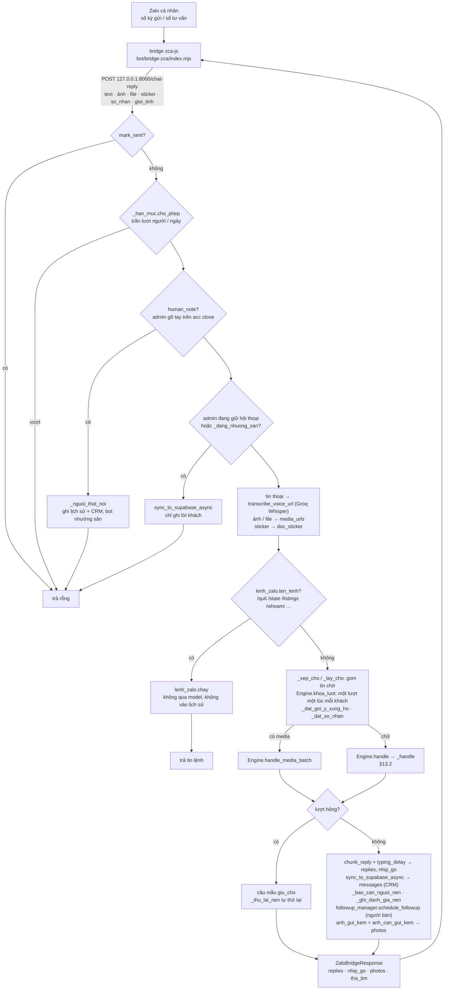
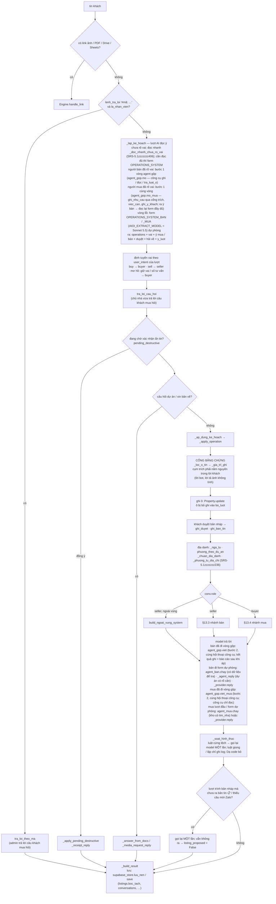
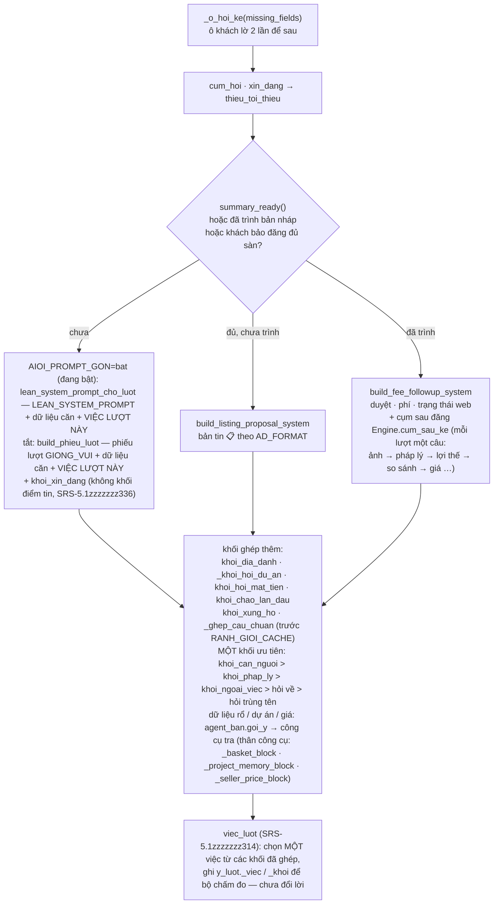
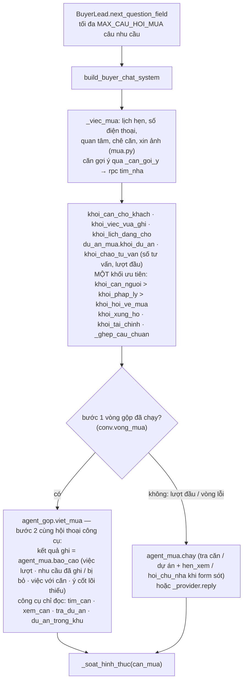

# 13 — Sơ đồ: một tin Zalo đi qua lõi Python

Bản cũ (chat-reply TypeScript, `zalo-webhook`, `inbound_ledger`, `required_facts`, 09/09/2026) xem `git log -- docs/13-so-do-nhan-va-boc-tach.md`.

Viết lại 28/10/2026 theo lõi Python `src/aioi/` (bộ não duy nhất từ 18/10/2026, SRS-5.1zzzzzzz31 / SRS-5.1zzzzzzz46)
`[nguồn: chủ dự án 28/10/2026, chat]`. Mỗi ô là một hàm có thật ở HEAD: `src/aioi/server.py` (`chat_reply`),
`src/aioi/engine.py` (`Engine.handle`, `Engine._handle`). Chỉ ghi bước thấy trong code; không có ô nào là "sẽ làm".
Kiến trúc chung: `docs/07-srs.md` §2. Không sinh ID.

Nguyên tắc xuyên suốt: **AI đọc ý theo nghĩa, code kiểm trích dẫn.** Ô tin chỉ ghi điều KHÁCH nói (SRS-5.1zzzzzzz73);
lời bot lệch luật hình thức thì gọi lại model một lần, không tự sửa chữ (`_soat_hinh_thuc`).

Sơ đồ vẽ đường DUY NHẤT đang chạy (cập nhật 02/11/2026 `[nguồn: engine.py, SRS-5.1zzzzzzz319]`): sáu công tắc `FORM_BAN_GON` / `FORM_MUA_GON`, `PHIEU_LUOT`, `AGENT_BAN` / `AGENT_MUA`, `SOAT_GON` đã gỡ hẳn cùng đường cũ (`build_chat_system`) —
form gọn, phiếu lượt, agent và soát gọn là đường duy nhất. Từ 03/11/2026 người bán đã rõ vai đi MỘT vòng agent gộp (`agent_gop.py`, SRS-5.1zzzzzzz371;
`AGENT_BOC` / `AGENT_GOP` gỡ); người mua đã rõ vai đi cùng vòng đó (`agent_gop.mo_mua` / `viet_mua`, SRS-5.1zzzzzzz380). Công tắc còn lại ở `bot/cau-hinh-loi.env` (chạy thật: `.env` lõi trên máy 146): `AIOI_MODEL_LUOT_DE` = tat; `AIOI_PROMPT_GON` = bat — lượt hỏi ô
người bán viết lời bằng `prompts.lean_system_prompt_cho_luot` (`LEAN_SYSTEM_PROMPT`) và bước ghi của vòng gộp dùng `prompts.co_dinh_ban` (cũng là
`LEAN_SYSTEM_PROMPT`); tắt thì về phiếu lượt `build_phieu_luot` / `phieu_co_dinh` (SRS-5.1zzzzzzz408 / 414). Model chat và bóc tách đều Sonnet 5.5 (SRS-5.1zzzzzzz392).

## 13.1 Toàn cảnh: từ bridge tới lời trả về

Hàm `server.chat_reply`, theo đúng thứ tự trong code.

## 13.2 Một lượt trong `Engine._handle`

`Engine.handle` chỉ đặt model thử cho ID thử (`model_chat_thu`, SRS-5.1zzzzzzz234) rồi gọi `_handle`.

## 13.3 Nhánh bán: chọn prompt

## 13.4 Nhánh mua

Bước 1 của lượt mua đã rõ vai (`_lap_ke_hoach` → `agent_gop.mo_mua`, SRS-5.1zzzzzzz380): system = `prompts.mua_co_dinh` (phần cố định của
`build_buyer_chat_system`, nguyên vẹn) + `agent_mua.HUONG_DAN_GHI` + `prompts.luat_doc_y_mua()` (nguyên form mua gọn, bỏ khung JSON) trước
`RANH_GIOI_CACHE`, dữ liệu lượt (dòng căn, nhu cầu) sau. Công cụ ghi gom vào kế hoạch cùng dạng form; engine áp qua đường cũ: ô nhu cầu
qua `Engine._loc_nhu_cau` (cụm trích nằm nguyên trong lời khách) rồi `_chon_nhu_cau` / `BuyerLead.update`, việc căn qua `_loc_viec_mua` →
`_viec_mua` (ghi_hen_xem gộp giờ, ghi_hoi_chu_nha chống câu trùng, xin số MỘT lần). `user_intent = "sell"` → đọc lại cả lượt bằng form đầy đủ.

Sau lượt, ảnh căn bot vừa dán link đi kèm qua `anh_can_gui_kem` (§13.1). Tin chủ động cho khách (nhắc, báo căn mới) không đi
đường này: lõi gửi qua `POST /send` của bridge (`gui_nhac.py`, `bao_can_moi.py`, `followup.py`), xem `docs/07-srs.md` §2.
Tin chủ động cho người bán SAU khi tin lên web (LQC) cũng gửi qua `/send`: vòng `hoi_sau_dang` dùng chung `Engine.cum_sau_ke` / `khoi_cum_sau` với lượt chat (§13.3, nhánh "đã trình"), vòng `qc_anh` chấm bộ ảnh — xem `docs/lqc-listing-quality-controller.md`.
