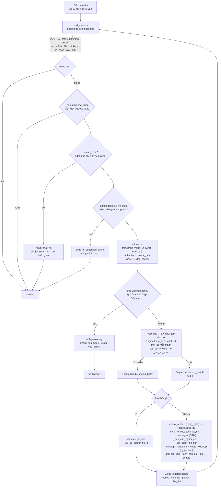
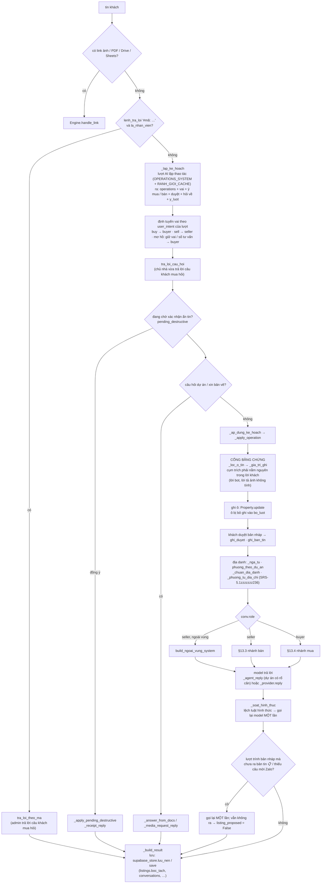
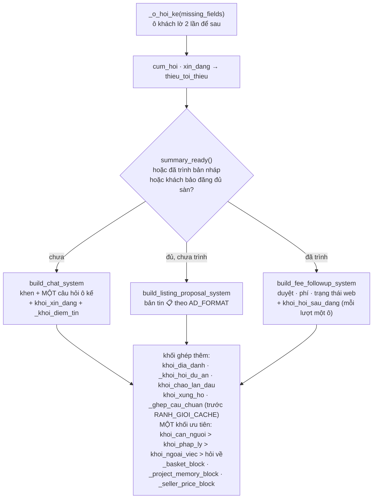
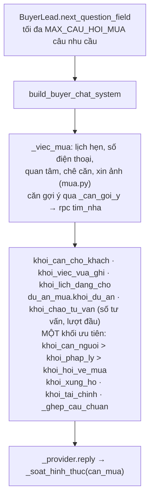

# 13 — Sơ đồ: một tin Zalo đi qua lõi Python

Bản cũ (chat-reply TypeScript, `zalo-webhook`, `inbound_ledger`, `required_facts`, 09/09/2026) xem `git log -- docs/13-so-do-nhan-va-boc-tach.md`.

Viết lại 28/10/2026 theo lõi Python `src/aioi/` (bộ não duy nhất từ 18/10/2026, SRS-5.1zzzzzzz31 / SRS-5.1zzzzzzz46)
`[nguồn: chủ dự án 28/10/2026, chat]`. Mỗi ô là một hàm có thật ở HEAD: `src/aioi/server.py` (`chat_reply`),
`src/aioi/engine.py` (`Engine.handle`, `Engine._handle`). Chỉ ghi bước thấy trong code; không có ô nào là "sẽ làm".
Kiến trúc chung: `docs/07-srs.md` §2. Không sinh ID.

Nguyên tắc xuyên suốt: **AI đọc ý theo nghĩa, code kiểm trích dẫn.** Ô tin chỉ ghi điều KHÁCH nói (SRS-5.1zzzzzzz73);
lời bot lệch luật hình thức thì gọi lại model một lần, không tự sửa chữ (`_soat_hinh_thuc`).

## 13.1 Toàn cảnh: từ bridge tới lời trả về

Hàm `server.chat_reply`, theo đúng thứ tự trong code.

## 13.2 Một lượt trong `Engine._handle`

`Engine.handle` chỉ đặt model thử cho ID thử (`model_chat_thu`, SRS-5.1zzzzzzz234) rồi gọi `_handle`.

## 13.3 Nhánh bán: chọn prompt

## 13.4 Nhánh mua

Sau lượt, ảnh căn bot vừa dán link đi kèm qua `anh_can_gui_kem` (§13.1). Tin chủ động cho khách (nhắc, báo căn mới) không đi
đường này: lõi gửi qua `POST /send` của bridge (`gui_nhac.py`, `bao_can_moi.py`, `followup.py`), xem `docs/07-srs.md` §2.
