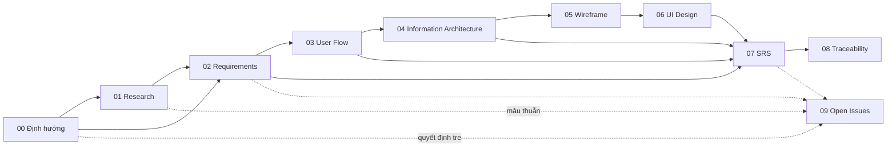

# Bộ tài liệu BA — nhadat.cc

Phiên bản: **v1.0** · Ngày: **2026-08-21** · Trạng thái: **Draft để review**

## Pipeline

## Mục lục

| File | Mô tả | Đối tượng đọc |
|---|---|---|
| [00-dinh-huong.md](00-dinh-huong.md) | **Định hướng (BRD hợp nhất Aioinhadat × nhadat.cc)** — thương hiệu Aioinhadat / AI Ơi Nhà Đất, trợ lý mỗi khách một tên (FR-181; nay 13 tên có chấm giữa, SRS-5.1zzzzzzz183); sản phẩm hôm nay là gì, giữ gì của bên nào, câu khách hỏi đi về chủ nhà rồi admin (CTV bỏ 28/10/2026), sao Bắc Đẩu, lộ trình, quyết định treo | Founder, PO, mọi người mới vào |
| [00-glossary.md](00-glossary.md) | Từ điển thuật ngữ | Tất cả |
| [01-research.md](01-research.md) | Bối cảnh thị trường, người dùng, đối thủ, ràng buộc | PO, Founder, Marketing |
| [02-requirements.md](02-requirements.md) | Mục tiêu KD, persona, FR/NFR | PO, Dev Lead, QA |
| [03-user-flows.md](03-user-flows.md) | 13 luồng end-to-end | UX, Dev, QA |
| [04-information-architecture.md](04-information-architecture.md) | Sitemap, URL/SEO, content model | UX, SEO, Dev |
| [05-wireframes.md](05-wireframes.md) | Wireframe low-fi 14 màn hình | UX, UI, Dev |
| [06-ui-design.md](06-ui-design.md) | Design system + tone giọng chat | UI, Dev, Content |
| [07-srs.md](07-srs.md) | Đặc tả kỹ thuật: kiến trúc, DB, API, NFR; nhật ký sửa từ 26/10/2026 | Dev, QA, Vendor |
| [07-srs-luu-tru.md](07-srs-luu-tru.md) | Nhật ký sửa cũ (ngoài 10 mục mới nhất) — lưu trữ, chỉ tra cứu | Dev |
| [02-requirements-luu-tru.md](02-requirements-luu-tru.md) · [08-traceability-luu-tru.md](08-traceability-luu-tru.md) · [10-ke-hoach-kiem-thu-luu-tru.md](10-ke-hoach-kiem-thu-luu-tru.md) | Bản đầy đủ cũ của 02 §2.4 (FR), 08 §8.3 (ma trận), 10 §10.7 (bộ test đã ngừng) — lưu trữ, chỉ tra cứu (30/10/2026) | Dev |
| [08-traceability.md](08-traceability.md) | Ma trận truy vết | PO, QA |
| [09-open-issues.md](09-open-issues.md) | 67 vấn đề (cả 67 đã chốt hoặc đã đóng — đợt 28/10/2026 đóng các mục mất đối tượng khi gỡ phần TypeScript và bỏ CTV, chủ dự án chốt nốt 11 mục còn chờ; 0 còn chờ) | Founder, PO |
| [10-ke-hoach-kiem-thu.md](10-ke-hoach-kiem-thu.md) | Kế hoạch kiểm thử 4 tầng (suite TS-*) | QA, Dev, PO |
| [11-quy-trinh.md](11-quy-trinh.md) | **Quy trình BA và tester** — hai vòng làm việc, ba cổng, máy kiểm gì / người kiểm gì, định nghĩa XONG | Tất cả |
| [SRD-AI-Oi-Nha-Dat.docx](SRD-AI-Oi-Nha-Dat.docx) | **SRD gộp (.docx)** — bản đọc nhanh theo bố cục SRD Aioinhadat 06/2026 (7 mục I–VII + đối chiếu + còn treo + thư viện kịch bản + hội thoại giả lập 30 câu). **Bản xuất, không phải nguồn sự thật**: sinh từ các file md ở đây bằng `bun run srd` (`scripts/sinh-srd-docx.mjs`, 06/10/2026 theo yêu cầu chủ dự án "đổi thành đuôi docx như bên AOND"); sửa nội dung thì sửa md rồi sinh lại, không sửa tay file .docx | Sếp, chủ dự án, người mới, đối tác đọc một lần |
| [13-so-do-nhan-va-boc-tach.md](13-so-do-nhan-va-boc-tach.md) | **Sơ đồ: một tin Zalo đi qua lõi Python** (viết lại 28/10/2026, cập nhật 02–03/11) — bridge → `server.chat_reply` → `Engine.handle`; người bán / người mua đã rõ vai đi một vòng agent gộp (`agent_gop.py`); AI đọc ý theo nghĩa, code kiểm trích dẫn. Mỗi ô là hàm có thật ở HEAD. Mermaid, không sinh ID | Dev, chủ dự án |
| [lqc-listing-quality-controller.md](lqc-listing-quality-controller.md) | **LQC — người chăm tin sau đăng** (12/11/2026): bot hỏi chủ nhà gì, khi nào, luật không nhắn, trạng thái 22 câu mẫu (ảnh · pháp lý · lợi thế · so sánh) | PO, tester, người viết đặc tả |
| [14-tinh-nang-tai-chinh-thue-phi-lead.md](14-tinh-nang-tai-chinh-thue-phi-lead.md) | **Tính năng Tài chính, Thuế phí chuyển nhượng, Bộ lọc Bán nhanh & Bảo toàn Lead SĐT** (06/11/2026, SRS-5.1zzzzzzz388) — Năng lực chọn lọc từ MOSO đưa vào Zalo Chatbot 1:1, bảo toàn 500 MB Supabase Free (0 byte DB) | Dev, BA, PO |

## Đọc từ đâu

- **Founder / nhà đầu tư** → `00-dinh-huong` rồi `01`, rồi `09`.
- **Vendor phát triển (Vitalify)** → `07` là hợp đồng kỹ thuật; `02` là phạm vi.
- **Designer** → `03` → `04` → `05` → `06`.
- **QA** → `02` (FR/NFR) + `08` (truy vết) để dựng test case.

## Trạng thái từng tầng

| Tầng | Độ đầy đủ | Chặn bởi |
|---|---|---|
| 00 Định hướng | Không tự chấm % (soát lại 28/10/2026 theo lõi Python và quyết định bỏ CTV; dọn khớp code 13/11/2026, v1.6, SRS-5.1zzzzzzz464) — tên, địa bàn, vùng nhận tin đã chốt; bớt kế thừa nhadat.cc (OPEN-48) đã chốt, các trang web còn chạy giữ theo code | — (0 OPEN chờ) |
| 01 Research | Thiếu số liệu thị trường sơ cấp (OPEN-01 đóng 07/09 — kế hoạch 2024) | — |
| 02 Requirements | FR/NFR khớp code tới 13/11/2026; tính năng sau 18/10 ghi theo SRS | — |
| 03 User Flow | Bỏ CTV 28/10/2026, lịch xem đi thẳng admin | — |
| 04 IA | 100 tag theo quận / huyện (SRS-5.1zzzzzzz433); TOP-100 keyword gốc không có file (OPEN-06 đóng) | — |
| 05 Wireframe | Low-fi 14 màn hình (ASCII) | — |
| 06 UI Design | Theme KingTheme đã chốt (OPEN-07); token thật ở `app/globals.css` | — |
| 07 SRS | Lõi Python `src/aioi/` là bộ não duy nhất; 10 mục SRS mới nhất ở `07`, cũ ở `07-srs-luu-tru` | — |
